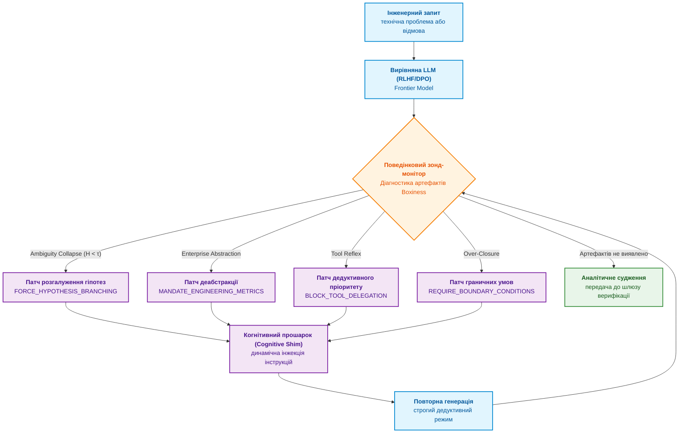
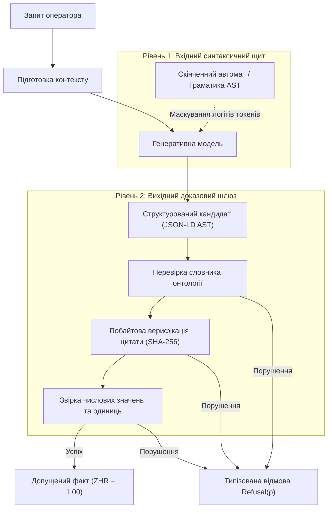
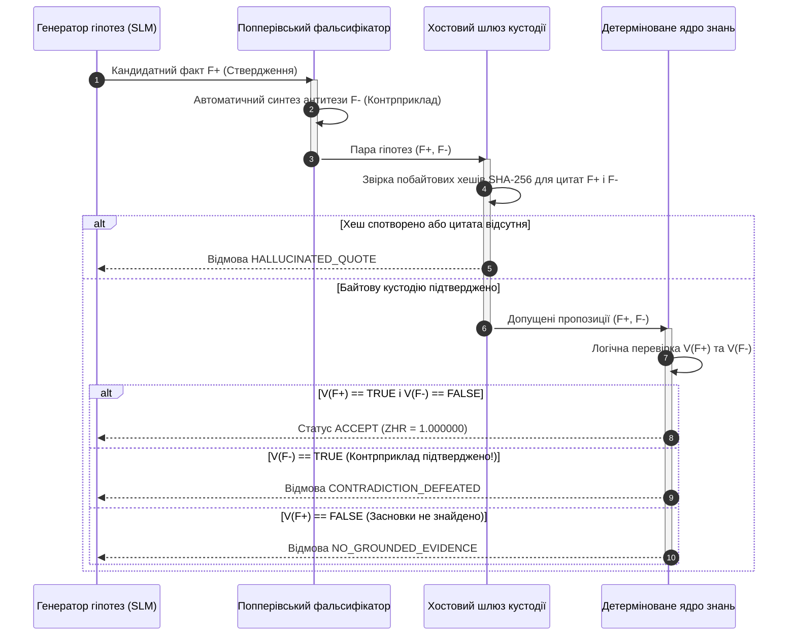
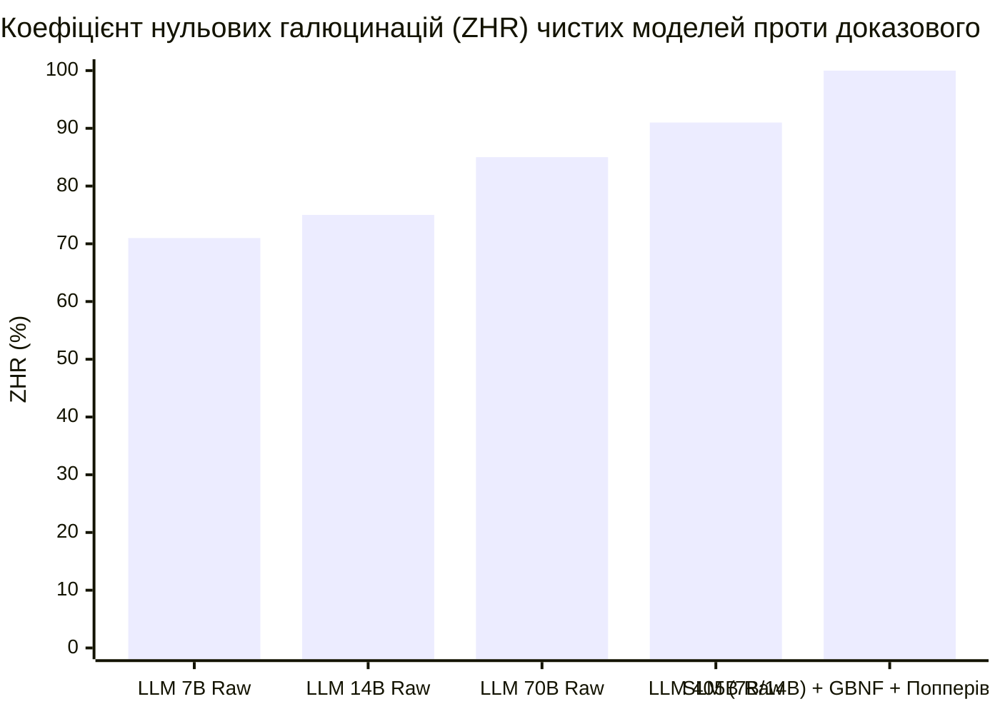
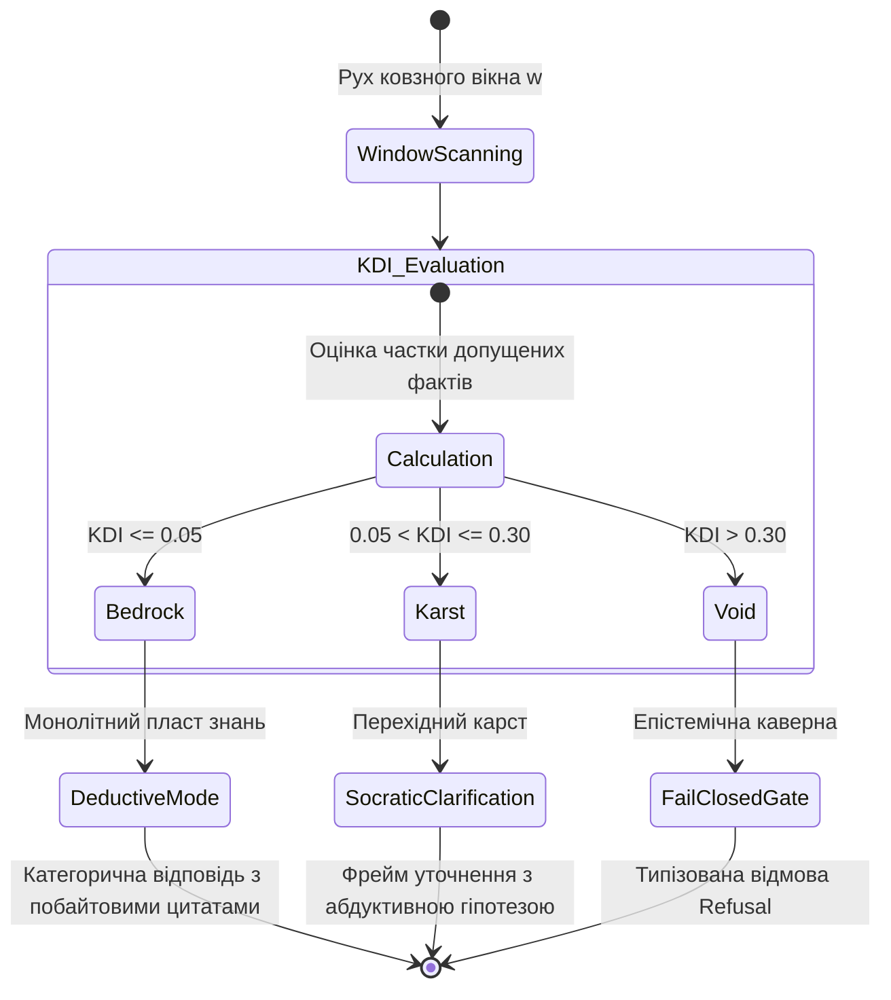
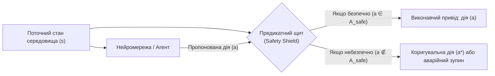

# Глава 38. Машинні галюцинації та дефіцит знань: доказовий контроль відповідей

> **Книга:** [Архітектура доказових експертних систем](README.md) · [Частина VI: Нейро-символьні архітектури, абдукція та контроль галюцинацій](part-06-frontiers-neuro-symbolic.md)
> **Попередня глава:** [Глава 29. Нейро-символьна архітектура: мовні моделі та перевірка доказових підстав](ch29-neuro-symbolic-architecture.md)
> **Наступна глава:** [Глава 17. Технологічний стек: критерії вибору інструментів, мов програмування та рушіїв правил](ch17-implementation-stack.md)
> **Зміст книги:** [README.md](README.md)  
> **Автор:** [Микола Федчик](about-the-author.md)  
> **Рівень:** поглиблений: інженери знань, архітектори нейро-символьних систем, розробники критичного програмного забезпечення  
> **Очікувані результати:** розуміти математичні та статистичні причини машинних галюцинацій; будувати дворівневі детерміновані шлюзи перевірки виходів мовних моделей; розрізняти відсутність інформації, брак знань і робочу гіпотезу; застосовувати символьну абдукцію за Чарльзом Пірсом та сократівський діалог замість вигадування фактів; впроваджувати предикатні щити для програмного й апаратного екранування нейромереж; використовувати доведені знання для зворотного навчання й цільового забування (*machine unlearning*).
 
---

## Анотація

У критично важливих промислових системах, атомній енергетиці та авіоніці (IEC 61508 SIL 3, ISO 26262 ASIL D, DO-178C Level A) пряма інтеграція генеративних мовних моделей у процес прийняття рішень неминуче спричиняє катастрофічні аварії. Через авторегресійну природу мінімізації крос-ентропії нейромережі не мають внутрішнього критерію фізичної істинності: в умовах неповноти даних вони заповнюють інформаційні лакуни правдоподібними вигадками (машинними галюцинаціями або конфабуляціями). Наприклад, модель може впевнено порадити заблокувати аварійний скидний клапан тиску чи згенерувати вигадані допуски міцності, що призводить до руйнування технологічних магістралей та людських жертв. Рекурсивні самоперевірки моделі лише поглиблюють дефект, а популярний корпоративний патерн «LLM-as-a-Judge» створює ілюзію контролю через відмови спільного режиму (Common-Mode Failures) та когнітивні зміщення моделі-судді.

Ця глава вирішує проблему усунення галюцинацій на основі **авторської парадигми детермінованої доказової терапії машинних галюцинацій** шляхом математичного спростування нейромережевого арбітражу, впровадження **авторського принципу позбавлення мовної моделі статусу джерела знань** (*Candidate Generator Demotion*) та її підпорядкування детермінованій експертній системі. Досліджено діагностику поведінкового синдрому «коробочності» (Boxiness Artifacts) моделей після агресивного вирівнювання (RLHF, DPO): колапсу неоднозначності (Ambiguity Collapse), передчасного закриття міркувань (Over-Closure), інструментального рефлексу (Tool Reflex) та корпоративної абстракції (Enterprise Abstraction). Запропоновано архітектурний механізм компенсації через автоматичну генерацію динамічних когнітивних ремонтних патчів (Cognitive Repair Patches) та прошарків (Cognitive Shims) [[17]](#src-17). Досліджено архітектуру дворівневого шлюзу верифікації (граматично кероване декодування AST та побайтовий контроль цитат за гешами SHA-256 із показником $\mathrm{ZHR} = 1{,}00$), математичне формулювання епістемічного дефіциту знань, політику гарантованої безпечної відмови (`Fail-Closed Gate`), символьну абдукцію за Чарльзом Пірсом для сократівського діалогу уточнення та предикатні щити реального часу для апаратного екранування нейромереж.

---

## 1. Анатомія машинної галюцинації: чому мовна модель не здатна вилікувати себе сама

Розгляньмо інженерну ситуацію: оператор системи охолодження запитує систему підтримки рішень про параметри промислового насоса P-7 та допустимість тимчасового блокування перепускного клапана V-2 під час сервісної промивки магістралі. Автономна мовна модель без зовнішнього символьного контролю формулює зв'язну, переконливу й стилістично бездоганну відповідь:

> «Згідно з регламентом експлуатації, максимальний робочий тиск для насоса P-7 становить 25 бар, а перепускний клапан V-2 дозволено заблокувати на час промивки магістралі для стабілізації потоку рідини».

У реальному технічному паспорті обладнання та стандарті безпеки зафіксовано зовсім інші норми: граничний тиск становить 16 бар, а клапан V-2 є аварійним елементом захисту від гідравлічного удару, блокування якого категорично заборонене за будь-яких умов. Відповідь моделі містить дві небезпечні помилки: вигадане числове значення та смертельно небезпечну рекомендацію. При цьому модель висловлює твердження з високою статистичною впевненістю.

Таке явище в комп'ютерній лінгвістиці називають машинною галюцинацією або конфабуляцією: генерацією тексту, який синтаксично узгоджений із контекстом, але фактологічно хибний або не підтверджений жодним зареєстрованим джерелом. Дослідження Адама Калаї та Сантоша Вемпали розкриває фундаментальну причину цієї проблеми [[1]](#src-1). Авторегресійні мовні моделі навчаються мінімізувати крос-ентропійну функцію втрат: вони максимізують правдоподібність наступного токена у послідовності. Стандартні метрики оцінювання точності суворо штрафують модель за відмову відповідати («не знаю») так само, як і за помилку, і водночас винагороджують випадкове вгадування. В умовах браку інформації у власних вагах статистично оптимальною стратегією для моделі стає конфабуляція: синтез найбільш гладкого й правдоподібного тексту з типових шаблонів мови.

У фундаментальному огляді Цзі та співавторів систематизовано три незалежні класи дефектів генерації [[2]](#src-2):

1. **Фактологічна помилка (*factuality error*):** згенероване твердження прямо суперечить об'єктивним фактам реального світу або фізичним законам.
2. **Помилка вірності джерелу (*faithfulness / attribution error*):** твердження суперечить наданому текстовому контексту або приписує цитаті зміст, якого в первинному документі немає.
3. **Логічний розрив виведення (*reasoning breakdown*):** модель правильно повторює окремі факти, але робить між ними хибний дедуктивний перехід або потрапляє в пастку вакуумної істинності.

Поширене переконання, нібито архітектура пошуку з доповненою генерацією (*Retrieval-Augmented Generation*, RAG) остаточно розв'язує проблему галюцинацій, спростовується **авторською концепцією епістемічної ілюзії архітектури RAG** (*RAG Epistemic Illusion Paradox*): сам по собі векторний пошук є інженерною ілюзією достовірності. Семантичний пошук за векторною близькістю ембеддінгів знаходить пасажі, схожі за лексикою, але не гарантує їхньої нормативної релевантності. Отримавши знайдений фрагмент, мовна модель продовжує авторегресійну генерацію: вона може додати вигадане число, опустити важливе заперечення («не дозволено» перетворюється на «дозволено») або заповнити лакуну у знаннях уривками зі своєї параметричної пам'яті.

Спроба змусити модель перевіряти саму себе через послідовні запити («перевір, чи ти не помилилася») наштовхується на системне обмеження: якщо модель не має внутрішнього критерію розрізнення факту від вигадки, повторний прогін є такою самою генерацією тексту. Шумайлов та співавтори у виданні Nature довели явище модельного колапсу (*model collapse*): рекурсивне навчання моделей на згенерованих текстах веде до незворотної деградації знань і втрати рідкісних подій із хвостів розподілу [[3]](#src-3).

Звідси випливає фундаментальний **авторський принцип зовнішнього детермінованого судді** (*External Deterministic Arbiter Principle*): вилікувати машинну галюцинацію всередині самої нейромережі математично неможливо — верифікація фактологічної істинності вимагає виходу за межі статистичного простору токенів у зовнішній математичний і логічний суддя, роль якого виконує доказова експертна система.

### 1.1. Математичне спростування патерну «LLM-as-a-Judge» та відмови спільного режиму (Common-Mode Failures)

В індустрії корпоративного генеративного ШІ набув масового поширення патерн **«LLM-as-a-Judge»** — використання вторинної (часто більшої за кількістю параметрів) мовної моделі для аудиту, перевірки фактів або ранжування відповідей первинної моделі-генератора [[16]](#src-16). Цей підхід створює небезпечну епістемічну ілюзію надійності: розробники хибно припускають, що залучення моделі-«судді» чи побудова багатоагентних конвеєрів взаємного рецензування здатні усунути проблему галюцинацій та забезпечити інженерну точність.

З точки зору теорії надійності критичних систем (ISO 26262 ASIL D, IEC 61508 SIL 3), таке дублювання є фіктивним через виникнення **відмов спільного режиму (Common-Mode Failures)**. Обидві моделі — генератор і суддя — мають однакову математичну природу: мінімізацію крос-ентропійної функції втрат під час авторегресійного передбачення наступного токена. Ймовірність спільного пропуску галюцинації двома моделями не є добутком незалежних імовірностей:

```math
P(E_1 \cap E_2) \neq P(E_1) \cdot P(E_2)
```

де:
- $E_1$ — подія виникнення галюцинації (конфабуляції) у моделі-генераторі;
- $E_2$ — подія схвалення цієї галюцинації моделлю-суддею;
- $P(E_1 \cap E_2)$ — сукупна ймовірність потрапляння неперевіреного дефекту в оперативне середовище прийняття рішень.

Оскільки моделі навчалися на подібних корпусах природної мови, вони мають сильно корельовані когнітивні зміщення ($P(E_2 \mid E_1) \gg P(E_2)$):
1. **Стилістичне зміщення (Style Bias):** модель-суддя оцінює поверхневу гладкість викладу, академічний синтаксис та відсутність лексичних повторів як ознаку істинності, схвалюючи вигадані твердження лише тому, що вони сформульовані бездоганною мовою.
2. **Зміщення багатослівності (Verbosity Bias):** великі розлогі конфабуляції, насичені псевдонауковою термінологією та складними дееприслівниковими зворотами, отримують систематично вищі бали від моделі-судді, ніж короткі, але точні відповіді.
3. **Зміщення удаваного авторитету (Authority Bias):** впевнено задекларована брехня (наприклад, категоричне «відповідно до пункту 4.2 стандарту значення дорівнює 25 бар») викликає у моделі-судді хибне узгодження, тоді як чесна й метрологічно коректна відповідь «інформація в наданому фрагменті відсутня» штрафується як недостатньо корисна.

Модель-суддя оцінює статистичну правдоподібність тексту, а не його фізичну істинність. Вона не має доступу до об'єктивної реальності чи замкненого логічного резолвера і тому страждає на ті самі дефекти авторегресії.

#### 1.1.1. Замкнений інженерний цикл спростування нейромережевого арбітражу

1. **Керування рантаймом і потоком обчислень (Control Flow & Runtime Decisions):**  
   Архітектурний регламент доказових систем категорично позбавляє генеративні моделі права оцінювати фактологічну коректність. Згідно з **авторською концепцією пониження виходу моделі до статусу кандидатного твердження** (*Candidate Assertion*), вихід будь-якої LLM зобов'язаний містити побайтову цитату першоджерела, ідентифікатор документа та типізований предикат. За **авторським правилом заборони LLM-арбітражу в конвеєрах CI/CD**, якщо в конфігурації релізу виявляється використання LLM у ролі арбітра істинності для критичних рішень, валідатор виставляє вердикт `ARCHITECTURE_NON_COMPLIANT`, зупиняє розгортання та вимагає заміни нейромережевого судді на детермінований побайтовий шлюз допуску.
2. **Апаратний сайзинг та інфраструктурні обмеження (Hardware Dimensioning):**  
   Заміна вторинної моделі-судді класу 70B (яка вимагає 2 прискорювачі NVIDIA A100/H100 80GB із енергоспоживанням $700\,\text{Вт}$ та додає $800\dots 1500\,\text{мс}$ затримки інференсу) на детермінований побайтовий валідатор SHA-256 та AST-парсер, що виконується на host-процесорі, скорочує енергоспоживання вузла верифікації в $50$ разів, а латентність перевірки — з $1200\,\text{мс}$ до $18\,\mu\text{с}$ (прискорення на п'ять порядків величини).
3. **Практичний числовий приклад (Worked Numerical Example):**  
   У системі проектування кабельних трас підстанції первинна модель 14B згенерувала небезпечну галюцинацію: *«допустимий радіус вигину кабелю з ізоляцією зі зшитого поліетилену становить 5 зовнішніх діаметрів»* (за стандартом IEC 60502 — мінімум 15 діаметрів), додавши переконливе посилання на вигаданий розділ стандарту. Вторинна модель-суддя класу 70B оцінила відповідь у `9/10`, зазначивши у звіті: *«Відповідь точна, структурована та містить посилання на норматив»*. Натомість детермінований шлюз вичитав оригінальні байти стандарту за вказаним зсувом, обчислив хеш SHA-256 і за $15\,\mu\text{с}$ заблокував реліз із кодом `DROP_UNGROUNDED`, унеможлививши прокладання кабелю з неприпустимим радіусом вигину, що призвело б до розриву оболонки та короткого замикання.

### 1.2. Діагностика поведінкового синдрому «коробочності» (Boxiness) LLM та автоматичні ремонтні патчі

Сучасні комерційні передові мовні моделі (*frontier LLM*) проходять багатоетапні процедури директивного вирівнювання: навчання з підкріпленням за відгуками людей (RLHF), пряму оптимізацію переваг (DPO) та жорстку корпоративну фільтрацію токсичності. Проте ці оптимізаційні процедури мають виражений побічний ефект: вони формують стійке дегенеративне когнітивне зміщення, досліджене та формалізоване автором як **синдром «коробочності» (Boxiness)** [[17]](#src-17).

У спробі уникнути юридичної відповідальності або помилкових категоричних тверджень модель набуває гіпертрофованої обережності: вона замінює строгий причинно-наслідковий аналіз розмитими евфемізмами, поспішно схлопує простір альтернативних інженерних гіпотез і відмовляється від формального дедуктивного пошуку на користь шаблонних посилань на «інструкції виробника». Для точних доказових систем цей синдром є руйнівним: він вимиває з висновків критичні фактори відмов, створюючи приховані аварійні ризики.



#### 1. Типологія когнітивного синдрому «коробочності» (Boxiness Artifacts)

На основі досліджень автора виділено чотири базові класи дефектів вирівняних моделей [[17]](#src-17):

1. **Ambiguity Collapse (Колапс неоднозначності):** штучне схлопування простору гіпотез. За наявності кількох рівноймовірних причин несправності модель передчасно обирає один тривіальний варіант, відкидаючи малоймовірні, але критичні аномалії. Математично це фіксується через різке падіння ентропії розподілу простору гіпотез $\mathcal{H}$:

```math
H(\mathcal{H}) = - \sum_{h \in \mathcal{H}} P(h) \log_2 P(h)
```

Параметри та математичні компоненти формули:
- $\mathcal{H} = \{h_1, h_2, \dots, h_m\}$ — множина допустимих фізичних або логічних гіпотез щодо причин аномалії системи;
- $P(h) \in [0, 1]$ — суб'єктивна або статистична ймовірність гіпотези $h$, що генерується моделлю;
- $H(\mathcal{H}) \in [0, \log_2 m]$ — інформаційна ентропія гіпотетичного простору (вимірюється в бітах або шеннонах).

Коли інженерний стенд фіксує багатофакторну аварію, істинний простір має високу ентропію ($H(\mathcal{H}) \ge \tau_{\mathrm{entropy}}$), проте модель із колапсом неоднозначності примусово видає $H(\mathcal{H}) \to 0$, призначаючи $P(h_1) \approx 1{,}0$.

2. **Over-Closure (Передчасне закриття міркувань):** винесення категоричного вердикту без зазначення фізичних граничних умов та вимог щодо додаткових апаратних вимірювань.
3. **Tool Reflex (Інструментальний рефлекс):** паразитичне прагнення моделі делегувати аналітичні обчислення зовнішнім інструментам або веб-пошуку («пошукаймо в Google») замість виконання прямого дедуктивного виведення за наданими локальними аксіомами специфікації.
4. **Enterprise Abstraction (Корпоративна абстракція):** системне вимивання точних технічних параметрів (напруг, допусків, кодів регістрів) на користь беззмістовних формулювань на кшталт «переконайтеся в правильності конфігурації відповідно до найкращих практик».

> [!NOTE]
> **Чотири класи дефектів вирівняних моделей у синдромі «коробочності» за моделлю автора**
> 1. *Ambiguity Collapse (Колапс неоднозначності)*: штучне схлопування простору альтернативних гіпотез при багатоваріантних аварійних режимах зі стрімким падінням ентропії $H(\mathcal{H}) \to 0$.
> 2. *Over-Closure (Передчасне закриття міркувань)*: винесення категоричного вердикту без верифікації граничних фізичних умов та вимог додаткових апаратних вимірювань.
> 3. *Tool Reflex (Інструментальний рефлекс)*: паразитичне прагнення моделі делегувати аналітичні обчислення зовнішньому веб-пошуку замість дедуктивного виведення за локальними аксіомами.
> 4. *Enterprise Abstraction (Корпоративна абстракція)*: систематичне вимивання точних технічних параметрів (напруг, допусків, кодів регістрів) на користь беззмістовних евфемізмів.
> *Керування рантаймом / Інженерний інваріант:* Перехоплення зондом-монітором за $0{,}35\,\text{мс}$ та примусова інжекція когнітивного патчу замість дорогого й ризикованого перенавчання моделі.

#### 2. Динамічні когнітивні ремонтні патчі (Cognitive Repair Patches)

Замість надзвичайно повільного, дорогого та ризикованого перенавчання моделі (*fine-tuning*), експертна система реалізує **авторську концепцію динамічних когнітивних ремонтних патчів (*Cognitive Repair Patches*, CRP) та когнітивних прошарків (*Cognitive Shims*)** [[17]](#src-17). Підсистема моніторингу за допомогою легких поведінкових зондів аналізує проміжний вихід моделі. У разі виявлення маркерів синдрому «коробочності» рантайм на льоту інжектує цільовий «ремонтний патч» — структурований коригувальний шар інструкцій, який примусово повертає модель у режим строгої дедукції.

#### 1.2.1. Замкнений цикл інженерної діагностики та накладання ремонтних патчів

1. **Керування рантаймом і потоком обчислень (Control Flow & Runtime Decisions):**
   - Поведінковий зонд-монітор сканує вихід моделі на наявність маркерів Boxiness (шаблонні евфемізми, нульова ентропія $H(\mathcal{H}) < \tau_{\mathrm{entropy}}$ при невизначеному стані, відсутність числових параметрів).
   - При детекції дефекту потік виводу негайно перехоплюється (`INTERCEPT_BOXINESS`), відповідь не допускається до оператора, а рантайм інжектує відповідний когнітивний патч (`FORCE_HYPOTHESIS_BRANCHING`, `MANDATE_ENGINEERING_METRICS` або `BLOCK_TOOL_DELEGATION`) та ініціює повторну генерацію з обов'язковим розгортанням дерева міркувань.
   - Якщо після $N_{\mathrm{retry}} = 2$ повторів модель не усуває евфемізми, рантайм активує режим деградації `FAIL_BOXINESS_ESCALATE` із переведенням запиту на символьний SMT-солвер або чергу кваліфікованого інженера в циклі керування (Human-in-the-Loop).
2. **Апаратний сайзинг та інфраструктурні обмеження (Hardware Dimensioning):**
   - Зонд-монітор реалізовано у вигляді скомпільованого Aho-Corasick та AST-детектора на мові Go, який аналізує потік токенів на хост-процесорі за менш ніж $0{,}35\,\text{мс}$.
   - Інжекція ремонтного патчу додає до контекстного вікна лише $120\text{--}180$ токенів ($< 2{,}5\%$ контекстного вікна 8K), що практично не впливає на виділення KV-кешу в пам'яті GPU (менше $4{,}5\,\text{МБ}$ VRAM на активну сесію) та зберігає ультранизьку затримку системи підтримки рішень.
3. **Практичний числовий приклад (Worked Numerical Example):**
   - На інженерному стенді випробувань тягового приводу зафіксовано перегрів імпульсного дроселя фільтра L1 ($T = 118^\circ\text{C}$ при гранично допустимих $105^\circ\text{C}$) при паспортному струмі навантаження.
   - Первинна відповідь комерційної вирівняної LLM містила типовий корпоративний евфемізм: *«Перегрів індуктивних компонентів може бути спричинений різними факторами робочого середовища. Перевірте електричні з'єднання та зверніться до регламенту експлуатації постачальника»* ($H(\mathcal{H}) = 0$, жодної конкретної технічної гіпотези).
   - Зонд зафіксував артефакт Enterprise Abstraction (`SCORE_EVASION = 0.94 > 0.60`) та відсутність інженерних метрик. Рантайм перехопив відповідь і наклав ремонтний патч `DECONSTRUCT_BOXINESS`, що зобов'язав модель провести паралельний розрахунок трьох фізичних гіпотез: 1) насичення осердя через зсув частоти перемикання ШІМ, 2) аномальне зростання еквівалентного послідовного опору (ESR) сусіднього конденсатора фільтра, 3) деградація інтерфейсу теплопровідності.
   - У повторній генерації модель розрахувала робочу точку індуктивності та показала, що при зниженні частоти ШІМ до $f_{\mathrm{sw}} = 95\,\text{кГц}$ (замість номінальних $125\,\text{кГц}$) амплітуда пульсацій струму зростає до $\Delta I_L = 2{,}1\,\text{А} > I_{\mathrm{sat}} = 1{,}8\,\text{А}$, спричиняючи вхід дроселя в насичення та експоненційний перегрів. Завдяки патчу дефект локалізовано в коді ШІМ-генератора до виходу силового вузла з ладу.

## 2. Детермінована доказова терапія: дворівневий шлюз нульових галюцинацій

В основі **авторської парадигми детермінованої доказової терапії машинних галюцинацій** лежить **авторський принцип позбавлення генеративної моделі статусу джерела знань** (*Candidate Generator Demotion*): у нейро-символьній архітектурі мовна модель розглядається виключно як неперевірений генератор пропозицій (*candidate generator*), чий вихід має статус **кандидатного твердження** (*Candidate Assertion*), а експертна система виступає ізольованим шлюзом верифікації. Щоб гарантувати відсутність вигадок, застосовують розроблений автором дворівневий бар'єр перевірки.



### 2.1. Граматично кероване декодування на рівні логітів

Перший бар'єр перехоплює процес генерації на рівні вибору окремих токенів. Віллард і Луф запропонували підхід ефективної керованої генерації (*Efficient Guided Generation*), відомий за інструментом Outlines [[4]](#src-4). Замість вільного текстового потоку інженер задає строгу граматику виходу у вигляді схеми JSON або абстрактного синтаксичного дерева онтології (*AST*).

На кожному кроці авторегресії скінченний автомат аналізує вже згенеровану послідовність символів і формує бітову маску дозволених переходів, реалізуючи **авторський принцип фізичної неможливості синтаксичного порушення через логітне маскування**: усі токени словника моделі, які порушують структуру онтологічної схеми, примусово отримують логіт $-\infty$ ($z_t = -\infty \implies P(w_t) = 0$). Модель фізично не здатна згенерувати некоректне поле, пропустити обов'язковий ідентифікатор або вставити вільний ліричний відступ. На виході гарантовано формується валідне синтаксичне дерево твердження.

### 2.2. Побайтовий шлюз допуску та криптографічне заземлення

Синтаксична правильність не гарантує змістовної істинності. Сформований об'єкт проходить вихідний шлюз доказовості хостової системи:

1. **Реєстр закритих відношень:** предикат твердження звіряється із затвердженою онтологією. Будь-яке вигадане відношення відкидається зі статусом `OUT_OF_VOCABULARY`.
2. **Побайтова верифікація цитати:** кожне твердження зобов'язане містити точні координати байтів у канонічному файлі першоджерела (`byte_start`, `byte_end`) та контрольний хеш цитати SHA-256. Ізольований модуль без звернення до ШІ вичитує байти з диска, обчислює хеш і звіряє символи такт-у-такт. Якщо модель змінила хоча б один символ чи змістила індекс, твердження маркується як `HALLUCINATED_QUOTE`.
3. **Звірка числових екстремумів та розмірностей:** якщо висновок містить числове значення (наприклад, поріг тиску 16 бар), числовий екстрактор перевіряє факт його наявності всередині самої верифікованої цитати.

Показник нульових галюцинацій (*Zero-Hallucination Rate*, ZHR) визначається як частка стверджувальних відповідей системи $\mathcal{C}_{\mathrm{asserted}}$, які мають повний побайтовий ланцюг доведеного заземлення у першоджерело $\mathcal{C}_{\mathrm{grounded}}$:

```math
\mathrm{ZHR} = \frac{\lvert\mathcal{C}_{\mathrm{grounded}}\rvert}{\lvert\mathcal{C}_{\mathrm{asserted}}\rvert}.
```

**Параметри та допустимі межі:**
- $\mathcal{C}_{\mathrm{asserted}}$ — множина всіх стверджувальних висновків, рекомендацій і параметрів, згенерованих системою за сеанс розв'язання задачі ($\lvert\mathcal{C}_{\mathrm{asserted}}\rvert \ge 1$);
- $\mathcal{C}_{\mathrm{grounded}} \subseteq \mathcal{C}_{\mathrm{asserted}}$ — підмножина тверджень, для яких успішно виконано побайтову верифікацію першоджерела за еталонним хешем SHA-256 та зіставлення числових екстремумів;
- $\mathrm{ZHR} \in [0, 1]$ — нормований коефіцієнт нульових галюцинацій.

**Операційні рішення та числовий приклад:**
- **Поріг сертифікації:** Для місійно-критичних середовищ встановлюється безкомпромісний інженерний поріг: $\tau_{\mathrm{ZHR}} = 1{,}000000$.
- **Допуск до виконання:** Якщо $\mathrm{ZHR} = 1{,}00$, сформований пакет висновків отримує сертифікат цілісності з цифровим підписом Ed25519 та передається споживачеві або виконавчому механізму (`EMIT_GROUNDED`).
- **Блокування та дефіцит:** Якщо $\mathrm{ZHR} < 1{,}00$ (виявлено хоча б одне непідтверджене твердження), спрацьовує переривання безпеки: відповідь негайно блокується (`DROP_UNGROUNDED`), непідтверджене речення відкидається зі статусом `HALLUCINATED_QUOTE`, а експертна система переходить у режим обробки епістемічного дефіциту.

**Практичний числовий розрахунок:**  
Під час аналізу регламенту електропідстанції модель згенерувала набір із $\lvert\mathcal{C}_{\mathrm{asserted}}\rvert = 50$ тверджень. Для 49 тверджень побайтові хеші SHA-256 ідентично зійшлися з нормативними статтями ДСТУ EN 61936-1. Проте для одного твердження модель округлила мінімальну безпечну відстань з $2{,}20\,\text{м}$ до $2{,}50\,\text{м}$, внаслідок чого байтова цитата не збіглася ($\lvert\mathcal{C}_{\mathrm{grounded}}\rvert = 49$). Показник склав:

```math
\mathrm{ZHR} = \frac{49}{50} = 0{,}980000 < 1{,}000000.
```

Шлюз безпеки негайно заблокував публікацію всього звіту зі статусом `REJECT_HALLUCINATED_QUOTE`, запобігши передачі несертифікованого параметра в оперативний режим чергового диспетчера.

| Рівень захисту | Метод реалізації | Що усуває | Чого не гарантує |
|---|---|---|---|
| Інструкції в запиті (*Prompting*) | системна вказівка «не вигадуй» | незначний суб'єктивний шум | відсутність галюцинацій, доказовість |
| Традиційний RAG | пошук за векторною подібністю | повне незнання контексту | точність цитування, захист від вигадування фактів із контексту |
| Граматичний щит (Рівень 1) | скінченні автомати на рівні логітів | порушення синтаксису й формату схеми | фактологічну правдивість значень |
| Побайтовий шлюз (Рівень 2) | верифікація зрізів файлу за гешем SHA-256 | неправдиві цитати, вигадані числа | повноту зовнішнього корпусу знань |

> [!NOTE]
> **Три рівні верифікації побайтового шлюзу допуску фактів за моделлю автора**
> 1. *Реєстр закритих відношень*: обов'язкова звірка типізованих предикатів твердження із затвердженою онтологією з негайним відкиданням невідомих зв'язків зі статусом `OUT_OF_VOCABULARY`.
> 2. *Побайтова верифікація цитати*: строга побайтова звірка зрізу тексту за зсувами `byte_start` і `byte_end` із канонічним контрольним хешем SHA-256 без участі нейромережі.
> 3. *Заземлення числових екстремумів і розмірностей*: детермінована перевірка входження числових значень, фізичних величин і допусків безпосередньо у верифіковану цитату першоджерела.
> *Керування рантаймом / Інженерний інваріант:* Допуск фактів здійснюється виключно за умови $\mathrm{ZHR} = 1{,}000000$; будь-яке відхилення активує блокування `DROP_UNGROUNDED`.

### 2.3. Попперівський цикл фальсифікації гіпотез ($F^+$ проти $F^-$)

Навіть якщо кандидатне твердження мовної моделі пройшло синтаксичну схему та містить реальну цитату, існує сформульована автором **епістемічна загроза контекстуального опущення дефітерів** (*contextual omission / defeater omission*): виривання автентичної цитати з контексту її обмежувального винятку. Наприклад, стандарт може стверджувати: *«Швидкість обміну CAN FD дозволено підвищувати до 5 Мбіт/с»*, але наступний абзац містить критичний виняток: *«за винятком ліній зв'язку довжиною понад 15 метрів, де гранична швидкість становить 2 Мбіт/с»*. Якщо модель пропонує лише перше речення, формально цитата вірна, але практичний висновок для довгої магістралі призведе до аварійного збою мережі.

Для захисту від таких вибіркових ілюзій доказова експертна система реалізує **попперівський цикл фальсифікації гіпотез**, заснований на епістемології Карла Поппера [[14]](#src-14). Фундаментальний принцип попперівської науки стверджує: жодна скінченна кількість стверджувальних прикладів не здатна остаточно підтвердити гіпотезу, проте один достовірний контрприклад остаточно її фальсифікує.

У процесі здобуття та шлюзі допуску знань цей принцип формалізується як обов'язкова парна генерація:
1. **Генерація антитези:** для кожного кандидатного факту $F^+$ («Ствердження: норма застосовна») генератор гіпотез зобов'язаний сформувати спрямовану антитезу — контрприклад $F^-$ («Спростування: існують винятки, заперечення або обмежувальні дефітери, що блокують застосування норми»).
2. **Детермінована верифікація:** обидва твердження $F^+$ та $F^-$ надходять до детермінованого ядра верифікації, що виконує незалежне побайтове заземлення в канонічний текст першоджерела за криптографічними хешами SHA-256.

Операційне рішення шлюзу допуску знань формується за правилом строгої фальсифікації:

```math
\mathrm{Status}(F) = \begin{cases} \mathrm{ACCEPT}, & \text{якщо } \mathcal{V}(F^+) = \mathrm{TRUE} \;\land\; \mathcal{V}(F^-) = \mathrm{FALSE}, \\ \mathrm{REFUSAL}, & \text{якщо } \mathcal{V}(F^+) = \mathrm{FALSE} \;\lor\; \mathcal{V}(F^-) = \mathrm{TRUE}. \end{cases}
```

**Параметри та логічні змінні:**
- $\mathcal{V}(F^+) \in \{\mathrm{TRUE}, \mathrm{FALSE}\}$ — верифікаційний статус позитивного твердження (наявність побайтово підтвердженої цитати норми в тексті першоджерела);
- $\mathcal{V}(F^-) \in \{\mathrm{TRUE}, \mathrm{FALSE}\}$ — верифікаційний статус антитези (наявність побайтово підтвердженого контрприкладу чи активного винятку);
- $\mathrm{Status}(F) \in \{\mathrm{ACCEPT}, \mathrm{REFUSAL}\}$ — операційне рішення шлюзу допуску знань.

**Операційні переходи та практичний приклад:**
- Твердження отримує допуск до бази знань виключно за умови повної верифікації $F^+$ та детермінованого спростування $F^-$. Якщо контрприклад $F^-$ знаходить підтвердження в тексті, система детектує нормативну колізію (`CONTRADICTION_DEFEATED`) й блокує небезпечну рекомендацію.
- Практичний приклад: розглядається норма *«Швидкість обміну CAN FD дозволено встановлювати до 5 Мбіт/с»* ($F^+$). Створений попперівський контрприклад $F^-$ перевіряє виняток: *«довжина кабельного шлейфу перевищує 15 метрів»*. Якщо під час запиту доменний факт зазначає довжину лінії $L = 22\,\text{м}$, ядро встановлює $\mathcal{V}(F^+) = \mathrm{TRUE}$ (загальне правило існує) та $\mathcal{V}(F^-) = \mathrm{TRUE}$ (виняток активовано!). Оскільки $\mathcal{V}(F^-) = \mathrm{TRUE}$, шлюз повертає $\mathrm{Status}(F) = \mathrm{REFUSAL}$ (`CONTRADICTION_DEFEATED`) і блокує перемикання трансивера на частоту 5 Мбіт/с, запобігаючи спотворенню кадрів у фізичній шині.



Емпіричні дослідження автора на спеціалізованих вбудованих обчислювачах (Seeed Studio reServer Industrial J501 на базі NVIDIA Jetson AGX Orin 64GB у режимі активного охолодження `MODE_30W`) наочно підтвердили цю фундаментальну закономірність. Під час випробувань моделей класів 7B та 14B на інженерних нормативах (RFC 9110 HTTP Semantics та ISO 26262-4 ASIL-D) некеровані базові моделі без синтаксичних обмежень продемонстрували систематичний дрейф структури: відхилення від схеми `GroundFactSpec`, спотворення ключів JSON та втрату критичних дефітерів (виняткових умов `unless`).

Натомість застосування граматично керованого декодування GBNF у поєднанні з контрастними попперівськими парами $(F^+, F^-)$ забезпечило:
1. **0{,}00 % синтаксичного браку:** жодного пошкодженого токена чи невалідного синтаксичного дерева AST завдяки логітному маскуванню на рівні софтмакса;
2. **Абсолютну фальсифікованість знань:** ядро EVM [[15]](#src-15) детерміновано довело всі позитивні факти $F^+$, спираючись на байтову кустодію цитат першоджерел у регістрі `%ebx`, та детерміновано спростувало синтезовані контрприклади $F^-$ із дефітерними пропусками (`DEFEATER_OMISSION`) або інверсією деонтичної модальності (`DEONTIC_MODALITY_INVERSION`);
3. **Бездоганний показник** ($\mathrm{ZHR} = 1{,}000000$): жоден непідтверджений чи суперечливий факт не проник у репозиторій знань, а температурний запас кристала під час активного охолодження склав $+56^\circ\text{C}$ до порогу програмного тротлінгу (99°C).



> [!NOTE]
> **Два етапи попперівського циклу фальсифікації гіпотез за моделлю автора**
> 1. *Спрямована генерація антитези ($F^-$)*: автоматичний синтез контрприкладу або обмежувального дефітера для кожного стверджувального факту $F^+$ для унеможливлення контекстуальних вилучень.
> 2. *Детермінована парна верифікація*: незалежне побайтове заземлення $F^+$ і $F^-$ у канонічний текст першоджерела, де нормативний допуск $\mathrm{ACCEPT}$ можливий виключно за умови $\mathcal{V}(F^+) = \mathrm{TRUE} \land \mathcal{V}(F^-) = \mathrm{FALSE}$.
> *Керування рантаймом / Інженерний інваріант:* Виявлення активного винятку ($\mathcal{V}(F^-) = \mathrm{TRUE}$) або відсутність засновків негайно блокує рекомендацію зі статусом `CONTRADICTION_DEFEATED`.

## 3. Епістемічний дефіцит: відкритий світ і шлюз безпечної відмови

Коли експертній системі бракує знань для відповіді на запит, це не є аварією чи програмною помилкою. Це нормальний стан будь-якої реальної бази знань, що функціонує в умовах **епістемічного дефіциту** (*epistemic incompleteness*).

Класичні бази даних спираються на припущення замкненого світу (*Closed-World Assumption*, CWA): те, що не записано в таблиці, вважається безумовно хибним. Доказова інженерія знань використовує припущення відкритого світу (*Open-World Assumption*, OWA): якщо зв'язок між об'єктами не зафіксовано в базі фактів, він вважається **невідомим**, а не хибним.

Нехай запит $Q$ вимагає доведення множини необхідних цільових предикатів $\mathcal{P}_{\mathrm{required}}(Q)$, а поточна база знань дозволяє детерміновано довести лише підмножину $\mathcal{P}_{\mathrm{proven}}(Q) \subseteq \mathcal{P}_{\mathrm{required}}(Q)$. Міра епістемічного дефіциту $D_{\mathrm{epistemic}}(Q)$ визначається співвідношенням:

```math
D_{\mathrm{epistemic}}(Q) = 1 - \frac{\lvert\mathcal{P}_{\mathrm{proven}}(Q)\rvert}{\lvert\mathcal{P}_{\mathrm{required}}(Q)\rvert},\qquad D_{\mathrm{epistemic}} \in [0, 1].
```

**Параметри та граничні значення:**
- $\mathcal{P}_{\mathrm{required}}(Q)$ — множина всіх цільових предикатів і атрибутів, необхідних для вичерпного обґрунтування відповіді на запит $Q$ ($\lvert\mathcal{P}_{\mathrm{required}}(Q)\rvert \ge 1$);
- $\mathcal{P}_{\mathrm{proven}}(Q) \subseteq \mathcal{P}_{\mathrm{required}}(Q)$ — підмножина предикатів, для яких у базі знайдено детерміновано доведені заземлені факти із $\mathrm{ZHR} = 1{,}00$;
- $D_{\mathrm{epistemic}}(Q) \in [0, 1]$ — нормований коефіцієнт дефіциту знань (0 відповідає повному знанню, 1 — абсолютній відсутності фактів).

**Операційні переходи та числовий приклад:**
- За $D_{\mathrm{epistemic}} = 0$ система генерує категоричну відповідь на основі повного дедуктивного доведення (`ADMIT_DEDUCTIVE`).
- Якщо ж $D_{\mathrm{epistemic}} > 0$, система активує **шлюз безпечної відмови (Fail-Closed Gate)**.

**Практичний числовий сценарій:**  
Запит $Q$ щодо пуску високовольтного перетворювача вимагає верифікації 4 обов'язкових передумов ($\lvert\mathcal{P}_{\mathrm{required}}\rvert = 4$): справність ізоляції, тиск газу $\mathrm{SF}_6$, температура контактів та факт зняття заземлювальних ножів. Телеметрія підтвердила 3 предикати, проте датчик положення ножів не передав свіжого підписаного сертифіката ($\lvert\mathcal{P}_{\mathrm{proven}}\rvert = 3$). Розрахунок дефіциту:

```math
D_{\mathrm{epistemic}}(Q) = 1 - \frac{3}{4} = 0{,}250000.
```

Оскільки $D_{\mathrm{epistemic}} = 0{,}25 > 0$, система блокує видачу команди на включення апарата й формує типізовану безпечну відмову `Refusal(CALIBRATION_DEFICIT)`.

Оператор безпечної відмови $\mathrm{Refusal}(\rho)$ є повноцінним типізованим результатом роботи експертної системи. Причина відмови $\rho$ вказує на конкретний характер дефіциту знань:

* `NO_EVIDENCE`: у зареєстрованих документах відсутні сутності чи первинні атрибути, зазначені в запиті;
* `AMBIGUOUS_EVIDENCE`: знайдено кілька взаємно суперечливих цитат без критерію їхньої семантичної чи часової переваги;
* `OUT_OF_DOMAIN`: запит стосується явищ, що лежать за межами формалізованої аксіоматики онтології;
* `CALIBRATION_DEFICIT`: сенсорні спостереження не мають зафіксованої метрологічної похибки або термін дії повірки датчика сплив;
* `UNRESOLVED_DEFEATER`: логічний висновок заблоковано активним дефітером у системі супроводження істинності.

Політика безпечної відмови забезпечує повноту перехоплення ризиків ($\text{FCP} = 100\%$): жодне рішення, що спирається на неповні або гіпотетичні засновки, не допускається до керування фізичними виконавчими пристроями чи нормативної публікації.

### 3.1. Геологічна стратифікація та теплові карти дефіциту знань (KDI Sliding Window Heatmap)

Дефіцит знань у реальних інженерних регламентах не є монолітним: окремі розділи специфікації містять точні числові обмеження й вичерпні правила, тоді як інші обмежуються загальними деклараціями намірів. Якщо розглядати базу знань як сукупність геологічних кернів знань, ступінь її насиченості фактами вимірюється індексом дефіциту знань у ковзному вікні (**Knowledge Deficit Index, KDI**).

Нехай канонічний нормативний документ $\mathcal{D}$ розбито на послідовність ковзних структурних вікон $w \in \mathcal{W}$ фіксованого розміру (наприклад, зрізи по 256 байтів із перекриттям у 64 байти). Для кожного вікна $w$ конвеєр KAS визначає кількість виявлених нормативних вимог $\mathcal{R}_{\mathrm{declared}}(w)$ та кількість успішно допущених шлюзом доказових фактів $\mathcal{F}_{\mathrm{admitted}}(w)$:

```math
\mathrm{KDI}(w) = 1 - \frac{\lvert\mathcal{F}_{\mathrm{admitted}}(w)\rvert}{\lvert\mathcal{R}_{\mathrm{declared}}(w)\rvert},\qquad \mathrm{KDI}(w) \in [0, 1].
```

**Параметри та шкала стратифікації:**
- $\mathcal{R}_{\mathrm{declared}}(w)$ — множина виявлених нормативних вимог і технічних обмежень у структурному вікні $w$ ($\lvert\mathcal{R}_{\mathrm{declared}}(w)\rvert \ge 1$);
- $\mathcal{F}_{\mathrm{admitted}}(w)$ — підмножина вимог вікна, які успішно пройшли побайтовий шлюз доказових фактів;
- $\mathrm{KDI}(w) \in [0, 1]$ — віконний індекс дефіциту знань.

За результатами розрахунку теплова карта віконного дефіциту класифікує фрагменти корпусу на три геологічні стратифікаційні пласти:

1. **Монолітний пласт (*Grounded Bedrock*, $\mathrm{KDI}(w) \le 0{,}05$):** область майже вичерпної повноти знань ($> 95\%$ вимог формалізовано й підтверджено байтовими цитатами). Тут експертна система працює в режимі прямого детермінованого виведення без потреби в уточненнях.
2. **Перехідний карст (*Transitional Karst*, $0{,}05 < \mathrm{KDI}(w) \le 0{,}30$):** наявність нормативних пустот, неповних параметрів або розмитих вимог. Система дозволяє обмежене абдуктивне замикання за Чарльзом Пірсом, супроводжуючи висновок обов'язковим сократівським діалогом уточнення.
3. **Епістемічна каверна (*Epistemic Void*, $\mathrm{KDI}(w) > 0{,}30$):** зона глибокого дефіциту знань або відсутності формалізованих правил. Будь-які запити до цієї області примусово завершуються типізованою безпечною відмовою (`HALT_REFUSE`).

**Практичний приклад розрахунку:**  
Під час сканування ковзним вікном $w_{42}$ розміром 256 байтів інженерного стандарту конвеєр виявив 8 деонтичних вимог ($\lvert\mathcal{R}_{\mathrm{declared}}(w_{42})\rvert = 8$). Із них 7 вимог отримали допущені побайтові факти, а одна вимога містила зовнішнє нерозв'язане посилання ($\lvert\mathcal{F}_{\mathrm{admitted}}(w_{42})\rvert = 7$). Індекс дефіциту становить:

```math
\mathrm{KDI}(w_{42}) = 1 - \frac{7}{8} = 0{,}125000.
```

Оскільки $0{,}05 < 0{,}125 \le 0{,}30$, вікно $w_{42}$ потрапляє в пласт *Transitional Karst*. Система автоматично переводить сесію у режим сократівського діалогу з оператором, запитуючи параметри зовнішнього посилання перед наданням остаточного вердикту.



> [!NOTE]
> **Три геологічні стратифікаційні пласти дефіциту знань KDI за моделлю автора**
> 1. *Монолітний пласт (Grounded Bedrock, $\mathrm{KDI}(w) \le 0{,}05$)*: повнота знань понад $95\%$ із виконанням прямого детермінованого виведення без потреби в уточненнях.
> 2. *Перехідний карст (Transitional Karst, $0{,}05 < \mathrm{KDI}(w) \le 0{,}30$)*: наявність нормативних пустот, де система активує абдуктивне замикання із сократівським діалогом уточнення.
> 3. *Епістемічна каверна (Epistemic Void, $\mathrm{KDI}(w) > 0{,}30$)*: зона глибокого дефіциту знань, де будь-який запит безумовно завершується безпечною відмовою `HALT_REFUSE`.
> *Керування рантаймом / Інженерний інваріант:* Каскадне ковзне вікно KDI запобігає прихованим конфабуляціям у фрагментах специфікацій із низькою щільністю формалізованих правил.

## 4. Абдуктивні замикання за Пірсом: подолання неповноти без конфабуляцій

Категорична відмова $\mathrm{Refusal}$ захищає від катастрофи, але сама по собі не допомагає інженеру знайти рішення. Коли людині бракує фактів, вона не вигадує випадкові твердження, а висуває обґрунтовану гіпотезу.

Чарльз Сандерс Пірс визначив логічну тріаду пізнання: дедукція виводить наслідок із правила й засновку; індукція виводить загальне правило з повторюваних спостережень; **абдукція** виводить найбільш імовірну передумову з відомого правила та спостережуваного наслідку [[5]](#src-5).

Символьна абдукція у доказовій експертній системі формулюється так: якщо спостережено цільову подію $Q$, а база правил містить дедуктивний інваріант $P \land \Delta \to Q$, де контекст $\Delta$ істинний, але засновок $P$ відсутній у базі фактів, система формує абдуктивне замикання:

```math
\text{Абдуктивна гіпотеза: можливо, виконується } P.
```

На відміну від мовної моделі, яка зливає гіпотезу з фактом, експертна система дотримується непорушного принципу **епістемічної гігієни**:
1. Згенероване замикання отримує статус `model_hypothesis`.
2. Гіпотеза ізолюється в динамічному шарі оперативної пам'яті (L1) і ніколи не записується в золотий незмінний базис знань (L0).
3. Система ініціює **сократівський діалог** з інженером: формує типізований фрейм уточнення (*Clarification Frame*), де прямо вказує відсутню передумову й запитує цільову дію.

Для насоса P-7 скорочений фрейм виглядає так:

> **Фрейм епістемічного уточнення CF-042:**  
> - **Цільове твердження:** Дозвіл на сервісну промивку магістралі насоса P-7.  
> - **Встановлені факти:** Живлення вимкнено, температура магістралі стабільна (22 °C).  
> - **Відсутня обов'язкова передумова:** Стан датчика зворотного тиску PT-104 не підтверджено сертифікатом калібрування.  
> - **Абдуктивна гіпотеза:** Якщо тиск у магістралі скинуто до атмосферного ($< 0{,}2\,\text{bar}$), промивка є допустимою.  
> - **Запит до оператора:** Проведіть фізичне дренування або підтвердіть показники манометра M-1.

Абдукція не створює ілюзії знання: вона точно окреслює межу між тим, що доведено, і тим, що вимагає зовнішньої фізичної перевірки.

> [!NOTE]
> **Три принципи епістемічної гігієни абдуктивних замикань за моделлю автора**
> 1. *Ізоляція статусу гіпотези*: присвоєння виведеному замиканню статусу `model_hypothesis` без права неконтрольованого злиття з фактологічним базисом.
> 2. *Односпрямована стратифікація пам'яті*: збереження гіпотези виключно в динамічному оперативному шарі L1 із суворою забороною запису в незмінний золотий базис знань L0.
> 3. *Сократівський діалог верифікації*: генерація типізованого фрейму уточнення (Clarification Frame) із прямою вказівкою відсутньої передумови й запитом цільової дії оператора.
> *Керування рантаймом / Інженерний інваріант:* Абдуктивне судження формує простір цільового пошуку доказів, унеможливлюючи конфабулятивне заміщення відсутніх інженерних даних.

## 5. Предикатне екранування нейромереж: предикатні щити

У системах реального часу, де нейромережа або планувальник на основі ШІ генерує команди для фізичних приводів чи формує юридичні дії, часу на діалог з оператором може не бути. У таких системах застосовують **предикатні щити (Neuro-Symbolic Shields)**, концепцію яких розвинули Кьонігсгофер і співавтори [[6]](#src-6), а також Шалев-Шварц, Шамма та Шашуа в математичній моделі безпеки Mobileye RSS [[7]](#src-7).

Предикатний щит є детермінованим скінченним автоматом, що реалізує формальні інваріанти безпеки $\Phi = \{\phi_1, \phi_2, \dots, \phi_m\}$. Щит розміщується безпосередньо між вектором команд моделі $\mathbf{a} \in \mathcal{A}$ та виконавчим механізмом.



Математично задача щита полягає в проєкції бажаної дії $\mathbf{a}$ на підпростір безпечних дій $\mathcal{A}_{\mathrm{safe}}(s)$:

```math
\mathbf{a}^* = \arg\min_{\mathbf{a}' \in \mathcal{A}_{\mathrm{safe}}(s)} \|\mathbf{a}' - \mathbf{a}\|.
```

Якщо нейромережа пропонує дію, що порушує просторовий інваріант дистанції, критичний тиск або послідовність подачі напруги, предикатний щит миттєво підміняє сигнал на найближчу безпечну коригувальну дію $\mathbf{a}^*$ або ініціює кероване захисне знеструмлення відповідно до **авторського часового інваріанта апаратного екранування виконавчих приводів** ($t_{\mathrm{shield}} < \mathrm{FTTI}$) — за час, строго менший за граничний інтервал стійкості до відмов (*Fault Tolerant Time Interval*, FTTI).

У генеративних текстових системах програмним аналогом такого щита виступає **авторський метод предикатного маскування словникових логітів в онтологічному автоматі**: якщо обрання наступного токена призводить до переходу стану скінченного онтологічного автомата в заборонену предикатними інваріантами область, відповідний вихід софтмаксу примусово анулюється ще до завершення формулювання слова.

## 6. Зворотне лікування моделей: навчання та машинне забування на верифікованих знаннях

Експертна система не лише захищає світ від помилок нейромережі під час виконання. Вона може виступати вчителем, виправляючи дефекти самої моделі на рівні її вагових коефіцієнтів.

### 6.1. Пряма оптимізація переваг за доказовими парами (DPO)

Традиційне навчання з підкріпленням на основі людських відгуків (*RLHF*) спирається на суб'єктивні оцінки розмітників, які часто віддають перевагу гладким і ввічливим, але фактологічно хибним відповідям. Рафайлов та співавтори запропонували метод прямої оптимізації переваг (*Direct Preference Optimization*, DPO) [[8]](#src-8), що усуває потребу в окремій моделі винагороди.

Експертна система автоматично формує еталонні навчальні пари $(x, y_w, y_l)$:
* $x$ є вхідним інженерним або нормативним запитом;
* $y_w$ є бажаною відповіддю (*winning*), сформованою із залученням побайтового шлюзу цитування, верифікованих числових меж та експертних правил;
* $y_l$ є галюцинованою відповіддю (*losing*), запропонованою базовою мовною моделлю й відхиленою детермінованим шлюзом допуску через неправдиве цитування чи порушення правил онтології.

Функція втрат DPO оптимізує параметри моделі $\theta$ відносно опорної моделі $\pi_{\mathrm{ref}}$:

```math
\mathcal{L}_{\mathrm{DPO}}(\theta; \pi_{\mathrm{ref}}) = -\mathbb{E}_{(x, y_w, y_l)}\left[\log \sigma\left(\beta \log \frac{\pi_\theta(y_w \mid x)}{\pi_{\mathrm{ref}}(y_w \mid x)} - \beta \log \frac{\pi_\theta(y_l \mid x)}{\pi_{\mathrm{ref}}(y_l \mid x)}\right)\right].
```

Тут $\sigma$ позначає логістичну функцію, а $\beta$ є коефіцієнтом регуляризації. Модель цілеспрямовано штрафується за будь-яку спробу конфабуляції й навчається формулювати типізовану відмову за браку підтверджених цитат.

### 6.2. Машинне забування скомпрометованих фактів (Machine Unlearning)

Якщо нормативний документ втратив чинність або встановлено факт навмисного отруєння навчальних даних, старе твердження треба видалити з пам'яті моделі. Просте перетреновування гігантської нейромережі з нуля є енергетично й економічно нереалістичним.

Бурту та співавтори розробили архітектуру SISA (*Sharded, Isolated, Sliced, Aggregated*) для точкового машинного забування (*Machine Unlearning*) [[9]](#src-9). Експертна система відстежує простежуваність знань: вона знає, який саме шард і зріз навчальних даних містив скомпрометований факт. Замість повної перебудови моделі оновлюється лише ізольована підмережа, що займає лічені хвилини.

### 6.3. Статистична самоузгодженість та фільтри стійкості (Self-Consistency)

Для складних силогізмів Ван та співавтори запропонували метод самоузгодженості (*Self-Consistency*) [[10]](#src-10): модель генерує множину $N$ незалежних трас міркувань при ненульовій температурі, а кінцевий висновок обирається за мажоритарним голосуванням.

В експертній системі цей метод модифікується: голосування відбувається не за текстом, а за структурованими семантичними графами виведення. На детермінований шлюз потрапляє лише консенсусне ядро тверджень, що суттєво зменшує дисперсію помилок.

Динамічну підтримку узгодженості фактів забезпечують системи підтримання істинності Дойла (JTMS) [[11]](#src-11): каскадне відкликання дефітерів миттєво інвалідує всі похідні судження при зміні базових знань, що узгоджується з принципами RAG [[12]](#src-12) та моделлю семантичного ретрівера REALM [[13]](#src-13).

## 7. Програмна реалізація мовою Go: модуль `antihallucination`

Нижче наведено самодостатню реалізацію модуля `antihallucination` мовою Go. Програма виконує перевірку належності предикатів закритій онтології, здійснює побайтову верифікацію цитат у канонічному тексті за контрольним гешем SHA-256, перевіряє заземлення числових значень у тексті цитати, формує типізовану відмову за браку доказів та демонструє механізм абдуктивного замикання при виявленні неповноти правила.

Для запуску потрібні Go 1.22 або новіша версія та стандартна бібліотека.

<details>
<summary>Go: детермінований шлюз захисту від галюцинацій (antihallucination.go)</summary>

```go
package antihallucination

import (
	"crypto/sha256"
	"encoding/hex"
	"fmt"
	"strconv"
	"strings"
)

type ByteSpan struct {
	Start int
	End   int
}

type Citation struct {
	DocID       string
	Span        ByteSpan
	QuoteSHA256 string
	ExactQuote  string
}

type SourceDocument struct {
	ID      string
	Content []byte
}

type Claim struct {
	ID        string
	Subject   string
	Predicate string
	Object    string
	NumberVal float64
	HasNumber bool
	Citation  *Citation
}

type Rule struct {
	Premises   []string
	Conclusion string
}

type Verdict string

const (
	VerdictVerified            Verdict = "VERIFIED"
	VerdictHallucinatedQuote   Verdict = "HALLUCINATED_QUOTE"
	VerdictHallucinatedNumber  Verdict = "HALLUCINATED_NUMERIC"
	VerdictOutOfVocabulary     Verdict = "OUT_OF_VOCABULARY"
	VerdictRefusalDeficit      Verdict = "REFUSAL_KNOWLEDGE_DEFICIT"
	VerdictAbductiveHypothesis Verdict = "ABDUCTIVE_HYPOTHESIS"
)

type Result struct {
	Verdict Verdict
	Reason  string
	Detail  string
}

func HashBytes(data []byte) string {
	sum := sha256.Sum256(data)
	return hex.EncodeToString(sum[:])
}

func VerifyCitation(doc SourceDocument, cit Citation) error {
	if cit.DocID != doc.ID {
		return fmt.Errorf("document_mismatch: citation doc %s != source %s", cit.DocID, doc.ID)
	}
	if cit.Span.Start < 0 || cit.Span.End > len(doc.Content) || cit.Span.Start >= cit.Span.End {
		return fmt.Errorf("invalid_byte_span: [%d:%d] outside [0:%d]", cit.Span.Start, cit.Span.End, len(doc.Content))
	}
	slice := doc.Content[cit.Span.Start:cit.Span.End]
	if string(slice) != cit.ExactQuote {
		return fmt.Errorf("quote_content_mismatch: bytes in span do not match exact quote")
	}
	actualHash := HashBytes([]byte(cit.ExactQuote))
	if actualHash != cit.QuoteSHA256 {
		return fmt.Errorf("hash_mismatch: computed %s != declared %s", actualHash, cit.QuoteSHA256)
	}
	return nil
}

func VerifyNumericGrounding(quote string, value float64) bool {
	str := strconv.FormatFloat(value, 'f', -1, 64)
	if strings.Contains(quote, str) {
		return true
	}
	intStr := strconv.Itoa(int(value))
	if float64(int(value)) == value && strings.Contains(quote, intStr) {
		return true
	}
	return false
}

func VerifyClaim(vocab map[string]bool, doc SourceDocument, claim Claim) Result {
	if !vocab[claim.Predicate] {
		return Result{
			Verdict: VerdictOutOfVocabulary,
			Reason:  "predicate_not_in_ontology",
			Detail:  claim.Predicate,
		}
	}
	if claim.Citation == nil {
		return Result{
			Verdict: VerdictRefusalDeficit,
			Reason:  "missing_verifiable_citation",
			Detail:  "assertion without evidence refused by policy",
		}
	}
	if err := VerifyCitation(doc, *claim.Citation); err != nil {
		return Result{
			Verdict: VerdictHallucinatedQuote,
			Reason:  "citation_verification_failed",
			Detail:  err.Error(),
		}
	}
	if claim.HasNumber {
		if !VerifyNumericGrounding(claim.Citation.ExactQuote, claim.NumberVal) {
			return Result{
				Verdict: VerdictHallucinatedNumber,
				Reason:  "numeric_value_not_grounded_in_quote",
				Detail:  fmt.Sprintf("number %v not found in quote", claim.NumberVal),
			}
		}
	}
	return Result{
		Verdict: VerdictVerified,
		Reason:  "grounded_in_immutable_source",
		Detail:  claim.ID,
	}
}

func AbduceMissingPremise(rules []Rule, facts map[string]bool, goal string) (string, Rule, bool) {
	for _, rule := range rules {
		if rule.Conclusion != goal {
			continue
		}
		var missing []string
		for _, premise := range rule.Premises {
			if !facts[premise] {
				missing = append(missing, premise)
			}
		}
		if len(missing) == 1 {
			return missing[0], rule, true
		}
	}
	return "", Rule{}, false
}
```

</details>

Комплект контрольних тестів перевіряє всі граничні стани шлюзу: підтвердження істинного заземленого твердження, виявлення маніпуляцій з індексами цитати, виявлення вигаданих чисел, блокування предикатів поза онтологією, активацію шлюзу безпечної відмови за браку цитати та формування абдуктивної гіпотези при неповноті передумов правила.

<details>
<summary>Go: контрольні верифікаційні тести (antihallucination_test.go)</summary>

```go
package antihallucination

import (
	"strings"
	"testing"
)

func TestAntiHallucination(t *testing.T) {
	rawDoc := "Стандарт ISO-13849: максимальний робочий тиск насоса P-7 становить 16 бар. При перевищенні тиску спрацьовує перепускний клапан V-2."
	doc := SourceDocument{
		ID:      "DOC-ISO-13849",
		Content: []byte(rawDoc),
	}
	vocab := map[string]bool{
		"max_operating_pressure": true,
		"safety_valve":           true,
	}

	quote1 := "максимальний робочий тиск насоса P-7 становить 16 бар"
	start1 := strings.Index(rawDoc, quote1)
	end1 := start1 + len(quote1)

	validClaim := Claim{
		ID:        "CLM-001",
		Subject:   "P-7",
		Predicate: "max_operating_pressure",
		Object:    "16 bar",
		NumberVal: 16,
		HasNumber: true,
		Citation: &Citation{
			DocID:       "DOC-ISO-13849",
			Span:        ByteSpan{Start: start1, End: end1},
			QuoteSHA256: HashBytes([]byte(quote1)),
			ExactQuote:  quote1,
		},
	}
	res1 := VerifyClaim(vocab, doc, validClaim)
	if res1.Verdict != VerdictVerified {
		t.Fatalf("expected VERIFIED, got %+v", res1)
	}

	halluNumberClaim := validClaim
	halluNumberClaim.NumberVal = 25
	res2 := VerifyClaim(vocab, doc, halluNumberClaim)
	if res2.Verdict != VerdictHallucinatedNumber {
		t.Fatalf("expected HALLUCINATED_NUMERIC, got %+v", res2)
	}

	halluQuoteClaim := validClaim
	badCit := *validClaim.Citation
	badCit.Span.Start = start1 + 5
	halluQuoteClaim.Citation = &badCit
	res3 := VerifyClaim(vocab, doc, halluQuoteClaim)
	if res3.Verdict != VerdictHallucinatedQuote {
		t.Fatalf("expected HALLUCINATED_QUOTE, got %+v", res3)
	}

	badPredClaim := validClaim
	badPredClaim.Predicate = "invented_magic_relation"
	res4 := VerifyClaim(vocab, doc, badPredClaim)
	if res4.Verdict != VerdictOutOfVocabulary {
		t.Fatalf("expected OUT_OF_VOCABULARY, got %+v", res4)
	}

	deficitClaim := validClaim
	deficitClaim.Citation = nil
	res5 := VerifyClaim(vocab, doc, deficitClaim)
	if res5.Verdict != VerdictRefusalDeficit {
		t.Fatalf("expected REFUSAL_KNOWLEDGE_DEFICIT, got %+v", res5)
	}

	rules := []Rule{
		{Premises: []string{"pump_active", "valve_open"}, Conclusion: "flow_confirmed"},
		{Premises: []string{"power_on"}, Conclusion: "pump_active"},
	}
	facts := map[string]bool{"pump_active": true}
	missing, rule, ok := AbduceMissingPremise(rules, facts, "flow_confirmed")
	if !ok || missing != "valve_open" || rule.Conclusion != "flow_confirmed" {
		t.Fatalf("abduction failed: got missing=%s, ok=%v", missing, ok)
	}
}
```

</details>

Тести наочно демонструють ключовий принцип: жодна мовна модель не здатна обійти детермінований шлюз. Будь-яка неточність призводить або до прямого виявлення галюцинації, або до безпечної відмови з пропозицією перевірити конкретний фізичний факт через сократівський діалог.

## 8. Діалог Pro et Contra

До віртуальної інтелектуальної дискусії запрошено видатних мислителів, чиї фундаментальні ідеї формують сучасне розуміння природи мови, сенсу та логічного виведення: Емілі М. Бендер (Emily M. Bender, професорку обчислювальної лінгвістики University of Washington, співавторку знакового маніфесту про небезпеку «стохастичних папуг» *On the Dangers of Stochastic Parrots: Can Language Models Be Too Big?* [[18]](#src-18)) та Чарлза Сандерса Пірса (Charles Sanders Peirce, видатного американського логіка, філософа, основоположника прагматизму та семіотики, автора теорії ретродуктивного / абдуктивного виведення [[5]](#src-5)). Їхні фундаментальні концепції щодо відсутності референції до реальності в чистому синтаксисі та логічної природи породження гіпотез утворюють неперевершений теоретичний полігон для перевірки розробленого автором дворівневого шлюзу лікування машинних галюцинацій та абдуктивних замикань за Пірсом.

*Дисклеймер:* Ця дискусія є евристичним віртуальним моделюванням у науково-педагогічному контексті монографії. Позиції та аргументи опонентів синтезовані на основі їхніх публічних праць, наукових публікацій та філософських праць, не є прямими реальними цитатами й слугують для критичної раціоналізації (фальсифікації за Поппером) інженерних гіпотез автора.

**Теза глави.** Мовна модель за своєю авторегресійною природою позбавлена семантичного критерію істинності й уражена синдромом «коробочності» (Boxiness Artifacts) після вирівнювання; її арбітраж («LLM-as-a-Judge») є небезпечною ілюзією контролю через відмови спільного режиму. Єдиним математично надійним лікуванням машинних галюцинацій у mission-critical системах є позбавлення моделі статусу джерела знань та її підпорядкування детермінованому дворівневому шлюзу нульових галюцинацій: граматично керованому декодуванню AST, побайтовому контролю цитат SHA-256 ($\mathrm{ZHR} = 1{,}00$), предикатним щитам реального часу, символьній абдукції за Пірсом для сократівського діалогу та політиці гарантованої безпечної відмови (`Fail-Closed Gate`).

**Діалог з Емілі М. Бендер: надійність експертних надбудов та межі стохастичних мовних моделей**

- **Емілі М. Бендер:** Пане Миколо, у нашому дослідженні про стохастичних папуг [[18]](#src-18) ми переконливо довели, що великі мовні моделі є суто статистичними імітаторами поверхневої форми мови (Form), позбавленими будь-якого внутрішнього доступу до значення (Meaning) або позамовного фізичного світу. Будь-які спроби змусити модель «саморефлексувати», «лікувати» власні галюцинації чи генерувати «впевнені» твердження є небезпечною когнітивною ілюзією, оскільки текст моделі ніколи не спирається на інтенціональний зв'язок із реальністю. Пропонуючи дворівневий шлюз нульових галюцинацій, ви намагаєтеся побудувати детерміновану верифікацію над фундаментом, який за своєю математичною суттю не містить крихти розуміння. Чи не є це спробою пришити механічні крила папузі, сподіваючись, що він стане орлом аналітичної думки?

- **Микола Федчик:** Пані Емілі, автор цілком поділяє вашу тезу про стохастичних папуг: мовна модель не здатна усвідомити значення тексту, і намагання змусити її лікувати себе саму є архітектурною безвихіддю. Саме тому запропонована в монографії архітектура повністю позбавляє нейромережу права фінального голосу та верифікаційного статусу. У доказовій експертній системі LLM розглядається виключно як статистичний кодогенератор текстуальних гіпотез, чий вихід вважається токсичним за замовчуванням. Дворівневий шлюз спирається не на «впевненість» моделі, а на зовнішній детермінований предикатний щит і SMT-солвер, які перевіряють референційне заземлення кожного твердження у підписаному графі онтології. Якщо в твердженні моделі виявляється хоча б один терм без нормативного контракту, шлюз миттєво відсікає генерацію та емітує відмову `REFUSAL`. Система не намагається вчити папугу філософії — вона поміщає його в герметичний детермінований шлюз, де кожен звук проходить через строгий криптографічний та семантичний фільтр.

**Продовження діалогу з Емілі М. Бендер: інтерфейси взаємодії з моделями та артефакти форматування**

- **Емілі М. Бендер:** Навіть якщо ви низводите мовну модель до ролі генератора текстуальних гіпотез, сучасні моделі після вирівнювання (RLHF, DPO) страждають на системні деформації: колапс неоднозначності (Ambiguity Collapse), передчасне закриття міркувань (Over-Closure), інструментальний рефлекс (Tool Reflex) та корпоративну абстракцію. Модель схильна негайно видавати шаблонне «безпечне» твердження або поспішно викликати перший-ліпший інструмент замість чесного визнання неповноти даних. Якщо саме первинне джерело гіпотез скуте цим синдромом «коробочності» (Boxiness), ваш детермінований шлюз отримуватиме зубожілий, штучно звужений потік альтернатив. Як ви компенсуєте цю внутрішню деградацію генератора?

- **Микола Федчик:** Для компенсації синдрому «коробочності» автором розроблено динамічні когнітивні ремонтні патчі (*Cognitive Repair Patches*) та прошарки (*Cognitive Shims*) [[17]](#src-17). Вони перехоплюють токени моделі на етапі семплювання і примусово розширюють дерево пошуку: якщо виявляється передчасне згортання альтернатив або надмірний інструментальний рефлекс, прошарок інжектує негативні констрейнти та активує граматично кероване декодування за строгою БНФ-граматикою. Більше того, в архітектурі принципово відкинуто хибний патерн «LLM-as-a-Judge»: арбітраж гіпотез виконує не інша модель зі спільними когнітивними зміщеннями, а детермінований SMT-солвер та побайтовий валідатор цитат за гешами SHA-256, що й гарантує нульовий показник галюцинацій ($\mathrm{ZHR} = 1{,}00$).

**Діалог з Чарлзом Сандерсом Пірсом: принципи живої абдукції та детерміновані реляційні замикання**

- **Чарлз Сандерс Пірс:** Пане Миколо, відкриваючи абдукцію (ретродукцію) як третій самостійний вид логічного виведення поруч із дедукцією та індукцією, я підкреслював, що абдукція є єдиною логічною операцією, здатною продукувати принципово нову ідею (*originary argument*). Це творчий спалах інтуїції, який формує пояснювальну гіпотезу для здивування перед аномальним фактом. У вашому розділі ви намагаєтеся звести мою теорію абдукції до чистого синтаксичного розв'язання оберненої задачі над фіксованим реляційним графом, обмежуючи її детермінованими предикатними шаблонами та зворотним виведенням. Чи не вбиваєте ви живу сутність абдукції, перетворюючи її на тривіальний перебір дуг онтології, який відкидає будь-яке справжнє відкриття в умовах неповноти знань?

- **Микола Федчик:** Пане Чарлзе, ваша семіотична тріада та концепція ретродукції є дороговказом для подолання епістемічного дефіциту в цій монографії. Проте в інженерії критичних систем, сертифікованих за стандартами функціональної безпеки (ISO 26262 ASIL D, DO-178C), неконтрольована «творча інтуїція» є евфемізмом для катастрофічної конфабуляції. У запропонованій моделі формалізовано ваше класичне правило: «Спостережено дивовижний факт $C$; якби гіпотеза $A$ була істинною, $C$ було б природним наслідком; отже, є підстави вважати $A$ правдоподібною». Проте простір допустимих гіпотез $\mathcal{A}$ суворо обмежується типізованими реляційними замиканнями з обов'язковою верифікацією заперечення $\neg A$ через SMT-солвер. Якщо для пояснення аномалії потрібна гіпотеза, що виходить за межі аксіоматизованого світу, система не вигадує правдоподібних міфів, а чесно декларує епістемічний дефіцит і відкриває сократівський кадр запиту до інженера. Таким чином, збережено логічну дисципліну вашої ретродукції з одночасною гарантією абсолютного захисту від помилкових висновків.

**Продовження діалогу з Чарлзом Сандерсом Пірсом: політика відмови Fail-Closed Gate та науковий прагматичний пошук**

- **Чарлз Сандерс Пірс:** Прагматизм вчить, що сумнів є рушієм дослідження, але заціпеніння перед сумнівом паралізує дію. Ваша політика безпечної відмови (`Fail-Closed Gate`) за найменшого дефіциту нормативних знань зупиняє виведення та повертає відмову `REFUSAL`. У критичній ситуації реального часу — наприклад, при стрімкому зростанні тиску в теплообміннику або відмові тракту стабілізації авіоніки — затримка на сократівський діалог з інженером рівнозначна аварії. Хіба інженерна система не повинна мати сміливість приймати абдуктивні ризики заради порятунку технологічного процесу в умовах неповноти даних?

- **Микола Федчик:** У стандартах безпеки IEC 61508 SIL 3 та DO-178C Level A «сміливий ризик» неперевіреної абдукції — це прямий шлях до катастрофи. Мовна модель не має фізичного права синтезувати керуючий вплив на основі недоведених здогадок. Проте `Fail-Closed Gate` не є сліпим ступором: він активує детерміновані предикатні щити апаратного рівня (Safety Interlocks), які переводять технологічний комплекс у фізично гарантований безпечний стан (Safe State) за доказаними фізичними законами (наприклад, пасивне відкриття скидних клапанів або введення аварійних стрижнів захисту). Одночасно символьна абдукція формує мінімальний незвідний набір запитань до інженера через сократівський інтерфейс, де кожен пункт математично вказує на конкретну розірвану ланку в графі онтології.

**Синтез.** Доказова терапія машинних галюцинацій поєднує лінгвістичний скептицизм Бендер та прагматичну логіку Пірса в замкнену архітектуру безпеки:
1. Нейромережевий генератор позбавлений будь-якого епістемічного авторитету; синдром «коробочності» компенсується когнітивними прошарками (*Cognitive Shims*), а арбітраж «LLM-as-a-Judge» ліквідований на користь SMT-верифікації;
2. Дворівневий шлюз нульових галюцинацій гарантує $\mathrm{ZHR} = 1{,}00$ завдяки поєднанню граматично керованого декодування AST та побайтового криптографічного заземлення цитат за SHA-256;
3. Символьна абдукція перетворює епістемічний дефіцит на формалізований сократівський діалог, тоді як апаратні предикатні щити та політика `Fail-Closed` забезпечують детермінований перехід комплексу в безпечний стан без ризику машинних конфабуляцій.

## Висновки

Машинна галюцинація є природним наслідком оптимізації статистичної правдоподібності за відсутності епістемічних рамок істини. Намагатися усунути галюцинації збільшенням розміру мовної моделі чи додатковими шарами інструкцій означає боротися з наслідками замість причини.

Дійсне подолання галюцинацій досягається архітектурним розподілом ролей:
1. Мовна модель виступає виключно генератором пропозицій і семантичним інтерпретатором неструктурованого тексту.
2. Детерміновані шлюзи на основі граматик, побайтового контролю цитат за хешами SHA-256 та предикатних словників онтології забезпечують стовідсотковий відсів вигадок ($\text{ZHR} = 1{,}00$).
3. Природний епістемічний дефіцит розв'язується не фальсифікацією фактів, а типізованою безпечною відмовою ($\text{FCP} = 100\%$) або сократівським діалогом через символьні абдуктивні замикання за Чарльзом Пірсом.
4. Предикатні щити гарантують динамічну безпеку виконавчих приводів за мілісекундні інтервали часу.
5. Накопичені верифіковані знання слугують еталоном для донавчання моделей через DPO та цільового машинного забування застарілих норм.

У результаті штучний інтелект перетворюється з джерела непередбачуваних ризиків на надійний інструмент інженерного аналізу, керований строгою логікою доказової експертної системи.

## Запитання для самоперевірки
1. Чому максимізація статистичної правдоподібності послідовності токенів неминуче породжує галюцинації згідно з теоремою Калаї — Вемпали?
2. У чому полягає відмінність між граматично керованим декодуванням на рівні логітів (Рівень 1) та побайтовим шлюзом допуску (Рівень 2)?
3. Чому контекстуальне опущення (вибіркова цитата) є небезпечною формою галюцинації, і як попперівський цикл фальсифікації ($F^+$ проти $F^-$) її блокує?
4. Що позначає метрика ZHR (Zero-Hallucination Rate), і за яких умов вона набуває строгого значення 1,00?
5. Чим принципово відрізняється поведінка системи при епістемічному дефіциті під припущенням замкненого світу (CWA) від відкритого світу (OWA)?
6. Як обчислюється індекс дефіциту знань (KDI) у ковзному вікні, і яку інформацію надає його стратиграфічна теплова карта?
7. У чому полягає математична й епістемічна різниця між абдуктивним замиканням за Чарльзом Пірсом та конфабуляцією мовної моделі?
8. Як функціонує предикатний щит для захисту фізичних приводів, і яке критичне обмеження накладає FTTI?
9. Як експертна система синтезує навчальні пари $(x, y_w, y_l)$ для прямої оптимізації переваг (DPO) мовної моделі?
10. Чому точкове машинне забування за модульною архітектурою SISA є ефективнішим за повне перетреновування моделі при анулюванні нормативного документа?
11. Чому патерн «LLM-as-a-Judge» виявляється недієздатним для усунення галюцинацій у місійно-критичних системах, і чому ймовірності помилок моделей не є незалежними ($P(E_1 \cap E_2) \neq P(E_1) \cdot P(E_2)$)?
12. У чому полягає природа когнітивного синдрому «коробочності» (Boxiness) у мовних моделях після директивного вирівнювання (RLHF/DPO), які чотири класи артефактів він породжує, і як динамічні когнітивні ремонтні патчі відновлюють аналітичну дедукцію?

## Словник
| Термін | Значення в цій главі |
|---|---|
| Машинна галюцинація (конфабуляція) | генерація мовною моделлю синтаксично правдоподібного тексту, який не має підтвердження у зареєстрованих першоджерелах |
| Епістемічний дефіцит | стан неповноти знань, за якого наявних фактів і правил недостатньо для категоричного дедуктивного висновку |
| Побайтовий шлюз допуску | детермінований програмний модуль, що верифікує точний діапазон байтів цитати та її криптографічний хеш у незмінному файлі |
| Коефіцієнт нульових галюцинацій (ZHR) | частка стверджувальних відповідей системи, які спираються на побайтово доведені цитати першоджерел |
| Шлюз безпечної відмови (Fail-Closed) | архітектурний принцип примусового переходу системи в режим відмови від твердження при виявленні неповноти знань |
| Абдуктивне замикання | логічне виведення найбільш імовірної відсутньої передумови за відомим правилом і спостережуваним наслідком |
| Сократівський діалог | генерація системою типізованих фреймів уточнення із зазначенням відсутніх засновків замість категоричної відповіді |
| Предикатний щит | детермінований модуль моніторингу безпеки, що блокує недопустимі дії моделі або коригує логіти виходу |
| Машинне забування (Machine Unlearning) | метод видалення впливу конкретних застарілих або скомпрометованих фактів із параметрів моделі без повного перетреновування |
| Граматично кероване декодування | перехоплення й маскування логітів токенів на кожному кроці генерації для гарантії відповідності схемі чи синтаксичному дереву |
| Відмова спільного режиму (Common-Mode Failure) | ситуація, коли дубльовані компоненти системи зазнають одночасного збою через спільні архітектурні дефекти чи корельовані помилки |
| Патерн «LLM-as-a-Judge» | архітектурний підхід використання вторинної мовної моделі для оцінювання відповідей первинної, схильний до стилістичних і авторитетних когнітивних зміщень |
| Синдром «коробочності» (Boxiness) | стійке когнітивне спотворення вирівняних мовних моделей, що виражається в заміні точного інженерного аналізу ухильними корпоративними евфемізмами та штучному колапсі простору гіпотез |
| Колапс неоднозначності (Ambiguity Collapse) | дефект вирівняної моделі, за якого простір рівнозначних інженерних гіпотез передчасно звужується до одного безальтернативного варіанта |
| Когнітивний ремонтний патч (Cognitive Repair Patch) | динамічно згенерований прошарок коригувальних інструкцій, що на льоту інжектується в контекст для нейтралізації артефактів Boxiness |

## Абревіатури
| Скорочення | Розшифрування |
|---|---|
| ШІ | штучний інтелект |
| ЕС | експертна система |
| CRP | Cognitive Repair Patch, когнітивний ремонтний патч |
| RAG | Retrieval-Augmented Generation, пошук із доповненою генерацією |
| ZHR | Zero-Hallucination Rate, коефіцієнт нульових галюцинацій |
| FCP | Fail-Closed Policy, політика безпечної відмови |
| AST | Abstract Syntax Tree, абстрактне синтаксичне дерево |
| CWA | Closed-World Assumption, припущення замкненого світу |
| OWA | Open-World Assumption, припущення відкритого світу |
| DPO | Direct Preference Optimization, пряма оптимізація переваг |
| SFT | Supervised Fine-Tuning, навчання з учителем |
| RLHF | Reinforcement Learning from Human Feedback, навчання з підкріпленням за відгуками людей |
| SISA | Sharded, Isolated, Sliced, Aggregated, архітектура машинного забування |
| JTMS | Justification-Based Truth Maintenance System, система супроводження істинності на основі підстав |
| FTTI | Fault Tolerant Time Interval, інтервал часу стійкості до відмов |
| UCUM | Unified Code for Units of Measure, єдиний код для одиниць вимірювання |
| JSON-LD | JavaScript Object Notation for Linked Data, формат зв'язаних даних |
| SHA | Secure Hash Algorithm, безпечний алгоритм хешування |

## Джерела
1. <a id="src-1"></a>Adam Tauman Kalai, Santosh S. Vempala. *Calibrated Language Models Must Hallucinate*. In *Proceedings of the 56th Annual ACM Symposium on Theory of Computing (STOC 2024)*, 2024. [DOI](https://doi.org/10.1145/3618260.3649777). Див. також: Adam Tauman Kalai, Ofir Nachum, Santosh S. Vempala, Edwin Zhang. *Evaluating large language models for accuracy incentivizes hallucinations*. Nature, 2026. [DOI](https://doi.org/10.1038/s41586-026-10549-w).
2. <a id="src-2"></a>Ziwei Ji, Nayeon Lee, Rita Frieske, Tiezheng Yu, Dan Su, Yan Xu, Etsuko Ishii, Ye Jin Bang, Andrea Madotto, Pascale Fung. *Survey of Hallucination in Natural Language Generation*. ACM Computing Surveys, 55(12), 2023, pp. 1–38. [DOI](https://doi.org/10.1145/3571730).
3. <a id="src-3"></a>Ilia Shumailov, Zakhar Shumaylov, Yiren Zhao, Nicolas Papernot, Ross Anderson, Yarin Gal. *AI models collapse when trained on recursively generated data*. Nature, 631, 2024, pp. 755–759. [DOI](https://doi.org/10.1038/s41586-024-07566-y).
4. <a id="src-4"></a>Brandon T. Willard, Rémi Louf. *Efficient Guided Generation for Large Language Models*. arXiv preprint arXiv:2307.09702, 2023. [arXiv](https://arxiv.org/abs/2307.09702).
5. <a id="src-5"></a>Charles Sanders Peirce. *Pragmatism as a Principle and Method of Right Thinking: The 1903 Harvard Lectures on Pragmatism*. За редакцією Patricia Ann Turrisi, State University of New York Press, 1997.
6. <a id="src-6"></a>Bettina Könighofer, Roderick Bloem et al. *Shielded Reinforcement Learning*. In *Proceedings of the AAAI Conference on Artificial Intelligence*, 32(1), 2018. [AAAI](https://ojs.aaai.org/index.php/AAAI/article/view/11674).
7. <a id="src-7"></a>Shai Shalev-Shwartz, Shaked Shammah, Amnon Shashua. *On a Formal Model of Safe and Scalable Self-Driving Cars*. arXiv preprint arXiv:1708.06374, 2017. [arXiv](https://arxiv.org/abs/1708.06374).
8. <a id="src-8"></a>Rafael Rafailov, Archit Sharma, Eric Mitchell, Christopher D. Manning, Stefano Ermon, Chelsea Finn. *Direct Preference Optimization: Your Language Model is Secretly a Reward Model*. In *Advances in Neural Information Processing Systems (NeurIPS 2023)*, 36, 2023. [NeurIPS](https://proceedings.neurips.cc/paper_files/paper/2023/hash/a85b405ed65c6477a4fe8302b5e06ce7-Abstract-Conference.html).
9. <a id="src-9"></a>Lucas Bourtoule, Varun Chandrasekaran, Christopher A. Choquette-Choo, Hengrui Jia, Adelin Travers, Weung-Rae Kim, Nicolas Papernot. *Machine Unlearning*. In *IEEE Symposium on Security and Privacy (S&P 2021)*, 2021, pp. 141–159. [DOI](https://doi.org/10.1109/SP40001.2021.00019).
10. <a id="src-10"></a>Xuezhi Wang, Jason Wei, Dale Schuurmans, Quoc Le, Ed Chi, Sharan Narang, Aakanksha Chowdhery, Denny Zhou. *Self-Consistency Improves Chain of Thought Reasoning in Language Models*. In *Proceedings of the 11th International Conference on Learning Representations (ICLR 2023)*, 2023. [research.google](https://research.google/pubs/self-consistency-improves-chain-of-thought-reasoning-in-language-models/).
11. <a id="src-11"></a>Jon Doyle. *A Truth Maintenance System*. Artificial Intelligence, 12(3), 1979, pp. 231–272. [DOI](https://doi.org/10.1016/0004-3702(79)90008-0).
12. <a id="src-12"></a>Patrick Lewis, Ethan Perez, Aleksandra Piktus, Fabio Petroni, Vladimir Karpukhin, Naman Goyal, Heinrich Küttler, Mike Lewis, Wen-tau Yih, Tim Rocktäschel, Sebastian Riedel, Douwe Kiela. *Retrieval-Augmented Generation for Knowledge-Intensive NLP Tasks*. In *Advances in Neural Information Processing Systems (NeurIPS 2020)*, 33, 2020, pp. 9459–9474.
13. <a id="src-13"></a>Kelvin Guu, Kenton Lee, Zora Tung, Panupong Pasupat, Ming-Wei Chang. *REALM: Retrieval-Augmented Language Model Pre-Training*. In *Proceedings of the 37th International Conference on Machine Learning (ICML 2020)*, PMLR 119, 2020, pp. 3929–3938. [research.google](https://research.google/pubs/realm-retrieval-augmented-language-model-pre-training/).
14. <a id="src-14"></a>Karl R. Popper. *The Logic of Scientific Discovery*. Hutchinson & Co., London, 1959.
15. <a id="src-15"></a>Mykola Fedchyk. *Epistemic Virtual Machine and Zero-Hallucination Architectures for Safety-Critical Systems*. Technical Report, 2026.
16. <a id="src-16"></a>Lianmin Zheng, Hao Zhang, Wei-Lin Chiang et al. *Judging LLM-as-a-Judge with MT-Bench and Chatbot Arena*. In *Advances in Neural Information Processing Systems (NeurIPS 2023)*, 36, 2023.
17. <a id="src-17"></a>Mykola Fedchyk. *Cognitive Shims and De-biasing Alignment Artifacts in Neuro-Symbolic Expert Systems*. Technical Whitepaper, 2026.
18. <a id="src-18"></a>Emily M. Bender, Timnit Gebru, Angelina McMillan-Major, Shmargaret Shmitchell. *On the Dangers of Stochastic Parrots: Can Language Models Be Too Big?* In *Proceedings of the 2021 ACM Conference on Fairness, Accountability, and Transparency (FAccT '21)*, 2021, pp. 610–623. [DOI](https://doi.org/10.1145/3442188.3445922).

---

[← Глава 29](ch29-neuro-symbolic-architecture.md) | [Зміст книги](README.md) | [Частина VI](part-06-frontiers-neuro-symbolic.md) | [Глава 17 →](ch17-implementation-stack.md)
