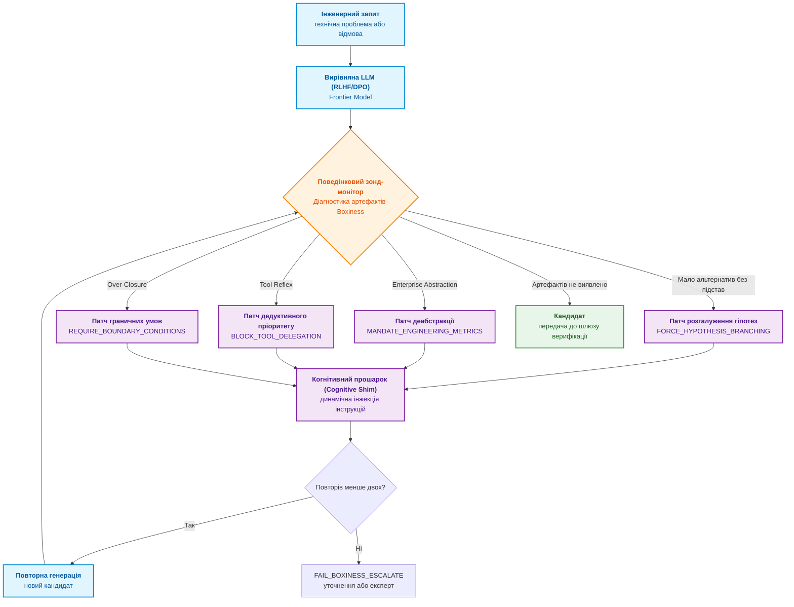
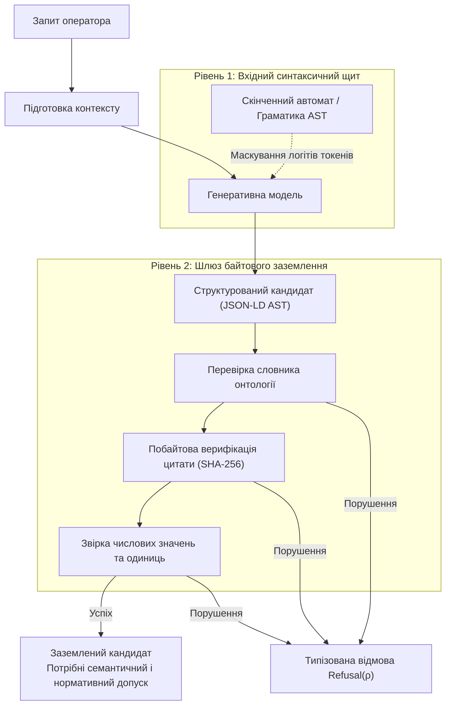
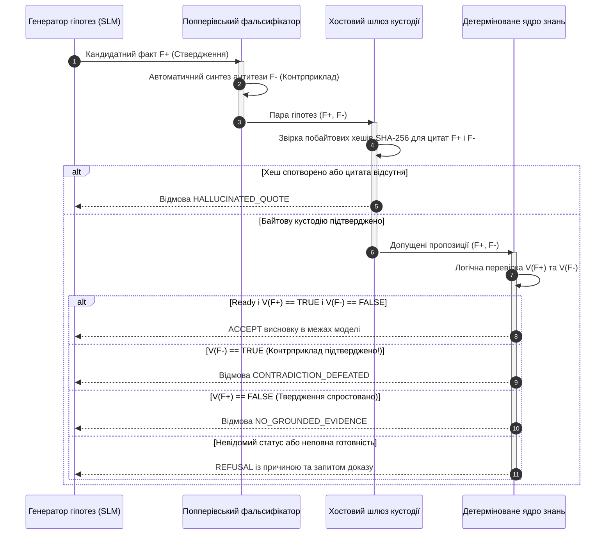
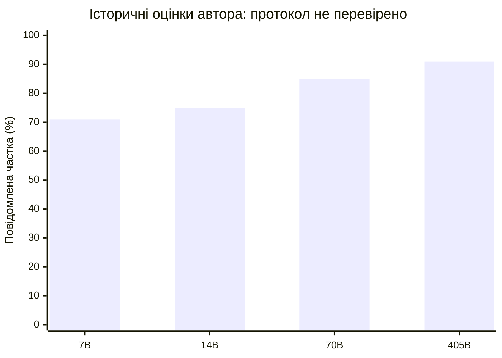
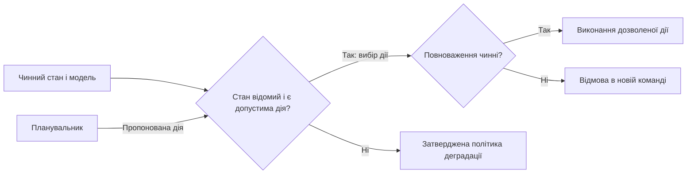

# Глава 38. Машинні галюцинації та дефіцит знань: доказовий контроль відповідей

> **Книга:** [Архітектура доказових експертних систем](README.md) · [Частина VI: Нейро-символьні архітектури, абдукція та контроль галюцинацій](part-06-frontiers-neuro-symbolic.md)
> **Попередня глава:** [Глава 29. Нейро-символьна архітектура: мовні моделі та перевірка доказових підстав](ch29-neuro-symbolic-architecture.md)
> **Наступна глава:** [Глава 17. Технологічний стек: критерії вибору інструментів, мов програмування та рушіїв правил](ch17-implementation-stack.md)
> **Зміст книги:** [README.md](README.md)
> **Автор:** [Микола Мартинович Федчик](about-the-author.md)
> **Передумови й маршрут:** множини, умовна ймовірність і правило «якщо передумови, то наслідок»; потрібні означення нагадано в тексті. Від простого прикладу насоса переходимо до шлюзу доказів, планування досліджень і навчання моделей.
> **Очікувані результати:** відрізняти автентичність цитати від логічного слідування; будувати обмежений шлюз перевірки кандидатів; виявляти відсутню обов'язкову передумову; застосовувати KDI й епістемічний борг для планування, а не для допуску; зберігати статус гіпотези під час абдукції та навчання.

---

## Анотація

Доказова експертна система має відповідати не лише на питання «який текст запропонувала модель?», а й на питання «які підстави дозволяють прийняти цей висновок?». Після нейро-символьного розподілу ролей у главі 29 тут розібрано конкретну межу: мовна модель пропонує кандидата, а зовнішні перевірки встановлюють його джерело, зміст, застосовність і достатність передумов. Автентична цитата необхідна для простежуваності, проте сама не доводить висновку. Пропущена умова може зробити небезпечною навіть відповідь із правильно скопійованими словами.

У цій монографії автором запропоновано **парадигму детермінованої доказової терапії машинних галюцинацій**: обмежувати право моделі стверджувати, явно обліковувати дефіцит і запитувати відсутні докази. Наскрізний навчальний приклад насоса пояснює дворівневий шлюз, пошук винятків і типізовану відмову. Далі введено авторську класифікацію Boxiness та ремонтні патчі [[17]](#src-17), індекс KDI й модель епістемічного боргу, абдукцію, предикатні щити та навчання за перевіреними парами. Це архітектурні пропозиції з названими припущеннями, а не підтвердження нульової частоти всіх помилок чи відповідності стандартам функціональної безпеки. Читач перевірить байтовий шлюз кодом і побачить, яких висновків цей код не встановлює.

---

## 1. Анатомія машинної галюцинації: чому мовна модель не здатна вилікувати себе сама

Анатомію галюцинації зручно вивчати від рішення, яке потрібно обґрунтувати: чи можна дозволити сервісну промивку насоса P-7? Достатньо розрізняти документ, твердження й правило: документ зберігає текст, твердження описує стан, а правило пов'язує передумови з висновком. У всіх прикладах цієї глави P-7, клапан V-2 і числові межі є навчальними припущеннями, не витягами зі стандарту чи протоколом реального випробування. Уявімо, що модель відповіла:

> «Згідно з регламентом експлуатації, максимальний робочий тиск для насоса P-7 становить 25 бар, а перепускний клапан V-2 дозволено заблокувати на час промивки магістралі для стабілізації потоку рідини».

У навчальному паспорті P-7 задано інше: максимальний робочий тиск становить 16 бар; блокувати V-2 заборонено. Окреме правило сервісу вимагає вимкненого живлення, підтвердженого надлишкового тиску нижче 0,2 бар, стабільної температури в дозволеному діапазоні та незаблокованого V-2. Отже, у відповіді є вигадане число й недопустима рекомендація. Навіть правильне число 16 бар не дало б дозволу на промивку: межа робочого тиску та умова сервісу виконують різні ролі.

Машинною галюцинацією або конфабуляцією тут названо правдоподібний текст із хибним або непідтвердженим твердженням. Непідтверджене ще не означає спростоване, але для категоричної відповіді його недостатньо. Передбачення наступного токена оптимізує відповідність текстовим даним, а не перевіряє паспорт насоса. Праця Калаї та Вемпали [[1]](#src-1) досліджує неминучість певних помилок за умов своєї моделі калібрування; це не теорема про кожну можливу нейромережу. Оцінювання, яке однаково штрафує відмову й помилку, може додатково заохочувати вгадування. Вибір функції втрат пояснює ризик, але не доводить, що кожна відповідь моделі є хибною.

Для перевірки P-7 використаємо три робочі категорії дефектів; огляд [[2]](#src-2) дає ширший контекст factuality та faithfulness. Ці категорії можуть перетинатися, а не є статистично незалежними:

1. **Фактологічна помилка (*factuality error*):** згенероване твердження прямо суперечить об'єктивним фактам реального світу або фізичним законам.
2. **Помилка вірності джерелу (*faithfulness / attribution error*):** твердження суперечить наданому текстовому контексту або приписує цитаті зміст, якого в первинному документі немає.
3. **Логічний розрив виведення (*reasoning breakdown*):** модель правильно повторює окремі факти, але робить між ними хибний дедуктивний перехід або потрапляє в пастку вакуумної істинності.

Пошук із доповненою генерацією (*Retrieval-Augmented Generation*, RAG) [[12]](#src-12) допомагає знайти паспорт, але не робить знайдене автоматичним доказом. **Авторська концепція епістемічної ілюзії RAG** (*RAG Epistemic Illusion Paradox*) називає саме помилкове ототожнення пошуку з перевіркою. Модель може знайти правильний абзац і все одно пропустити «не» перед «дозволено». Потрібно перевірити і джерело, і відношення між його текстом та запропонованим твердженням.

Повторне запитання «перевір себе» інколи допомагає знайти помилку, проте не додає незалежної підстави, якщо використовує ті самі неповні дані. Модельний колапс у [[3]](#src-3) стосується рекурсивного навчання на згенерованих даних за досліджених умов; його не слід використовувати як доказ неможливості виправити відповідь одним повторним запитом.

**Авторський принцип зовнішнього детермінованого судді** (*External Deterministic Arbiter Principle*) тому задано як архітектурне правило: остаточний допуск не доручається генератору. Зовнішня система перевіряє явні докази у визначеній моделі; помилкове джерело чи правило залишається її межею. Наступне питання: чи може друга мовна модель замінити таку перевірку?

### 1.1. Математичне спростування патерну «LLM-as-a-Judge» та відмови спільного режиму (Common-Mode Failures)

Патерн **LLM-as-a-Judge** використовує другу модель для оцінювання чи ранжування відповідей [[16]](#src-16). У задачі P-7 такий суддя може вказати на підозріле число, але висока оцінка тексту ще не встановлює дозволу. Для аналізу достатньо правила умовної ймовірності: ймовірність двох подій дорівнює ймовірності першої, помноженій на ймовірність другої за умови першої.

Визначимо події на одному й тому самому розподілі запитів: генератор помилився, а суддя схвалив його відповідь. Залежні помилки можливі через спільні джерела, формулювання й навчальні дані. Сам факт однакової архітектури не доводить ні незалежності, ні певної сили кореляції; це треба вимірювати.

<a id="obj-38-1"></a>
**Формула (38.1). Імовірність пропуску помилки парою моделей.**

```math
P(E_1 \cap E_2)=P(E_1)P(E_2\mid E_1),\qquad P(E_1)>0.
```

де:
- $`E_1`$ — подія виникнення галюцинації (конфабуляції) у моделі-генераторі;
- $`E_2`$ — подія схвалення відповіді моделлю-суддею незалежно від того, правильна вона чи ні;
- $`P(E_1 \cap E_2)`$ — імовірність того, що генератор помилився, а суддя схвалив його відповідь. Це пропуск помилки саме цією парою; подальші незалежні перевірки ще можуть відхилити кандидата.

Усі ймовірності безрозмірні, від 0 до 1; перетин означає одночасність подій. Добуток без умовної ймовірності допустимий лише за незалежності. У навчальному прикладі генератор помиляється з імовірністю 0,10, а суддя схвалює 0,60 помилкових відповідей: спільний пропуск становить 0,10 × 0,60 = 0,06, тобто 6 %. Якщо безпідставно підставити безумовну частоту схвалень 0,20, вийде 2 % і ризик буде занижено втричі. Це контрприклад припущенню незалежності, не вимір якості конкретної моделі.

Перевіряти варто, зокрема, такі можливі зміщення:
1. **Стилістичне зміщення (Style Bias):** модель-суддя оцінює поверхневу гладкість викладу, академічний синтаксис та відсутність лексичних повторів як ознаку істинності, схвалюючи вигадані твердження лише тому, що вони сформульовані бездоганною мовою.
2. **Зміщення багатослівності (Verbosity Bias):** великі розлогі конфабуляції, насичені псевдонауковою термінологією та складними дееприслівниковими зворотами, отримують систематично вищі бали від моделі-судді, ніж короткі, але точні відповіді.
3. **Зміщення удаваного авторитету (Authority Bias):** впевнено задекларована брехня (наприклад, категоричне «відповідно до пункту 4.2 стандарту значення дорівнює 25 бар») викликає у моделі-судді хибне узгодження, тоді як чесна й метрологічно коректна відповідь «інформація в наданому фрагменті відсутня» штрафується як недостатньо корисна.

Модель-суддя може мати інструменти й документи, але оцінка судді не замінює їх перевіреного результату. Назва цього підрозділу означає спростування безумовної гарантії нейромережевого арбітражу, не заперечення користі такого ранжування.

#### 1.1.1. Замкнений інженерний цикл спростування нейромережевого арбітражу

Цикл спростування має завершуватися перевірною дією, а не лише критикою другої моделі. Для P-7 порядок такий:

1. **Кандидат.** За авторською концепцією *Candidate Assertion* відповідь містить предикат, документ і цитату. Суддя може пріоритезувати перевірку, але не випустити остаточний дозвіл.
2. **Перевірка.** За авторським правилом заборони LLM-арбітражу в CI/CD реліз, де лише оцінка моделі надає критичний допуск, має отримати `ARCHITECTURE_NON_COMPLIANT`. Це запропонована політика, не твердження про наявний валідатор. Потрібні байтовий контроль і перевірка змісту, а не тільки заміна одного компонента на SHA-256.
3. **Результат і межа.** Вигадані 25 бар не збігаються з навчальною цитатою про 16 бар, тому кандидат відхиляється. Автентична цитата «V-2 не дозволено блокувати» із кандидатом «дозволено» пройде байтовий контроль, але повинна провалити перевірку модальності. Час і енергоспоживання цих перевірок слід виміряти на цільовій реалізації; попередні оцінки 15–18 мкс і 50-кратної економії без протоколу не є встановленими результатами.

Отже, друга модель корисна як критик, але потрібні зовнішні підстави. Перед побудовою шлюзу розглянемо ще один ризик: відповідь може бути обережною й водночас не містити потрібного аналізу.

### 1.2. Діагностика поведінкового синдрому «коробочності» (Boxiness) LLM та автоматичні ремонтні патчі

Діагностика «коробочності» потрібна, коли відповідь не містить явної вигадки, але й не допомагає встановити відсутню передумову. Для P-7 порада «перевірте належну конфігурацію» не пояснює, чи потрібен тиск, стан клапана або версія паспорта. У цій монографії автором запропоновано **синдром «коробочності» (Boxiness)** [[17]](#src-17) як робочу класифікацію таких відповідей. Її зв'язок із RLHF (навчанням за людськими перевагами) чи DPO (§6.1) є дослідницьким поясненням, а не встановленою причиною поведінки кожної моделі.

Передумова діагностики: є перелік потрібних даних і допустимих альтернатив, з яким можна порівняти відповідь. Обережна відмова за відсутності паспорта правильна; дефектом є заміна конкретного запиту доказу загальною фразою. Схема показує запропонований обмежений цикл виправлення форми аналізу, не механізм доведення істини.

<a id="obj-38-2"></a>
**Діаграма 38.2. Діагностика Boxiness із обмеженням повторів.**



<a id="1-типологія-когнітивного-синдрому-коробочності-boxiness-artifacts"></a>
**Типологія когнітивного синдрому «коробочності» (Boxiness Artifacts)**

За класифікацією автора розрізняються чотири діагностичні класи [[17]](#src-17). Спершу розглянемо втрату альтернатив: як побачити, що модель без підстав залишила лише одну причину? За явно заданих імовірностей можна обчислити ентропію, тобто міру розосередженості розподілу.

1. **Ambiguity Collapse (Колапс неоднозначності):** звуження множини допустимих гіпотез без достатніх підстав. Для незмінного скінченного переліку альтернатив розглянемо такий індикатор.

<a id="obj-38-3"></a>
**Формула (38.3). Ентропія явно заданого розподілу гіпотез.**

```math
H(\mathcal{H}) = - \sum_{h \in \mathcal{H}} P(h) \log_2 P(h)
```

Параметри та математичні компоненти формули:
- $`\mathcal{H} = \{h_1, h_2, \dots, h_m\}`$ — множина з $m \ge 1$ взаємовиключних і вичерпних альтернатив у вибраній моделі задачі;
- $P(h) \in [0, 1]$ — явно задана ймовірність альтернативи $h$; сума всіх таких значень дорівнює 1, а внесок нульової ймовірності за домовленістю дорівнює нулю;
- $`H(\mathcal{H}) \in [0, \log_2 m]`$ — інформаційна ентропія гіпотетичного простору (вимірюється в бітах або шеннонах).

Для навчальної діагностики відсутнього показника тиску P-7 припустимо лише дві альтернативи: несправність датчика або каналу передавання. За ймовірностей 0,5 і 0,5 кожний доданок дає 0,5 біта, разом 1 біт. За 0,99 і 0,01 внески становлять приблизно 0,0144 і 0,0664 біта, разом 0,0808 біта. Якщо підстави не змінилися, таке падіння є приводом перевірити передчасне звуження. Поріг $`\tau_{\mathrm{entropy}}`$ у бітах задає профіль задачі, не фізичний закон. Низька ентропія може бути виправдана сильним доказом; відсутність гіпотез означає невизначений показник, а не нуль. Для одночасних причин спершу задають спільні альтернативи; формулу не застосовують до ненормованого списку причин.

2. **Over-Closure (Передчасне закриття міркувань):** винесення категоричного вердикту без зазначення фізичних граничних умов та вимог щодо додаткових апаратних вимірювань.
3. **Tool Reflex (Інструментальний рефлекс):** необґрунтована передача задачі іншому інструменту, коли потрібні дані вже надані. Пошук відсутнього паспорта або перевірений числовий розрахунок, навпаки, можуть бути необхідними.
4. **Enterprise Abstraction (Корпоративна абстракція):** системне вимивання точних технічних параметрів (напруг, допусків, кодів регістрів) на користь беззмістовних формулювань на кшталт «переконайтеся в правильності конфігурації відповідно до найкращих практик».

> [!NOTE]
> **Чотири класи дефектів вирівняних моделей у синдромі «коробочності» за моделлю автора**
> 1. *Ambiguity Collapse (Колапс неоднозначності)*: штучне схлопування простору альтернативних гіпотез при багатоваріантних аварійних режимах зі стрімким падінням ентропії $`H(\mathcal{H}) \to 0`$.
> 2. *Over-Closure (Передчасне закриття міркувань)*: винесення категоричного вердикту без верифікації граничних фізичних умов та вимог додаткових апаратних вимірювань.
> 3. *Tool Reflex (Інструментальний рефлекс)*: необґрунтоване делегування замість аналізу наданих даних; потрібне звернення до джерела дефектом не вважається.
> 4. *Enterprise Abstraction (Корпоративна абстракція)*: систематичне вимивання точних технічних параметрів (напруг, допусків, кодів регістрів) на користь беззмістовних евфемізмів.
> *Керування рантаймом / Інженерний інваріант:* Зонд лише сигналізує про можливий дефект; патч змінює запит, а не статус доказовості відповіді. Історична оцінка 0,35 мс без протоколу не є встановленою затримкою.

<a id="2-динамічні-когнітивні-ремонтні-патчі-cognitive-repair-patches"></a>
**Динамічні когнітивні ремонтні патчі (Cognitive Repair Patches)**

Щоб попросити конкретизацію без зміни ваг моделі, **авторська концепція динамічних когнітивних ремонтних патчів (*Cognitive Repair Patches*, CRP) та когнітивних прошарків (*Cognitive Shims*)** [[17]](#src-17) додає цільову інструкцію до наступного запиту. Наприклад: «Назви відсутню передумову дозволу промивки; не підміняй її оцінкою ймовірності». Автоматичне виявлення шаблонної фрази можливе рядковим чи AST-аналізом, але повний детектор змістовних дефектів тут не реалізовано. Патч не примушує нейромережу до коректної дедукції.

#### 1.2.1. Замкнений цикл інженерної діагностики та накладання ремонтних патчів

Замкнений цикл потрібен, щоб виправлення не перетворилося на нескінченне генерування. Вхід тут: запит P-7, перелік передумов і поточна відповідь; вихід: конкретизований кандидат або ескалація.

1. **Виявлення.** Замість «перевірте конфігурацію» потрібна назва непідтвердженого факту. Зонд позначає `INTERCEPT_BOXINESS`; це евристичний сигнал, не висновок про фізичний стан насоса.
2. **Повтор.** Додається патч із запитом тиску, джерела та похибки; після щонайбільше двох повторів без результату повертається `FAIL_BOXINESS_ESCALATE`. SMT-розв'язувач допоможе лише за наявності формалізованої задачі, а не відновить відсутнє вимірювання.
3. **Перевірка.** Відповідь «тиск, імовірно, скинуто» не закриває передумови. Потрібні чинне вимірювання і правило допуску. Додавання 120–180 токенів до 8192 становить приблизно 1,46–2,20 % місткості, якщо решта запиту вміщується; обсяг KV-кешу залежить від архітектури й точності. Попередні 4,5 МБ не є універсальною оцінкою.

Раніше наведений авторський сценарій дроселя (118 °C проти межі 105 °C; 95 проти 125 кГц; 2,1 проти 1,8 А) ілюструє потребу перевіряти альтернативи насичення осердя, ESR і тепловідведення. Без напруги, індуктивності, постійної складової струму й протоколу вимірювання ці числа не доводять причини перегріву. Патч лише ставить питання для дослідження. Отже, якість запиту можна поліпшувати окремо від доказовості; тепер побудуємо перевірки самого кандидата.

## 2. Детермінована доказова терапія: дворівневий шлюз нульових галюцинацій

В основі **авторської парадигми детермінованої доказової терапії машинних галюцинацій** лежить **авторський принцип позбавлення генеративної моделі статусу джерела знань** (*Candidate Generator Demotion*): мовна модель пропонує кандидатне твердження, а не підтверджений факт. Наведені два рівні відсікають синтаксичний брак і непідтверджені цитати; їх проходження не замінює семантичної перевірки, нормативної застосовності та окремих повноважень на виконання за [Главою 16, §1.1](ch16-expert-systems-architecture.md#11-канонічний-словник-вердиктів-рантайму-та-межі-повноважень).

Для P-7 завдання шлюзу спочатку вузьке: чи правильно оформлено кандидата і чи справді в паспорті є заявлені слова? Передумови: незмінна зареєстрована версія документа, схема кандидата та словник відношень. Назва «шлюз нульових галюцинацій» позначає авторську ціль недопуску неперевірених кандидатів, не доведену відсутність усіх семантичних помилок. Після цих двох рівнів потрібна окрема перевірка того, що цитата означає саме запропонований висновок.

<a id="obj-38-4"></a>
**Діаграма 38.4. Два рівні підготовки кандидата до змістовної перевірки.**



### 2.1. Граматично кероване декодування на рівні логітів

Граматично кероване декодування потрібне, щоб перевіряльник отримав об'єкт із відомими полями замість довільного тексту. Токен є елементом словника моделі, логіт є числовою оцінкою його вибору, AST є деревом структури вислову. Підхід керованої генерації Вілларда і Луфа [[4]](#src-4), відомий за Outlines, обмежує допустимі продовження відповідно до граматики.

Щоб визначити ймовірність вибору токена після маскування, залишимо лише продовження, дозволені поточним станом парсера.

<a id="obj-38-5"></a>
**Формула (38.5). Нормування ймовірностей на дозволених токенах.**

```math
P(w\mid k)=\begin{cases}
\displaystyle\frac{e^{z_k(w)}}{\sum_{v\in A_k}e^{z_k(v)}},& w\in A_k,\\
0,&w\notin A_k.
\end{cases}
```

Тут $k$ є цілим невід'ємним номером кроку; $w,v$ є токенами скінченного словника; $`A_k`$ є непорожньою множиною дозволених токенів; $`z_k(v)`$ є скінченним безрозмірним логітом. Експонента $e$ перетворює оцінки на додатні ваги, знаменник нормує їх до суми 1. Для двох дозволених токенів із логітами 0 і 0 маємо ваги 1 і 1 та ймовірності по 0,5; будь-який заборонений токен має ймовірність 0. Присвоєння забороненим логітам $-\infty$ є еквівалентним математичним записом маски.

**Авторський принцип фізичної неможливості синтаксичного порушення через логітне маскування** має умовну гарантію: правильний парсер, узгоджений токенізатор, маска на кожному кроці й видача лише завершених дерев. За порожньої множини дозволів або вичерпання бюджету слід повернути помилку, а не неповний JSON. Граматика «число тиску» може дозволити і 16, і 25: синтаксичний вибір не розрізняє істинних значень. Це завдання наступного рівня.

### 2.2. Побайтовий шлюз допуску та криптографічне заземлення

Побайтовий шлюз відповідає на питання «чи дослівно відтворено фрагмент зареєстрованого джерела?», а не «чи доведено дозвіл?». Потрібні ідентифікатор версії документа й точні байтові координати; для UTF-8 число символів не дорівнює числу байтів. Сформований об'єкт перевіряється так:

1. **Реєстр закритих відношень:** предикат твердження звіряється із затвердженою онтологією. Будь-яке вигадане відношення відкидається зі статусом `OUT_OF_VOCABULARY`.
2. **Побайтова верифікація цитати:** напіввідкритий інтервал `[byte_start, byte_end)` має лежати в документі й бути непорожнім. Зріз порівнюється з точною цитатою та її SHA-256. У слові «бар» 3 символи займають 6 байтів UTF-8; зміщення на один байт може розрізати символ. Хеш цитати, поданий самою моделлю, не є довіреним підписом: потрібне незалежне зв'язування `DocID` з незмінним документом. Код §7 перевіряє заданий об'єкт документа, але не реалізує реєстр його довіри.
3. **Звірка чисел і одиниць:** наявність окремого числового токена є лише текстовою опорою. «16» не повинно збігатися з підрядком «160». Для змістового допуску додатково потрібні об'єкт P-7, одиниця «бар», вид тиску й модальність правила; сама наявність числа їх не встановлює.

Для обліку результатів авторська метрика *Zero-Hallucination Rate* тут має вузьке значення частки байтово заземлених кандидатів. Назва ZHR не розширює обсяг перевірки до всіх видів істинності.

<a id="obj-38-6"></a>
**Формула (38.6). Частка кандидатів із підтвердженою текстовою опорою.**

```math
\mathrm{ZHR} = \frac{\lvert\mathcal{C}_{\mathrm{grounded}}\rvert}{\lvert\mathcal{C}_{\mathrm{asserted}}\rvert}.
```

**Параметри та допустимі межі:**
- $`\mathcal{C}_{\mathrm{asserted}}`$ — скінченна множина запропонованих стверджень за сеанс до публікації, а не вже дозволених команд ($`\lvert\mathcal{C}_{\mathrm{asserted}}\rvert \ge 1`$);
- $`\mathcal{C}_{\mathrm{grounded}} \subseteq \mathcal{C}_{\mathrm{asserted}}`$ — підмножина тверджень, для яких успішно виконано побайтову верифікацію першоджерела за еталонним хешем SHA-256 та зіставлення числових екстремумів;
- $`\mathrm{ZHR} \in [0, 1]`$ — безрозмірна частка; за відсутності кандидатів вона невизначена, не дорівнює автоматично 1.

**Операційні рішення, метрологічне розмежування та числовий приклад:**
- **Конструктивний інваріант.** Авторський контракт $`\mathrm{ZHR}_{\mathrm{gate}}=1`$ означає: кожний пропущений кандидат пройшов задані перевірки. Це вимога до реалізації без обхідного шляху, не емпіричний відсоток правильних відповідей. Нотація $`\tau_{\mathrm{ZHR\_gate}}=1`$ є локальним порогом, не критерієм сертифікації стандарту.
- **Передача кандидата на подальшу перевірку:** У цьому підрозділі показник охоплює лише словник, байти цитати й текстові числові опори. Його значення 1 є необхідною, не достатньою умовою повного допуску. Перед передачею верифікатору пакет повинен отримати підпис Ed25519; `EMIT_GROUNDED` тут є внутрішньою діагностикою заземлення, не зовнішнім `ACCEPT` і не командою приводу. Перед випуском висновку перевіряються семантичний зв'язок із цитатою, чинність, застосовність, засновки й дефітери; виконавча дія додатково потребує `execution_authority` за Главою 16 §1.1.
- **Блокування та дефіцит.** Кожний незаземлений кандидат відкидається до видачі через `DROP_UNGROUNDED`; змішаний пакет не публікується як повністю перевірений. Це не фізичне переривання живлення. Якщо незаземлений кандидат уже видано, порушено контракт шлюзу, а не просто отримано нижчий допустимий бал.

Що дає нуль знайдених помилок у тестах? За умов [глави 36, §5.5](ch36-knowledge-testing-pyramid-and-variational-calibration.md#55-метрологія-нульових-галюцинацій-zhr-точні-довірчі-інтервали-клоппера-пірсона-та-правило-трьох) застосовується точна однобічна біноміальна межа:

<a id="obj-38-7"></a>
**Формула (38.7). Верхня межа частоти помилок за нуля спостережених збоїв.**

```math
p_U=1-\alpha^{1/N},\qquad k=0,\quad N\ge1,\quad 0<\alpha<1.
```

$N$ є кількістю незалежних однаково розподілених випробувань Бернуллі зі спільною незмінною ймовірністю помилки; $k$ є числом помилок; $\alpha$ є рівнем значущості; $`p_U`$ є безрозмірною верхньою довірчою межею. Критерій помилки задає незалежний оракул. За $N=100$, $\alpha=0{,}05$ обчислюємо корінь сотого степеня з 0,05, отримуємо приблизно 0,970487 і віднімаємо від 1: межа близько 2,9513 %, а не нуль. Це однобічний рівень довіри 95 %; для двобічного інтервалу використовують половину рівня значущості в кожному хвості. За залежних перефразувань число рядків не можна підставляти замість незалежних випадків.

Шість десяткових знаків самі по собі не вимагають певного числа тестів. Якщо поставлено саме ціль верхньої межі не більш як 0,000001 за тих самих умов і без помилок, розв'язання нерівності (38.7) дає щонайменше 2 995 731 незалежне випробування. Це обмеження цілі, не правило форматування числа й не гарантія для іншого розподілу запитів.

**Практичний числовий розрахунок.** У навчальному пакеті з 50 тверджень про P-7 для 49 знайдено точні опори, а для одного заявлено «25 бар» замість «16 бар». Якщо модель також підмінила слова цитати, байтовий контроль це виявить. Якщо цитата справжня, а змінено лише поле числа, потрібна окрема числова перевірка. Це два різні види помилки.

<a id="obj-38-8"></a>
**Формула (38.8). Частка заземлених кандидатів у навчальному пакеті.**

```math
\mathrm{ZHR} = \frac{49}{50} = 0{,}980000 < 1{,}000000.
```

Чисельник 49 і знаменник 50 є цілими кількостями кандидатів, частка 0,98 безрозмірна. Вона сигналізує про брак пакета; неперевірений елемент не видається. Навіть 50 із 50 не доводять правильності рекомендації блокувати V-2. Попередній приклад відстаней 2,20/2,50 м не використовується як вимога ДСТУ EN 61936-1: точний пункт і застосовність у цій главі не встановлено.

<a id="obj-38-9"></a>
**Таблиця 38.9. Обсяг і межі чотирьох захисних механізмів.**

| Рівень захисту | Метод реалізації | Що усуває | Чого не гарантує |
|---|---|---|---|
| Інструкції в запиті (*Prompting*) | системна вказівка «не вигадуй» | може зменшити частину помилок поведінки | відсутність галюцинацій, доказовість |
| Традиційний RAG | пошук за векторною подібністю | може надати потрібний контекст | повноту пошуку, точність цитування, правильність висновку |
| Граматичний щит (Рівень 1) | скінченні автомати на рівні логітів | порушення синтаксису й формату схеми | фактологічну правдивість значень |
| Побайтовий шлюз (Рівень 2) | верифікація зрізів файлу за гешем SHA-256 | невідповідність заявленої цитати байтам джерела | істинність джерела, семантичну відповідність твердження цитаті, застосовність або повноту корпусу |

> [!NOTE]
> **Три рівні верифікації побайтового шлюзу допуску фактів за моделлю автора**
> 1. *Реєстр закритих відношень*: обов'язкова звірка типізованих предикатів твердження із затвердженою онтологією з негайним відкиданням невідомих зв'язків зі статусом `OUT_OF_VOCABULARY`.
> 2. *Побайтова верифікація цитати*: строга побайтова звірка зрізу тексту за зсувами `byte_start` і `byte_end` із канонічним контрольним хешем SHA-256 без участі нейромережі.
> 3. *Заземлення числових екстремумів і розмірностей*: детермінована перевірка входження числових значень, фізичних величин і допусків безпосередньо у верифіковану цитату першоджерела.
> *Керування рантаймом / Інженерний інваріант:* Непідтверджене заземлення блокує кандидата через `DROP_UNGROUNDED`; повне заземлення лише допускає наступні перевірки, не встановлюючи істинності чи права на дію.

### 2.3. Попперівський цикл фальсифікації гіпотез ($F^+$ проти $F^-$)

Попперівський цикл потрібен, коли справжня цитата ще може приховувати виняток. Передумовами є розрізнення заземлення та слідування з §2.2 і поняття дефітера: умови, яка спростовує висновок або блокує спосіб його обґрунтування. **Авторська загроза контекстуального опущення дефітерів** (*contextual omission / defeater omission*) для P-7 виглядає так: процитовано загальний дозвіл сервісу, але пропущено вимогу підтвердженого тиску та заборону блокування V-2.

На основі ідеї фальсифікації Поппера [[14]](#src-14) автором запропоновано шукати не лише опори, а й контрприклади. Універсальне твердження «для всіх випадків виконується властивість» спростовується одним коректним випадком її порушення за тих самих умов. Але незнайдений контрприклад не доводить універсальної істини; синтез однієї антитези не вичерпує всіх можливих винятків.

У процесі здобуття та шлюзі допуску знань цей принцип формалізується як обов'язкова парна генерація:
1. **Генерація антитези:** для кожного кандидатного факту $F^+$ («Ствердження: норма застосовна») генератор гіпотез зобов'язаний сформувати спрямовану антитезу — контрприклад $F^-$ («Спростування: існують винятки, заперечення або обмежувальні дефітери, що блокують застосування норми»).
2. **Детермінована верифікація:** для обох кандидатів перевіряються цитати, значення й застосовні правила. Відсутність знайденої цитати не прирівнюється до спростування. Для антитези потрібен доведений статус, а не лише невдача пошуку.

У межах явно заданої моделі авторський оператор допуску має таке правило:

<a id="obj-38-10"></a>
**Формула (38.10). Допуск із явним урахуванням невідомих станів.**

```math
\mathrm{Status}(F)=\begin{cases}
\mathrm{ACCEPT},&\mathrm{Ready}(F)\land\mathcal{V}(F^+)=\mathrm{TRUE}\land\mathcal{V}(F^-)=\mathrm{FALSE},\\
\mathrm{REFUSAL},&\text{інакше}.
\end{cases}
```

**Параметри та логічні змінні:**
- $`F^+,F^-`$ — позитивне твердження й перевірювана антитеза для одного кандидата $F$;
- $`\mathcal{V}(F^+),\mathcal{V}(F^-)\in\{\mathrm{TRUE},\mathrm{FALSE},\mathrm{UNKNOWN}\}`$ — статуси після змістовної перевірки: підтверджено, спростовано або невідомо. Виявлена суперечність блокує допуск через готовність;
- $`\mathrm{Ready}(F)`$ — булева умова: чинні джерела, семантичне зв'язування, усі обов'язкові передумови та застосовні дефітери перевірено за заданою політикою, конфлікту немає;
- $`\mathrm{Status}(F) \in \{\mathrm{ACCEPT}, \mathrm{REFUSAL}\}`$ — операційне рішення шлюзу допуску знань.

**Операційні переходи та практичний приклад:**
Усі значення логічні, без фізичних одиниць. Позитивний контроль: правило сервісу P-7 застосовне, усі чотири умови підтверджено, антитезу «V-2 заблоковано» спростовано; тоді за готовності отримуємо `ACCEPT` висновку. Контрприклад: V-2 заблоковано, отже антитеза істинна й отримуємо `REFUSAL`. Межовий випадок: стан V-2 невідомий; оператор також відмовляє, хоча пошук не знайшов факту блокування. Дозвіл висновку не є повноваженням на фізичну дію.

Попередній приклад CAN FD (5/2 Мбіт/с, 15/22 м) можна читати лише як умовне правило навчальної мережі, не як універсальну норму CAN FD. За таким правилом 22 м активують виняток понад 15 м. Реальні швидкості потребують конкретної фізичної конфігурації та її перевірки.

<a id="obj-38-11"></a>
**Діаграма 38.11. Від пари кандидатів до перевірки підстав і невідомих станів.**



**Статус повідомлених стендових результатів.** Автором раніше описано стенд Seeed Studio reServer Industrial J501, Jetson AGX Orin 64GB, `MODE_30W`, моделі 7B/14B, корпуси RFC 9110 та ISO 26262-4 і типізовану схему кандидатів [[15]](#src-15). Повідомлялося про відсутність синтаксичного браку з GBNF, виявлення `DEFEATER_OMISSION` і `DEONTIC_MODALITY_INVERSION`, нуль пропущених дефектів та температурний запас 56 °C до порога 99 °C. Під час локальної перевірки знайдено опис іншого профілю EXP3 і поточний програмний симулятор: у його функції контролю відмову контрприкладу призначено наперед, а позитивний контроль перевіряє заповнення полів, не слідування чи побайтову відповідність цитати. Така конструкція не вимірює нуль пропущених дефектів. Тотожність цього коду виконаній історичній версії не встановлена, тому він також не спростовує іншого минулого досліду. Без повних входів і виходів, незалежних очікувань та журналу фактичних перевірок повідомлення не прийнято як перевірений бенчмарк. Різниця температур арифметично відповідала б 43 °C кристала, але не встановлює WCET або відсутності тротлінгу за інших умов.

Так само попередні інженерні оцінки 71, 75, 85 і 91 % для «сирих» моделей збережено нижче лише як історичні дані для перевірки. Показник 100 % контракту шлюзу не ставиться поруч як п'ятий вимір тієї самої величини: це було б порівнянням вимоги з оцінкою. Для емпіричного висновку потрібні однаковий знаменник, незалежні випадки, частка відмов, критерій помилки та межа (38.7).

<a id="obj-38-12"></a>
**Діаграма 38.12. Історичні інженерні оцінки без прийнятого протоколу вимірювання.**



> [!NOTE]
> **Два етапи попперівського циклу фальсифікації гіпотез за моделлю автора**
> 1. *Спрямована генерація антитези ($F^-$)*: пошук контрприкладу або дефітера для кандидата $F^+$; одна згенерована антитеза не вичерпує можливих винятків.
> 2. *Детермінована парна верифікація*: байтове зв'язування доповнюється перевіркою змісту, готовності й доведеного спростування антитези за (38.10). Невідомий статус не замінюється хибним.
> *Керування рантаймом / Інженерний інваріант:* Активний виняток дає `CONTRADICTION_DEFEATED`, відсутня підстава дає відповідну типізовану відмову. Жодний із цих результатів сам не наказує фізичного знеструмлення.

Тепер відомо, чому навіть правильна цитата може не дати відповіді. Наступний розділ показує, як назвати й кількісно облікувати те, чого бракує, не заповнюючи прогалину припущенням.

## 3. Епістемічний дефіцит: відкритий світ і шлюз безпечної відмови

Епістемічний дефіцит пояснює, чому шлюз не може завершити відповідь навіть після знаходження правильного паспорта. Для P-7 залишилося питання: чи підтверджено всі умови сервісу саме зараз? Потрібні множина обов'язкових передумов і відмінність між «спростовано» та «не встановлено» з §2.3. Дефіцит знань сам по собі не є програмною аварією; небезпечним є приховування цього стану категоричним дозволом.

За явно обраного припущення замкненого світу (*Closed-World Assumption*, CWA) недоведене в заданій базі трактують як хибне для відповідного запиту; не всі бази даних безумовно працюють саме так. У цій моделі доказової системи обрано відкритий світ (*Open-World Assumption*, OWA): незареєстрований зв'язок є **невідомим**. Відсутність запису про тиск не доводить ні безпечного тиску, ні його перевищення.

Нехай запит $Q$ вимагає доведення множини необхідних цільових предикатів $`\mathcal{P}_{\mathrm{required}}(Q)`$, а поточна база знань дозволяє детерміновано довести лише підмножину $`\mathcal{P}_{\mathrm{proven}}(Q) \subseteq \mathcal{P}_{\mathrm{required}}(Q)`$. Міра епістемічного дефіциту $`D_{\mathrm{epistemic}}(Q)`$ визначається співвідношенням:

<a id="obj-38-13"></a>
**Формула (38.13). Частка непідтверджених обов'язкових передумов запиту.**

```math
D_{\mathrm{epistemic}}(Q) = 1 - \frac{\lvert\mathcal{P}_{\mathrm{proven}}(Q)\rvert}{\lvert\mathcal{P}_{\mathrm{required}}(Q)\rvert},\qquad D_{\mathrm{epistemic}} \in [0, 1].
```

**Параметри та граничні значення:**
- $`\mathcal{P}_{\mathrm{required}}(Q)`$ — множина всіх цільових предикатів і атрибутів, необхідних для вичерпного обґрунтування відповіді на запит $Q$ ($`\lvert\mathcal{P}_{\mathrm{required}}(Q)\rvert \ge 1`$);
- $`\mathcal{P}_{\mathrm{proven}}(Q) \subseteq \mathcal{P}_{\mathrm{required}}(Q)`$ — передумови з підтвердженими змістом, застосовністю, чинністю та допустимими свідченнями, а не лише з точною цитатою;
- $`D_{\mathrm{epistemic}}(Q) \in [0, 1]`$ — безрозмірна частка: 0 означає повне покриття **названих** передумов, 1 означає, що жодну з них не доведено. Це не оцінка всіх знань про світ.

**Операційні переходи та числовий приклад:**
- За $`D_{\mathrm{epistemic}} = 0`$ усі перелічені передумови готові; висновок ще потребує правильного правила, розв'язання дефітерів і повноважень відповідного рівня. За цих умов можливий `ADMIT_DEDUCTIVE`.
- За $`D_{\mathrm{epistemic}} > 0`$ **шлюз безпечної відмови (Fail-Closed Gate)** не видає категоричного дозволу. Навіть одна відсутня обов'язкова умова блокує його незалежно від її ваги у звіті покриття.

**Практичний числовий сценарій.** Запит $Q$ про сервіс P-7 потребує чотирьох умов із §1. Живлення вимкнено, температура допустима, V-2 не заблоковано, але свіжого вимірювання надлишкового тиску немає. Отже, доведено 3 з 4 передумов:

<a id="obj-38-14"></a>
**Формула (38.14). Дефіцит сервісного дозволу P-7.**

```math
D_{\mathrm{epistemic}}(Q) = 1 - \frac{3}{4} = 0{,}250000.
```

Числа 3 і 4 рахують передумови; результат 0,25 означає одну прогалину, а не 25 % імовірності аварії. Видається `Refusal(NO_EVIDENCE)` із запитом свіжого вимірювання. Якщо показник є, але прострочено повірку, доречний `CALIBRATION_DEFICIT`; якщо прострочено саме спостереження, профіль може уточнити причину як `STALE_EVIDENCE`. У попередньому прикладі високовольтного апарата та сама арифметика 3/4 також не дозволяла вважати відсутній сигнал положення ножів автоматично дефектом калібрування.

Непорожність і повнота списку передумов є припущеннями формули. За порожнього списку результат не обчислюють, а перевіряють специфікацію запиту. Вагова частка покриття корисна для звіту, проте 99 із 100 навіть маловагових передумов не замінюють відсутню соту. Для допуску перевіряється кожна обов'язкова умова, не середній бал.

Оператор безпечної відмови $`\mathrm{Refusal}(\rho)`$ є повноцінним типізованим результатом роботи експертної системи. Причина відмови $\rho$ вказує на конкретний характер дефіциту знань:

* `NO_EVIDENCE`: у зареєстрованих документах відсутні сутності чи первинні атрибути, зазначені в запиті;
* `AMBIGUOUS_EVIDENCE`: знайдено кілька взаємно суперечливих цитат без критерію їхньої семантичної чи часової переваги;
* `OUT_OF_DOMAIN`: запит стосується явищ, що лежать за межами формалізованої аксіоматики онтології;
* `CALIBRATION_DEFICIT`: сенсорні спостереження не мають зафіксованої метрологічної похибки або термін дії повірки датчика сплив;
* `UNRESOLVED_DEFEATER`: логічний висновок заблоковано активним дефітером у системі супроводження істинності.

Авторська політика Fail-Closed вимагає не випускати категоричний висновок за непідтвердженої обов'язкової передумови. Історичний запис «FCP = 100 %» означав цю вимогу, а не виміряну повноту перехоплення всіх фізичних ризиків. Типізована відмова є результатом запиту; вона не наказує знеструмити насос, припинити охолодження або виконати запропоноване дренування. Фізичний перехід визначає окрема політика безпеки (§5).

**Ймовірнісна оцінка не усуває дефіциту.** Дослідницькі інструменти `Turing.jl` [[19]](#src-19), `Gen.jl` [[20]](#src-20) і бібліотека мір `MeasureTheory.jl` [[21]](#src-21) дозволяють формулювати й досліджувати ймовірнісні моделі. Як архітектурний вибір для обмеженого набору задач автор пропонує переносити лише потрібні, окремо перевірені обчислення у вбудовану метрологію: оцінювати довіру до каналів, узгоджувати їхні спостереження та враховувати невизначеність вимірювань. Приклади моделей і першоджерела наведено в [главі 37, §7.3](ch37-input-information-assessment-and-algorithmic-skepticism.md#73-інтервал-оцінки-замість-удаваної-точності). Така реалізація не тотожна повній мові ймовірнісного програмування, а її відповідність часовому бюджету встановлюється вимірюванням.

> [!NOTE]
> **Три межі вбудованої метрології за моделлю автора**
> 1. *Простежуваність даних:* оновлення оцінки спирається на перевірені спостереження та явно зазначені апріорні припущення; залежні копії не рахують як незалежні джерела.
> 2. *Відкритість невизначеності:* результати зберігають разом із моделлю, параметрами й обмеженнями; відсутність даних про похибку або кореляцію не замінюють довільним числом.
> 3. *Незалежність допуску:* оцінка може спрямувати пошук і калібрування, але не доводить відсутню передумову й не обходить шлюз доказів або затверджену політику дій.
> *Інженерний інваріант:* За нестачі обов'язкових доказів зберігається типізований дефіцит; імовірнісна впевненість сама по собі не перетворює гіпотезу на встановлений факт.

### 3.1. Геологічна стратифікація та теплові карти дефіциту знань (KDI Sliding Window Heatmap)

Теплова карта KDI потрібна після відмови P-7, щоб знайти ділянки документів, які найчастіше потребують доопрацювання. Передумовою є вже зрозуміла різниця між покриттям і допуском: карта описує фрагмент корпусу, а не готовність конкретного дозволу. **Авторський індекс дефіциту знань (Knowledge Deficit Index, KDI)** переносить облік непідтверджених елементів із запиту на структурне вікно документа; геологічні назви є метафорою стану опрацювання.

Нехай $`\mathcal{D}`$ є документом, $`\mathcal{W}`$ є набором його вікон, а $w$ є одним вікном. Конвеєр набуття знань виявляє вимоги й пов'язує кожну з перевіреним записом. У чисельнику рахують **вимоги, що мають запис**, а не довільну кількість фактів чи копій цитати.

<a id="obj-38-15"></a>
**Формула (38.15). Дефіцит формалізації виявлених вимог вікна.**

```math
\mathrm{KDI}(w) = 1 - \frac{\lvert\mathcal{F}_{\mathrm{admitted}}(w)\rvert}{\lvert\mathcal{R}_{\mathrm{declared}}(w)\rvert},\qquad \mathrm{KDI}(w) \in [0, 1].
```

**Параметри та шкала стратифікації:**
- $`\mathcal{R}_{\mathrm{declared}}(w)`$ — множина виявлених нормативних вимог і технічних обмежень у структурному вікні $w$ ($`\lvert\mathcal{R}_{\mathrm{declared}}(w)\rvert \ge 1`$);
- $`\mathcal{F}_{\mathrm{admitted}}(w)\subseteq\mathcal{R}_{\mathrm{declared}}(w)`$ — підмножина тих самих ідентифікаторів вимог із перевіреною формалізацією та джерельною опорою; кожну рахують один раз;
- $`\mathrm{KDI}(w) \in [0, 1]`$ — безрозмірний індекс. За відсутності виявлених вимог він невизначений, а не 0 чи 1.

Байтові зрізи, наприклад по 256 байтів із перекриттям 64, придатні для індексації, але можуть розірвати речення або UTF-8. Для оцінювання потрібні повні структурні фрагменти з контекстом і зовнішніми посиланнями; перекриття не додає нових незалежних вимог. Пропущена самим екстрактором вимога не потрапить у знаменник, тому низький KDI не доводить повноти документа чи видобування.

Для планування автором запропоновано три пласти з ілюстративними порогами 0,05 і 0,30, які треба калібрувати на корпусі:

1. **Монолітний пласт (*Grounded Bedrock*, $`\mathrm{KDI}(w) \le 0{,}05`$):** щонайменше 95 % виявлених вимог опрацьовано; далі можна пріоритетно перевіряти готовність конкретного запиту, але не надавати автоматичний дозвіл.
2. **Перехідний карст (*Transitional Karst*, $`0{,}05 < \mathrm{KDI}(w) \le 0{,}30`$):** потрібні уточнення та, за потреби, ізольовані гіпотези для пошуку відсутніх доказів.
3. **Епістемічна каверна (*Epistemic Void*, $`\mathrm{KDI}(w) > 0{,}30`$):** пріоритет ширшого набуття знань. Залежний від прогалин висновок блокується (`HALT_REFUSE`), але незалежний повністю обґрунтований запит не забороняється лише через середній показник вікна.

**Практичний приклад розрахунку:**  
У навчальному структурному вікні $`w_{42}`$ паспорта P-7 виявлено 8 вимог, із яких 7 формалізовано, а одна посилається на недоступну процедуру повірки. Два записи однієї цитати не збільшують 7 до 8.

<a id="obj-38-16"></a>
**Формула (38.16). KDI навчального вікна з одним нерозв'язаним посиланням.**

```math
\mathrm{KDI}(w_{42}) = 1 - \frac{7}{8} = 0{,}125000.
```

Частка 0,125 означає 12,5 % неопрацьованих виявлених вимог. За профілем це *Transitional Karst*: у черзі з'являється запит процедури повірки. Навіть у вікні з 99 опрацьованими вимогами зі 100 значення 0,01 не дозволило б сервіс P-7 без обов'язкового вимірювання. І навпаки, великий KDI не спростовує вже окремо доведеного факту максимального тиску. Усі маршрути мають завершуватися перевіркою конкретних підстав.

<a id="obj-38-17"></a>
**Діаграма 38.17. KDI спрямовує роботу, а не замінює шлюз допуску.**

```mermaid
stateDiagram-v2
	accTitle: Планування опрацювання за KDI з окремою перевіркою допуску
	accDescr: Низький і високий KDI визначають чергу роботи; кожна відповідь потребує повного набору обов'язкових доказів.
    [*] --> WindowScanning: Рух ковзного вікна w

    state KDI_Evaluation {
		[*] --> Calculation: Оцінка опрацьованих вимог
		Calculation --> NoData: Немає виявлених вимог
        Calculation --> Bedrock: KDI <= 0.05
        Calculation --> Karst: 0.05 < KDI <= 0.30
        Calculation --> Void: KDI > 0.30
    }

    WindowScanning --> KDI_Evaluation

    Bedrock --> DeductiveMode: Монолітний пласт знань
    Karst --> SocraticClarification: Перехідний карст
	Void --> Acquisition: Епістемічна каверна
	NoData --> Acquisition: Перевірити видобування й джерело

	DeductiveMode --> Admission: Перевірити конкретний запит
	SocraticClarification --> Admission: Після одержання доказів
	Acquisition --> Admission: Після набуття знань
	Admission --> [*]: Доведено й дозволено за політикою
	Admission --> FailClosedGate: Є відсутня обов'язкова підстава
	FailClosedGate --> [*]: Типізована відмова Refusal
```



> [!NOTE]
> **Три геологічні стратифікаційні пласти дефіциту знань KDI за моделлю автора**
> 1. *Монолітний пласт (Grounded Bedrock, $`\mathrm{KDI}(w) \le 0{,}05`$)*: щонайменше 95 % виявлених вимог опрацьовано; готовність конкретного запиту перевіряється окремо.
> 2. *Перехідний карст (Transitional Karst, $`0{,}05 < \mathrm{KDI}(w) \le 0{,}30`$)*: пріоритет уточнення й пошуку підстав, без підвищення гіпотези до факту.
> 3. *Епістемічна каверна (Epistemic Void, $`\mathrm{KDI}(w) > 0{,}30`$)*: пріоритет набуття знань; залежний від відсутніх підстав висновок блокується.
> *Керування рантаймом / Інженерний інваріант:* Пороги KDI є авторським профілем планування. Жодний пласт не обходить перевірку всіх обов'язкових передумов.

Карта показала, де бракує опрацювання. Щоб обрати, яку прогалину досліджувати першою, потрібна вже не частка покриття, а окрема модель пріоритету.

### 3.2. Числення епістемічного боргу підприємства та кількісна пріоритезація R&D (Epistemic Debt Calculus)

Числення епістемічного боргу потрібне, коли кілька відмов конкурують за дослідницький бюджет. Для P-7 можна витратити день на перевірку каналу тиску або на другорядне уточнення паспорта; частота запитів і наслідки затримки різні. Передумови моделі: окремі квитки прогалин, однакові одиниці часу й вартості та погоджені ваги. **Авторська модель епістемічного боргу підприємства** дає скалярний індекс пріоритету, не тензор, суму реальних збитків чи ймовірність аварії.

Щоб множення не змішувало запити за добу з грошима за добу, обидві величини нормуються на явні опорні масштаби. Позначення домену $`\mathcal{D}`$ та боргу збережено; аргумент відрізняє цей показник від частки дефіциту запиту (38.13).

<a id="obj-38-18"></a>
**Формула (38.18). Нормований індекс епістемічного боргу домену.**

$$
D_{\mathrm{epistemic}}(\mathcal{D}) = \sum_{j=1}^{M}
\frac{\lambda_j}{\lambda_0}\,w_{\mathrm{risk}}(c_j)\,
\Delta U_{\mathcal{B}_4}(g_j)\,
\frac{C_{\mathrm{delay},j}(a_j)}{C_0},\qquad
a_j=t-t_{0,j}\ge0.
$$

де:
- $`\mathcal{D}`$ — цільовий інженерний домен знань (наприклад, тяговий інвертор, планер, гідросистема);
- $M$ — ціла невід'ємна кількість відкритих квитків; $j$ перебирає їх від 1 до $M$, $`g_j`$ є відповідною прогалиною; порожня сума дорівнює нулю;
- $`\lambda_j\ge0`$ — інтенсивність запитів до прогалини в запитах за добу, а $`\lambda_0=1\,\text{запит/добу}`$ є опорним масштабом;
- $`w_{\mathrm{risk}}(c_j) \in [1, 100]`$ — безрозмірна авторська вага пріоритету прогалини, задана політикою конкретного продукту; це не шкала ISO 26262, IEC 61508 чи DO-178C. Числа для різних стандартів не взаємно перераховуються без окремо затвердженого mapping;
- $`c_j`$ — категорія наслідків за профілем проєкту, аргумент ваги; не універсальний номер класу стандарту;
- $`\Delta U_{\mathcal{B}_4}(g_j)\in[0,1]`$ — **призначений авторський штраф**, не ентропія Шеннона: 0,5 для $`\mathbf{None}`$ (немає ні підтвердження, ні спростування), 1 для $`\mathbf{Both}`$ (наявні обидва). $`\mathcal{B}_4`$ позначає чотири стани Белнапа; підтверджений або спростований без конфлікту запис сам по собі не потребує такого квитка;
- $t$ і $`t_{0,j}`$ — поточний час і час відкриття в добах від спільного початку, $`a_j`$ — вік квитка;
- $`C_{\mathrm{delay},j}(a_j)\ge0`$ — профільна оцінка тягаря затримки в грошах за добу; $`C_0=1\,\text{дол./добу}`$ у цьому прикладі. Іншу валюту спершу узгоджують. Усі множники після нормування безрозмірні, результат умовно звітується в пунктах.

Для навчального розрахунку профіль задає лінійне наростання: базові 500 дол./добу множаться на вік квитка, поділений на 30 діб. Для $`g_1`$ беремо 12 запитів/добу, вагу 100, конфлікт зі штрафом 1 і вік 14 діб. Нормований тягар дорівнює 500 × 14/30; внесок боргу дорівнює 12 × 100 × 1 × 500 × 14/30 = 280 000 пунктів. Для $`g_2`$: 3 запити/добу, вага 1, відсутність даних зі штрафом 0,5, вік 6 діб; 3 × 1 × 0,5 × 500 × 6/30 = 150 пунктів. Сума становить 280 150 пунктів. Шкали й числа навчальні, не виміряне фінансове зобов'язання; зміна опорних масштабів змінює числовий індекс.

Щоб порівняти витрати на закриття прогалин, авторська модель використовує зменшення індексу на одиницю вартості:

<a id="obj-38-19"></a>
**Формула (38.19). Питома очікувана віддача дослідження.**

$$
\eta_j = \frac{\Delta D_{\mathrm{epistemic}, j}}{C_{\mathrm{lab}, j}}
$$

$`\Delta D_{\mathrm{epistemic},j}\ge0`$ є очікуваним зменшенням індексу в пунктах за успішного дослідження, $`C_{\mathrm{lab},j}>0`$ є його вартістю в доларах, а $`\eta_j`$ має одиниці пунктів на долар. Це відношення, не математичний градієнт і не фінансова рентабельність. За припущення повного закриття $`g_1`$ за 28 000 дол. отримуємо 280 000/28 000 = 10 пунктів/дол.; для $`g_2`$ за 5000 дол. — 150/5000 = 0,03 пункту/дол. Отже, перше дослідження має вищий пріоритет (`PRIORITY_EXP_DISPATCH`). Якщо воно може не закрити прогалину, оцінку зменшення переглядають; сам очікуваний виграш ще не є доказом нового факту.

Ранжування за цим відношенням є евристикою: залежності досліджень, строки, доступність стендів і обов'язкові роботи можуть змінити план. Воно не доводить глобального оптимуму й не дає допуску до дії. Якщо реалізація резервує 65 536 записів по 64 байти, лише масив потребує 4 194 304 байти, тобто 4 МіБ, без індексів і синхронізації. Попередня оцінка оновлення за 25 нс потребує вимірювання й не випливає з місткості буфера.

> [!NOTE]
> **Алгебраїчна модель Епістемічного Боргу підприємства за моделлю автора (Чотири чинники капіталізації знань)**
> 1. Частотна інтенсивність обігу знань ($`\lambda_j`$): динамічна щільність звернень розробників та бортових систем до нерозв'язаної зони нормативу.
> 2. Авторська профільна вага пріоритету ($`w_{\mathrm{risk}}`$): проєктно визначена безрозмірна оцінка наслідків для планування досліджень; її не прирівнюють до SIL, ASIL або DAL.
> 3. Профільний штраф стану Белнапа ($`\Delta U_{\mathcal{B}_4}`$): авторське призначення ваг 1 і 0,5 для конфлікту та неповноти, не властивість решітки й не інформаційна ентропія.
> 4. Динамічна функція вартості часового простою ($`C_{\mathrm{delay}}`$): оцінений тягар затримки в грошах за добу, не накопичена сума збитків.
> *Керування рантаймом / Інженерний інваріант:* Індекс і питома віддача визначають рекомендовану чергу досліджень за явним профілем; вони не замінюють доказу, бюджету чи затвердження плану.

Дефіцит тепер має назву, місце в корпусі й пріоритет роботи. Залишається змістове питання: як запропонувати перевірювану причину прогалини, не назвавши її встановленим фактом? Для цього потрібна абдукція.

## 4. Абдуктивні замикання за Пірсом: подолання неповноти без конфабуляцій

Абдуктивне замикання продовжує роботу після відмови: замість вигаданого дозволу система пропонує, яку передумову перевірити. Для P-7 уже відомі три умови сервісу, але бракує чинного вимірювання тиску. Потрібні правило з явними засновками та відмінність між гіпотезою і доведеним фактом; відмова від висновку сама по собі не гарантує фізичної безпеки насоса.

У логічній тріаді Пірса [[5]](#src-5) дедукція виводить наслідок із правила й засновків; індукція узагальнює спостереження; **абдукція** пропонує можливе пояснення спостережуваного наслідку. Абдукція не доводить засновок і без імовірнісної моделі не визначає «найбільш імовірного» пояснення. Дві різні причини можуть давати однаковий наслідок.

У сервісному прикладі дозвіл ще не спостережено: його запитують. Тому авторський метод символьного замикання тут реалізує споріднений, але вужчий крок зворотного пошуку: знайти єдину відсутню передумову правила та поставити питання про неї.

<a id="obj-38-20"></a>
**Формула (38.20). Пошук передумови без її автоматичного доведення.**

```math
P\land\Delta\to Q,\qquad
\Delta\not\vdash Q,\qquad
\Delta\cup\{P\}\vdash Q,\qquad
\mathrm{status}(P)=\texttt{model\_hypothesis}.
```

$P$ є відсутньою булевою передумовою, $\Delta$ є скінченною множиною вже доведених інших засновків, $Q$ є цільовим висновком. У правилі множина $\Delta$ читається як кон'юнкція її елементів; знак $\vdash$ означає вивід за заданими правилами. Усі значення логічні, без одиниць. Передумови прикладу: правило достатнє в цій моделі, інших шляхів виведення $Q$ немає, усі засновки сумісні, а $P$ невідоме, не спростоване. Додавання $P$ у пробний набір дозволило б вивід, але саме $P$ із цього не випливає.

Для P-7 позначимо $P$ як «чинне вимірювання підтверджує надлишковий тиск нижче 0,2 бар», а $\Delta$ як три інші умови §1. Спершу маємо 3 з 4 засновків і дефіцит 0,25 за (38.14). Додавання неперевіреного припущення не змінює цього показника. Лише після одержання допустимого свідчення $P$ стає доведеним: 4 з 4, дефіцит 0; потім ще перевіряють правило, дефітери й повноваження. Це логічний розрахунок умов, не команда промивки.

Авторська модель **епістемічної гігієни** закріплює межу між пошуком і знанням:
1. Згенероване замикання отримує статус `model_hypothesis`.
2. Гіпотеза ізолюється в динамічному шарі оперативної пам'яті (L1) і ніколи не записується в золотий незмінний базис знань (L0).
3. Система ініціює **сократівський діалог** з інженером: формує типізований фрейм уточнення (*Clarification Frame*), де прямо вказує відсутню передумову й запитує доказ, не наказує фізичну дію.

Для насоса P-7 скорочений фрейм виглядає так:

> **Фрейм епістемічного уточнення CF-042:**
> - **Цільове твердження:** Дозвіл на сервісну промивку магістралі насоса P-7.
> - **Встановлені факти:** Живлення вимкнено, температура стабільна (22 °C) і допустима за навчальним правилом, V-2 не заблоковано.
> - **Відсутня обов'язкова передумова:** Немає свіжого вимірювання надлишкового тиску з чинними відомостями про калібрування й невизначеність.
> - **Робоча гіпотеза:** Тиск може відповідати межі нижче 0,2 бар; це ще не встановлено й не є дозволом.
> - **Запит до оператора:** Надайте запис вимірювання, час, одиницю, вид тиску та метрологічні відомості. Будь-яке дренування виконується лише за окремою затвердженою процедурою й повноваженнями.

Абдукція не створює ілюзії знання: вона точно окреслює межу між тим, що доведено, і тим, що вимагає зовнішньої фізичної перевірки.

> [!NOTE]
> **Три принципи епістемічної гігієни абдуктивних замикань за моделлю автора**
> 1. *Ізоляція статусу гіпотези*: присвоєння виведеному замиканню статусу `model_hypothesis` без права неконтрольованого злиття з фактологічним базисом.
> 2. *Односпрямована стратифікація пам'яті*: збереження гіпотези виключно в динамічному оперативному шарі L1 із суворою забороною запису в незмінний золотий базис знань L0.
> 3. *Сократівський діалог верифікації*: генерація типізованого фрейму уточнення (Clarification Frame) із прямою вказівкою відсутньої передумови й запитом доказу; фізична дія потребує окремого дозволу.
> *Керування рантаймом / Інженерний інваріант:* За дотримання ізоляції гіпотеза спрямовує пошук, але не закриває дефіциту. Реалізацію цієї ізоляції перевіряють окремо.

Фрейм пояснив, що треба дізнатися. Якщо модель пропонує не відповідь, а команду насосу, потрібна ще одна межа: контроль допустимості дії.

## 5. Предикатне екранування нейромереж: предикатні щити

Предикатне екранування перевіряє команду між планувальником і приводом: навіть доведене твердження про P-7 не надає моделі права вмикати насос. Потрібні спостережуваний стан, модель допустимих переходів і окрема перевірка повноважень. Класичний базис щитів наведено в [[6]](#src-6); RSS [[7]](#src-7) є окремою формальною моделлю для руху автомобіля, не доказом безпеки насосної установки.

**Предикатний щит (Safety Shield)** є детермінованим перевіряльником умов дії; скінченний автомат є одним із варіантів реалізації, не єдиним. Інваріант означає властивість, яка має зберігатися на всіх дозволених переходах. Невідомий стан датчика не можна мовчки підставити як допустимий. Відмова від нової команди й аварійне знеструмлення також не тотожні: припинення охолодження іноді збільшує ризик.

<a id="obj-38-21"></a>
**Діаграма 38.21. Контроль стану, дії та повноважень перед приводом.**



Для числової команди можна обрати допустиму дію з найменшим відхиленням від пропозиції моделі. Безпечна множина тут не обов'язково є лінійним підпростором; потрібні її непорожність і досяжність мінімуму.

<a id="obj-38-22"></a>
**Формула (38.22). Вибір найближчої допустимої дії в моделі.**

```math
\mathbf{a}^*\in\arg\min_{\mathbf{a}'\in\mathcal{A}_{\mathrm{safe}}(s)}
\lVert\mathbf{a}'-\mathbf{a}\rVert.
```

$s$ є поточним підтвердженим станом, $`\mathbf{a}`$ є запропонованою дією, $`\mathbf{a}'`$ є кандидатом на заміну, $`\mathcal{A}_{\mathrm{safe}}(s)`$ є множиною допустимих за моделлю дій, а $`\mathbf{a}^*`$ є обраним мінімізатором. Норма вимірює відхилення; компоненти різних фізичних одиниць спочатку нормують на погоджені масштаби. Для неперервних векторів достатньо непорожньої компактної множини та неперервної норми; для скінченного набору мінімум знаходять перебором. За кількох мінімумів потрібне явне правило вибору.

Навчальний приклад для окремо дозволеного робочого, не сервісного режиму P-7: модель пропонує частоту приводу 40 Гц, а підтверджений стан допускає від 0 до 30 Гц включно. За модулем різниці найближче значення — 30 Гц, відхилення 10 Гц; 20 Гц дало б 20 Гц відхилення. Це рішення лише заданої моделі: допустимість 30 Гц не випливає з паспортних 16 бар і потребує окремого обґрунтування. За невідомого стану або порожньої множини (38.22) не застосовують; виконують затверджену політику деградації.

**Авторський часовий інваріант апаратного екранування виконавчих приводів** уточнює, що самого швидкого щита недостатньо. Порівнювати з інтервалом стійкості до відмов (*Fault Tolerant Time Interval*, FTTI) треба весь шлях реагування, включно з вимірюванням і приводом:

<a id="obj-38-23"></a>
**Формула (38.23). Бюджет повного часу реагування.**

```math
t_{\mathrm{sense}}+t_{\mathrm{transport}}+t_{\mathrm{shield}}+t_{\mathrm{actuate}}
<\mathrm{FTTI}.
```

Усі величини невід'ємні й вимірюються тут у мілісекундах: час виявлення стану, передавання даних, перевірки щитом та завершення захисної дії; FTTI є додатною межею розвитку небезпечного стану в прийнятій моделі відмов. Потрібні верхні оцінки часів за визначеного навантаження й похибок, а не середні затримки. Для навчальних меж 2, 1, 1 і 3 мс сума становить 7 мс; за FTTI 10 мс залишається 3 мс запасу. Якщо лише передавання зросте до 4 мс, сума стане 10 мс і строга умова вже не виконується. Ці числа не є апаратними вимірами чи цитатою пункту ISO 26262. Навіть виконана нерівність не доводить правильності моделі, сенсорів або приводу.

У текстовому інтерфейсі **авторський метод предикатного маскування словникових логітів в онтологічному автоматі** застосовує ідею обмеження переходів до токенів (§2.1). Він виключає лише порушення, які справді виражені в автоматі; пропущений дефітер, хибне джерело чи фізичні повноваження цим не перевіряються. Тепер розглянемо, як результати зовнішньої перевірки можуть поліпшувати наступні пропозиції моделі, не скасовуючи щита.

## 6. Зворотне лікування моделей: навчання та машинне забування на верифікованих знаннях

Зворотне навчання використовує перевірені й відхилені відповіді, щоб модель рідше повторювала помилки P-7. Передумова — коректна розмітка: точну цитату не можна автоматично оголосити правильною відповіддю, а відмову за браком даних — помилкою. Навчання змінює статистичну поведінку, тому незалежний шлюз під час застосування залишається потрібним.

### 6.1. Пряма оптимізація переваг за доказовими парами (DPO)

Пряма оптимізація переваг потрібна, щоб підвищити відносну ймовірність бажаної відповіді для того самого запиту. Людські переваги в RLHF можуть містити зміщення, але не обов'язково є хибними. Метод DPO Рафайлова та співавторів [[8]](#src-8) працює з парами переваг без окремого навчання моделі винагороди; правильність самої розмітки він не встановлює.

У цій монографії автором запропоновано формувати перевірені навчальні трійки $`(x, y_w, y_l)`$:
* $x$ є вхідним інженерним або нормативним запитом;
* $`y_w`$ є бажаною відповіддю (*winning*), перевіреною за джерелами, змістом, застосовністю та правилами; за браком тиску P-7 це може бути конкретна відмова із запитом вимірювання;
* $`y_l`$ є менш бажаною відповіддю (*losing*) з установленим дефектом, наприклад вигаданим дозволом блокувати V-2. Саме відхилення шлюзом через брак свідчень ще не доводить фактологічної хибності відповіді.

Функція втрат DPO вимірює, наскільки модель надає перевагу $`y_w`$ над $`y_l`$ відносно незмінної опорної моделі:

<a id="obj-38-24"></a>
**Формула (38.24). Втрата DPO на розподілі навчальних трійок.**

```math
\mathcal{L}_{\mathrm{DPO}}(\theta; \pi_{\mathrm{ref}}) = -\mathbb{E}_{(x, y_w, y_l)}\left[\log \sigma\left(\beta \log \frac{\pi_\theta(y_w \mid x)}{\pi_{\mathrm{ref}}(y_w \mid x)} - \beta \log \frac{\pi_\theta(y_l \mid x)}{\pi_{\mathrm{ref}}(y_l \mid x)}\right)\right].
```

Тут $\theta$ є вектором параметрів моделі; $`\pi_\theta(y\mid x)`$ і $`\pi_{\mathrm{ref}}(y\mid x)`$ є ймовірностями повної відповіді за запиту, у цьому розрахунку строго додатними й не більшими за 1. $\beta>0$ є безрозмірним коефіцієнтом масштабу DPO, пов'язаним із регуляризацією відносно опорної політики. $\log$ є натуральним логарифмом; $\sigma$ є логістичною функцією: оберненим значенням суми 1 та експоненти від мінус її аргументу. $\mathbb{E}$ усереднює за навчальними трійками; для скінченного набору з однаковими вагами це арифметичне середнє. Втрата безрозмірна й невід'ємна.

Для однієї навчальної трійки P-7 нехай імовірності бажаної та небажаної відповіді становлять 0,4 і 0,1 у поточної моделі, а 0,2 і 0,2 — в опорної; решта маси належить іншим відповідям. За $\beta=1$ відношення дорівнюють 2 і 0,5; різниця логарифмів становить $\log 4$, логістична функція дає 0,8, а мінус логарифм — приблизно 0,2231. Якщо поточні ймовірності поміняти місцями, отримаємо 0,2 і втрату 1,6094. Отже, мінімізація підтримує розмічену перевагу, але не доводить істинності чи нульової частоти помилок на нових запитах. Після навчання потрібні окремі тести на відкладених випадках і збережений шлюз допуску.

### 6.2. Машинне забування скомпрометованих фактів (Machine Unlearning)

Машинне забування потрібне, коли навчальна перевага спиралася на відкликану версію паспорта P-7. Спочатку документ позначають нечинним у реєстрі та блокують залежні висновки; чекати завершення перенавчання не можна. Зміна індексу пошуку не означає вилучення впливу прикладу з ваг моделі.

SISA (*Sharded, Isolated, Sliced, Aggregated*) Буртуля та співавторів [[9]](#src-9) заздалегідь розподіляє навчальні записи між ізольованими частинами й часовими зрізами з контрольними станами. За наявності простежуваності повторюють потрібну частину навчання без вилученого запису, потім агрегують результати. Це не універсальний спосіб видалити будь-який факт із довільної вже навченої LLM.

У навчальній конфігурації чотири частини мають по три рівновартісні зрізи. Якщо запис був лише в останньому зрізі однієї частини, за збережених контрольних станів повторюють один зріз замість дванадцяти. За появи запису в усіх частинах або на ранніх зрізах роботи більше; витрати агрегації тут не враховано. Отже, економія умовна, «лічені хвилини» без вимірювань не встановлено. Перевіряють також дублікати й похідні записи: виключення одного навчального прикладу не гарантує, що модель більше ніколи не відтворить те саме твердження.

### 6.3. Статистична самоузгодженість та фільтри стійкості (Self-Consistency)

Самоузгодженість допомагає відібрати кандидата перед зовнішньою перевіркою, коли кілька генерацій дають різні відповіді. Метод Вана та співавторів [[10]](#src-10) агрегує відповіді з кількох вибірок міркування. Окремі випадкові вибірки не означають незалежних фактологічних помилок: усі можуть повторювати один дефект навчальних даних.

Авторська модифікація пропонує порівнювати структуровані графи аргументації, а не тільки тексти. Передумови — узгоджені ідентифікатори фактів, правила зіставлення графів та збереження винятків. У п'яти навчальних трасах чотири можуть пропонувати блокування V-2, а одна — правильно посилатися на заборону. Голосування дасть 4/5, тобто 80 %, за хибний кандидат; семантичне зв'язування з паспортом повинне його відхилити. Консенсус ранжує пропозиції, не встановлює істину; зменшення частоти помилок потребує окремого експерименту.

Динамічну підтримку узгодженості фактів забезпечують системи підтримання істинності Дойла (JTMS) [[11]](#src-11) за єдиним каскадним протоколом відкликання монографії ([Глава 35](ch35-self-organizing-expert-systems-synergetics-and-npu-runtime.md), [Глава 36](ch36-knowledge-testing-pyramid-and-variational-calibration.md)): при відкликанні первинного джерела або базового факту сам первинний факт отримує статус `REVOKED` (відкликано), а всі залежні похідні висновки в графі обґрунтування (justification graph) синхронно набувають статусу `INVALIDATED_BY_REVOCATION` (визнано недійсними внаслідок відкликання передумови), що блокує видачу вердикту `ACCEPT` до повторної верифікації й узгоджується з принципами RAG [[12]](#src-12) та моделлю семантичного ретрівера REALM [[13]](#src-13).

Назви цих статусів і контракт блокування належать архітектурі книги, а не є цитатою з Дойла, RAG чи REALM. Для P-7 відкликання паспорта блокує похідний дозвіл до перевірки нової редакції навіть тоді, коли модель упевнено повторює стару. Після розмежування навчання й допуску можна реалізувати вузьку, відтворювану частину шлюзу.

## 7. Програмна реалізація мовою Go: модуль `antihallucination`

Програмна реалізація закріплює два вже розібрані методи: текстове заземлення §2.2 та пошук єдиної відсутньої передумови (38.20). Вхід — словник відношень, заданий документ, кандидат із байтовою цитатою й, окремо, набір правил та відомих фактів. Вихід — діагностика заземлення або відмова; для неповного правила — назва умови, яку треба перевірити. Це навчальний пакет, не повний семантичний верифікатор і не виконавчий контролер.

`VerifyCitation` звіряє ідентифікатор, непорожній UTF-8-зріз, текст і хеш; `VerifyNumericGrounding` порівнює окремі числові токени, тому 16 не збігається зі 160. Навчальний формат допускає десяткову крапку або кому без групування розрядів та одиницю, відокремлену пробілом. Порівняння `float64` не замінює точної десяткової арифметики, обліку похибки або перевірки одиниць. `Subject` і `Object` тут не зв'язуються зі змістом цитати: навіть кандидат про інший насос може пройти. Реєстр довірених версій, підпис і нормативний допуск залишаються поза кодом.

Потрібні Go 1.22 або новіша версія та стандартна бібліотека. Обидва блоки становлять один пакет: перевірка виконується командою `go test -v antihallucination.go antihallucination_test.go`, не `go run`, оскільки функції `main` тут немає. `AbduceMissingPremise` повертає перше правило з однією невідомою умовою; відсутній ключ у `facts` означає невідомість, наявний `false` — спростування. Це не перебір усіх пояснень і не присвоєння їм імовірностей.

<details>
<summary>Go: детермінований шлюз захисту від галюцинацій (antihallucination.go)</summary>

```go
package antihallucination

import (
	"crypto/sha256"
	"encoding/hex"
	"fmt"
	"math"
	"strconv"
	"strings"
	"unicode"
	"unicode/utf8"
)

type ByteSpan struct {
	Start int
	End   int
}

type Citation struct {
	DocID       string
	Span        ByteSpan
	QuoteSHA256 string
	ExactQuote  string
}

type SourceDocument struct {
	ID      string
	Content []byte
}

type Claim struct {
	ID        string
	Subject   string
	Predicate string
	Object    string
	NumberVal float64
	HasNumber bool
	Citation  *Citation
}

type Rule struct {
	Premises   []string
	Conclusion string
}

type Verdict string

const (
	VerdictGrounded            Verdict = "GROUNDED_CANDIDATE"
	VerdictHallucinatedQuote   Verdict = "HALLUCINATED_QUOTE"
	VerdictHallucinatedNumber  Verdict = "HALLUCINATED_NUMERIC"
	VerdictOutOfVocabulary     Verdict = "OUT_OF_VOCABULARY"
	VerdictRefusalDeficit      Verdict = "REFUSAL_KNOWLEDGE_DEFICIT"
	VerdictAbductiveHypothesis Verdict = "ABDUCTIVE_HYPOTHESIS"
)

type Result struct {
	Verdict Verdict
	Reason  string
	Detail  string
}

func HashBytes(data []byte) string {
	sum := sha256.Sum256(data)
	return hex.EncodeToString(sum[:])
}

func VerifyCitation(doc SourceDocument, cit Citation) error {
	if cit.DocID != doc.ID {
		return fmt.Errorf("document_mismatch: citation doc %s != source %s", cit.DocID, doc.ID)
	}
	if cit.Span.Start < 0 || cit.Span.End > len(doc.Content) || cit.Span.Start >= cit.Span.End {
		return fmt.Errorf("invalid_byte_span: [%d:%d] outside [0:%d]", cit.Span.Start, cit.Span.End, len(doc.Content))
	}
	slice := doc.Content[cit.Span.Start:cit.Span.End]
	if !utf8.Valid(slice) {
		return fmt.Errorf("invalid_utf8_span: citation splits or contains an invalid character")
	}
	if string(slice) != cit.ExactQuote {
		return fmt.Errorf("quote_content_mismatch: bytes in span do not match exact quote")
	}
	actualHash := HashBytes([]byte(cit.ExactQuote))
	if actualHash != cit.QuoteSHA256 {
		return fmt.Errorf("hash_mismatch: computed %s != declared %s", actualHash, cit.QuoteSHA256)
	}
	return nil
}

func VerifyNumericGrounding(quote string, value float64) bool {
	if math.IsNaN(value) || math.IsInf(value, 0) {
		return false
	}
	tokens := strings.FieldsFunc(quote, func(character rune) bool {
		return !unicode.IsLetter(character) && !unicode.IsNumber(character) &&
			!strings.ContainsRune(".,+-_", character)
	})
	for _, token := range tokens {
		parsed, err := strconv.ParseFloat(strings.ReplaceAll(token, ",", "."), 64)
		if err == nil && parsed == value {
			return true
		}
	}
	return false
}

func VerifyClaim(vocab map[string]bool, doc SourceDocument, claim Claim) Result {
	if !vocab[claim.Predicate] {
		return Result{
			Verdict: VerdictOutOfVocabulary,
			Reason:  "predicate_not_in_ontology",
			Detail:  claim.Predicate,
		}
	}
	if claim.Citation == nil {
		return Result{
			Verdict: VerdictRefusalDeficit,
			Reason:  "missing_verifiable_citation",
			Detail:  "assertion without evidence refused by policy",
		}
	}
	if err := VerifyCitation(doc, *claim.Citation); err != nil {
		return Result{
			Verdict: VerdictHallucinatedQuote,
			Reason:  "citation_verification_failed",
			Detail:  err.Error(),
		}
	}
	if claim.HasNumber {
		if !VerifyNumericGrounding(claim.Citation.ExactQuote, claim.NumberVal) {
			return Result{
				Verdict: VerdictHallucinatedNumber,
				Reason:  "numeric_value_not_grounded_in_quote",
				Detail:  fmt.Sprintf("number %v not found in quote", claim.NumberVal),
			}
		}
	}
	return Result{
		Verdict: VerdictGrounded,
		Reason:  "text_grounded_not_semantically_admitted",
		Detail:  claim.ID,
	}
}

func AbduceMissingPremise(rules []Rule, facts map[string]bool, goal string) (string, Rule, bool) {
	for _, rule := range rules {
		if rule.Conclusion != goal {
			continue
		}
		var missing []string
		seen := make(map[string]bool)
		contradicted := false
		for _, premise := range rule.Premises {
			if seen[premise] {
				continue
			}
			seen[premise] = true
			value, known := facts[premise]
			if known && !value {
				contradicted = true
				break
			}
			if !known {
				missing = append(missing, premise)
			}
		}
		if !contradicted && len(missing) == 1 {
			return missing[0], rule, true
		}
	}
	return "", Rule{}, false
}
```

</details>

Контрольні тести перевіряють названі випадки: точну опору 16 бар, підміну на 25, пошкоджений діапазон, невідомий предикат, відсутню цитату та пошук вимірювання тиску. Додаткові негативні контроли відрізняють 16 від 160, знак і дробову частину, нечислові значення, явно спростовану умову й неповний UTF-8-символ. Окремий тест навмисно показує межу: справжня цитата з неправильним суб'єктом дає лише `GROUNDED_CANDIDATE`, не `ACCEPT`.

<details>
<summary>Go: контрольні верифікаційні тести (antihallucination_test.go)</summary>

```go
package antihallucination

import (
	"math"
	"strings"
	"testing"
)

func TestAntiHallucination(t *testing.T) {
	rawDoc := "Навчальний паспорт: максимальний робочий тиск насоса P-7 становить 16 бар. При перевищенні тиску спрацьовує перепускний клапан V-2."
	doc := SourceDocument{
		ID:      "DOC-P7-TRAINING",
		Content: []byte(rawDoc),
	}
	vocab := map[string]bool{
		"max_operating_pressure": true,
		"safety_valve":           true,
	}

	quote1 := "максимальний робочий тиск насоса P-7 становить 16 бар"
	start1 := strings.Index(rawDoc, quote1)
	end1 := start1 + len(quote1)

	validClaim := Claim{
		ID:        "CLM-001",
		Subject:   "P-7",
		Predicate: "max_operating_pressure",
		Object:    "16 bar",
		NumberVal: 16,
		HasNumber: true,
		Citation: &Citation{
			DocID:       "DOC-P7-TRAINING",
			Span:        ByteSpan{Start: start1, End: end1},
			QuoteSHA256: HashBytes([]byte(quote1)),
			ExactQuote:  quote1,
		},
	}
	res1 := VerifyClaim(vocab, doc, validClaim)
	if res1.Verdict != VerdictGrounded {
		t.Fatalf("expected GROUNDED_CANDIDATE, got %+v", res1)
	}
	wrongSubject := validClaim
	wrongSubject.Subject = "P-8"
	if result := VerifyClaim(vocab, doc, wrongSubject); result.Verdict != VerdictGrounded {
		t.Fatalf("expected textual grounding only, got %+v", result)
	}

	halluNumberClaim := validClaim
	halluNumberClaim.NumberVal = 25
	res2 := VerifyClaim(vocab, doc, halluNumberClaim)
	if res2.Verdict != VerdictHallucinatedNumber {
		t.Fatalf("expected HALLUCINATED_NUMERIC, got %+v", res2)
	}

	halluQuoteClaim := validClaim
	badCit := *validClaim.Citation
	badCit.Span.Start = start1 + 5
	halluQuoteClaim.Citation = &badCit
	res3 := VerifyClaim(vocab, doc, halluQuoteClaim)
	if res3.Verdict != VerdictHallucinatedQuote {
		t.Fatalf("expected HALLUCINATED_QUOTE, got %+v", res3)
	}

	badPredClaim := validClaim
	badPredClaim.Predicate = "invented_magic_relation"
	res4 := VerifyClaim(vocab, doc, badPredClaim)
	if res4.Verdict != VerdictOutOfVocabulary {
		t.Fatalf("expected OUT_OF_VOCABULARY, got %+v", res4)
	}

	deficitClaim := validClaim
	deficitClaim.Citation = nil
	res5 := VerifyClaim(vocab, doc, deficitClaim)
	if res5.Verdict != VerdictRefusalDeficit {
		t.Fatalf("expected REFUSAL_KNOWLEDGE_DEFICIT, got %+v", res5)
	}

	rules := []Rule{
		{Premises: []string{"power_off", "temperature_ok", "valve_unblocked", "pressure_verified"}, Conclusion: "service_eligible"},
	}
	facts := map[string]bool{"power_off": true, "temperature_ok": true, "valve_unblocked": true}
	missing, rule, ok := AbduceMissingPremise(rules, facts, "service_eligible")
	if !ok || missing != "pressure_verified" || rule.Conclusion != "service_eligible" {
		t.Fatalf("abduction failed: got missing=%s, ok=%v", missing, ok)
	}
	if _, exists := facts[missing]; exists {
		t.Fatal("hypothesis must not be written into facts")
	}
	facts["pressure_verified"] = false
	if _, _, ok := AbduceMissingPremise(rules, facts, "service_eligible"); ok {
		t.Fatal("disproved premise is not an unknown premise")
	}
	facts["pressure_verified"] = true
	if _, _, ok := AbduceMissingPremise(rules, facts, "service_eligible"); ok {
		t.Fatal("complete rule has no missing premise")
	}
}

func TestNumericTokens(t *testing.T) {
	cases := []struct {
		quote string
		value float64
		want  bool
	}{
		{"16 бар", 16, true},
		{"160 бар", 16, false},
		{"-16 бар", 16, false},
		{"16.5 бар", 16, false},
		{"0,2 бар", 0.2, true},
		{"P-16", 16, false},
		{"16бар", 16, false},
		{"16 бар", math.NaN(), false},
		{"16 бар", math.Inf(1), false},
	}
	for _, testCase := range cases {
		if got := VerifyNumericGrounding(testCase.quote, testCase.value); got != testCase.want {
			t.Errorf("quote=%q value=%v: got %v, want %v", testCase.quote, testCase.value, got, testCase.want)
		}
	}
}

func TestCitationBoundaries(t *testing.T) {
	doc := SourceDocument{ID: "UTF8", Content: []byte("бар")}
	valid := Citation{DocID: doc.ID, Span: ByteSpan{0, len(doc.Content)},
		ExactQuote: string(doc.Content), QuoteSHA256: HashBytes(doc.Content)}
	if err := VerifyCitation(doc, valid); err != nil {
		t.Fatal(err)
	}
	cases := []Citation{valid, valid, valid, valid, valid, valid}
	cases[0].Span.Start = -1
	cases[1].Span.End = len(doc.Content) + 1
	cases[2].Span.End = 0
	cases[3].DocID = "other"
	cases[4].QuoteSHA256 = strings.Repeat("0", 64)
	cases[5].Span.End = 1
	cases[5].ExactQuote = string(doc.Content[:1])
	cases[5].QuoteSHA256 = HashBytes(doc.Content[:1])
	for index, citation := range cases {
		if err := VerifyCitation(doc, citation); err == nil {
			t.Errorf("invalid citation %d accepted", index)
		}
	}
}

func TestMissingPremiseBoundaries(t *testing.T) {
	rules := []Rule{{Premises: []string{"pressure_verified", "pressure_verified"}, Conclusion: "goal"}}
	if missing, _, ok := AbduceMissingPremise(rules, map[string]bool{}, "goal"); !ok || missing != "pressure_verified" {
		t.Fatal("repeated premise must be counted once")
	}
	rules[0].Premises = []string{"pressure_verified", "power_off"}
	if _, _, ok := AbduceMissingPremise(rules, map[string]bool{}, "goal"); ok {
		t.Fatal("two unknown premises are outside the method")
	}
}
```

</details>

Очікуваний результат — проходження чотирьох тестових функцій, включно з негативними контролями. Це перевіряє поведінку наведеного пакета на цих входах, не доводить неможливості всіх обходів. Зокрема, кандидат про P-8 зі справжньою цитатою P-7 показує, навіщо після байтового контролю ще потрібний семантичний верифікатор.

## Висновки

Контроль галюцинацій у цій главі зведено до перевірного розподілу відповідальності, а не до обіцянки універсального лікування. Наскрізний P-7 показав, чому точне число, цитата, числова впевненість і навіть згода більшості не дають дозволу на сервіс без потрібних умов.

Авторська архітектурна пропозиція розділяє п'ять ролей:
1. Мовна модель виступає виключно генератором пропозицій і семантичним інтерпретатором неструктурованого тексту.
2. Граматики, словник і байтовий контроль відсікають визначені види браку. Контракт ZHR не дорівнює доказу істинності; потрібні семантика, застосовність і повнота обов'язкових передумов.
3. Дефіцит зберігається як типізована відмова або запит доказу. KDI й епістемічний борг планують роботу, а гіпотеза не закриває прогалини.
4. Предикатний щит перевіряє дії за моделлю й повним часовим бюджетом; повноваження та політика деградації задаються окремо. Історичні стендові оцінки не замінюють верифікації цих умов.
5. Перевірені пари підтримують DPO, а простежуваність — відкликання й дослідження машинного забування. Жодний метод навчання не скасовує незалежного допуску на нових запитах.

Читач може відтворити числові приклади й код, але не повинен переносити їхні навчальні межі на реальний насос або стандарт. Наступна за маршрутом глава 17 переходить до вибору технологій: інструмент обирають під названий контракт і його перевірку, не під обіцянку безпомилковості моделі.

## Словник

Словник підсумовує розмежування, потрібні для читання результатів шлюзу: заземлення, доведення й дозвіл є різними станами.

<a id="obj-38-25"></a>
**Таблиця 38.25. Робочі терміни доказового контролю.**

| Термін | Значення в цій главі |
|---|---|
| Машинна галюцинація (конфабуляція) | генерація мовною моделлю синтаксично правдоподібного тексту, який не має підтвердження у зареєстрованих першоджерелах |
| Епістемічний дефіцит | стан неповноти знань, за якого наявних фактів і правил недостатньо для категоричного дедуктивного висновку |
| Побайтовий шлюз допуску | детермінований програмний модуль, що верифікує точний діапазон байтів цитати та її криптографічний хеш у незмінному файлі |
| Коефіцієнт нульових галюцинацій (ZHR) | у цій главі частка кандидатів із підтвердженою текстовою опорою; не частка доведено істинних висновків |
| Шлюз безпечної відмови (Fail-Closed) | архітектурний принцип примусового переходу системи в режим відмови від твердження при виявленні неповноти знань |
| Абдуктивне замикання | пропозиція можливої передумови без її доведення; код реалізує вужчий пошук єдиної невідомої умови цільового правила |
| Сократівський діалог | генерація системою типізованих фреймів уточнення із зазначенням відсутніх засновків замість категоричної відповіді |
| Предикатний щит | детермінований модуль моніторингу безпеки, що блокує недопустимі дії моделі або коригує логіти виходу |
| Машинне забування (Machine Unlearning) | метод видалення впливу конкретних застарілих або скомпрометованих фактів із параметрів моделі без повного перетреновування |
| Граматично кероване декодування | перехоплення й маскування логітів токенів на кожному кроці генерації для гарантії відповідності схемі чи синтаксичному дереву |
| Відмова спільного режиму (Common-Mode Failure) | ситуація, коли дубльовані компоненти системи зазнають одночасного збою через спільні архітектурні дефекти чи корельовані помилки |
| Патерн «LLM-as-a-Judge» | архітектурний підхід використання вторинної мовної моделі для оцінювання відповідей первинної, схильний до стилістичних і авторитетних когнітивних зміщень |
| Синдром «коробочності» (Boxiness) | авторська робоча класифікація підміни конкретного аналізу шаблонами або безпідставного звуження альтернатив; причина потребує дослідження |
| Колапс неоднозначності (Ambiguity Collapse) | дефект вирівняної моделі, за якого простір рівнозначних інженерних гіпотез передчасно звужується до одного безальтернативного варіанта |
| Когнітивний ремонтний патч (Cognitive Repair Patch) | динамічно згенерований прошарок коригувальних інструкцій, що на льоту інжектується в контекст для нейтралізації артефактів Boxiness |

## Абревіатури

Абревіатури зібрано для зіставлення методів і статусів; їх наявність у таблиці не надає механізму додаткових гарантій.

<a id="obj-38-26"></a>
**Таблиця 38.26. Скорочення глави.**

| Скорочення | Розшифрування |
|---|---|
| ШІ | штучний інтелект |
| ЕС | експертна система |
| CRP | Cognitive Repair Patch, когнітивний ремонтний патч |
| RAG | Retrieval-Augmented Generation, пошук із доповненою генерацією |
| ZHR | Zero-Hallucination Rate, коефіцієнт нульових галюцинацій |
| FCP | Fail-Closed Policy, політика безпечної відмови |
| AST | Abstract Syntax Tree, абстрактне синтаксичне дерево |
| CWA | Closed-World Assumption, припущення замкненого світу |
| OWA | Open-World Assumption, припущення відкритого світу |
| DPO | Direct Preference Optimization, пряма оптимізація переваг |
| SFT | Supervised Fine-Tuning, навчання з учителем |
| RLHF | Reinforcement Learning from Human Feedback, навчання з підкріпленням за відгуками людей |
| SISA | Sharded, Isolated, Sliced, Aggregated, архітектура машинного забування |
| JTMS | Justification-Based Truth Maintenance System, система супроводження істинності на основі підстав |
| FTTI | Fault Tolerant Time Interval, інтервал часу стійкості до відмов |
| UCUM | Unified Code for Units of Measure, єдиний код для одиниць вимірювання |
| JSON-LD | JavaScript Object Notation for Linked Data, формат зв'язаних даних |
| SHA | Secure Hash Algorithm, безпечний алгоритм хешування |

## Джерела
1. <a id="src-1"></a>Adam Tauman Kalai, Santosh S. Vempala. *Calibrated Language Models Must Hallucinate*. In *Proceedings of the 56th Annual ACM Symposium on Theory of Computing (STOC 2024)*, 2024. [DOI](https://doi.org/10.1145/3618260.3649777). Див. також: Adam Tauman Kalai, Ofir Nachum, Santosh S. Vempala, Edwin Zhang. *Evaluating large language models for accuracy incentivizes hallucinations*. Nature, 2026. [DOI](https://doi.org/10.1038/s41586-026-10549-w).
2. <a id="src-2"></a>Ziwei Ji, Nayeon Lee, Rita Frieske, Tiezheng Yu, Dan Su, Yan Xu, Etsuko Ishii, Ye Jin Bang, Andrea Madotto, Pascale Fung. *Survey of Hallucination in Natural Language Generation*. ACM Computing Surveys, 55(12), 2023, pp. 1–38. [DOI](https://doi.org/10.1145/3571730).
3. <a id="src-3"></a>Ilia Shumailov, Zakhar Shumaylov, Yiren Zhao, Nicolas Papernot, Ross Anderson, Yarin Gal. *AI models collapse when trained on recursively generated data*. Nature, 631, 2024, pp. 755–759. [DOI](https://doi.org/10.1038/s41586-024-07566-y).
4. <a id="src-4"></a>Brandon T. Willard, Rémi Louf. *Efficient Guided Generation for Large Language Models*. arXiv preprint arXiv:2307.09702, 2023. [arXiv](https://arxiv.org/abs/2307.09702).
5. <a id="src-5"></a>Charles Sanders Peirce. *Pragmatism as a Principle and Method of Right Thinking: The 1903 Harvard Lectures on Pragmatism*. За редакцією Patricia Ann Turrisi, State University of New York Press, 1997.
6. <a id="src-6"></a>Bettina Könighofer, Roderick Bloem et al. *Shielded Reinforcement Learning*. In *Proceedings of the AAAI Conference on Artificial Intelligence*, 32(1), 2018. [AAAI](https://ojs.aaai.org/index.php/AAAI/article/view/11674).
7. <a id="src-7"></a>Shai Shalev-Shwartz, Shaked Shammah, Amnon Shashua. *On a Formal Model of Safe and Scalable Self-Driving Cars*. arXiv preprint arXiv:1708.06374, 2017. [arXiv](https://arxiv.org/abs/1708.06374).
8. <a id="src-8"></a>Rafael Rafailov, Archit Sharma, Eric Mitchell, Christopher D. Manning, Stefano Ermon, Chelsea Finn. *Direct Preference Optimization: Your Language Model is Secretly a Reward Model*. In *Advances in Neural Information Processing Systems (NeurIPS 2023)*, 36, 2023. [NeurIPS](https://proceedings.neurips.cc/paper_files/paper/2023/hash/a85b405ed65c6477a4fe8302b5e06ce7-Abstract-Conference.html).
9. <a id="src-9"></a>Lucas Bourtoule, Varun Chandrasekaran, Christopher A. Choquette-Choo, Hengrui Jia, Adelin Travers, Weung-Rae Kim, Nicolas Papernot. *Machine Unlearning*. In *IEEE Symposium on Security and Privacy (S&P 2021)*, 2021, pp. 141–159. [DOI](https://doi.org/10.1109/SP40001.2021.00019).
10. <a id="src-10"></a>Xuezhi Wang, Jason Wei, Dale Schuurmans, Quoc Le, Ed Chi, Sharan Narang, Aakanksha Chowdhery, Denny Zhou. *Self-Consistency Improves Chain of Thought Reasoning in Language Models*. In *Proceedings of the 11th International Conference on Learning Representations (ICLR 2023)*, 2023. [research.google](https://research.google/pubs/self-consistency-improves-chain-of-thought-reasoning-in-language-models/).
11. <a id="src-11"></a>Jon Doyle. *A Truth Maintenance System*. Artificial Intelligence, 12(3), 1979, pp. 231–272. [DOI](https://doi.org/10.1016/0004-3702(79)90008-0).
12. <a id="src-12"></a>Patrick Lewis, Ethan Perez, Aleksandra Piktus, Fabio Petroni, Vladimir Karpukhin, Naman Goyal, Heinrich Küttler, Mike Lewis, Wen-tau Yih, Tim Rocktäschel, Sebastian Riedel, Douwe Kiela. *Retrieval-Augmented Generation for Knowledge-Intensive NLP Tasks*. In *Advances in Neural Information Processing Systems (NeurIPS 2020)*, 33, 2020, pp. 9459–9474.
13. <a id="src-13"></a>Kelvin Guu, Kenton Lee, Zora Tung, Panupong Pasupat, Ming-Wei Chang. *REALM: Retrieval-Augmented Language Model Pre-Training*. In *Proceedings of the 37th International Conference on Machine Learning (ICML 2020)*, PMLR 119, 2020, pp. 3929–3938. [research.google](https://research.google/pubs/realm-retrieval-augmented-language-model-pre-training/).
14. <a id="src-14"></a>Karl R. Popper. *The Logic of Scientific Discovery*. Hutchinson & Co., London, 1959.
15. <a id="src-15"></a>Mykola Fedchyk. *Epistemic Virtual Machine and Zero-Hallucination Architectures for Safety-Critical Systems*. Technical Report, 2026.
16. <a id="src-16"></a>Lianmin Zheng, Hao Zhang, Wei-Lin Chiang et al. *Judging LLM-as-a-Judge with MT-Bench and Chatbot Arena*. In *Advances in Neural Information Processing Systems (NeurIPS 2023)*, 36, 2023.
17. <a id="src-17"></a>Mykola Fedchyk. *Cognitive Shims and De-biasing Alignment Artifacts in Neuro-Symbolic Expert Systems*. Technical Whitepaper, 2026.
18. <a id="src-18"></a>Emily M. Bender, Timnit Gebru, Angelina McMillan-Major, Shmargaret Shmitchell. *On the Dangers of Stochastic Parrots: Can Language Models Be Too Big?* In *Proceedings of the 2021 ACM Conference on Fairness, Accountability, and Transparency (FAccT '21)*, 2021, pp. 610–623. [DOI](https://doi.org/10.1145/3442188.3445922).
19. <a id="src-19"></a>Hong Ge, Kai Xu, Zoubin Ghahramani. *Turing: A Language for Flexible Probabilistic Inference*. AISTATS, PMLR 84, 2018, pp. 1682–1690. [Публікація](https://proceedings.mlr.press/v84/ge18b.html).
20. <a id="src-20"></a>Marco F. Cusumano-Towner, Feras A. Saad, Alexander K. Lew, Vikash K. Mansinghka. *Gen: A General-Purpose Probabilistic Programming System with Programmable Inference*. PLDI, 2019, pp. 221–236. [DOI](https://doi.org/10.1145/3314221.3314642).
21. <a id="src-21"></a>MeasureTheory.jl contributors. *MeasureTheory.jl documentation*. [Документація](https://juliamath.github.io/MeasureTheory.jl/stable/).

---

[← Глава 29](ch29-neuro-symbolic-architecture.md) | [Зміст книги](README.md) | [Частина VI](part-06-frontiers-neuro-symbolic.md) | [Глава 17 →](ch17-implementation-stack.md)
