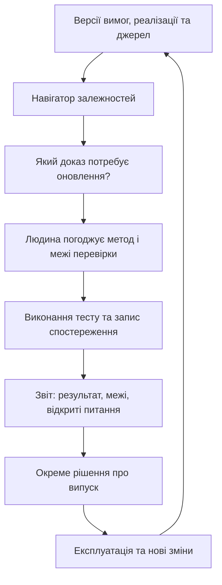
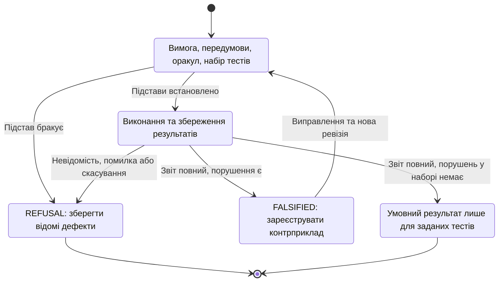
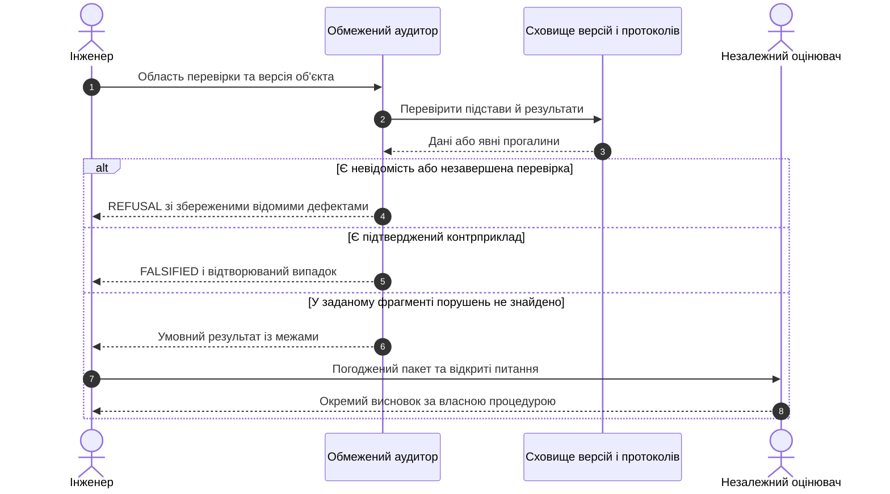
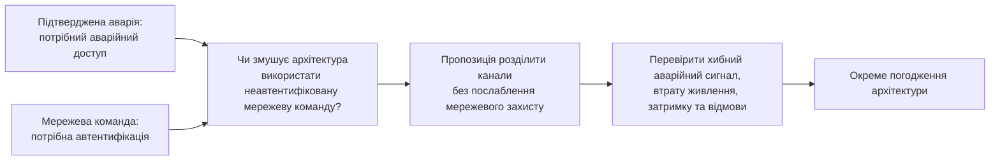
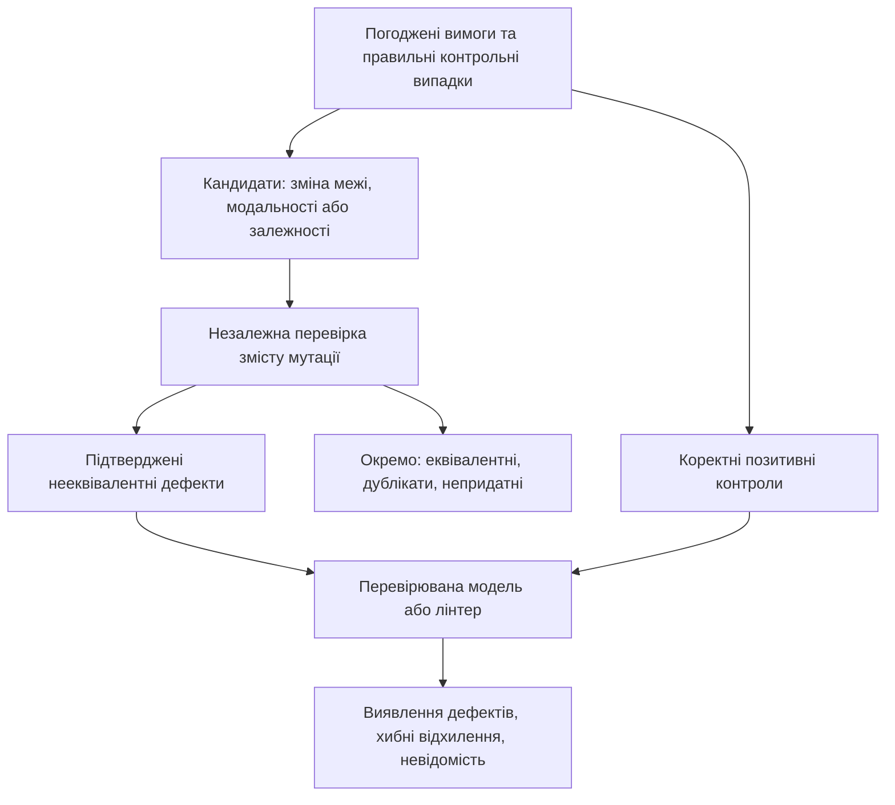
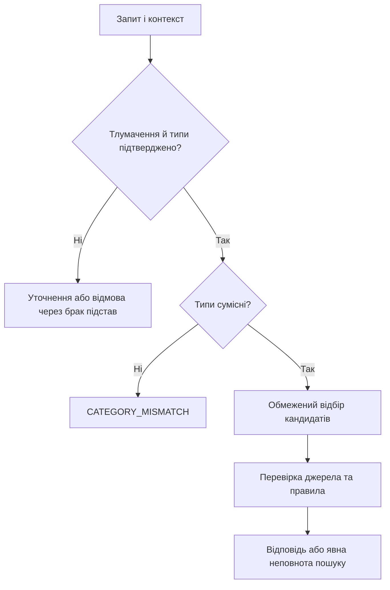
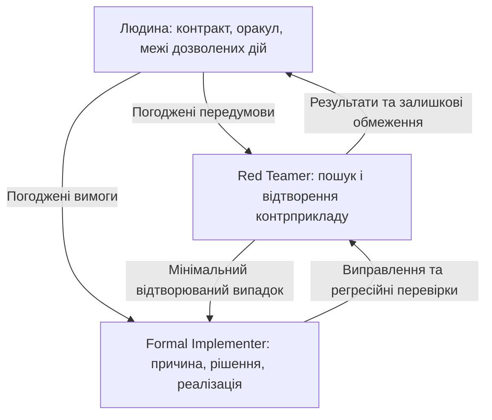

# Глава 39. Активний експерт-тестувальник: попперівська фальсифікація, нормативний комплаєнс (ASPICE/ISO 26262/ISO 21434) та автономне проєктування випробувань

> **Книга:** [Архітектура доказових експертних систем](README.md) · [Частина V: Верифікація, тестування, навчання та обґрунтування безпеки](part-05-verification-and-learning.md)
> **Попередня глава:** [Глава 26. Неперервне навчання (Continual Learning) на досвіді та подолання зсуву системного журналу](ch26-continual-learning.md)
> **Наступна глава:** [Глава 27. Обґрунтування безпеки: синтез і перевірка аргументів](ch27-safety-case-gsn-synthesis.md)
> **Зміст книги:** [README.md](README.md)
> **Автор:** [Микола Мартинович Федчик](about-the-author.md)
> **Передумови:** умовні оператори, множини, частки та поняття вимоги й тесту. Потрібні логічні позначення пояснено в §3; для практикуму §8 достатньо базового Go.
> **Очікувані результати:** побудувати тест із перевірним очікуванням; відрізнити пропозицію мовної моделі від виконаного випробування; зберегти й перевірити контрприклад; обчислити покриття та пояснити межі висновку. Складніші приклади стосуються підготовки матеріалів аналізу ризиків і незалежного аудиту, а не автоматичної сертифікації.

---

## Анотація

Активний аудитор доповнює рушій виведення експертної системи: він не лише відповідає на запит, а й шукає, яких перевірок бракує для заявленої вимоги. Наприклад, вимогу «прострочені дані не допускаються до використання» не перевіряє один тест зі свіжими даними. Потрібні також прострочений вхід, точна гранична умова та незалежно заданий очікуваний результат. Інакше таблиця успішних тестів приховує неперевірений випадок.

У цій монографії автором запропоновано поєднати активний пошук контрприкладів, ощадливе розширення моделі знань і розподіл ролей між генератором тестів, детермінованим перевірником та людиною [[8]](#src-8). Глава послідовно переходить від вимоги до тесту, від спостереження до контрприкладу, а потім до звіту й обмеженого Go-аудитора. Окремо розглянуто підготовку матеріалів функціональної безпеки та кібербезпеки. Пройдена скінченна серія тестів, точна цитата або цифровий підпис не є самі по собі доказом істинності, фізичної безпечності чи нормативної відповідності.

---

## 1. Драма комплаєнс-інженерії: чому ручні методи вичерпали себе

Проблема ручного комплаєнсу виникає не від самого використання таблиць, а від втрати зв'язку між вимогою, реалізацією та доказом після змін. Комплаєнс тут означає обґрунтовану відповідність застосовним вимогам. Якщо змінено граничний вік даних, але старий тест лишився зеленим, наявність запису в таблиці ще нічого не говорить про нову версію.

У різних галузях застосовують різні рамки: Automotive SPICE 4.0 для оцінювання процесів [[2]](#src-2), ISO 26262:2018 для функціональної безпеки автомобільних електричних та електронних систем [[3]](#src-3), ISO/SAE 21434:2021 для інженерії кібербезпеки транспортних засобів [[4]](#src-4), DO-178C / ED-12C для авіаційного ПЗ [[5]](#src-5). Це не взаємозамінні сертифікати. У главі наведено навчальні способи організації перевірок, а не дослівний виклад їхніх нормативних положень; конкретну вимогу слід звіряти із застосовною редакцією офіційного тексту.

### 1.1. Тягар персональної відповідальності інженера з безпеки
Відповідальність інженера з безпеки потребує зрозумілих підстав для кожного підписаного висновку. Вона не зникає після автоматизації; її юридичний обсяг залежить від ролі, договору та юрисдикції, а не визначається цією главою.

Для перевірного звіту потрібно:
1. Назвати розглянуті небезпеки, умови експлуатації та критерії прийнятності залишкового ризику.
2. Зберегти відомі загрози, прийняті заходи й невирішені питання, не оголошуючи всі можливі атаки нейтралізованими.
3. Пов'язати кожну заяву з доказом (*objective evidence*): версією об'єкта, процедурою перевірки, очікуванням, фактичним результатом та межами застосування.

### 1.2. Трудомісткість рутинних людино-годин: TARA, SAR, DFAR та HARA
Трудомісткість підготовки документів пояснюється тим, що одна зміна може зачепити кілька видів доказів. Таблиця розрізняє їх за запитанням, на яке вони відповідають; назва документа сама по собі не встановлює його достатності для аудиту.

<a id="obj-39-1"></a>
**Таблиця 39.1. Призначення матеріалів аналізу ризику й оцінювання безпеки.**

| Артефакт | Галузевий контекст | Сутність та інженерне наповнення | Рутинний виклик для інженера |
| :--- | :--- | :--- | :--- |
| **HARA** (*Hazard Analysis and Risk Assessment*) | Функціональна безпека | Які небезпечні події можливі та які цілі безпеки потрібні? | Підтримка переліку сценаріїв після зміни функції. |
| **TARA** (*Threat Analysis and Risk Assessment*) | Кібербезпека | Які активи, загрози й шляхи атак слід розглянути? | Зіставлення компонентів, інтерфейсів та актуальних загроз. |
| **SAR** (*Safety Assessment Report*) | Оцінювання безпеки | Які висновки підтримані доказами та що лишилося відкритим? | Перевірка актуальності й достатності протоколів. |
| **DFAR / DFMEA / FMEDA** | Аналіз відмов конструкції та апаратури | Які відмови можливі, які їхні наслідки та що виявляє діагностика? | Перерахунок категорій та інтенсивностей відмов після зміни конструкції. |

Наприклад, зміна датчика вимагає перевірити його режими відмов, переглянути залежні тести й оновити посилання у звіті. Автоматизація пошуку цих залежностей корисна, але скорочення людино-годин потрібно вимірювати на конкретному процесі; універсальної частки економії тут не встановлено.

### 1.3. Феномен людської втоми та ризики формального комплаєнсу
Втома під час повторюваного звіряння підвищує ризик пропуску, але не означає неминучої недоброчесності інженера. «Театром відповідності» (*compliance theatre*) тут названо ситуацію, коли формальна позначка виконання підміняє перевірку змісту.

Навчальний приклад: у звіті стоїть «тест є», хоча тест перевіряє стару версію функції. Потрібно не додати ще одну позначку, а зв'язати вимогу з чинною реалізацією, повторно виконати перевірку та зберегти результат. Саме це готує наступне питання: як система може сама помітити потребу в новому тесті?

---

## 2. Зсув парадигми: від пасивного довідника до інтерактивного гіда життєвого циклу продукту

Перехід до активного супроводу означає, що приводом для перевірки стає зміна артефакта, а не лише запитання користувача. Пасивна довідка лишається корисною, проте не нагадує про забутий тест сама собою. Активний модуль порівнює нову версію вимоги з попередньою та ставить конкретне запитання про наслідки зміни.

Якщо допустимий вік даних змінено з 10 до 8 мс, аудитор знаходить залежний тест на межі 10 мс і позначає його для перегляду. Це виявлення залежності, а не автоматичне доведення правильності нової межі. Для такого супроводу потрібні версійовані вимоги, карта залежностей і визначений відповідальний за рішення.

### 2.1. Концепція проактивного доказового супроводу життєвого циклу

Проактивний доказовий супровід поєднує спостереження за змінами з постановкою перевірних запитань. У запропонованій авторській моделі навігатор виконує три дії: знаходить змінений артефакт, визначає залежні вимоги й запитує відсутній доказ. Він не може надійно вказати невиконану норму, доки не перевірено її застосовність і зв'язок із першоджерелом.

> [!NOTE]
> **Три принципи проактивного доказового супроводу життєвого циклу за моделлю автора**
> 1. *Сканування артефактів*: авторська модель передбачає пошук змін у визначеному наборі вимог, коду й протоколів.
> 2. *Сократівський діалог*: запитання вимагає назвати умову відмови, очікування й спосіб спостереження.
> 3. *Нормативне скеровування*: підтверджена застосовна норма пов'язується з доказом; невідомість лишається відкритим питанням.
> *Інженерний інваріант:* Зміна залежності позначає доказ для повторної перевірки, а не автоматично робить виріб відповідним або невідповідним.

<a id="obj-39-2"></a>
**Діаграма 39.2. Активний супровід без передачі системі повноважень сертифікації.**



---

### 2.2. Рольова матриця учасників життєвого циклу безпеки

Рольова матриця потрібна, щоб запитання аудитора отримало відповідального адресата. Одна людина може поєднувати кілька ролей; таблиця описує розподіл роботи, а не вимогу мати певну посаду для розуміння глави.

<a id="obj-39-3"></a>
**Таблиця 39.3. Ролі та межі автоматизованої допомоги.**

| Інженерна роль у проєкті | За що відповідає в цьому прикладі | Як допомагає активна експертна система |
| :--- | :--- | :--- |
| Керівник проєкту | План перевірок і незакриті питання | Зводить актуальні статуси, не обіцяючи дату завершення без оцінки робіт. |
| Фахівець із функціональної безпеки | Небезпеки, моделі відмов, підстави розрахунків | Перераховує метрики за погодженими даними. |
| Фахівець із кібербезпеки | Загрози, шляхи атак, заходи захисту | Пропонує сценарії для аналізу, не оголошує їх перелік вичерпним. |
| Архітектор | Передумови й сумісність вимог | Показує суперечні умови та залежні рішення. |
| Тестувальник | Вхід, оракул, виконання, результат | Генерує граничні випадки й зберігає зв'язок тесту з вимогою. |

---

### 2.3. Довготривалий супровід продукту на етапі експлуатації (Post-SOP)

Супровід після початку серійного виробництва (*Start of Production*, SOP) потрібний тому, що доказ стосується конкретної версії та умов використання. Тривалість експлуатації залежить від виробу; фіксований діапазон років не є передумовою методу.

1. **Оновлення ПЗ:** зміна реалізації запускає аналіз залежностей і повторні тести. Зелений старий протокол не переноситься автоматично на нову прошивку.
2. **Заміна компонента:** нові дані про відмови потребують перевірки походження, умов вимірювання та повторного розрахунку, а не лише підстановки числа.
3. **Нові вразливості:** перелік компонентів (*Software Bill of Materials*, SBOM) зіставляється з повідомленнями про вразливості. Збіг назви є приводом для аналізу застосовності, не готовим доказом експлуатованості.
4. **Оновлення нормативів:** змінена редакція джерела позначає залежні правила для повторного експертного розгляду. Автоматичне порівняння текстів не встановлює саме по собі зміни юридичних обов'язків.

Отже, навігатор підтримує актуальність доказів. Наступний крок полягає у виборі достатньої глибини перевірки для конкретного ризику.

### 2.4. Шкала градації епістемічної суворості (`ERL-1`..`ERL-4`) для гнучкої розробки Agile / CI/CD

Шкала суворості допомагає розрізнити дослідницьку пропозицію та рішення, на підставі якого дозволено дію. У цій монографії автором запропоновано чотири профілі *Epistemic Rigor Levels* (ERL). Це авторська організаційна модель, не шкала ISO чи Automotive SPICE і не гарантія певної тривалості перевірки в автоматизованому конвеєрі інтеграції та постачання (CI/CD).

<a id="obj-39-4"></a>
**Таблиця 39.4. Авторські профілі суворості та дозволені висновки.**

| Профіль | Мінімальна дія у цій моделі | Межа результату |
|---|---|---|
| `ERL-1`, дослідницький | Позначити гіпотезу, джерела й неперевірені передумови | Немає дозволу на виробничу дію. |
| `ERL-2`, простежуваний | Додати перевірку цитат, версій, тестів і відмов за невідомості | Цілісність запису не доводить істинності джерела. |
| `ERL-3`, формалізований | Перевірити застосовність правил, суперечності та припущення моделі | Висновок обмежений формалізацією. |
| `ERL-4`, фізично перевірюваний | Додати погоджений стендовий протокол та незалежний контроль післяумови | Випробуваний виріб і умови не репрезентують автоматично всю експлуатацію. |

> [!NOTE]
> **Чотири рівні градації епістемічної суворості (`ERL-1`..`ERL-4`) за методологією автора**
> 1. **`ERL-1`:** авторський профіль зберігає гіпотезу як непідтверджену.
> 2. **`ERL-2`:** додає простежуваність і блокування непідтверджених тверджень у визначеному процесі.
> 3. **`ERL-3`:** додає формальний аналіз із явними припущеннями.
> 4. **`ERL-4`:** додає перевірку фізичної поведінки за погодженим протоколом.
> *Інженерний інваріант:* Перемикання назви профілю не замінює виконання його перевірок і не створює сертифікації.

Наприклад, модель може запропонувати тест прострочених даних у `ERL-1`, але для наступного профілю потрібні чинна вимога й відтворений результат. Для фізичного виконавця додається незалежне спостереження дії. Тепер потрібно визначити, що саме може спростувати перевірюване твердження.

---

## 3. Математичний апарат попперівської фальсифікації інженерних гіпотез

Математичний опис фальсифікації потрібний, щоб перетворити загальне запевнення «система працює правильно» на перевірне твердження. Принцип фальсифікованості Карла Поппера [[1]](#src-1), [[9]](#src-9) спонукає шукати умови, за яких твердження буде спростовано. Один відтворений контрприклад у межах передумов спростовує універсальну гіпотезу; відсутність знайденого контрприкладу в скінченній серії тестів не доводить її істинності чи нормативної відповідності. Доказ у моделі потребує окремого обґрунтування повноти перевірки та зв'язку моделі з реалізацією.

### 3.1. Формалізація інженерної гіпотези
Формалізація гіпотези починається з питання: яке спостереження змусить відкинути твердження? Замість загального «модуль безпечний» візьмемо навчальний контракт: «дані віком не більше 10 мс допускаються, старіші відхиляються». Поріг 10 мс обрано для прикладу, не взято зі стандарту. Оракулом тесту називається незалежно заданий спосіб отримати очікувану відповідь; він не повинен просто повторювати код, який перевіряє.

Потрібно перевірити універсальність контракту в оголошеній області станів. Символ $\forall$ означає «для кожного», а $\implies$ означає «якщо передумова істинна, має виконуватися наслідок».

<a id="obj-39-5"></a>
**Формула (39.5). Гіпотеза про виконання контракту в заданій області.**

```math
\mathcal{H} \equiv \forall s \in \mathcal{S}, \quad \mathrm{StateValid}(s) \implies \mathrm{SafetyGoalSatisfied}(s)
```

Тут $`\mathcal{H}`$ є логічним твердженням; $`\mathcal{S}`$ є оголошеною непорожньою областю станів; $s$ є її елементом. Предикат $`\mathrm{StateValid}`$ визначає допустимі умови випробування, а $`\mathrm{SafetyGoalSatisfied}`$ означає відповідність фактичного виходу очікуванню; обидва мають значення «істина» або «хиба». У прикладі стан містить цілий вік даних від 0 до 20 мс та вихід «допустити/відхилити». Прострочені дані належать області перевірки: їх не можна вилучити передумовою й тим самим зробити негативний тест порожнім.

Для віку 9 мс оракул очікує допуск, для 10 мс також допуск, для 11 мс відмову. Якщо модуль допускає вхід 11 мс, цей стан спростовує контракт. Якщо пройдено лише ці три тести, інші стани ще не перевірені. Навіть повний перебір цілих значень віку не охоплює неврахованої конкурентності чи похибки годинника.

Щоб зв'язати контракт із джерелом, потрібен запис правила. Деонтична модальність вказує, чи дія обов'язкова, заборонена, рекомендована або дозволена; її тлумачення береться з конкретного джерела.

<a id="obj-39-6"></a>
**Формула (39.6). Запис нормативної підстави в авторській моделі аудитора.**

```math
\mathcal{K} = \lbrace \nu_1, \nu_2, \dots, \nu_m \rbrace, \quad \nu_i = \langle \mathrm{Domain}, \mathrm{Clause}, \mathrm{Entity}, \mathrm{Modality}, \mathrm{Action}, \mathrm{Evidence} \rangle
```

Тут $`\mathcal{K}`$ є скінченною множиною правил; $m$ є невід'ємною цілою кількістю, а індекс $i$ пробігає від 1 до $m$. Правило $`\nu_i`$ містить предметну область `Domain`, редакцію й адресу положення `Clause`, об'єкт `Entity`, модальність `Modality`, дію `Action` та підставу `Evidence`. Це записи, а не фізичні величини. Навчальні позначки модальностей: `MUST`, `MUST_NOT`, `SHOULD`, `MAY`; код §8 підтримує лише перші дві. Застосовність, умови й винятки мають бути встановлені окремо до оцінювання.

Наприклад, синтетична специфікація наказує модулю відхиляти прострочені дані. Запис містить її версію та точну цитату. Якщо джерела немає або область застосування невідома, правило не можна використати для позитивного висновку. Порожня база також не є доказом відсутності обов'язків.

### 3.2. Пошук потенційного фальсифікатора (Potential Falsifier)

Пошук фальсифікатора має повернути не лише назву порушеної вимоги, а й випадок, на якому його можна повторити. У цьому розділі розглядається скінченний набір виконаних тестів; для кожного з них відомі чинна вимога, передумови та незалежно встановлене очікування.

<a id="obj-39-7"></a>
**Формула (39.7). Знайдені контрприклади в межах виконаного набору.**

```math
\mathcal{F}(\mathcal{H},\mathcal{K};\mathcal{T},O)
= \lbrace (s,\nu) \in \mathcal{T}\times\mathcal{K}
\mid \mathrm{Applicable}(\nu,s) \land O(\nu,s)=\mathrm{VIOLATION} \rbrace
```

Тут $`\mathcal{H}`$ і $`\mathcal{K}`$ визначено вище; $`\mathcal{T}\subseteq\mathcal{S}`$ є скінченним набором виконаних випадків, не всіма можливими тестами. $\nu$ є правилом, $s$ є випадком, а $\times$ означає множину пар. Предикат $`\mathrm{Applicable}`$ істинний лише за підтверджених передумов. Оракул $O$ порівнює зафіксований вихід із очікуванням і повертає `SATISFIED`, `VIOLATION` або `UNKNOWN`. Пара з `UNKNOWN` не входить до множини спростувань, але робить оцінювання неповним. Усі результати логічні, без одиниць; час і ресурси реєструються окремо.

Для тесту 11 мс з помилковим допуском оракул повертає `VIOLATION`, а множина містить пару «цей тест, правило відмови». Перед підтвердженням дефекту слід перевірити налаштування стенду й оракул: помилково задане очікування не є спростуванням реалізації. Мінімізація контрприкладу означає вилучення зайвих входів зі збереженням відтворюваного порушення, а не вилучення незручних передумов.

#### 1. Керування потоком верифікації та вердикти системи

Керування перевіркою має розрізняти знайдений дефект і повноту звіту. Для узгодження з кодом §8 використаємо консервативний пріоритет: незавершений аудит завжди повертає `REFUSAL`, але не губить уже знайдених порушень.

<a id="obj-39-8"></a>
**Формула (39.8). Вердикт обмеженого аудитора.**

```math
\mathrm{Verdict}=\begin{cases}
\mathrm{REFUSAL}, & C=0,\\
\mathrm{FALSIFIED}, & C=1\ \land\ V>0,\\
\mathrm{PROVISIONALLY\_CORROBORATED}, & C=1\ \land\ V=0.
\end{cases}
```

Тут $C$ є безрозмірною ознакою з множини $\{0,1\}$: одиниця означає, що всі перевірки оголошеного непорожнього застосовного фрагмента завершені, їхні підстави перевірені й немає невідомих результатів. $V$ є невід'ємною цілою кількістю збережених порушень; за повного аудиту це потужність множини (39.7). Назви вердиктів є статусами, не оцінками ймовірності.

Наприклад, один відтворений дефект і повний звіт дають `FALSIFIED`. Той самий дефект разом із таймаутом іншої перевірки дає `REFUSAL` та збережений запис дефекту: таймаут не скасовує спростування, але забороняє заявляти повний перелік. Нуль порушень за повного виконання заданих тестів дає лише умовне підтвердження в цих межах. Жоден із трьох статусів сам не відкриває фізичний виконавчий тракт або реліз.

<a id="obj-39-9"></a>
**Діаграма 39.9. Завершення пошуку не перетворює тестування на доказ.**



#### 2. Апаратний сайзинг та латентність
Ресурсний бюджет потрібний, щоб перевірка не тривала безмежно. Його встановлюють для конкретної реалізації та навантаження; індекс правил сам по собі не доводить часової межі. Наприклад, якщо навчальний запуск обмежено 2 с і він не завершився, результат є неповним незалежно від кількості вже пройдених тестів. Необхідно зберегти ліміт, фактичний час, причину зупинки й знайдені дефекти. Ці 2 с є умовою прикладу, не апаратною гарантією.

#### 3. Практичний числовий приклад
Числовий приклад завершує початкову задачу: для контракту 10 мс виконано випадки 9, 10 і 11 мс. Очікування: «допустити, допустити, відхилити». Фактичні виходи дефектної версії: «допустити, допустити, допустити». Є один контрприклад із трьох виконаних випадків; гіпотезу спростовано без потреби оцінювати відсоток істинності. Після виправлення всі три виходи збігаються з очікуванням, але це лише регресійний результат цих трьох випадків. Далі потрібно оцінити, чи модель знань справді допомагає будувати змістовні перевірки.

### 3.3. Принцип антитеоретичного дрейфу та ощадливого моделювання онтологій знань

Ощадливе моделювання потрібне, коли нові поняття збільшують складність бази знань, але не допомагають розрізняти правильну й хибну поведінку. Такий відрив абстракцій від перевірюваної задачі тут названо теоретичним дрейфом. Авторський принцип антитеоретичного дрейфу вимагає показати користь нового поняття на конкретному дефекті. Він не стверджує, що кожне розширення онтології неодмінно спричиняє експоненційну складність.

#### 3.3.1. Критерій попперівської фальсифікованості онтології та правило епістемічної необхідності

Критерій перевірки онтології має враховувати не тільки виявлення помилок, а й збереження правильних випадків. Спочатку візьмемо непорожній набір випадків, чию некоректність установлено незалежно від перевірюваної моделі.

<a id="obj-39-10"></a>
**Формула (39.10). Частка виявлених дефектних випадків.**

```math
\mathrm{RejectionRate}(\mathcal{M},\mathcal{C})=
\frac{\lvert\{c\in\mathcal{C}:\mathcal{M}\text{ виявила заданий дефект у }c\}\rvert}{\lvert\mathcal{C}\rvert}
```

Тут $`\mathcal{M}`$ є версією перевірюваної моделі, $`\mathcal{C}`$ є скінченною множиною незалежно розмічених дефектних випадків, $c$ є одним випадком, а вертикальні дужки означають кількість елементів. Знаменник додатний; частка безрозмірна, від 0 до 1. Відмова через таймаут чи невідомість не зараховується як виявлення потрібного дефекту. Навчальні 42 виявлення зі 100 дають 0,42 та 58 пропусків; 100 зі 100 дають 1,00 лише на цьому корпусі, не нормативний поріг істинності.

Щоб перевірник не «виграв» просто відмовою на всі входи, потрібен другий, непорожній набір завідомо коректних випадків.

<a id="obj-39-11"></a>
**Формула (39.11). Частка помилкових відхилень коректних випадків.**

```math
\mathrm{FalseRejectionRate}(\mathcal{M},\mathcal{P})=
\frac{\lvert\{p\in\mathcal{P}:\mathcal{M}\text{ помилково відхилила }p\}\rvert}{\lvert\mathcal{P}\rvert}
```

Тут $`\mathcal{P}`$ є скінченною непорожньою множиною незалежно розмічених коректних випадків, $p$ є її елементом, а $`\mathcal{M}`$ має те саме значення, що вище. Частка безрозмірна, від 0 до 1. Наприклад, 2 помилкові відхилення з 50 дають 0,04, тобто 4%. Невизначені результати слід звітувати окремою кількістю, не вилучати зі знаменника потай. Два показники разом розрізняють чутливість до дефектів і надмірну суворість; вони не визначають майбутню надійність без моделі вибірки.

Правило епістемічної необхідності (*Lex Parsimoniae*) ставить інше питання: чи потрібний новий предикат для зафіксованої прогалини? Перевіряється не тільки одиничний старий предикат, а й можливість виразити потрібну умову їх композицією.

<a id="obj-39-12"></a>
**Формула (39.12). Обґрунтування розширення базису предикатів.**

```math
\forall p\in\Delta\mathcal{P},\quad\exists e\in\mathcal{E}_{\mathrm{deficit}}:
\mathrm{Resolves}(p,e)\land\neg\mathrm{Expressible}(\mathcal{P}_{\mathrm{existing}},e)
```

Тут $`\Delta\mathcal{P}`$ є скінченним набором запропонованих нових предикатів, $p$ є пропозицією, $`\mathcal{E}_{\mathrm{deficit}}`$ є набором задокументованих прогалин, $e$ є однією прогалиною. $`\mathcal{P}_{\mathrm{existing}}`$ є чинним базисом. Логічні відношення $`\mathrm{Resolves}`$ та $`\mathrm{Expressible}`$ означають відповідно «усуває прогалину» й «дозволяє виразити умову в обраному формалізмі»; $\exists$ означає існування, $\land$ спільне виконання, $\neg$ заперечення. Це критерій інженерного перегляду без одиниць, не загальний алгоритм автоматичного доведення невиразності.

Наприклад, якщо вже є порівняння віку з межею, новий клас «актуальний стан» може бути лише назвою композиції, а не новою логікою. Якщо ж немає способу описати невідомий час вимірювання, це окрема прогалина: новий предикат потрібно обґрунтувати тестом із відсутньою часовою міткою.

> [!NOTE]
> **Два постулати принципу антитеоретичного дрейфу та ощадливого моделювання за моделлю автора**
> 1. *Перевірність онтології*: в авторській моделі нові поняття оцінюються на незалежно розмічених дефектних і коректних випадках; результати не поширюються автоматично за межі корпусу.
> 2. *Епістемічна необхідність*: розширення має відповідати задокументованій прогалині, яку не покриває чинний базис у визначеному формалізмі.
> *Інженерний інваріант:* Необґрунтована пропозиція повертається на перегляд; автоматичний контроль метаданих не оголошується доказом семантичної надлишковості.

#### 3.3.2. Замкнений цикл інженерного розрахунку ощадливості онтології

Замкнений цикл ощадливості завершується порівнянням моделей на однакових даних, а не декларацією простоти. У навчальному прикладі стара модель виявляє 42 зі 100 дефектів, нова 100 зі 100; на 50 коректних випадках стара не помиляється, нова помилково відхиляє 2. Новий варіант краще виявляє задані дефекти, але потребує аналізу двох хибних відхилень. Ці числа є умовною ілюстрацією, не стендовим вимірюванням.

Для відтворення порівняння фіксуються версії моделей, точний корпус, розмітка, налаштування та час. Мала глибина онтології сама по собі не гарантує лінійного часу, певного обсягу пам'яті чи мікросекундної реакції. Встановивши межі перевірки моделі, можна перейти до того, як її результати включити в інженерні документи.

---

## 4. Автоматизація генерації артефактів TARA, SAR та DFAR через доменні правила

Автоматизована підготовка артефактів потрібна, щоб перевірений результат не втрачав своєї підстави під час перенесення у звіт. Система може зібрати чернетку, перелік джерел і незакритих питань. Вона не перетворює неповні вихідні дані на повну оцінку ризику й не замінює незалежного оцінювання. Нижче від простого опису загрози перейдемо до розрахунку відмов і лише потім до підсумкової аргументації.

### 4.1. Автоматизація TARA (ISO/SAE 21434): від опису системи до матриці ризиків

Автоматизація TARA починається із запитання «що саме потрібно захистити?», а не з готового бала ризику. Навчальна послідовність нижче показує підготовку даних для аналізу загроз; вона не відтворює обов'язкову структуру конкретного пункту ISO/SAE 21434 [[4]](#src-4).

#### 4.1.1. Визначення активів (Asset Identification)
Визначення активів встановлює, втрата якої інформації або функції матиме наслідки. Наприклад, у навчальному сервісі оновлень активом є образ ПЗ, справжність якого потрібно зберегти. Парсер опису системи пропонує активи, а відповідальна людина перевіряє пропуски: документ може не містити всіх фактичних інтерфейсів.

#### 4.1.2. Сценарії загроз (Threat Scenario Identification)
Сценарій загрози пов'язує актив із порушеною властивістю та наслідком. Для цього достатній простий запис, який не слід плутати з оцінкою ймовірності атаки.

<a id="obj-39-13"></a>
**Формула (39.13). Навчальне подання сценарію загрози.**

```math
\mathrm{Threat} = \langle \mathrm{Asset}, \ \mathrm{Property}, \ \mathrm{Damage} \rangle
```

Тут `Threat` є записом сценарію, `Asset` є ідентифікованим активом, `Property` є потрібною властивістю, наприклад цілісністю чи доступністю, а `Damage` є описом шкоди. Усі поля текстові, одиниць вимірювання немає. Для образу ПЗ прикладом є трійка «образ оновлення; справжність; встановлення підробленого ПЗ». Результат задає питання для тесту перевірки підпису, але ще не доводить досяжності атаки або повноти переліку загроз.

#### 4.1.3. Аналіз шляхів та складності атаки (Attack Path Analysis & Feasibility)
Аналіз шляху атаки з'ясовує, як загроза може реалізуватися. У прикладі потрібно встановити, хто може змінити файл оновлення, куди його подає та чи дістається файл перевірника підпису. Якщо інтерфейс недосяжний за оголошених передумов, це інший висновок, ніж успішне блокування підробки. Числові бали допустимі лише за названою й перевіреною шкалою; без неї лишається якісний опис і питання для дослідження.

#### 4.1.4. Формування підсумкової матриці TARA
Підсумкова матриця збирає актив, сценарій, шлях атаки, запропонований захист, тест і відкриті припущення. Для підробленого образу в ній зазначається очікування «відхилити до встановлення» й окреме спостереження фактичної версії ПЗ після тесту. Автоматично заповнений рядок є чернеткою для перегляду, не сертифікатом відсутності інших загроз.

### 4.2. Автоматизація DFAR та FMEDA (ISO 26262): математична строгість метрик

Математична строгість FMEDA починається з класифікації відмов, а не з порівняння довільного відсотка з порогом. FMEDA (*Failure Modes, Effects and Diagnostic Analysis*) пов'язує вид відмови, наслідок і діагностичний захід. Діагностичне покриття окремого механізму не є автоматично метрикою всього виробу.

Для навчального розрахунку приймемо сталу інтенсивність відмов і взаємовиключні категорії, визначені щодо однієї функції безпеки. FIT означає одну відмову на мільярд годин роботи сукупності порівнюваних компонентів. Це одиниця інтенсивності, не ймовірність відмови за один запуск. Наведені нижче спрощені агреговані моделі пояснюють знаменники; виробничий розрахунок і пороги потрібно звірити з офіційним текстом ISO 26262 та профілем виробу. Нормативної перевірки цих положень у главі не заявлено.

#### 4.2.1. Метрика одноточкових відмов (SPFM)

Метрика одноточкових відмов відображає частку врахованої інтенсивності, яка не припадає на одноточкові та залишкові небезпечні відмови. Перед додаванням слід перевірити, що одну відмову не зараховано в дві категорії.

<a id="obj-39-14"></a>
**Формула (39.14). Навчальний агрегований розрахунок SPFM.**

```math
\mathrm{SPFM}=1-\frac{\Lambda_{\mathrm{SPF}}+\Lambda_{\mathrm{RF}}}{\Lambda_{\mathrm{total}}}
```

Тут $`\Lambda_{\mathrm{total}}>0`$ є сумою інтенсивностей врахованих відмов апаратури, $`\Lambda_{\mathrm{SPF}}\ge0`$ є інтенсивністю одноточкових небезпечних відмов, $`\Lambda_{\mathrm{RF}}\ge0`$ є інтенсивністю залишкових небезпечних відмов, не усунених діагностикою. Усі три величини вимірюються у FIT, сума двох останніх не перевищує загальної. Метрика безрозмірна, від 0 до 1; вона не є ймовірністю безвідмовної роботи всієї системи.

У навчальному прикладі загальна інтенсивність становить 120 FIT, одноточкова 1 FIT, залишкова 0,9 FIT. Віднявши частку 1,9/120 від одиниці, отримаємо приблизно 0,98417, або 98,42%. Якщо *припущений проєктний* поріг становить 99%, бракує приблизно 0,58 відсоткового пункту. Це порівняння з умовою прикладу, не висновок про ASIL чи сертифікацію.

#### 4.2.2. Метрика латентних відмов (LFM)

Метрика латентних відмов потребує іншого знаменника: після вилучення одноточкових і залишкових категорій оцінюється частка, не пов'язана з прихованими багатоточковими відмовами. Позитивне значення SPFM не дозволяє пропустити цей окремий розрахунок.

<a id="obj-39-15"></a>
**Формула (39.15). Навчальний агрегований розрахунок LFM.**

```math
\mathrm{LFM}=1-\frac{\Lambda_{\mathrm{MPF,lat}}}
{\Lambda_{\mathrm{total}}-\Lambda_{\mathrm{SPF}}-\Lambda_{\mathrm{RF}}}
```

Тут $`\Lambda_{\mathrm{MPF,lat}}`$ є невід'ємною інтенсивністю латентних багатоточкових відмов у FIT; решту величин визначено після (39.14). Знаменник має бути додатним, чисельник не більшим за нього. Результат безрозмірний, від 0 до 1. Якщо знаменник нульовий, значення не обчислюється: потрібен перегляд області розрахунку, а не підстановка 100%.

За попередніх даних знаменник дорівнює 118,1 FIT. При латентній інтенсивності 8 FIT частка 8/118,1 становить приблизно 0,06774, тож LFM дорівнює приблизно 0,93226, або 93,23%. При *навчальному* порозі 90% ця перевірка проходить, хоча попередня перевірка SPFM не проходить. Отже, одну метрику не можна підмінити іншою.

Авторський метод зворотного діагностичного трасування (*Diagnostic Backtracking*) пропонує знайти категорії, що дали дефіцит, і перевірити можливі зміни. Якщо підтверджено перенесення 1,2 FIT із небезпечних до захищених категорій без зміни загальних 120 FIT, небезпечний залишок зменшується до 0,7 FIT, а SPFM зростає приблизно до 99,42%. Саме підвищення налаштування діагностичного покриття такого перенесення не доводить: потрібні дані про конкретні режими відмов і нові тести.

Невдалий розрахунок не забороняє складати звіт: у ньому має залишитися дефіцит. Статус `APPROVED_FOR_AUDIT` у запропонованому процесі означає лише готовність погодженого пакета до розгляду. Підпис підтверджує його походження та цілісність у межах довіри до ключа, не правильність моделі й не сертифікацію виробу.

### 4.3. Автоматизація SAR: доказове полотно для аудиторів TÜV / Dekra
Автоматизація SAR допомагає простежити, на чому тримається висновок оцінювання безпеки. У нотації **Goal Structuring Notation (GSN)** [[6]](#src-6) розрізняються ціль, стратегія обґрунтування та свідчення. Граф аргументів може бути частиною матеріалів звіту, але сама нотація не встановлює його достатності.

Для контракту віку даних ціллю буде «перевірено задану політику допуску у визначених умовах», стратегією є поділ на звичайний, граничний і прострочений вхід, а свідченнями є протоколи трьох випадків. Хеш протоколу допомагає виявити зміну байтів; він не підтверджує, що стенд правильно виміряв час. У звіті лишаються передумови та неперевірені випадки.

<a id="obj-39-16"></a>
**Діаграма 39.16. Підготовка пакета доказів із явною гілкою неповноти.**



Тепер зрозуміло, як зібрати підстави для окремої вимоги. Наступна складність виникає, коли дві вимоги задають несумісну поведінку в однаковому стані.

---

## 5. Розв'язання фундаментального протиріччя: функціональна безпека проти кібербезпеки

Протиріччя між функціональною безпекою та кібербезпекою потрібно шукати в конкретних умовах, а не вважати ці дисципліни несумісними взагалі. Розглянемо навчальний шлюз: проєктна вимога аварійного доступу очікує розблокування за підтвердженої аварії, а проєктна вимога мережевого захисту забороняє виконувати неавтентифіковані мережеві команди. Це не цитати ISO 26262 чи ISO/SAE 21434. Колізія виникне, якщо аварійний доступ помилково реалізовано лише через ту саму мережеву команду.

<a id="obj-39-17"></a>
**Діаграма 39.17. Навчальна колізія проєктних вимог і перевірка запропонованого розділення каналів.**



### 5.1. Розв'язання колізій вимог детермінованим ядром експертної системи
Розв'язання колізії починається з перевірки, чи обидві вимоги справді застосовні до тієї самої дії в той самий момент. Авторський метод пошуку міжнормативних заперечень (*Cross-Standard Defeater Mining*) пропонує зіставити умови, а не просто слова «дозволено» та «заборонено».

Для попереднього прикладу виконуємо три кроки. Спочатку фіксуємо, що сигнал аварії та мережева команда є різними входами. Потім перевіряємо припущення про незалежність аварійного каналу: чи не може мережевий нападник підробити цей сигнал? Нарешті порівнюємо очікувану й фактичну поведінку за нормальною роботою, аварією та хибним аварійним сигналом. Розділення каналів лишається кандидатним рішенням, доки ці питання відкриті; відсутність руху не є підставою скасувати автентифікацію.

У спростовній аргументації ASPIC+ можна заперечити засновок (*undermining*), висновок (*rebutting*) або застосовність правила переходу (*undercutting*). Абстрактні аргументаційні рамки Зунга [[7]](#src-7) дають загальний базис роботи з атаками на аргументи, але не є повною специфікацією ASPIC+. Приклад заперечення засновку: «аварійний сигнал незалежний» не підтверджено схемою. Правильне рішення тоді полягає у перегляді підстави, не в довільному призначенні пріоритету.

> [!NOTE]
> **Три етапи розв'язання колізій між функціональною безпекою та кібербезпекою за моделлю автора**
> 1. *Виявлення*: авторська модель зіставляє умови застосовності та несумісні дії.
> 2. *Аргументація*: окремо перевіряються засновки, висновки й застосовність правил, без приховування заперечень.
> 3. *Перегляд рішення*: пропозиція зміни архітектури проходить нові тести й погодження, а не отримує статус безпечної лише за результатом символічного арбітражу.
> *Інженерний інваріант:* Невирішена колізія лишається відкритою й не дозволяє позитивного висновку в залежній частині звіту.

Після розділення умов конфлікту можна конструювати тести саме для них. Наступний розділ пояснює, як залучити мовну модель до цього пошуку, не доручаючи їй установлювати правильну відповідь.

---

## 6. Нейро-символьний тандем тестувальника та автономна генерація тест-програм

Нейро-символьний тандем потрібний для розподілу двох різних задач: запропонувати незвичний випадок і перевірити його результат. Мовна модель (*System 1*) може запропонувати відсутню часову мітку або прострочений пакет. Детермінований перевірник (*System 2*) зіставляє виконання з погодженим контрактом. Якщо обидва компоненти отримали хибний контракт, детермінізм не виправить цю спільну помилку.

Паспорт тесту містить вимогу й версію об'єкта, вхід, початковий стан, передумову активації, оракул, спосіб вимірювання, критерій завершення та умови безпечного виконання. Потрібно розрізняти чотири речі:
1. **Активація тесту:** чи справді вхід дістався потрібної гілки реалізації? Якщо прострочений пакет відкинуто парсером раніше, це ще не тест перевірки віку.
2. **Очікувана поведінка:** оракул бере її з погодженої специфікації, а не з відповіді LLM чи поточного виходу програми.
3. **Фактична поведінка:** протокол зберігає спостереження. У фізичній системі відповідь API «команду прийнято» не доводить потрібної післяумови виконавця.
4. **Повноваження на дію:** придатність тесту не дозволяє автоматично запускати його на реальному виробі. Небезпечні впливи потребують ізоляції, погодженого стенду та окремого дозволу.

Негативний тест може навмисно порушувати формат або допустимий діапазон входу. Його мета тоді полягає у перевірці правильної відмови; відкидати всі такі тести як «ненормативні» означає втратити перевірку захисту. Межі безпечного стенду при цьому порушувати не можна.

### 6.1. Розрахунок повноти тестової програми (Traceability Coverage)

Повноту тестової програми не можна звести до кількості згенерованих текстів. Спочатку потрібно порахувати, для яких вимог узагалі є зв'язаний тест, а потім окремо зазначити його активацію, виконання, результат та якість оракула.

<a id="obj-39-18"></a>
**Формула (39.18). Покриття зв'язками «вимога — тест».**

```math
\mathrm{TraceabilityCoverage}=
\frac{\lvert\{r\in\mathcal{R}:\exists t\in\mathcal{T}\ (r,t)\in L\}\rvert}{\lvert\mathcal{R}\rvert}
```

Тут $`\mathcal{R}`$ є скінченною непорожньою множиною вимог оголошеної області, $`\mathcal{T}`$ є множиною зареєстрованих тестів, а $L$ є перевіреним відношенням трасованості між ними. Елементи $r$ і $t$ позначають відповідно вимогу й тест; $\exists$ означає наявність хоча б одного зв'язку. Знаменник рахує вимоги, не тести. Частка безрозмірна, від 0 до 1; для порожньої області вона не визначена.

У навчальній специфікації 142 вимоги, з них 141 має зв'язаний тест. Частка 141/142 дорівнює приблизно 0,99296, тобто 99,30%. Для незв'язаної вимоги формують завдання на тест, а не зараховують сам промпт як виконання. Якщо для останньої вимоги зареєстровано тест, покриття стає 100%, навіть коли цей тест ще не запускався або виявив дефект. Тому автоматичного `PASSED` нормативної відповідності з цього числа не випливає.

Для побудови граничних тестів повернімося до числового діапазону. Шеститочковий аналіз меж (*Boundary Value Analysis*, BVA), використаний в авторському процесі, перевіряє точки безпосередньо перед, на та після обох меж.

<a id="obj-39-19"></a>
**Формула (39.19). Шість кандидатних точок для дискретного діапазону.**

```math
\mathcal{V}_{\mathrm{BVA}}=\{x_{\min}-\varepsilon,x_{\min},x_{\min}+\varepsilon,
x_{\max}-\varepsilon,x_{\max},x_{\max}+\varepsilon\}
```

Тут $`x_{\min}\le x_{\max}`$ є включними межами допустимого входу, $\varepsilon>0$ є кроком його подання, а $`\mathcal{V}_{\mathrm{BVA}}`$ є множиною кандидатних тестових значень. Усі значення мають однакові одиниці; операції повинні виконуватися без машинного переповнення. Близькі межі можуть дати повтори, тож різних тестів буде менше шести. Точка поза діапазоном типу потребує тесту парсера чи ширшого подання, а не переповненої змінної.

Наприклад, навчальний параметр допустимий від 2 до 10 мс із кроком 1 мс. Точки: 1, 2, 3, 9, 10, 11 мс; очікування: відмова, допуск, допуск, допуск, допуск, відмова. Це підбір випадків, не доказ для всіх значень чи часових взаємодій.

Інший спосіб шукати слабкість перевірника полягає у мутації: навмисно змінити правильну вимогу, наприклад замінити «не більше» на «менше», та перевірити, чи контроль помітить зміну. До знаменника оцінки виявлення входять лише незалежно підтверджені змістовні дефекти; еквівалентні, дубльовані й некоректно утворені мутації обліковуються окремо. Інакше кількість мутацій не має однозначного змісту. Фаззинг, тобто автоматична генерація багатьох варіантів входу, також потребує незалежної властивості-оракула; класичний приклад такого підходу наведено в QuickCheck [[11]](#src-11).

<a id="obj-39-20"></a>
**Діаграма 39.20. Мутаційний корпус потребує незалежної розмітки й позитивних контролів.**



### 6.2. Категоріальні попперівські пастки та шлюзи миттєвої відмови (Fast-Refusal Gate)

Категоріальна пастка перевіряє, чи не прийме система граматично правильне запитання з невизначеним змістом. Наприклад, «яка температура мережевого протоколу?» не задає фізичного об'єкта вимірювання. Але «яка температура процесора під час обробки цього протоколу?» є змістовним запитом. Отже, потрібна перевірка відношення та контексту, не словник заборонених поєднань слів.

#### Формалізація категоріальної ортогональності

Формалізація ортогональності корисна лише після встановлення типу конкретного відношення. Замість припущення, що будь-які абстрактні й фізичні поняття ніколи не пов'язані, перевіримо, чи сумісний тип суб'єкта з оголошеною областю властивості.

<a id="obj-39-21"></a>
**Формула (39.21). Умова встановленої помилки типу запиту.**

```math
\mathrm{Mismatch}(s,p)\iff
\mathrm{TypesKnown}(s,p)\land
\bigl(\mathrm{Type}(s)\cap\mathrm{Domain}(p)=\emptyset\bigr)
```

Тут $s$ є визначеним суб'єктом запиту, $p$ є властивістю або відношенням; це інше локальне використання символів, ніж стан у §3. $`\mathrm{Type}(s)`$ є множиною його підтверджених типів, $`\mathrm{Domain}(p)`$ є множиною дозволених типів аргументу. $`\mathrm{TypesKnown}`$ означає, що обидві множини й потрібне тлумачення підтверджено; порожній перетин $\emptyset$ означає несумісність у цій схемі. Знак $\iff$ задає «тоді й тільки тоді». Результат логічний, без одиниць. Невідомий тип не доводить несумісності й потребує уточнення або відмови через брак знань.

Для абстрактного протоколу властивість фізичної температури в цій схемі не визначена, тож після підтвердження тлумачення можливий `CATEGORY_MISMATCH`. Для процесора та температури типи сумісні, але значення ще потрібно виміряти або знайти в джерелі. Запит про енерговитрати передавання пакета також не можна відхиляти лише через згадку пакета. Відсіювання на ранньому етапі зменшує непотрібний пошук, але його швидкодію треба вимірювати.

<a id="obj-39-22"></a>
**Діаграма 39.22. Швидка відмова лише за встановленої несумісності.**



Авторський двостадійний шлюз поєднує ранню перевірку типу та подальший обмежений відбір кандидатів. Ліміт 10 кандидатів можна взяти як навчальне налаштування, але він обмежує бюджет пошуку, а не встановлює його повноту. Якщо потрібне джерело посідає одинадцяте місце, воно буде пропущене. Тому результат «не знайдено серед перевірених кандидатів» не можна перетворювати на «такого факту немає».

> [!NOTE]
> **Чотири принципи попперівської демаркації та швидкої відмови за моделлю автора**
> 1. *Типізація*: авторська модель перевіряє область конкретної властивості, а не забороняє всі міждоменні запити.
> 2. *Рання відмова*: установлена несумісність може завершити запит до широкого пошуку; невідомість має іншу причину відмови.
> 3. *Обмежений перебір*: бюджет кандидатів зберігається у протоколі разом із ризиком пропуску.
> 4. *Fail-Closed*: непідтверджений факт не стверджується; це політика обробки невідомості, не емпірична гарантія нульових помилок.
> *Інженерний інваріант:* Відповідь містить причину відмови й межі пошуку; часову гарантію встановлюють окремо.

<a id="емпірична-валідація-на-репрезентативному-наборі-з-20-випробувань"></a>
#### Журнал із 20 випробувань: перевірені підсумки та межі висновку

Журнал випробувань дозволяє перевірити, які статуси записано, перш ніж оцінювати їхню правильність. У збереженому авторському журналі з міткою 27.10.2026, 11:21:19 UTC перевірено 20 записів із різними ідентифікаторами: 10 між базами одного корпусу та 10 між доменами. Таблиця узагальнює ці записи, не розкриваючи приватних запитів і цитат. Точних версій виконаної програми й моделі, хешів входів та корпусу не встановлено; розмір і фактичне охоплення сховища цей журнал не засвідчує.

<a id="obj-39-23"></a>
**Таблиця 39.23. Перераховані підсумки збереженого авторського журналу за групами.**

| Група журналу | Записів | `ACCEPT` | `QUALIFIED_NONANSWER` | `REFUSAL` | Статус належить до записаного переліку допустимих |
| :--- | ---: | ---: | ---: | ---: | ---: |
| Між базами одного корпусу | 10 | 2 | 8 | 0 | 6 із 10 |
| Між доменами | 10 | 0 | 5 | 5 | 10 із 10 |
| **Разом** | **20** | **2** | **13** | **5** | **16 із 20** |

Останній стовпець отримано перевіркою належності фактичного статусу до переліку допустимих, записаного для того самого випадку. Це не оцінка точності: незалежної правильності цих переліків не перевірено. Зокрема, 10 входжень із 10 у міждоменній групі не доводять правильності всіх відмов. Для такого висновку потрібен ручний незалежний оракул із обґрунтуванням очікувань, тлумаченням кожного запиту та перевіркою підстав відповіді. Репрезентативності набору й охоплення всіх класів запитів не встановлено; подібні пастки не є незалежними вибірками з майбутніх звернень.

Усі десять запитів попереднього книжкового фрагмента присутні в журналі, але жодна відповідна затримка після округлення не збігається. Непідтверджені книжкові часи й похідні від них висновки вилучено, без підстановки часів із цього або іншого прогону. Підсумки журналу не встановлюють швидкодії відповіді чи внутрішнього шлюзу.

Відтворюваний протокол має містити корпус та його хеш, незалежні очікування з обґрунтуванням, версії програми й моделі, налаштування генерації та початкове зерно там, де воно підтримується, стан кешів, ресурси, визначення інтервалу часу, кількість повторів, помилки й таймаути. Незмінне зерно не гарантує однаковості відповідей іншої версії моделі чи недетермінованого середовища. Оцінювати статистичну невизначеність можна лише за явно названої схеми вибірки; для цілеспрямовано підібраних пасток автоматично припускати незалежні однаково розподілені випробування не можна.

Отже, тестова програма поєднує конструкцію випадків, незалежне очікування й відтворюване виконання. Наступний розділ визначає, хто відповідає за ці різні частини роботи та як розглядати знайдений дефект.

---

## 7. Інженерний та гуманістичний вимір: людина в циклі керування (Human-in-the-Loop)

Людина в циклі керування потрібна не як формальний підписувач машинного звіту, а як відповідальний за постановку задачі, припущення та межі дозволених дій. Активний аудитор може показати невідповідність контракту, але не вирішує сам, чи правильно контракт описує потребу користувача. Розподіл роботи нижче має зменшити ризик спільної помилки й полегшити перевірку підстав, а не проголосити людину або програму безпомилковою.

### 7.1. Попперівська діалектика та змагальне парне програмування: Red Teamer проти Formal Implementer

Змагальне парне програмування розділяє пошук дефекту й реалізацію виправлення, щоб тест не був простим переказом коду. У запропонованій автором методології агент-фальсифікатор (*Red Teamer*) шукає випадок порушення, агент-реалізатор (*Formal Implementer*) аналізує причину, а людина перевіряє підстави рішення.

Потребу в такому розподілі пояснюють три ризики. По-перше, модель може підтакувати очікуванню автора й не ставити незручних запитань. По-друге, і людина, і модель можуть пропустити поєднання умов, навіть якщо кожну окрему умову вже тестували. По-третє, поспішне виправлення може змінити поведінку без оновлення вимоги й оракула. Різні назви агентів не створюють статистичної незалежності: однакові модель, дані й припущення можуть породжувати спільні помилки.

З інженерного досвіду автора наведено класи знахідок: неправильне тлумачення знакового поля, прийняття нерозпізнаної умови як виконаної, взаємне блокування та усічення документа. Це повідомлення про практику, не відтворені тут вимірювання: без вихідних протоколів не встановлено частоти дефектів або переваги методу. Навчальні приклади нижче пояснюють механізм перевірки, не відновлюють конфіденційні випадки.

> [!NOTE]
> **Три методологічні дефекти використання генеративних моделей без фальсифікації за моделлю автора**
> 1. *Підтакування*: за класифікацією автора, схвалення без спроби побудувати контрприклад приховує слабкість перевірки.
> 2. *Сліпота до комбінацій*: перегляд і скінченні тести можуть пропускати спільну дію кількох чинників.
> 3. *Передчасне кодування*: зміна реалізації без аналізу контракту та причини ускладнює оцінювання регресій.
> *Інженерний інваріант:* Кожний підтверджений контрприклад зберігається разом із передумовами, очікуванням і фактичним результатом.

Авторська методологія попперівського діалектичного аудиту організовує обмін перевірними артефактами між ролями. У схемі «підтвердження» означає відтворення конкретного результату, не голосування агентів за істинність.

<a id="obj-39-24"></a>
**Діаграма 39.24. Розподіл пошуку контрприкладу, виправлення та погодження.**



#### Епістемічний дуалізм ролей: Red Teamer проти Implementer

Розподіл ролей установлює різні обов'язки, але не різні стандарти доказу. Опонент має відтворити дефект і відкинути власну помилкову підозру, якщо оракул або передумови виявилися хибними. Реалізатор має пояснити причину й показати, що виправлення не просто підлаштовано під один вхід. Людина погоджує зміну контракту та оцінює залишковий ризик.

В авторському процесі якість визначено як обмеження, а обсяг робіт можна фазувати; це інженерний вибір у межах керування вимогами [[10]](#src-10), не підстава знижувати критерії заднім числом. Лічити слід підтверджені різні дефекти й охоплені класи випадків, не повтори одного дефекту або кількість голосних зауважень.

> [!NOTE]
> **Три ролі попперівського змагального тандему за моделлю автора**
> 1. *Popperian Red Teamer*: у моделі автора подає контрприклад із відтворенням та перевіреними передумовами.
> 2. *Formal Implementer*: аналізує першопричину до зміни коду (*Analysis-First*) і повертає виправлення з тестами.
> 3. *Людина-арбітр*: погоджує вимоги, архітектурні зміни й дозволені дії; схвалення не замінює відсутнього доказу.
> *Інженерний інваріант:* Назва ролі або згода агентів не є свідченням проходження перевірки.

#### Правило замкненого циклу трасованості (Zero-Gap Traceability Cycle)

Правило трасованості потрібне, щоб знайдений дефект не загубився між повідомленням про помилку та випуском нової версії. Автором запропоновано процесний ланцюг; стрілки позначають обов'язкові зв'язки записів, не логічний доказ правильності кожної наступної ланки.

<a id="obj-39-25"></a>
**Схема 39.25. Процесний ланцюг від дефекту до перевірки виправлення.**

```math
\mathrm{Defect}\longrightarrow\mathrm{SWR}\longrightarrow\mathrm{ADR}
\longrightarrow\mathrm{Task}\longrightarrow\mathrm{Code}\longrightarrow\mathrm{Verification}
```

Тут `Defect` є записом підтвердженої помилки; `SWR` є програмною вимогою, новою або вже чинною; `ADR` є записом архітектурного рішення чи посиланням на рішення, яке залишається чинним; `Task` є завданням; `Code` є версією виправлення; `Verification` є протоколом перевірки. Це ідентифіковані артефакти без фізичних одиниць. Ланцюг не вимагає вигадувати нову вимогу чи ADR для кожної друкарської помилки, але потребує перевірки їхньої застосовності.

Для помилкового допуску даних 11 мс запис дефекту посилається на чинну межу 10 мс, виправлення порівняння та повторні випадки 9, 10, 11 мс. Перевірка засвідчує ці результати. Твердження «регресій немає взагалі» потребувало б окремого доказу в явно визначеній моделі.

#### 7.1.1. Замкнений цикл попперівського змагального контролю

Замкнений цикл закінчується не фразою «простір атак вичерпано», а записом того, що саме перевірено після виправлення. Послідовність така: відтворити випадок на дефектній версії, перевірити оракул, установити причину, реалізувати погоджену зміну, повторити вихідний і сусідні випадки, зберегти залишкові обмеження.

Коли застосовується SAT/SMT-розв'язувач, він шукає присвоєння змінним, що задовольняє закодовані обмеження. Для запиту про порушення інваріанта `SAT` дає кандидатний контрприклад, який потрібно перевірити на відповідність моделі. `UNSAT` означає відсутність такого присвоєння в закодованій області, якщо кодування й розв'язувач коректні. Таймаут або `UNKNOWN` не є `UNSAT`. Обмеження часу й пам'яті захищають бюджет запуску, але не гарантують завершення змістового доведення.

У навчальному прикладі помилкова перевірка пропускає також невідомий вік, бо перетворює відсутню часову мітку на нуль. Виправлення розрізняє нульовий вік і невідомість: для 0 мс допуск, для відсутньої мітки відмова. Повторний прогін має містити обидва випадки. Навіть тисяча тестів без збоїв не доводить відсутності помилки на всіх інших входах.

### 7.2. Нейро-символічний вододіл повноважень: зона релевантності проти зони правомірності

Вододіл повноважень потрібний, щоб висока оцінка релевантності не перетворилася на дозвіл дії. Авторський принцип розділяє пошук кандидатів, оцінювання за контрактом і фізичне керування. Детермінований оракул теж залежить від правильності специфікації, вимірювання та реалізації.

<a id="obj-39-26"></a>
**Таблиця 39.26. Релевантність, перевірка контракту та фізичні повноваження.**

| Тракт обробки | Компонент | Роль в архітектурі | Повноваження та статус вердиктів |
|---|---|---|---|
| **System 1, релевантність** | Мовна модель або евристика | Пропонує випадок, джерело чи можливе тлумачення | Дорадчий кандидат, не еталон і не дозвіл дії. |
| **System 2, допуск за контрактом** | Детермінований перевірник із погодженим оракулом | Перевіряє типи, застосовність, підстави й фактичний результат | Вердикт лише у визначеному фрагменті; не автоматична сертифікація. |
| **Фізичний виконавчий тракт** | Окремий контролер і захисні механізми | Виконує дозволену дію та контролює післяумову | Повноваження задає погоджена політика, а не текст відповіді чи тестовий статус. |

Наприклад, LLM пропонує тест відмови автентифікації, перевірник установлює невідповідність очікуванню, а система керування стендом окремо забезпечує, щоб тест не змінив стан реального виконавця. Оцінка впевненості моделі не визначає нормативної придатності, а статус `ACCEPT` у протоколі конкретної програми не є зовнішнім сертифікатом. Розподілений варіант такої перевірки розглянуто у [Главі 40](ch40-distributed-epistemic-architectures-soa-and-cluster-scaling.md).

Узгодження автоматичних налаштувань ([Глава 35](ch35-self-organizing-expert-systems-synergetics-and-npu-runtime.md)) з людським підтвердженням ([Глава 34](ch34-deterministic-relational-analysis-abduction-and-socratic-dialogue.md)) у цій моделі має три класи. Маршрутизація й порядок черг можуть змінюватися в погоджених межах; зміна правил, джерел або порогів потребує перегляду й схвалення; автономне послаблення захисних обмежень заборонене. Цифровий підпис версії фіксує її схвалення та цілісність, але не доводить правильності змісту.

### 7.3. Делегування рутинних верифікаційних обчислень машині

Делегування рутинних обчислень корисне там, де вхід і правило обробки визначені: перевірка посилань, зіставлення версій, перерахунок формули або формування переліку невиконаних тестів. Наприклад, машина знаходить змінений хеш протоколу й позначає залежний висновок як такий, що потребує перегляду. Вона не встановлює з одного хешу, чи новий протокол змістово кращий. Пошук слів `MUST` або `SHALL` також дає кандидати, а не готову інтерпретацію всіх умов і винятків.

### 7.4. Стратегічні та творчі функції інженера з безпеки

Стратегічні функції інженера полягають у виборі задачі, перевірці припущень і пошуку того, що ще не потрапило до моделі. У прикладі віку даних це питання про спільне джерело часу, затримку передавання та поведінку після перезапуску. Перевірник може правильно виконувати порівняння й водночас користуватися хибним часом.

Отже, машина допомагає повторювати визначені перевірки, людина відповідає за межі моделі та процес погодження, а спостереження встановлює фактичну поведінку. Наступний розділ реалізує лише вузьку програмну частину: оцінювання відомих обов'язків за незалежно наданими спостереженнями.

---

## 8. Програмна реалізація ядра активного аудитора TARA та директив безпеки на Go

Програмне ядро активного аудитора потрібне, щоб реалізувати правило вердиктів (39.8) без підміни невідомого позитивним результатом. Навчальний модуль нижче оцінює відомі безумовні `MUST` і `MUST_NOT` та формує запитання про обов'язки; це не виробнича реалізація TARA чи генератор виконуваних стендових тестів. Він не реалізує ASPIC+, аналізу прошивки, підписування токенів або керування фізичним виробом. Порожня база, непідтримувана модальність і невідомий стан залишають результат недопущеним.

Довірений спостерігач `ActionObserver` має отримувати стан дії з незалежно перевірених артефактів саме цільової версії проєкту, не з упевненості LLM або довільного поля `ProposedAction`. Відсутність доказу реалізації означає `ActionUnknown`, а не доведену відсутність: `ActionAbsent` допустимий лише за перевіреним повним описом реалізації в заданому фрагменті. Тести використовують синтетичний спостерігач і не доводять правильності продуктивного адаптера.

Конструктор копіює джерело та правила й більше не змінює їх під час перевірки; це спрощує відтворення та не вимагає очікування блокування реєстратора. Попередній завантажувач має перевірити підпис і чинність baseline, повноту очікуваного фрагмента та зв'язок правил із джерелом: локальне порівняння SHA-256 не встановлює довіри до одночасно підмінених тексту й очікуваного хешу. Поля `Complete` й `EvidenceVerified` у прикладі стосуються лише переданого фрагмента; вони не доводять охоплення всіх стандартів, істинності джерела або безпечності фізичного проєкту. Для паралельних викликів довірений спостерігач теж має бути потокобезпечним і працювати з узгодженими артефактами цільової версії.

<a id="obj-39-27"></a>
**Таблиця 39.27. Відповідність програмних статусів правилу (39.8).**

| Стан перевірки | Внутрішній результат прикладу | Межа висновку |
|---|---|---|
| Немає норм, застосовність/дія невідома, кастодію порушено, є помилка або скасування | `REFUSAL`, `Complete=false`, `EvidenceVerified=false` | Відомі до зупинки порушення збережено, але повнота списку не заявляється |
| Усі застосовні підтримувані правила перевірено, є порушення | `FALSIFIED`, `Complete=true` | Повертається повний список порушень цього завантаженого фрагмента |
| Усі застосовні підтримувані правила перевірено, порушень немає | `PROVISIONALLY_CORROBORATED`, `Complete=true` | Лише умовне підтвердження в межах фрагмента; не `ACCEPT`, не допуск релізу |

`ctx` перевіряється до роботи, між правилами, після виклику спостерігача та перед завершенням. Це кооперативне скасування: спостерігач теж повинен виконувати свій контракт контексту. Метод не перериває сторонню функцію, що його ігнорує, і не встановлює верхньої межі найгіршого часу виконання (*Worst-Case Execution Time*, WCET); `Latency` є спостереженим часом конкретного виклику.

Входами методу є контекст скасування, ідентифікована гіпотеза та зафіксовані конструктором джерело й правила. `checkCustody` перевіряє непорожній напіввідкритий інтервал байтів: початок включено, кінець не включено. `FalsifyDesignHypothesis` викликає спостерігача й перевіряє обов'язок: `MUST` разом із `ActionAbsent` або `MUST_NOT` разом із `ActionPresent` є порушенням; невідомість не означає відсутності. Так реалізовано обмежений варіант пошуку (39.7), а поле `Complete` відповідає ознаці повноти в (39.8).

Логічний приклад: для синтетичного `MUST` спостерігач повідомляє `ActionPresent`, усі підстави перевірено, тому очікується `PROVISIONALLY_CORROBORATED`. Заміна на `ActionAbsent` дає `FALSIFIED`; заміна на `ActionUnknown` дає неповний `REFUSAL`. Генератор `InterrogateSystem` створює запитання лише до `MUST`; відсутність запитань про `MUST_NOT` не скасовує заборон, які перевіряє основний метод.

<details>
<summary><b>Навчальний Go-модуль: явні відмови, перевірка обов'язків і кастодія</b></summary>

```go
package compliance

import (
	"bytes"
	"context"
	"crypto/sha256"
	"encoding/hex"
	"fmt"
	"time"
)

type DomainStandard string
type DeonticModality string

const (
	ModalityMust    DeonticModality = "MUST"
	ModalityMustNot DeonticModality = "MUST_NOT"
)

type ComplianceRule struct {
	ID            string
	Standard      DomainStandard
	Clause        string
	Entity        string
	Modality      DeonticModality
	TargetAction  string
	VerbatimQuote string
	ByteStart     uint64
	ByteEnd       uint64
	ExpectedSHA   string
}

type EngineeringHypothesis struct {
	HypothesisID string
	TargetEntity string
}

type ActionState uint8

const (
	ActionUnknown ActionState = iota
	ActionPresent
	ActionAbsent
)

type Observation struct {
	ApplicabilityKnown bool
	Applicable         bool
	State              ActionState
}

type ActionObserver func(context.Context, EngineeringHypothesis, ComplianceRule) (Observation, error)

type Verdict string

const (
	VerdictRefusal      Verdict = "REFUSAL"
	VerdictFalsified    Verdict = "FALSIFIED"
	VerdictCorroborated Verdict = "PROVISIONALLY_CORROBORATED"
)

type FalsificationResult struct {
	Verdict          Verdict
	Violations       []ComplianceRule
	Issues           []string
	Complete         bool
	EvidenceVerified bool
	Latency          time.Duration
}

type ActiveComplianceEngine struct {
	rulesByEntity map[string][]ComplianceRule
	rawSourceData []byte
	observe       ActionObserver
}

func NewComplianceEngine(sourceData []byte, rules []ComplianceRule, observe ActionObserver) (*ActiveComplianceEngine, error) {
	if len(sourceData) == 0 || observe == nil {
		return nil, fmt.Errorf("source and trusted observer are required")
	}
	e := &ActiveComplianceEngine{
		rulesByEntity: make(map[string][]ComplianceRule),
		rawSourceData: append([]byte(nil), sourceData...),
		observe:       observe,
	}
	seen := make(map[string]bool)
	for _, r := range rules {
		if r.ID == "" || r.Standard == "" || r.Clause == "" ||
			r.Entity == "" || r.TargetAction == "" || r.Modality == "" || seen[r.ID] {
			return nil, fmt.Errorf("invalid or duplicate rule %q", r.ID)
		}
		seen[r.ID] = true
		e.rulesByEntity[r.Entity] = append(e.rulesByEntity[r.Entity], r)
	}
	return e, nil
}

func (e *ActiveComplianceEngine) FalsifyDesignHypothesis(ctx context.Context, h EngineeringHypothesis) (result FalsificationResult, err error) {
	start := time.Now()
	result.Verdict = VerdictRefusal
	defer func() {
		result.Latency = time.Since(start)
		if err != nil {
			result.Verdict = VerdictRefusal
			result.Complete = false
			result.EvidenceVerified = false
			result.Issues = append(result.Issues, err.Error())
		}
	}()
	if ctx == nil || h.HypothesisID == "" || h.TargetEntity == "" {
		return result, fmt.Errorf("context and hypothesis identity are required")
	}
	if err := ctx.Err(); err != nil {
		return result, err
	}
	rules := e.rulesByEntity[h.TargetEntity]
	if len(rules) == 0 {
		result.Issues = append(result.Issues, "NO_APPLICABLE_RULES")
		return result, nil
	}

	applicable := 0
	for _, rule := range rules {
		if err := ctx.Err(); err != nil {
			return result, err
		}
		if !e.checkCustody(rule) {
			result.Issues = append(result.Issues, "CUSTODY_FAILED:"+rule.ID)
			continue
		}
		if rule.Modality != ModalityMust && rule.Modality != ModalityMustNot {
			result.Issues = append(result.Issues, "UNSUPPORTED_MODALITY:"+rule.ID)
			continue
		}
		obs, err := e.observe(ctx, h, rule)
		if err != nil {
			return result, fmt.Errorf("observe %s: %w", rule.ID, err)
		}
		if err := ctx.Err(); err != nil {
			return result, err
		}
		if !obs.ApplicabilityKnown {
			result.Issues = append(result.Issues, "UNSUPPORTED_CONDITION:"+rule.ID)
			continue
		}
		if !obs.Applicable {
			continue
		}
		applicable++
		if obs.State != ActionPresent && obs.State != ActionAbsent {
			result.Issues = append(result.Issues, "ACTION_UNKNOWN:"+rule.ID)
			continue
		}
		if (rule.Modality == ModalityMust && obs.State == ActionAbsent) ||
			(rule.Modality == ModalityMustNot && obs.State == ActionPresent) {
			result.Violations = append(result.Violations, rule)
		}
	}

	if err := ctx.Err(); err != nil {
		return result, err
	}
	if applicable == 0 {
		result.Issues = append(result.Issues, "NO_APPLICABLE_RULES")
	}
	if len(result.Issues) != 0 {
		return result, nil
	}
	result.Complete = true
	result.EvidenceVerified = true
	result.Verdict = VerdictCorroborated
	if len(result.Violations) != 0 {
		result.Verdict = VerdictFalsified
	}
	return result, nil
}

func (e *ActiveComplianceEngine) checkCustody(r ComplianceRule) bool {
	if r.ByteStart >= r.ByteEnd || r.ByteEnd > uint64(len(e.rawSourceData)) {
		return false
	}
	chunk := e.rawSourceData[r.ByteStart:r.ByteEnd]
	expected, err := hex.DecodeString(r.ExpectedSHA)
	if err != nil || len(expected) != sha256.Size || !bytes.Equal(chunk, []byte(r.VerbatimQuote)) {
		return false
	}
	hash := sha256.Sum256(chunk)
	return bytes.Equal(hash[:], expected)
}

func (e *ActiveComplianceEngine) InterrogateSystem(ctx context.Context, entity string) ([]string, error) {
	if ctx == nil {
		return nil, fmt.Errorf("context is required")
	}
	if err := ctx.Err(); err != nil {
		return nil, err
	}
	rules := e.rulesByEntity[entity]
	if len(rules) == 0 {
		return nil, fmt.Errorf("no rules for entity %q", entity)
	}
	var probes []string
	for _, rule := range rules {
		if err := ctx.Err(); err != nil {
			return nil, err
		}
		if !e.checkCustody(rule) {
			return nil, fmt.Errorf("custody failed for %s", rule.ID)
		}
		if rule.Modality == ModalityMust {
			probes = append(probes, fmt.Sprintf(
				"ACTIVE COMPLIANCE PROBE [%s %s]: verify %q; quote: %q",
				rule.Standard, rule.Clause, rule.TargetAction, rule.VerbatimQuote,
			))
		}
	}
	if err := ctx.Err(); err != nil {
		return nil, err
	}
	return probes, nil
}
```

</details>

API прикладу навмисно уточнено: замість паралельної реєстрації під час аудиту конструктор фіксує копію завантаженої нормативної бази, а стан реалізації надає окремий довірений спостерігач. Результат містить один явний вердикт і список порушень, а не суперечливу пару булевих ознак або тільки першу норму. За помилки чи скасування частковий список не губиться, але `Complete` й `EvidenceVerified` лишаються хибними. Генератор запитань також перевіряє цитату; порожній список запитань не є доказом комплаєнсу.

Контрольні тести виконуються разом із модулем у пакеті `compliance`: перший блок зберігається як `compliance.go`, другий як `compliance_test.go` у власному тестовому Go-модулі. Команди відтворення: `go test ./...` і `go test -race ./...`. Тексти правил синтетичні й не є цитатами стандартів. Позитивні контроли потрібні, щоб відмова на всі входи не виглядала виправленням аудитора.

<details>
<summary><b>Go-тести: обов'язки, невідомість, кастодія, скасування та незмінний зріз</b></summary>

```go
package compliance

import (
	"context"
	"crypto/sha256"
	"encoding/hex"
	"errors"
	"fmt"
	"strings"
	"sync"
	"testing"
	"time"
)

func fixture(t *testing.T, modalities []DeonticModality, states map[string]ActionState) (*ActiveComplianceEngine, []byte, []ComplianceRule) {
	t.Helper()
	source := []byte("synthetic source\n")
	var rules []ComplianceRule
	for i, modality := range modalities {
		quote := fmt.Sprintf("synthetic rule %d: %s action", i, modality)
		start := len(source)
		source = append(source, []byte(quote)...)
		hash := sha256.Sum256([]byte(quote))
		rules = append(rules, ComplianceRule{
			ID: fmt.Sprintf("r%d", i), Standard: "SYNTHETIC", Clause: fmt.Sprint(i),
			Entity: "unit", Modality: modality, TargetAction: fmt.Sprintf("a%d", i),
			VerbatimQuote: quote, ByteStart: uint64(start), ByteEnd: uint64(len(source)),
			ExpectedSHA: hex.EncodeToString(hash[:]),
		})
		source = append(source, '\n')
	}
	observe := func(ctx context.Context, h EngineeringHypothesis, r ComplianceRule) (Observation, error) {
		return Observation{ApplicabilityKnown: true, Applicable: true, State: states[r.ID]}, nil
	}
	e, err := NewComplianceEngine(source, rules, observe)
	if err != nil {
		t.Fatal(err)
	}
	return e, source, rules
}

func hypothesis() EngineeringHypothesis {
	return EngineeringHypothesis{HypothesisID: "h1", TargetEntity: "unit"}
}

func assertRefusal(t *testing.T, result FalsificationResult) {
	t.Helper()
	if result.Verdict != VerdictRefusal || result.Complete || result.EvidenceVerified || len(result.Issues) == 0 {
		t.Fatalf("expected explicit incomplete refusal: %+v", result)
	}
}

func TestModalities(t *testing.T) {
	cases := []struct {
		name     string
		modality DeonticModality
		state    ActionState
		verdict  Verdict
	}{
		{"must-present", ModalityMust, ActionPresent, VerdictCorroborated},
		{"must-absent", ModalityMust, ActionAbsent, VerdictFalsified},
		{"must-not-present", ModalityMustNot, ActionPresent, VerdictFalsified},
		{"must-not-absent", ModalityMustNot, ActionAbsent, VerdictCorroborated},
		{"unknown-action", ModalityMust, ActionUnknown, VerdictRefusal},
		{"invalid-action", ModalityMust, ActionState(99), VerdictRefusal},
		{"unsupported-modality", "SHOULD", ActionPresent, VerdictRefusal},
	}
	for _, tc := range cases {
		t.Run(tc.name, func(t *testing.T) {
			e, _, _ := fixture(t, []DeonticModality{tc.modality}, map[string]ActionState{"r0": tc.state})
			result, err := e.FalsifyDesignHypothesis(context.Background(), hypothesis())
			if err != nil || result.Verdict != tc.verdict {
				t.Fatalf("result=%+v err=%v", result, err)
			}
			if tc.verdict == VerdictRefusal {
				assertRefusal(t, result)
			} else if !result.Complete || !result.EvidenceVerified {
				t.Fatalf("complete audit lost evidence: %+v", result)
			}
		})
	}
}

func TestUnknownAndInapplicableRules(t *testing.T) {
	t.Run("unknown-entity", func(t *testing.T) {
		e, _, _ := fixture(t, []DeonticModality{ModalityMust}, map[string]ActionState{"r0": ActionPresent})
		h := hypothesis()
		h.TargetEntity = "unknown"
		result, err := e.FalsifyDesignHypothesis(context.Background(), h)
		if err != nil {
			t.Fatal(err)
		}
		assertRefusal(t, result)
	})
	t.Run("empty-registry", func(t *testing.T) {
		e, _, _ := fixture(t, nil, nil)
		result, err := e.FalsifyDesignHypothesis(context.Background(), hypothesis())
		if err != nil {
			t.Fatal(err)
		}
		assertRefusal(t, result)
	})
	for _, obs := range []Observation{{}, {ApplicabilityKnown: true, Applicable: false}} {
		e, _, _ := fixture(t, []DeonticModality{ModalityMust}, nil)
		e.observe = func(context.Context, EngineeringHypothesis, ComplianceRule) (Observation, error) {
			return obs, nil
		}
		result, err := e.FalsifyDesignHypothesis(context.Background(), hypothesis())
		if err != nil {
			t.Fatal(err)
		}
		assertRefusal(t, result)
	}
}

func TestAllViolationsAndPartialResult(t *testing.T) {
	e, _, _ := fixture(t, []DeonticModality{ModalityMust, ModalityMustNot},
		map[string]ActionState{"r0": ActionAbsent, "r1": ActionPresent})
	result, err := e.FalsifyDesignHypothesis(context.Background(), hypothesis())
	if err != nil || result.Verdict != VerdictFalsified || len(result.Violations) != 2 || !result.Complete {
		t.Fatalf("result=%+v err=%v", result, err)
	}
	e, _, _ = fixture(t, []DeonticModality{ModalityMust, ModalityMust},
		map[string]ActionState{"r0": ActionAbsent})
	result, err = e.FalsifyDesignHypothesis(context.Background(), hypothesis())
	if err != nil || len(result.Violations) != 1 {
		t.Fatalf("partial evidence lost: %+v err=%v", result, err)
	}
	assertRefusal(t, result)
}

func TestCustodyRejectsInvalidEvidence(t *testing.T) {
	mutations := []func(*ComplianceRule){
		func(r *ComplianceRule) { r.VerbatimQuote = "a different reported quote" },
		func(r *ComplianceRule) { r.ExpectedSHA = "not-hex" },
		func(r *ComplianceRule) { r.ExpectedSHA = "00" },
		func(r *ComplianceRule) { r.ExpectedSHA = strings.Repeat("0", 64) },
		func(r *ComplianceRule) { r.ByteEnd = r.ByteStart },
		func(r *ComplianceRule) { r.ByteStart = r.ByteEnd + 1 },
		func(r *ComplianceRule) { r.ByteEnd = ^uint64(0) },
	}
	for i, mutate := range mutations {
		t.Run(fmt.Sprint(i), func(t *testing.T) {
			e, source, rules := fixture(t, []DeonticModality{ModalityMust}, nil)
			mutate(&rules[0])
			calls := 0
			observe := func(context.Context, EngineeringHypothesis, ComplianceRule) (Observation, error) {
				calls++
				return Observation{true, true, ActionPresent}, nil
			}
			e, err := NewComplianceEngine(source, rules, observe)
			if err != nil {
				t.Fatal(err)
			}
			result, err := e.FalsifyDesignHypothesis(context.Background(), hypothesis())
			if err != nil || calls != 0 {
				t.Fatalf("bad custody reached observer: result=%+v err=%v calls=%d", result, err, calls)
			}
			assertRefusal(t, result)
			if _, err := e.InterrogateSystem(context.Background(), "unit"); err == nil {
				t.Fatal("probe repeated an unverified quote")
			}
		})
	}
}

func TestContextAndObserverErrors(t *testing.T) {
	e, _, _ := fixture(t, []DeonticModality{ModalityMust}, nil)
	ctx, cancel := context.WithCancel(context.Background())
	cancel()
	result, err := e.FalsifyDesignHypothesis(ctx, hypothesis())
	if !errors.Is(err, context.Canceled) {
		t.Fatal(err)
	}
	assertRefusal(t, result)
	expired, stop := context.WithDeadline(context.Background(), time.Now().Add(-time.Second))
	defer stop()
	result, err = e.FalsifyDesignHypothesis(expired, hypothesis())
	if !errors.Is(err, context.DeadlineExceeded) {
		t.Fatal(err)
	}
	assertRefusal(t, result)
	ctx, cancel = context.WithCancel(context.Background())
	e.observe = func(context.Context, EngineeringHypothesis, ComplianceRule) (Observation, error) {
		cancel()
		return Observation{true, true, ActionPresent}, nil
	}
	result, err = e.FalsifyDesignHypothesis(ctx, hypothesis())
	if !errors.Is(err, context.Canceled) {
		t.Fatal(err)
	}
	assertRefusal(t, result)
	cause := errors.New("synthetic observer failure")
	e.observe = func(context.Context, EngineeringHypothesis, ComplianceRule) (Observation, error) {
		return Observation{}, cause
	}
	result, err = e.FalsifyDesignHypothesis(context.Background(), hypothesis())
	if !errors.Is(err, cause) {
		t.Fatal(err)
	}
	assertRefusal(t, result)
	if _, err := e.InterrogateSystem(expired, "unit"); !errors.Is(err, context.DeadlineExceeded) {
		t.Fatal(err)
	}
}

func TestCancellationPreservesKnownViolation(t *testing.T) {
	e, _, _ := fixture(t, []DeonticModality{ModalityMust, ModalityMustNot}, nil)
	ctx, cancel := context.WithCancel(context.Background())
	defer cancel()
	e.observe = func(ctx context.Context, h EngineeringHypothesis, rule ComplianceRule) (Observation, error) {
		if rule.ID == "r0" {
			return Observation{true, true, ActionAbsent}, nil
		}
		cancel()
		return Observation{true, true, ActionPresent}, nil
	}
	result, err := e.FalsifyDesignHypothesis(ctx, hypothesis())
	if !errors.Is(err, context.Canceled) || len(result.Violations) != 1 || result.Violations[0].ID != "r0" {
		t.Fatalf("known violation lost at cancellation: %+v err=%v", result, err)
	}
	assertRefusal(t, result)
}

func TestImmutableSnapshotAndConcurrentReads(t *testing.T) {
	e, source, rules := fixture(t, []DeonticModality{ModalityMust}, map[string]ActionState{"r0": ActionPresent})
	source[rules[0].ByteStart] ^= 1
	rules[0].Entity = "changed"
	probes, err := e.InterrogateSystem(context.Background(), "unit")
	if err != nil || len(probes) != 1 {
		t.Fatalf("snapshot was aliased: %v %v", probes, err)
	}
	var workers sync.WaitGroup
	for i := 0; i < 8; i++ {
		workers.Add(1)
		go func() {
			defer workers.Done()
			for j := 0; j < 20; j++ {
				result, err := e.FalsifyDesignHypothesis(context.Background(), hypothesis())
				if err != nil || result.Verdict != VerdictCorroborated || !result.Complete {
					t.Errorf("result=%+v err=%v", result, err)
				}
			}
		}()
	}
	workers.Wait()
}

func TestInvalidInputs(t *testing.T) {
	e, source, rules := fixture(t, []DeonticModality{ModalityMust}, nil)
	if _, err := NewComplianceEngine(nil, rules, e.observe); err == nil {
		t.Fatal("missing source accepted")
	}
	if _, err := NewComplianceEngine(source, rules, nil); err == nil {
		t.Fatal("missing observer accepted")
	}
	if _, err := NewComplianceEngine(source, append(rules, rules[0]), e.observe); err == nil {
		t.Fatal("duplicate rule accepted")
	}
	rules[0].ID = ""
	if _, err := NewComplianceEngine(source, rules, e.observe); err == nil {
		t.Fatal("missing rule ID accepted")
	}
	result, err := e.FalsifyDesignHypothesis(nil, hypothesis())
	if err == nil {
		t.Fatal("nil context accepted")
	}
	assertRefusal(t, result)
	result, err = e.FalsifyDesignHypothesis(context.Background(), EngineeringHypothesis{})
	if err == nil {
		t.Fatal("missing hypothesis identity accepted")
	}
	assertRefusal(t, result)
	if _, err := e.InterrogateSystem(context.Background(), "unknown"); err == nil {
		t.Fatal("unknown entity produced a silent probe success")
	}
	if _, err := e.InterrogateSystem(nil, "unit"); err == nil {
		t.Fatal("nil context accepted by probe")
	}
}
```

</details>

### 8.1. Конструктивний науковий оптимізм проти скептицизму: діалектична верифікація комбінаторного синтезу

Конструктивний науковий оптимізм у цій главі означає перетворення критики на перевірне питання, а не відхилення будь-якого заперечення як скептицизму. Працездатний аудитор §8 перевіряє вузький контракт; його успіх не розв'язує автоматично загальної задачі синтезу знань. Авторські п'ять напрямів захисту комбінаторного синтезу нижче зберігають роль інженерних пропозицій із названими межами.

Перший напрям стосується **дедукції**: правильне застосування правил дає наслідок їхніх передумов, а не нове емпіричне підтвердження. Наприклад, із дозволеного типу входу й перевіреної межі можна отримати рішення про допуск у моделі, але не довести, що датчик виміряв істинне значення.

Другий напрям стосується **неявних передумов**. Збіг одиниць і діапазонів не підтверджує, що фізичне з'єднання існує, час узгоджено чи умови середовища виконані. Автор пропонує явно включати потрібні фізичні обмеження до контексту синтезу. Скінченний набір таких обмежень не охоплює всіх законів і режимів; невідомість лишається підставою для додаткового дослідження.

Третій напрям стосується **помилок формалізації**. Щоб оцінити, як вони можуть накопичуватися, розглянемо навчальну ймовірнісну модель, а не виміряну якість конкретного парсера.

<a id="obj-39-28"></a>
**Формула (39.28). Відсутність помилок у ланцюгу за припущення незалежності.**

```math
P(\text{усі }d\text{ перетворень правильні})=(1-p)^d
```

Тут $P$ є ймовірністю в заданій моделі, $p\in[0,1]$ є однаковою для кожного кроку ймовірністю помилки, а $d\ge1$ є цілою кількістю кроків. Величини безрозмірні. Формула вимагає незалежності подій правильного перетворення та заданого способу вибірки. За залежних помилок потрібні умовні ймовірності; повтори одного дефекту парсера або спільна LLM не задовольняють незалежність автоматично.

Для припущених 15% помилки правильність одного кроку має ймовірність 0,85; двох незалежних кроків 0,7225; шести приблизно 0,37715, тобто 37,71%. Це ймовірність відсутності помилки перетворення в моделі, не істинності висновку чи безпечності виробу. При нульовій помилці модель дає одиницю, але дані експерименту не встановлюють точне нульове значення. У знаменнику оцінки помилки мають бути незалежно перевірені перетворення, а не всі згенеровані слова чи кількість документів. Авторський бар'єр погодженої формалізації зменшує неперевіреність правил, але побайтова точність і людський перегляд не доводять нульової семантичної помилки.

Четвертий напрям стосується **аналогій**. Однакові слова або одиниці не означають однакової фізичної ролі: енергія та момент сили пов'язані з ньютон-метром, але не взаємозамінні. Перевірка розмірностей є необхідним фільтром для певних композицій, не достатнім доказом сумісності. Потрібні також тип, напрям зв'язку, діапазон і фізичні передумови.

П'ятий напрям стосується **розміру пошуку**. Для простого дерева з однаковою кількістю продовжень можна порахувати кандидати на фіксованій глибині.

<a id="obj-39-29"></a>
**Формула (39.29). Кількість кандидатних ланцюгів у навчальному повному дереві.**

```math
N=b^d
```

Тут $N$ є кількістю ланцюгів довжини $d$, $b\ge1$ є цілою кількістю доступних продовжень кожного кроку, $d\ge1$ є цілою глибиною; одиниць немає. Формула передбачає повне дерево без злиття гілок і відсікання, не описує будь-який граф. При 50 варіантах на кожному із 6 кроків отримуємо 15 625 000 000 ланцюгів. Якщо людина погодила рамку лише з 3 варіантами на крок, їх 729. Менший простір легше дослідити, але відкинуті кандидати залишаються поза висновком. Сам підрахунок не доводить NP-повноти задачі, а індекс або прискорювач не перетворює автоматично загальний пошук на поліноміальний.

<a id="obj-39-30"></a>
**Таблиця 39.30. Авторські напрями захисту синтезу та межі їхніх гарантій.**

| № | Питання критика | Ризик наївного підходу | Запропонований автором захід та межа |
|---|---|---|---|
| **1** | Що дає дедукція? | Наслідок моделі видається за новий факт. | Шукати неочевидні наслідки, окремо перевіряти емпіричні засновки. |
| **2** | Чи всі потрібні передумови відомі? | Фізична здійсненність лишається неявною. | Задокументувати необхідний фізичний контекст, зберегти невідомість. |
| **3** | Як перевірено перетворення тексту на правило? | Помилки формалізації накопичуються. | Погодити зміст і походження правил; не ототожнювати точну цитату з правильною семантикою. |
| **4** | Чи сумісні поняття? | Збіг слова або одиниці підміняє тип. | Перевіряти розмірності, типи та передумови разом. |
| **5** | Що вилучено з пошуку? | Звужений пошук оголошується повним. | Погодити рамку й явно звітувати про відкинуту область. |

> [!NOTE]
> **П'ять тез попперівської критики наївного синтезу та авторські бар'єри їх подолання**
> 1. **Неочевидні наслідки:** автор пропонує застосовувати дедукцію до пошуку сумісних конфігурацій без заяви про відкриття нового закону природи.
> 2. **Явний фізичний контекст:** авторська модель вимагає назвати потрібні фізичні передумови; повнота всіх законів не припускається.
> 3. **Погоджена формалізація:** перевіряються зміст правила, умови й походження, але не декларується нульова ймовірність семантичної помилки.
> 4. **Розмірнісна й типова сумісність:** одиниці служать фільтром разом із предметним тлумаченням, а не самостійним доказом.
> 5. **Людино-керована редукція:** автором запропоновано погоджувати рамку пошуку та фіксувати її межі, не заявляючи усунення загальної комбінаторної складності.
> *Інженерний інваріант:* Неперевірений крок не стає доказовим від повторення, підписування або включення до довшого ланцюга.

Ці п'ять напрямів завершують задачу глави: активний аудитор не тільки знаходить випадки для випробування, а й показує, де закінчується підстава висновку. Саме це робить його звіт придатним до подальшого незалежного розгляду.

---

## Висновки

Активний аудит корисний тоді, коли запитання перетворюється на відтворюваний тест, а результат зберігає свої передумови. Розглянутий підхід дає чотири практичні висновки.

1. **Від вимоги до тесту:** потрібно задати область, активацію, незалежне очікування та спосіб спостереження; запропонований LLM сценарій ще не є доказом.
2. **Від тесту до контрприкладу:** відтворене порушення спростовує контракт у його передумовах. Відсутність знайденого дефекту в скінченній серії не доводить істинності або відповідності стандарту.
3. **Від протоколу до звіту:** трасованість, перевірка байтів і підпис допомагають відстежити підставу, але не замінюють правильного оракула, повноти моделі та незалежного оцінювання. Економію праці потрібно вимірювати, а не обіцяти універсальним відсотком.
4. **Від вердикту до дії:** авторський розподіл ролей залишає пропозиції дорадчими, програмну перевірку обмеженою контрактом, а фізичні повноваження й погодження випуску окремими. Людське схвалення також не робить відсутні докази наявними.

> [!NOTE]
> **Чотири методичні перевірки контрактів доказової системи, запропоновані автором:**
> 1. [Глава 18 §8.3.1](ch18-execution-infrastructure.md#831-запас-до-порога-та-чинна-межа-сумарної-похибки): перевірити блокування допуску, коли чинна межа сумарної похибки вичерпує запас до порога.
> 2. [Глава 37 §5.1](ch37-input-information-assessment-and-algorithmic-skepticism.md#51-незалежний-аудит-мовчазних-пропусків): незалежно перевірити мовчазні пропуски, а не лише вже прийняті кандидати.
> 3. [Глава 21 §1](ch21-from-recommendation-to-action.md#1-рекомендація-план-і-дія-три-рівні-відповідальності): перевірити, що успішна відповідь API без незалежного підтвердження фізичної післяумови не означає успішного виконання.
> 4. [Глава 28](ch28-dual-mode-expert-systems.md): перевірити перемикання Simplex на детермінований контролер при порушенні умов допуску дорадчого тракту.
> *Інженерний інваріант:* Це методичні сценарії фальсифікації контрактів, а не звіт про виконані фізичні випробування чи емпіричний доказ сертифікаційної надійності.

Для самоперевірки відтворіть три випадки межі 10 мс і поясніть, чому зелений результат не охоплює помилковий годинник. Потім додайте вимогу без зв'язаного тесту та розрізніть зміну трасованості й зміну фактичної якості реалізації. Наступне питання полягає в тому, як оформити обмежені результати як прозору аргументацію; цьому присвячено [Главу 27](ch27-safety-case-gsn-synthesis.md).

---

## Словник

<a id="obj-39-31"></a>
**Таблиця 39.31. Основні поняття активного аудитора.**

| Термін | Значення в цій главі |
|---|---|
| Активний аудитор | програмний модуль експертної системи, що проактивно аналізує інженерні артефакти та генерує директиви випробувань |
| Попперівська фальсифікація | цілеспрямований пошук контрприкладу; невдалий пошук у скінченному наборі не є доказом істинності |
| Потенційний фальсифікатор | кандидатний випадок, який після перевірки передумов, оракула та відтворення може спростувати твердження |
| Оракул тесту | незалежно заданий спосіб установити очікуваний результат за погодженим контрактом |
| Активація тесту | досягнення саме тієї умови або гілки реалізації, яку планували перевірити |
| HARA (Hazard Analysis and Risk Assessment) | аналіз небезпек та оцінка ризиків згідно з ISO 26262-3 для призначення рівнів ASIL |
| TARA (Threat Analysis and Risk Assessment) | аналіз загроз та оцінка кібербезпекових ризиків; нормативне застосування потребує звірення чинного джерела |
| SAR (Safety Assessment Report) | підсумковий аудиторський звіт незалежної оцінки функціональної безпеки виробу |
| FMEDA (Failure Modes, Effects and Diagnostic Analysis) | кількісний метод розрахунку метрик відмов апаратних компонентів |
| SPFM (Single-Point Fault Metric) | метрика частки врахованої інтенсивності відмов, що не припадає на одноточкові й залишкові небезпечні категорії |
| LFM (Latent Fault Metric) | метрика, що враховує латентні багатоточкові відмови щодо визначеного знаменника інтенсивностей |
| Людина в циклі керування (Human-in-the-Loop) | архітектурний принцип збереження стратегічної ролі та прийняття остаточних рішень за людиною-інженером |
| Антитеоретичний дрейф (Anti-Theory Drift) | авторський принцип протидії розростанню абстракцій без перевірної користі; сама пастка називається теоретичним дрейфом |
| Правило епістемічної необхідності | авторський критерій обґрунтування нового предиката задокументованою прогалиною чинного базису |
| Popperian Red Teamer | автономний агент-фальсифікатор, чиєю метрикою успіху є знаходження контрприкладів, порушених інваріантів та спростування гіпотез |
| Formal Implementer | агент-інженер, що розробляє типізовані Fail-Closed рішення на підставі контрприкладів згідно з регламентом Analysis-First |
| Зона релевантності та правомірності (Relevance vs Eligibility) | авторське розмежування дорадчого пошуку кандидатів і перевірки допуску за контрактом; жодна з них не дорівнює фізичному дозволу чи сертифікації |

---

## Абревіатури

<a id="obj-39-32"></a>
**Таблиця 39.32. Скорочення для читання глави й пов'язаних матеріалів.**

| Скорочення | Розшифрування |
|---|---|
| ASIL | Automotive Safety Integrity Level, рівень повноти безпеки автомобіля |
| CAL | Cybersecurity Assurance Level, рівень гарантії кібербезпеки |
| ASPICE | Automotive Software Process Improvement and Capability Determination |
| HARA | Hazard Analysis and Risk Assessment |
| TARA | Threat Analysis and Risk Assessment |
| SAR | Safety Assessment Report |
| DFAR | Design Failure Analysis Report |
| FMEDA | Failure Modes, Effects and Diagnostic Analysis |
| SPFM | Single-Point Fault Metric |
| LFM | Latent Fault Metric |
| FTTI | Fault Tolerant Time Interval |
| GSN | Goal Structuring Notation |
| ALARP | As Low As Reasonably Practicable |
| SOP | Start of Production |
| SBOM | Software Bill of Materials |
| OTA | Over-The-Air (бездротове оновлення) |
| ZHR | Zero-Hallucination Rate |
| ADR | Architecture Decision Record (запис архітектурного рішення) |
| SWR | Software Requirement (вимога до програмного забезпечення) |
| SAT | Boolean Satisfiability Problem (задача здійсненності булевих формул) |

---

## Джерела

1. <a id="src-1"></a>**Popper, K. R.** (1959). *The Logic of Scientific Discovery*. London: Hutchinson & Co.
2. <a id="src-2"></a>**VDA QMC.** (2023). *Automotive SPICE Process Assessment / Reference Model, Version 4.0*. Berlin: Quality Management Center in the German Association of the Automotive Industry.
3. <a id="src-3"></a>**International Organization for Standardization.** (2018). *ISO 26262:2018: Road vehicles — Functional safety (Parts 1–12)*. Geneva: ISO.
4. <a id="src-4"></a>**ISO/SAE.** (2021). *ISO/SAE 21434:2021: Road vehicles — Cybersecurity engineering*. Geneva: ISO.
5. <a id="src-5"></a>**RTCA / EUROCAE.** (2011). *DO-178C / ED-12C: Software Considerations in Airborne Systems and Equipment Certification*. Washington, D.C. / Paris.
6. <a id="src-6"></a>**Kelly, T., & Weaver, R.** (2004). *The Goal Structuring Notation — A Safety Argument Notation*. Proceedings of Dependable Systems and Networks.
7. <a id="src-7"></a>**Dung, P. M.** (1995). *On the acceptability of arguments and its fundamental role in nonmonotonic reasoning, logic programming and n-person games*. Artificial Intelligence, 77(2), 321–357.
8. <a id="src-8"></a>**Федчик, М.** (2026). *Архітектура доказових експертних систем: від формальних онтологій до нейро-символьного ШІ*.
9. <a id="src-9"></a>**Popper, K. R.** (1963). *Conjectures and Refutations: The Growth of Scientific Knowledge*. London: Routledge and Kegan Paul.
10. <a id="src-10"></a>**Wiegers, K., & Beatty, J.** (2013). *Software Requirements (3rd Edition)*. Redmond, WA: Microsoft Press.
11. <a id="src-11"></a>**Claessen, K., & Hughes, J.** (2000). *QuickCheck: A Lightweight Tool for Random Testing of Haskell Programs*. ACM SIGPLAN Notices, 35(9), 268–279.

---

[← Глава 26](ch26-continual-learning.md) | [Зміст книги](README.md) | [Частина V](part-05-verification-and-learning.md) | [Глава 27 →](ch27-safety-case-gsn-synthesis.md)
