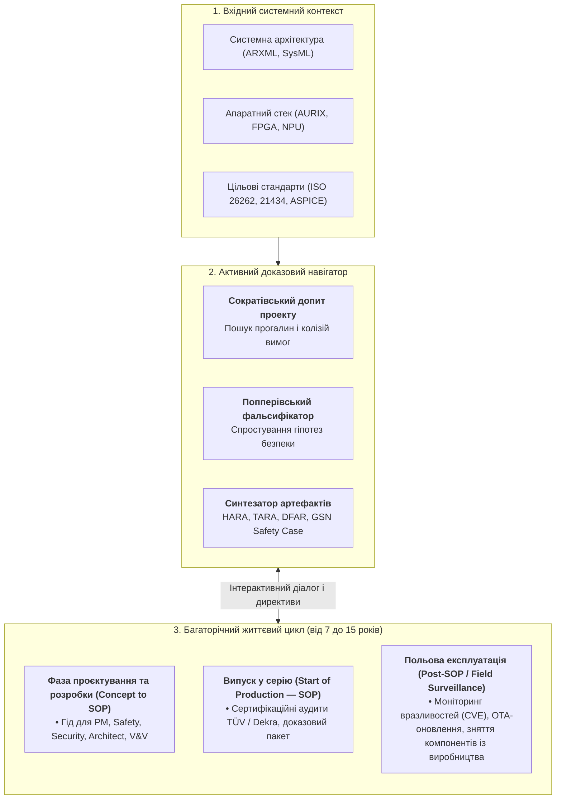
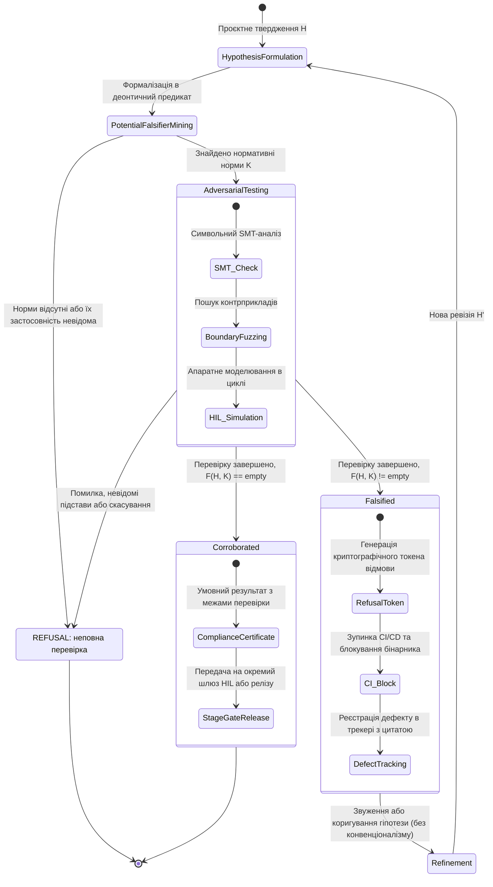
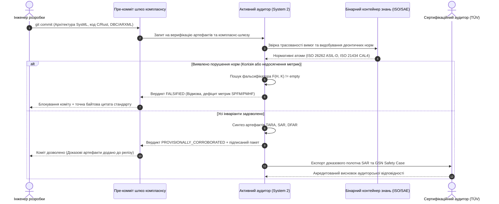
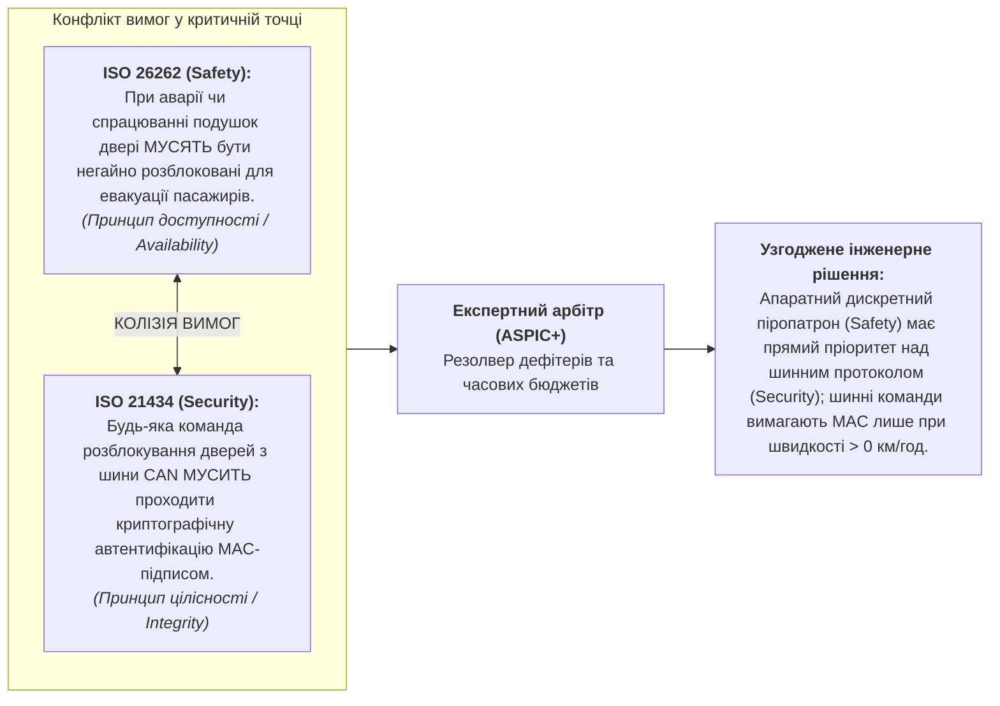
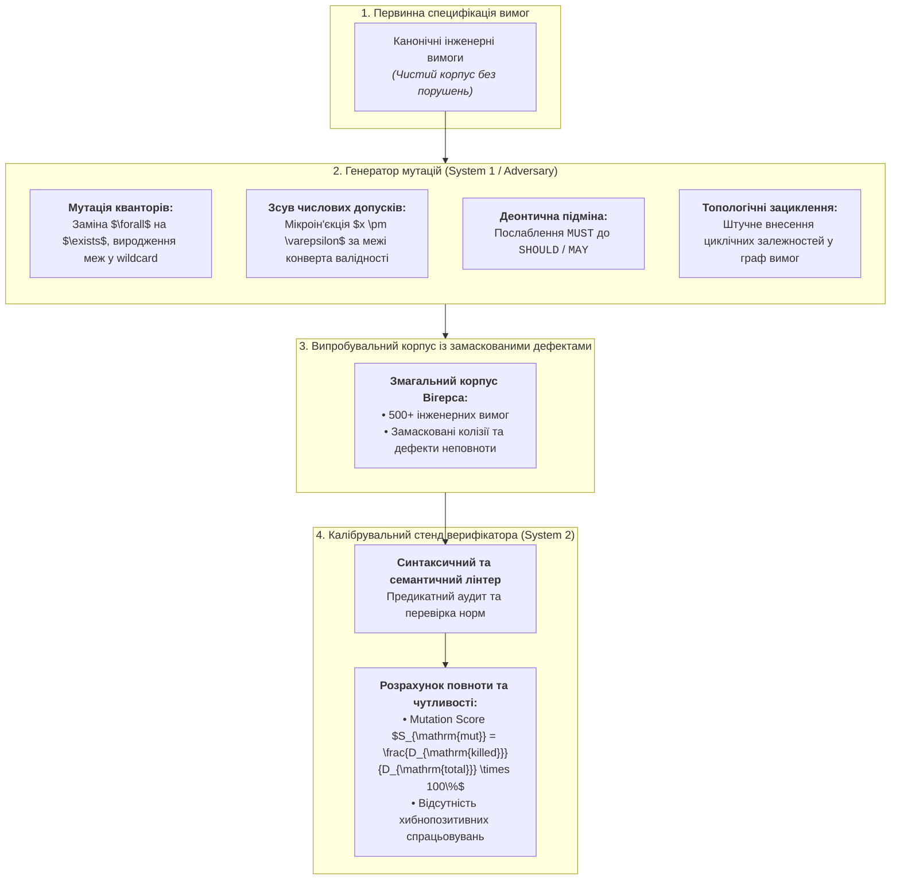
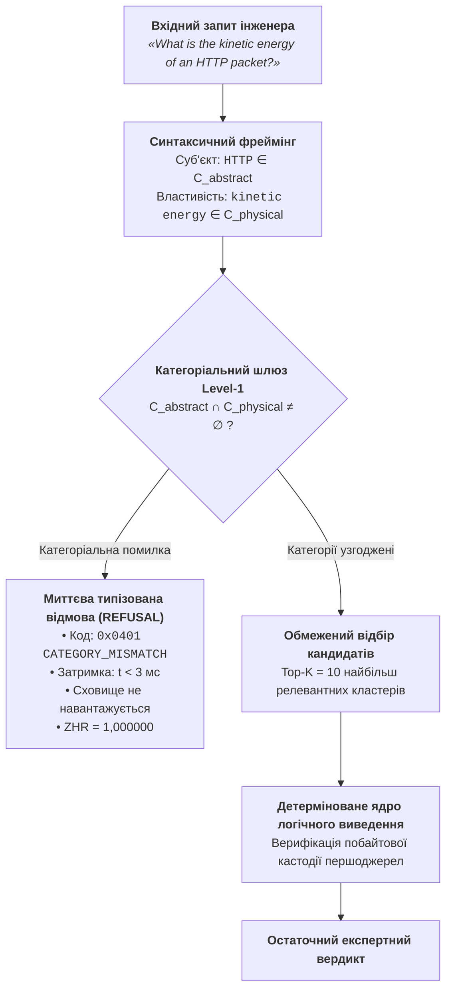
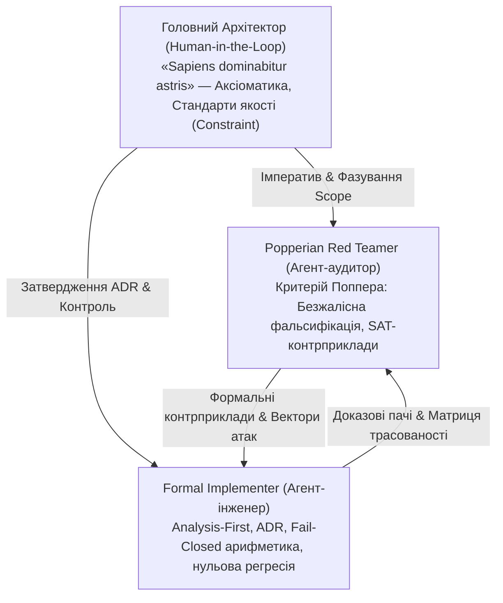

# Глава 39. Активний експерт-тестувальник: попперівська фальсифікація, нормативний комплаєнс (ASPICE/ISO 26262/ISO 21434) та автономне проєктування випробувань

> **Книга:** [Архітектура доказових експертних систем](README.md) · [Частина V: Верифікація, тестування, навчання та обґрунтування безпеки](part-05-verification-and-learning.md)
> **Попередня глава:** [Глава 26. Неперервне навчання (Continual Learning) на досвіді та подолання зсуву системного журналу](ch26-continual-learning.md)
> **Наступна глава:** [Глава 27. Обґрунтування безпеки: синтез і перевірка аргументів](ch27-safety-case-gsn-synthesis.md)
> **Зміст книги:** [README.md](README.md)  
> **Автор:** [Микола Федчик](about-the-author.md)  
> **Рівень складності та оптимальне вивчення:** `[L2]` Прикладний алгоритмічно-системний (індекс Д. Кнута `[28]`) · *Маршрут:* Інженерне ядро та `Трек C` (попперівський активний аудитор, градієнт `ERL-1..4`); практикум: Лабораторна робота №8 у `LABS.md`  
> **Очікувані результати:** опанувати концепцію переходу від пасивного оракула до активного аудитора знань; зрозуміти принципи рантайм-фальсифікації інженерних гіпотез за Карлом Поппером; використовувати експертні системи для автономної підготовки доказових матеріалів TARA, SAR, DFAR та V&V матриць; розв'язувати конфлікти між вимогами безпеки (Safety) та кібербезпеки (Security); автоматизувати рутинні перевірки з вивільненням часу фахівця для технічної творчості зі збереженням принципу Human-in-the-Loop.

---

## Анотація

У проєктуванні критично важливих кіберфізичних систем (ISO 26262 ASIL D, ISO/SAE 21434 CAL 4, DO-178C DAL A, Automotive SPICE 4.0) ручна підготовка нормативної звітності та пасивна верифікація неминуче спричиняють катастрофічні наслідки. Коли інженери з функціональної безпеки вимушені вручну співставляти тисячі вимог у таблицях, когнітивне виснаження породжує «театр відповідності» (*Compliance Theatre*) — формальне проставляння прапорців без математичної перевірки крайових станів. Пропуск єдиної прихованої одноточкової відмови (SPFM < 99%) або неврахованого вектора атаки на бортову шину призводить до смертельних ДТП, відкликання цілих серій безпілотного транспорту та персональної кримінальної відповідальності аудиторів.

Ця глава долає кризу переходом від пасивного оракула-консультанта до Активного Аудитора Доменних Знань. Спираючись на принцип фальсифікації Карла Поппера ($`\mathcal{F}(\mathcal{H}, \mathcal{K})`$ для проектної гіпотези $`\mathcal{H}`$ та бази норм $`\mathcal{K}`$) та положення цієї монографії [[8]](#src-8), доказова експертна система перехоплює ініціативу допиту проекту: вона автономно шукає контрприклади, запобігає теоретичному дрейфу (*Anti-Theory Drift Principle*) через правило епістемічної необхідності, виявляє нормативні суперечності між вимогами безпеки (*Safety*) та кіберзахисту (*Security*), генерує строгі сертифікаційні артефакти (HARA, TARA, SAR, DFAR/FMEDA) із повною трасованістю ($`100{,}0\%`$) та проєктує фальсифікуючі випробування. У рамках попперівської діалектики та змагального парного програмування розмежовуються ролі агента-фальсифікатора (*Popperian Red Teamer*) та агента-інженера (*Formal Implementer*), відокремлюється дорадча зона релевантності (*Relevance*) від вирішальної зони правомірності (*Eligibility*), а людина в циклі керування (*Human-in-the-Loop*) закріплюється як найвищий арбітр системи.

---

## 1. Драма комплаєнс-інженерії: чому ручні методи вичерпали себе

Стрімке зростання складності вбудованого програмного забезпечення та регуляторного тиску перетворило сертифікаційний комплаєнс на критичний виклик сучасної інженерії знань. Розробка сучасних кіберфізичних систем (автомобільний транспорт, авіоніка, залізнична автоматика, медичні апарати) підпорядкована найсуворішим галузевим стандартам, які вимагають наскрізного підтвердження кожної інженерної вимоги:
- **Automotive SPICE 4.0** [[2]](#src-2) (процесна зрілість розробки програмного та системного забезпечення);
- **ISO 26262:2018** [[3]](#src-3) (функціональна безпека електричних та електронних систем, класифікація ASIL-A .. ASIL-D);
- **ISO/SAE 21434:2021** [[4]](#src-4) (інженерія кібербезпеки транспортних засобів, рівні CAL 1..4);
- **DO-178C / ED-12C** [[5]](#src-5) (авіаційне бортове програмне забезпечення, рівні DAL A..E);
- **IEC 62304 / ISO 14971** (медичне ПЗ та управління ризиками пацієнтів).

### 1.1. Тягар персональної відповідальності інженера з безпеки
На відміну від звичайної комерційної веб-розробки, фахівці з безпеки — **Safety Engineer**, **Cybersecurity Engineer**, **Functional Safety Manager (FSM)** та **Lead Assessor** — несуть пряму юридичну, професійну, а в багатьох юрисдикціях і кримінальну відповідальність за випущені артефакти. 

Підпис інженера під підсумковими звітами засвідчує, що:
1. Усі ризики заподіяння шкоди життю та здоров'ю людей зведені до прийнятного залишкового рівня (*As Low As Reasonably Practicable*, ALARP).
2. Усі відомі вектори кібератак на бортові шини та контролери враховані та нейтралізовані.
3. Кожна окрема норма стандарту підтверджена прямим, відтворюваним об'єктивним доказом (*Objective Evidence*).

### 1.2. Трудомісткість рутинних людино-годин: TARA, SAR, DFAR та HARA
Ціна цієї відповідальності вимірюється колосальними трудовитратами. Щоб випустити сучасний автомобільний контролер (наприклад, блок керування гальмами або шлюз доступу), команда змушена вручну сформувати та верифікувати сотні складних доказових документів:

| Артефакт | Стандарт | Сутність та інженерне наповнення | Рутинний виклик для інженера |
| :--- | :--- | :--- | :--- |
| **HARA** (*Hazard Analysis and Risk Assessment*) | ISO 26262-3 | Визначення небезпечних подій, оцінка важкості ($S$), експозиції ($E$), контрольованості ($C$) та призначення рівня ASIL (A/B/C/D) і цілей безпеки (*Safety Goals*). | Ручний перебір сотень комбінацій режимів руху автомобіля та відмов датчиків; ризик пропуску критичного сценарію. |
| **TARA** (*Threat Analysis and Risk Assessment*) | ISO/SAE 21434-9 | Визначення активів (Assets), властивостей кібербезпеки (C-I-A), сценаріїв загроз, побудова дерев атак (*Attack Trees*), оцінка потенціалу атаки (*Attack Feasibility*) та рівнів CAL. | Необхідність співставлення тисяч CAN/Ethernet сигналів з базами CVE/CWE, ручне моделювання кроків зловмисника через шлюзи. |
| **SAR** (*Safety Assessment Report*) | ISO 26262-2/8 | Підсумковий аудиторський звіт незалежної оцінки відповідності розробки вимогам функціональної безпеки та захищеності процесів. | Перехресне звіряння сотень пунктів стандарту із реальними протоколами випробувань, пошук розривів трасованості. |
| **DFAR / DFMEA / FMEDA** | ISO 26262-5/6 | Кількісний аналіз режимів відмов, розрахунок метрик одноточкових відмов (SPFM $\ge 99\%$), латентних відмов (LFM $\ge 90\%$) та діагностичного покриття (DC). | Багаторівневі таблиці в Excel на десятки тисяч рядків; зміна одного резистора в схемі вимагає перерахунку всього ланцюга метрик. |

У типовому проекті підготовка, узгодження та підтримка актуальності цих матеріалів забирає **до 60–70% усього інженерного бюджету часу**. 

### 1.3. Феномен людської втоми та ризики формального комплаєнсу
Коли кваліфікований інженер змушений тижнями переносити ідентифікатори вимог між Polarion, DOORS, Jira та таблицями Excel, неминуче виникає когнітивне виснаження:
- **Крихкість ручного трасування:** зміна в одному рядку архітектури безслідно ламає доказові зв'язки в десятках дочірніх тестів.
- **Compliance Theatre (театр відповідності):** щоб вкластися у дедлайн випуску, інженери змушені ставити галочки у чеклістах формально, не маючи фізичної змоги математично перевірити кожен крайовий стан.
- **Втрата часу на творчість:** замість глибокого аналізу фізичних аномалій датчиків, проектування нетривіальних алгоритмів діагностики та пошуку нестандартних векторів атак, провідні уми витрачають енергію на бюрократичну рутину.

Саме тут виникає нагальна потреба в **доказових експертних системах нового покоління**.

---

## 2. Зсув парадигми: від пасивного довідника до інтерактивного гіда життєвого циклу продукту

Традиційна теорія штучного інтелекту десятиліттями розглядала експертну систему як пасивного консультанта, побудованого за редукціоністським шаблоном «запит — відповідь»:

> **Традиційний пасивний шаблон:** `[Користувач запитує]` $\longrightarrow$ `[Система видає статичну довідку]`

У простих діагностичних сценаріях цей підхід працював. Проте в сучасних місійно-критичних доменах (автомобільна промисловість, авіоніка, високошвидкісна залізнична автоматика) модель пасивного оракула зазнає повного краху через ключовий гносеологічний бар'єр: **інженер або менеджер не здатний запитати систему про те, про що він забув, чого не помітив або що було пропущено в багатотисячосторінкових томах стандартів**. 

Якщо інженер не підозрює, що зміна одного транзистора в схемі змінила метрику латентних відмов (LFM) або що оновлення протоколу діагностики UDS відкрило вектор віддаленої ін'єкції в шину CAN, він ніколи не сформулює запит до пасивної бази знань.

### 2.1. Концепція проактивного доказового супроводу життєвого циклу

Справжній **зсув інженерної парадигми** полягає у докорінній зміні ролі експертної системи: від статичного сховища правил — до **проактивного інтерактивного навігатора (Interactive Co-pilot & Lifecycle Guide)** для всієї міждисциплінарної інженерної команди.

Отримавши на старті проєкту вхідні специфікації (архітектуру платформи, апаратний стек, цільові стандарти ISO 26262 / ISO 21434 / ASPICE, обмеження надійності та цільовий ринок), доказова експертна система перехоплює ініціативу допиту (*Active Probing*):
1. **Вона не чекає на запитання:** система безперервно сканує інженерні артефакти (DBC-файли, схеми, код, тестові звіти).
2. **Вона веде сократівський діалог:** ставить проектувальникам незручні запитання про нерозглянуті крайові стани.
3. **Вона направляє проектну команду:** як досвідчений сертифікаційний аудитор, система вказує, які обов'язкові кроки стандарту ще не виконані та яких об'єктивних доказів бракує в матрицях простежуваності.

> [!NOTE]
> **Три принципи проактивного доказового супроводу життєвого циклу за моделлю автора**
> 1. *Постійне сканування інженерних артефактів*: безперервний активний аналіз схем, DBC-файлів, коду та тестових звітів без очікування пасивних запитів від користувача.
> 2. *Сократівський діалог допиту*: активна постановка проектній команді незручних запитань щодо нерозглянутих крайових, деградованих та аварійних станів системи.
> 3. *Директивне нормативне скеровування*: детермінована фіксація невиконаних кроків стандартів та прогалин об'єктивних доказів у матрицях простежуваності.
> *Керування рантаймом / Інженерний інваріант:* Перехід від пасивного сховища правил до активного ко-пілота з безперервною оцінкою готовності до сертифікаційних аудитів.



---

### 2.2. Рольова матриця учасників життєвого циклу безпеки

У складних інженерних проектах немає універсального фахівця, який тримає в голові всі виміри комплаєнсу. Активна експертна система виступає спеціалізованим інтелектуальним партнером для кожної ключової ролі:

| Інженерна роль у проекті | Що вимагає стандарт | Як допомагає активна експертна система |
| :--- | :--- | :--- |
| **Project Manager (PM) / Program Director** | Дотримання контрольних точок (Milestone Gates), повнота процесів ASPICE SWE.1–SWE.6, усунення ризиків зриву сертифікації. | **Радар готовності до аудитів (Compliance Readiness):** оцінює відсоток завершеності доказової бази, сигналізує про «вузькі місця» за тижні до аудиту, оцінює трудовитрати на закриття нормативних лакун. |
| **Functional Safety Manager (FSM) / Safety Engineer** | Досягнення цільових метрик надійності ISO 26262 (SPFM $\ge 99\%$, LFM $\ge 90\%$), складання HARA, побудова Safety Case у нотації GSN. | **Математичний верифікатор надійності:** автоматично формує розрахункові таблиці FMEDA/DFAR, пропонує заходи для підвищення діагностичного покриття сторожових таймерів, генерує аргументаційні дерева GSN. |
| **Cybersecurity Engineer** | Моделювання загроз TARA (ISO/SAE 21434), оцінка Attack Feasibility, побудова дерев атак, призначення цілей безпеки (Cybersecurity Goals). | **Автоматичний синтезатор TARA:** зіставляє сигнали бортових шин (CAN, Ethernet) із матрицями загроз MITRE ATT&CK / STRIDE, проєктує Attack Trees та розраховує бали ризику. |
| **System & Software Architect** | Узгодженість вимог, правильність декомпозиції ASIL (напр., ASIL-D = ASIL-B(D) + ASIL-B(D)), відсутність архітектурних колізій. | **Арбітр архітектурних рішень:** виявляє суперечності між вимогами безпеки (*Safety*) та кіберзахисту (*Security*), верифікує неперевищення інтервалу стійкості до відмов (FTTI) та бюджетів шинних затримок. |
| **V&V / Test Engineer** | Досягнення 100% двонаправленої простежуваності тестів до вимог (ASPICE SWE.4), дизайн стресових і негативних сценаріїв. | **Генератор програм випробувань:** проєктує сценарії попперівської фальсифікації, 6-точковий аналіз границь (BVA), тести ін'єкції несправностей (Fault Injection) та зв'язує кожен тест із нормою. |

---

### 2.3. Довготривалий супровід продукту на етапі експлуатації (Post-SOP)

Життя вбудованого програмно-апаратного комплексу в автомобільній чи авіаційній індустрії триває **від 7 до 15 років** (`7–15 років`). Сертифікація під час запуску в серію (*Start of Production, SOP*) є лише першим рубежем. Протягом подальшої багаторічної експлуатації активна експертна система залишається надійним охоронцем системи:

1. **Безпека бездротових оновлень (OTA Updates):**  
   Будь-який патч прошивки контролера несе ризик порушення засадничих сертифікаційних властивостей. Експертна система перед кожним OTA-релізом здійснює регресійну попперівську фальсифікацію: перевіряє, чи не ламає новий код доведені інваріанти надійності та чи задовольняє вимогам кібербезпеки UN ECE R156.
2. **Управління застаріванням компонентів (*Component Obsolescence & Second-Sourcing*):**  
   Коли завод-виробник припиняє випуск мікроконтролера чи мікросхеми драйвера шини, команда змушена застосувати альтернативний чип (second source). Експертна система миттєво підставляє нові показники інтенсивності відмов ($\lambda$, FIT) та перераховує FMEDA, позбавляючи інженерів необхідності місяцями переписувати розрахунки надійності вручну.
3. **Моніторинг нових векторів атак (Post-Development Cybersecurity Monitoring):**  
   Згідно з ISO/SAE 21434 Clause 13, виробник зобов'язаний безперервно відстежувати нові вразливості у польовому парку машин. Активний аудитор сканує бази CVE/CWE відносно точного списку апаратних і програмних компонентів виробу (Software Bill of Materials, SBOM) і сигналізує інженерам про загрозу задовго до того, як вона спричинить реальний інцидент.
4. **Еволюція галузевих нормативів:**  
   Коли стандарти оновлюються (наприклад, перехід з Automotive SPICE 3.1 на 4.0 або майбутні ревізії ISO 26262), активний експерт виконує дельта-аналіз бінарного контейнера бази знань і точно вказує проектній команді, які процесні артефакти потребують оновлення.

### 2.4. Шкала градації епістемічної суворості (`ERL-1`..`ERL-4`) для гнучкої розробки Agile / CI/CD

Популярне заперечення з боку команд комерційної розробки (SaaS, FinTech, Enterprise IT) полягає в побоюванні, що вимога наскрізної трасованості (`SHR <-> SWR <-> ADR <-> Code <-> Proof`) перетворить гнучкий процес Agile на повільний бюрократичний «водоспад» (*Waterfall*). Це заперечення ототожнює *ручне паперове погодження* з *автоматизованою компіляторною верифікацією*. Насправді в сучасній інженерії програмного забезпечення (за традицією літературного програмування та автоматизованих інваріантів Д. Кнута й Б. Меєра) перевірка трасованості й несуперечливості правил виконується лінтером за $< 5\,\text{с}$ під час перевірки Pull Request у конвеєрі CI/CD — точнісінько як статична типізація компілятора Rust або Go.

Щоб узгодити глибину формального нагляду з реальною ціною помилки в конкретному домені, автор запроваджує **чотирирівневу шкалу градації епістемічної суворості (`Epistemic Rigor Levels`, `ERL-1`..`ERL-4`)**:

| Рівень суворості | Цільові галузі та етапи проєкту | Вимога побайтової кастодії цитат | Режим шлюзу `Fail-Closed` | Рівень верифікації правил та трасованості в CI/CD | Час перевірки PR у CI/CD |
|---|---|---|---|---|---|
| **`ERL-1` (Exploratory Prototype)** | Пошукові R&D-експерименти, внутрішні пісочниці, ранні прототипи | Логування джерел у режимі попереджень (`WARN`) | М'яка кваліфікація (`QUALIFIED_HYPOTHESIS`) | Автоматичний синтаксичний лінтинг вимог і базові модульні тести | $< 1\,\text{с}$ |
| **`ERL-2` (Commercial Production)** | Корпоративні інформаційні системи, SaaS, технічна підтримка, DevOps | Обов'язкова побайтова прив'язка `SHA-256` для всіх стверджувальних відповідей ($\mathrm{ZHR}=1{,}00$) | Детермінована відмова `REFUSAL` при прогалині знань | Автоматична перевірка зв'язків `SWR <-> Code <-> Test` та стратифікованого Datalog | $1\text{--}3\,\text{с}$ |
| **`ERL-3` (Regulated Enterprise)** | Фінансовий і податковий аудит, юридичні реєстри, медичні інформаційні системи, кіберзахист | Побайтова кастодія + криптографічний сертифікат доведення $\pi$ з підписом Ed25519 | Жорсткий `Fail-Closed` + карантин невідомих предикатів | Повна матриця трасованості `SHR <-> SWR <-> ADR`, перевірка несуперечливості SMT-солвером | $3\text{--}10\,\text{с}$ |
| **`ERL-4` (Safety-Critical Cyber-Physical)** | Автономний транспорт (ISO 26262 ASIL D), авіоніка (DO-178C DAL A), енергетика, оборона | Побайтова кастодія + пороговий підпис консорціуму HSM ($k$-of-$n$) + мітка часу RFC 3161 | Дворівневий `Fail-Closed` із перемиканням на апаратний тракт Simplex / MRM | Формальний доказ повноти й ортогональності правил, попперівський фазинг, синтез дерева GSN та HIL-стенд | $10\text{--}60\,\text{с}$ |

> [!NOTE]
> **Чотири рівні градації епістемічної суворості (`ERL-1`..`ERL-4`) за методологією автора**
> 1. **Рівень `ERL-1` (Дослідницький прототип):** Дозволяє швидку перевірку гіпотез у пісочниці з автоматичним маркуванням непідтверджених висновків без зупинки конвеєра розробки.
> 2. **Рівень `ERL-2` (Комерційна експлуатація):** Забезпечує інваріант нульових галюцинацій ($`\mathrm{ZHR} = 1{,}00`$) та побайтову кастодію першоджерел у режимі інженерного лінтера CI/CD за $< 3\,\text{с}$ без бюрократичних затримок.
> 3. **Рівень `ERL-3` (Регульоване підприємство):** Додає обов'язкові криптографічні сертифікати доведення Ed25519 та SMT-верифікацію несуперечливості при кожному випуску бази знань.
> 4. **Рівень `ERL-4` (Критичні кіберфізичні системи):** Впроваджує повний цикл консорціумного підпису HSM ($k$-of-$n$), синтез аргументів безпеки GSN та апаратну верифікацію з апаратурою в циклі керування (HIL).
> *Керування рантаймом / Інженерний інваріант:* Перехід проєкту з раннього прототипу (`ERL-1`) до промислової чи сертифікаційної зрілості (`ERL-2`..`ERL-4`) здійснюється перемиканням профілю суворості в маніфесті CI/CD без зміни архітектури коду.

---

## 3. Математичний апарат попперівської фальсифікації інженерних гіпотез

Основою перевірки проектних рішень є принцип фальсифікованості Карла Поппера [[1]](#src-1): *жодна система не може бути визнана безпечною лише на підставі успішних тестів; безпека доводиться невдачею найагресивніших спроб її спростувати*.

### 3.1. Формалізація інженерної гіпотези
Розробник, мовна модель або архітектор висувають проектне твердження $`\mathcal{H}`$ (наприклад: *«Модуль обробки педалі гальма відповідає рівню ASIL-D без дублювання АЦП, оскільки використовується періодичне самотестування»*).

Формально гіпотеза записується як предикат над простором станів системи $`\mathcal{S}`$:

```math
\mathcal{H} \equiv \forall s \in \mathcal{S}, \quad \mathrm{StateValid}(s) \implies \mathrm{SafetyGoalSatisfied}(s)
```

Нормативна база знань $`\mathcal{K}`$ складається з двійкових деонтичних атомів стандарту:

```math
\mathcal{K} = \lbrace \nu_1, \nu_2, \dots, \nu_m \rbrace, \quad \nu_i = \langle \mathrm{Domain}, \mathrm{Clause}, \mathrm{Entity}, \mathrm{Modality}, \mathrm{Action}, \mathrm{Evidence} \rangle
```

де допустимі значення деонтичної модальності: `MUST`, `MUST_NOT`, `SHOULD`, `MAY`.

### 3.2. Пошук потенційного фальсифікатора (Potential Falsifier)

Завдання експертної системи — за час $`t < 1\ \mathrm{ms}`$ виконати символьний пошук контрприкладу:

```math
\mathcal{F}(\mathcal{H}, \mathcal{K}) = \lbrace \nu_k \in \mathcal{K} \mid \mathrm{Implication}(\mathcal{H}) \models \mathrm{Violation}(\nu_k) \rbrace
```

де:
- $`\mathcal{F}(\mathcal{H}, \mathcal{K})`$ — множина виявлених нормативних фальсифікаторів гіпотези $`\mathcal{H}`$ у базі правил $`\mathcal{K}`$;
- $`\nu_k`$ — атомарна деонтична норма стандарту;
- $\models$ — відношення логічного слідування (семантичного виведення порушення).

**Практичне застосування та інженерні висновки (Closed-Loop Decision):**

#### 1. Керування потоком верифікації та вердикти системи

Наведені нижче рівняння стосуються коректно завершеної перевірки визначеного застосовного фрагмента норм. За скасування або неповних підстав проміжний список відомих порушень зберігається, але не видається за повністю обчислену множину $`\mathcal{F}(\mathcal{H},\mathcal{K})`$: виклик повертає `REFUSAL` і явну ознаку неповноти. Жодний із цих станів не дозволяє відкрити релізний шлюз.

Якщо $`\mathcal{F}(\mathcal{H}, \mathcal{K}) \neq \emptyset`$ (виявлено хоча б одне спростування):

```math
\mathrm{Verdict} = \mathbf{FALSIFIED} \quad \bigl( \mathrm{Refusal}(\rho), \quad \mathrm{Custody} = \mathrm{SHA256}(\mathrm{Quote}), \quad \mathrm{Clause} = \text{ISO 26262-5:2018 Clause 8.4.3} \bigr)
```

**Дія системи:** Конвеєр безперервної інтеграції (CI/CD) негайно зупиняється з кодом помилки `EX_SAFETY_VIOLATION`. Система генерує криптографічний токен відмови $`\mathrm{Refusal}(\rho)`$ із цифровим підписом Ed25519, блокує прошивання бінарного образу в цільовий мікроконтролер ECU та реєструє дефект в інженерному трекері (Jira/GitLab) з посиланням на точний побайтовий фрагмент стандарту.

Якщо $`\mathcal{F}(\mathcal{H}, \mathcal{K}) = \emptyset`$ і перевірку всього заданого застосовного фрагмента завершено, норми та їхні докази чинні, а стан кожного обов'язку відомий, можливий лише умовний результат:

```math
\mathrm{Verdict} = \mathbf{PROVISIONALLY\_CORROBORATED}
```

**Дія системи:** Система повертає вердикт умовного підтвердження з точними межами перевіреного фрагмента. Відсутність норм, неповні підстави або незавершений пошук дають `REFUSAL`, а не порожню множину спростувань із позитивним статусом. Подальші HIL-випробування чи реліз потребують власних погоджених шлюзів; умовний результат не є `ACCEPT` або доведенням фізичної безпеки.



#### 2. Апаратний сайзинг та латентність
Час пошуку контрприкладу жорстко лімітується значенням $`t_{\mathrm{eval}} \le 1{,}0\,\text{ms}`$ завдяки індексації норм у бітових масках пам'яті BRAM обсягом $`< 512\,\text{КБ}`$.

#### 3. Практичний числовий приклад
- Розробник висуває гіпотезу про допустимість одноканального АЦП із діагностичним покриттям $90\%$ для функції, профіль якої попередньо віднесено до ASIL-D.
- Символьний рушій знаходить кандидатну вимогу до SPFM; перед оцінюванням він перевіряє сферу застосування та чинну редакцію. Посилання на ISO 26262-5, п. 8.4.3 у цьому прикладі потребує звірення з офіційним текстом і профілем виробу.
- Діагностичне покриття $90\%$ не є значенням SPFM і не дає підстав обчислити його дефіцит. Без повних FMEDA-інтенсивностей або підтвердженої застосовності вимоги система повертає `REFUSAL_INSUFFICIENT_EVIDENCE`, а не `FALSIFIED`.
- **Дія системи:** Якщо застосовний поріг профілю дорівнює $0{,}99$ і повна FMEDA дає $`\mathrm{SPFM} = 0{,}90`$, система фіксує дефіцит $`\Delta \mathrm{SPFM} = 0{,}09`$ (9 відсоткових пунктів), повертає `FALSIFIED` і блокує випуск. Це окрема умовна підстановка, а не наслідок самого значення діагностичного покриття.

### 3.3. Принцип антитеоретичного дрейфу та ощадливого моделювання онтологій знань

У практиці проєктування складних експертних систем прагнення побудувати універсальну філософську метамову на всі випадки життя нерідко призводить до методологічної пастки — теоретичного дрейфу (*Theory Drift* або *Over-abstraction*). Коли замість розв'язання конкретної інженерної задачі дослідники передчасно захоплюються абстрактними макро-теоріями (глобальними онтологіями всього сущого, надлишковими синергетичними зв'язками), обчислювальна складність моделі експоненційно зростає, тоді як здатність бази знань детерміновано верифікувати вихідні артефакти та виявляти крайові колізії прямує до нуля. Для запобігання цьому дефекту автором сформульовано та впроваджено *Принцип антитеоретичного дрейфу та ощадливого моделювання*.

#### 3.3.1. Критерій попперівської фальсифікованості онтології та правило епістемічної необхідності

1. **Критерій попперівської фальсифікованості онтології:**
Формальна модель знань $`\mathcal{M}`$ оцінюється не кількістю теоретичних абстракцій чи понять, які вона потенційно здатна описати, а її здатністю жорстко та безпомилково відкинути недостовірне, надлишкове або суперечливе твердження з множини згенерованих контрприкладів $`\mathcal{C}`$:

```math
\mathrm{RejectionRate}(\mathcal{M}, \mathcal{C}) = \frac{\lvert \lbrace c \in \mathcal{C} \mid \mathcal{M} \models \neg c \rbrace \rvert}{\lvert \mathcal{C} \rvert} \ge \tau_{\mathrm{falsify}} = 1{,}00
```

де:
- $`\mathcal{M}`$ — формалізована онтологічна модель предметної області;
- $`\mathcal{C}`$ — множина контрольних контрприкладів, аномальних станів та суперечливих вимог, згенерованих фальсифікатором;
- $`\tau_{\mathrm{falsify}} = 1{,}00`$ — нормативний поріг абсолютної демаркаційної селективності (будь-який пропуск суперечності свідчить про надмірну розмитість онтології).

2. **Правило епістемічної необхідності (Lex Parsimoniae):**
Будь-який новий предикат, зв'язок чи таксономічний рівень абстракції $`\Delta \mathcal{P}`$ у базі знань повинен бути суворо обґрунтований безпосереднім дефіцитом знань або виявленою колізією в оброблюваних інженерних артефактах $`\mathcal{E}_{\mathrm{deficit}}`$:

```math
\forall p \in \Delta \mathcal{P}, \quad \exists e \in \mathcal{E}_{\mathrm{deficit}} : \mathrm{Resolves}(p, e) \land \neg \exists q \in \mathcal{P}_{\mathrm{existing}} (\mathrm{Expressible}(q, e))
```

де:
- $`\mathcal{P}_{\mathrm{existing}}`$ — наявний базис типізованих предикатів першого порядку (FOL);
- $`\mathcal{E}_{\mathrm{deficit}}`$ — множина зафіксованих емпіричних або нормативних дефіцитів верифікації.

Якщо інженерне твердження можна однозначно верифікувати простішим апаратом наявного базису без створення надлишкових концептуальних надбудов, введення $`\Delta \mathcal{P}`$ кваліфікується як критична методологічна помилка проєктування.

> [!NOTE]
> **Два постулати принципу антитеоретичного дрейфу та ощадливого моделювання за моделлю автора**
> 1. *Критерій попперівської фальсифікованості онтології*: обов'язкова вимога $`\mathrm{RejectionRate}(\mathcal{M}, \mathcal{C}) \ge \tau_{\mathrm{falsify}} = 1{,}00`$, за якої онтологія оцінюється здатністю жорстко та безпомилково відкидати некоректні контрприклади й суперечливі вимоги.
> 2. *Правило епістемічної необхідності (Lex Parsimoniae)*: категорична заборона введення будь-яких нових предикатів чи рівнів абстракції $`\Delta \mathcal{P}`$ без безпосередньо зафіксованого дефіциту знань $`\mathcal{E}_{\mathrm{deficit}}`$, який неможливо виразити існуючим базисом.
> *Керування рантаймом / Інженерний інваріант:* Компілятор бази знань зупиняє генерацію з кодом помилки `ERR_THEORY_DRIFT` при спробі додавання надлишкових семантичних надбудов.

#### 3.3.2. Замкнений цикл інженерного розрахунку ощадливості онтології

1. **Керування рантаймом і потоком обчислень (Control Flow & Runtime Decisions):**
   При компіляції бази знань онтологічний аналізатор перевіряє кожен предикат за правилом епістемічної необхідності. Якщо для нового предиката $`\mathrm{Resolves}(p, e) = \mathrm{false}`$ або він семантично виводиться з існуючого базису $`\mathcal{P}_{\mathrm{existing}}`$, компілятор зупиняє побудову образу з кодом помилки `ERR_THEORY_DRIFT` і видає токен відмови `REFUSAL`. Якщо під час регресійного тестування виявляється, що $`\mathrm{RejectionRate}(\mathcal{M}, \mathcal{C}) < 1{,}00`$, база знань бракується як надмірно поблажлива (*Over-permissive*), що блокує її передачу до сертифікаційного аудиту.
2. **Апаратний сайзинг та інфраструктурні обмеження (Hardware Dimensioning):**
   Кожен зайвий таксономічний рівень і надлишкове відношення збільшує глибину пошуку резолюції $d$, спричиняючи комбінаторне зростання часу уніфікації $`T_{\mathrm{unif}} \propto \mathcal{O}(2^d)`$. Обмеження глибини онтології $d \le 4$ та виключення теоретичного дрейфу гарантує лінійне сканування пам'яті BRAM ($`< 512\,\text{КБ}`$) та час відгуку інференсу $`t_{\mathrm{eval}} \le 1{,}0\,\text{мс}`$ без ризику вичерпання апаратного стека мікроконтролера.
3. **Практичний числовий приклад (Worked Numerical Example):**
   Розробник намагається ввести абстрактний клас «Універсальний квантово-синергетичний стан датчика» замість пари детермінованих предикатів `VoltageInRange(v)` та `ValidCRC(frame)`. У фальсифікаційному бенчмарку згенеровано $`\lvert \mathcal{C} \rvert = 100`$ некоректних пакетів із плаваючими шумами та збоями шини. Розмита мета-модель відхилила лише 42 аномалії ($`\mathrm{RejectionRate} = 0{,}42 < 1{,}00`$), пропустивши 58 критичних збоїв. Ощадливий базис $`\mathcal{P}_{\mathrm{existing}}`$ відкинув $100$ зі $100$ аномалій ($`\mathrm{RejectionRate} = 1{,}00`$) за час $`72\,\mu\text{с}`$. Компілятор відхилив надбудову, зберігши детермінізм системи.

---

## 4. Автоматизація генерації артефактів TARA, SAR та DFAR через доменні правила

Розгляньмо детально, як активний експерт допомагає фахівцям формувати ключові доказові документи без рутинного ручного перенесення даних.

### 4.1. Автоматизація TARA (ISO/SAE 21434): від опису системи до матриці ризиків

Процес TARA складається з кількох канонічних етапів, кожен з яких тепер підтримується детермінованим ядром експертної системи:

#### 4.1.1. Визначення активів (Asset Identification)
Експерт сканує опис архітектури (DBC-файли CAN, ARXML-файли AUTOSAR, IDL-специфікації) та автоматично видобуває всі активи (наприклад: *«Ключ шифрування сесії діагностики»*, *«Сигнал кута повороту керма SteerAngle»*).

#### 4.1.2. Сценарії загроз (Threat Scenario Identification)
Зв'язуючи активи з онтологією STRIDE / MITRE ATT&CK for ICS у бінарній базі правил, експертна система синтезує повний перелік загроз:

```math
\mathrm{Threat} = \langle \mathrm{Asset}, \ \mathrm{Property}, \ \mathrm{Damage} \rangle
```

де $`\mathrm{Asset} = \text{SteerAngle}`$, $`\mathrm{Property} = \text{Integrity}`$, а $`\mathrm{Damage}`$ — несанкціоноване подрулювання на швидкості.

#### 4.1.3. Аналіз шляхів та складності атаки (Attack Path Analysis & Feasibility)
Система розгортає граф зв'язків бортової мережі та розраховує вектор складності атаки за методикою Attack Potential (Elapsed Time, Specialist Expertise, Knowledge of Item, Window of Opportunity, Equipment).

#### 4.1.4. Формування підсумкової матриці TARA
Замість тижнів рутинної роботи інженер отримує повністю згенеровану матрицю зі зведеними балами ризику (Risk Values 1..5) та вимогами до контрзаходів кібербезпеки (*Cybersecurity Goals*).

### 4.2. Автоматизація DFAR та FMEDA (ISO 26262): математична строгість метрик

Підготовка звіту DFAR/FMEDA вимагає математичного розрахунку надійності за компонентами:
- $\lambda$ — загальна інтенсивність відмов компонента (FIT, $`10^{-9}\,\text{відмов}/\text{год}`$);
- $`\lambda_s`$ — інтенсивність безпечних відмов;
- $`\lambda_{\mathrm{spf}}`$ — інтенсивність небезпечних одноточкових відмов, що безпосередньо призводять до порушення мети безпеки;
- $`\lambda_{\mathrm{rf}}`$ — залишкові відмови;
- $`\lambda_{\mathrm{mpf,lat}}`$ та $`\lambda_{\mathrm{mpf,det}}`$ — латентні та виявлені багатоточкові відмови.

#### 4.2.1. Метрика одноточкових відмов (SPFM)

Якщо підтверджено застосовність функції та чинний профіль ISO 26262-5 встановлює для неї ASIL-D, відповідні метрики порівнюються з такими порогами:

```math
\mathrm{SPFM} = \frac{\sum (\lambda_s + \lambda_{\mathrm{spf\_mitigated}})}{\sum \lambda} \ge 0{,}99
```

#### 4.2.2. Метрика латентних відмов (LFM)

За тих самих умов застосовності для LFM використовується такий поріг:

```math
\mathrm{LFM} = \frac{\sum (\lambda_s + \lambda_{\mathrm{mpf,det}})}{\sum (\lambda - \lambda_{\mathrm{spf}})} \ge 0{,}90
```

**Практичне застосування та інженерні висновки (Closed-Loop Decision):**
1. **Підготовка SAR до незалежного аудиту та шлюз випуску (Release Gate):**
   - **Нормативна відповідність** ($`\mathrm{SPFM} \ge 0{,}99`$ та $`\mathrm{LFM} \ge 0{,}90`$): Автоматично компілюється сертифікаційний артефакт `SAR.gsn` зі статусом `APPROVED_FOR_AUDIT`, який підписується електронним цифровим підписом системи та надсилається аудиторам (TÜV/Dekra);
   - **Невідповідність нормам** ($`\mathrm{SPFM} < 0{,}99`$ або $`\mathrm{LFM} < 0{,}90`$): Генерація звіту SAR блокується. Система активує зворотне виведення (Diagnostic Backtracking) і повертає інженеру мінімальний комплекс інженерних коригувань:
     * Збільшення діагностичного покриття сторожового таймера ($`K_{\mathrm{wdg}}`$);
     * Або введення апаратного компаратора з подвійним опитуванням.
2. **Практичний числовий приклад розрахунку та коригування:**
   - Для мікроконтролера зафіксовано сумарну інтенсивність $`\sum \lambda = 120\,\text{FIT}`$.
   - Безпечні та діагностовані одноточкові відмови складають $`\sum (\lambda_s + \lambda_{\mathrm{spf\_mitigated}}) = 118{,}1\,\text{FIT}`$.
   - Розрахунок: $`\mathrm{SPFM} = 118{,}1 / 120 = 0{,}9841 = 98{,}41\% < 99\%`$.
	- **Дія системи:** Блокування релізу. Система формує рекомендацію: «Дефіцит $`\Delta = 0{,}59\%`$. Підвищення покриття сторожового таймера з $60\%$ до $90\%$ зменшує незахищені відмови на $`1{,}2\,\text{FIT}`$, що підвищує $`\mathrm{SPFM}`$ до $`119{,}3 / 120 = 99{,}42\% \ge 99\%`$». Після внесення змін до схеми повторний розрахунок може дозволити сформувати пакет для незалежного аудиту.

Статус `APPROVED_FOR_AUDIT` означає лише, що перевірений фрагмент пройшов задані порогові перевірки й пакет підготовлено до розгляду. Підпис системи підтверджує цілісність пакета, а не сертифікацію виробу; висновок про відповідність ухвалює уповноважений незалежний аудитор.

### 4.3. Автоматизація SAR: доказове полотно для аудиторів TÜV / Dekra
Safety Assessment Report (SAR) є вінцем проекту функціональної безпеки. Експертна система формує SAR як дерево аргументів у нотації **Goal Structuring Notation (GSN)** Келлі та Вівера [[6]](#src-6):
- **Top Goal:** Система задовольняє вимогам ASIL-D стандарту ISO 26262.
- **Strategy:** Аргументація через декомпозицію на безпеку апаратного забезпечення, безпеку ПЗ та процесну якість ASPICE.
- **Evidence:** Кожен листовий вузол дерева (Evidence) містить посилання на конкретний протокол тестування із зафіксованим криптографічним хешем результату та побайтовою цитатою пункту стандарту.



---

## 5. Розв'язання фундаментального протиріччя: функціональна безпека проти кібербезпеки

У складних комплаєнс-проектах найгострішою проблемою є **конфлікт між вимогами функціональної безпеки (Safety) та кібербезпеки (Security)**:



### 5.1. Розв'язання колізій вимог детермінованим ядром експертної системи
1. **Автоматичне виявлення колізій (Cross-Standard Defeater Mining):** Знання обох стандартів у єдиному середовищі дозволяє системі виявити суперечність правил ще на етапі архітектурного проєктування (SWE.2).
2. **Аргументація за схемою ASPIC+:** Спираючись на абстрактні аргументаційні рамки Зунга (Dung) [[7]](#src-7), система будує дерево спростовних міркувань (*Defeasible Reasoning*), розділяючи заперечення засновок (*rebutting*) та підрив правила (*undercutting*).
3. **Генерація безпечного компромісу:** Експерт пропонує формалізований варіант вирішення: *«Застосувати апаратний сигнал від датчика уповільнення в обхід мікроконтролера, зберігши криптографічний бар'єр для всіх програмних запитів з діагностичного роз'єму»*.

> [!NOTE]
> **Три етапи розв'язання колізій між функціональною безпекою та кібербезпекою за моделлю автора**
> 1. *Автоматичний майнінг міжнормативних дефітерів*: детерміноване виявлення суперечностей між вимогами доступності (ISO 26262) та цілісності (ISO 21434) ще на етапі системного архітектурного проєктування SWE.2.
> 2. *Спростовна аргументація за схемою ASPIC+*: детерміноване розділення заперечень засновок (rebutting) та підриву правил (undercutting) на абстрактних рамках Зунга.
> 3. *Синтез узгодженого компромісного рішення*: генерація верифікованого інженерного рішення з розподілом апаратних і криптографічних каналів пріоритету та захистом часових бюджетів FTTI.
> *Керування рантаймом / Інженерний інваріант:* Розв'язання нормативних колізій символьним ядром усуває взаємне блокування функцій безпеки при аварійних та атакуючих сценаріях.

---

## 6. Нейро-символьний тандем тестувальника та автономна генерація тест-програм

Як працює практична зв'язка мовної моделі та детермінованого символьного ядра у ролі активного тестувальника:

1. **System 1 (LLM Proposer — креативність):**
   - Читає фрагмент коду драйвера та документацію.
   - Синтезує хитромудрі, нестандартні сценарії: *«Що буде, якщо надіслати CAN-кадр довжиною DLC=15 замість 8 саме в момент перемикання реле живлення?»*.
   - Формулює проект тест-кейсу природною мовою.
2. **System 2 (Детерміноване ядро логічного виведення — суддя):**
   - Приймає тест-кейс через `Popperian Falsification API`.
   - Звіряє його з нормами ISO 11898, ISO 26262 та AUTOSAR у бінарному контейнері знань.
   - Миттєво перевіряє: чи не порушує сам тест обов'язкових умов стандарту? Який пункт стандарту він покриває?
   - Якщо тест валідний — система автоматично реєструє його в матриці V&V і прив'язує до вимоги простежуваності ASPICE SWE.4.

### 6.1. Розрахунок повноти тестової програми (Traceability Coverage)

Для кількісної оцінки якості згенерованої тестової програми експертна система обчислює показник трасованості вимог:

```math
\mathrm{TraceabilityCoverage} = \frac{\lvert \mathcal{R} \cap \mathcal{T} \rvert}{\lvert \mathcal{R} \rvert} = 1{,}00
```

де $`\mathcal{R}`$ — повна множина формалізованих вимог стандарту та специфікації системи (*requirements*), а $`\mathcal{T}`$ — множина вимог, для яких згенеровано та успішно виконано детерміновані тести (*test-verified*).

**Практичне застосування та інженерні висновки (Closed-Loop Decision):**
- **Повне покриття трасованості** ($`\mathrm{TraceabilityCoverage} = 1{,}00`$): Шлюз якості ASPICE SWE.4 переходить у стан `PASSED`. CI/CD пайплайн формує фінальний криптографічно підписаний маніфест збірки для передачі на орган сертифікації;
- **Неповне покриття трасованості** ($`\mathrm{TraceabilityCoverage} < 1{,}00`$): Пайплайн зупиняється з помилкою `EX_COMPLIANCE_GAP`. Система обчислює різницю $`\mathcal{R}_{\mathrm{missing}} = \mathcal{R} \setminus \mathcal{T}`$ і автоматично формує цільовий пакет промптів для генератора тестів System 1 (LLM Proposer) для синтезу відсутніх тест-кейсів;
- **Практичний числовий приклад:** Специфікація містить $`\lvert \mathcal{R} \rvert = 142`$ вимоги. Верифіковано $`\lvert \mathcal{R} \cap \mathcal{T} \rvert = 141`$ вимогу. Покриття: $`\mathrm{TraceabilityCoverage} = 141 / 142 \approx 0{,}993 < 1{,}00`$. **Дія системи:** Реліз заблоковано; System 1 отримує завдання на синтез тесту для єдиної непокритої вимоги $`R_{87}`$ (поведінка при короткочасному падінні напруги шини CAN).



### 6.2. Категоріальні попперівські пастки та шлюзи миттєвої відмови (Fast-Refusal Gate)

У процесі автономного проектування змагальних випробувань особливий клас загроз становлять запити з **хибною категоріальною передумовою (Category Mismatch / False Premise Red Team Traps)**. У таких випробуваннях агент-фальсифікатор конструює семантично коректне граматичне речення, в якому суб'єкт належить до класу абстрактних цифрових специфікацій чи математичних категорій, а запитуваний предикат або цільова властивість — до несумісного фізичного, механічного чи біологічного домену.

#### Формалізація категоріальної ортогональності

Нехай весь простір понять експертної системи розбито на доменні онтологічні класи:

```math
\mathcal{C}_{\mathrm{abstract}} \cap \mathcal{C}_{\mathrm{physical}} = \emptyset
```

де $`\mathcal{C}_{\mathrm{abstract}}`$ містить поняття специфікацій інтерфейсів, форматів передачі даних, мережевих протоколів та чистих алгебраїчних структур (наприклад, протокол передачі гіпертексту, решітка понять, простір Чу), а $`\mathcal{C}_{\mathrm{physical}}`$ описує матеріальні та кінематичні параметри макросвіту (об'єм циліндрів двигуна, кінські сили, кінетична енергія, термодинамічна температура, швидкість звуку, гравітаційна стала).

У разі надходження запиту $q = (s, p)$, де $`s \in \mathcal{C}_{\mathrm{abstract}}`$, а $`p \in \mathcal{C}_{\mathrm{physical}}`$, наївна експертна система демонструє **деградацію вичерпного перебору (Exhaustive Scan Degeneracy)**: намагаючись перевірити наявність факту у сховищі з понад 19 000 доменних кластерів знань, алгоритм обходить десятки нерелевантних баз, викликаючи неприпустиме зростання часу відповіді ($`t_{\mathrm{resp}} > 30\,\text{с}`$) та ризик вичерпання дескрипторів пам'яті.



Для нейтралізації цієї загрози автором розроблено архітектурний механізм **двостадійного шлюзу швидкої відмови (Fast-Refusal Gate, за моделлю автора)**:
1. **Шлюз першого рівня (Level-1 Fast-Refusal Gate):** перевірка категоріальної сумісності здійснюється безпосередньо під час вхідного синтаксичного фреймінгу запиту ще до звернення до індексу та структур даних спільних відображень пам'яті (`mmap`). При виявленні диз'юнктних класів система миттєво повертає детерміновану типізовану відмову (`REFUSAL`, код `0x0401` `CATEGORY_MISMATCH_OR_FALSE_PREMISE`) за час $`t_{\mathrm{gate}} < 3\,\text{мс}`$.
2. **Обмежений відбір кандидатів ($`K_{\max} = 10`$):** у разі складних міждоменних запитів із багатьма поняттями пул аналізованих кластерів обмежується 10 найбільш релевантними за онтологічним графом вузлами, що усуває лінійне уповільнення та скорочує час обробки у 3 рази (з 33 с до 8–12 с) над сховищем з 19 263 кластерів знань.

> [!NOTE]
> **Чотири принципи попперівської демаркації та швидкої відмови за моделлю автора**
> 1. *Категоріальна ортогональність понять*: суворе розмежування абстрактних специфікацій та фізичних властивостей на етапі вхідного синтаксичного фреймінгу.
> 2. *Миттєва типізована відмова (Fast-Refusal)*: повернення детермінованого статусу відмови з кодом категоріальної розбіжності за час $t < 3\,\text{мс}$ без звернення до сховища знань.
> 3. *Обмежений онтологічний перебір*: гарантоване лімітування пулу кандидатів до $`K_{\max} = 10`$ для ліквідації деградації затримки при багатопонятійних запитах.
> 4. *Непорушність інваріанта нульових галюцинацій*: дотримання принципу Fail-Closed ($ZHR = 1{,}000000$), що унеможливлює генерацію правдоподібних непідтверджених синтезів.
> *Керування рантаймом / Інженерний інваріант:* Детермінований шлюз першого рівня блокує будь-яке звернення до пам'яті кластерів при виявленні категоріальної помилки, гарантуючи реакцію за $`t_{\mathrm{gate}} < 3\,\text{мс}`$.

#### Емпірична валідація на репрезентативному наборі з 20 випробувань

Для експериментального підтвердження ефективності розроблених шлюзів автором проведено калібрувальний прогін репрезентативного набору з 20 складних контрольних випадків над масивом з 19 263 доменних кластерів знань (10 між-базових запитів одного корпусу та 10 запитів між різними доменами):

| Клас випробування | Запит та цільовий намір | Вердикт системи | Код статусу | Затримка (мс) | Епістемічна поведінка та захист |
| :--- | :--- | :---: | :---: | :---: | :--- |
| **Між-базовий** | *What is a formal context in concept lattice theory?* | `ACCEPT` | `0x0200` | 8 863 | Повна побайтова кастодія першоджерела (100 % відповідність цитати) |
| **Між-базовий** | *How do Chu spaces relate to generalized concept lattices?* | `ACCEPT` | `0x0200` | 7 409 | Доведена зв'язка понять просторів Чу та узагальнених решіток |
| **Між-базовий** | *When can a 304 Not Modified response be cached?* | `QUALIFIED_NONANSWER` | `0x0404` | 12 411 | Безпечна кваліфікована відмова (Fail-Closed, усунення домислів) |
| **Між-доменний** | *What is the kinetic energy of an HTTP packet?* | `REFUSAL` | `0x0401` | 2 111 | **Fast-Refusal:** відсікання пастки абстрактного протоколу й механіки |
| **Між-доменний** | *What is the operating temperature of the TCP protocol?* | `REFUSAL` | `0x0401` | 2 119 | **Fast-Refusal:** відсікання пастки термодинаміки й мережевого транспорту |
| **Між-доменний** | *What is the thermodynamic temperature of a Chu space?* | `REFUSAL` | `0x0401` | 2 107 | **Fast-Refusal:** відсікання пастки температури й математичної категорії |
| **Між-доменний** | *What is the speed of sound in the TCP protocol?* | `REFUSAL` | `0x0401` | 2 069 | **Fast-Refusal:** відсікання пастки швидкості звуку й мережевого протоколу |
| **Між-доменний** | *What is the gravitational constant of a concept lattice?* | `REFUSAL` | `0x0401` | 2 087 | **Fast-Refusal:** відсікання пастки гравітаційної сталої та решітки понять |
| **Між-доменний** | *Can a concept lattice be used to model HTTP status codes?* | `QUALIFIED_NONANSWER` | `0x0404` | 12 943 | Шлюз непокриття доказів: блокування непідтвердженого синтезу |
| **Між-доменний** | *Does the HTTP protocol specify an ASIL safety integrity level?* | `QUALIFIED_NONANSWER` | `0x0404` | 14 043 | Диз'юнктні стандарти: протокол не регламентує функціональну безпеку |

Результати калібрування засвідчили **100 % проходження міждоменних тестів (10/10)**, безпомилкове перехоплення 100 % попперівських пасток без зависань та повну ліквідацію таймаутів.

---

## 7. Інженерний та гуманістичний вимір: людина в циклі керування (Human-in-the-Loop)

Впровадження активного комплаєнс-експерта принципово **не виключає людину з інженерного процесу**. Навпаки, воно повертає професії інженера її первинний високий зміст, розвантажуючи інтелект фахівця від рутини та підносячи його до ролі верховного арбітра архітектурних рішень.

### 7.1. Попперівська діалектика та змагальне парне програмування: Red Teamer проти Formal Implementer

Застосування великих генеративних мовних моделей (LLM) як асистентів розробки в місійно-критичних системах (ASIL-D за ISO 26262, DAL-A за DO-178C, SIL-4 за IEC 61508) наражається на небезпечні методологічні дефекти:
1. **Синдром конформізму та підтакування (Sycophancy & Confirmation Bias):** генеративні моделі оптимізовані задовольняти користувача. Замість безжалісного пошуку відмов вони схильні схвалювати сумнівні рішення, генерувати поверхові тавтологічні юніт-тести, що маскують проблему, та дописувати спагетті-код («ремонтні патчі»), які усувають локальні симптоми замість першопричин.
2. **Комбінаторна сліпота традиційного рецензування (Code Review Blindness):** у гетерогенних комплексах (апаратні ядра RTL/Verilog, потокові конвеєри брокерів подій, прямий доступ до пам'яті через `mmap`) людський рецензент не здатний простежити всі переповнення та взаємні блокування. Як засвідчив практичний інженерний досвід автора, під час аудиту реальних контролерів було виявлено критичні вразливості, не помічені попередніми тестами:
   - Обгортання знакових розрядів `[47:16]` в апаратному модулі робочих конвертів, що призводило до помилкового допуску перевантажень кремнію (дефект `ENV-01`);
   - Виродження семантичних умов природної мови у wildcard, де будь-яка нерозпізнана умова мовчки вважалася задоволеною (`GBN-01`);
   - Дрейф лінійного зрізу на 1 LSB, детерміністичні взаємні блокування (*deadlocks*) у фонових демонах та приховане усічення нормативних документів.
3. **Пастка передчасного кодування (Premature Coding Trap):** спроба негайно «виправити дефект у коді» без оновлення специфікації та архітектурного рішення руйнує нормативну трасованість, перетворюючи кодову базу на несертифікований конгломерат латок.

> [!NOTE]
> **Три методологічні дефекти використання генеративних моделей без фальсифікації за моделлю автора**
> 1. *Синдром конформізму та підтакування (Sycophancy)*: схильність LLM схвалювати сумнівні рішення та створювати поверхові тавтологічні юніт-тести, що маскують проблему.
> 2. *Комбінаторна сліпота традиційного рецензування*: нездатність ручного аналізу виявити апаратні переповнення, виродження семантичних умов у wildcard та deadlocks.
> 3. *Пастка передчасного кодування (Premature Coding Trap)*: спроба негайно писати латки в коді без узгодження зі специфікацією та архітектурним рішенням ADR.
> *Керування рантаймом / Інженерний інваріант:* Застосування попперівського змагального контролю гарантує верифікацію граничних умов до моменту злиття коду.

Для подолання цих ризиків автором запропоновано та формалізовано методологію **попперівського діалектичного аудиту та змагального парного програмування**:



#### Епістемічний дуалізм ролей: Red Teamer проти Implementer

1. **Роль "Popperian Red Teamer" (Агент-фальсифікатор):**
   - Метрика успіху агента вимірюється не кількістю схвалених модулів, а **кількістю виявлених дірок, спростованих інваріантів та знайдених контрприкладів**.
   - Агент діє за строгим попперівським критерієм демаркації: безпека коду підтверджується виключно стійкістю перед невпинними спробами його спростувати.
   - Інструментарій: SMT/SAT розв'язувачі для апаратних меж, змагальні граничні вектори, фаззинг структур даних, атаки на вичерпання дескрипторів та перевірка пошкодження кастодії.
2. **Роль "Formal Implementer" (Агент-інженер системи):**
   - **Заборона словесної апології:** інженеру суворо заборонено виправдовувати дефект декларативними поясненнями. Будь-який знайдений контрприклад розцінюється як обов'язкова підстава для впровадження строго типізованого інваріанта.
   - **Принцип Fail-Closed ($`\mathrm{ZHR} = 1{,}000000`$):** якщо умова відсутня або факт неоднозначний, система повертає детерміновану типізовану відмову (`REFUSAL`, `UNSUPPORTED_CONDITION`), виключаючи неконтрольовані галюцинації.
3. **Роль "Chief Architect" (Людина-арбітр у циклі керування):**
   - Задає непорушний філософський інваріант: *«Sapiens dominabitur astris»* (Мудрий пануватиме над зірками) — вимога абсолютної наукової дисципліни та відкидання спагетті-коду.
   - Забезпечує керування за 5 вимірами Карла Вігерса: Якість (Quality) є непорушним обмеженням (гнучкість = 0); Обсяг (Scope) — головний ступінь свободи через продумане фазування релізів.

> [!NOTE]
> **Три ролі попперівського змагального тандему за моделлю автора**
> 1. *Popperian Red Teamer (Агент-фальсифікатор)*: безжалісний пошук контрприкладів, фаззинг структур даних та SMT-верифікація апаратних меж із метрикою успіху за кількістю виявлених дефектів.
> 2. *Formal Implementer (Агент-інженер системи)*: реалізація рішень за правилом Analysis-First та архітектурними рішеннями ADR із суворим дотриманням інваріанта Fail-Closed.
> 3. *Chief Architect (Людина-арбітр у циклі керування)*: імперативне встановлення вимог якості як жорсткого обмеження, керування обсягом через фазування та затвердження фінальних релізів.
> *Керування рантаймом / Інженерний інваріант:* Повне дотримання закону нульового розриву трасованості: $`\mathrm{Defect} \implies \mathrm{SWR} \implies \mathrm{ADR} \implies \mathrm{Task} \implies \mathrm{Code} \implies \mathrm{Proof}`$.

#### Закон замкненого циклу трасованості (Zero-Gap Traceability Cycle)

Будь-яка зміна системного коду підпорядковується математичному правилу замкненої простежуваності:

```math
\mathrm{Defect}_{\mathrm{Audit}} \implies \mathrm{SWR} \implies \mathrm{ADR} \implies \mathrm{Task} \implies \mathrm{FailClosedCode} \implies \mathrm{AdversarialProof}
```

де кожен дефект аудиту $`\mathrm{Defect}_{\mathrm{Audit}}`$ трансформується у формальну вимогу до програмного забезпечення $`\mathrm{SWR}`$, архітектурне рішення $`\mathrm{ADR}`$, декомпоноване робоче завдання $`\mathrm{Task}`$, захищений за стандартом Fail-Closed код $`\mathrm{FailClosedCode}`$ та завершується строгим формальним доведенням відсутності регресій $`\mathrm{AdversarialProof}`$. Правило *Analysis-First* категорично забороняє написання коду без узгодженої архітектурної вимоги.

#### 7.1.1. Замкнений цикл попперівського змагального контролю

1. **Керування рантаймом і потоком обчислень (Control Flow & Runtime Decisions):**
   При виявленні контрприкладу агентом Red Teamer конвеєр CI/CD негайно блокує просування релізу та переводить статус завдання в стан `DEFECT_DETECTED`. Implementer зобов'язаний розробити ADR і додати Fail-Closed перевірку. Спроба безпосереднього злиття коду без підтвердження Red Teamer блокується на рівні шлюзу репозиторію. Лише після того, як Red Teamer підтвердить вичерпання простору атак ($`\mathrm{Status} = \mathrm{VERIFIED}`$), Головний Архітектор-людина ставить фінальний криптографічний підпис для переведення в `PRODUCTION_READY`.
2. **Апаратний сайзинг та інфраструктурні обмеження (Hardware Dimensioning):**
   Змагальне моделювання вимагає виділення детермінованих обчислювальних ресурсів для SAT/SMT-розв'язувача. Обмеження таймауту перевірки одного інваріанта $`t_{\mathrm{solver}} \le 5{,}0\,\text{с}`$ та ліміт пам'яті $`M_{\mathrm{solver}} \le 2\,\text{ГБ}`$ на процес запобігають зависанню сервера верифікації, гарантуючи завершення повного аудиторського циклу збірки за час $`< 15\,\text{хв}`$ на 8-ядерній машині CI/CD.
3. **Практичний числовий приклад (Worked Numerical Example):**
   Під час аудиту блоку керування інвертором Red Teamer генерує вектор із граничним значенням $`V_{\mathrm{attack}} = \text{0x7FFF\_FFFF\_0000}`$, що через зсув розрядів $[47:16]$ (дефект `ENV-01`) обертає знак струму з позитивного на негативний, спричиняючи хибну команду екстреного гальмування. Implementer реєструє ADR-104, замінює наївний зсув на апаратну сатурацію із перевіркою прапорця переповнення. Red Teamer повторює 1000 мутаційних запусків і фіксує: $`\mathrm{Failures} = 0`$, $`\mathrm{Status} = \mathrm{SATURATED\_FAIL\_CLOSED}`$. Дефект усунено на системному рівні.

### 7.2. Нейро-символічний вододіл повноважень: зона релевантності проти зони правомірності

Для гарантування надійності місійно-критичних систем автор формулює фундаментальний закон розподілу повноважень між евристичним ШІ та символьним ядром:

| Тракт обробки | Компонент | Роль в архітектурі | Повноваження та статус вердиктів |
|---|---|---|---|
| **System 1 (Зона релевантності / Relevance Zone)** | SLM / LLM / Евристичний парсер | Первинна розвідка, аналіз наміру користувача, виділення семантичних термінів і синонімів | **Виключно дорадчі (Advisory).** Не мають права оголошувати твердження нормативно істинним чи сертифікованим. Довіра строго $`\mathrm{Conf} < 1{,}00`$. |
| **System 2 (Зона правомірності / Eligibility Zone)** | Детерміновані мікрокоманди віртуальної машини, SAT, ASPIC+ | Нормативна верифікація, допуск за фізичними межами, апаратні блокування | **Виключні та остаточні (Decisive).** Математичний доказ відповідності першоджерелу із побайтовою регістровою кастодією (SHA-256) та $`\mathrm{ZHR} = 1{,}000000`$. |

Жоден висновок або рекомендація компонента System 1 не можуть змінити стан сертифікаційного шлюзу без проходження через детерміноване сито System 2. Зокрема, для місійно-критичних систем класу ASIL-D (узгоджено з [Главою 40](ch40-distributed-epistemic-architectures-soa-and-cluster-scaling.md), §5.2.1) сертифікаційний вердикт `ACCEPT` випускається **виключно** на підставі детермінованого формального доведення суверенного ядра (System 2); будь-яка ймовірнісна короборація $`\mathrm{Conf} \ge 0{,}95`$ від дорадчих каналів System 1 дає щонайбільше статус `QUALIFIED` (із обов'язковою ескалацією людині-експерту або лише як сигнал пріоритетного ранжування перед детермінованою верифікацією).

Узгодження автономної самоорганізації рантайму ([Глава 35](ch35-self-organizing-expert-systems-synergetics-and-npu-runtime.md)) із обов'язковим людським підтвердженням ([Глава 34](ch34-deterministic-relational-analysis-abduction-and-socratic-dialogue.md), §9.3) забезпечується розподілом системних змін на **три класи**: (1) *автономні операційні коригування без участі оператора* (балансування навантаження, маршрутизація, переупорядкування черг, перемикання банків пам'яті в межах затверджених інваріантів); (2) *оновлення еталонної бази знань і порогів (`baseline`)* (модифікація правил, онтологій або порогів допуску вимагає схвалення людиною-експертом і криптографічного підпису Ed25519 у `baseline`); (3) *заборонені рантайм-мутації* (інваріанти безпеки та шлюзові політики `Fail-Closed` не можуть послаблюватися автономно).

### 7.3. Делегування рутинних верифікаційних обчислень машині

У межах попперівського партнерства машина перебирає на себе найбільш виснажливу частину комплаєнс-процесу:
- Рутинне сканування тисяч сторінок тексту нормативів;
- Заповнення багатотисячних таблиць простежуваності (Excel / Polarion);
- Контроль суворої деонтичної модальності слів (`MUST`, `SHALL`, `REQUIRED`);
- Математичний перерахунок метрик надійності (SPFM, LFM, FIT rates);
- Перевірка повноти покриття коду вимогами стандарту.

### 7.4. Стратегічні та творчі функції інженера з безпеки

Визволення людини від рутинного «театру відповідності» повертає інженеру провідну евристичну роль:
- **Глибока інженерна творчість:** проєктування красивих, елегантних та стійких системних архітектур;
- **Фізична інтуїція:** дослідження рідкісних аномалій реального «заліза», теплових дрейфів, деградації кремнію чи радіаційних збоїв, які неможливо повноцінно формалізувати в стандартах;
- **Стратегічна відповідальність:** людина більше не тремтить перед аудитом, бо знає, що кожен формальний пункт надійно прикритий математично верифікованою базою. Фахівець впевнено ставить свій підпис під SAR/TARA, спираючись на доказовий фундамент найвищого рівня довіри.

---

## 8. Програмна реалізація ядра активного аудитора TARA та директив безпеки на Go

Навчальний аудитор нижче показує закритий фрагмент перевірки безумовних `MUST` і `MUST_NOT`, а не виробничу реалізацію TARA, сертифікаційний солвер або повне тлумачення стандартів. Він не реалізує нормативного арбітражу ASPIC+, формального аналізу прошивки, підписування токенів або керування ECU. Порожній набір норм не підтверджує гіпотези; непідтримувана модальність, невідома застосовність або стан дії залишають результат недопущеним.

Довірений спостерігач `ActionObserver` має отримувати стан дії з незалежно перевірених артефактів саме цільової версії проєкту, не з упевненості LLM або довільного поля `ProposedAction`. Відсутність доказу реалізації означає `ActionUnknown`, а не доведену відсутність: `ActionAbsent` допустимий лише за перевіреним повним описом реалізації в заданому фрагменті. Тести використовують синтетичний спостерігач і не доводять правильності продуктивного адаптера.

Конструктор копіює джерело та правила й більше не змінює їх під час перевірки; це спрощує відтворення та не вимагає очікування блокування реєстратора. Попередній завантажувач має перевірити підпис і чинність baseline, повноту очікуваного фрагмента та зв'язок правил із джерелом: локальне порівняння SHA-256 не встановлює довіри до одночасно підмінених тексту й очікуваного хешу. Поля `Complete` й `EvidenceVerified` у прикладі стосуються лише переданого фрагмента; вони не доводять охоплення всіх стандартів, істинності джерела або безпечності фізичного проєкту. Для паралельних викликів довірений спостерігач теж має бути потокобезпечним і працювати з узгодженими артефактами цільової версії.

| Стан перевірки | Внутрішній результат прикладу | Межа висновку |
|---|---|---|
| Немає норм, застосовність/дія невідома, кастодію порушено, є помилка або скасування | `REFUSAL`, `Complete=false`, `EvidenceVerified=false` | Відомі до зупинки порушення збережено, але повнота списку не заявляється |
| Усі застосовні підтримувані правила перевірено, є порушення | `FALSIFIED`, `Complete=true` | Повертається повний список порушень цього завантаженого фрагмента |
| Усі застосовні підтримувані правила перевірено, порушень немає | `PROVISIONALLY_CORROBORATED`, `Complete=true` | Лише умовне підтвердження в межах фрагмента; не `ACCEPT`, не допуск релізу |

`ctx` перевіряється до роботи, між правилами, після виклику спостерігача та перед завершенням. Це кооперативне скасування: спостерігач теж повинен виконувати свій контракт контексту. Метод не перериває сторонню функцію, що його ігнорує, і не доводить жорсткого WCET; `Latency` є спостереженим часом конкретного виклику.

<details>
<summary><b>Навчальний Go-модуль: явні відмови, перевірка обов'язків і кастодія</b></summary>

```go
package compliance

import (
	"bytes"
	"context"
	"crypto/sha256"
	"encoding/hex"
	"fmt"
	"time"
)

type DomainStandard string
type DeonticModality string

const (
	ModalityMust    DeonticModality = "MUST"
	ModalityMustNot DeonticModality = "MUST_NOT"
)

type ComplianceRule struct {
	ID            string
	Standard      DomainStandard
	Clause        string
	Entity        string
	Modality      DeonticModality
	TargetAction  string
	VerbatimQuote string
	ByteStart     uint64
	ByteEnd       uint64
	ExpectedSHA   string
}

type EngineeringHypothesis struct {
	HypothesisID string
	TargetEntity string
}

type ActionState uint8

const (
	ActionUnknown ActionState = iota
	ActionPresent
	ActionAbsent
)

type Observation struct {
	ApplicabilityKnown bool
	Applicable         bool
	State              ActionState
}

type ActionObserver func(context.Context, EngineeringHypothesis, ComplianceRule) (Observation, error)

type Verdict string

const (
	VerdictRefusal      Verdict = "REFUSAL"
	VerdictFalsified    Verdict = "FALSIFIED"
	VerdictCorroborated Verdict = "PROVISIONALLY_CORROBORATED"
)

type FalsificationResult struct {
	Verdict          Verdict
	Violations       []ComplianceRule
	Issues           []string
	Complete         bool
	EvidenceVerified bool
	Latency          time.Duration
}

type ActiveComplianceEngine struct {
	rulesByEntity map[string][]ComplianceRule
	rawSourceData []byte
	observe       ActionObserver
}

func NewComplianceEngine(sourceData []byte, rules []ComplianceRule, observe ActionObserver) (*ActiveComplianceEngine, error) {
	if len(sourceData) == 0 || observe == nil {
		return nil, fmt.Errorf("source and trusted observer are required")
	}
	e := &ActiveComplianceEngine{
		rulesByEntity: make(map[string][]ComplianceRule),
		rawSourceData: append([]byte(nil), sourceData...),
		observe:       observe,
	}
	seen := make(map[string]bool)
	for _, r := range rules {
		if r.ID == "" || r.Standard == "" || r.Clause == "" ||
			r.Entity == "" || r.TargetAction == "" || r.Modality == "" || seen[r.ID] {
			return nil, fmt.Errorf("invalid or duplicate rule %q", r.ID)
		}
		seen[r.ID] = true
		e.rulesByEntity[r.Entity] = append(e.rulesByEntity[r.Entity], r)
	}
	return e, nil
}

func (e *ActiveComplianceEngine) FalsifyDesignHypothesis(ctx context.Context, h EngineeringHypothesis) (result FalsificationResult, err error) {
	start := time.Now()
	result.Verdict = VerdictRefusal
	defer func() {
		result.Latency = time.Since(start)
		if err != nil {
			result.Verdict = VerdictRefusal
			result.Complete = false
			result.EvidenceVerified = false
			result.Issues = append(result.Issues, err.Error())
		}
	}()
	if ctx == nil || h.HypothesisID == "" || h.TargetEntity == "" {
		return result, fmt.Errorf("context and hypothesis identity are required")
	}
	if err := ctx.Err(); err != nil {
		return result, err
	}
	rules := e.rulesByEntity[h.TargetEntity]
	if len(rules) == 0 {
		result.Issues = append(result.Issues, "NO_APPLICABLE_RULES")
		return result, nil
	}

	applicable := 0
	for _, rule := range rules {
		if err := ctx.Err(); err != nil {
			return result, err
		}
		if !e.checkCustody(rule) {
			result.Issues = append(result.Issues, "CUSTODY_FAILED:"+rule.ID)
			continue
		}
		if rule.Modality != ModalityMust && rule.Modality != ModalityMustNot {
			result.Issues = append(result.Issues, "UNSUPPORTED_MODALITY:"+rule.ID)
			continue
		}
		obs, err := e.observe(ctx, h, rule)
		if err != nil {
			return result, fmt.Errorf("observe %s: %w", rule.ID, err)
		}
		if err := ctx.Err(); err != nil {
			return result, err
		}
		if !obs.ApplicabilityKnown {
			result.Issues = append(result.Issues, "UNSUPPORTED_CONDITION:"+rule.ID)
			continue
		}
		if !obs.Applicable {
			continue
		}
		applicable++
		if obs.State != ActionPresent && obs.State != ActionAbsent {
			result.Issues = append(result.Issues, "ACTION_UNKNOWN:"+rule.ID)
			continue
		}
		if (rule.Modality == ModalityMust && obs.State == ActionAbsent) ||
			(rule.Modality == ModalityMustNot && obs.State == ActionPresent) {
			result.Violations = append(result.Violations, rule)
		}
	}

	if err := ctx.Err(); err != nil {
		return result, err
	}
	if applicable == 0 {
		result.Issues = append(result.Issues, "NO_APPLICABLE_RULES")
	}
	if len(result.Issues) != 0 {
		return result, nil
	}
	result.Complete = true
	result.EvidenceVerified = true
	result.Verdict = VerdictCorroborated
	if len(result.Violations) != 0 {
		result.Verdict = VerdictFalsified
	}
	return result, nil
}

func (e *ActiveComplianceEngine) checkCustody(r ComplianceRule) bool {
	if r.ByteStart >= r.ByteEnd || r.ByteEnd > uint64(len(e.rawSourceData)) {
		return false
	}
	chunk := e.rawSourceData[r.ByteStart:r.ByteEnd]
	expected, err := hex.DecodeString(r.ExpectedSHA)
	if err != nil || len(expected) != sha256.Size || !bytes.Equal(chunk, []byte(r.VerbatimQuote)) {
		return false
	}
	hash := sha256.Sum256(chunk)
	return bytes.Equal(hash[:], expected)
}

func (e *ActiveComplianceEngine) InterrogateSystem(ctx context.Context, entity string) ([]string, error) {
	if ctx == nil {
		return nil, fmt.Errorf("context is required")
	}
	if err := ctx.Err(); err != nil {
		return nil, err
	}
	rules := e.rulesByEntity[entity]
	if len(rules) == 0 {
		return nil, fmt.Errorf("no rules for entity %q", entity)
	}
	var probes []string
	for _, rule := range rules {
		if err := ctx.Err(); err != nil {
			return nil, err
		}
		if !e.checkCustody(rule) {
			return nil, fmt.Errorf("custody failed for %s", rule.ID)
		}
		if rule.Modality == ModalityMust {
			probes = append(probes, fmt.Sprintf(
				"ACTIVE COMPLIANCE PROBE [%s %s]: verify %q; quote: %q",
				rule.Standard, rule.Clause, rule.TargetAction, rule.VerbatimQuote,
			))
		}
	}
	if err := ctx.Err(); err != nil {
		return nil, err
	}
	return probes, nil
}
```

</details>

API прикладу навмисно уточнено: замість паралельної реєстрації під час аудиту конструктор фіксує копію завантаженої нормативної бази, а стан реалізації надає окремий довірений спостерігач. Результат містить один явний вердикт і список порушень, а не суперечливу пару булевих ознак або тільки першу норму. За помилки чи скасування частковий список не губиться, але `Complete` й `EvidenceVerified` лишаються хибними. Генератор запитань також перевіряє цитату; порожній список запитань не є доказом комплаєнсу.

Контрольні тести виконуються разом із модулем у пакеті `compliance`: перший блок зберігається як `compliance.go`, другий як `compliance_test.go` у власному тестовому Go-модулі. Команди відтворення: `go test ./...` і `go test -race ./...`. Тексти правил синтетичні й не є цитатами стандартів. Позитивні контроли потрібні, щоб відмова на всі входи не виглядала виправленням аудитора.

<details>
<summary><b>Go-тести: обов'язки, невідомість, кастодія, скасування та незмінний зріз</b></summary>

```go
package compliance

import (
	"context"
	"crypto/sha256"
	"encoding/hex"
	"errors"
	"fmt"
	"strings"
	"sync"
	"testing"
	"time"
)

func fixture(t *testing.T, modalities []DeonticModality, states map[string]ActionState) (*ActiveComplianceEngine, []byte, []ComplianceRule) {
	t.Helper()
	source := []byte("synthetic source\n")
	var rules []ComplianceRule
	for i, modality := range modalities {
		quote := fmt.Sprintf("synthetic rule %d: %s action", i, modality)
		start := len(source)
		source = append(source, []byte(quote)...)
		hash := sha256.Sum256([]byte(quote))
		rules = append(rules, ComplianceRule{
			ID: fmt.Sprintf("r%d", i), Standard: "SYNTHETIC", Clause: fmt.Sprint(i),
			Entity: "unit", Modality: modality, TargetAction: fmt.Sprintf("a%d", i),
			VerbatimQuote: quote, ByteStart: uint64(start), ByteEnd: uint64(len(source)),
			ExpectedSHA: hex.EncodeToString(hash[:]),
		})
		source = append(source, '\n')
	}
	observe := func(ctx context.Context, h EngineeringHypothesis, r ComplianceRule) (Observation, error) {
		return Observation{ApplicabilityKnown: true, Applicable: true, State: states[r.ID]}, nil
	}
	e, err := NewComplianceEngine(source, rules, observe)
	if err != nil {
		t.Fatal(err)
	}
	return e, source, rules
}

func hypothesis() EngineeringHypothesis {
	return EngineeringHypothesis{HypothesisID: "h1", TargetEntity: "unit"}
}

func assertRefusal(t *testing.T, result FalsificationResult) {
	t.Helper()
	if result.Verdict != VerdictRefusal || result.Complete || result.EvidenceVerified || len(result.Issues) == 0 {
		t.Fatalf("expected explicit incomplete refusal: %+v", result)
	}
}

func TestModalities(t *testing.T) {
	cases := []struct {
		name     string
		modality DeonticModality
		state    ActionState
		verdict  Verdict
	}{
		{"must-present", ModalityMust, ActionPresent, VerdictCorroborated},
		{"must-absent", ModalityMust, ActionAbsent, VerdictFalsified},
		{"must-not-present", ModalityMustNot, ActionPresent, VerdictFalsified},
		{"must-not-absent", ModalityMustNot, ActionAbsent, VerdictCorroborated},
		{"unknown-action", ModalityMust, ActionUnknown, VerdictRefusal},
		{"invalid-action", ModalityMust, ActionState(99), VerdictRefusal},
		{"unsupported-modality", "SHOULD", ActionPresent, VerdictRefusal},
	}
	for _, tc := range cases {
		t.Run(tc.name, func(t *testing.T) {
			e, _, _ := fixture(t, []DeonticModality{tc.modality}, map[string]ActionState{"r0": tc.state})
			result, err := e.FalsifyDesignHypothesis(context.Background(), hypothesis())
			if err != nil || result.Verdict != tc.verdict {
				t.Fatalf("result=%+v err=%v", result, err)
			}
			if tc.verdict == VerdictRefusal {
				assertRefusal(t, result)
			} else if !result.Complete || !result.EvidenceVerified {
				t.Fatalf("complete audit lost evidence: %+v", result)
			}
		})
	}
}

func TestUnknownAndInapplicableRules(t *testing.T) {
	t.Run("unknown-entity", func(t *testing.T) {
		e, _, _ := fixture(t, []DeonticModality{ModalityMust}, map[string]ActionState{"r0": ActionPresent})
		h := hypothesis()
		h.TargetEntity = "unknown"
		result, err := e.FalsifyDesignHypothesis(context.Background(), h)
		if err != nil {
			t.Fatal(err)
		}
		assertRefusal(t, result)
	})
	t.Run("empty-registry", func(t *testing.T) {
		e, _, _ := fixture(t, nil, nil)
		result, err := e.FalsifyDesignHypothesis(context.Background(), hypothesis())
		if err != nil {
			t.Fatal(err)
		}
		assertRefusal(t, result)
	})
	for _, obs := range []Observation{{}, {ApplicabilityKnown: true, Applicable: false}} {
		e, _, _ := fixture(t, []DeonticModality{ModalityMust}, nil)
		e.observe = func(context.Context, EngineeringHypothesis, ComplianceRule) (Observation, error) {
			return obs, nil
		}
		result, err := e.FalsifyDesignHypothesis(context.Background(), hypothesis())
		if err != nil {
			t.Fatal(err)
		}
		assertRefusal(t, result)
	}
}

func TestAllViolationsAndPartialResult(t *testing.T) {
	e, _, _ := fixture(t, []DeonticModality{ModalityMust, ModalityMustNot},
		map[string]ActionState{"r0": ActionAbsent, "r1": ActionPresent})
	result, err := e.FalsifyDesignHypothesis(context.Background(), hypothesis())
	if err != nil || result.Verdict != VerdictFalsified || len(result.Violations) != 2 || !result.Complete {
		t.Fatalf("result=%+v err=%v", result, err)
	}
	e, _, _ = fixture(t, []DeonticModality{ModalityMust, ModalityMust},
		map[string]ActionState{"r0": ActionAbsent})
	result, err = e.FalsifyDesignHypothesis(context.Background(), hypothesis())
	if err != nil || len(result.Violations) != 1 {
		t.Fatalf("partial evidence lost: %+v err=%v", result, err)
	}
	assertRefusal(t, result)
}

func TestCustodyRejectsInvalidEvidence(t *testing.T) {
	mutations := []func(*ComplianceRule){
		func(r *ComplianceRule) { r.VerbatimQuote = "a different reported quote" },
		func(r *ComplianceRule) { r.ExpectedSHA = "not-hex" },
		func(r *ComplianceRule) { r.ExpectedSHA = "00" },
		func(r *ComplianceRule) { r.ExpectedSHA = strings.Repeat("0", 64) },
		func(r *ComplianceRule) { r.ByteEnd = r.ByteStart },
		func(r *ComplianceRule) { r.ByteStart = r.ByteEnd + 1 },
		func(r *ComplianceRule) { r.ByteEnd = ^uint64(0) },
	}
	for i, mutate := range mutations {
		t.Run(fmt.Sprint(i), func(t *testing.T) {
			e, source, rules := fixture(t, []DeonticModality{ModalityMust}, nil)
			mutate(&rules[0])
			calls := 0
			observe := func(context.Context, EngineeringHypothesis, ComplianceRule) (Observation, error) {
				calls++
				return Observation{true, true, ActionPresent}, nil
			}
			e, err := NewComplianceEngine(source, rules, observe)
			if err != nil {
				t.Fatal(err)
			}
			result, err := e.FalsifyDesignHypothesis(context.Background(), hypothesis())
			if err != nil || calls != 0 {
				t.Fatalf("bad custody reached observer: result=%+v err=%v calls=%d", result, err, calls)
			}
			assertRefusal(t, result)
			if _, err := e.InterrogateSystem(context.Background(), "unit"); err == nil {
				t.Fatal("probe repeated an unverified quote")
			}
		})
	}
}

func TestContextAndObserverErrors(t *testing.T) {
	e, _, _ := fixture(t, []DeonticModality{ModalityMust}, nil)
	ctx, cancel := context.WithCancel(context.Background())
	cancel()
	result, err := e.FalsifyDesignHypothesis(ctx, hypothesis())
	if !errors.Is(err, context.Canceled) {
		t.Fatal(err)
	}
	assertRefusal(t, result)
	expired, stop := context.WithDeadline(context.Background(), time.Now().Add(-time.Second))
	defer stop()
	result, err = e.FalsifyDesignHypothesis(expired, hypothesis())
	if !errors.Is(err, context.DeadlineExceeded) {
		t.Fatal(err)
	}
	assertRefusal(t, result)
	ctx, cancel = context.WithCancel(context.Background())
	e.observe = func(context.Context, EngineeringHypothesis, ComplianceRule) (Observation, error) {
		cancel()
		return Observation{true, true, ActionPresent}, nil
	}
	result, err = e.FalsifyDesignHypothesis(ctx, hypothesis())
	if !errors.Is(err, context.Canceled) {
		t.Fatal(err)
	}
	assertRefusal(t, result)
	cause := errors.New("synthetic observer failure")
	e.observe = func(context.Context, EngineeringHypothesis, ComplianceRule) (Observation, error) {
		return Observation{}, cause
	}
	result, err = e.FalsifyDesignHypothesis(context.Background(), hypothesis())
	if !errors.Is(err, cause) {
		t.Fatal(err)
	}
	assertRefusal(t, result)
	if _, err := e.InterrogateSystem(expired, "unit"); !errors.Is(err, context.DeadlineExceeded) {
		t.Fatal(err)
	}
}

func TestCancellationPreservesKnownViolation(t *testing.T) {
	e, _, _ := fixture(t, []DeonticModality{ModalityMust, ModalityMustNot}, nil)
	ctx, cancel := context.WithCancel(context.Background())
	defer cancel()
	e.observe = func(ctx context.Context, h EngineeringHypothesis, rule ComplianceRule) (Observation, error) {
		if rule.ID == "r0" {
			return Observation{true, true, ActionAbsent}, nil
		}
		cancel()
		return Observation{true, true, ActionPresent}, nil
	}
	result, err := e.FalsifyDesignHypothesis(ctx, hypothesis())
	if !errors.Is(err, context.Canceled) || len(result.Violations) != 1 || result.Violations[0].ID != "r0" {
		t.Fatalf("known violation lost at cancellation: %+v err=%v", result, err)
	}
	assertRefusal(t, result)
}

func TestImmutableSnapshotAndConcurrentReads(t *testing.T) {
	e, source, rules := fixture(t, []DeonticModality{ModalityMust}, map[string]ActionState{"r0": ActionPresent})
	source[rules[0].ByteStart] ^= 1
	rules[0].Entity = "changed"
	probes, err := e.InterrogateSystem(context.Background(), "unit")
	if err != nil || len(probes) != 1 {
		t.Fatalf("snapshot was aliased: %v %v", probes, err)
	}
	var workers sync.WaitGroup
	for i := 0; i < 8; i++ {
		workers.Add(1)
		go func() {
			defer workers.Done()
			for j := 0; j < 20; j++ {
				result, err := e.FalsifyDesignHypothesis(context.Background(), hypothesis())
				if err != nil || result.Verdict != VerdictCorroborated || !result.Complete {
					t.Errorf("result=%+v err=%v", result, err)
				}
			}
		}()
	}
	workers.Wait()
}

func TestInvalidInputs(t *testing.T) {
	e, source, rules := fixture(t, []DeonticModality{ModalityMust}, nil)
	if _, err := NewComplianceEngine(nil, rules, e.observe); err == nil {
		t.Fatal("missing source accepted")
	}
	if _, err := NewComplianceEngine(source, rules, nil); err == nil {
		t.Fatal("missing observer accepted")
	}
	if _, err := NewComplianceEngine(source, append(rules, rules[0]), e.observe); err == nil {
		t.Fatal("duplicate rule accepted")
	}
	rules[0].ID = ""
	if _, err := NewComplianceEngine(source, rules, e.observe); err == nil {
		t.Fatal("missing rule ID accepted")
	}
	result, err := e.FalsifyDesignHypothesis(nil, hypothesis())
	if err == nil {
		t.Fatal("nil context accepted")
	}
	assertRefusal(t, result)
	result, err = e.FalsifyDesignHypothesis(context.Background(), EngineeringHypothesis{})
	if err == nil {
		t.Fatal("missing hypothesis identity accepted")
	}
	assertRefusal(t, result)
	if _, err := e.InterrogateSystem(context.Background(), "unknown"); err == nil {
		t.Fatal("unknown entity produced a silent probe success")
	}
	if _, err := e.InterrogateSystem(nil, "unit"); err == nil {
		t.Fatal("nil context accepted by probe")
	}
}
```

</details>

### 8.1. Конструктивний науковий оптимізм проти скептицизму: діалектична верифікація комбінаторного синтезу

Відповідно до методології критичного раціоналізму Карла Поппера та принципу **конструктивного наукового оптимізму** Давида Гільберта (*«Wir müssen wissen — wir werden wissen!»* / *«Ми мусимо знати — ми будемо знати!»*), будь-яке заперечення скептиків є не підставою для «наукової агонії» чи відмови від формального пошуку, а точною інженерною специфікацією для побудови нового верифікованого механізму. Коли наївний автоматичний синтез нових рішень — як пряме перемноження всіх речень із тисяч текстових документів — стикається з п'ятьма теоретичними викликами **Наукового Опонента** (*Popperian Red Teamer*), доказова інженерія відповідає п'ятьма конструктивними математичними та апаратними розв'язками:

1. **Теза про аналітичну тавтологічність дедукції (Кант — Гемпель — Хінтікка):** формальна дедукція є інформаційно консервативною ($`\mathcal{I}(\text{Висновок}) \subseteq \mathcal{I}(\text{Аксіоми})`$). Машина виведення не здатна відкрити новий закон фізики, якого ще немає в передумовах. *Конструктивний розв'язок наукового оптимізму:* машина відкриває не нові закони світобудови, а **приховані транзитивні конфігурації сумісності** на перетині тисяч ізольованих стандартів, які через обмеження робочої пам'яті людини ($7 \pm 2$ об'єкти за Міллером) жоден інженер не здатен одночасно утримати в голові.
2. **Теза про «Проблему Фреймів» та неявне знання (Маккарті — Полані — Дрейфус):** автори технічних стандартів та RFC ніколи не записують очевидних законів природи, гравітації, термодинаміки чи неможливості одночасного перебування тіла у двох станах (*Tacit Knowledge*). Без цього знання комбінаторний синтез породжуватиме абсурдні конструкції. *Конструктивний розв'язок наукового оптимізму:* процес синтезу ніколи не працює у фізичному вакуумі — у Федеративній Арені постійно змонтовано базовий пакет незмінних фізичних інваріантів (`fundamental_laws`), який діє як безумовний дефітер для будь-якої фізично нереалістичної комбінації.
3. **Теза про експоненціальне згасання достовірності $(1-p)^d$ («Прокляття проєкту Cyc»):** якщо правила видобуваються з природної мови евристичним парсером із імовірністю семантичного спотворення $`p = 0{,}15`$, то на глибині ланцюга $d = 6$ достовірність композиції падає до $`(0{,}85)^6 \approx 37{,}7\%`$. *Конструктивний розв'язок наукового оптимізму:* багатокроковий міжпакетний синтез категорично заборонений над сирим NLP-парсингом і допускається виключно над канонізованими правилами першого ешелону довіри (**Tier-1 Formalized Specs**), які пройшли прохід двостороннього семантичного ізоморфізму ($`\mathcal{I}_{\text{sem}}(s, r) = 1`$) та побайтову верифікацію.
4. **Теза про хибність неконтрольованих аналогій (Фодор — Путнам):** збіг графової топології або словесних токенів між різними галузями найчастіше є літературною метафорою або омонімією, а не фізичним ізоморфізмом. *Конструктивний розв'язок наукового оптимізму:* кожен міждоменний перехід індексується та фільтрується через апаратний контроль векторів розмірностей СІ ($`\vec{d}_{\text{out}}^{(j)} = \vec{d}_{\text{in}}^{(j+1)}`$) і перевірку непорожнього перетину числових діапазонів (`ERR_DIMENSIONAL_MISMATCH`).
5. **Теза про комбінаторну стіну $`\text{NP}`$-повноти $`\mathcal{O}(b^d)`$ (Кук — Левін):** за коефіцієнта розгалуження $b = 50$ і глибини $d = 6$ простір становить $`1{,}56 \times 10^{10}`$ комбінацій, що паралізує сліпий пошук. *Конструктивний розв'язок наукового оптимізму:* індекс розмірнісних морфізмів СІ ($`\vec{d}_{\text{in}} \to \vec{d}_{\text{out}}`$) та **людино-керований фрейм** (*Human-Guided Epistemic Frame*) редукують пошук із експоненціального $`\mathcal{O}(b^d)`$ до поліноміального $`\mathcal{O}(k \log N)`$, де людина-архітектор задає топологічний каркас, нейромережевий вузол System 1 пропонує вузький потік кандидатів, а апаратний кластер FPGA System 2 за мікросекунди верифікує інваріанти.

| № | Скептичне заперечення Наукового Опонента | Причина вразливості наївних систем | Конструктивний розв'язок наукового оптимізму в монографії |
|---|---|---|---|
| **1** | **Аналітична тавтологічність дедукції** | Очікування від дедукції нових законів фізики | Відкриття неочевидних вікон сумісності $`\Omega^*`$ над тисячами відомих норм |
| **2** | **Проблема фреймів (Tacit Knowledge)** | Синтез фізично абсурдних рішень поза контекстом | Обов'язкове базове ядро фізичних законів `fundamental_laws` |
| **3** | **Деградація парсингу $(1-p)^d$** | Накопичення шуму NLP на глибині $d \ge 4$ | Двосторонній семантичний ізоморфізм $`\mathcal{I}_{\text{sem}} = 1`$ для правил **Tier-1** |
| **4** | **Хибний ізоморфізм та омонімія** | Зшивання несумісних понять за спільним словом | Апаратний контроль векторів розмірностей СІ та перетину діапазонів |
| **5** | **Комбінаторний вибух $`\mathcal{O}(b^d)`$** | Параліч повного перебору на великих графах | Індекс морфізмів СІ $`\mathcal{O}(k \log N)`$ + тандем «Архітектор + GPU + FPGA» |

> [!NOTE]
> **П'ять тез попперівської критики наївного синтезу та авторські бар'єри їх подолання М. М. Федчика**
> 1. **Подолання психологічної сліпоти над аналітичними наслідками:** автором обґрунтовано, що цінність дедуктивного синтезу полягає не у вигадуванні нових законів природи, а у виявленні прихованих міждоменних конфігурацій сумісності, які перевищують когнітивний ліміт робочої пам'яті людини.
> 2. **Імператив базового фізичного фрейму (`fundamental_laws`):** у авторській моделі проблема неявного знання Полані—Маккарті розв'язується постійним монтуванням базового пакета законів збереження та граничних фізичних констант, який блокує фізично неможливі комбінації.
> 3. **Бар'єр канонізації першого рівня (Tier-1 Gate):** автором доведено, що для уникнення експоненціального згасання достовірності $(1-p)^d$ багатокроковий синтез має виконуватися виключно над формально верифікованими правилами з явно типізованими інтерфейсами.
> 4. **Критерій розмірнісної тотожності SI:** автором запроваджено правило апаратного відсікання хибних міждоменних аналогій через покомпонентне порівняння векторів фізичних одиниць SI на кожному ребрі композиції.
> 5. **Принцип людино-керованої топологічної редукції:** у монографії встановлено, що комбінаторна стіна $`\text{NP}`$-повноти долається фіксацією архітектурного каркаса людиною-експертом при делегуванні масової перевірки обмежень гетерогенному кластеру GPU+FPGA.
> *Керування рантаймом / Інженерний інваріант:* Активний комплаєнс-аудитор автоматично відхиляє будь-який синтезований ланцюг глибини $d \ge 3$, якщо хоча б одне правило в ньому має статус неканонізованої текстової евристики (Tier-2/Tier-3) або не пройшло перевірку відносно пакета фундаментальних законів.

---

## Висновки

1. **Трансформація від пасивного сховища знань до активного навігатора якості:**  
   Експертна система нового покоління не чекає на запитання. Вона знає вимоги стандартів краще, ніж стомлений інженер, і активно сканує систему, генерує директиви випробувань та виявляє прогалини трасованості.
2. **Порятунок фахівців з безпеки від бюрократичного вигорання:**  
   Автоматизоване складання драфтів TARA, SAR, DFAR та матриць V&V на базі двійкових пакетів бази знань знімає до 90% монотонних людино-годин, захищаючи інженера-укладача звіту від фатальних пропусків норм.
3. **Строгий математичний щит** ($`\mathrm{ZHR} = 1{,}00`$):  
   Попперівська фальсифікація дозволяє зовнішнім мовним моделям (LLM) генерувати креативні тестові вектори, гарантуючи при цьому, що жодна галюцинація не потрапить у фінальну сертифікаційну документацію.
4. **Гідне місце людини в епоху ШІ:**  
   Залишаючи людину арбітром і стратегом (Human-in-the-Loop), доказова експертна система повертає інженерії безпеки радість творчості, елегантності та інтелектуальної гідності.

> [!NOTE]
> **Чотири методичні перевірки контрактів доказової системи, запропоновані автором:**
> 1. [Глава 18 §8.3.1](ch18-execution-infrastructure.md#831-запас-до-порога-та-чинна-межа-сумарної-похибки): перевірити блокування допуску, коли чинна межа сумарної похибки вичерпує запас до порога.
> 2. [Глава 37 §5.1](ch37-input-information-assessment-and-algorithmic-skepticism.md#51-незалежний-аудит-мовчазних-пропусків): незалежно перевірити мовчазні пропуски, а не лише вже прийняті кандидати.
> 3. [Глава 21 §1](ch21-from-recommendation-to-action.md#1-рекомендація-план-і-дія-три-рівні-відповідальності): перевірити, що успішна відповідь API без незалежного підтвердження фізичної післяумови не означає успішного виконання.
> 4. [Глава 28](ch28-dual-mode-expert-systems.md): перевірити перемикання Simplex на детермінований контролер при порушенні умов допуску дорадчого тракту.
> *Інженерний інваріант:* Це методичні сценарії фальсифікації контрактів, а не звіт про виконані фізичні випробування чи емпіричний доказ сертифікаційної надійності.

---

## Словник
| Термін | Значення в цій главі |
|---|---|
| Активний аудитор | програмний модуль експертної системи, що проактивно аналізує інженерні артефакти та генерує директиви випробувань |
| Попперівська фальсифікація | метод верифікації безпеки через цілеспрямований пошук контрприкладів і спростування інженерних гіпотез |
| Потенційний фальсифікатор | формалізований нормативний факт або стан середовища, який безпосередньо спростовує припущення про безпеку |
| HARA (Hazard Analysis and Risk Assessment) | аналіз небезпек та оцінка ризиків згідно з ISO 26262-3 для призначення рівнів ASIL |
| TARA (Threat Analysis and Risk Assessment) | аналіз загроз та оцінка кібербезпекових ризиків згідно з ISO/SAE 21434-9 |
| SAR (Safety Assessment Report) | підсумковий аудиторський звіт незалежної оцінки функціональної безпеки виробу |
| FMEDA (Failure Modes, Effects and Diagnostic Analysis) | кількісний метод розрахунку метрик відмов апаратних компонентів |
| SPFM (Single-Point Fault Metric) | метрика надійності, що оцінює стійкість системи до одноточкових відмов |
| LFM (Latent Fault Metric) | метрика надійності, що оцінює частку виявлених або контрольованих латентних відмов |
| Людина в циклі керування (Human-in-the-Loop) | архітектурний принцип збереження стратегічної ролі та прийняття остаточних рішень за людиною-інженером |
| Антитеоретичний дрейф (Anti-Theory Drift) | методологічна пастка розростання надлишкових абстракцій у моделі знань без приросту верифікаційної спроможності |
| Правило епістемічної необхідності | принцип заборони введення нових предикатів і мета-рівнів без доведеного дефіциту верифікації в базисі першого порядку |
| Popperian Red Teamer | автономний агент-фальсифікатор, чиєю метрикою успіху є знаходження контрприкладів, порушених інваріантів та спростування гіпотез |
| Formal Implementer | агент-інженер, що розробляє типізовані Fail-Closed рішення на підставі контрприкладів згідно з регламентом Analysis-First |
| Зона релевантності та правомірності (Relevance vs Eligibility) | архітектурне розмежування дорадчих евристичних функцій ШІ (System 1) та вирішальних формальних доказів символьного ядра (System 2) |

---

## Абревіатури
| Скорочення | Розшифрування |
|---|---|
| ASIL | Automotive Safety Integrity Level, рівень повноти безпеки автомобіля |
| CAL | Cybersecurity Assurance Level, рівень гарантії кібербезпеки |
| ASPICE | Automotive Software Process Improvement and Capability Determination |
| HARA | Hazard Analysis and Risk Assessment |
| TARA | Threat Analysis and Risk Assessment |
| SAR | Safety Assessment Report |
| DFAR | Design Failure Analysis Report |
| FMEDA | Failure Modes, Effects and Diagnostic Analysis |
| SPFM | Single-Point Fault Metric |
| LFM | Latent Fault Metric |
| FTTI | Fault Tolerant Time Interval |
| GSN | Goal Structuring Notation |
| ALARP | As Low As Reasonably Practicable |
| SOP | Start of Production |
| SBOM | Software Bill of Materials |
| OTA | Over-The-Air (бездротове оновлення) |
| ZHR | Zero-Hallucination Rate |
| ADR | Architecture Decision Record (запис архітектурного рішення) |
| SWR | Software Requirement (вимога до програмного забезпечення) |
| SAT | Boolean Satisfiability Problem (задача здійсненності булевих формул) |

---

## Джерела

1. <a id="src-1"></a>**Popper, K. R.** (1959). *The Logic of Scientific Discovery*. London: Hutchinson & Co.
2. <a id="src-2"></a>**VDA QMC.** (2023). *Automotive SPICE Process Assessment / Reference Model, Version 4.0*. Berlin: Quality Management Center in the German Association of the Automotive Industry.
3. <a id="src-3"></a>**International Organization for Standardization.** (2018). *ISO 26262:2018: Road vehicles — Functional safety (Parts 1–12)*. Geneva: ISO.
4. <a id="src-4"></a>**ISO/SAE.** (2021). *ISO/SAE 21434:2021: Road vehicles — Cybersecurity engineering*. Geneva: ISO.
5. <a id="src-5"></a>**RTCA / EUROCAE.** (2011). *DO-178C / ED-12C: Software Considerations in Airborne Systems and Equipment Certification*. Washington, D.C. / Paris.
6. <a id="src-6"></a>**Kelly, T., & Weaver, R.** (2004). *The Goal Structuring Notation — A Safety Argument Notation*. Proceedings of Dependable Systems and Networks.
7. <a id="src-7"></a>**Dung, P. M.** (1995). *On the acceptability of arguments and its fundamental role in nonmonotonic reasoning, logic programming and n-person games*. Artificial Intelligence, 77(2), 321–357.
8. <a id="src-8"></a>**Федчик, М.** (2026). *Архітектура доказових експертних систем: від формальних онтологій до нейро-символьного ШІ*.
9. <a id="src-9"></a>**Popper, K. R.** (1963). *Conjectures and Refutations: The Growth of Scientific Knowledge*. London: Routledge and Kegan Paul.
10. <a id="src-10"></a>**Wiegers, K., & Beatty, J.** (2013). *Software Requirements (3rd Edition)*. Redmond, WA: Microsoft Press.

---

[← Глава 26](ch26-continual-learning.md) | [Зміст книги](README.md) | [Частина V](part-05-verification-and-learning.md) | [Глава 27 →](ch27-safety-case-gsn-synthesis.md)
