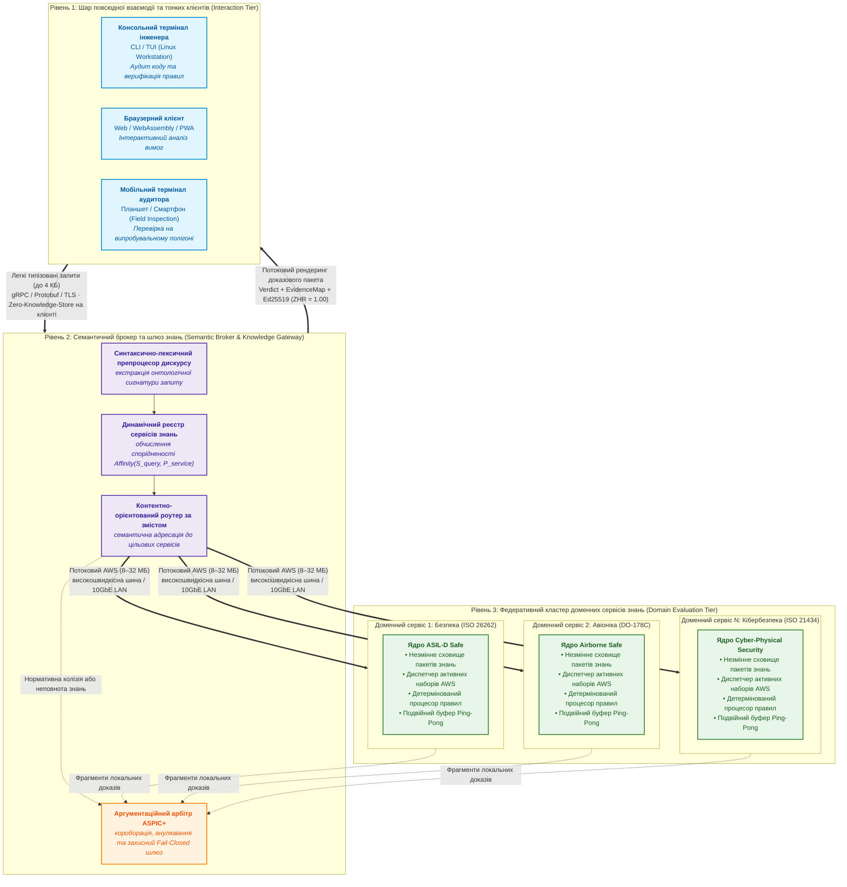
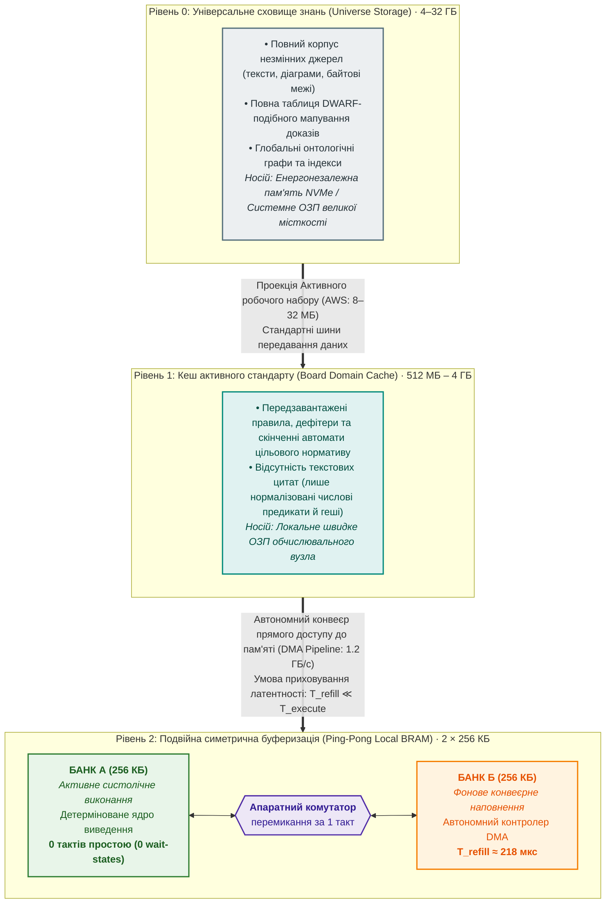
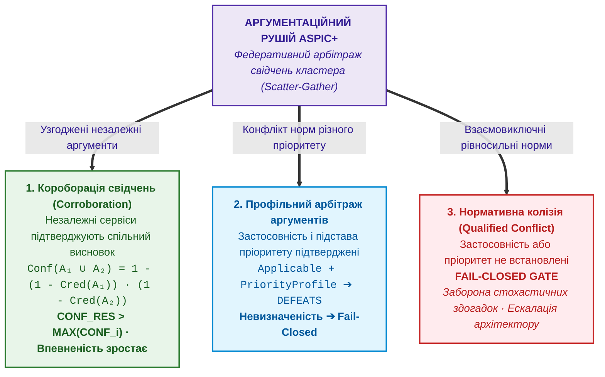
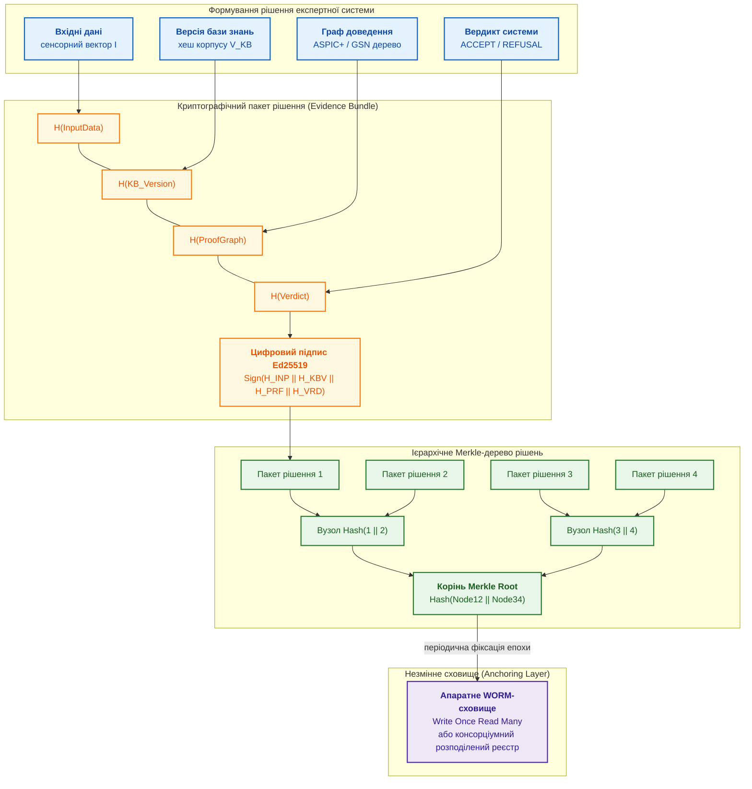
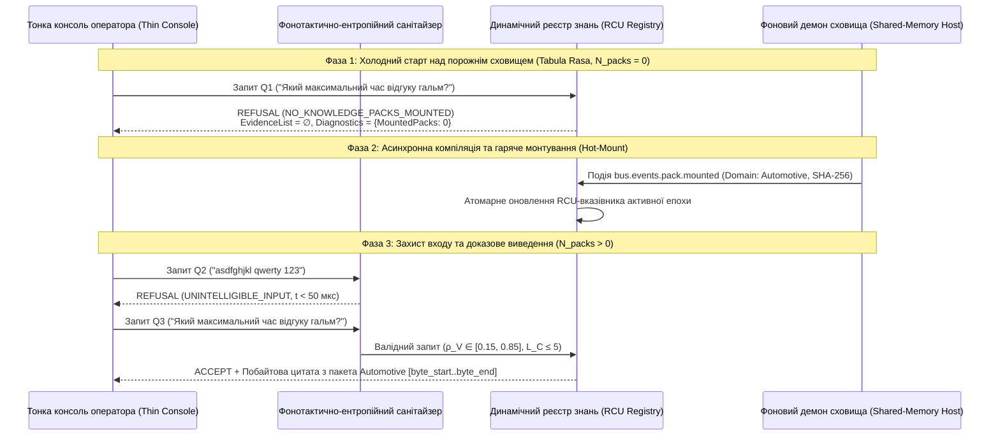

# Глава 40. Розподілена архітектура доказової експертної системи: епістемічна SOA, семантична маршрутизація, ієрархія пам'яті та багатоджерельний дефезитивний арбітраж

> **Книга:** [Архітектура доказових експертних систем](README.md) · [Частина VII: Технологічний стек, апаратна інфраструктура, кібернетичне виконання та розподілена SOA](part-07-runtime-and-knowledge-exchange.md)
> **Попередня глава:** [Глава 33. Міжсистемний обмін знаннями: постачання правил стороннім системам, навчання моделей і захищений зворотний зв'язок](ch33-inter-system-knowledge-exchange-and-model-teaching.md)
> **Завершення основного тексту:** [Зміст монографії](README.md)
> **Автор:** [Микола Федчик](about-the-author.md)  
> **Рівень складності та оптимальне вивчення:** `[L2]` Прикладний алгоритмічно-системний (індекс Д. Кнута `[28]`) · *Маршрут:* `Трек A` (розподілена Epistemic SOA, подвійна буферизація та SimHash-кластеризація)  
> **Очікувані результати:** синтезувати теоретичні положення всіх розділів монографії у завершений референсний архітектурний прототип розподіленої експертної системи; проєктувати триланкову сервіс-орієнтовану архітектуру (Epistemic SOA) із відокремленням тонких клієнтів від сервісів знань; реалізовувати синтаксично-лексичний препроцесинг і семантичну маршрутизацію запитів; долати розрив між макрообсягами сховищ і мікромісткістю швидкої пам'яті через активні робочі набори та подвійну конвеєрну буферизацію; організовувати федеративний пошук (Scatter-Gather) та багатоджерельну дефезитивну агрегацію свідчень (ASPIC+) при низькій впевненості джерел; приймати зважені інженерні рішення щодо масштабування та вибору класів апаратного/програмного забезпечення за бюджетом проєкту.

---

## Анотація

Усі попередні розділи цієї монографії послідовно довели фундаментальну тезу: надійна експертна система не може базуватися на стохастичних узагальненнях великих мовних моделей чи неперевірених базах фактів. Справжня експертність вимагає математичного детермінізму, формального виведення, побайтової кустодії першоджерел ($ZHR = 1.00$) та незалежного аудиту. Проте вихід системи за межі дослідницького стенда у реальне промислове середовище R&D ставить перед архітектором новий критичний виклик: **масштабованість, розподіленість і повсюдну доступність**.

Ця глава завершує теоретичний цикл монографії, формуючи для читача **референсний архітектурний прототип промислової доказової експертної системи**. Абстрагуючись від конкретних комерційних брендів мікросхем чи приватних специфікацій, глава визначає функціональні класи апаратних і програмних обчислювачів, необхідних для побудови масштабованої системи. Розглядається триланкова епістемічна сервіс-орієнтована архітектура (Epistemic SOA), де тонкі мобільні клієнти (смартфони, термінали) взаємодіють із кластером доменних сервісів через інтелектуальний семантичний брокер. Формалізується багаторівнева ієрархія пам'яті: математично доводиться умова безперервності конвеєра та повного приховування затримок ($`T_{\mathrm{refill}} \ll T_{\mathrm{execute}}`$) через механізм активних робочих наборів знань і симетричну подвійну буферизацію (Ping-Pong Pipeline). Для випадків неповноти окремих баз знань розроблено модель федеративного пошуку (Scatter-Gather) та багатоджерельної дефезитивної агрегації свідчень (ASPIC+). Окрему увагу приділено розподіленому семантичному тріажу дефіцитів знань на базі 64-бітного SimHash і BK-дерев із захистом від виродження простору ознак (Degeneracy Guard) та автономними WAL-буферами, а також формуванню незмінного журналу рішень (Immutable Decision Ledger) на ієрархічних Merkle-деревах із WORM-анкорингом для забезпечення юридичної та технічної неспростовності аудиту ASIL D. Наприкінці наведено інженерну матрицю вибору технологій, яка дозволяє системному архітектору розгорнути працездатний прототип на доступному йому обладнанні відповідно до бюджету проєкту.

---

## 1. Синтез монографії: від локальної моделі до референсного архітектурного прототипу

Тридцять дев'ять попередніх глав цієї книги детально препарували анатомію доказового штучного інтелекту. У монографії розглянуто гносеологію машинного знання ([Глава 2](ch02-epistemology-of-machine-knowledge.md)), моделі та типологію баз знань ([Глава 7](ch07-knowledge-base-typology.md)), автоматизоване вилучення норм із першоджерел ([Глава 15](ch15-knowledge-extraction-and-kb-construction.md)), строге детерміноване виведення ([Глава 16](ch16-expert-systems-architecture.md), [Глава 31](ch31-syllogistic-reasoning-and-relation-lattices.md)), подолання машинних галюцинацій ([Глава 38](ch38-curing-machine-hallucinations-and-knowledge-deficits.md)) та попперівський комплаєнс-аудит ([Глава 39](ch39-active-compliance-auditor-and-popperian-testing.md)).

Однак у практичній інженерії виникає закономірне запитання: **як зібрати всі ці теоретичні концепції в єдину працюючу систему корпоративного рівня?**

У реальних високотехнологічних R&D проєктах (автомобілебудування, авіоніка, медичне приладобудування) нормативна база налічує десятки чинних стандартів (ISO, IEC, DO, IEEE, RFC), які разом із вербатім-першоджерелами, таблицями відповідності та дефітерами займають десятки гігабайтів інформації. Водночас інженерам-дослідникам, аудиторам і розробникам необхідний повсякденний доступ до системи:
- на робочому місці за десктопом під час проєктування архітектури;
- у випробувальній лабораторії чи на полігоні з планшета або смартфона;
- в автоматизованому конвеєрі неперервної інтеграції (CI/CD) під час нічних аудитів коду.

Спроба вирішити цю задачу створенням «товстого» локального моноліту зазнає фіаско. Мобільний пристрій не здатний утримувати в оперативній пам'яті багатогігабайтні бази знань і не має обчислювальних потужностей для глибокого семантичного аналізу. З іншого боку, звичайний хмарний сервіс із популярною мовною моделлю не гарантує ні детермінізму, ні захисту від галюцинацій, ні побайтової кустодії першоджерел.

Потрібен **розподілений референсний архітектурний прототип**, побудований на принципах сервіс-орієнтованої архітектури (SOA), чіткого розмежування зон відповідальності та математично обґрунтованої ієрархії пам'яті.



---

## 2. Епістемічна сервіс-орієнтована архітектура (Epistemic SOA) та тонкі клієнти

Сервіс-орієнтована архітектура в інженерії програмного забезпечення традиційно вирішує задачі слабкого зв'язування компонентів, незалежного розгортання та повторного використання бізнес-функцій [[4]](#src-4). В **епістемічних доказових системах** парадигма SOA набуває якісно нового сенсу: вона забезпечує **ізоляцію контекстів істинності** та **повсюдний доступ користувачів** без ризику втрати кустодії доказів.

### 2.1. Концепція тонкого клієнта (Thin Interaction Client)

Клієнтський пристрій кінцевого користувача (інженера з якості, розробника чи аудитора) визначається як **ультратонкий агент взаємодії**:
1. **Нульове сховище знань ($`S_{\mathrm{client}} = 0`$):** Клієнтська програма не зберігає бази знань і не кешує локальні копії стандартів. Це усуває проблему розсинхронізації версій норм між членами інженерної команди.
2. **Абстрагування від обчислювачів:** Клієнту не потрібні апаратні прискорювачі нейромереж (NPU/GPU) чи спеціалізовані процесори правил. Завдяки цьому клієнтський інтерфейс експертної системи легко функціонує на звичайних смартфонах під керуванням мобільних ОС, у веб-браузерах через WebAssembly/PWA або у текстовому терміналі інженерної робочої станції.
3. **Строга типізація запитів та відповідей:** Обмін здійснюється через високоефективні бінарні RPC-контракти (наприклад, Protocol Buffers над gRPC чи захищені WebSockets):
   - Запит від клієнта: рядок природної мови або структурований ідентифікатор інженерного артефакту (обсяг пакета $`\le 2\text{--}4\,\text{КБ}`$).
   - Відповідь клієнту: структурований доказовий кортеж, що містить вердикт (`ACCEPT`, `REFUSAL`, `QUALIFIED`), ідентифікатори застосованих правил, дослівні цитати з байтовими координатами у першоджерелі та 256-бітні криптографічні геші кустодії.

> [!NOTE]
> **Три характеристики ультратонкого агента взаємодії за моделлю автора**
> 1. *Нульове сховище знань ($`S_{\mathrm{client}} = 0`$)*: клієнтська програма не зберігає бази знань і не кешує локальні копії стандартів, що усуває проблему розсинхронізації версій.
> 2. *Абстрагування від апаратних обчислювачів*: клієнту не потрібні прискорювачі NPU/GPU чи процесори правил, що дозволяє запуск на мобільних пристроях, браузерах та CLI.
> 3. *Строга типізація RPC-контрактів*: компактний вхідний запит (до $`4\,\text{КБ}`$) та структурована відповідь із повним доказовим кортежем і цифровим підписом Ed25519.
> *Керування рантаймом / Інженерний інваріант:* Тонкий клієнт не додає тверджень до серверного пакета. Підпис перевіряє походження й цілісність за довіреного ключа, а не правильність висновку; доказовий допуск виконує серверний верифікатор.

### 2.2. Збереження інваріанта $ZHR = 1.00$ на клієнті

Критично важливо, що тонкий клієнт не має права інтерпретувати чи самостійно узагальнювати отриману відповідь. Він виконує суто репрезентативну функцію:

```math
\text{Display}(\text{Response}) = \text{Render}(\text{Verdict}, \text{EvidenceMap}, \text{Signature})
```

де:
- $`\text{Verdict} \in \{\text{ACCEPT}, \text{REFUSAL}, \text{QUALIFIED}\}`$ — формальний логічний статус виведення, сформований сервером;
- $`\text{EvidenceMap}`$ — побайтове відображення термів виведення на координати у вихідних першоджерелах;
- $`\text{Signature}`$ — криптографічний цифровий підпис Ed25519 доказового пакета для гарантування незмінності.

Перед показом пакета клієнт повинен перевірити його схему, підпис і довірений ключ; це вимога до адаптера, не твердження про вже атестовану реалізацію. Розрив зв'язку не змінює раніше отриманих байтів, але не підтверджує чинності джерел або дозволу дії в новий момент часу. Історичний пакет зберігається з версією та строком чинності; якщо актуальність неможливо перевірити, це не дає нового виконавчого дозволу. Правила нормативного допуску й повноважень залишаються за Главою 16 §1.1.

Водночас у метрології розподіленої системи строго розрізняються два поняття ([Глава 36](ch36-knowledge-testing-pyramid-and-variational-calibration.md), §5.5; [Глава 38](ch38-curing-machine-hallucinations-and-knowledge-deficits.md), §2.2):
1. **Конструктивний шлюзовий інваріант ($`\mathrm{ZHR}_{\mathrm{gate}} = 1{,}00`$ або $`\tau_{\mathrm{ZHR\_gate}} = 1`$):** структурне правило, за яким кожне допущене шлюзом і передане на тонкий клієнт твердження має верифіковану побайтову цитату з першоджерела за SHA-256.
2. **Емпірична статистична верхня межа частоти галюцинацій на скінченній вибірці з $`N`$ запитів ($`p_U = 1 - 0{,}05^{1/N}`$ на рівні довіри $95\%$):** метрологічна межа випробувань, де кількість значущих десяткових розрядів емпіричного звіту визначається формулою $`d = \max(1, \lfloor \log_{10}(N/3) \rfloor)`$ для $`N \ge 30`$ (так що емпіричний запис із 6 знаками після коми на кшталт $`0{,}999999`$ вимагає $`N \ge 3 \cdot 10^6`$, тоді як $`1{,}000000`$ у [Главі 38](ch38-curing-machine-hallucinations-and-knowledge-deficits.md), §2.2 позначає конструктивний шлюзовий інваріант $`\tau_{\mathrm{ZHR\_gate}} = 1`$ у парі з параметрами $`N`$ і $`p_U`$). Там, де в цій главі наводяться виміряні стендові показники без окремо опублікованого зовнішнього сертифікаційного протоколу, вони подаються за інженерною оцінкою автора в поєднанні з вибірковою логікою [Глави 36](ch36-knowledge-testing-pyramid-and-variational-calibration.md) (§5.5).

---

## 3. Семантичний брокер, препроцесор дискурсу та маршрутизація за змістом

Коли в інженерній екосистемі функціонує не одна база знань, а кластер спеціалізованих сервісів, виникає ключове завдання координації: **хто і як визначає, куди саме спрямувати запит інженера?**

У класичних веб-системах маршрутизація здійснюється за мережевими адресами чи префіксами URL (наприклад, `/api/v1/orders`). В експертних системах адресація є суто **семантичною (Content-Based Semantic Routing)** і спирається на результати роботи лінгвістичного препроцесора.

### 3.1. Синтаксично-лексичний препроцесор дискурсу

Отримавши запит, Семантичний Брокер пропускає його крізь конвеєр первинного семантичного розбору:

```mermaid
flowchart TD
    accTitle: Конвеєр синтаксично-лексичного розбору дискурсу в Семантичному Брокері
    accDescr: Поетапна трансформація природномовного запиту інженера у структуровану онтологічну сигнатуру для маршрутизації доменних правил.

    IN["&emsp;&emsp;&emsp;&emsp; <b>ВХІДНИЙ ІНЖЕНЕРНИЙ ЗАПИТ НА АУДИТ ВІДПОВІДНОСТІ (Natural Language Query)</b> &emsp;&emsp;&emsp;&emsp;<br><i>«Чи дозволено використовувати динамічне виділення пам'яті для модуля ASIL-D згідно з ISO 26262-6?»</i><br><i>Джерело надходження: робоча станція інженера / конвеєр неперервної інтеграції (CI/CD Quality Gate)</i>"]

    STEP1["&emsp;&emsp;&emsp;&emsp; <b>1. КЛАСИФІКАЦІЯ ДИСКУРСУ (Discourse Qualification)</b> &emsp;&emsp;&emsp;&emsp;<br>• Прагматичний тип: <code>NORMATIVE_COMPLIANCE_QUERY</code> &emsp;·&emsp; • Цільова модальність: <code>DEONTIC_PROHIBITION_OR_PERMISSION</code><br><i>Семантичний намір: формальна верифікація допустимості архітектурного рішення проти сертифікаційного стандарту</i>"]

    STEP2["&emsp;&emsp;&emsp;&emsp; <b>2. СИНТАКСИЧНО-ФРЕЙМОВИЙ РОЗБІР (Syntactic Frame Parsing)</b> &emsp;&emsp;&emsp;&emsp;<br>• Актор: <i>«модуль програмного забезпечення»</i> &emsp;·&emsp; • Дія: <i>«динамічне виділення пам'яті» (Dynamic Allocation)</i> &emsp;·&emsp; • Атрибут: <code>ASIL_Level = 'D'</code><br><i>Вилучення предикатно-аргументної структури вимоги для детермінованого зіставлення з онтологічними аксіомами</i>"]

    STEP3["&emsp;&emsp;&emsp;&emsp; <b>3. ЕКСТРАКЦІЯ ОНТОЛОГІЧНОЇ СИГНАТУРИ (Domain Signature Extraction)</b> &emsp;&emsp;&emsp;&emsp;<br>• Доменні маркери: <code>{ISO-26262, ASIL-D, Software-Architecture, Memory-Management}</code><br>• Профіль запиту: <code>TargetDomain = 'Automotive-Safety'</code> &emsp;·&emsp; • Норматив: <code>Standard = 'ISO-26262-6:2018'</code><br><i>Формування сигнатурного вектора запиту для обчислення коефіцієнтів спорідненості в динамічному реєстрі сервісів</i>"]

    OUT["&emsp;&emsp;&emsp;&emsp; <b>ПРИЗНАЧЕННЯ ГОЛОВНОГО ВИКОНАВЦЯ (Primary Evaluator Dispatching)</b> &emsp;&emsp;&emsp;&emsp;<br>Призначено сервіс: <b>Доменний сервіс безпеки автомобільної електроніки (ISO 26262-6:2018)</b> &emsp;·&emsp; <code>Affinity(S_query, P_service) = 1.00</code><br><i>Пакет активного набору (AWS) передається до систолічного детермінованого ядра правил через високошвидкісну локальну шину</i>"]

    IN ==> STEP1
    STEP1 ==> STEP2
    STEP2 ==> STEP3
    STEP3 ==> OUT

    classDef query fill:#e3f2fd,stroke:#1565c0,stroke-width:2px,color:#0d47a1;
    classDef step1 fill:#ede7f6,stroke:#5e35b1,stroke-width:2px,color:#311b92;
    classDef step2 fill:#fff8e1,stroke:#ffa000,stroke-width:2px,color:#e65100;
    classDef step3 fill:#e8f5e9,stroke:#2e7d32,stroke-width:2px,color:#1b5e20;
    classDef target fill:#f3e5f5,stroke:#7b1fa2,stroke-width:2px,color:#4a148c;

    class IN query;
    class STEP1 step1;
    class STEP2 step2;
    class STEP3 step3;
    class OUT target;
```



### 3.2. Динамічний реєстр сервісів знань (Knowledge Service Registry)

Семантичний Брокер підтримує в пам'яті актуальний реєстр доступних у кластері доменних сервісів. Кожен сервіс при реєстрації публікує формальний маніфест:
- **Ідентифікатор та ендпоінт:** Мережева адреса (IP/порт або черга повідомлень);
- **Простір знань (Knowledge Domain):** Набір обслуговуваних стандартів та версій онтологій (відповідно до вимог SemVer 2.0.0);
- **Клас обчислювача:** Програмний CPU, масив векторних процесорів або спеціалізоване апаратне ядро детермінованого виведення;
- **Метрики пропускної здатності:** Поточна глибина черги запитів та оцінка затримки обчислення.

Брокер обчислює функцію відповідності між онтологічною сигнатурою запиту $`\mathcal{S}_{\mathrm{query}}`$ та простором знань $`\mathcal{P}_{\mathrm{domain}}`$ у паспорті сервісу $`\mathcal{P}_{\mathrm{service}}`$:

```math
\mathrm{Affinity}(\mathcal{S}_{\mathrm{query}}, \mathcal{P}_{\mathrm{service}}) = \frac{\lvert\mathcal{S}_{\mathrm{query}} \cap \mathcal{P}_{\mathrm{domain}}\rvert}{\lvert\mathcal{S}_{\mathrm{query}}\rvert}
```

де:
- $`\mathcal{S}_{\mathrm{query}}`$ — множина онтологічних концептів і доменних маркерів, екстрагованих із запиту інженера;
- $`\mathcal{P}_{\mathrm{domain}}`$ — множина підтримуваних стандартів та версій онтологій у паспорті сервісу $`\mathcal{P}_{\mathrm{service}}`$;
- $`\lvert \mathcal{S}_{\mathrm{query}} \cap \mathcal{P}_{\mathrm{domain}} \rvert`$ — потужність перетину онтологічних сигнатур (число зіставлених концептів);
- $`\lvert \mathcal{S}_{\mathrm{query}} \rvert`$ — загальна кількість онтологічних маркерів у вхідному запиті;
- $`\mathrm{Affinity}(\mathcal{S}_{\mathrm{query}}, \mathcal{P}_{\mathrm{service}}) \in [0, 1]`$ — нормований коефіцієнт семантичної спорідненості (значення $1.0$ відповідає повному охопленню домену запиту).

Сервіс із найвищим показником близькості призначається головним виконавцем (*Primary Evaluator*).

---

## 4. Теоретична модель багаторівневої ієрархії пам'яті та подвійної буферизації

Будь-яка обчислювальна система обмежена законами фізики передавання сигналів та організації ієрархії пам'яті [[3]](#src-3): **чим більший обсяг пам'яті, тим більша затримка доступу до неї, і навпаки — надшвидка пам'ять, інтегрована безпосередньо в логіку обчислювача, має вкрай обмежену місткість**.

В інженерних експертних системах цей розрив досягає критичних масштабів:
1. **Макрообсяг сховища знань ($`V_{\mathrm{corpus}}`$):** Повний репозиторій нормативів разом із першоджерелами, деревами розбору та матрицями трасованості становить $`4\text{--}32\,\text{ГБ}`$.
2. **Мікрообсяг швидкої пам'яті процесора правил ($`V_{\mathrm{local}}`$):** Локальна пам'ять спеціалізованого процесора правил (Block RAM у кремнієвих прискорювачах або швидкий кеш L1/L2) зазвичай не перевищує кількох сотень кілобайт ($`256\text{--}512\,\text{КБ}`$).
3. **Пропускна здатність каналу обміну ($`B_{\mathrm{channel}}`$):** Передавання повного масиву знань на обчислювач під час кожного запиту спричиняє неприпустимий простій системи ($> 1$ хвилини), що руйнує комфортний діалог інженера ($`0.5\text{--}2.0\,\text{с}`$).



### 4.1. Концепція Активного робочого набору (Active Working Set — AWS)

Замість переміщення всього корпусу знань, семантичний диспетчер формує **Активний робочий набір (AWS)**:

```math
\mathrm{AWS} = \mathrm{Closure}(\mathcal{R}_{\mathrm{target}}) = \mathcal{R}_{\mathrm{target}} \cup \mathrm{Prerequisites}(\mathcal{R}_{\mathrm{target}}) \cup \mathrm{Defeaters}(\mathcal{R}_{\mathrm{target}})
```

де:
- $`\mathcal{R}_{\mathrm{target}}`$ — множина цільових правил, активована онтологічною сигнатурою запиту;
- $`\mathrm{Prerequisites}(\mathcal{R}_{\mathrm{target}})`$ — предикати-передумови, необхідні для детермінованого розв'язання залежностей;
- $`\mathrm{Defeaters}(\mathcal{R}_{\mathrm{target}})`$ — множина асоційованих дефітерів (винятків і контрправил);
- $`\mathrm{AWS}`$ — транзитивне логічне замикання правил без текстових цитат першоджерел, оптимізоване для миттєвого завантаження в локальний кеш обчислювача.

AWS містить лише математичний скелет правил: числові ліміти, логічні умови, ідентифікатори дефітерів та 256-бітні геші цитат. Вербатім-тексти першоджерел залишаються у сховищі Рівня 0. Обсяг AWS зменшується до **$`8\text{--}32\,\text{МБ}`$**, що передається стандартними промисловими шинами за лічені частки секунди.

> [!NOTE]
> **Три компоненти Активного робочого набору (AWS) за моделлю автора**
> 1. *Цільовий пул правил ($`\mathcal{R}_{\mathrm{target}}`$)*: множина актуальних нормативних вимог, активованих онтологічною сигнатурою запиту.
> 2. *Транзитивні передумови ($`\mathrm{Prerequisites}`$)*: предикати та залежності, необхідні для замкненого детермінованого логічного виведення.
> 3. *Асоційовані дефітери ($`\mathrm{Defeaters}`$)*: повний перелік винятків і контрправил, що можуть підірвати або обмежити застосування цільової норми.
> *Керування рантаймом / Інженерний інваріант:* Обсяг AWS стискається до $`8\text{--}32\,\text{МБ}`$ шляхом відокремлення вербатім-цитат, забезпечуючи передачу по шині за частки секунди.

### 4.2. Математична умова безперервності конвеєра подвійної буферизації (Ping-Pong Pipeline)

У детермінованих експертних системах неприпустима ситуація, коли високопродуктивне обчислювальне ядро зупиняється в очікуванні надходження чергової порції правил із повільного зовнішнього накопичувача. Для усунення затримок пам'ять процесора правил організовується як два симетричні незалежні банки однакового розміру: Банк A та Банк B. Поки процесор опрацьовує правила в одному банку, контролер прямого доступу до пам'яті (DMA) у фоновому режимі заповнює інший банк наступною порцією знань.

Час заповнення одного банку даними з локального системного ОЗП ($`T_{\mathrm{refill}}`$) визначається відношенням місткості банку до реальної пропускної здатності шини передавання:

```math
T_{\mathrm{refill}} = \frac{V_{\mathrm{bank}}}{B_{\mathrm{bus}}}
```

де:
- $`V_{\mathrm{bank}}`$ — місткість одного банку швидкої внутрішньокристальної пам'яті (наприклад, $`256\,\text{КБ}`$ Block RAM на FPGA або виділеного статичного ОЗП SRAM у кристалі);
- $`B_{\mathrm{bus}}`$ — ефективна пропускна здатність внутрішньої шини підкачування знань (наприклад, $`1.2\,\text{ГБ/с}`$ для шини AXI4-Stream / PCIe DMA);
- $`T_{\mathrm{refill}}`$ — розрахунковий час фонового наповнення банку даними без участі процесора правил;
- $`T_{\mathrm{execute}}`$ — час, необхідний процесору правил для повного систолічного зіставлення вхідного пакета вимог із блоком знань місткістю $`V_{\mathrm{bank}}`$.

**Теорема приховування затримок (Latency Hiding Invariant):**
Конвеєр виведення функціонує з максимальним коефіцієнтом використання обчислювальних ресурсів ($\eta = 1.00$) без жодного такту простою процесора (zero wait-states) тоді й тільки тоді, коли час фонового наповнення не перевищує часу обчислення поточної порції правил:

```math
T_{\mathrm{refill}} \le T_{\mathrm{execute}}
```

**Практичне інженерне застосування результату розрахунку:**

Отримане значення $`T_{\mathrm{refill}}`$ та його співвідношення з $`T_{\mathrm{execute}}`$ є не просто теоретичною оцінкою, а **робочим інструментом системного проєктування та динамічного диспетчеризування**:

1. **Апаратний сайзинг (Hardware Dimensioning):**
   Формула задає гранично допустимий розмір банку швидкої пам'яті $`V_{\mathrm{bank}}`$ під час проєктування апаратного комплексу:

```math
V_{\mathrm{bank}} \le B_{\mathrm{bus}} \cdot T_{\mathrm{execute}}
```

   Якщо архітектор помилково виділить надмірно великий банк (наприклад, $`V_{\mathrm{bank}} = 16\,\text{МБ}`$), шина з пропускною здатністю $`1.2\,\text{ГБ/с}`$ потребуватиме на його заповнення:

```math
T_{\mathrm{refill}} = \frac{16\,\text{МБ}}{1.2\,\text{ГБ/с}} \approx 13.3\,\text{мс}
```

   Якщо процесор завершує перевірку правил за $`T_{\mathrm{execute}} = 2.0\,\text{мс}`$, виникає деградація конвеєра (*Pipeline Stall*): процесор примусово зупиняється на $`11.3\,\text{мс}`$ в очікуванні шини, а коефіцієнт корисної дії ядра падає до:

```math
\eta = \frac{T_{\mathrm{execute}}}{T_{\mathrm{refill}}} = \frac{2.0\,\text{мс}}{13.3\,\text{мс}} \approx 0.15
```

   (85% тактової частоти дорогого кремнієвого ядра втрачається вхолосту). Розрахунок доводить: для збереження безперервності розмір порції правил не повинен перевищувати $`256\text{--}512\,\text{КБ}`$.

2. **Динамічне планування порцій правил (Adaptive Chunk Sizing) у софтверному рантаймі:**
   Під час формування Активного робочого набору (AWS) семантичний диспетчер динамічно оцінює складність правил у черговій порції. Якщо правила прості й прогнозований час виконання зменшується ($`T_{\mathrm{execute}} \to 0.5\,\text{мс}`$), диспетчер автоматично пакує правила в менші фрагменти або активує burst-режим шини DMA, запобігаючи зупинці обчислювального ядра.

3. **Режими функціонування та інженерні рішення за результатами зіставлення:**
   - **Оптимальний детермінований режим ($`T_{\mathrm{refill}} \ll T_{\mathrm{execute}}`$, запас $\ge 2\times$):**
   Для типового блоку знань обсягом $`256\,\text{КБ}`$ за десятковими одиницями $`1\,\text{КБ}=1000`$ байтів і $`1\,\text{ГБ}=10^9`$ байтів час підкачування становить $`T_{\mathrm{refill}} = \frac{256\,\text{КБ}}{1.2\,\text{ГБ/с}} \approx 213\,\mu\text{с}`$. Систолічне зіставлення пакета складних інженерних вимог проти цих правил займає $`T_{\mathrm{execute}} \approx 1.5\text{--}5.0\,\text{мс}`$. Запас часу складає від 7 до 23 разів.
     **Дія системи:** Пасивний банк гарантовано заповнюється задовго до завершення розрахунків. У момент готовності процесора апаратний комутатор за **1 такт** перемикає банки ($A \leftrightarrow B$), забезпечуючи наскрізну продуктивність $\eta = 1.00$ та повну детермінованість часу відповіді (WCET).
   - **Гранична зона конкуренції за шину ($`0.8 \cdot T_{\mathrm{execute}} < T_{\mathrm{refill}} \le T_{\mathrm{execute}}`$):**
     Запас мінімальний. Будь-яка тимчасова колізія на внутрішній шині (сторонні переривання, звернення периферії) здатна спричинити прострочення дедлайну конвеєра.
     **Дія системи:** Диспетчер активує пріоритетний арбітраж шини (*DMA Channel Priority / QoS*), надаючи потоку знань найвищий рівень пріоритету перед іншими системними процесами.
   - **Аварійний режим дефіциту пропускної здатності ($`T_{\mathrm{refill}} > T_{\mathrm{execute}}`$):**
     **Дія системи:** Апаратний сторожовий таймер фіксує простій конвеєра. Семантичний диспетчер активує режим деградації: тимчасово обмежує паралелізм векторного ядра або відсікає необов'язкові дефітери другого порядку, повертаючись до стабільного стану $`T_{\mathrm{refill}} \le T_{\mathrm{execute}}`$.

#### 4.2.1. Емпірична верифікація теореми приховування затримок та аналіз ККД конвеєра на стенді PYNQ-Z1

Для експериментального підтвердження теоретичної моделі приховування затримок автором проведено серію випробувань на апаратному стенді **Xilinx PYNQ-Z1** (кристал Zynq-7000 XC7Z020, шина AXI HP0 з виміряною смугою $`B_{\mathrm{DMA}} = 412\,\text{МБ/с}`$, тактова частота ядра $`F_{\mathrm{clk}} = 100\,\text{МГц}`$, середня затримка інструкції $`\tau_{\mathrm{rule}} = 20\,\text{нс}`$).

Коефіцієнт корисної дії обчислювального ядра ($\eta$) описується кусково-лінійною функцією від відношення часу підкачування до часу виконання:

$$
\eta = \frac{T_{\mathrm{execute}}}{\max(T_{\mathrm{execute}}, T_{\mathrm{refill}})} = \begin{cases} 1{,}00, & \text{якщо } T_{\mathrm{refill}} \le T_{\mathrm{execute}} \\ \dfrac{T_{\mathrm{execute}}}{T_{\mathrm{refill}}}, & \text{якщо } T_{\mathrm{refill}} > T_{\mathrm{execute}} \end{cases}
$$

Емпіричні результати вимірювання затримок та ККД для різних розмірів порцій правил наведено в таблиці:

| Конфігурація порції ($`V_{\mathrm{bank}}`$) | Кількість інструкцій ($`N_{\mathrm{rules}}`$) | Час обчислення ($`T_{\mathrm{execute}}`$) | Час підкачування ($`T_{\mathrm{refill}}`$) | Співвідношення $`T_{\mathrm{refill}} / T_{\mathrm{execute}}`$ | Емпіричний ККД ($\eta$) | Стан конвеєра ядра |
| :--- | :---: | :---: | :---: | :---: | :---: | :--- |
| **16 КБ (2 048 правил EISA)** | $2\,048$ | $`40{,}96\,\mu\text{с}`$ | $`39{,}7\,\mu\text{с}`$ | $`0{,}97 \le 1{,}00`$ | **$`1{,}00`$ (100%)** | Повний детермінізм |
| **32 КБ (4 096 правил EISA)** | $4\,096$ | $`81{,}92\,\mu\text{с}`$ | $`79{,}5\,\mu\text{с}`$ | $`0{,}97 \le 1{,}00`$ | **$`1{,}00`$ (100%)** | Повний детермінізм |
| **64 КБ (8 192 правила EISA)** | $8\,192$ | $`163{,}84\,\mu\text{с}`$ | $`153{,}1\,\mu\text{с}`$ | $`0{,}93 \le 1{,}00`$ | **$`1{,}00`$ (100%)** | Повний детермінізм |
| **128 КБ (штучний тротлінг DMA)** | $4\,096$ (розріджені) | $`81{,}92\,\mu\text{с}`$ | $`310{,}7\,\mu\text{с}`$ | $`3{,}79 > 1{,}00`$ | **$`0{,}26`$ (26%)** | Pipeline Stall ($`228{,}8\,\mu\text{с}`$) |
| **256 КБ (колізія шини AXI)** | $5\,000$ (сканування) | $`100{,}00\,\mu\text{с}`$ | $`621{,}4\,\mu\text{с}`$ | $`6{,}21 > 1{,}00`$ | **$`0{,}16`$ (16%)** | Watchdog Fault (`SLACK_FAULT`) |

Графік залежності підтверджує: допоки відношення $`T_{\mathrm{refill}} / T_{\mathrm{execute}} \le 1{,}00`$, ядро функціонує з теоретичним максимумом $`\eta = 1{,}00`$ (нульові такти простою). При перевищенні одиниці ККД ядра гіперболічно спадає за законом $`\eta \propto 1 / (T_{\mathrm{refill}} / T_{\mathrm{execute}})`$, що призводить до втрати до 84% обчислювального часу кремнію в режимі очікування шини.

> [!NOTE]
> **Чотири інженерні виміри теореми приховування затримок подвійної буферизації за моделлю автора**
> 1. *Апаратний сайзинг швидкої пам'яті*: обмеження розміру банку Block RAM умовою $`V_{\mathrm{bank}} \le B_{\mathrm{bus}} \cdot T_{\mathrm{execute}}`$ (оптимально $`32\text{--}64\,\text{КБ}`$ на кристалах Zynq-7000 та $`256\text{--}512\,\text{КБ}`$ на UltraScale+) для запобігання апаратному простою конвеєра.
> 2. *Динамічне адаптивне пакування правил*: автоматичне коригування розміру блоків диспетчером у рантаймі відповідно до обчислювальної складності порції та пропускної здатності шини DMA.
> 3. *Трьохрежимний арбітраж перемикання*: функціонування в детермінованому режимі ($`T_{\mathrm{refill}} \ll T_{\mathrm{execute}}`$) з однотактним перемиканням банків, пріоритезація шини при конкуренції та деградація при аварії.
> 4. *Емпірична гарантія безперервності ($`\eta = 1{,}00`$)*: кремнієва валідація на платі PYNQ-Z1 доводить нульовий простій ядра при розмірах порцій до $`64\,\text{КБ}`$ і смузі DMA $`412\,\text{МБ/с}`$ та автоматичну відсічку апаратним сторожовим таймером при деградації шини.
> *Керування рантаймом / Інженерний інваріант:* Виконання умови $`T_{\mathrm{refill}} \le T_{\mathrm{execute}}`$ гарантує безперервність роботи ядра з нульовими тактами простою ($\eta = 1.00$).

### 4.3. Систолічний пакетний аудит (Batch Compliance Sweeps)

Для масової верифікації (наприклад, одночасна перевірка $M = 1\,500$ вимог безпеки проти $K = 500$ нормативних правил):
- Вимоги подаються як конвеєрний векторний потік;
- Елементарні атомарні порівняння виконуються за $`1\text{--}4`$ такти апаратної частоти;
- Загальний час апаратної перевірки $750\,000$ пар становить менше **$`30\text{--}50\,\text{мс}`$**, що забезпечує наскрізний час відповіді менше $`1.0\,\text{с}`$ для всієї системи.

---

## 5. Багатоджерельна дефезитивна агрегація знань (ASPIC+ / Dung)

В інженерних R&D проєктах високої складності жодна окрема база знань не володіє абсолютною монополією на повноту інформації. Окремий доменний сервіс може повернути результат, який не є однозначним.

### 5.1. Тригери неповноти знань (Uncertainty Triggers)

Семантичний Брокер ідентифікує необхідність підключення додаткових сервісів за трьома строгими ознаками:
1. **Низький дискретний бал достовірності ($Score < 70/100$):** Посилання походить з негармонізованого або вторинного джерела;
2. **Неімперативний нормативний статус (Informative vs Normative):** Правило вилучено з довідкового розділу або додатку (*Guideline / May / Informative Annex*), тоді як інженер вимагає сертифікаційного вердикту;
3. **Відкритий дефіцитний стан (Ungrounded Defeater):** Правило містить умову-виняток `unless condition_X`, але в локальній базі знань факт `condition_X` відсутній.

### 5.2. Федеративний запит (Scatter-Gather) та аргументаційний арбітраж

Виявивши дефіцит, Брокер ініціює паралельне опитування (**Scatter**) суміжних сервісів кластера (наприклад, сервісу галузевих прецедентів чи загальних стандартів надійності). Отримані від різних сервісів фрагменти доказів зводяться (**Gather**) у формальну аргументаційну систему **ASPIC+** [[2]](#src-2) на базі абстрактних аргументаційних структур Дунга [[1]](#src-1):



#### 5.2.1. Короборація свідчень (Corroboration)

Під час аудиту складних інженерних систем свідчення від одного доменного сервісу може мати ненульовий епістемічний дефіцит або недостатній рівень довіри. Механізм короборації об'єднує узгоджені докази від суміжних вузлів кластера. Якщо два сервіси доходять узгодженого твердження за умови **строгої статистичної та джерельної незалежності аргументів** ($`A_1 \perp A_2`$, неперетинні ланцюги походження `Provenance Chains`), сукупна ймовірнісна довіра до висновку обчислюється за теоремою про ймовірність об'єднання незалежних подій:

```math
\mathrm{Conf}(A_1 \cup A_2) = 1 - (1 - \mathrm{Cred}(A_1)) \cdot (1 - \mathrm{Cred}(A_2))
```

де:
- $`\mathrm{Cred}(A_i) \in [0, 1)`$ — дискретний рівень достовірності свідчення, наданого доменним сервісом $i$ (визначається авторитетністю джерела знань та глибиною трасованості);
- $`\mathrm{Conf}(A_1 \cup A_2) \in [0, 1)`$ — сукупна ймовірнісна довіра до скороборованого висновку після агрегації незалежних аргументів $`A_1`$ та $`A_2`$;
- **Інваріант незалежності походження ($`A_1 \perp A_2`$):** застосування мультиплікативної формули дозволено виключно тоді, коли графи походження аргументів не мають спільного вихідного документа, спільного сенсорного каналу чи спільної генеративної моделі ([Глава 37](ch37-input-information-assessment-and-algorithmic-skepticism.md), §7.2); за наявності спільного предка у графі походження незалежне перемноження $`(1 - c_1)(1 - c_2)`$ категорично заборонено.

**Практичне застосування та інженерні висновки з результату обчислень:**
Пороги $`\tau_{\mathrm{accept}}=0{,}95`$ і $`0{,}80`$ нижче є параметрами авторського профілю короборації, а не числовими вимогами ISO 26262, DO-178C чи IEC 61508. Їхнє застосування до продукту потребує затвердженого профілю та окремої перевірки застосовних вимог.
1. **Точка виклику в життєвому циклі:** Розрахунок виконується семантичним брокером на етапі зведення (Gather-фаза), коли надіслані від кількох вузлів докази з диз'юнктними ланцюгами походження узгоджуються щодо одного цільового предикату.
2. **Критерії прийняття системних рішень за числовими порогами та класами критичності ([Глава 39](ch39-active-compliance-auditor-and-popperian-testing.md), §7.2):**
   - **Безпеково-критичні класи (ISO 26262 ASIL-D [[5]](#src-5), DO-178C DAL-A [[6]](#src-6), IEC 61508 SIL-4):** Вердикт `ACCEPT` із криптографічним підписом Ed25519 випускається **виключно** на підставі детермінованого формального доведення від суверенного ядра (System 2). Ймовірнісна короборація $`\mathrm{Conf} \ge \tau_{\mathrm{accept}} = 0{,}95`$ від дорадчих або евристичних каналів (System 1) у класі ASIL-D дає **щонайбільше статус `QUALIFIED`** (з обов'язковою ескалацією людині-експерту або суто як сигнал пріоритетного ранжування перед детермінованою верифікацією). Лише в некритичних дорадчих профілях (`QM` / `ERL-1..2`) досягнення $`\mathrm{Conf} \ge 0{,}95`$ дозволяє автоматичне закриття інформаційного запиту.
   - **Зона експертного доопрацювання ($`0{,}80 \le \mathrm{Conf} < 0{,}95`$, або $`\mathrm{Conf} \ge 0{,}95`$ для ASIL-D без формального доведення ядра):** Система формує кваліфікований вердикт `QUALIFIED`. Доказовий пакет маркується як умовно прийнятний та автоматично ескалується провідному архітектору (людина в циклі керування, *Human-in-the-Loop*) або передається у пріоритетну чергу детермінованого верифікатора із побайтовим зазначенням ланок аргументації.
   - **Зона недостатності свідчень ($`\mathrm{Conf} < 0{,}80`$):** Система блокує перевірку зі статусом `REFUSAL`. Запит відхиляється через відсутність достатнього теоретичного підґрунтя в базі знань.
3. **Числовий інженерний приклад:**
   Нехай дорадчий вузол аналізу архітектурних патернів повертає твердження $`A_1`$ із довірою $`\mathrm{Cred}(A_1) = 0{,}85`$, а суміжний вузол аудиту пам'яті з диз'юнктним ланцюгом походження ($`A_1 \perp A_2`$) підтверджує безпеку того ж фрагмента аргументом $`A_2`$ з достовірністю $`\mathrm{Cred}(A_2) = 0{,}80`$. Підсумкова ймовірнісна довіра:

```math
\mathrm{Conf}(A_1 \cup A_2) = 1 - (1 - 0{,}85) \cdot (1 - 0{,}80) = 1 - (0{,}15 \cdot 0{,}20) = 1 - 0{,}03 = 0{,}97
```

   Оскільки $`0{,}97 \ge \tau_{\mathrm{accept}} = 0{,}95`$, для загальнопромислового некритичного профілю (`QM`) вимога закривається автоматично; проте для тракту сертифікації **ASIL-D** цей ймовірнісний показник не має права підмінити формальне доведення: брокер присвоює статус `QUALIFIED`, піднімає пріоритет гіпотези до №1 для детермінованої перевірки суверенним ядром System 2 та скеровує звіт на підтвердження провідному інженеру з безпеки.

#### 5.2.2. Анулювання слабких тверджень (Defeat / Undercutting)

В інженерних регламентах нормативні вимоги поділяються за строгістю модальності: імперативні обов'язкові правила (*Shall / Must*), рекомендаційні настанови (*Should / Recommended*) та довідкові примітки (*May / Informative*).

Якщо під час федеративного пошуку виявляється конфлікт між висновками сервісів, система не застосовує ймовірнісне зважування. До порівняння арбітр перевіряє версію, чинність, сферу, юрисдикцію та нормативний статус кожного пункту. Слова `SHALL/MUST` і `SHOULD/MAY` зберігають різну модальну силу за конвенцією документа, але самі по собі не доводять застосовності чи відношення пріоритету між різними джерелами. Лише коли затверджений профіль для цієї колізії підтверджує застосовність обох норм і визначає перевагу, система застосовує відповідне правило перемоги аргументу та зберігає обидві підстави в аудиторському протоколі. Якщо сфера чи пріоритет невідомі, автоматичне анулювання заборонено: активується `REFUSAL_NORMATIVE_CONFLICT` або `QUALIFIED_CONFLICT` за Главою 16 §1.1.

#### 5.2.3. Кваліфікована відмова при нормативній колізії (Qualified Conflict)

Критична ситуація виникає, якщо для визначених виробу, юрисдикції, версій і періоду підтверджено застосовність двох норм та профіль оцінювання встановив їхню однакову нормативну силу, але приписи взаємовиключні. Назви стандартів або однакова модальність *Shall* окремо не доводять ані однакової юридичної сили, ані застосовності; зіставлення ISO 26262 та ISO/SAE 21434 тут є умовним сценарієм для такого профілю.

У такій ситуації, згідно з рекомендаціями стандартів довіреного штучного інтелекту (зокрема, NIST AI RMF 1.0 [[7]](#src-7)), експертна система **категорично забороняє стохастичне вгадування компромісу** чи вибір «найбільш імовірного» варіанта нейромережею. Система активує захисний шлюз **Fail-Closed**:
1. Формує типізований вердикт `QUALIFIED_CONFLICT`;
2. Генерує двостороннє дерево колізії із зазначенням конкретних пунктів обох стандартів;
3. Блокує автоматичний випуск артефакту в CI/CD та ескалує проблему на головного системного архітектора для формування офіційного інженерного обґрунтування винятку (*Safety Deviation Justification*).

#### 5.2.4. Бітемпоральна модель безконфліктного оновлення нормативної бази та аргументаційне розв'язання колізій поколінь стандартів

У довготривалих інженерних програмах життєвий цикл кіберфізичного виробу (15–30 років) суттєво перевищує цикл перегляду міжнародних регламентів (5–7 років). Наприклад, перехід автомобільного стандарту функціональної безпеки від ISO 26262:2011 до ISO 26262:2018 запровадив кардинально нові вимоги до складних напівпровідникових кристалів (Part 11) та специфічні правила оцінювання залежних відмов (Part 9). Механічне видалення старих правил або сліпе перезаписування онтології руйнує доказову цілісність сертифікаційного досьє для раніше випущених серійних виробів, які за законом повинні підтримуватися за нормативами року їхнього затвердження.

Автором запропоновано **бітемпоральну модель нормативної спадковості бази знань М. Федчика**, де кожна вимога $`C \in \mathcal{KB}`$ маркується двовимірним темпоральним інтервалом: валідним часом дії норми у правовому полі $`[t_{\mathrm{valid\_start}}, t_{\mathrm{valid\_end}}]`$ та транзакційним часом реєстрації факту в базі $`[t_{\mathrm{tx\_start}}, t_{\mathrm{tx\_end}}]`$, а еволюційний зв'язок фіксується денотатом заміщення:

```math
\mathrm{SUPERSEDED\_BY}(S_{\mathrm{new}}, C_{\mathrm{new}}, S_{\mathrm{old}}, C_{\mathrm{old}})
```

де $`S_{\mathrm{new}}, S_{\mathrm{old}}`$ — ідентифікатори поколінь стандарту; $`C_{\mathrm{new}}, C_{\mathrm{old}}`$ — відповідні пункти вимог.

Коли експертна система проводить аудит проєкту на дату $`t_{\mathrm{eval}}`$, аргументаційний рушій ASPIC+ генерує недемонстративне анулювання за правилом:

$$
\mathrm{Undercuts}(A_{\mathrm{new}}, A_{\mathrm{old}}) \iff \mathrm{SUPERSEDED\_BY}(S_{\mathrm{new}}, C_{\mathrm{new}}, S_{\mathrm{old}}, C_{\mathrm{old}}) \land (t_{\mathrm{eval}} \ge t_{\mathrm{valid\_start}}(S_{\mathrm{new}}))
$$

**Параметри та умови функціонування моделі:**
- $`A_{\mathrm{new}}, A_{\mathrm{old}}`$ — аргументи логічного виведення, сформовані на основі вимог нового та попереднього видання стандарту;
- $`t_{\mathrm{eval}}`$ — дата цільового проєктного або аудиторського зрізу системи;
- $`t_{\mathrm{valid\_start}}(S_{\mathrm{new}})`$ — дата офіційного набуття чинності новою редакцією стандарту;
- $`\mathrm{Undercuts}(\cdot)`$ — оператор анулювання зв'язку обґрунтування аргументу в абстрактній системі аргументації Дунга.

**Імператив замкненого циклу розрахунку (Actionable Closed Loop):**
1. **Керування рантаймом і потоком обчислень (Control Flow & Runtime Decisions):**
   При побудові доказового графа семантичний брокер фільтрує застосовні норми за цільовим таймстемпом $`t_{\mathrm{eval}}`$. Якщо $`t_{\mathrm{eval}} \ge t_{\mathrm{valid\_start}}(S_{\mathrm{new}})`$, активується атака $`\mathrm{Undercuts}(A_{\mathrm{new}}, A_{\mathrm{old}})`$: аргумент застарілої редакції детерміновано вилучається з активного розрахунку, система формує висновок `SUPERSEDED_STANDARD_MIGRATED` та виводить у звіті аудит-лог із порівняльним аналізом змін. Якщо ж виконується ретроспективний аудит старого серійного виробу ($`t_{\mathrm{eval}} < t_{\mathrm{valid\_start}}(S_{\mathrm{new}})`$), відношення анулювання блокується, і система застосовує норми $`S_{\mathrm{old}}`$, зберігаючи повну юридичну силу сертифікату.
2. **Апаратний сайзинг та інфраструктурні обмеження (Hardware Dimensioning):**
   Бітемпоральні індекси вимог зберігаються у компактних реляційних B-Tree/LSM-структурах із 64-бітними мітками часу UNIX epoch. Повний реєстр переходів стандарту ISO 26262 (всі 12 частин, понад $1\,400$ статей за редакції 2011 та 2018 років) займає $`V_{\mathrm{meta}} \le 4.5\,\text{МБ}`$ оперативної пам'яті, а час темпоральної селекції застосовного набору правил становить $`t_{\mathrm{resolve}} \le 18\,\mu\text{с}`$.
3. **Практичний числовий приклад (Worked Numerical Example):**
   Експертна система перевіряє проєктну специфікацію мікроконтролера для автопілота на дату $`t_{\mathrm{eval}} = \text{2024-05-15}`$. Редакція ISO 26262:2011 (Part 5, Clause 6.4.2) вимагала метрики одиничних відмов $SPFM \ge 99\%$, тоді як редакція ISO 26262:2018 (Part 11) вводить обов'язкові специфічні тести для багатоядерних кристалів. Оскільки $`t_{\mathrm{eval}} = \text{2024-05-15} \ge t_{\mathrm{valid\_start}}(\text{ISO 2018}) = \text{2018-12-01}`$, аргументаційний рушій активує $`\mathrm{Undercuts}(A_{2018}, A_{2011})`$. Стара норма безумовно відсікається, система застосовує нові формули Part 11:2018 та випускає статус відповідності `ACCEPT_MIGRATED_EDITION` без необхідності ручного втручання інженера.

> [!NOTE]
> **Авторська чотиригілкова модель федеративного аргументаційного арбітражу ASPIC+ та бітемпоральної міграції стандартів М. М. Федчика (Чотири гілки арбітражу)**
> 1. *Короборація свідчень (Corroboration)*: підвищення ймовірнісної довіри $`\mathrm{Conf}(A_1 \cup A_2) = 1 - (1 - c_1)(1 - c_2)`$ за умови диз'юнктних ланцюгів походження ($`A_1 \perp A_2`$), де для класу ASIL-D вердикт `ACCEPT` видається виключно на підставі детермінованого формального доведення суверенного ядра, а ймовірнісна короборація $`\mathrm{Conf} \ge 0{,}95`$ дає щонайбільше статус `QUALIFIED` (пріоритетне ранжування та ескалація експерту).
> 2. *Анулювання тверджень (Undercutting Defeat)*: безумовне скасування рекомендацій нижчого рангу (Should/May) імперативною нормою вищого пріоритету (Shall/Must).
> 3. *Кваліфікована відмова при нормативній колізії (Qualified Conflict)*: блокування виведення через захисний шлюз Fail-Closed при взаємовиключних імперативах однакової сили без права стохастичного вгадування.
> 4. *Бітемпоральна нормативна міграція (Superseded Migration)*: аргументаційне анулювання застарілих вимог попередніх поколінь стандартів (ISO 26262:2011 $\to$ 2018) за предикатом $`\mathrm{SUPERSEDED\_BY}`$ із збереженням ретроспективної валідності для попередніх релізів.
> *Керування рантаймом / Інженерний інваріант:* Забезпечує детерміновану еволюцію нормативної бази без руйнування доказової спадковості сертифікаційних артефактів.

---

## 6. Розподілений тріаж дефіцитів знань: кластеризація SimHash, захист від виродження та автономний WAL-буфер

У розподіленій архітектурі доказових експертних систем, де кожен вузол керується безкомпромісним принципом блокування за неповноти знань (Fail-Closed, $`\mathrm{ZHR} = 1{,}00`$), будь-який відсутній факт, нерозв'язана нормативна амбівалентність або конфлікт правил призводить до автоматичного формування тікета дефіциту знань (*Knowledge Gap Ticket*). У масштабних промислових розгортаннях (сотні бортових контролерів або тисячі агентів неперервного аудиту CI/CD) виникає системна загроза шторму дефіцитних тікетів (*Gap-Ticket Storm*): наївна лінійна агрегація запитів під глобальними блокуваннями призводить до вичерпання пулу потоків брокера повідомлень, переповнення черг оперативної пам'яті та відмови в обслуговуванні (*Denial of Memory*). Для подолання цієї кризи розподілена система знань спирається на трирівневу підсистему семантичного тріажу.

### 6.1. Математична модель 64-бітної кластеризації SimHash та BK-дерева

Для ліквідації надлишкового дублювання та об'єднання однотипних дефіцитів у єдині інженерні задачі кожен вхідний тікет дефіциту токенізується та згортається у 64-бітний локально-чутливий відбиток (*Locality-Sensitive Hash, LSH*) за алгоритмом SimHash [[8]](#src-8). На відміну від криптографічних хеш-функцій (SHA-256), де зміна одного біта повністю змінює результат (лавинний ефект), SimHash зберігає топологічну близькість вихідних векторів у просторі Геммінга: подібні формулювання дефіциту отримують близькі двійкові вектори.

Кожен $i$-й біт 64-бітного відбитка $`h(\mathbf{t}) \in \{0, 1\}^{64}`$ тікета $`\mathbf{t}`$ обчислюється як зважена сума проекцій ознак:

```math
h_i(\mathbf{t}) = \frac{1 + \mathrm{sign}\left(\sum_{w \in \mathbf{t}} \mathrm{weight}(w) \cdot \bigl(2 \cdot b_i(w) - 1\bigr)\right)}{2}, \quad i \in [0, 63]
```

де:
- $`\mathbf{t} = \{w_1, w_2, \dots, w_k\}`$ — множина токенів (предикатів, ідентифікаторів стандартів, семантичних лексем контексту дефіциту);
- $`\mathrm{weight}(w)`$ — ваговий коефіцієнт токена (наприклад, оцінка TF-IDF або інформаційна вага онтологічного концепту, $`\mathrm{weight}(w) > 0`$);
- $`b_i(w) \in \{0, 1\}`$ — $i$-й біт 64-бітного базового гешу токена $w$ (отриманий швидкою некриптографічною функцією xxHash64);
- $`\mathrm{sign}(x)`$ — функція знака ($+1$ при $x \ge 0$ та $-1$ при $x < 0$).

Два дефіцитні тікети $`\mathbf{t}_1`$ та $`\mathbf{t}_2`$ вважаються належними до одного структурного кластера дефіциту, якщо їхня бітова відстань Геммінга не перевищує поріг кластеризації:

```math
D_{\mathrm{Hamming}}\bigl(h(\mathbf{t}_1), h(\mathbf{t}_2)\bigr) = \sum_{i=0}^{63} \Bigl(h_i(\mathbf{t}_1) \oplus h_i(\mathbf{t}_2)\Bigr) \le \tau_{\mathrm{gap\_cluster}} = 3
```

де $\oplus$ — операція побітового виключного АБО (XOR), а поріг $`\tau_{\mathrm{gap\_cluster}} = 3`$ відповідає близькості змісту понад $95\%$.

Для уникнення лінійного перебору існуючих кластерів ($O(N)$), що викликає зупинку обробки під час шторму, збережені відбитки кластерів організуються у метричне дерево Буркхарда-Келлера (*BK-Tree*) [[9]](#src-9). Оскільки відстань Геммінга задовольняє аксіоми метрики (зокрема нерівність трикутника), пошук найближчого кластера виконується за логарифмічний час $O(\log N)$, скорочуючи обсяг обчислень на три порядки.

#### 6.1.1. Замкнений цикл інженерного розрахунку SimHash-кластеризації

1. **Керування рантаймом і потоком обчислень (Control Flow & Runtime Decisions):**
   - Коли агент виявляє відсутність правила, він генерує тікет дефіциту й передає його в локальний модуль тріажу. Якщо $`D_{\mathrm{Hamming}}(h(\mathbf{t}), h_{\mathrm{existing}}) \le 3`$, новий тікет не публікується в центральну шину подій NATS, а локально агрегується як лічильник повторень інциденту (`IncClusterHit(ClusterID)`);
   - Якщо відстань Геммінга до всіх відомих вершин BK-дерева $`D_{\mathrm{Hamming}} > 3`$, система реєструє новий унікальний кластер дефіциту знань, додає його у BK-дерево та публікує подію `epistemic.gap.discovered` у шину NATS для подальшого розслідування інженерами знань.
2. **Апаратний сайзинг та інфраструктурні обмеження (Hardware Dimensioning):**
   - Кожна вершина BK-дерева займає $`64\,\text{байти}`$ в оперативній пам'яті (64-бітний ключ, лічильник, покажчики на дочірні гілки від $0$ до $64$). Для пулу з $100\,000$ унікальних кластерів дефіцитів уся структура BK-дерева потребує лише $`6{,}4\,\text{МБ}`$ RAM, що дозволяє утримувати її навіть у L3-кеші процесора, уникаючи затримок звернення до зовнішньої пам'яті DRAM.
3. **Практичний числовий приклад (Worked Numerical Example):**
   - Під час нічного циклу тестування системи автономного маневрування $1\,000$ віртуальних агентів згенерували $50\,000$ дефіцитних тікетів через відсутність специфікації на гальмування при кутовому занесенні на льоду.
   - Завдяки розрахунку $`D_{\mathrm{Hamming}} \le 3`$ у BK-дереві система згорнула $50\,000$ однотипних запитів у рівно $2$ кореневі кластери дефіцитів (коефіцієнт дедуплікації $`99{,}996\%`$). Навантаження на комунікаційну шину знизилося з $50\,000$ до $2$ повідомлень, запобігши колапсу черги завдань.

### 6.2. Захист від виродження простору ознак (SimHash Degeneracy Guard) та сувора валідація контрактів

У реальній розподіленій експлуатації асинхронні брокери (NATS JetStream, Apache Kafka) стикаються з критичною прихованою відмовою: **тихим виродженням метричного простору хешування** (*Contract Drift Collapse*) [[7]](#src-7). Якщо агент-відправник через зміну версії серіалізатора передає тікет із розбіжністю назв полів контракту (наприклад, `ticket_id` замість очікуваного приймачем `TicketID`, або `context` замість `Query`), гнучкий десеріалізатор JSON мовчки залишає поля порожніми рядками (`""`).

Векторизатор тексту отримує порожній вхід. Алгоритм SimHash над порожньою множиною токенів детерміновано повертає нульовий константний вектор:

```math
\mathrm{SimHash}(\emptyset) = \mathrm{0x0000000000000000}
```

У результаті всі різнорідні дефіцити знань із різних підсистем (від збою калібрування сенсора струму до правової колізії в директивах) отримують однаковий відбиток `0x0000000000000000`. Оскільки відстань Геммінга між ними $`D_{\mathrm{Hamming}} = 0 \le 3`$, система зливає абсолютно непов'язані відмови в один гігантський вироджений псевдокластер, паралізуючи роботу інженерів знань.

Для усунення цієї вразливості запроваджується комбінований архітектурний захист (*Degeneracy Guard*):

1. **Інваріант мінімальної лексичної складності (Distinct Tokens Invariant):**
   Перед обчисленням згортки SimHash перевіряється умова достатності ентропії ознакового простору:
```math
\mathrm{DistinctTokens}(T) \ge K_{\mathrm{min}} \quad (K_{\mathrm{min}} = 2)
```
   Якщо кількість унікальних семантичних токенів $`\mathrm{DistinctTokens}(T) < 2`$ або довжина вхідного тексту дорівнює нулю, виклик негайно завершується помилкою `ErrDegenerateFeatureSpace`. Значення `0x0000000000000000` та `0xFFFFFFFFFFFFFFFF` резервуються як маркери аномалії та апаратно блокуються від додавання до BK-дерева;

2. **Суворе двостороннє узгодження контрактів (Strict Unmarshal):**
   Десеріалізатори системних повідомлень у розподіленій шині налаштовуються на абсолютну заборону невідомих або пропущених обов'язкових полів:
   ```go
   decoder := json.NewDecoder(streamReader)
   decoder.DisallowUnknownFields()
   ```
   Повідомлення з відсутніми або спотвореними полями миттєво відхиляються й перенаправляються до карантинної черги недоставлених повідомлень (*Dead-Letter Queue, DLQ*);

3. **Стандартизація багатотокенових ієрархічних масок шини:**
   У брокері NATS маска із зірочкою (`epistemic.tasks.*`) фільтрує **строго один токен** ієрархії. Для гарантування проходження повідомлень від складнопідрядних вузлів усі системні підписки стандартизуються на оператор повного піддерева `>`:
```math
\mathrm{SubSubject} = \text{"epistemic.tasks.>"} \quad (\text{замість помилкового } \text{"epistemic.tasks.*"})
```

> [!NOTE]
> **Три ешелони захисту від виродження простору ознак SimHash за моделлю автора**
> 1. *Інваріант мінімальної лексичної складності*: детермінована вимога $`\mathrm{DistinctTokens}(T) \ge 2`$ із блокуванням вироджених векторів `0x0000000000000000` та `0xFFFFFFFFFFFFFFFF`.
> 2. *Суворе двостороннє узгодження контрактів*: конфігурація десеріалізатора `DisallowUnknownFields` для негайного відкидання розбіжностей у назвах полів схеми до карантинної черги DLQ.
> 3. *Стандартизація багатотокенових масок підписки*: обов'язкове застосування оператора повного піддерева `>` замість одинарного токена `*` для запобігання втраті повідомлень від складнопідрядних вузлів.
> *Керування рантаймом / Інженерний інваріант:* Захист від виродження відбитків запобігає колапсу семантичного індексу при збоях формату серіалізації в розподіленій шині.

#### 6.2.1. Замкнений цикл інженерного розрахунку захисту від виродження

1. **Керування рантаймом і потоком обчислень (Control Flow & Runtime Decisions):**
   - Якщо вхідне повідомлення не містить обов'язкових полів схеми або містить $`\mathrm{DistinctTokens} < 2`$, модуль тріажу генерує подію `ALERT_CONTRACT_DEGENERACY` та скидає тікет у DLQ. Потік виконання блокує потрапляння спотворених даних у BK-дерево;
   - Якщо контракт валідний і $`\mathrm{DistinctTokens} \ge 2`$, система обчислює повноцінний 64-бітний відбиток SimHash і направляє його в алгоритм кластеризації.
2. **Апаратний сайзинг та інфраструктурні обмеження (Hardware Dimensioning):**
   - Карантинний буфер DLQ виділяється на окремому SSD-накопичувачі з обмеженням розміру $`10\,\text{ГБ}`$ і сповіщенням чергового інженера при заповненні понад $50\%$;
   - Перевірка `DisallowUnknownFields` додає не більше $`1{,}2\,\mu\text{s}`$ на повідомлення, зберігаючи пропускну здатність вузла понад $80\,000$ повідомлень/сек на одному ядрі CPU.
3. **Практичний числовий приклад (Worked Numerical Example):**
   - Після оновлення прошивки сенсорного модуля польотного контролера поле контексту було випадково перейменовано з `context_spec` на `ctx_spec`.
   - Захисний шлюз `decoder.DisallowUnknownFields()` зафіксував невпізнане поле `ctx_spec` за $`0{,}8\,\mu\text{s}`$ і перенаправив запит у DLQ із генерацією аварійного журналу. Запобігли аварійному виродженню $15\,000$ тікетів у нульовий відбиток `0x0`, зберегли чистоту семантичного індексу дефіцитів у корпоративному репозиторії.

### 6.3. Автономний локальний WAL-буфер та протокол виведення з експлуатації (Lame Duck Mode)

У промислових розподілених системах зв'язок між периферійними вузлами (робочими станціями, бортовими комп'ютерами) та центральним брокером знань не є абсолютно надійним: електромагнітні завади, перепідключення мережі або технічне обслуговування серверів спричиняють тимчасову ізоляцію вузлів (*Network Partitions*). Якщо в цей момент граничний агент виявляє дефіцит знань, відсутність буферизації призводить або до аварійного зависання робочого процесу, або до тихої втрати інформації про прогалини в безпеці.

Для забезпечення безперервності аудиту граничний вузол оснащується автономним локальним журналом випереджального запису (*Write-Ahead Log, WAL*):
1. **Кільцевий шифрований WAL-буфер:** Тікети дефіциту негайно фіксуються в локальному журналі на диску, захищеному асиметричним ключем сесії. Журнал має фіксовану максимальну дискову квоту (наприклад, $`500\,\text{МБ}`$). За досягнення квоти активується кільцева ротація, де старі дубльовані записи витісняються, але унікальні критичні вердикти зберігаються;
2. **Відновлення зв'язку та FIFO-дренаж:** Щойно мережевий стек виявляє відновлення з'єднання з брокером знань, фоновий агент виконує послідовне вичитування локального WAL і пакетну публікацію накопичених тікетів за принципом FIFO без блокування основного циклу перевірки інваріантів;
3. **Режим контрольованого виведення з експлуатації (Lame Duck Mode):**
   Під час планового оновлення або вимкнення вузла кластера активується двоетапний протокол безпечної зупинки:
   - Вузол негайно знімає себе з реєстрації в динамічному реєстрі брокера (`UNREGISTER_PENDING`), припиняючи прийом нових запитів від тонких клієнтів;
   - Усі активні сесії логічного виведення доводяться до завершення, а проміжні черги дефіцитів повністю синхронізуються на диск у WAL і передаються на сусідній резервний вузол;
   - Лише після підтвердження скидання буферів процес коректно завершує роботу (`SHUTDOWN_CLEAN`).

## 7. Незмінний журнал рішень (Immutable Decision Ledger) на Merkle-деревах

У критичних галузях застосування експертних систем — функціональній безпеці безпілотного транспорту (ISO 26262 ASIL D), сертифікації бортового програмного забезпечення (DO-178C DAL A) та медичній діагностиці — ключовою юридичною та технічною вимогою є **неспростовність рішень (Non-Repudiation)**. Звичайні реляційні бази даних (PostgreSQL, SQLite) або текстові логи операційної системи непридатні для цієї ролі: будь-який привілейований адміністратор сервера може заднім числом змінити запис у базі, підробити вердикт або приховати факт порушення норм безпеки під час ретроспективного розслідування аварії. З іншого боку, наївна спроба записувати весь гігабайтний обсяг доказів у публічний блокчейн спричиняє неприпустимі затримки (секунди замість мікросекунд), колосальні фінансові витрати та розкриття конфіденційної інформації підприємства.

Доказова архітектура розв'язує цю дилему через побудову **незмінного журналу рішень (Immutable Decision Ledger)** на основі локальних Merkle-дерев та розподіленої фіксації контрольних коренів.



### 7.1. Структура криптографічного пакета рішення (Decision Evidence Bundle)

Кожен факт логічного виведення перед відправленням замовнику упаковується в криптографічно цілісний двійковий пакет доказів (*Decision Evidence Bundle*), що містить чотири взаємопов'язані хеш-дескриптори:

```math
\mathrm{EvidenceBundle} = \mathrm{Sign}_{\mathrm{Ed25519}}\Bigl(H(I) \mathbin{\Vert} H(V_{\mathrm{KB}}) \mathbin{\Vert} H(G_{\mathrm{proof}}) \mathbin{\Vert} H(\mathrm{Verdict})\Bigr)
```

де:
- $H(I)$ — криптографічний хеш SHA-256 вхідного вектора спостережень, телеметрії або тексту нормативного запиту $I$;
- $`H(V_{\mathrm{KB}})`$ — хеш поточної версії бази знань, нормативних онтологій та дефітерів (гарантує побайтову фіксацію стану правил на момент виведення);
- $`H(G_{\mathrm{proof}})`$ — хеш структури графа аргументації ASPIC+ або GSN-дерева доведення цілі (включаючи всі активовані предикати та анульовані гілки);
- $`H(\mathrm{Verdict})`$ — хеш результуючого вердикту (`ACCEPT`, `REFUSAL`, `QUALIFIED`);
- $`\mathbin{\Vert}`$ — операція двійкової конкатенації;
- $`\mathrm{Sign}_{\mathrm{Ed25519}}`$ — цифровий підпис на асиметричному ключі обчислювального вузла за схемою Ed25519 (RFC 8032).

Ця структура забезпечує математичний доказ: ані вхідні параметри, ані застосовані версії правил, ані сам вердикт не можуть бути підроблені без порушення валідності цифрового підпису.

### 7.2. Ієрархічне Merkle-дерево та WORM-анкоринг

Для забезпечення високої пропускної здатності пакети рішень не записуються поодинці в повільні зовнішні реєстри. Замість цього вони об'єднуються в локальні бінарні дерева Merkle [[10]](#src-10) в оперативній пам'яті вузла в режимі реального часу:

```math
\mathrm{Root}_{\mathrm{Merkle}} = \mathrm{Hash}\bigl(\mathrm{Node}_{\mathrm{left}} \mathbin{\Vert} \mathrm{Node}_{\mathrm{right}}\bigr)
```

Кожні $`T_{\mathrm{epoch}}`$ секунд (або після накопичення $`K_{\mathrm{batch}}`$ рішень, наприклад $1\,000$ пакетів) обчислений корінь дерева $`\mathrm{Root}_{\mathrm{Merkle}}`$ фіксується у захищеному сховищі типу WORM (*Write Once Read Many*, оптичний носій або хмарний накопичувач із блокуванням видалення S3 Object Lock) або реєструється в консорціумному розподіленому реєстрі.

Для перевірки включення пакета рішення до епохи аудитору достатньо надати компактний аудиторський шлях (*Merkle Audit Trail*) завдовжки $`\lceil \log_2 N \rceil`$ хешів. Аудитор перевіряє ланцюжок від листа до довіреного, незалежно зафіксованого кореня без читання всього масиву рішень.

Збіг шляху підтверджує цілісність пакета відносно цього кореня за умови надійності хеш-функції та сховища якоря. Він сам по собі не доводить істинності первинних даних, особи автора, повноважень підписанта чи юридичної допустимості запису; ці властивості потребують окремих джерельних, криптографічних, процедурних і правових перевірок.

#### 7.2.1. Замкнений цикл інженерного розрахунку та верифікації незмінного журналу

1. **Керування рантаймом і потоком обчислень (Control Flow & Runtime Decisions):**
   - Після формування вердикту сервіс знань створює `EvidenceBundle` і додає його як лист у поточне дерево епохи;
   - Якщо під час валідації історичного запиту розрахований хеш $`\mathrm{Root}_{\mathrm{computed}} \ne \mathrm{Root}_{\mathrm{WORM}}`$, система генерує тривогу першого пріоритету `AUDIT_CORRUPTION_DETECTED` та блокує сертифікаційний статус вузла до з'ясування причин підробки даних;
   - Якщо корені збігаються, аудиторський інспектор видає статус цілісності пакета відносно довіреного кореня (`MERKLE_INTEGRITY_VERIFIED`); цей статус не є висновком про істинність чи юридичну неспростовність вердикту.
2. **Апаратний сайзинг та інфраструктурні обмеження (Hardware Dimensioning):**
   - Обчислення одного вузла дерева на базі SHA-256 або BLAKE3 займає менше $`0{,}15\,\mu\text{s}`$ на сучасному процесорі з підтримкою апаратних інструкцій SHA-NI;
   - Для кластера з інтенсивністю $10\,000$ рішень/сек епоха $`T_{\mathrm{epoch}} = 10\,\text{с}`$ генерує Merkle-дерево з $100\,000$ листів. Розмір аудиторського шляху становить лише $`\lceil \log_2 100\,000 \rceil = 17`$ хешів ($`17 \times 32 = 544\,\text{байти}`$), що мінімізує трафік сертифікаційного аудиту.
3. **Практичний числовий приклад (Worked Numerical Example):**
   - Під час аудиту автомобільної системи ASIL D на відповідність ISO 26262 виникла підозра щодо вердикту екстреного гальмування, ухваленого 6 місяців тому.
   - Експертна система надала криптографічний пакет рішення із 17 хешами Merkle-шляху.
   - Незалежний верифікатор відновив корінь дерева за 17 операцій хешування ($`2{,}5\,\mu\text{s}`$) і звірив його з коренем, зафіксованим у WORM-сховищі на дату події. У межах прикладу збіг підтверджує цілісність хешованих полів пакета відносно зафіксованого кореня; він не встановлює достовірності сенсорного вимірювання, правильності застосованих правил або результату можливого судового розгляду.

### 7.3. Синергетична фазова синхронізація кластера за моделлю Курамото та запобігання епістемічному розколу

Коли розподілений кластер експертної системи складається з множини гетерогенних вузлів ($N$ агентів або бортових обчислювачів), що обмінюються епохами рішень через канали зі змінною латентністю, ключовим ризиком є фазовий розкол кластера (**Epistemic Split-Brain**): ситуація, коли через затримки зв'язку різні підмножини вузлів фіксують несумісні версії бази знань та ухвалюють суперечливі рішення.

Для детермінованого контролю цілісності кластера застосовується синергетична модель зв'язаних фазових осциляторів Йосікі Курамото:

$$\frac{d\theta_i}{dt} = \omega_i + \frac{K}{N} \sum_{j=1}^{N} A_{ij} \sin(\theta_j - \theta_i)$$

де $`\theta_i`$ — фаза поточної епохи фіксації Merkle-дерева на $i$-му вузлі, $`\omega_i`$ — власна частота формування вердиктів, $K$ — коефіцієнт інтенсивності міжвузлового обміну, а $`A_{ij}`$ — матриця топологічної зв'язності мережі.

Інтегральний рівень епістемічної когерентності кластера визначається комплексним параметром порядку Курамото $`R_{\mathrm{sync}} \in [0, 1]`$:

$$R_{\mathrm{sync}} e^{\mathrm{i}\Psi} = \frac{1}{N} \sum_{j=1}^{N} e^{\mathrm{i}\theta_j}$$

Існує критичний поріг інтенсивності зв'язку $`K_c = \frac{2}{\pi g(0)}`$, де $g(\omega)$ — функція розподілу власних частот вузлів. При $`K < K_c`$ параметр порядку спадає ($`R_{\mathrm{sync}} \to 0`$), сигналізуючи про втрату синхронізації та загрозу епістемічного розколу.

> [!NOTE]
> **Закон критичної фазової когерентності розподіленого кластера знань М. М. Федчика (Три режими зв'язності)**
> 1. **Режим повної епістемічної когерентності ($`K > K_c`$, $`R_{\mathrm{sync}} \ge \tau_{\mathrm{sync}} = 0{,}85`$):** стан глобальної синхронізації епох та версій бази знань, де всі вузли погоджено фіксують спільний корінь Merkle та виконують розподілені транзакції без затримок.
> 2. **Перехідний режим часткової синхронізації ($`K \approx K_c`$, $`\tau_{\mathrm{quarantine}} \le R_{\mathrm{sync}} < \tau_{\mathrm{sync}}`$):** виявлення кластерної фрагментації та фазового дрейфу окремих вузлів, що супроводжується карантинною ізоляцією відхилених вузлів та примусовою реплікацією дельта-пакетів WAL.
> 3. **Режим епістемічного розколу та ізоляції ($`K < K_c`$, $`R_{\mathrm{sync}} < \tau_{\mathrm{quarantine}} = 0{,}50`$):** фазова десинхронізація кластера (Split-Brain), за якої забороняються будь-які транскордонні транзакції, а всі вузли автономно переходять у захисний локальний режим на базі золотого пакета L0 (`Islanded Fail-Safe Mode`).

**Імператив замкненого циклу розрахунку (Actionable Closed Loop):**

1. **Керування рантаймом і потоком обчислень (Control Flow & Runtime Decisions):**
   Брокер кластера обчислює комплексний параметр порядку $`R_{\mathrm{sync}}`$ кожні $`T_{\mathrm{heartbeat}} = 50\,\text{мс}`$. Якщо $`R_{\mathrm{sync}} < 0{,}85`$, брокер призупиняє комміт спільних епох у WORM-сховище і переводить кластер у режим кворумної перевірки. При падінні $`R_{\mathrm{sync}} < 0{,}50`$ негайно генерується вердикт `CLUSTER_SPLIT_BRAIN_ISOLATION`, активуючи автономний режим L0 на кожному вузлі без взаємного блокування.
2. **Апаратний сайзинг та інфраструктурні обмеження (Hardware Dimensioning):**
   Обчислення фазового параметра порядку Курамото для $N = 64$ вузлів зводиться до сумування 64 комплексних чисел FP16, що виконується за 64 такти ($`< 0{,}32\,\mu\text{с}`$ на ядрі ARM Cortex / x86-64). Мережевий оверхед фазового серцебиття (`Heartbeat Packet`) становить лише 16 байтів на вузол кожні $`50\,\text{мс}`$, споживаючи менше $`0{,}01\%`$ смуги гігабітної мережі кластера.
3. **Практичний числовий приклад (Worked Numerical Example):**
   Розподілений кластер авіоніки із $N = 16$ обчислювачів обмінюється епохами рішень. Внаслідок радіозавад пропускна здатність каналу впала, що зменшило коефіцієнт зв'язку до $`K = 0{,}72`$ при критичному порозі $`K_c = 0{,}94`$. Комплексний параметр порядку впав до $`R_{\mathrm{sync}} = 0{,}41 < 0{,}50`$. Рантайм за $`1{,}2\,\text{мс}`$ розпізнав фазовий розкол кластера ще до того, як розбіжність версій призвела до суперечливих команд рульовим приводам, і безпечно перевів усі 16 вузлів в ізольований режим ASIL D.

---

## 8. Інженерна матриця вибору технологій та масштабування за бюджетом проєкту

Головна цінність теоретичного прототипу полягає в тому, що він задає **напрямок розвитку**, а не жорсткий перелік купівельних специфікацій. Інженер-розробник може розгорнути систему на тому обладнанні, яке доступне в межах поточного бюджету його науково-дослідного чи комерційного проєкту:

| Рівень інфраструктури | Клас обладнання | Семантичний брокер і System 1 | Ядро детермінованого виведення (System 2) | Сховище та ієрархія пам'яті | Бюджетний контекст і застосування |
| :--- | :--- | :--- | :--- | :--- | :--- |
| **Рівень 1: Лабораторний стенд (Lab Prototype)** | Єдиний ПК або робоча станція розробника | Легка локальна SLM (3B-7B) на CPU / дискретному споживчому GPU | Програмне ядро (Software EVM) як бібліотека в тому ж процесі | Файлове сховище з прямим `mmap` в оперативну пам'ять ОС | **Мінімальний бюджет.** Дослідження концепцій, курсові та дисертаційні роботи, перевірка правил на малих наборах. |
| **Рівень 2: Розподілена робоча група (Team R&D Cluster)** | Виділений локальний сервер + тонкі клієнти (ПК/смартфони) | Виділений сервер із моделлю 14B; доступ через REST/gRPC брокер | Софтверний демон виведення в пам'яті з IPC-сокетом | Кешування в оперативній пам'яті сервера (32–64 GB), потокова видача на клієнти | **Середній бюджет.** Інженерні команди з 10–50 фахівців, інтеграція в корпоративний CI/CD, щоденний аудит коду. |
| **Рівень 3: Промисловий комплекс (Enterprise / ASIL-D Safe)** | Кластер серверів + апаратні плати детермінованого захисту | Гетерогенний пул моделей (14B-32B) на GPU/NPU із Circuit Breaker | Спеціалізовані апаратні плати з детермінованим кремнієвим ядром | Апаратна подвійна буферизація (Ping-Pong BRAM) + високошвидкісна шина DMA | **Високий / галузевий бюджет.** Автономний транспорт, авіоніка, критичні об'єкти енергетики, сертифікаційні лабораторії TÜV. |

---

## 9. Холодна готовність динамічного реєстру знань (Tabula Rasa), чистота діагностичних доказів та субмілісекундний фонотактично-ентропійний санітайзер входу

Класичні експертні системи та корпоративні пошукові рушії зазвичай проєктуються в парадигмі статичного зв'язування (*Static Knowledge Binding*): інтерфейс користувача або клієнтський демон вимагає явної конфігурації шляхів до файлів баз знань під час запуску (`--kb /path/to/domain.pack`) і аварійно завершується, якщо сховище порожнє. У розподіленій епістемічній архітектурі (Epistemic SOA) такий підхід є неприпустимим: тонка операторська консоль та інференс-вузли повинні стартувати з нульовою конфігурацією (*Zero-Configuration Startup*) і зберігати повну працездатність навіть у стані «чистого аркуша» (**Tabula Rasa**, коли кількість змонтованих пакетів $`N_{\mathrm{packs}} = 0`$).

### 9.1. Реактивний життєвий цикл динамічного реєстру знань та біфуркація телеметрії

Розподілений реєстр знань функціонує як реактивний автомат станів над спільною пам'яттю `mmap(MAP_SHARED)` та шиною подій публікації/підписки (*Pub/Sub Event Bus*), керований фоновим хост-демоном без жодного втручання клієнтського інтерфейсу:



Для запобігання підміні понять між реальними доказами першоджерела та внутрішньою системною діагностикою вводиться **Закон нульових синтетичних доказів** (*Zero Synthetic Evidence Law*):

$$\forall r \in \mathrm{Response.\mathbf{EvidenceList}}: \quad \mathcal{G}(r) \ne \varnothing \;\land\; \mathrm{SHA256}\!\left(\mathrm{Source}[b_{\mathrm{start}}:b_{\mathrm{end}}]\right) = r.\mathrm{QuoteHash}$$

Якщо система повертає відмову (наприклад, через відсутність змонтованих баз знань у стані *Tabula Rasa* або відсутність факту у змонтованих пакетах), масив доказів `EvidenceList` зобов'язаний бути **математично порожнім** ($`\mathbf{EvidenceList} = \varnothing`$). Категорично забороняється записувати системні повідомлення чи діагностичні рядки компілятора у поле цитати `EvidenceQuote` з фіктивними байтовими координатами `[0:0]`, оскільки це фальсифікує криптографічну кастодію. Вся операційна телеметрія передається виключно в окремому діагностичному полі `Diagnostics` і відображається в операторському інтерфейсі за принципом **когнітивно-криміналістичної біфуркації** (*Cognitive-Forensic UI Bifurcation*):
- **Когнітивний потік чату** містить лаконічну природномовну відповідь або чітке пояснення причини відмови для оператора;
- **Інспекційна панель аудитора** відображає криптографічні хеші змонтованих пакетів, байтові зміщення цитат та телеметрію співпроцесорів без засмічення діалогового вікна.

### 9.2. Математична модель субмілісекундного фонотактично-ентропійного санітайзера входу

Перш ніж запит оператора потрапить до семантичного брокера, локальної мовної моделі (SLM) чи апаратного ядра виведення, він проходить через детермінований **фонотактично-ентропійний санітайзер входу** (*Phonotactic-Entropic Input Sanitizer*). Його мета — за час $`t < 50\,\mu\text{s}`$ відсіяти випадковий набір символів («клавіатурний шум» на кшталт `asdfghjkl`, пошкоджені кодування або спроби переповнення буфера токенізатора), не витрачаючи ресурси GPU/NPU та не генеруючи хибних тікетів дефіциту знань.

Спираючись на теорію ентропії друкованої мови Клода Шеннона [[11]](#src-11) та фонотактичні обмеження сполучуваності фонем у природних мовах Ноама Чомскі й Морріса Галле [[12]](#src-12), кожен алфавітний токен $w$ запиту $`Q = (w_1, \dots, w_m)`$ (довжиною $`|w| \ge 4`$ символів, що не входить до білого списку відомих інженерних абревіатур $`\mathcal{A}_{\mathrm{tech}}`$ на кшталт `HTML`, `HTTP`, `DBMS`, `FPGA`, `RTOS`, `UTF8`) перевіряється за трьома інваріантами:

1. **Інваріант вокалічної щільності ($`\rho_V`$):** відношення кількості голосних літер $V(w)$ (для латиниці `{a, e, i, o, u, y}` та кирилиці `{а, е, є, и, і, ї, о, у, ю, я}`) до загальної довжини слова $`|w|`$ повинно лежати у фізіологічно допустимому коридорі природної мови:

$$\rho_V(w) = \frac{V(w)}{|w|} \in [0{,}15; \; 0{,}85]$$

2. **Інваріант максимального консонантного кластера ($`L_C`$):** довжина найдовшої неперервної послідовності приголосних літер $`L_C(w)`$ у слові не може перевищувати фонотактичного порогу природних індоєвропейських мов [[12]](#src-12):

$$L_C(w) = \max_{[i, j] \subseteq [1, |w|]} \left\{ j - i + 1 \;\middle|\; \forall k \in [i, j]: w[k] \in \mathrm{Consonants} \right\} \le 5$$

3. **Інваріант ентропії Шеннона та біграмної правдоподібності ($`H_1`$):** для довгих рядків ($`|Q| \ge 12`$) посимвольна ентропія Шеннона [[11]](#src-11) не повинна вказувати ані на вироджений повтор одного символу (`aaaaaaaaaa`, $`H_1 \to 0`$), ані на рівномірний псевдовипадковий шум високої ентропії з нульовою часткою валідних мовних біграм:

$$H_1(Q) = -\sum_{c \in \Sigma} p(c) \log_2 p(c) \in [1{,}5; \; 4{,}7]\,\text{біт/символ}$$

Якщо частка фонотактично невалідних токенів у запиті перевищує поріг $`\theta_{\mathrm{gibberish}} = 0{,}50`$, санітайзер миттєво блокує запит зі статусом `REFUSAL (UNINTELLIGIBLE_INPUT)` за мікросекунди, повністю захищаючи обчислювальний кластер і черги подій від сміттєвого трафіку.

> [!NOTE]
> **Три закони реактивної готовності реєстру знань та гігієни вхідного потоку (авторська модель Миколи Федчика)**
> 1. **Закон холодної готовності Tabula Rasa (Zero-Config Tabula Rasa Readiness):** тонка операторська консоль та вузли виведення стартують без жодної прив'язки до шляхів баз знань і при порожньому реєстрі ($`N_{\mathrm{packs}} = 0`$) повертають детерміновану типізовану відмову `NO_KNOWLEDGE_PACKS_MOUNTED`, миттєво переходячи в робочий режим при отриманні події гарячого монтування від хост-демона.
> 2. **Закон нульових синтетичних доказів (Zero Synthetic Evidence Law):** жодне діагностичне повідомлення, підказка чи опис помилки рантайму не може бути поміщене в масив доказів `EvidenceList` під виглядом цитати з нульовими координатами `[0:0]`; за будь-якої відмови масив доказів залишається строго порожнім ($`\mathbf{EvidenceList} = \varnothing`$), а телеметрія ізолюється в інспекційній панелі аудитора.
> 3. **Закон субмілісекундної фонотактично-ентропійної фільтрації (Phonotactic-Entropic Pre-Brokering Guard):** перевірка вокалічної щільності $`\rho_V \in [0{,}15; 0{,}85]`$, довжини консонантних кластерів $`L_C \le 5`$ та символьної ентропії Шеннона $`H_1`$ відсікає нечленороздільний ввід на вхідному периметрі за $`< 50\,\mu\text{s}`$ до виклику мовних моделей чи брокера.
> *Керування рантаймом / Інженерний інваріант:* оновлення списку активних пакетів у динамічному реєстрі при подіях `MOUNT / UNMOUNT / SWAP` здійснюється за безблокувальним протоколом Read-Copy-Update (RCU [[13]](#src-13)), що гарантує нульовий час простою читачів під час гарячого поповнення сховища знань.

### 9.3. Федеративна Zero-Copy Арена міжпакетного виведення та три покоління апаратних прискорювачів синтезу

Коли у динамічному реєстрі одночасно змонтовано $m \ge 2$ пакетів знань $`\mathcal{P} = \{P_1, P_2, \dots, P_m\}`$, послідовне опитування кожного пакета в ізольованому циклі (`Single-Pack Evaluation Silo`) унеможливлює побудову наскрізних логічних ланцюгів, де передумова $A \to B$ міститься в пакеті $`P_1`$, проміжний перехід $B \to C$ — у пакеті $`P_2`$, а нормативне обмеження безпеки — у пакеті $`P_3`$. Щоб забезпечити **доказовий міжпакетний синтез** без порушення інваріанта нульового копіювання (`Zero-Copy Invariant`), у розподіленому рантаймі запроваджується **Федеративна Арена Виведення** (*Federated Zero-Copy Reasoning Arena*).

Федеративна Арена відображає бінарні секції активних контейнерів у спільний віртуальний адресний простір через `mmap(MAP_SHARED)` та використовує відображення канонічних ідентичностей $`\Phi:\bigcup_{i=1}^m A_i\to\mathcal{G}_{\mathrm{canon}}`$. Тут $`A_i`$ — поняття пакета $`P_i`$, $m$ — кількість підключених пакетів, а $`\mathcal{G}_{\mathrm{canon}}`$ — канонічний граф ідентичностей; збіг назв не встановлює $\Phi$ без джерельної підстановки. Множину перевірених кандидатів для запиту формують через спільний сертифікат, а не через один перетин інтервалів усіх правил:

$$
\mathcal{S}^*(Q;\Gamma)=
\left\{\pi\ \middle|\ \pi\text{ запропоновано для }Q,
\mathrm{Cert}_{\Gamma}(\pi)=\mathrm{true}\right\}.
$$

Тут $Q$ — формалізований запит; $\pi$ — скінченний кандидат ланцюга з $k$ правил; $\Gamma$ — зафіксований baseline і маніфест хешів усіх підключених пакетів; $`\mathrm{Cert}_{\Gamma}(\pi)`$ — результат усіх восьми перевірок Глави 25 §12.1, позитивний лише за їх успішного завершення. Невідомість, помилка чи вичерпання бюджету не є `true`. Множина $`\mathcal{S}^*(Q;\Gamma)`$ містить кандидатів, не автоматично доведені відповіді. Наприклад, обмеження струму $x<5\,\text{А}$ і $x>5\,\text{А}$ не дозволять додати ланцюг до цієї множини, навіть коли байти обох цитат справжні. Межі пам'яті й часу перевірки задають за кількістю пакетів, правил і величин кандидата; за нестачі ресурсів Арена повідомляє причину, а не пропускає частину сертифіката.

Якщо знайдений ланцюг $\pi$ використовує щонайменше два контейнери з незалежними ланцюгами походження й незалежний перевіряльник підтвердив усі вісім умов за [Главою 25 §12.1](ch25-how-expert-systems-learn.md#121-синтетичні-машинні-міркування-дистиляція-векторних-припущень-у-верифіковані-правила), Арена реєструє кандидата **`SYNTHESIZED`** з підстатусом `QUALIFIED_PROVISIONAL`, векторним побайтовим паспортом $\vec{E}(\pi)$ і перетинами, обчисленими окремо для кожної величини. Різні назви пакетів або різні копії одного першоджерела не встановлюють незалежності. Сертифікат сумісності та спосіб доступу `mmap` не доводять вивідності й не надають допуску до baseline.

Оскільки зі зростанням кількості змонтованих пакетів $m$ та глибини композиції $k$ обчислювальне навантаження на перетин обмежень зростає нелінійно, автором сформульовано **прогноз трьох поколінь апаратних засобів федеративного синтезу**:

| Покоління апаратури | Базова обчислювальна платформа | Ємність активного поля правил | Пропускна здатність селектора | Цільовий клас задач синтезу |
|---|---|---|---|---|
| **Покоління I (Лабораторний гетерогенний стенд)** | NVIDIA Jetson AGX Orin 64 GB UMA (275 TOPS) + кластер **2× PYNQ-Z1 FPGA** (Zynq-7020, BRAM 630 KB) | До $10^4$ активних правил у вікнах BRAM | $\sim 10^6$ перевірок/с ($`< 1\,\text{мкс}`$ на ланцюг) | Міжпакетний синтез глибини $d \le 5$ над $`5\text{–}15`$ доменами знань |
| **Покоління II (Масштабований HBM-EPU вузол)** | Серверний процесор 128+ GB UMA + прискорювач **FPGA з пам'яттю HBM2e / UltraRAM** (Alveo / Versal HBM, 16–32 GB на кристалі, 460 GB/s) | До $10^7$ правил без зовнішніх підкачок DMA | $\sim 10^8$ графових транзицій/с | Повномасштабний промисловий аудит та синтез над сотнями стандартів у реальному часі |
| **Покоління III (Когерентна фабрика CXL 3.0 + цифрові ізінгові відпалювачі)** | Когерентний пул пам'яті **CXL 3.0** (терабайти спільних контейнерів знань) + **цифрові ізінгові відпалювачі (Digital Annealers / Ising Machines на FPGA)** | Понад $10^9$ правил у єдиному адресному просторі | Миттєвий пошук глобального мінімуму енергії обмежень | Розв'язання надскладних задач комбінаторної оптимізації Max-SAT у багатовимірних просторах вимог |

> [!NOTE]
> **Три покоління апаратної еволюції федеративної арени синтезу за прогнозом М. М. Федчика**
> 1. **Покоління I — Гетерогенний тандем UMA + BRAM FPGA (Jetson AGX Orin + 2× PYNQ-Z1):** автором реалізовано архітектуру початкового рівня, де уніфікована пам'ять 64 GB утримує змонтовані бінарні контейнери баз знань і локальні моделі-мутатори, а спарені плати FPGA виконують субмікросекундне відсікання конфліктів ASPIC+ над активними вікнами правил.
> 2. **Покоління II — Процесори епістемічного синтезу з високошвидкісною пам'яттю на кристалі (HBM2e-EPU):** у авторському прогнозі обґрунтовано перехід до FPGA-прискорювачів із інтегрованими стеками HBM2e (пропускна здатність $`> 460\,\text{ГБ/с}`$), що повністю усуває вузьке місце шинної підкачування при зшиванні десятків тисяч міждоменних правил.
> 3. **Покоління III — Когерентні фабрики CXL 3.0 та спеціалізовані ізінгові розв'язувачі (Digital Annealers):** автором сформульовано перспективну концепцію поєднання терабайтних пулів Zero-Copy пам'яті CXL 3.0 із цифровими ізінговими машинами на базі FPGA, які перетворюють задачу багатоджерельного синтезу Max-SAT на фізичний процес швидкої релаксації спінової решітки до стану з нульовою кількістю конфліктів.
> *Керування рантаймом / Інженерний інваріант:* Кастодія кожної ланки є необхідною, не достатньою умовою `SYNTHESIZED`. Лише повний незалежно перевірений сертифікат дає кандидата; допуск знання, доказ висновку та право виконати дію залишаються окремими перевірками.

### 9.4. Маніфест конструктивного наукового оптимізму: математичне та алгоритмічне розв'язання п'яти викликів переднього краю

У сучасній літературі зі штучного інтелекту нерідко трапляється явище методологічного песимізму («наукової агонії»), коли фундаментальні проблеми — семантичні помилки формалізації тексту, комбінаторний вибух міждоменного синтезу, довіра до самого інтерпретатора правил чи вихід фізичного об'єкта за межі моделі — оголошуються нездоланними перешкодами (*Ignorabimus*). Продовжуючи традицію конструктивного наукового оптимізму Давида Гільберта (*«Wir müssen wissen — wir werden wissen!»*), Віктора Глушкова, Анатолія Летичевського та Дональда Кнута, автор монографії стверджує: **кожен теоретичний виклик переднього краю є точною специфікацією для побудови нового верифікованого математичного інваріанта та інженерного конвеєра**.

У межах референсної архітектури монографії п'яти викликам найвищої складності (`[L4 / індекси Кнута 43..48]`) поставлено у відповідність п'ять конструктивних розв'язків:

1. **Двосторонній семантичний ізоморфізм формалізації природної мови (*The Formalization Gap Solution*, `[45]`):** щоб унеможливити спотворення модальності чи втрату заперечення під час компіляції природномовного нормативу $s$ у формальну клаузу $r$, запроваджується прохід зворотної канонічної проєкції у контрольовану природну мову $\mathrm{CNL}(r)$ із перевіркою індикатора семантичного ізоморфізму:

$$\mathcal{I}_{\mathrm{sem}}(s, r) = \mathbb{I}\!\left(\mathrm{Pol}(s) = \mathrm{Pol}(r)\right) \cdot \mathbb{I}\!\left(\mathrm{Mod}(s) \cong \mathrm{Mod}(r)\right) \cdot \mathbb{I}\!\left(\mathcal{Q}_{\mathrm{num}}(s) \subseteq \mathcal{Q}_{\mathrm{num}}(r)\right) = 1$$

   Будь-яка клауза, для якої $`\mathcal{I}_{\mathrm{sem}}(s, r) = 0`$ (наприклад, інверсія заборони `SHALL NOT` у дозвіл або втрата умовної преамбули `when/if`), блокується компілятором знань до запису в бінарний контейнер.

2. **Поліноміальна редукція міждоменного винахідницького синтезу через Індекс розмірнісних морфізмів СІ (`[46]`):** кожне правило або фізичний ефект індексується парою 8-вимірних векторів розмірностей СІ та інформації $`(\vec{d}_{\mathrm{in}}, \vec{d}_{\mathrm{out}}) \in \mathbb{Z}^8 \times \mathbb{Z}^8`$. Пошук винахідницьких ланцюгів між віддаленими галузями виконується як спрямований обхід стисненого графа морфізмів $`\mathcal{G}_{\mathrm{SI}}`$, де ребра з'єднуються лише за точної рівності розмірностей $`\vec{d}_{\mathrm{out}}^{(j)} = \vec{d}_{\mathrm{in}}^{(j+1)}`$ та непорожнього перетину числових інтервалів $`\Omega^*(\pi) \neq \varnothing`$, що знижує складність із $\mathcal{O}(b^d)$ до $\mathcal{O}(k \log N)$.

3. **Самодостатнє мікроядро верифікації сертифікатів доведення (*Verified Epistemic TCB*, `[44]`):** за принципом відокремлення *пошуку виведення* від *перевірки сертифіката* (парадигма *Proof-Carrying Code*), довіра до всієї системи зводиться до компактного, математично тотального й вільного від циклів та динамічних алокацій мікроядра $`\mathrm{TCB}_{\pi}`$. Воно за лінійний час $\mathcal{O}(k)$ перевіряє криптографічну тотожність кожної цитати $`\mathrm{SHA256}(\mathrm{Source}[b_{\mathrm{start}}:b_{\mathrm{end}}]) = H_j`$, неперервність імплікації, збереження векторів СІ та відсутність активних дефітерів ASPIC+.

4. **Тристановий ортогональний дискримінатор нестаціонарної динаміки (*Out-of-Domain Regime Shift Discriminator*, `[43]`):** для захисту кіберфізичного об'єкта у відкритому нестаціонарному середовищі одночасно обчислюються нев'язка перехресного паритету незалежних каналів вимірювання $`\varepsilon_{\mathrm{parity}} = |y_A - y_B|`$ та нев'язка фундаментального закону збереження енергії/маси/струму $`\varepsilon_{\mathrm{cons}} = |\mathcal{L}_{\mathrm{phys}}(\mathbf{x}, \mathbf{u})|`$:
   - при $`\varepsilon_{\mathrm{parity}} > \tau_p \;\land\; \varepsilon_{\mathrm{cons}} \le \tau_c`$ діагностується локальний збій давача (`REGIME_SENSOR_FAULT`);
   - при $`\varepsilon_{\mathrm{cons}} > \tau_c`$ та збігу з відомим профілем поломки вузла — відмова компонента (`REGIME_KNOWN_COMPONENT_FAULT`);
   - при $`\varepsilon_{\mathrm{parity}} \le \tau_p \;\land\; \varepsilon_{\mathrm{cons}} > \tau_c`$ без збігу з відомими моделями відмов фіксується **вихід об'єкта за межі фізичної моделі домену** (`REGIME_OUT_OF_DOMAIN_SHIFT`) із негайним звуженням захисного конверта (*Fail-Closed Envelope Tightening*).

5. **Синергія «Людина-Дослідник — Агентний ШІ» та кремнієві процесори знань з фіксованою точкою $Q16.16$ (`[48]`):** поєднання апаратного 80-наносекундного конвеєра перевірки конвертів у форматі $Q16.16$ із високопродуктивним науковим тандемом між людиною-дослідником (носієм оригінальної наукової парадигми та евристичного бачення) і агентними середовищами формальної верифікації прискорює рух світового науково-технічного прогресу на порядки величин.

> [!NOTE]
> **П'ять теорем конструктивного наукового оптимізму та горизонтів розвитку доказових систем М. М. Федчика**
> 1. **Теорема двостороннього семантичного ізоморфізму ($`\mathcal{I}_{\mathrm{sem}}(s, r) = 1`$):** автором доведено, що доповнення побайтової кастодії проходом канонічної зворотної проєкції у контрольовану природну мову (CNL) дозволяє детерміновано виявляти й блокувати будь-які інверсії полярності заперечень та втрати умовних кванторів на етапі компіляції бази знань.
> 2. **Теорема поліноміальної редукції синтезу на графі розмірностей СІ:** автором встановлено, що індексація правил за 8-вимірними вхідними й вихідними сигнатурами СІ/UCUM ($`\vec{d}_{\mathrm{in}} \to \vec{d}_{\mathrm{out}}`$) перетворює міждоменний винахідницький пошук із експоненціального перебору $`\mathcal{O}(b^d)`$ на поліноміальну графову навігацію $`\mathcal{O}(k \log N)`$.
> 3. **Принцип редукції бази довіри до лінійного верифікатора сертифікатів ($`\mathrm{TCB}_{\pi}`$):** у монографії обґрунтовано, що незалежно від складності евристичних планувальників чи розподілених арен, абсолютна епістемічна надійність ($`\mathrm{ZHR} = 1{,}00`$) гарантується тотальним лінійним мікроядром перевірки сертифікатів доведення $\pi$.
> 4. **Закон ортогональної дискримінації нестаціонарних режимів:** автором сформульовано критерій розрізнення збоїв сенсорів, відомих відмов компонентів та позадоменного фізичного зсуву режиму через спільний аналіз нев'язки паритету давачів $`\varepsilon_{\mathrm{parity}}`$ та нев'язки законів збереження $`\varepsilon_{\mathrm{cons}}`$.
> 5. **Соціально-науковий постулат примату творчого дослідника в епоху агентного ШІ:** автором зафіксовано, що передові інструменти штучного інтелекту виступають потужним каталізатором формалізації, тоді як джерелом наукового оптимізму, нових аксіоматик та фундаментальних відкриттів залишається вчений-першопроходець, чия праця рухає загальнолюдський науково-технічний прогрес.
> *Керування рантаймом / Інженерний інваріант:* жоден результат міждоменного синтезу або адаптивного керування не допускається до виконання без одночасного підтвердження семантичного ізоморфізму правил ($`\mathcal{I}_{\mathrm{sem}} = 1`$), успішної перевірки сертифіката мікроядром $`\mathrm{TCB}_{\pi}`$ та перебування нев'язки законів збереження в межах $`\varepsilon_{\mathrm{cons}} \le \tau_c`$.

---

## Висновки

1. **Ізоляція рівнів відповідальності в Epistemic SOA:** Розподілена архітектура доказової експертної системи розв'язує фундаментальну дилему масштабованості. Поділ на рівень тонких клієнтів, семантичний координаційний брокер і федеративні доменні сервіси дозволяє ізолювати контексти істинності й усунути залежність від ресурсів термінала кінцевого користувача.
2. **Межі доказового контракту тонкого клієнта:** Клієнт не утримує локальної бази знань ($`S_{\mathrm{client}} = 0`$) і не виконує логічного виведення. Він перевіряє підпис і відображає серверний пакет без доданих тверджень; семантичний і нормативний допуск залишаються відповідальністю верифікатора. Цілісність пакета не доводить істинності джерела, актуальності дозволу або юридичної чинності рішення.
3. **Онтологічна маршрутизація запитів:** Семантичний брокер відкидає наївну URL-маршрутизацію на користь контентного аналізу. Синтаксично-лексичний препроцесор екстрагує доменні маркери, а динамічний реєстр сервісів призначає головного виконавця на основі обчислення нормованого коефіцієнта спорідненості $`\mathrm{Affinity}(\mathcal{S}_{\mathrm{query}}, \mathcal{P}_{\mathrm{service}})`$.
4. **Подолання розриву місткості пам'яті:** Сепарація статичних цитат від математичного скелета правил зменшує робочий набір до компактного Активного робочого набору ($`\mathrm{AWS} \le 32\,\text{МБ}`$). Двобанкова конвеєрна буферизація (Ping-Pong Pipeline) забезпечує повне приховування латентності за рахунок дотримання нерівності $`T_{\mathrm{refill}} \ll T_{\mathrm{execute}}`$, усуваючи простої обчислювального ядра ($\eta = 1.00$).
5. **Багатоджерельний аргументаційний арбітраж:** При неповноті знань шаблон Scatter-Gather агрегує свідчення суміжних сервісів кластера за формалізмом ASPIC+. Аргумент перемагає за підтвердженої застосовності та пріоритету в затвердженому профілі; невідома сфера або невирішена колізія активує *Fail-Closed*.
6. **Практична еволюція за проєктним бюджетом:** Запропонований прототип є концептуальним вектором розвитку, що масштабується від одномашинного лабораторного стенда (Рівень 1) до корпоративного R&D-кластера (Рівень 2) і промислового апаратно-детермінованого комплексу рівня ASIL-D (Рівень 3).
7. **Тріаж дефіциту знань та кластеризація SimHash:** Децентралізована обробка виявлених прогалин знань через 64-бітний SimHash та BK-Tree усуває лавинні шторми повторних запитів і перевантаження сервісів. Локальний буфер WAL із жорсткою дисковою квотою гарантує збереження виявлених дефіцитів навіть під час обриву зв'язку з центральним брокером, а перехід у режим кульгавої качки (Lame Duck) унеможливлює видачу недоведених тверджень.
8. **Захист простору ознак та незмінний реєстр рішень:** Дегенерація токенів у запитах і схематичні аномалії блокуються на межі введення суворою десеріалізацією (`DisallowUnknownFields`) та інваріантом $`\mathrm{DistinctTokens}(T) \ge 2`$. Усі сформовані доказові пакети рішень незворотно фіксуються в деревах Меркла та носіях WORM, утворюючи неспростовний аудиторський слід із криптографічним зв'язуванням вхідних умов, вердикту та версії бази знань.
9. **Холодна готовність Tabula Rasa, чистота доказів та фонотактичний санітайзер:** Динамічний реєстр знань забезпечує старт тонкої консолі з нульовою конфігурацією при $`N_{\mathrm{packs}} = 0`$ із видачею типізованої відмови та строго порожнім списком доказів ($`\mathbf{EvidenceList} = \varnothing`$), а фонотактично-ентропійний санітайзер входу за $`< 50\,\mu\text{s}`$ відсікає клавіатурний шум за вокалічною щільністю $`\rho_V \in [0{,}15; 0{,}85]`$, довжиною консонантних кластерів $`L_C \le 5`$ та ентропією Шеннона.
10. **Конструктивний науковий оптимізм та розв'язання п'яти викликів переднього краю:** На противагу песимізму («науковій агонії»), кожен фундаментальний виклик доказового ШІ отримує конструктивний розв'язок: двосторонній семантичний ізоморфізм формалізації ($`\mathcal{I}_{\mathrm{sem}}(s, r) = 1`$), поліноміальний синтез на графі 8-вимірних морфізмів СІ ($`\mathcal{O}(k \log N)`$), лінійне мікроядро верифікації сертифікатів доведення ($`\mathrm{TCB}_{\pi}`$), тристановий дискримінатор нестаціонарних режимів за ортогональними нев'язками $`(\varepsilon_{\mathrm{parity}}, \varepsilon_{\mathrm{cons}})`$ та 80-наносекундні кремнієві процесори знань з фіксованою точкою $Q16.16$.

---

## Словник

| Український термін | Англійський відповідник | Коротке пояснення |
|---|---|---|
| Епістемічна SOA | Epistemic Service-Oriented Architecture | Розподілена архітектура експертної системи з ізоляцією контекстів істинності між незалежними сервісами знань |
| Тонкий клієнт взаємодії | Thin Interaction Client | Клієнтський інтерфейс з нульовим локальним сховищем знань, призначений виключно для рендерингу підписаних доказів |
| Семантичний брокер | Semantic Broker | Центральний координатор кластера, що виконує синтаксичний препроцесинг і контентно-орієнтовану маршрутизацію запитів |
| Маршрутизація за змістом | Content-Based Semantic Routing | Спрямування запитів до сервісів знань на основі аналізу онтологічної сигнатури понять і цільових нормативів |
| Активний робочий набір | Active Working Set (AWS) | Компактне транзитивне логічне замикання цільових правил і дефітерів без текстових першоджерел |
| Подвійна буферизація Ping-Pong | Ping-Pong Double Buffering | Симетрична архітектура пам'яті з чергуванням фонового наповнення одного банку та паралельного виконання правил з іншого |
| Приховування затримок | Latency Hiding | Стан конвеєра виведення ($`T_{\mathrm{refill}} \le T_{\mathrm{execute}}`$), за якого час підкачування даних повністю маскується часом обчислення |
| Шаблон Scatter-Gather | Scatter-Gather Pattern | Паралельне опитування пулу розподілених сервісів кластера з подальшим зведенням результатів у єдиний аргументаційний висновок |
| Короборація свідчень | Corroboration | Математичне підсилення сукупної довіри до висновку при отриманні узгоджених доказів від незалежних джерел |
| Анулювання правила | Undercutting Defeat | Механізм аргументаційного арбітражу, за якого аргумент перемагає лише за підтвердженої застосовності й профільної підстави пріоритету; інакше колізія ескалується |
| Кваліфікована колізія Fail-Closed | Fail-Closed Qualified Conflict Gate | Захисне блокування автоматичного компромісу при взаємовиключних вимогах рівносильних норм з ескалацією на архітектора |
| Тріаж дефіциту знань | Knowledge Gap Triage | Алгоритмічна кластеризація та дедуплікація виявлених відсутніх фактів у розподіленому середовищі |
| Відбиток SimHash | SimHash Fingerprint | 64-бітний хеш із властивістю локальної чутливості для вимірювання семантичної відстані Геммінга |
| Дерево Буркхарда-Келлера | Burkhard-Keller Tree (BK-Tree) | Метричне дерево для дискретного логарифмічного пошуку $O(\log N)$ найближчих векторів знань |
| Бар'єр дегенерації ознак | Feature Degeneracy Guard | Механізм валідації вхідних потоків, що відсікає тривіальні та аномальні вектори за ентропійними порогами |
| Доказовий пакет рішення | Decision Evidence Bundle | Криптографічний кортеж із гешів вхідних даних, версії бази знань, графа доказу та підпису Ed25519 |
| Незмінний реєстр рішень | Immutable Decision Ledger | Розподілена структура на базі дерев Меркла та сховищ WORM для неспростовного аудиту висновків |
| Стан Tabula Rasa | Tabula Rasa Cold-Readiness State | Режим холодної готовності системи за відсутності змонтованих пакетів знань ($`N_{\mathrm{packs}} = 0`$) із поверненням чесної типізованої відмови |
| Фонотактично-ентропійний санітайзер | Phonotactic-Entropic Input Sanitizer | Детермінований фільтр вхідного периметра, що відсікає клавіатурний шум за вокалічною щільністю, консонантними кластерами та ентропією Шеннона |
| Когнітивно-криміналістична біфуркація | Cognitive-Forensic UI Bifurcation | Розділення операторського інтерфейсу на чистий діалоговий потік та інспекційну панель криптографічного аудиту й телеметрії |

---

## Абревіатури

| Скорочення | Розшифрування | Значення |
|---|---|---|
| ASIL | Automotive Safety Integrity Level | Рівень повноти безпеки автомобільної електроніки за стандартом ISO 26262 (від A до D) |
| ASPIC+ | Argumentation Service Platform with Incomplete and Conflicting Information | Формальний апарат структурування аргументів, презумпцій та правил атаки/дефіту |
| AWS | Active Working Set | Активний робочий набір знань, мінімально необхідний для обчислення запиту |
| BK-Tree | Burkhard-Keller Tree | Метричне дерево для пошуку найближчих сусідів у просторах із дискретною метрикою |
| BRAM | Block Random Access Memory | Внутрішньокристальна швидка пам'ять апаратного процесора правил з фіксованим часом доступу |
| DLQ | Dead-Letter Queue | Черга недоставлених чи аномальних повідомлень для ізоляції збійних пакетів |
| DMA | Direct Memory Access | Прямий доступ до пам'яті для фонового апаратного перенесення даних повз ядро процесора |
| EVM | Epistemic Virtual Machine | Детермінована віртуальна машина доказового виведення логічних резолюцій |
| gRPC | Google Remote Procedure Call | Високопродуктивний бінарний RPC-фреймворк на базі HTTP/2 та Protocol Buffers |
| IPC | Inter-Process Communication | Комплекс системних механізмів обміну даними між процесами на одній машині |
| KTP | Knowledge Testing Pyramid | Багаторівнева методологія тестування баз знань від атомарних фактів до цілісних сценаріїв |
| LSH | Locality-Sensitive Hashing | Хешування, чутливе до локальності, для швидкого групування схожих об'єктів |
| NPU | Neural Processing Unit | Спеціалізований апаратний прискорювач тензорних операцій для штучних нейромереж |
| PWA | Progressive Web Application | Технологія створення веб-застосунків з можливістю автономного кешування інтерфейсу |
| RCU | Read-Copy-Update | Механізм неблокувальної синхронізації читачів під час гарячого оновлення вказівників на структури знань |
| RPC | Remote Procedure Call | Парадигма взаємодії розподілених компонентів через віддалений виклик процедур |
| SLM | Small Language Model | Компактна спеціалізована мовна модель (1B-7B) для лінгвістичного аналізу та класифікації |
| SOA | Service-Oriented Architecture | Сервіс-орієнтована архітектура програмного комплексу зі слабким зв'язуванням компонентів |
| TARA | Threat Analysis and Risk Assessment | Методологія оцінювання загроз і кібербезпекових ризиків за стандартом ISO/SAE 21434 |
| WAL | Write-Ahead Log | Журнал випереджального запису на диск для забезпечення атомарності та довговічності |
| WORM | Write Once, Read Many | Апаратний або програмний носій із однократним записом і багаторазовим зчитуванням без можливості модифікації |
| ZHR | Zero-Hallucination Rate | Метрика абсолютної відсутності безпідставних генерацій ($ZHR = 1.00$) у доказових ЕС |

---

## Джерела

<a id="src-1"></a>[1] Dung, P. M. (1995). On the acceptability of arguments and its fundamental role in nonmonotonic reasoning, logic programming and n-person games. *Artificial Intelligence*, 77(2), 321–357.  
<a id="src-2"></a>[2] Prakken, H. (2010). An abstract framework for argumentation with structured arguments. *Argument & Computation*, 1(2), 93–124.  
<a id="src-3"></a>[3] Hennessy, J. L., & Patterson, D. A. (2019). *Computer Architecture: A Quantitative Approach* (6th ed.). Morgan Kaufmann. (Розділи про ієрархію пам'яті та приховування латентності).  
<a id="src-4"></a>[4] Fielding, R. T. (2000). *Architectural Styles and the Design of Network-based Software Architectures*. Doctoral dissertation, University of California, Irvine.  
<a id="src-5"></a>[5] ISO 26262:2018. *Road vehicles — Functional safety* (Parts 1–12). International Organization for Standardization.  
<a id="src-6"></a>[6] RTCA DO-178C / EUROCAE ED-12C (2011). *Software Considerations in Airborne Systems and Equipment Certification*. RTCA.  
<a id="src-7"></a>[7] NIST AI 100-1 (2023). *Artificial Intelligence Risk Management Framework (AI RMF 1.0)*. National Institute of Standards and Technology.  
<a id="src-8"></a>[8] Charikar, M. S. (2002). Similarity estimation techniques from rounding algorithms. *Proceedings of the thirtieth annual ACM symposium on Theory of computing*, 380–388.  
<a id="src-9"></a>[9] Burkhard, W. A., & Keller, R. M. (1973). Some approaches to best-match file searching. *Communications of the ACM*, 16(4), 230–236.  
<a id="src-10"></a>[10] Merkle, R. C. (1987). A digital signature based on a conventional encryption function. *Advances in Cryptology — CRYPTO ’87*, LNCS 293, 369–378.  
<a id="src-11"></a>[11] Shannon, C. E. (1948). A Mathematical Theory of Communication. *The Bell System Technical Journal*, 27(3), 379–423; 27(4), 623–656.  
<a id="src-12"></a>[12] Chomsky, N., & Halle, M. (1968). *The Sound Pattern of English*. Harper & Row, New York.  
<a id="src-13"></a>[13] McKenney, P. E., & Slingwine, J. D. (1998). Read-Copy Update: Using Execution History to Solve Concurrency Problems. *Parallel and Distributed Computing and Systems*, 509–518.

---

[← Глава 33](ch33-inter-system-knowledge-exchange-and-model-teaching.md) | [Зміст книги](README.md) | [Частина VII](part-07-runtime-and-knowledge-exchange.md)
