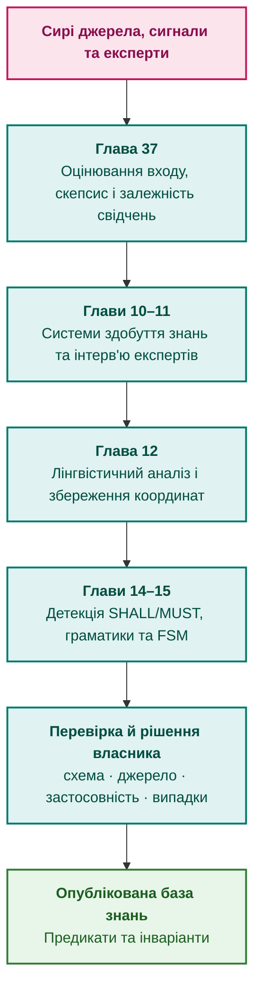

# Частина III. Оцінювання входу, здобуття знань та лінгвістична формалізація

[← До Частини II](part-02-knowledge-models.md) | [До змісту книги](README.md) | [До Частини IV →](part-04-architecture-and-inference.md)

---

## Мета частини

Мета цієї частини: показати, як готувати перевірювані знання для експертної системи — від первинного скептичного оцінювання вхідної інформації й визначення джерел до вилучення експертного досвіду, лінгвістичного розбору документів і побудови формальної бази знань:

1. **Оцінювання входу:** розрізняти надійність джерела, підтвердження твердження, залежність свідчень і право використати результат до початку парсингу.
2. **Джерела та життєвий цикл:** контролювати паспорт об'єкта, допуск, двочасову чинність і відкликання першоджерел.
3. **Експертний досвід:** отримувати кандидатів із контекстом, винятками й способом перевірки.
4. **Мовний аналіз документів:** застосовувати аналізатори й локальні моделі зі збереженням координат оригіналу, не приховуючи неоднозначності та похибки.
5. **Формалізація вимог і правил:** перетворювати деонтичні модальності (`MUST`, `SHALL`, `MAY`) на явне подання предикатів, граматик і скінченних автоматів.

---

## Анотація теми та взаємозв'язку глав

Глава 37 відкриває вхідний епістемічний периметр (воронка L0–L3): правильно прочитане повідомлення може лишатися ненадійним або залежним від уже врахованого джерела, тому оцінювання свідчень передує їхньому завантаженню в конвеєр. Глави 10–11 визначають керування допущеними джерелами та формалізацію досвіду фахівців-експертів. Глава 12 зберігає зміст і побайтове походження під час структурного та лінгвістичного аналізу документів. Глави 14–15 перетворюють нормативний текст на формальні вимоги, інваріанти, граматики й автомати.

Модель CommonKADS відокремлює предметний зміст від операцій виведення й порядку виконання задачі. Лінгвістичні аналізатори пропонують кандидатів, а перевірка онтології й оцінювання свідчень виконують різні завдання. Результат частини: формалізований кандидат із відомими межами та криптографічним родоводом джерела.

Інженерія знань не закінчується екстракцією. Компіляцію запитань користувача та логічне виведення над побудованою базою розглядає [Частина IV](part-04-architecture-and-inference.md), формальну верифікацію та еволюційне навчання без регресій — [Частина V](part-05-verification-and-learning.md), а бінарний формат незмінного пакета знань — [Глава 32](ch32-high-performance-knowledge-packs-mmap-and-harvesting.md).

---

## Глави частини

### [Глава 37. Оцінювання вхідної інформації: джерела, свідчення та невизначеність](ch37-input-information-assessment-and-algorithmic-skepticism.md)

* **Анотація:** Від сигналу до допустимого висновку: розділення надійності джерела, підтвердження твердження, аналітичної впевненості й права дії. Огляд дев'яти розвідувальних традицій за відкритими джерелами, правоохоронної аналітики UNODC, FBI, INTERPOL та Europol, методик реагування FIRST і NIST. Текст, звук, радіосигнали й зображення з первинним носієм та історією перетворень; залежні підтвердження, інтервальні ймовірності, алгоритмічний скепсис, потокова й пакетна обробка. Огляд i2 Analyst's Notebook та інших платформ відокремлює заявлені можливості від доказового допуску. Навчальний Go-модуль перевіряє незмінність оцінки після копіювання спостереження, контроль залежностей і відкладення рішення.

### [Глава 10. Системи здобуття знань: джерела, допуск і життєвий цикл](ch10-knowledge-acquisition-systems.md)

* **Анотація:** Контракт між джерелами й споживачами: паспорт об'єкта, незалежні статуси перевірки й схвалення, доступ, два виміри часу, випуск і відкликання. Відкат знімка не відновлює скасованого дозволу на джерело.

### [Глава 11. Вилучення знань у експертів: інтерв'ювання, когнітивні карти та формалізація досвіду](ch11-knowledge-elicitation-from-experts.md)

* **Анотація:** Протоколи отримання досвіду, невідомі винятки, незалежна перевірка правил і межі статистичних оцінок. CommonKADS розділяє предметні знання, операції виведення й керування задачею; цифровий слід дає кандидатів на консультацію, не рейтинг компетентності.

### [Глава 12. Лінгвістичний аналіз і локальні моделі: збереження змісту та джерела](ch12-linguistic-analysis-and-local-models.md)

* **Анотація:** Розділення координат оригіналу, похідного тексту й токенів. Структурний парсинг документів, межі статистичного мовного аналізу, слабка розмітка, активний добір прикладів і незалежна оцінка невизначеності.

### [Глава 14. Виявлення вимог і модальностей: від нормативного тексту до інваріантів](ch14-requirements-detection-and-formalization.md)

* **Анотація:** Конвенція документа й контекст норми, межі шаблонів EARS, типізоване проміжне подання та часткова компіляція. Час тригера не стає строком реакції; задовільність формули не означає відповідності виробу.

### [Глава 15. Вилучення знань і побудова бази знань: факти, граматики та автомати](ch15-knowledge-extraction-and-kb-construction.md)

* **Анотація:** Факти, граматики й автомати з перевірюваними джерелами; область цитати, одиниці та оновлення редакцій. Допуск, схвалення й випуск розділені. Protégé й ROBOT перевіряють онтології; журнали подій і асоціативний аналіз дають кандидатні гіпотези, не нормативні правила.

## Прикладний аналіз глав 12, 14–15

Втрати накопичуються причинно: парсер загубив заголовок таблиці, екстрактор приєднав число до іншої дії, компілятор приховав невідому часову область, шлюз прийняв запис лише через правильну цитату. Заміна мовної моделі на більшу не усуває кожної з цих причин. Тому оцінювання розділяє етапи й залишає незмінними решту конвеєра.

| Межа | Наукове уточнення | Дешевий контрольний випадок |
|---|---|---|
| Файл → текст | нормалізація може бути незворотною; PDF має похідні координати | лігатура, повторена цитата, розрізана послідовність UTF-8 |
| Текст → кандидат | статистичний клас не є формальним доказом | заперечення, переставлені ролі, два числа з різними ролями |
| Кандидат → формула | граматика й EARS не визначають правильного змісту | час у тригері, неоднозначний строк, недосяжна передумова |
| Формула → допуск | узгодженість не замінює застосовності й схвалення | чинна цитата з відкликаним доступом або неправильним профілем |
| Зміна → новий пакет | незмінна цитата може отримати інший контекст | зміна заголовка чи винятку; порівняння з повним збиранням |

Для кожної межі глави частини пропонують власні досліди:

1. [Глава 37](ch37-input-information-assessment-and-algorithmic-skepticism.md): каскадна фільтрація L0–L3, виявлення інформаційного відлуння та оцінка чутливості LOGO.
2. [Глава 12](ch12-linguistic-analysis-and-local-models.md): Docling, Tika й розпізнавання сканів; структура, карти джерела, активний добір прикладів для розмітки.
3. [Глави 14](ch14-requirements-detection-and-formalization.md) і [15](ch15-knowledge-extraction-and-kb-construction.md): часткова компіляція, розв'язувачі, журнали процесів та рівність інкрементального й повного збирання.

Ці досліди є пропозиціями, не вже отриманими результатами. Незалежний еталон, групування редакцій і окремий остаточний контроль запобігають оцінюванню моделі її власними мітками. Синтетичні тести в главах перевіряють конкретні механізми, але не встановлюють якість на всіх нормативних документах.

---

[← До Частини II](part-02-knowledge-models.md) | [До змісту книги](README.md) | [До Частини IV →](part-04-architecture-and-inference.md)
