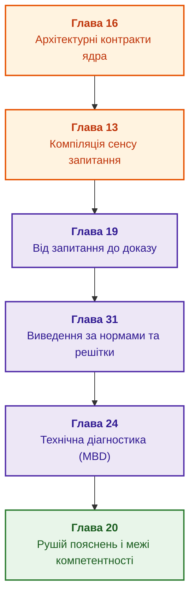

# Частина IV. Архітектура ядра, компіляція запиту, виведення, діагностика та пояснення

[← До Частини III](part-03-knowledge-engineering-nlp.md) | [До змісту книги](README.md) | [До Частини V →](part-05-verification-and-learning.md)

---

## Мета частини

Побудувати повне детерміноване ядро експертної системи: від архітектурних контрактів і компіляції природномовного запитання користувача у формальний запит до пошуку доказових підстав, логічного виведення за нормами й решітками відношень, модельно-орієнтованої технічної діагностики та генерації перевірюваних пояснень.

---

## Анотація теми та взаємозв'язку глав

Глава 16 визначає базові архітектурні контракти ядра й межі відповідальності компонентів. Глава 13 вирішує проблему варіативності формулювань користувача, компілюючи природномовне запитання у типізовану логічну форму без змішування синтаксису з істинністю. Глава 19 будує тракт від формалізованого запиту до доказу, відокремлюючи знайдений фрагмент від твердження, яке він підтверджує. Глава 31 реалізує нормативне виведення за ієрархіями предикатів, решітками відношень та фільтром розмірнісно-інтервальної сумісності SI. Глава 24 розгортає технічну діагностику складних систем (Model-Based Diagnosis), відокремлюючи першопричину від вторинних симптомів та мінімізуючи ентропію наступної перевірки. Глава 20 завершує роботу ядра синтезом доказових пояснень (`WHY` / `WHY NOT`) безпосередньо з траси доведення із захистом від витоку конфіденційних даних.

Результат частини: цілісне символьне ядро прийняття рішень і діагностики, що має розділені статуси «архітектурно визначено», «запит скомпільовано», «підставу знайдено», «норму застосовано», «першопричину локалізовано» та «рішення пояснено». Формальну верифікацію бази знань, піраміду тестування, еволюційне навчання та обґрунтування безпеки продовжує [Частина V](part-05-verification-and-learning.md).

---

## Глави частини

### [Глава 16. Архітектура експертної системи: від формального знання до доказового рішення](ch16-expert-systems-architecture.md)

* **Анотація:** Межі відповідальності, закріплений контекст читання й поточний доступ. Позитивне замикання обґрунтувань, альтернативні підстави й непідкріплені цикли; походження рішення включає факти та версію правила.

### [Глава 13. Варіативність природної мови проти детермінізму: компіляція сенсу запитання](ch13-language-variability-vs-determinism.md)

* **Анотація:** Кандидат логічної форми, обмежене декодування та перевірка змісту. Перефразування й контрастні пари; невідомі значення й суперечливі гіпотези; GLiNER, GLiNER2 та типізовані валідатори без змішування форми й істинності.

### [Глава 19. Від запитання до доказу: пошук, прив'язка та перевірка твердження](ch19-from-question-to-evidence.md)

* **Анотація:** Контракт запиту, пошук, атоми, прив'язка й окрема семантична перевірка. Обов'язкові поля й ваги перевіряються до обчислення повноти; знайдена цитата не встановлює ролі, а ненайдений доказ не доводить відсутності норми.

### [Глава 31. Виведення за нормами: ієрархії предикатів, винятки та чинність](ch31-syllogistic-reasoning-and-relation-lattices.md)

* **Анотація:** Ієрархія предикатів відрізняється від решітки; чинна редакція не скасовує умов застосування норми. Фільтр фізичної розмірнісно-інтервальної сумісності SI ($`[\vec{d}_1] = [\vec{d}_2]`$, $`\Omega^* \neq \varnothing`$) та правила контролю міжпакетних силогістичних ланцюгів для запобігання апаратному винятку `0x0422 ERR_DIMENSIONAL_MISMATCH`. Навчальний Go-крок перевіряє клас, спеціалізацію, винятки й конкурентні правила; це не повний багатоходовий рушій. Мережевий приклад розділяє дії за станом, номером послідовності й підтримуваним профілем.

### [Глава 24. Технічна діагностика: як не сплутати симптом із першопричиною в умовах неповноти](ch24-system-diagnosis.md)

* **Анотація:** Діагностика несправностей складних систем. Моделі на основі симптомів проти моделей на основі фізичної структури (Model-Based Diagnosis). Мінімізація вартості наступної перевірки та абдуктивна локалізація першопричин.

### [Глава 20. Рушій пояснень: рішення, відмова та межі компетентності](ch20-explanation-engine.md)

* **Анотація:** Пояснення з фактичної траси; невідомі передумови відрізняються від несумісності. Передумови QuickXPlain, мінімальність за включенням, ціль контрфакту, контроль вільного тексту й витоку після маскування.

---

## Наскрізний аналіз ядра виведення та пояснення

Ця серія об'єднує повний ланцюг формування доказового вердикту, перевіряючи переходи, де локальний успіх легко помилково прийняти за загальну надійність:

| Перехід | Що не випливає автоматично | Дискримінувальна перевірка |
|---|---|---|
| Архітектура → рішення | правильність правила з назви «символьний» | незалежна альтернативна підстава, непідкріплений цикл, змішування знімків |
| Запитання → формальний запит | істинність засновку з граматичної коректності форми | контрастні перефразування, невідомі сутності, відмова при двозначності |
| Цитата → твердження | правильна роль числа з його наявності | два числа, неправильна одиниця, порожній або повторений атом |
| Норма → силогізм | сумісність ланок із текстового збігу термінів | перевірка векторів розмірностей SI, перетин робочих інтервалів, пріоритет винятків |
| Симптом → діагноз | першопричина з кореляції ознак | мінімальні множини конфліктів (Hitting Sets), розрізнювальний тест за ентропією |
| Траса → пояснення | правильний зміст тексту з наявності назв | змінене заперечення, пропущена причина, закриті дані й контрфакт |

---

[← До Частини III](part-03-knowledge-engineering-nlp.md) | [До змісту книги](README.md) | [До Частини V →](part-05-verification-and-learning.md)
