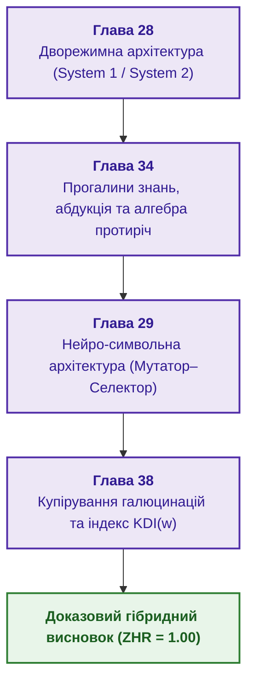

# Частина VI. Дворежимні системи, абдукція та нейро-символьна архітектура

[← До Частини V](part-05-verification-and-learning.md) | [До змісту книги](README.md) | [До Частини VII →](part-07-runtime-and-knowledge-exchange.md)

---

## Мета частини

Вийти за межі припущення про замкненість світу (CWA): поєднати детерміновану строгість символьного виведення з реляційною абдукцією, сократівським діалогом та евристичною генеративною потужністю великих мовних моделей (LLM), забезпечити доказовий міжпакетний синтез нових рішень і гарантовано купірувати машинні галюцинації.

---

## Анотація теми та взаємозв'язку глав

Глава 28 визначає два режими функціонування (швидка дорадча евристика System 1 та детерміноване символьне доведення System 2), формалізує синергію репродуктивної верифікації й комбінаторного синтезу та забороняє автоматичне підвищення статусу неперевіреної гіпотези. Глава 34 використовує виявлені прогалини виведення для запуску двонаправленого реляційного пошуку зв'язків, символьної абдукції Пірса, алгебри компенсації технічних протиріч та сократівського діалогу з користувачем. Глава 29 реалізує розподіл ролей «модель пропонує, ядро затверджує» через шлюз допуску із замкненими граматиками GBNF, примусовою де-векторизацією та асиметричним конвеєром «Мутатор–Селектор». Глава 38 систематизує когнітивні патології вирівняних мовних моделей (синдром Boxiness), вводить індекс дефіциту знань $`\mathrm{KDI}(w)`$ та розгортає багатоетапну терапію галюцинацій через контрастні попперівські пари.

Результат частини: нейро-символьна система третьої хвилі, яка відкриває нові міждоменні композиції та формулює перевірювані гіпотези в умовах неповноти знань, зберігаючи інваріант нульової галюцинації ($`\mathrm{ZHR} = 1{,}00`$). Технологічний стек реалізації, апаратну інфраструктуру, перехід до фізичної дії та розподілену епістемічну SOA розглядає [Частина VII](part-07-runtime-and-knowledge-exchange.md).

---

## Глави частини

### [Глава 28. Дворежимні експертні системи: строгий висновок і дорадча гіпотеза](ch28-dual-mode-expert-systems.md)

* **Анотація:** Строгий результат із перевіреними підставами або відмовою та окремо позначена дорадча гіпотеза. Дедукція, прецеденти й абдукція виконують різні ролі. Дворежимна синергія репродуктивної верифікації та комбінаторного синтезу над спільним реєстром знань; 3 правила дворежимної синергії та криптографічної промоції гіпотез через верифікаційний експеримент. Відмова або консультація фахівця дає кандидата на знання, який не обходить незалежної перевірки та випуску.

### [Глава 34. Прогалини знань: реляційний пошук, абдукція та діалог уточнення](ch34-deterministic-relational-analysis-abduction-and-socratic-dialogue.md)

* **Анотація:** Прогалина у виведенні стає конкретним відсутнім засновком. Реляційний пошук знаходить кандидатні зв'язки, абдукція пропонує перевірювану гіпотезу, діалог визначає потрібне уточнення. Алгебра компенсації технічних протиріч та 5 авторських законів захисту комбінаторного синтезу від семантичної деградації. Індуктивно знайдене правило або схожий прецедент не підвищує статус гіпотези без предметної перевірки.

### [Глава 29. Нейро-символьна архітектура: мовні моделі та перевірка доказових підстав](ch29-neuro-symbolic-architecture.md)

* **Анотація:** Розподіл обов'язків «модель пропонує, ядро затверджує»: шлюз допуску з реєстром редакцій документів, закритим словником, перевіркою дослівної цитати за байтами й значення як цілої лексеми; асиметричний конвеєр «Мутатор–Селектор» для міжпакетного синтезу (NVIDIA Jetson AGX Orin + Федеративна Zero-Copy Арена + 2× FPGA PYNQ-Z1) та три архітектурні принципи тандему; обмеження виходу локальної моделі схемою JSON через Ollama; перевірка пояснень моделі; дорадче відновлення структури запиту з перевіркою хостом; облік причин відхилення як дані для аналізу; тести, що відрізняють адаптовану модель від базової; відкриті напрями досліджень.

### [Глава 38. Машинні галюцинації та дефіцит знань: доказовий контроль відповідей](ch38-curing-machine-hallucinations-and-knowledge-deficits.md)

* **Анотація:** Класи помилок генерації та різні механізми контролю: обмеження форми, перевірка цитати, відмова, позначення гіпотези й захисний контроль дії. Навчання на перевірених парах відповідей і машинне розучування розглянуто як додаткові напрями. Демонстраційний шлюз не доводить правильного тлумачення всіх цитат або універсального усунення галюцинацій.

---

[← До Частини V](part-05-verification-and-learning.md) | [До змісту книги](README.md) | [До Частини VII →](part-07-runtime-and-knowledge-exchange.md)
