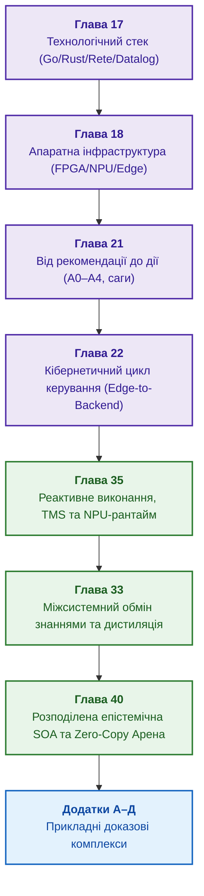

# Частина VII. Стек, інфраструктура, безпечна дія, реактивний рантайм та розподілена SOA

[← До Частини VI](part-06-frontiers-neuro-symbolic.md) | [До змісту книги](README.md) | [До додатків →](appendix-a-evidence-governed-framework.md)

---

## Мета частини

Втілити верифіковане ядро експертної системи у промисловий програмно-апаратний комплекс реального часу та масштабувати його до глобальної розподіленої екосистеми корпоративного інтелекту. Частина охоплює інженерний вибір мов програмування й рушіїв правил, апаратну інфраструктуру виконання (FPGA, NPU, Edge), шлюз повноважень на фізичну дію (A0–A4), замкнений кібернетичний цикл керування периферією, реактивне подійне переоцінювання знань, захищений міжсистемний обмін правилами та побудову референсної розподіленої епістемічної SOA.

---

## Анотація теми та взаємозв'язку глав

Глава 17 формулює інженерні критерії вибору технологічного стеку (Go, Rust, C++, Python, рушії Rete/Datalog) під жорсткі обмеження затримок і пам'яті. Глава 18 розгортає апаратну інфраструктуру виконання (CPU, GPU, NPU, FPGA, ізоляція On-Premise та енергетичний бюджет Edge). Глава 21 здійснює безпечний перехід від рекомендації до авторизованої дії через рівні автономності A0–A4, ключі ідемпотентності та розподілені саги. Глава 22 замикає кібернетичний цикл керування з обробкою сенсорної телеметрії та раннім виявленням критичного уповільнення (CSD). Глава 35 розглядає реактивне подійне виконання правил, системи підтримки істинності (TMS) та синергетичні фазові переходи знань на NPU-рантаймі. Глава 33 визначає контракт міжсистемного обміну знаннями, постачання підписаних правил стороннім агентам і дистиляцію в моделі-учні. Глава 40 виступає архітектурною кульмінацією монографії, синтезуючи триланкову епістемічну SOA, конвеєрну подвійну буферизацію (Ping-Pong Pipeline), Федеративну Zero-Copy Арену та багатоджерельний дефезитивний арбітраж ASPIC+.

Результат частини: повномасштабна промислова архітектура доказового ШІ — від окремого кремнієвого чи периферійного вузла керування до глобальної федерації тисяч сервісів знань. Прикладні комплекси автономності та нетрадиційні обчислювачі зібрано в [додатках А–Д](README.md#додатки).

---

## Глави частини

### [Глава 17. Технологічний стек: критерії вибору інструментів, мов програмування та рушіїв правил](ch17-implementation-stack.md)

* **Анотація:** Інженерні критерії вибору мов (Go, Rust, Python, C++), рушіїв правил (Rete, Datalog, Prolog) та вбудованих сховищ під конкретні класи задач, гарантії затримок і профілі пам'яті.

### [Глава 18. Інфраструктура виконання: локальні моделі, апаратні прискорювачі, Edge та On-Premise](ch18-execution-infrastructure.md)

* **Анотація:** Апаратне середовище виконання: розміщення на CPU, GPU, NPU та FPGA, холодний запуск, ізоляція обчислень, енергетичний бюджет периферійних систем і детермінізм латентності.

### [Глава 21. Від рекомендації до дії: контроль повноважень і безпечне виконання у виробничому середовищі](ch21-from-recommendation-to-action.md)

* **Анотація:** Контракт, поточні повноваження, підписане подання й атомарна передумова. Ідемпотентність перевіряє ціль і параметри; невідомий ефект потребує звірки до компенсації. Temporal, OPA й Cedar мають різні ролі. Локальний ремонт плану зберігає лише ще застосовні схвалення.

### [Глава 22. Кібернетичний цикл керування: сенсори, периферія та зворотний зв'язок](ch22-cybernetics-edge-to-backend.md)

* **Анотація:** Замкнений кібернетичний цикл: закон Ешбі, потокова телеметрія, фільтрація шумів, виявлення критичного уповільнення (CSD) та безпечна робота в режимі часткової автономності периферії.

### [Глава 35. Реактивна експертна система: події, відкликання й адаптація знань](ch35-self-organizing-expert-systems-synergetics-and-npu-runtime.md)

* **Анотація:** Подійне виконання, незмінний базовий шар, динамічні факти та відкликання підтримки висновку. Шина подій і підтримання підстав мають перевіряти повтори, порядок та альтернативні обґрунтування. Синергетична еволюція онтологій, параметри порядку Гаккена й NPU-рантайм.

### [Глава 33. Міжсистемний обмін знаннями: постачання правил стороннім системам, навчання моделей і захищений зворотний зв'язок](ch33-inter-system-knowledge-exchange-and-model-teaching.md)

* **Анотація:** Контракт експорту правил, обмежень і фактів до іншого програмного споживача. Походження, область застосування, дозволи, підпис і відкликання супроводжують передане знання. Навчання сторонньої моделі як дистиляція знань; зворотний зв'язок постачає кандидатів у карантин, а не перезаписує чинну базу знань.

### [Глава 40. Розподілена архітектура доказової експертної системи: епістемічна SOA, семантична маршрутизація, ієрархія пам'яті та багатоджерельний дефезитивний арбітраж](ch40-distributed-epistemic-architectures-soa-and-cluster-scaling.md)

* **Анотація:** Референсний архітектурний прототип промислової доказової експертної системи. Триланкова Epistemic SOA (тонкі мобільні клієнти, семантичний брокер, федеративні доменні сервіси). Долання розриву місткості пам'яті через активні робочі набори знань (AWS) і подвійну буферизацію (Ping-Pong Pipeline) з повним приховуванням затримок. Федеративна Zero-Copy Арена міжпакетного виведення ($\mathcal{S}^*(Q)$) та три покоління апаратної еволюції платформи синтезу (UMA + спарені PYNQ-Z1 $\to$ HBM2e-EPU $\to$ когерентні фабрики CXL 3.0 + цифрові ізінгові відпалювачі). Шаблон Scatter-Gather та багатоджерельна дефезитивна агрегація (ASPIC+) для обробки неповних знань і нормативних колізій. Інженерна матриця вибору технологій та масштабування за бюджетом проєкту.

---

[← До Частини VI](part-06-frontiers-neuro-symbolic.md) | [До змісту книги](README.md) | [До додатків →](appendix-a-evidence-governed-framework.md)