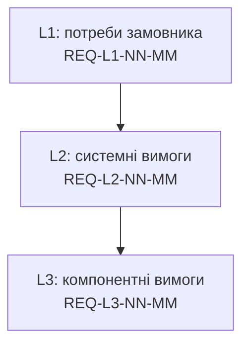

# Вимоги до експертної системи, розділи 1–40

Каталог містить вимоги, витягнуті з тексту розділів 01–40 монографії. Для розділів 01–10 2026-10-28 виконано повторний суцільний витяг із покриттям 370 заголовків H2/H3 та вкладених пунктів H4; розділи 11–40 містять раніше сформовані повні набори. Описові приклади й дослідницькі гіпотези не перетворюються на безумовні продуктові вимоги. Кожна вимога має ідентифікатор і посилання на джерельний розділ; вимоги L2 і L3 також мають батьківську вимогу вищого рівня.

**Поточний зріз 2026-10-28 після скорочення редакції:** 2 532 вимоги: L1 — 473, L2 — 915, L3 — 1 144; 47 позначених дублів. Розширення глав 01–10 додало 525 вимог зі збереженням наявних ID. Після перенесення канонічних контрактів до глав 16, 18, 36 і 37 додано ще 53 вимоги; попередні ID не змінено.

**Межі аудиту:** документальне читання сорока глав і семантичне зіставлення попереднього корпусу 2 479 вимог завершено; 263 локальні знахідки залишаються окремими відкритими питаннями. Нові 53 вимоги перевірено в межах редакційного перенесення, але завершення старого аудиту не означає повторної перевірки всього оновленого корпусу. Історична перевірка П-01…П-20 підтвердила 17 повідомлень і відхилила 3; актуальні межі та перенесення наведено в [беклозі](../refinements/book-refinement-backlog.md).

**Статус:** Проєкт. Вимоги сформульовано за текстом розділів і їх слід перевірити з автором монографії та з предметними експертами перед використанням як специфікації.

## Структура

```text
requirements/
├── README.md
├── L1-stakeholder/   потреби замовника
├── L2-system/        системні вимоги до експертної системи
└── L3-component/     вимоги до конкретних модулів
```



## Рівні

- **L1, потреби замовника.** Що замовник повинен отримати від експертної системи. Формулювання не прив'язане до реалізації.
- **L2, системні вимоги.** Що повинна робити експертна система як ціле. Кожна вимога L2 посилається на батьківську вимогу L1.
- **L3, компонентні вимоги.** Що повинен робити конкретний модуль або механізм. Кожна вимога L3 посилається на батьківську вимогу L2.

Формат вимоги: EARS-подібне формулювання українською («Експертна система повинна ...»). Для кожної вимоги вказано джерело (розділ і підрозділ), батьківську вимогу, метод верифікації за ISO/IEC/IEEE 29148 (Тест, Аналіз, Інспекція, Демонстрація), пріоритет за трирівневою шкалою (`P0 (Критична / Безпекова)`, `P1 (Основна)`, `P2 (Допоміжна / Оптимізаційна)`) і статус; у шапці кожного файлу зафіксовано власника та дату перегляду.

## Словник скорочень

| Скорочення | Розшифрування |
|---|---|
| EKG | Engineering Knowledge Graph, інженерний граф знань |
| KAS | Knowledge Acquisition System, система здобуття знань |
| БЗ | база знань |
| TEVV | Test, Evaluation, Verification and Validation, тестування, оцінювання, верифікація і валідація |
| ZHR | Zero Hallucination Rate; у прийнятій у книзі конвенції ціль інваріанта доказового шлюзу дорівнює 1. Частку помилок на скінченній вибірці оцінюють окремо, з обсягом вибірки й довірчою межею; інваріант не доводить семантичної істинності цитати |
| Fail-Closed | захисна відмова: за невизначеності система не видає результат |
| OWA / CWA / PCWA | Open / Closed / Partially Closed World Assumption, відкритий, закритий і частково закритий світ |
| UNKNOWN | третій логічний стан, що не дорівнює ні True, ні False |
| K3 | сильна тризначна логіка Кліні |
| K (Демпстер-Шафер) | коефіцієнт конфлікту теорії свідчень Демпстера-Шафера |
| CF | certainty factor, коефіцієнт впевненості системи MYCIN |
| AA | Adamic-Adar, метрика подібності вузлів графа |
| KDI | Knowledge Density Index, індекс щільності знань |
| ECE | Expected Calibration Error, очікувана помилка калібрування |
| SHA-256 | криптографічна хеш-функція для перевірки цілісності |
| AST | Abstract Syntax Tree, абстрактне синтаксичне дерево коду |
| SVD | System View Description, опис регістрів мікроконтролера |
| CI/CD | Continuous Integration / Continuous Delivery, безперервна інтеграція і доставка |
| ASIL | Automotive Safety Integrity Level, рівень безпеки автомобільних систем (ISO 26262) |
| SHACL | Shapes Constraint Language, мова обмежень для RDF-графів |
| MIME | Multipurpose Internet Mail Extensions, тип вмісту файлу |
| Q_gate | контрольна точка якості артефакту вимоги |
| P_trace | імовірність коректного наскрізного відтворення зв'язку |
| LLM | Large Language Model, велика мовна модель |
| RAG | Retrieval-Augmented Generation, генерація з пошуком за фрагментами |
| BLOCK | блокування випуску або коміту |

## Матриця трасування

| Розділ | L1 | L2 | L3 |
|---|---|---|---|
| [ch01](../ch01-introduction-to-expert-systems.md) | REQ-L1-01-01 … REQ-L1-01-05 | REQ-L2-01-01 … REQ-L2-01-10 | REQ-L3-01-01 … REQ-L3-01-13 |
| [ch02](../ch02-epistemology-of-machine-knowledge.md) | REQ-L1-02-01 … REQ-L1-02-06 | REQ-L2-02-01 … REQ-L2-02-20 | REQ-L3-02-01 … REQ-L3-02-27 |
| [ch03](../ch03-beyond-reference-information-systems.md) | REQ-L1-03-01 … REQ-L1-03-05 | REQ-L2-03-01 … REQ-L2-03-14 | REQ-L3-03-01 … REQ-L3-03-19 |
| [ch04](../ch04-evolution-from-bayes-to-evidence-ai.md) | REQ-L1-04-01 … REQ-L1-04-05 | REQ-L2-04-01 … REQ-L2-04-18 | REQ-L3-04-01 … REQ-L3-04-19 |
| [ch05](../ch05-triad-of-trust-and-corporate-memory.md) | REQ-L1-05-01 … REQ-L1-05-05 | REQ-L2-05-01 … REQ-L2-05-20 | REQ-L3-05-01 … REQ-L3-05-19 |
| [ch06](../ch06-applied-mathematics-for-expert-systems.md) | REQ-L1-06-01 … REQ-L1-06-10 | REQ-L2-06-01 … REQ-L2-06-27 | REQ-L3-06-01 … REQ-L3-06-47 |
| [ch07](../ch07-knowledge-base-typology.md) | REQ-L1-07-01 … REQ-L1-07-07 | REQ-L2-07-01 … REQ-L2-07-25 | REQ-L3-07-01 … REQ-L3-07-42 |
| [ch08](../ch08-engineering-artifacts-as-data.md) | REQ-L1-08-01 … REQ-L1-08-07 | REQ-L2-08-01 … REQ-L2-08-24 | REQ-L3-08-01 … REQ-L3-08-37 |
| [ch09](../ch09-engineering-knowledge-graph-traceability.md) | REQ-L1-09-01 … REQ-L1-09-04 | REQ-L2-09-01 … REQ-L2-09-13 | REQ-L3-09-01 … REQ-L3-09-24 |
| [ch10](../ch10-knowledge-acquisition-systems.md) | REQ-L1-10-01 … REQ-L1-10-09 | REQ-L2-10-01 … REQ-L2-10-40 | REQ-L3-10-01 … REQ-L3-10-93 |
| [ch11](../ch11-knowledge-elicitation-from-experts.md) | REQ-L1-11-01 … REQ-L1-11-18 | REQ-L2-11-01 … REQ-L2-11-36 | REQ-L3-11-01 … REQ-L3-11-51 |
| [ch12](../ch12-linguistic-analysis-and-local-models.md) | REQ-L1-12-01 … REQ-L1-12-15 | REQ-L2-12-01 … REQ-L2-12-47 | REQ-L3-12-01 … REQ-L3-12-80 |
| [ch13](../ch13-language-variability-vs-determinism.md) | REQ-L1-13-01 … REQ-L1-13-10 | REQ-L2-13-01 … REQ-L2-13-40 | REQ-L3-13-01 … REQ-L3-13-64 |
| [ch14](../ch14-requirements-detection-and-formalization.md) | REQ-L1-14-01 … REQ-L1-14-11 | REQ-L2-14-01 … REQ-L2-14-47 | REQ-L3-14-01 … REQ-L3-14-54 |
| [ch15](../ch15-knowledge-extraction-and-kb-construction.md) | REQ-L1-15-01 … REQ-L1-15-13 | REQ-L2-15-01 … REQ-L2-15-19 | REQ-L3-15-01 … REQ-L3-15-21 |
| [ch16](../ch16-expert-systems-architecture.md) | REQ-L1-16-01 … REQ-L1-16-18 | REQ-L2-16-01 … REQ-L2-16-24 | REQ-L3-16-01 … REQ-L3-16-27 |
| [ch17](../ch17-implementation-stack.md) | REQ-L1-17-01 … REQ-L1-17-17 | REQ-L2-17-01 … REQ-L2-17-20 | REQ-L3-17-01 … REQ-L3-17-20 |
| [ch18](../ch18-execution-infrastructure.md) | REQ-L1-18-01 … REQ-L1-18-16 | REQ-L2-18-01 … REQ-L2-18-24 | REQ-L3-18-01 … REQ-L3-18-25 |
| [ch19](../ch19-from-question-to-evidence.md) | REQ-L1-19-01 … REQ-L1-19-13 | REQ-L2-19-01 … REQ-L2-19-22 | REQ-L3-19-01 … REQ-L3-19-21 |
| [ch20](../ch20-explanation-engine.md) | REQ-L1-20-01 … REQ-L1-20-11 | REQ-L2-20-01 … REQ-L2-20-23 | REQ-L3-20-01 … REQ-L3-20-20 |
| [ch21](../ch21-from-recommendation-to-action.md) | REQ-L1-21-01 … REQ-L1-21-14 | REQ-L2-21-01 … REQ-L2-21-19 | REQ-L3-21-01 … REQ-L3-21-19 |
| [ch22](../ch22-cybernetics-edge-to-backend.md) | REQ-L1-22-01 … REQ-L1-22-15 | REQ-L2-22-01 … REQ-L2-22-20 | REQ-L3-22-01 … REQ-L3-22-20 |
| [ch23](../ch23-knowledge-base-verification.md) | REQ-L1-23-01 … REQ-L1-23-13 | REQ-L2-23-01 … REQ-L2-23-20 | REQ-L3-23-01 … REQ-L3-23-20 |
| [ch24](../ch24-system-diagnosis.md) | REQ-L1-24-01 … REQ-L1-24-11 | REQ-L2-24-01 … REQ-L2-24-20 | REQ-L3-24-01 … REQ-L3-24-20 |
| [ch25](../ch25-how-expert-systems-learn.md) | REQ-L1-25-01 … REQ-L1-25-13 | REQ-L2-25-01 … REQ-L2-25-18 | REQ-L3-25-01 … REQ-L3-25-20 |
| [ch26](../ch26-continual-learning.md) | REQ-L1-26-01 … REQ-L1-26-14 | REQ-L2-26-01 … REQ-L2-26-20 | REQ-L3-26-01 … REQ-L3-26-20 |
| [ch27](../ch27-safety-case-gsn-synthesis.md) | REQ-L1-27-01 … REQ-L1-27-13 | REQ-L2-27-01 … REQ-L2-27-17 | REQ-L3-27-01 … REQ-L3-27-18 |
| [ch28](../ch28-dual-mode-expert-systems.md) | REQ-L1-28-01 … REQ-L1-28-12 | REQ-L2-28-01 … REQ-L2-28-18 | REQ-L3-28-01 … REQ-L3-28-20 |
| [ch29](../ch29-neuro-symbolic-architecture.md) | REQ-L1-29-01 … REQ-L1-29-13 | REQ-L2-29-01 … REQ-L2-29-19 | REQ-L3-29-01 … REQ-L3-29-21 |
| [ch30](../ch30-safety-cybersecurity-co-engineering.md) | REQ-L1-30-01 … REQ-L1-30-12 | REQ-L2-30-01 … REQ-L2-30-18 | REQ-L3-30-01 … REQ-L3-30-20 |
| [ch31](../ch31-syllogistic-reasoning-and-relation-lattices.md) | REQ-L1-31-01 … REQ-L1-31-16 | REQ-L2-31-01 … REQ-L2-31-23 | REQ-L3-31-01 … REQ-L3-31-25 |
| [ch32](../ch32-high-performance-knowledge-packs-mmap-and-harvesting.md) | REQ-L1-32-01 … REQ-L1-32-11 | REQ-L2-32-01 … REQ-L2-32-19 | REQ-L3-32-01 … REQ-L3-32-23 |
| [ch33](../ch33-inter-system-knowledge-exchange-and-model-teaching.md) | REQ-L1-33-01 … REQ-L1-33-12 | REQ-L2-33-01 … REQ-L2-33-19 | REQ-L3-33-01 … REQ-L3-33-20 |
| [ch34](../ch34-deterministic-relational-analysis-abduction-and-socratic-dialogue.md) | REQ-L1-34-01 … REQ-L1-34-16 | REQ-L2-34-01 … REQ-L2-34-24 | REQ-L3-34-01 … REQ-L3-34-24 |
| [ch35](../ch35-self-organizing-expert-systems-synergetics-and-npu-runtime.md) | REQ-L1-35-01 … REQ-L1-35-11 | REQ-L2-35-01 … REQ-L2-35-20 | REQ-L3-35-01 … REQ-L3-35-19 |
| [ch36](../ch36-knowledge-testing-pyramid-and-variational-calibration.md) | REQ-L1-36-01 … REQ-L1-36-21 | REQ-L2-36-01 … REQ-L2-36-26 | REQ-L3-36-01 … REQ-L3-36-26 |
| [ch37](../ch37-input-information-assessment-and-algorithmic-skepticism.md) | REQ-L1-37-01 … REQ-L1-37-13 | REQ-L2-37-01 … REQ-L2-37-24 | REQ-L3-37-01 … REQ-L3-37-26 |
| [ch38](../ch38-curing-machine-hallucinations-and-knowledge-deficits.md) | REQ-L1-38-01 … REQ-L1-38-13 | REQ-L2-38-01 … REQ-L2-38-18 | REQ-L3-38-01 … REQ-L3-38-20 |
| [ch39](../ch39-active-compliance-auditor-and-popperian-testing.md) | REQ-L1-39-01 … REQ-L1-39-12 | REQ-L2-39-01 … REQ-L2-39-20 | REQ-L3-39-01 … REQ-L3-39-20 |
| [ch40](../ch40-distributed-epistemic-architectures-soa-and-cluster-scaling.md) | REQ-L1-40-01 … REQ-L1-40-13 | REQ-L2-40-01 … REQ-L2-40-20 | REQ-L3-40-01 … REQ-L3-40-20 |

Повні ланцюжки трасування задано полем «Батьківська вимога» в кожному записі L2 і L3. Після розширення глав 01–10 скорочений перелік окремих ланцюжків не використовується як повна матриця покриття.

Міжглавні батьківські посилання допускаються, коли тематично точний батько визначений в іншій главі. Приклади: REQ-L3-10-03 ← REQ-L2-02-03, REQ-L3-34-19 ← REQ-L2-31-16.

Поле «Канонічна вимога» позначає дубль: вимога повторює обов'язок канонічної вимоги того самого рівня, і зміни вносять спершу в канонічну вимогу. Перелік кластерів дублів наведено в звітах [analysis](analysis/).

## Порядок перевірки

1. Перевірити відповідність кожної вимоги джерельному тексту (розділ і підрозділ).
2. Перевірити, що кожна вимога L2 і L3 має батьківську вимогу існуючого рівня.
3. Перевірити числові пороги (K, KDI, AA, P_trace, ентропію) за первинними розділами.
4. Перевірити, що верифікаційний метод відповідає типу вимоги.

Пункти 1, 2 і 4 частково автоматизовано скриптом [inspect_requirements_trace.py](../../scripts/inspect_requirements_trace.py). Скрипт перевіряє унікальність ідентифікаторів, обов'язкові поля, існування батька на рівень вище, поле «Канонічна вимога», посилання на файли глав, допустимі методи верифікації та заборонені слова. З прапорцем `--check-sections` він звіряє цитовані назви розділів «§N «Назва»» із заголовками глав:

```powershell
python scripts/inspect_requirements_trace.py --check-sections
```

Помилки дають код завершення 1, попередження (міжглавні батьки, розбіжні назви розділів) дають код 0. Скрипт не перевіряє зміст вимоги за текстом глави: це лишається ручною перевіркою за пунктами 1 і 3.
