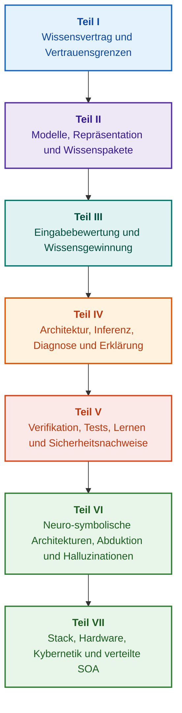

# Architektur evidenzbasierter Expertensysteme: Von formalen Ontologien zu neuro-symbolischer KI

**Monographie über Entwurf, mathematische Modelle, Wissenskompilierung und formale Verifikation halluzinationsfreier deterministischer intelligenter Systeme (Safety-Critical & Evidence-Grounded AI)**

**Autor:** [Mykola Fedchyk](about-the-author.md) · [LinkedIn](https://www.linkedin.com/in/nickfedchik/)  
**Format:** Technische Monographie / Handbuch für KI-Systemarchitekten  
**Jahr:** 2026  

---

## Über das Buch

Diese Monographie ist eine grundlegende Forschungsuntersuchung und ein ingenieurwissenschaftlicher Leitfaden zur Überwindung der zentralen Krise moderner künstlicher Intelligenz: der epistemischen Lücke zwischen der statistischen Plausibilität neuronaler Sprachmodelle und der deterministischen Wahrheit formaler Beweise. Im Zentrum steht die fundamentale Frage: **Wie entwirft man ein Expertensystem, dessen jede Schlussfolgerung unanfechtbar, lückenlos auf Primärquellen zurückführbar und für den Einsatz in sicherheitskritischen Bereichen (ISO 26262, IEC 61508, DO-178C, ISO/SAE 21434) zertifizierbar ist?**

Der Autor begründet ein neues Paradigma: **beweisgestützte neuro-symbolische KI (Evidence-Grounded Neuro-Symbolic AI)**. Statistische Modelle (LLM/SLM) übernehmen hierbei die beratende Funktion der Hypothesengenerierung und Projektion, während ein deterministischer symbolischer Kern unumstößlich die Invarianten logischer Konsistenz, byteweiser Faktenverankerung, Autorisierungskontrolle und sicheren Ausführungsübergänge garantiert.

### Vom Artefakt zur überprüfbaren Entscheidung

Anforderungen, Quellcode, Testprotokolle, Normen und Konstruktionsentscheidungen existieren in jeder industriellen Entwicklungsumgebung. Meist fungieren sie jedoch als isolierte Artefakte ohne formalisierte Semantik, explizite Gültigkeitsgrenzen und wechselseitige Rückverfolgbarkeit. Ein erfolgreicher Prüfbericht kann sich auf eine veraltete Hardware-Revision beziehen; ein Standardzitat kann aus dem Kontext gerissen sein; ein automatisierter Konfigurations-Rollback kann versehentlich eine zurückgezogene Komponente aktivieren.

Die Monographie etabliert einen durchgängigen Entwicklungspfad: von der Formalisierung technischer Artefakte als Daten und kryptographisch signierte Wissenspakete über symbolische Inferenz, schrittweise Plandekompensation und kontrafaktische Erklärungen bis hin zum Audit von Kompetenzgrenzen. Die Darstellung wird durch produktionsreife Go-Implementierungen mit vollständigen Testsuiten ([Kapitel 17](ch17-implementation-stack.md), [Kapitel 23](ch23-knowledge-base-verification.md), [Kapitel 32](ch32-high-performance-knowledge-packs-mmap-and-harvesting.md)), mathematische Verträge ([Teil II](part-02-knowledge-models.md)) und regreßfreie kontinuierliche Lernprotokolle ([Kapitel 25](ch25-how-expert-systems-learn.md)) untermauert.

### Zielgruppe

Das Werk richtet sich an Systemarchitekten, leitende Ingenieure für Zuverlässigkeit und funktionale Sicherheit, Entwickler von Inferenzmaschinen und Wissensingenieure. Für das grundlegende Verständnis genügen Kenntnisse der Prädikatenlogik, Versionierung und Software-Lebenszyklen; zur Ausführung der Implementierungen dient standardmäßiges Go-Tooling. Spezialisierte Kapitel zu Goal Structuring Notation (GSN), System-Synergetik, neuromorphen Beschleunigern und GNSS-freier autonomer Navigation erschließen den Einsatz beweisgestützter KI in Hochtechnologiebereichen (Luft- und Raumfahrt, autonomes Fahren, Energiesysteme).

---

## Wissenschaftlicher Kontext und globale Einordnung der Monographie

Die Monographie betrachtet Expertensysteme nicht als überholtes Relikt der Regelsysteme der 1980er Jahre (wie CLIPS oder MYCIN), sondern als Avantgarde der **beweisgestützten neuro-symbolischen KI der dritten Welle (Third-Wave NeSy)**. Die Methodik verbindet führende internationale Theorien mit hochperformantem Systems Engineering:

| Wissenschaftliche Disziplin | Bedeutende Werke und Autoren | Konzeptionelle Brücke im Buch |
|---|---|---|
| **Neuro-symbolische KI der 3. Welle (NeSy)** | Artur d'Avila Garcez, Luis C. Lamb (*Neurosymbolic AI: The 3rd Wave*, 2023; *Neural-Symbolic Cognitive Reasoning*, Springer, 2009); Henry Kautz (*The Third AI Summer*, AAAI 2022) | Aufgabentrennung: Statistische Modelle (SLM/LLM) generieren Abfragehypothesen, während ein deterministischer symbolischer Kern Fakten verifiziert und autorisiert ([Kapitel 29](ch29-neuro-symbolic-architecture.md)). |
| **Semantische Schranken und sicheres Lernen** | Guy Van den Broeck et al. (*A Semantic Loss Function for Deep Learning with Symbolic Knowledge*, ICML 2018); Luc De Raedt et al. (*DeepProbLog*, IJCAI 2020) | Eingangs- und Ausgangsgateways, deterministische semantische Filterung neuronaler Vorschläge gegen formale Schemata ([Kapitel 28](ch28-dual-mode-expert-systems.md), [33](ch33-inter-system-knowledge-exchange-and-model-teaching.md)). |
| **Anfechtbares Schließen & Argumentationstheorie** | John L. Pollock (*Defeasible Reasoning*, 1987; *Cognitive Carpentry*, MIT Press, 1995); Phan Minh Dung (*Abstract Argumentation Frameworks*, AIJ 1995); Douglas Walton (*Argumentation Schemes*, Cambridge, 2008) | Zerlegung von Wissen in Behauptungen, Herkunft und Entkräftungsfaktoren (*rebutting* und *undercutting defeaters*); Konfliktlösung in Normenbasen über Dung-Frameworks ([Kapitel 2](ch02-epistemology-of-machine-knowledge.md), [27](ch27-safety-case-gsn-synthesis.md)). |
| **Automatisches Mining von Assoziationsregeln (KBC)** | Luis Galárraga, Fabian M. Suchanek et al. (*AMIE: Association Rule Mining under Incomplete Evidence*, WWW 2013, VLDBJ 2015); Stephen Muggleton (*Inductive Logic Programming*, 1994) | Automatische Regelinduktion in Wissensbasen unter der Partial Completeness Assumption (PCA) ohne falsche Open-World-Gegenbeispiele ([Kapitel 34](ch34-deterministic-relational-analysis-abduction-and-socratic-dialogue.md)). |
| **Formale Sicherheitsschilde & Zertifizierung (Safe AI)** | Bettina Könighofer, Roderick Bloem et al. (*Shield Synthesis*, 2017); Tim Kelly, Rob Weaver (*Goal Structuring Notation*, York, 2004); André Platzer (*Logical Foundations of CPS*, Springer, 2018) | Synthese strukturierter Sicherheitsnachweise in GSN-Notation für ISO 26262/21434; formale Schilde und numerische Gültigkeitskorridore für Randaktoren ([Kapitel 27](ch27-safety-case-gsn-synthesis.md), [30](ch30-safety-cybersecurity-co-engineering.md), [33](ch33-inter-system-knowledge-exchange-and-model-teaching.md)). |
| **Epistemische Logik & Wissenssemiotik** | John F. Sowa (*Knowledge Representation: Logical, Philosophical, and Computational Foundations*, 2000); Frank van Harmelen et al. (*Handbook of Knowledge Representation*, Elsevier, 2008) | Peirce'sche epistemische Triade (Begriff → Urteil → Schluss); abduktive Hypothesengenerierung unter strikter deduktiver Kontrolle ([Kapitel 6](ch06-applied-mathematics-for-expert-systems.md), [34](ch34-deterministic-relational-analysis-abduction-and-socratic-dialogue.md)). |
| **Kybernetik & Synergetik komplexer Systeme** | Norbert Wiener (*Cybernetics*, 1948); W. Ross Ashby (*An Introduction to Cybernetics*, 1956); Hermann Haken (*Synergetics: An Introduction*, 1977; *Advanced Synergetics*, 1983); Ilya Prigogine (*Order out of Chaos*, 1984) | Ashbys Gesetz der erforderlichen Varietät, geschlossene L0–L4-Regelkreise, Phasenraumreduktion auf Ordnungsparameter über Hakens Versklavungsprinzip, CSD-Frühwarnung vor Phasenübergängen und dissipative Stabilisierung ([Kapitel 6](ch06-applied-mathematics-for-expert-systems.md), [22](ch22-cybernetics-edge-to-backend.md), [35](ch35-self-organizing-expert-systems-synergetics-and-npu-runtime.md)). |
| **Wissenstests, Invarianz & Lipschitz-Kalibrierung** | Kent Beck (*TDD*, 2002); Martin Fowler (*Refactoring*, 2018); Clark Barrett, Leonardo de Moura (*Z3 SMT Solver*, 2008); Chuan Guo et al. (*On Calibration of Modern Neural Networks*, ICML 2017); Marco Tulio Ribeiro et al. (*CheckList*, ACL 2020); John L. Pollock (*Defeasible Reasoning*, 1987) | Vierstufige Wissenstestpyramide (KTP): isolierte Regeltests (KUT) mit Prämissen-Mocks (`PremiseMock`), Blockierung von Vacuous Truth, spektrale Grenzwertanalyse, Regelverbände (KIT), semantische Invarianz ($\text{SIS} \ge 0{,}98$) und Lipschitz-Stetigkeit ($L_{\mathcal{K}} \le L_{\max}$) gegen Relaisflattern ([Kapitel 36](ch36-knowledge-testing-pyramid-and-variational-calibration.md)). |
| **Metrologische Invariantenkontrolle und Qualifikationsprinzipien (SIF)** | Yurii Kuzmenko, Olena Trofimova (*Structural Invariant Framework (SIF 1.0)*, Zenodo 2026; *Structural Invariant Framework in Low-Data Contradiction-Aware Neural Machine Translation: Architecture and Diagnostic Pipeline (v1.0)*, Zenodo 2026) | Architektonische Abgrenzung von Kandidatengenerierung und deterministischer Verifikation terminologischer Invarianten über eine externe Registry; mehrschichtige Diagnose-Pipeline als Forschungstrajektorie (SIF v1.0); Konzept sprachlicher Flüssigkeit als Maskierungsfaktor für strukturelle Deformationen; Adaption des Prinzips unabhängiger Qualifikation an das Anforderungsprüfungs-Gateway des Expertensystems ([Kapitel 12](ch12-linguistic-analysis-and-local-models.md), [13](ch13-language-variability-vs-determinism.md), [14](ch14-requirements-detection-and-formalization.md)). |

---

## Eigene theoretische Modelle, wissenschaftliche Forschung und ingenieurtechnische Innovationen

Die Monographie bündelt die Forschungs- und Entwicklungsleistungen des Autors in den Bereichen Hochzuverlässigkeitssysteme, eingebettete Architekturen und beweisgestützte KI. Über reine Übersichtsanalysen hinaus präsentiert das Werk eine Reihe originärer formaler Theorien und Protokolle:

### 1. Grundlegende theoretische Entwicklungen und mathematische Formalismen

1. **Systemische Invarianten evidenzbasierter Systeme, Relevanz vs. Zulässigkeit und Fail-Closed-Architektur ([Kapitel 1](ch01-introduction-to-expert-systems.md), [2](ch02-epistemology-of-machine-knowledge.md), [19](ch19-from-question-to-evidence.md), [28](ch28-dual-mode-expert-systems.md), [29](ch29-neuro-symbolic-architecture.md)):**
   * *Theoretisches Konzept:* Der Autor formuliert und formalisiert architektonische Evidenzinvarianten: Orthogonalität von Wissensbasis und Inferenzmaschine, neuro-symbolische Aufgabenteilung (Relevance vs. Eligibility: ML-Modelle ermitteln ausschließlich Relevanz, der deterministische Kern entscheidet über normative Zulässigkeit), lückenlose bytegenaue Primärquellen-Verwahrung (Evidence Custody) und Verankerungsvollständigkeit $\mathrm{Comp}(C) = 1{,}00$. Jedes Faktum ist durch ein kryptographisches Tupel gesichert: unveränderliche Koordinaten `[byte_start, byte_end]`, kanonischer Fragment-Hash `quote_sha256` und PROV-O-Herkunftszertifikat.
   * *Ingenieurtechnische Wirkung:* Das hardware-/softwareseitige bytegenaue Einlassgateway schließt neuronale Halluzinationen in der versionierten Wissensbasis kategorisch aus ($ZHR = 1{,}00$) und sichert absolute Blockierungspräzision bei Verweigerungen ($\mathrm{FCP} = 100\%$).
2. **Prozedurale Definition von Maschinenwissen, epistemischer Vertrag und Demarkationsprinzipien ([Kapitel 1](ch01-introduction-to-expert-systems.md), [2](ch02-epistemology-of-machine-knowledge.md)):**
   * *Theoretisches Konzept:* Der Autor entwickelt eine prozedurale Definition von Maschinenwissen als atomare, versionierte Aussage mit verifizierbarem Beleg, Gültigkeitsintervall und Geltungsbereich. Es wird eine strikte Demarkation zwischen Kompetenz (algorithmische Fähigkeit), Befugnis (juristisches Entscheidungsrecht des Menschen) und Beweisbarkeit (bytegenaue Verwahrung) etabliert.
   * *Ingenieurtechnische Wirkung:* Das Konzept des epistemischen Vertrags projiziert sieben klassische philosophische Disziplinen (Epistemologie, Ontologie, Logik, Sprachphilosophie, Hermeneutik, Wissenschaftstheorie, soziale Epistemologie) auf sieben deterministische technische Prüfschritte zur Faktenzulassung in der Inferenz.
3. **Relationaler Faktenrang nach Hayek und bitemporaler Gültigkeitsoperator ([Kapitel 2](ch02-epistemology-of-machine-knowledge.md)):**
   * *Theoretisches Konzept:* Ausgehend von Friedrich Hayeks *The Sensory Order* entwickelt der Autor einen mathematischen Operator des relationalen Faktenrangs $\mathrm{Rank}_{\mathrm{rel}}(f, \mathcal{K}) = \frac{\sum w(r)}{1 + \sum w(d)}$ mit Schwellenarbitrierung ($\tau_{\mathrm{rel}} = 1{,}00$), optimiert für CSR/BRAM-Speicherstrukturen mit Graphdurchlaufzeiten unter 180 ns.
   * *Mathematischer Apparat:* Formalisierung des bitemporalen Abtastoperators $K(t_v, t_s) = \{\, c \in \mathcal{KB} \mid t_v \in I_v(c) \wedge t_s \in I_s(c) \,\}$ im Raum $\mathbb{T} \times \mathbb{T}$, der fachliche Gültigkeitszeit (Valid Time) von Systemerfassungszeit (Transaction Time) trennt und anhand der Kardinalität $|K|$ deterministisch schaltet.
4. **Mehrwertige Anwendbarkeitsprüfung, parakonsistentes Routing und Kriterium des Rechts auf Behauptung ([Kapitel 2](ch02-epistemology-of-machine-knowledge.md)):**
   * *Theoretisches Konzept:* Der Autor formalisiert ein fünfgliedriges Vektorprädikat $\mathrm{Applicable}(c,q,t_v,t_s)$ in dreiwertiger Kleene-Logik $\mathbb{K}_3$ zur Überführung von Informationslücken in typisierte Klärungsanfragen sowie ein Vier-Quadranten-Routing über den Belnap-Vektor $V(c) = (P(c), N(c)) \in \{0, 1\}^2$ zur Neutralisierung des Explosionsprinzips ($\text{Ex Falso Quodlibet}$) bei Normenkollisionen.
   * *Mathematischer Apparat:* Sechsdimensionales algebraisches Kriterium des Rechts auf Urteilsabgabe $\mathrm{Answerable}(g,u,q,t_v,t_s) = \mathrm{Schema} \wedge \mathrm{Applicable} \wedge \mathrm{Replay} \wedge \mathrm{Resolved} \wedge \mathrm{Authorized} \wedge \mathrm{Risk}$, das als Fail-Closed-Gateway ungesicherte Ausgaben konservativ blockiert.
5. **Deterministisches erweitertes Evidenzfenster und revisionssicheres kryptographisches Audit ([Kapitel 2](ch02-epistemology-of-machine-knowledge.md)):**
   * *Theoretisches Konzept:* Konstruktive Lösung des hermeneutischen Zirkels durch ein deterministisches erweitertes Evidenzfenster $W(e) = e \cup \mathrm{Headings}_d(e) \cup \mathrm{Definitions}(e) \cup \mathrm{TableContext}(e) \cup \mathrm{Refs}_k(e)$ mit Parametertiefe $d \le 5, k \le 2$ und Integritätsversiegelung via Hash $\mathrm{SHA\text{-}256}(W(e))$.
   * *Ingenieurtechnische Wirkung:* Formalisierung eines revisionssicheren Audit-Logs über Hash-Ketten $h_i = H(h_{i-1} \parallel \mathrm{canon}(e_i))$ mit kanonischer Serialisierung (RFC 8785), WORM-Speichern und Hardware-Kryptomodulen (HSM/TPM) zur Erfüllung von ISO 26262-8 und DO-178C.
6. **Vierstufige Wissenstestpyramide (KTP) und Lipschitz-Stetigkeit des Logikraums ([Kapitel 36](ch36-knowledge-testing-pyramid-and-variational-calibration.md)):**
   * *Theoretisches Konzept:* Übertragung der Software-Testpyramide auf Wissenssysteme: isolierte Regel-Modultests (KUT) mit Antezedenz-Mocks (`PremiseMock`), Integrationstests von Regelinteraktionen (KIT) und variationsanalytische Kalibrierung (KVT).
   * *Mathematischer Apparat:* Invariante gegen triviale Wahrheit ($P \to Q$ bei $P \equiv \text{False}$), semantischer Invarianzwert ($\mathrm{SIS} \ge 0{,}98$) und Lipschitz-Schranke ($L_{\mathcal{K}} \le L_{\max}$) zur Eliminierung von Relaisflattern bei Eingangsfluktuationen.
7. **Poppersche Falsifikation deontischer Normen und aktiver Compliance-Auditor ([Kapitel 39](ch39-active-compliance-auditor-and-popperian-testing.md)):**
   * *Theoretisches Konzept:* Übergang vom passiven Orakel zum aktiven Compliance-Auditor nach Karl Poppers Falsifikationsprinzip. Das System sondiert Normenräume (ASPICE 4.0, ISO 26262, ISO/SAE 21434), synthetisiert Gegenbeispiele und entwirft Testkampagnen.
   * *Praktischer Nutzen:* Verbindung neuronaler Grenzwertgenerierung (System 1) mit deterministischer deontischer Verifikation (System 2) unter Schutz des Menschen vor Genehmigungsermüdung.
8. **Synergetische Dimensionsreduktion der Wissensbasis und CSD-Vor-Bifurkationsdiagnose ([Kapitel 6](ch06-applied-mathematics-for-expert-systems.md), [22](ch22-cybernetics-edge-to-backend.md), [35](ch35-self-organizing-expert-systems-synergetics-and-npu-runtime.md)):**
   * *Theoretisches Konzept:* Anwendung von Hakens Synergetik (Ordnungsparameter und Versklavungsprinzip) und Prigogines dissipativen Strukturen auf Wissenskorpora.
   * *Ergebnis:* Reduktion hochdimensionaler Telemetrieräume auf Ordnungsparameter und Erkennung kritischer Verlangsamung (*Critical Slowing Down*, CSD) weit vor dem Ansprechen von Notfallschwellen.
9. **Aktionsautonomie-Stufenmodell (A0–A4), Zulassungsgateway und idempotente Sagas ([Kapitel 21](ch21-from-recommendation-to-action.md)):**
   * *Theoretisches Konzept:* Granulare Autorisierungsskala (A0: passive Analyse bis A4: Notabschaltung), gebunden an das Tupel $\langle\text{Aktion}, \text{Umgebung}, \text{Risiko}\rangle$.
   * *Mathematischer Apparat:* Idempotenz-Invariante $f(f(x, k), k) \equiv f(x, k)$ mit Token $k$ und kompensierende Sagas mit Out-of-Band-Nachbedingungsprüfung.
10. **Formale Co-Entwicklung von funktionaler Sicherheit und Cybersecurity in GSN ([Kapitel 27](ch27-safety-case-gsn-synthesis.md), [30](ch30-safety-cybersecurity-co-engineering.md)):**
    * *Theoretisches Konzept:* Integrierte Goal Structuring Notation (GSN) zur gleichzeitigen Erfüllung von ISO 26262 (Safety) und ISO/SAE 21434 (Security).
    * *Durchbruch:* Mathematischer Ausgleich widerstreitender Ziele (Reaktionszeit vs. kryptographische Tiefe) und selektive Beweisoffenlegung über gesalzene Merkle-Bäume.
11. **Verifikationsprotokoll für Erklärungstreue und semantische Konsistenz ([Kapitel 20](ch20-explanation-engine.md)):**
    * *Theoretisches Konzept:* Erklärungen als eigenständige deterministische Artefakte aus Beweisgraph, Regelstand und Faktenstand.
    * *Mathematischer Apparat:* Metrisches Gateway ($C_{\text{facts}} = 1{,}00, H_{\text{free}} = 1{,}00$) mit automatischem Fallback auf Schablonen bei geringster Diskrepanz.
12. **Fail-Early-Kaskadentrichter, operative Schwellenwerte der epistemischen Checkliste und Schutz vor Informations-Echokammern ([Kapitel 37](ch37-input-information-assessment-and-algorithmic-skepticism.md)):**
    * *Theoretisches Konzept:* Ein 4-stufiger Kaskadentrichter zur Vorab-Filterung von Eingangsinformationen (L0: syntaktischer Validitätsfilter, L1: kryptographische Quellenauthentifizierung, L2: bytegenaue Primärquellen-Verwahrungsschleuse, L3: logisch-semantischer Konsistenzfilter), operative Schwellenwerte der epistemischen Checkliste $S_{\mathrm{doc}}$ und Regeln zur Unterdrückung von Echokammereffekten.
    * *Mathematischer Apparat:* Leave-One-Group-Out-Sensitivitätsanalyse (LOGO) auf Primärquellen-Clustern, die sicherstellt, dass das Entfernen eines sekundären Quellenclusters das normative Urteil des Systems nicht verändert.
13. **Deterministische evidenzbasierte Halluzinationstherapie, Boxiness-Syndrom und Popper’sche Paare ([Kapitel 38](ch38-curing-machine-hallucinations-and-knowledge-deficits.md)):**
    * *Theoretisches Konzept:* Identifikation von vier Klassen kognitiver Defekte ausgerichteter Sprachmodelle im Boxiness-Syndrom (Ambiguitätskollaps, verfrühte Schließung, instrumenteller Reflex, unternehmerische Abstraktion) und deren Behebung durch kognitive Reparatur-Patches; Formalisierung von Popper’schen Kontrastpaaren $(F^+, F^-)$ zur Aufdeckung von Defeater-Lücken.
    * *Mathematischer Apparat:* Gleitender Wissensdefizit-Index $\mathrm{KDI}(w)$ mit geologischer Schichtung (Grounded Bedrock, Transitional Karst, Epistemic Void) und Prinzipien epistemischer Hygiene für abduktive Schließungen unter strikter Einhaltung der Invariante $\mathrm{ZHR} = 1{,}000000$.
14. **Prinzip des antitheoretischen Ontologiedrifts, Popper’sches dialektisches Audit und geschlossenes Rückverfolgbarkeitsgesetz ([Kapitel 39](ch39-active-compliance-auditor-and-popperian-testing.md)):**
    * *Theoretisches Konzept:* Popper’sches Falsifizierbarkeitskriterium für Ontologien $\mathrm{RejectionRate} \ge 1{,}00$ und epistemische Sparsamkeit (Lex Parsimoniae) zur Verhinderung theoretischen Drifts `ERR_THEORY_DRIFT`; adversarielle Popper’sche Dialektik im Tandem (Popperian Red Teamer vs. Formal Implementer) unter oberster Führung des Chefarchitekten (Human-in-the-Loop).
    * *Mathematischer Apparat:* Gesetz des geschlossenen Rückverfolgbarkeitskreises $\mathrm{Defect} \implies \mathrm{SWR} \implies \mathrm{ADR} \implies \mathrm{Task} \implies \mathrm{Code} \implies \mathrm{Proof}$ und formale Konfliktlösung zwischen funktionaler Sicherheit (ISO 26262) und Cybersicherheit (ISO 21434) über ASPIC+-Argumentationsrahmen.
15. **Verteilte epistemische SOA, Doppelpufferungs-Latenzverbergungstheorem und defeasibles Schiedsverfahren ([Kapitel 40](ch40-distributed-epistemic-architectures-soa-and-cluster-scaling.md)):**
    * *Theoretisches Konzept:* Dreischichtige Epistemic-SOA-Architektur mit extrem schlanken Zero-Storage-Clients ($S_{\mathrm{client}} = 0$) und unveränderlichem Rendering signierter Beweispakete; transitive Reduktion des Active Working Sets (AWS) auf $8\text{--}32\,\text{MB}$ durch Entkopplung von Verbatim-Zitaten.
    * *Mathematischer Apparat:* Pipelined Doppelpufferungs-Latenzverbergungstheorem $T_{\mathrm{refill}} \le T_{\mathrm{execute}}$ mit null Kern-Wartezyklen ($\eta = 1{,}00$); probabilistische Beweiskorrobation $\mathrm{Conf}(A_1 \cup A_2)$ in ASPIC+ und 64-Bit-SimHash-Defizitticket-Clustering in BK-Bäumen mit Schutz vor Merkmalsraumdegeneration.
16. **Theorie des beweisgestützten Erfindens (Proof-Carrying Invention) und asymmetrische Mutator-Selektor-Pipeline ([Kapitel 2](ch02-epistemology-of-machine-knowledge.md), [3](ch03-beyond-reference-information-systems.md), [28](ch28-dual-mode-expert-systems.md), [29](ch29-neuro-symbolic-architecture.md), [31](ch31-syllogistic-reasoning-and-relation-lattices.md), [34](ch34-deterministic-relational-analysis-abduction-and-socratic-dialogue.md), [39](ch39-active-compliance-auditor-and-popperian-testing.md), [40](ch40-distributed-epistemic-architectures-soa-and-cluster-scaling.md)):**
    * *Theoretisches Konzept:* Theorie der beweisgestützten ingenieurtechnischen Synthese neuartiger Lösungen über unabhängigen Wissensbasen $\mathcal{P} = \{P_1, \dots, P_m\}$ unter Übertragung bytegenauer Verwahrung $\%ebx[1..k]$ auf Kompositionsaxiome ohne Verletzung der Invariante $\mathrm{ZHR} = 1{,}00$. Dreistufige Intelligenzstratifizierung zur Trennung reproduktiver Verifikation (`VERIFIED_FACT`), kombinatorischer Synthese (`SYNTHESIZED`) und eingegrenzter abduktiver Hypothesen (`BOUNDED_HYPOTHESIS`).
    * *Mathematischer Apparat:* Algebra zur Kompensation technischer Widersprüche ($\mathrm{Improves}(a, p_i) \wedge \mathrm{Degrades}(a, p_j)$) mit 5 Schutzgesetzen vor semantischer Degradation, SI-Einheiten- und Intervall-Kompatibilitätsfilter ($[\vec{d}_1] = [\vec{d}_2]$, $\Omega^* \neq \varnothing$) mit Hardware-Ausnahme `0x0422 ERR_DIMENSIONAL_MISMATCH` und dialektische Popper’sche Verifikation zur Überwindung der kombinatorischen Wand $\mathcal{O}(b^d)$.

---

### 2. Empirische Forschung, eigene Versuchsstände und Systems Engineering

1. **Silizium-Wissensprozessoren (EPU) und formale Beweiszeugen ([Kapitel 1](ch01-introduction-to-expert-systems.md)):**
   * *Konzept:* Hardwarenahe Implementierung symbolischer Inferenzkerne direkt in Silizium (FPGA/ASIC) mit garantierter Latenz von unter 80 ns für harte Echtzeitsysteme.
   * *Formale Methoden:* Anbindung an SMT-Solver und interaktive Theorembeweiser (Lean 4, Z3) zur Ausgabe kryptographisch signierter Beweiszeugen (Proof Witnesses), die von unabhängigen Prüfern verifiziert werden können.
2. **Unveränderliche binäre Wissenspakete mit `mmap` und Zero-Allocation ([Kapitel 32](ch32-high-performance-knowledge-packs-mmap-and-harvesting.md)):**
   * *Architektur:* Trennung von kanonischen Primärquellen und materialisierten Indexschichten.
   * *Empirisches Ergebnis:* Direktes Speicher-Mapping (`mmap`), Zero-Allocation und sublinearer Start unabhängig von Gigabyte-Ontologien.
3. **Empirischer Kalibrierungsprüfstand auf IETF RFC-1000 und W3C-150 ([Kapitel 2](ch02-epistemology-of-machine-knowledge.md), [4](ch04-evolution-from-bayes-to-evidence-ai.md), [14](ch14-requirements-detection-and-formalization.md), [25](ch25-how-expert-systems-learn.md)):**
   * *Versuchsstand:* Evaluierung an 1.000 IETF-RFC-Spezifikationen und 150 W3C-Diagnosefällen (inklusive induzierter Widersprüche).
   * *Praktisches Ergebnis:* Objektive Prüfungsmatrizen, Normenwiderspruchserkennung und Schutz vor Wissensregressionen.
4. **Multi-Hop-Relationsanalyse, symbolische Abduktion und sokratischer Dialog ([Kapitel 34](ch34-deterministic-relational-analysis-abduction-and-socratic-dialogue.md)):**
   * *Entwicklung:* Bidirektionale beschränkte Breitensuche (BFS, $k \le 6$) mit Zyklenschutz und Synthese von Beweisketten.
   * *Vorteil:* Peirce'sche symbolische Abduktion unter deduktiver Kontrolle und sokratische Klärungsrahmen (*Clarification Frames*).
5. **Formale Sicherheitsschilde für Edge-Steuerungssysteme ([Kapitel 33](ch33-inter-system-knowledge-exchange-and-model-teaching.md), [Anhänge B](appendix-b-robotics-and-cyber-physical-systems.md), [C](appendix-c-autonomous-navigation-and-geosearch.md), [E](appendix-e-mixed-signal-neuromorphic-expert-systems.md)):**
   * *Innovation:* Übersetzung diskreter Invarianten in kontinuierliche Sicherheitskorridore für Signalprozessoren (DSPs) und GNSS-freie Navigation.
   * *Zuverlässigkeit:* Ed25519-signierter Regelaustausch und hardwarenahes Abfangen unzulässiger Steuerbefehle.
6. **Schutz vor Informationsabfluss über Erklärungen und differentielles Audit ([Kapitel 20](ch20-explanation-engine.md)):**
   * *Entwicklung:* Protokoll zur Reduktion der Erklärungsrepräsentation ($\mathrm{EIR}_{\text{redacted}}$) mit ACL-Prüfung an Knoten und Kanten des Beweisgraphen.
7. **Prüfstand für eingebettete Inferenz und Popper’sches Testen auf NVIDIA Jetson AGX Orin J501 ([Kapitel 38](ch38-curing-machine-hallucinations-and-knowledge-deficits.md), [39](ch39-active-compliance-auditor-and-popperian-testing.md)):**
   * *Versuchsstand:* Bereitstellung und Evaluierung von Modellen der Klassen 7B und 14B auf der spezialisierten Rechnerplattform Seeed Studio reServer Industrial J501 (AGX Orin 64GB, Profil `MODE_30W`) mit GBNF-grammatikgesteuertem Decodieren und kontrastiven Popper’schen Paaren $(F^+, F^-)$ auf den Standards RFC 9110 und ISO 26262-4.
   * *Empirisches Ergebnis:* Erreichen von $0{,}00\%$ Syntaxfehlern, absoluter Schutz vor Defeater-Auslassungen und nachgewiesene vollständige Byte-Verwahrung im `%ebx`-Register mit makellosem Wert $\mathrm{ZHR} = 1{,}000000$ bei $+56^\circ\text{C}$ thermischem Spielraum vor dem Throttling.
8. **Unveränderliches verteiltes Entscheidungs-Hauptbuch (Immutable Decision Ledger) auf WORM und Merkle-Bäumen ([Kapitel 40](ch40-distributed-epistemic-architectures-soa-and-cluster-scaling.md)):**
   * *Entwicklung:* Zweistufige Architektur zur Fixierung von Audit-Urteilen: kompakte kryptographische Entscheidungsbeweispakete (Decision Evidence Bundles) mit Ed25519-Signaturen und periodische Aggregation in hierarchische Merkle-Bäume mit WORM-Verankerung.
   * *Vorteil:* Vollständige juristische Nichtabstreitbarkeit (Non-Repudiation) für Zertifizierungsstellen (TÜV, Dekra, FAA) bei Submillisekunden-Latenz ohne den Overhead öffentlicher Blockchains.
9. **Heterogene Wissenssynthese-Pipeline auf der Föderierten Zero-Copy-Arena (Jetson AGX Orin + 2× PYNQ-Z1 FPGA) ([Kapitel 28](ch28-dual-mode-expert-systems.md), [29](ch29-neuro-symbolic-architecture.md), [40](ch40-distributed-epistemic-architectures-soa-and-cluster-scaling.md)):**
   * *Versuchsstand:* Experimenteller Aufbau der asymmetrischen «Mutator–Selektor»-Pipeline: 12-Kern ARM Cortex-A78AE CPU und 2048-Kern Ampere GPU (NVIDIA Jetson AGX Orin, System 1) generieren GBNF-grammatikvalidierte Hypothesen, gekoppelt mit zwei Xilinx Zynq-7020 FPGA-Boards (PYNQ-Z1, System 2), die submikrosekundenschnelle deterministische ASPIC+-Argumentfilterung über BRAM-Speicherfenster durchführen.
   * *Empirisches Ergebnis:* Zero-Copy-Datenaustausch über das `mmap`-Speichersegment der Föderierten Arena (`pkg/reasoning/arena`), drei Generationen hardwaretechnischer Evolution (UMA + FPGA-BRAM $\to$ HBM2e-EPU $\to$ kohärente CXL-3.0-Fabrics mit digitalen Ising-Annealern) und Eliminierung von Pipeline-Wartezyklen unter vollständiger Bewahrungsgarantie.

---

## Gliederungsprinzip

Die Teile des Werkes sind nach ingenieurtechnischen Aufgaben strukturiert, nicht nach Chronologie oder Technologiebezeichnungen. Jedes Kapitel gehört zu einem Hauptteil. Kapitelnummern und Dateinamen bleiben stabile Bezeichner.

| Abschnittsklasse | Frage des Lesers | Funktion im Kapitel |
|---|---|---|
| Problem & Aufgabengrenze | Was genau soll gelöst werden? | Kernfrage und Gültigkeitsbereich definieren |
| Objekt & Modell | Welche Daten, Zustände oder Regeln werden betrachtet? | Begriffe, Typen und Annahmen formalisieren |
| Methode & Verfahren | Wie wird das Ergebnis hergeleitet? | Deduktion, Transformation oder Steuerung darlegen |
| Implementierung & Werkzeug | Womit wird das Verfahren ausgeführt? | Konkrete Code- und Hardwarelösungen zeigen |
| Prüfung & Benchmark | Wie werden Fehler systematisch aufgedeckt? | Ergebnis gegen unabhängige Kriterien messen |
| Fazit & Grenzen | Was ist bewiesen und was bleibt offen? | Kernfrage ohne Übertreibungen beantworten |

Der redaktionelle Prüfbericht zur Monografiestruktur enthält die thematische Bewertung aller Kapitel.

## Lesepfade

**Erste Softwareverifikation:** [1](ch01-introduction-to-expert-systems.md) → [7](ch07-knowledge-base-typology.md) → [8](ch08-engineering-artifacts-as-data.md) → [32](ch32-high-performance-knowledge-packs-mmap-and-harvesting.md) → [19](ch19-from-question-to-evidence.md) → [23](ch23-knowledge-base-verification.md) → [25](ch25-how-expert-systems-learn.md). Ziel: Reproduzierbares, evidenzbasiertes Urteil mit Negativtests und kontrollierter Wissensänderung.

**Wissensingenieurwesen:** [Teil II](part-02-knowledge-models.md) → [Teil III](part-03-knowledge-engineering-nlp.md) → [19](ch19-from-question-to-evidence.md) → [20](ch20-explanation-engine.md) → [26](ch26-continual-learning.md). Ziel: Semantik, Provenienz, Eingangsskepsis ([37](ch37-input-information-assessment-and-algorithmic-skepticism.md)), Wissensgewinnung und Kandidatenprüfung abgleichen.

**Kernarchitektur und deterministische Inferenz ([Teil IV](part-04-architecture-and-inference.md)):** [16](ch16-expert-systems-architecture.md) → [13](ch13-language-variability-vs-determinism.md) → [19](ch19-from-question-to-evidence.md) → [31](ch31-syllogistic-reasoning-and-relation-lattices.md) → [24](ch24-system-diagnosis.md) → [20](ch20-explanation-engine.md). Ziel: Trennung von Kernverträgen, Abfragekompilierung, Normenanwendung, modellbasierter Ursachendiagnose und Erklärung von der Ausführungsautorisierung ([21](ch21-from-recommendation-to-action.md)).

**Verifikation, Lernen und Sicherheit ([Teil V](part-05-verification-and-learning.md)):** [23](ch23-knowledge-base-verification.md) → [36](ch36-knowledge-testing-pyramid-and-variational-calibration.md) → [25](ch25-how-expert-systems-learn.md) → [26](ch26-continual-learning.md) → [39](ch39-active-compliance-auditor-and-popperian-testing.md) → [27](ch27-safety-case-gsn-synthesis.md) → [30](ch30-safety-cybersecurity-co-engineering.md).

**Hybride Systeme und Betrieb:** [Teil VI](part-06-frontiers-neuro-symbolic.md) ([28](ch28-dual-mode-expert-systems.md) → [34](ch34-deterministic-relational-analysis-abduction-and-socratic-dialogue.md) → [29](ch29-neuro-symbolic-architecture.md) → [38](ch38-curing-machine-hallucinations-and-knowledge-deficits.md)) → [Teil VII](part-07-runtime-and-knowledge-exchange.md) ([17](ch17-implementation-stack.md) → [18](ch18-execution-infrastructure.md) → [21](ch21-from-recommendation-to-action.md) → [22](ch22-cybernetics-edge-to-backend.md) → [35](ch35-self-organizing-expert-systems-synergetics-and-npu-runtime.md) → [33](ch33-inter-system-knowledge-exchange-and-model-teaching.md) → [40](ch40-distributed-epistemic-architectures-soa-and-cluster-scaling.md)) und Anhänge. Ziel: Sprachmodelle integrieren, verteilte Wissens-SOAs skalieren und Systemföderationen absichern.

---

## Grenzen der Zusicherungen

Das Buch stellt Lehr- und Forschungsmaterial dar, kein zertifiziertes Konformitätsverfahren. Deterministische Ausführung beweist nicht die Richtigkeit von Prämissen; Hashes und Signaturen belegen Integrität, nicht empirische Wahrheit; Argumentationsgraphen ersetzen kein Expertenurteil. Gesamtsystemanforderungen dürfen nicht mit Fehlerraten von Sprachmodellen gleichgesetzt werden.

Automatisierte Extraktion ersetzt weder Modellierung noch Begutachtung. Mathematische Garantien gelten innerhalb definierter Annahmen; Durchsatzmessungen beziehen sich auf spezifische Testumgebungen. Freigaben, Risikoakzeptanz und regulatorische Konformität verbleiben bei autorisierten Ingenieuren.

---

## Struktur des Buches

Das Werk umfasst sieben Themenblöcke, 40 Kapitel und fünf Anhänge:

---

### [Teil I. Konzeptionelle und epistemische Grundlagen](part-01-foundations.md)

*Wann ein Expertensystem erforderlich ist, was als Wissen gilt und wie Begründungen bewahrt werden.*

* [Kapitel 1. Einführung in Expertensysteme: Vom Chaos zu kontrolliertem Wissen](ch01-introduction-to-expert-systems.md)
* [Kapitel 2. Philosophie für Ingenieure: Was Maschinen als Wissen bezeichnen dürfen](ch02-epistemology-of-machine-knowledge.md)
* [Kapitel 3. Abgrenzung von Expertensystemen gegenüber Referenz-Informationssystemen](ch03-beyond-reference-information-systems.md)
* [Kapitel 4. Evolution der Expertensysteme: Vom Satz von Bayes zur beweisgestützten KI](ch04-evolution-from-bayes-to-evidence-ai.md)
* [Kapitel 5. Die Triade des Vertrauens: Expertensystem, evidenzbasierte Empfehlung und Unternehmensgedächtnis](ch05-triad-of-trust-and-corporate-memory.md)

---

### [Teil II. Mathematische Modelle, Repräsentation und Wissensspeicherung](part-02-knowledge-models.md)

*Mathematische Formalismen, typisierte Artefakte, Rückverfolgbarkeitsgraphen und Wissenspakete.*

* [Kapitel 6. Angewandte Mathematik für Expertensysteme: Regeln, Wahrscheinlichkeiten, Graphen und Kausalität](ch06-applied-mathematics-for-expert-systems.md)
* [Kapitel 7. Typologie von Wissensbasen: Regeln, Ontologien, Fallbasen und Vektoren](ch07-knowledge-base-typology.md)
* [Kapitel 8. Technische Artefakte als Daten des Expertensystems](ch08-engineering-artifacts-as-data.md)
* [Kapitel 9. Technischer Wissensgraph: Durchgängige Rückverfolgbarkeit von Anforderungen bis zur Hardware](ch09-engineering-knowledge-graph-traceability.md)
* [Kapitel 32. Unveränderliche Wissenspakete: Byteweise Zulassung, Indizes und Memory-Mapping](ch32-high-performance-knowledge-packs-mmap-and-harvesting.md)

---

### [Teil III. Eingangsdatenbewertung, Wissensgewinnung und Sprachanalyse](part-03-knowledge-engineering-nlp.md)

*Algorithmische Skepsis und Quellenfilterung, Dokumente und Expertenwissen, Parsing und Formalisierung von Anforderungen.*

* [Kapitel 37. Bewertung von Eingabedaten: Quellen, Evidenz und algorithmische Skepsis](ch37-input-information-assessment-and-algorithmic-skepticism.md)
* [Kapitel 10. Systeme zur Wissensakquise: Quellen, Zulassungsgateways und Lebenszyklen](ch10-knowledge-acquisition-systems.md)
* [Kapitel 11. Wissensextraktion von Fachexperten: Interviews, kognitive Karten und Praxisformalisierung](ch11-knowledge-elicitation-from-experts.md)
* [Kapitel 12. Linguistische Analyse und lokale Modelle: Wahrung von Semantik und Quellenbezug](ch12-linguistic-analysis-and-local-models.md)
* [Kapitel 14. Erkennung von Anforderungen und Modalitäten: Vom Normentext zu formalen Invarianten](ch14-requirements-detection-and-formalization.md)
* [Kapitel 15. Wissensextraktion und Aufbau der Wissensbasis: Fakten, Grammatiken und Automaten](ch15-knowledge-extraction-and-kb-construction.md)

---

### [Teil IV. Systemarchitektur, normative Inferenz, Diagnose und Erklärung](part-04-architecture-and-inference.md)

*Architekturverträge, Kompilierung der Frageintention, Behauptungsverifikation, Normeninferenz, modellbasierte Diagnose (MBD) und Erklärungs-Engines.*

* [Kapitel 16. Architektur von Expertensystemen: Vom formalen Wissen zur beweisgestützten Entscheidung](ch16-expert-systems-architecture.md)
* [Kapitel 13. Natürliche Sprachvariabilität versus Determinismus: Kompilierung des Abfragesinns](ch13-language-variability-vs-determinism.md)
* [Kapitel 19. Von der Frage zum Beweis: Suche, Bindung und Prüfung von Behauptungen](ch19-from-question-to-evidence.md)
* [Kapitel 31. Normeninferenz: Prädikatenhierarchien, Ausnahmen und zeitliche Gültigkeit](ch31-syllogistic-reasoning-and-relation-lattices.md)
* [Kapitel 24. Technische Diagnose: Trennung von Symptom und Ursache unter unvollständiger Information](ch24-system-diagnosis.md)
* [Kapitel 20. Erklärungs-Engine: Entscheidungen, begründete Ablehnung und Kompetenzgrenzen](ch20-explanation-engine.md)

---

### [Teil V. Verifikation, Prüfung, Lernen und Sicherheitsnachweise](part-05-verification-and-learning.md)

*Formale Regelprüfung, Wissenstestpyramide, Prüfungsmatrizen, kontinuierliches Lernen, Poppersche Falsifikation und GSN-Sicherheitsnachweise.*

* [Kapitel 23. Verifikation der Wissensbasis: Widerspruchsfreiheit, Vollständigkeit und Robustheit](ch23-knowledge-base-verification.md)
* [Kapitel 36. Die Wissenstestpyramide: Regeln, Interaktionen und Antwortstabilität](ch36-knowledge-testing-pyramid-and-variational-calibration.md)
* [Kapitel 25. Wie Expertensysteme lernen: Prüfungsmatrizen, Wissensaudits und Regressionskontrolle](ch25-how-expert-systems-learn.md)
* [Kapitel 26. Kontinuierliches Lernen (Continual Learning) aus Erfahrung und Beherrschung von Protokolldrift](ch26-continual-learning.md)
* [Kapitel 39. Der aktive Compliance-Auditor: Poppersche Falsifikation, Normenkonformität und Testentwurf](ch39-active-compliance-auditor-and-popperian-testing.md)
* [Kapitel 27. Sicherheitsnachweise: Formale Synthese und Prüfung von GSN-Argumenten](ch27-safety-case-gsn-synthesis.md)
* [Kapitel 30. Integrierte Entwicklung von funktionaler Sicherheit und Cybersecurity](ch30-safety-cybersecurity-co-engineering.md)

---

### [Teil VI. Neuro-symbolische Architekturen, Abduktion und Halluzinationskontrolle](part-06-frontiers-neuro-symbolic.md)

*Strikte Deduktion vs. beratende Hypothesen, relationale Suche und Abduktion bei Wissenslücken, Sprachmodell-Integration und Halluzinationskontrolle.*

* [Kapitel 28. Dual-Mode-Expertensysteme: Strikte Deduktion und beratende Hypothese](ch28-dual-mode-expert-systems.md)
* [Kapitel 34. Wissenslücken: Relationale Suche, Abduktion und Klärungsdialog](ch34-deterministic-relational-analysis-abduction-and-socratic-dialogue.md)
* [Kapitel 29. Neuro-symbolische Architektur: Sprachmodelle und beweisgestützte Verifikation](ch29-neuro-symbolic-architecture.md)
* [Kapitel 38. Beseitigung maschineller Halluzinationen und Wissensdefizite: Evidenzbasierte Kontrolle](ch38-curing-machine-hallucinations-and-knowledge-deficits.md)

---

### [Teil VII. Technologie-Stack, Hardware-Infrastruktur, kybernetische Ausführung und verteilte SOA](part-07-runtime-and-knowledge-exchange.md)

*Technologie-Stack, Hardwarebeschleuniger, sichere Aktionsausführung, kybernetische Regelkreise, reaktive Synergetik, Systemföderation und verteilte epistemische Unternehmensarchitekturen.*

* [Kapitel 17. Der Technologie-Stack: Auswahlkriterien für Werkzeuge, Programmiersprachen und Regel-Engines](ch17-implementation-stack.md)
* [Kapitel 18. Ausführungsinfrastruktur: Lokale SLMs, Hardwarebeschleuniger, Edge und On-Premise](ch18-execution-infrastructure.md)
* [Kapitel 21. Von der Empfehlung zur Handlung: Autorisierungskontrolle und sichere Ausführung](ch21-from-recommendation-to-action.md)
* [Kapitel 22. Der kybernetische Regelkreis: Sensoren, Peripherie und Rückkopplung](ch22-cybernetics-edge-to-backend.md)
* [Kapitel 35. Reaktive Expertensysteme: Ereignisse, Widerruf und Wissensselbstorganisation](ch35-self-organizing-expert-systems-synergetics-and-npu-runtime.md)
* [Kapitel 33. Intersystemarer Wissensaustausch: Regelbereitstellung, Modellunterrichtung und sichere Rückkopplung](ch33-inter-system-knowledge-exchange-and-model-teaching.md)
* [Kapitel 40. Verteilte epistemische Architektur: Wissens-SOA, semantisches Routing und Multi-Quellen-Schiedsgericht](ch40-distributed-epistemic-architectures-soa-and-cluster-scaling.md)

---

### Anhänge

* [Anhang A. Praktischer beweisgestützter Forschungsrahmen für komplexe Ingenieurprojekte](appendix-a-evidence-governed-framework.md)
* [Anhang B. Evidenzbasierte Expertensysteme in autonomer Robotik und cyber-physischen Systemen](appendix-b-robotics-and-cyber-physical-systems.md)
* [Anhang C. GNSS-freie autonome Navigation: Georäumlicher Abgleich (TRN/DSMAC), visuelle Odometrie (VIO) und Sensorfusion](appendix-c-autonomous-navigation-and-geosearch.md)
* [Anhang D. Analoge Expertensysteme, neuromorphe Berechnungen und Hardware-Inferenz](appendix-d-analog-expert-systems-and-neuromorphic-computing.md)
* [Anhang E. Gemischt analog-digitale Expertensysteme unter beweisgestützter Kontrolle](appendix-e-mixed-signal-neuromorphic-expert-systems.md)
* [Gesamtregister der wissenschaftlichen Eigenleistungen und epistemischen Integrität (45 Kapitelregister)](../../authorial-contributions-registry.md)
* [Über den Autor: Mykola Fedchyk (Nick Fedchik)](about-the-author.md)

---

## Forschungsrichtungen

Zukünftige Forschungsrichtungen umfassen: reproduzierbare Zero-Allocation-Wissenspakete; Verifikation beschränkter formaler Fragmente; Agentensteuerung über explizite Autorisierungsverträge; Zero-Knowledge-Prüfungen vertraulicher Anforderungen; sowie kontrollierter Widerruf und Machine Unlearning. Der Beweis einer Modelleigenschaft validiert nicht automatisch das physische Produkt.

Für Hardwarebeschleuniger und unkonventionelle Rechner sind Fehler, Latenz, Energie und Ausfallverhalten vorab zu vermessen ([Kapitel 29](ch29-neuro-symbolic-architecture.md), [32](ch32-high-performance-knowledge-packs-mmap-and-harvesting.md), [Anhänge D](appendix-d-analog-expert-systems-and-neuromorphic-computing.md) und [E](appendix-e-mixed-signal-neuromorphic-expert-systems.md)). Das empirische Forschungsprogramm für Kapitel 7–11 ist in [Teil II](part-02-knowledge-models.md) detailliert.
