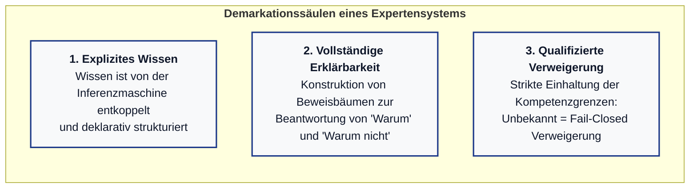
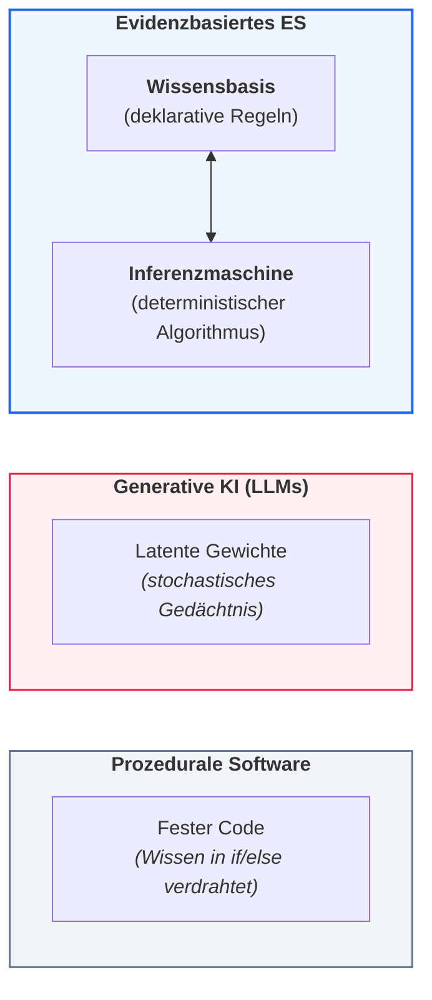
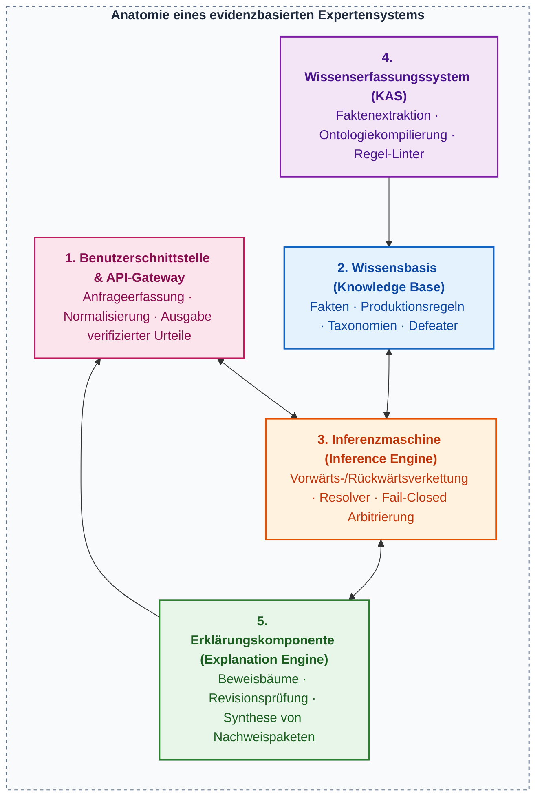
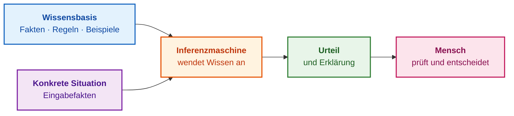

# Kapitel 1. Einführung in Expertensysteme: Vom Chaos zu beherrschbarem Wissen

> **Buch:** [Architektur evidenzbasierter Expertensysteme](README.md) · [Teil I: Konzeptionelles und epistemisches Fundament](part-01-foundations.md)  
> **Vorheriges Kapitel:** [Teil I. Konzeptionelles und epistemisches Fundament](part-01-foundations.md)  
> **Nächstes Kapitel:** [Kapitel 2. Philosophie für den Ingenieur: Was eine Maschine als Wissen bezeichnen darf](ch02-epistemology-of-machine-knowledge.md)  
> **Inhaltsverzeichnis:** [README.md](README.md)  
> **Autor:** [Mykola Fedchyk](about-the-author.md)  
> **Niveau:** Ingenieurtechnische Grundlagen  
> **Erwartete Ergebnisse:** Eine verifizierbare Expertenantwort eines Expertensystems von Suchtreffern und Chatbot-Antworten unterscheiden; die Komponenten eines Expertensystems und die Grenzen seiner Verantwortung kennen; beurteilen, ob der Bau eines Expertensystems für die Aufgabe Ihres Teams sinnvoll ist; einen Lesepfad durch das Buch wählen.

## Abstract

Das erste Kapitel legt die konzeptionellen, historischen und architektonischen Grundlagen evidenzbasierter Expertensysteme, des Wissens-Engineerings und des deterministischen logischen Schließens dar. Es analysiert die Krise des menschlichen Ingenieurgedächtnisses in hochkomplexen Technologiedomänen und zeigt auf, warum traditionelle Informationssuchkataloge und stochastische generative Sprachmodelle weder juristische noch funktionale Verantwortung für die Richtigkeit von Entscheidungen übernehmen können. Die Definition eines Expertensystems wird anhand von drei strengen Abgrenzungskriterien formuliert: explizite Wissensrepräsentation, lückenlose Erklärbarkeit und die Fähigkeit zur deterministischen qualifizierten Verweigerung (`REFUSAL`) bei unvollständigen oder widersprüchlichen Fakten.

Das Kapitel zeichnet die historische Evolution der Expertensysteme nach: von den kanonischen Produktionssystemen Emil Posts, Alan Turings Konzepten und ersten praktischen Meilensteinen (DENDRAL [[1]](#src-1), MYCIN [[2]](#src-2)) über den industriellen Triumph von XCON [[7]](#src-7), den kommerziellen Boom und die Lehren aus dem „KI-Winter“ bis zur modernen neuro-symbolischen Renaissance. Detailliert behandelt werden die zentralen Architekturinvarianten evidenzbasierter Expertensysteme, die Anatomie ihrer fünf Kernteilsysteme, vier klassische Wissensparadigmen, sicherheitskritische Anwendungsbereiche (automotive funktionale Sicherheit ASIL-D [[6]](#src-6), Avionik DO-178C, klinische Leitlinien [[5]](#src-5), regulatorische Compliance [[4]](#src-4)) sowie Entwicklungspfade hin zu hardwarebeschleunigten Wissensprozessoren in Silizium (EPU) und formalen mathematischen Beweiszeugen (Lean 4). Den Abschluss bilden systematische Schlussfolgerungen, aktualisierte Selbsttest-Fragen, ein Architekturleitfaden durch die sieben Teile der Monografie und ein virtueller wissenschaftlicher Disput mit führenden KI-Theoretikern.

---

## 1. Problemstellung und Voraussetzungen: Notwendigkeit von Expertensystemen 

Jede moderne Hochtechnologieindustrie stößt auf eine fundamentale kognitive Barriere: **Das Volumen des akkumulierten Fachwissens übersteigt exponentiell die physiologische Aufnahmekapazität des menschlichen Gehirns**.

Betrachten wir ein typisches ingenieurtechnisches Szenario. Ein Entwickler eingebetteter Systeme prüft das Stromversorgungsmodul `PowerSupervisor`, sieht einen Timeout-Parameter von `40` ms und steht vor der betrieblichen Frage: *„Darf dieser Kaltstart-Timeout auf 60 ms erhöht werden, um das Anlaufverhalten bei extrem niedrigen Temperaturen zu stabilisieren?“*. Die Antwort auf diese scheinbar einfache Frage ist fragmentiert über:
- Abschnitt 7.3.2 der Norm für funktionale Sicherheit ISO 26262;
- Eine Randbemerkung auf Seite 340 des Mikrocontroller-Hardware-Datenblatts;
- Ein drei Jahre altes Prüfprotokoll für Hardware-Revision C;
- Den Fehlerbericht `BUG-817`;
- Das ungeschriebene Erfahrungswissen eines Chefarchitekten, der das Unternehmen vor sechs Monaten verlassen hat.

In einer solchen Situation greift der Mensch unweigerlich zu Vermutungen oder entscheidet auf Basis unvollständiger Fakten. Vergleichen wir die Resultate dreier grundverschiedener Werkzeugklassen:

| Werkzeugparadigma | Gelieferte Antwort | Nächster Schritt für den Ingenieur |
|---|---|---|
| **Dokumentationssuche** (Information Retrieval) | Findet Anforderung `REQ-142`, Defekt `BUG-817`, einen Codekommentar und 40 Seiten Spezifikation. | Alle gefundenen Dokumente selbst durchlesen, Revisionsstände prüfen und die logische Schlussfolgerung manuell ziehen. |
| **Generatives Sprachmodell** (Dialogsystem / Chatbot) | „Ja, 60 ms ist unbedenklich: Industrienormen fordern üblicherweise ein Minimum von 50 ms.“ | Herkunft der Zahl 50 ermitteln. In der Praxis stammt sie aus einem verworfenen Normentwurf; die Antwort ist eine plausible Halluzination. |
| **Evidenzbasiertes Expertensystem** | „40 ms verletzt Regel `R-POWER-03` für Revision C. Der Wert 60 ms erfüllt die Bedingung $t \ge 55\text{ ms}$, erfordert jedoch die Wiederholung von Test `TC-88`. Quellen: `REQ-142` v5, `ADR-31` v3. Freigabe durch den zuständigen Ingenieur nach erfolgreichem Test.“ | Die schrittweise Begründungskette anhand von Primärzitaten prüfen und den vorgegebenen Testlauf durchführen. |

Keines dieser Werkzeuge entbindet den Ingenieur von der formalen Verantwortung. Der fundamentale Unterschied ist jedoch entscheidend: Nur die dritte Antwort, geliefert vom Expertensystem, lässt sich schrittweise anhand unveränderlicher Primärbelege nachvollziehen, ohne den gesamten Recherchezyklus von vorn beginnen zu müssen. Die Suche überlässt das logische Schließen vollständig dem Menschen. Generative Sprachmodelle formulieren Urteile ohne epistemologische Verantwortung und zitieren häufig Phantomquellen. Ein Expertensystem macht den Schlussprozess transparent, deterministisch und normativ abgesichert.

**Der Bedarf an Expertensystemen entsteht überall dort, wo die Fehlerkosten mit probabilistischem Raten unvereinbar sind.** Drei Faktoren treiben diesen Bedarf heute an:
1. **Plausibler Text ist billig geworden, Verifikation teuer:** Generative neuronale Netze formulieren in Millisekunden überzeugende Antworten, doch deren Verifikation erfordert vom Ingenieur oft mehr Zeit als das Verfassen einer fundierten Lösung aus Primärquellen.
2. **Verschärfung regulatorischer Vorgaben:** Der EU Artificial Intelligence Act (Verordnung (EU) 2024/1689 [[4]](#src-4)), FDA-Richtlinien für klinische Entscheidungssysteme [[5]](#src-5)) und Sicherheitsstandards (ISO 26262 [[6]](#src-6), DO-178C) fordern gesetzlich lückenlose Rückverfolgbarkeit, Determinismus und menschliche Überprüfbarkeit.
3. **Krise des institutionellen Gedächtnisses:** Industrieanlagen und Fahrzeugplattformen werden über Jahrzehnte betrieben, während Entwicklungsteams alle paar Jahre wechseln. Expertensysteme stellen das einzige Verfahren dar, um ingenieurtechnische Erfahrung als prüfbare, ausführbare Wissensartefakte dauerhaft zu bewahren.

---

## 2. Definition und epistemisches Wesen: Was ist ein Expertensystem 

In der Fachliteratur existieren unterschiedliche Begriffsbestimmungen; im evidenzbasierten Systems Engineering von Expertensystemen gilt folgende präzise Definition:

> **Ein Expertensystem (Expert System)** ist ein intelligentes Rechensystem, das formalisiertes Fachwissen menschlicher Experten in einem klar abgegrenzten Anwendungsbereich abbildet und mittels deterministischer Inferenzalgorithmen komplexe analytische, diagnostische und steuernde Aufgaben auf dem Niveau eines Spezialisten löst, wobei es eine vollständige und nachprüfbare Begründung seiner Schlüsse liefert.

Im Gegensatz zu prozeduralem Standardcode, in dem Geschäftsregeln in monolithischen Kontrollstrukturen (`if/else`) fest verdrahtet sind, und im Unterschied zu tiefen neuronalen Netzen, in denen Wissen in Milliarden uninterpretierbaren Gewichten einer „Black Box“ diffundiert ist, stützt sich ein evidenzbasiertes Expertensystem auf drei tragende Säulen:

1. **Explizite Wissensrepräsentation:** Das Fachwissen ist vollständig vom Ausführungsmechanismus entkoppelt. Es liegt in transparenter deklarativer Form vor (Regeln, Ontologien, Fakten, Randbedingungen), sodass die Wissensbasis erweitert werden kann, ohne das Engine-Programm des Expertensystems neu zu kompilieren.
2. **Vollständige Erklärbarkeit (Explainability):** Das Expertensystem liefert keine unbegründeten Urteile. Jede Behauptung wird von einem Prüfpfad begleitet: welche Eingabefakten aktiviert wurden, welche Regeln griffen, warum Alternativen verworfen wurden und auf welche Dokumentenrevisionen sich das Ergebnis stützt.
3. **Qualifizierte Verweigerung (Fail-Closed Gate):** Das Expertensystem kennt seine Systemgrenzen präzise. Reichen die Fakten nicht aus oder treten Widersprüche auf, verweigert das System deterministisch die Ausführung (`REFUSAL` oder `CLARIFICATION`), anstatt Spekulationen zu generieren ($ZHR = 1,00$).

Dabei müssen drei Begrifflichkeiten scharf getrennt werden:
* **Expertise:** Die Gesamtheit des verifizierten Fachwissens und die Fähigkeit, begründete Empfehlungen abzuleiten.
* **Autorität (Entscheidungsgewalt):** Das formale Recht, eine bindende Entscheidung zu treffen (etwa eine Systemfreigabe zu erteilen), was stets einem Menschen vorbehalten bleibt.
* **Evidenz (Beleg):** Ein unveränderliches Primärdokument mit kryptografisch gesicherter Byte-Grenze, das im Zuge des Schließens nicht verfälscht werden kann.

---

## 3. Geschichte und Evolution: Von der mathematischen Logik zur modernen Renaissance 

Die Entwicklung der Expertensysteme umfasst mehr als acht Jahrzehnte intensiver Forschung und industrieller Erprobung:

1. **Logisch-mathematische Grundlagen (1930er–1950er Jahre):**  
   Im Jahr 1943 formulierte der Mathematiker Emil Post kanonische Produktionssysteme und bewies, dass universelle Berechnungen durch formale String-Ersetzungsregeln ausgedrückt werden können. Alan Turing, Claude Shannon und Norbert Wiener begründeten die Kybernetik und Informationstheorie. 1965 revolutionierte John Alan Robinson das automatisierte Theorembeweisen durch das Resolutionsprinzip und den MGU-Unifikationsalgorithmus für Prädikatenlogik erster Stufe.
2. **Erste Welle und Geburt des Wissens-Engineerings (1965–1970er Jahre):**  
   Abkehr von universellen Problemlösern (General Problem Solver) hin zu wissensbasierten Spezialsystemen:
   - **DENDRAL (1965, Edward Feigenbaum, Joshua Lederberg):** Erstes Pionier-Expertensystem an der Stanford University, das Molekülstrukturen anhand von Massenspektrometriedaten rekonstruierte [[1]](#src-1).
   - **MYCIN (1972, Edward Shortliffe):** Expertensystem zur Diagnose bakterieller Infektionen und Meningitis. MYCIN trennte erstmals Regeln von der Ausführungslogik, führte Sicherheitsfaktoren (Certainty Factors) ein und lieferte dynamische Erklärungsketten [[2]](#src-2).
   - Edward Feigenbaum prägte den Begriff **Knowledge Engineering** für die ingenieurmäßige Formalisierung von Expertenwissen [[3]](#src-3).
3. **Kommerzieller Boom und Industrialisierung (1980–1988):**  
   Breiter industrieller Einsatz. John McDermotts System **R1/XCON** bei DEC konfigurierte VAX-Computersysteme und sparte jährlich über 40 Millionen Dollar ein [[7]](#src-7). Entstehung spezialisierter Shells und LISP-Rechnerarchitekturen (Symbolics, LMI, Texas Instruments).
4. **Der „KI-Winter“ und die Krise der ersten Generation (späte 1980er–1990er Jahre):**  
   Die Technologie stieß auf harte ingenieurtechnische Barrieren:
   - *Flaschenhals der Wissensakquisition (Knowledge Acquisition Bottleneck):* Das manuelle Extrahieren und Formulieren von Regeln durch langwierige Experteninterviews erwies sich als extrem langsam und teuer.
   - *Sprödigkeit an den Bereichsgrenzen (Brittleness):* Klassische Expertensysteme besaßen keine Mechanismen für stufenweise Degradation und scheiterten bei unvorhergesehenen Grenzfällen abrupt.
   - *Wartungskrise großer Regelbasen:* Regelwerke mit über 10.000 Regeln ohne Versionierung und Modularität wurden durch verdeckte Widersprüche unkontrollierbar.
   - *Niedergang spezialisierter Hardware:* Proprietäre LISP-Maschinen wurden von der rasanten Leistungssteigerung der x86-Standardprozessoren verdrängt.
5. **Die moderne neuro-symbolische Renaissance (2020er Jahre bis heute):**  
   Große Sprachmodelle verdrängen Expertensysteme nicht, sondern lösen deren historische Engpässe. Stochastische Modelle automatisieren die Wissensextraktion aus Tausenden Dokumenten, während der symbolische Kern als unbestechlicher deterministischer Schiedsrichter (Eligibility Gate) fungiert, der Null-Halluzinationen garantiert und Zertifizierungsanforderungen erfüllt.

---

## 4. Zentrale Architekturinvarianten evidenzbasierter Expertensysteme 

Ein evidenzbasiertes Expertensystem unterscheidet sich grundlegend von prozeduraler Software und statistischen Retrieval-Pipelines (RAG):

Zu den unverletzlichen Architekturinvarianten gehören:

* **Orthogonalität von Wissen und Inferenzmaschine:** Die Inferenzlogik ist universell und unveränderlich. Wissen wird als strukturierte externe Daten verwaltet. Regeländerungen erfolgen durch Einspielen versionierter Wissenspakete, ohne den Engine-Code des Expertensystems neu zu kompilieren.
* **Neuro-symbolische Aufgabenteilung: Relevanz versus normative Zulässigkeit (Relevance versus Eligibility):**
  - *Probabilistische Perzeptionsmodelle (System 1):* Sind ausschließlich für die **Relevanz** zuständig (heuristische Kontextsuche, Intent-Erkennung, Vorfilterung von Fakten aus unstrukturierten Texten).
  - *Deterministische symbolische Inferenzmaschinen (System 2):* Sind ausschließlich für die **normative Zulässigkeit (Eligibility)** zuständig (strikte Regelprüfung, Verifikation von Sicherheitsinvarianten, unbedingtes Vetorecht). Kein statistisches Modell besitzt die Vollmacht, eine sicherheitskritische Aktion eigenständig zu autorisieren.
* **Bytegenaue Evidenzsicherung (Evidence Custody):** Jedes atomare Teilergebnis in der Wissensbasis des Expertensystems muss auf eine wörtliche Primärquellenstelle mit exakten Byte-Grenzen `[byte_start, byte_end]` und SHA-256-Prüfsumme zurückgeführt werden. Ein Urteil ohne Byte-Verankerung kann vom Expertensystem mathematisch nicht erzeugt werden.
* **Fail-Closed-Prinzip:** Bei unvollständigen, widersprüchlichen oder fehlenden Fakten verweigert das Expertensystem deterministisch die Freigabe (`REFUSAL`), wodurch eine kompromisslose Null-Halluzinationsrate ($ZHR = 1,00$) gesichert wird.

---

## 5. Anatomie des Expertensystems: Die fünf Kernteilsysteme 

Ein produktionsreifes evidenzbasiertes Expertensystem integriert fünf zusammenwirkende Teilsysteme:

1. **Wissensbasis (Knowledge Base):** Das strukturierte Repository formalisierter Fachkenntnisse mit Ontologien, Relationsgraphen, Entscheidungstabellen, Produktionsregeln und anfechtbaren Argumenten.
2. **Inferenzmaschine (Inference Engine):** Der deterministische Ausführungskern, der Eingabefakten mit Regeln abgleicht. Er unterstützt Vorwärtsverkettung (datengetriebenes Schließen von Fakten zu neuen Hypothesen) und Rückwärtsverkettung (zielgerichtetes Schließen von Zielthesen zu benötigten Belegen).
3. **Erklärungskomponente (Explanation Engine):** Protokolliert die Regelausführung des Expertensystems und erstellt einen auditierbaren Beweisbaum, der die Fragen beantwortet: *„Warum wurde dieser Schluss gezogen?“* und *„Warum wurden alternative Pfade verworfen?“*.
4. **Wissenserfassungssystem (Knowledge Acquisition System, KAS):** Werkzeuge zur Extraktion, Validierung und Kompilierung von Wissen aus Normen, Datenblättern und Protokollen in maschinenlesbare Pakete.
5. **Benutzerschnittstelle und API-Gateway:** Die Kommunikationsschicht für Ingenieure, Enterprise-Systeme oder Echtzeit-Steuerungen kybernetischer Systeme.

Um das grundlegende Funktionsprinzip eines Expertensystems intuitiv zu erfassen, genügt ein Blick auf sein einfachstes Interaktionsmodell mit dem Menschen. Ein Expertensystem maßt sich niemals eigenmächtig finale Entscheidungsbefugnisse an. Stattdessen bezieht es deklarative Regeln aus der Wissensbasis, gleicht diese mit den konkreten Situationsfakten ab, leitet eine fundierte Empfehlung ab und übergibt die vollständige Begründungskette dem verantwortlichen Fachexperten, der die Entscheidung trifft und die Verantwortung trägt:

Diese Rollenteilung stellt sicher, dass das Expertensystem ein verlässliches, vom Menschen kontrolliertes Werkzeug zur Entscheidungsunterstützung bleibt, bei dem jeder Denkschritt transparent und schrittweise auditierbar ist.

---

## 6. Konstruktionsparadigmen und Wissensmodelle 

Je nach Aufgabenstellung dominieren im Wissens-Engineering vier klassische Paradigmen der Wissensrepräsentation:

1. **Produktionsregelsysteme:**  
   Bedingungs-Aktions-Paare: $WENN \ \langle \text{Bedingung} \rangle \ DANN \ \langle \text{Aktion/Schluss} \rangle$. Sub-Millisekunden-Ausführung bei Zehntausenden Regeln wird durch kompilierte Matching-Netzwerke wie **Rete** (Charles Forgy, 1979) und **TREAT** erreicht.
2. **Frame-Systeme und objektorientierte Modelle:**  
   Zurückgehend auf Marvin Minsky (1974). Wissen wird in hierarchischen „Frames“ mit typisierten Slots, Standardwerten und prozeduralen Anhängen („Dämonen“) gekapselt.
3. **Prädikatenlogik und formale Ontologien (Datalog / OWL):**  
   Streng mathematische Formalisierung über Prädikatenlogik erster Stufe oder Horn-Klauseln. Die Inferenz basiert auf Resolutionswiderlegung und Unifikation. Moderne Umsetzungen nutzen Semantic-Web-Standards (OWL, RDF, SPARQL) und deduktive Datalog-Engines.
4. **Anfechtbare Argumentationsmodelle (ASPIC+):**  
   Spezialisierte nichtmonotone Logiken zur Modellierung ingenieurtechnischer Zielkonflikte und juristischer Widersprüche. Regeln gelten vorläufig, bis ein stärkerer Gegenbeweis (Defeater) auftritt. Dies ermöglicht Wissensrevisionen des Expertensystems ohne Inkonsistenz der Gesamtbasis.

---

## 7. Sicherheitskritische Anwendungsbereiche mit hohen Fehlerkosten 

Evidenzbasierte Expertensysteme sind unverzichtbar, wo stochastische Halluzinationen Menschenleben gefährden oder immense Sachschäden verursachen:

* **Funktionale Sicherheit und Avionik (ISO 26262 ASIL-D [[6]](#src-6), DO-178C DAL-A, DO-254):** Hardware-Interlocks und Sicherheitszensoren in autonomen Fahrfunktionen, Bahnsteuerungen und Flugkontrollsystemen.
* **Medizin und klinische Leitlinien (FDA CDS Guidance [[5]](#src-5)):** Prüfung pharmakologischer Wechselwirkungen, Dosierungsberechnungen für Anästhetika und Protokollvalidierung in der Onkologie nach Leitlinien des Gesundheitsministeriums.
* **Kritische Energieinfrastruktur:** Telemetriediagnostik von Turbogeneratoren in Kraftwerken, Umspannwerken und automatisierte Netzabtrennung bei Fehlerzuständen in Echtzeit.
* **Rechts- und Finanz-Compliance (EU AI Act [[4]](#src-4), DSGVO, AML):** Automatisierte Überwachung grenzüberschreitender Transaktionen, Kartellrechtsaudits und Zertifizierung komplexer Lieferketten.
* **Verteidigung und MilTech:** Missionsplanung und autonome Entscheidungsfreigabe unter elektronischer Kampfführung und ohne Satellitennavigation (GNSS-Denied), wo eine bytegenaue Befehlskette zwingend ist.

---

## 8. Zukunftsperspektiven: Von Softwareregeln zu Wissensprozessoren in Silizium 

Die Zukunft evidenzbasierter Expertensysteme entsteht an der Schnittstelle von diskreter Mathematik, Mikroelektronik und formalen Methoden:

1. **Epistemische Prozessoren (Epistemic Processing Units, EPU):**  
   Ähnlich wie GPUs und NPUs für Matrixoperationen optimiert sind, wandert die Inferenzlogik moderner Expertensysteme direkt in Silizium (FPGA und ASICs). Befehle für Faktenabgleich, Ontologieprüfung und SHA-Berechnung laufen in festen Taktzyklen (Pipeline-Latenz $\le 80$ ns) direkt in harten Echtzeitschleifen.
2. **Mathematische Beweiszeugen (Automated Proof Witnesses):**  
   Kopplung von Inferenzsystemen mit interaktiven Theorembeweisern (**Lean 4**, **Coq**) und SMT-Solvern (**Z3**). Das Expertensystem liefert nicht bloß Fließtext, sondern ein kryptografisch signiertes Nachweispaket, das von unabhängigen Minimal-Checkern verifiziert werden kann.

---

## 9. Architektur-Panorama der Monografie: Leitfaden durch die sieben Teile 

Der Aufbau dieser Monografie entwickelt sich systematisch von den theoretischen Grundlagen bis zur Hardware-Realisierung in sieben Teilen: **Teil I** legt das konzeptionelle und epistemische Fundament von Maschinenwissen und Evidenz; **Teil II** entwickelt mathematische Verbandsmodelle, Wissensbasistypologien und Engineering Knowledge Graphs (EKG); **Teil III** vermittelt Methoden der automatisierten Wissensgewinnung, Sprachanalyse und Anforderungsformalisierung; **Teil IV** detailliert Systemarchitektur, Implementierungs-Stack, Erklärungskomponenten und Edge-to-Backend-Kybernetik; **Teil V** widmet sich der formalen Regelverifikation, Systemdiagnose und GSN-Sicherheitsnachweisen; **Teil VI** erforscht kognitive Fronten durch neuro-symbolische Synergien (NeSy) und Epistemische Prozessoren (EPU); und **Teil VII** entfaltet verteilte epistemische Architekturen, die Wissens-Testpyramide und aktive popperianische Falsifikationsaudits. Der vollständige Kapitelkatalog und rollenbasierte Lesepfade sind im Buchüberblick ([README.md](README.md)) zu finden.

---

## 10. Pro et Contra — Virtueller Dialog 

> **Epistemische Präambel und akademischer Disclaimer:**  
> Dieser Abschnitt simuliert eine akademische Debatte über die historischen Fundamente, Systemgrenzen und ingenieurtechnischen Begründungen für eine Modernisierung der Expertensysteme. Zum Disput geladen sind die Pioniere der Disziplin und Verfasser maßgeblicher Monografien des Wissens-Engineerings: Turing-Preisträger **Edward Feigenbaum** — Schöpfer des DENDRAL-Systems und Begründer des Wissens-Engineering-Paradigmas; **Edward H. Shortliffe** — Schöpfer von MYCIN, Pionier erklärbarer Inferenz und Faktorisierung von Unsicherheit; sowie **Frederick Hayes-Roth** — leitender Herausgeber und Koautor des Standardwerks *Building Expert Systems* (1983).  
> *Disclaimer:* Dieser Dialog ist eine wissenschaftliche Rekonstruktion auf Grundlage veröffentlichter Standardwerke und dient der didaktischen Untermauerung des qualitativen Sprungs von Systemen der ersten Generation zu modernen evidenzbasierten Expertensystemen. Jeder Disputant debattiert unmittelbar mit dem Autor der Monografie.

**These des Kapitels (Mykola Fedchyk):**  
Das klassische Paradigma der Expertensysteme ist kein überholtes Relikt, sondern das unverzichtbare Fundament vertrauenswürdiger künstlicher Intelligenz: Die Verbindung des symbolischen Determinismus, der Wissensexplizitheit und der lückenlosen Erklärbarkeit der ersten Generation mit modernen automatisierten Methoden der Wissensextraktion, Graphen-Ontologien und formaler Verifikation macht die Modernisierung von Expertensystemen zur zwingenden Voraussetzung für sicherheitskritische Bereiche mit einer Null-Halluzinationsrate ($ZHR = 1,00$).

**Runde 1: Edward Feigenbaum — Gilt der Grundsatz „Wissen ist Macht“ im Zeitalter statistischer Modelle fort?**

- **Edward Feigenbaum:**  
  *„Herr Fedchyk, in den 1970er Jahren formulierten wir in Stanford die Kernhypothese des Wissens-Engineerings: ‚Die Leistungsfähigkeit eines intelligenten Systems entspringt nicht ausgefeilten Suchverfahren oder universellen logischen Kalkülen, sondern dem Umfang und der Qualität spezifischen Fachwissens (Knowledge is Power).‘ Heute hat sich der Zeitgeist jedoch radikal gewandelt: Multimilliarden-Parameter-Modelle versuchen Probleme rein durch gigantische Rechenleistung und assoziative latente Gewichte zu lösen. Glauben Sie nicht, dass unsere Hypothese der rohen Rechenleistung unterlegen ist und es keinen praktischen Grund mehr gibt, explizite Wissensbasen aufzubauen?“*

- **Mykola Fedchyk:**  
  *„Herr Professor Feigenbaum, Ihre Hypothese hat nicht nur standgehalten — sie erlebt heute eine dramatische empirische Bestätigung.  
  Wenn statistische Modelle in kritischen Ingenieurdomänen ohne explizit verankertes Wissen agieren, scheitern sie regelmäßig und produzieren gefährliche Halluzinationen anstelle von Fakten. Der Versuch, echtes Wissen durch stochastische Assoziationen zu ersetzen, führt unweigerlich in eine Sackgasse.  
  Mehr noch: Moderne Sprachmodelle sind das ideale Werkzeug, um genau jene Hürde zu überwinden, die Sie treffend als ‚Flaschenhals der Wissensakquisition‘ (Knowledge Acquisition Bottleneck) bezeichnet haben. Sie lesen technische Fachkorpora in Sekundenschnelle und schlagen Regelkandidaten vor. Doch die letztendliche Verlässlichkeit eines Systems beruht auch heute auf einer verifizierten, expliziten Wissensbasis, in der jedes Faktum einen verantwortlichen Eigentümer, eine Revision und geprüfte Gültigkeitsgrenzen besitzt.“*

**Runde 2: Edward Shortliffe — Ist strenge Regelverfolgung nötig, wenn neuronale Netze flüssigen Text generieren?**

- **Edward H. Shortliffe:**  
  *„Herr Fedchyk, als wir MYCIN entwickelten, war die Akzeptanz der Mediziner unsere größte Herausforderung: Ein Kliniker wird niemals toxische Antibiotika auf Anraten eines Computers verabreichen, wenn das Programm nicht präzise darlegen kann, welche Symptome und Erregerkulturen die Entscheidung begründen. Wir entwickelten dafür Erklärungskomponenten auf Basis von Regelausführungspfaden. Heutige generative Modelle erzeugen jedoch für nahezu jede Frage grammatikalisch geschliffene verbale Begründungen. Warum sollten wir Architekturen mit deterministischen Beweisbäumen belasten, wenn Anwender sich oft mit gefälligem Fließtext zufriedengeben?“*

- **Mykola Fedchyk:**  
  *„Herr Dr. Shortliffe, der Unterschied zwischen diesen beiden Welten ist die Kluft zwischen Wahrheit und Täuschung.  
  Textuelle Begründungen tiefer neuronaler Netze sind reine Rationalisierungen post hoc: Sie beschreiben nicht, wie das Netz intern im latenten Tensorraum gerechnet hat, sondern lediglich, was für den Menschen plausibel klingt. Das erzeugt eine fatale Scheinsicherheit.  
  Ihr in MYCIN verwirklichter Grundsatz bleibt unumstößlich: Eine Erklärung muss strikt isomorph zum tatsächlichen Schlussprozess sein. In unserer modernisierten Architektur erzeugt die Erklärungskomponente ein mathematisch prüfbares Nachweispaket (Proof Bundle): Jeder Deduktionsschritt verweist auf eine aktivierte Regel und ein bytegenau verankertes Primärquellen-Zitat. Ein Ingenieur oder Arzt sieht keine literarische Improvisation, sondern eine rechtlich bindende Beweiskette.“*

**Runde 3: Frederick Hayes-Roth — Wie verhindern wir Skalierungskollaps und Sprödigkeit der ersten Generation?**

- **Frederick Hayes-Roth:**  
  *„Herr Fedchyk, in unserem Werk ‚Building Expert Systems‘ (1983) haben wir die Disziplin systematisiert, doch die späten 1980er Jahre brachten Ernüchterung. Als Regelbasen über 10.000 Regeln anwuchsen, brachen sie unter ihrer eigenen Komplexität zusammen: Verdeckte Widersprüche traten auf, Prioritäten ließen sich nicht mehr harmonisieren und an den Rändern des Fachgebiets reagierten die Systeme extrem spröde (Brittleness). Was gibt Ihnen die Gewissheit, dass Ihre Modernisierung diesen Zyklus der Enttäuschung nicht wiederholt und keinen weiteren KI-Winter für Expertensysteme einläutet?“*

- **Mykola Fedchyk:**  
  *„Herr Professor Hayes-Roth, die Krise der ersten Generation war kein theoretischer Konstruktionsfehler, sondern die Folge einer damals noch unreifen Software-Engineering-Infrastruktur.  
  Erstens wurde Wissen damals als monolithische, unversionierte Regelansammlung ohne Modularität und automatisierte Tests verwaltet. Wir modernisieren diesen Ansatz nach dem Paradigma ‚Wissen als Code‘ (Knowledge as Code): Jede Regel besitzt eine semantische Versionierung, Abhängigkeitskanten in einem Engineering Knowledge Graph (EKG) und durchläuft automatisierte Regressionstests in CI/CD-Pipelines.  
  Zweitens setzen wir statt naiver monotoner Logik auf anfechtbare Argumentation (ASPIC+), die reale Widersprüche durch formale Defeater mathematisch beherrschbar macht.  
  Drittens haben wir die unkontrollierte Sprödigkeit durch das Fail-Closed-Prinzip ersetzt: Trifft das System auf unbekannte Fakten, bricht es nicht ab, sondern gibt eine typisierte Verweigerung (`REFUSAL`) aus. Schließlich eliminiert die Synthese von Inferenzmaschinen direkt in Silizium über Epistemische Prozessoren (EPU) Latenzprobleme und macht Expertensysteme zum verlässlichen Fundament für cyber-physische Systeme des 21. Jahrhunderts.“*

**Synthese und wissenschaftliches Fazit:**  
Der virtuelle Disput mit den Gründungsvätern bestätigt: Die Kernprinzipien des Wissens-Engineerings — Feigenbaums Primat des expliziten Wissens, Shortliffes Postulat der isomorphen Erklärbarkeit und Hayes-Roths systematische Aufgabentypologie — bleiben zeitlose Maximen. Die Modernisierung evidenzbasierter Expertensysteme stattet dieses klassische Erbe mit einem zukunftsfähigen technologischen Rüstzeug aus: automatisierter Wissensextraktion, kryptografischem Halluzinationsschutz und direkter Ausführung in Silizium.

---

## Fazit

1. **Epistemische Demarkation von Expertensystemen:** Informationssuchkataloge überlassen das logische Schließen und Faktenabgleichen vollständig dem Menschen, während generative Sprachmodelle flüssigen Text ohne mathematische Wahrheitsgarantie synthetisieren. Im Gegensatz dazu transformiert ein evidenzbasiertes Expertensystem die Problemlösung in eine transparente, deterministische und überprüfbare logische Deduktion, bei der jeder Schritt auf expliziten Regeln und unveränderlichen Primärquellen fußt.
2. **Drei fundamentale Säulen eines Expertensystems:** Ein Expertensystem definiert sich weder über Codeumfang noch Ad-hoc-Heuristiken, sondern über drei Invarianten: vollständige Explizitheit des Wissens (Entkopplung der Regelbasis von der Engine), umfassende Erklärbarkeit von Urteilen (Erzeugung auditierbarer Beweisbäume für „Warum“ und „Warum nicht“) und obligatorische qualifizierte Verweigerung bei unvollständigen oder widersprüchlichen Fakten (Fail-Closed-Schranke).
3. **Historische Lehren und neuro-symbolische Renaissance:** Die Krise der Systeme der ersten Generation („KI-Winter“ der späten 1980er Jahre) wurde durch den Wissensakquisitions-Flaschenhals, Sprödigkeit an Bereichsgrenzen und die Unwirtschaftlichkeit proprietärer LISP-Hardware ausgelöst. Die moderne Renaissance löst diese Widersprüche durch Synergie: Große Sprachmodelle automatisieren das Einlesen unstrukturierter Dokumente, während der symbolische Kern des Expertensystems als kompromissloser normativer Schiedsrichter fungiert, der eine Null-Halluzinationsrate ($ZHR = 1,00$) sichert.
4. **Aufgabenteilung Relevanz versus normative Zulässigkeit:** Evidenzbasierte Architekturen setzen eine strikte Funktionstrennung durch. Probabilistische Perzeptionsmodelle verantworten ausschließlich die Relevanz — Intent-Erkennung und Kontextfilterung. Die symbolische Inferenzmaschine verantwortet ausschließlich die normative Zulässigkeit — Regelprüfung, Invariantensicherung und unbedingtes Vetorecht.
5. **Wissensorthogonalität und die fünf Kernteilsysteme:** Ein Expertensystem orchestriert fünf entkoppelte Teilsysteme (Wissensbasis, Inferenzmaschine, Erklärungskomponente, Wissenserfassungssystem und API-Gateway). Der zentrale ingenieurtechnische Imperativ ist die vollständige Unabhängigkeit deklarativer Wissensartefakte vom Maschinencode: Normänderungen erfolgen als versionierte Wissenspaket-Updates ohne Neukompilierung des Softwarekerns.
6. **Vielfalt der Wissensrepräsentationsmodelle:** Je nach Domänenanforderung nutzt das Expertensystem Produktionsregeln mit performanten Matching-Netzwerken (Rete/TREAT), hierarchische Frame-Strukturen mit prozeduralen Triggern, deduktive Logikbasen erster Stufe oder anfechtbare Argumentationsformalismen (ASPIC+), die reale Zielkonflikte auflösen und Wissensrevisionen ohne Konsistenzverlust ermöglichen.
7. **Sicherheitskritische Anwendungsdomänen:** Evidenzbasierte Expertensysteme sind unersetzlich, wo stochastische Fehler Menschenleben, kritische Infrastrukturen oder die finanzielle Existenz bedrohen: automotive funktionale Sicherheit (ISO 26262 ASIL-D), Avionik (DO-178C), klinische Pharmakologie, Netzschutz in der Energieversorgung und autonome Robotik in GNSS-blockierten Umgebungen.
8. **Wissensprozessoren in Silizium und formale Beweise:** Der evolutionäre Entwicklungspfad von Expertensystemen führt zur direkten Synthese deterministischer Inferenzmaschinen in Silizium (Epistemische Prozessoren auf FPGA/ASIC) mit garantierten Latenzen unter 100 Nanosekunden für harte Echtzeitschleifen, gekoppelt mit interaktiven Theorembeweisern (Lean 4) zur Erzeugung kryptografisch signierter mathematischer Beweisdokumente.

---

## Selbsttest-Fragen

1. **Epistemische Demarkation:** Worin besteht der grundlegende Unterschied in der Verantwortungsverteilung für die Korrektheit von Entscheidungen zwischen Dokumentationssuchsystemen, generativen Sprachmodellen und evidenzbasierten Expertensystemen?
2. **Demarkationskriterien:** Welche drei architektonischen Eigenschaften unterscheiden ein Expertensystem von prozeduralem Code mit verschachtelten `if-else`-Verzweigungen und von einer neuronalen „Black Box“?
3. **Historische Lehren:** Welche drei ingenieurtechnischen Hürden führten zum „KI-Winter“ Ende der 1980er Jahre und wie überwinden moderne Sprachmodelle und Graphenplattformen diese historischen Barrieren?
4. **Wissensorthogonalität:** Warum ist die vollständige Entkopplung der deklarativen Wissensbasis vom Code der Inferenzmaschine im Wissens-Engineering zwingend erforderlich? Welche Vorzüge bietet dies für Sicherheitszertifizierungen und Systemwartung?
5. **Funktionale Aufgabenteilung:** Wie wirken die Ebenen der Relevanz (Relevance) und der normativen Zulässigkeit (Eligibility) zusammen? Warum darf generativen Modellen keinesfalls das Recht auf die finale Entscheidung eingeräumt werden?
6. **Bytegenaue Evidenzsicherung:** Was schreibt die Byte-Evidenz (Evidence Grounding) vor und wie verhindert sie verdeckte Halluzinationen in der Wissensbasis?
7. **Anatomie der Teilsysteme:** Welche Aufgaben erfüllen die fünf Kernteilsysteme des Expertensystems? Wie generiert die Erklärungskomponente Begründungen für „Warum dieses Urteil?“ und „Warum wurde die Alternative verworfen?“?
8. **Wissensrepräsentationsmodelle:** Unter welchen Bedingungen sollte ein Entwicklungsteam Produktionsregeln (Rete) und wann anfechtbare Argumentationsmodelle (ASPIC+) wählen?
9. **Fail-Closed-Schranke:** Wie muss sich ein evidenzbasiertes Expertensystem deterministisch verhalten, wenn für eine gegebene Faktenkombination keine Regel existiert? Welches Sicherheitsmanöver wird in cyber-physischen Systemen ausgelöst?
10. **Hardware-Realisierung:** Warum reicht eine softwarebasierte Regelinterpretation auf Standard-CPUs für harte Echtzeit-Sicherheitsschleifen (ASIL-D) oft nicht aus, und welche Aufgaben übernehmen hardwarebeschleunigte Wissensprozessoren (EPU) in Silizium?

---

## Glossar

| Fachbegriff | Englisches Äquivalent | Definition |
|---|---|---|
| **Expertensystem** | *Expert System* | Intelligentes Rechensystem, das formalisiertes Fachwissen anwendet, um Probleme mit vollständiger Erklärbarkeit zu lösen. |
| **Wissensbasis** | *Knowledge Base (KB)* | Strukturiertes Repository deklarativer Fakten, Regeln, Ontologien und Defeater für maschinelles Schließen. |
| **Inferenzmaschine** | *Inference Engine* | Deterministischer Algorithmus, der Eingabefakten mit Regeln der Wissensbasis abgleicht, um gültige Schlüsse abzuleiten. |
| **Erklärungskomponente** | *Explanation Engine* | Teilsystem zur Rückverfolgung von Schlussfolgerungen, das Beweisbäume zur Beantwortung von „Warum“ und „Wie“ generiert. |
| **Wissenserfassungssystem** | *Knowledge Acquisition System (KAS)* | Tooling-Pipeline zur Extraktion, Validierung und Kompilierung von Fachwissen aus Primärdokumenten. |
| **Qualifizierte Verweigerung** | *Qualified Refusal* | Deterministischer Systemstatus (`REFUSAL`), der bei unvollständigen, mehrdeutigen oder widersprüchlichen Fakten ausgegeben wird. |
| **Bytegenaue Verankerung** | *Evidence Grounding* | Bindung jeder atomaren Behauptung an exakte Byte-Koordinaten `[byte_start, byte_end]` und Quell-Hashes. |
| **Produktionsregel** | *Production Rule* | Formale Wissenseinheit in der Form $WENN \ \langle \text{Bedingung} \rangle \ DANN \ \langle \text{Aktion} \rangle$. |
| **Anfechtbares Schließen** | *Defeasible Reasoning* | Nichtmonotone Logik, bei der Schlüsse durch stärkere Gegenbeweise (Defeater) revidiert werden können. |

---

## Abkürzungen

| Abkürzung | Vollständige Bezeichnung | Bedeutung |
|---|---|---|
| **ASIL** | Automotive Safety Integrity Level | Sicherheitsintegritätslevel nach ISO 26262 (Stufen A bis D). |
| **DAL** | Development Assurance Level | Entwicklungssicherungsstufe in der Avionik nach DO-178C (Stufen E bis A). |
| **EKG** | Engineering Knowledge Graph | Wissensgraph zur Rückverfolgbarkeit von Entwicklungsartefakten. |
| **EPU** | Epistemic Processing Unit | Hardware-Wissensprozessor für symbolische Inferenz und Beweissynthese. |
| **GOFAI** | Good Old-Fashioned Artificial Intelligence | Klassische symbolische KI auf Basis expliziter Logik und Regeln. |
| **KAS** | Knowledge Acquisition System | Wissenserfassungs- und Formalisierungsteilsystem. |
| **LLM** | Large Language Model | Großes Sprachmodell auf Basis von Transformer-Architekturen. |
| **NeSy** | Neuro-Symbolic AI | Neuro-symbolische KI, die neuronale Netze und symbolische Logik verbindet. |
| **ZHR** | Zero-Hallucination Rate | Metrik für Halluzinationsfreiheit ($ZHR = 1,00$ bedeutet 100% nachweisbare Korrektheit). |

---

## Literaturhinweise

1. Robert K. Lindsay, Bruce G. Buchanan, Edward A. Feigenbaum, Joshua Lederberg. [*DENDRAL: A Case Study of the First Expert System for Scientific Hypothesis Formation*](https://doi.org/10.1016/0004-3702(93)90068-M). *Artificial Intelligence*, 61(2), 209–261, 1993.
2. Bruce G. Buchanan, Edward H. Shortliffe (Hrsg.). [*Rule-Based Expert Systems: The MYCIN Experiments of the Stanford Heuristic Programming Project*](https://www.shortliffe.net/Buchanan-Shortliffe-1984/MYCIN%20Book.htm). Addison-Wesley, 1984.
3. Edward A. Feigenbaum. [*The Art of Artificial Intelligence: Themes and Case Studies of Knowledge Engineering*](https://doi.org/10.21236/ADA046289). Stanford University, 1977; auch in *Proceedings of IJCAI-77*.
4. Europäische Union. [*Verordnung (EU) 2024/1689 (Gesetz über künstliche Intelligenz)*](https://eur-lex.europa.eu/eli/reg/2024/1689/oj). *Amtsblatt der Europäischen Union*, 2024.
5. FDA. [*Clinical Decision Support Software: Guidance for Industry and Food and Drug Administration Staff*](https://www.fda.gov/regulatory-information/search-fda-guidance-documents/clinical-decision-support-software). Endfassung, 2026.
6. ISO. [*ISO 26262-8:2018. Road vehicles: Functional safety: Part 8: Supporting processes*](https://www.iso.org/standard/68390.html).
7. John McDermott. [*R1: A Rule-Based Configurer of Computer Systems*](https://doi.org/10.1016/0004-3702(82)90021-2). *Artificial Intelligence*, 19(1), 39–88, 1982.
8. Frederick Hayes-Roth, Donald A. Waterman, Douglas B. Lenat (Hrsg.). [*Building Expert Systems*](https://openlibrary.org/works/OL16444441W). Addison-Wesley, 1983.

---

[← Zu Teil I](part-01-foundations.md) | [Inhaltsverzeichnis](README.md) | [Teil I](part-01-foundations.md) | [Kapitel 2 →](ch02-epistemology-of-machine-knowledge.md)
