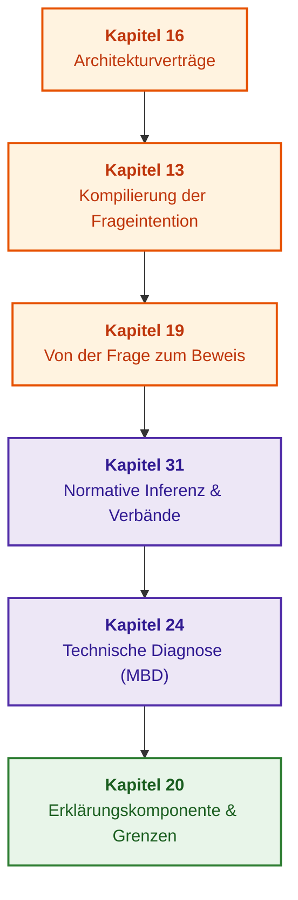

# Teil IV. Systemarchitektur, normative Inferenz, Diagnose und Erklärung

[← Zu Teil III](part-03-knowledge-engineering-nlp.md) | [Inhaltsverzeichnis](README.md) | [Zu Teil V →](part-05-verification-and-learning.md)

---

## Ziel des Teils

Aufbau des logischen und algorithmischen Kerns eines Expertensystems: von grundlegenden Architekturverträgen und der Kompilierung variabler natürlichsprachlicher Anfragen in deterministische logische Formen über das Auffinden von Evidenz und die normative Inferenz über Prädikatenhierarchien bis hin zur technischen Ursachendiagnose und der Synthese nachprüfbarer Erklärungen.

---

## Überblick über das Thema und die Verknüpfung der Kapitel

Kapitel 16 definiert die grundlegenden Architekturverträge, Komponentengrenzen und die Fixierung von Lese-Snapshots. Kapitel 13 löst den Konflikt zwischen der Varianz natürlichsprachlicher Benutzeranfragen und dem Determinismus der Inferenz, indem es die Frageintention in verifizierte logische Formen kompiliert. Kapitel 19 trennt gefundene Evidenzfragmente von den formalen Behauptungen, die sie stützen. Kapitel 31 implementiert die normative Inferenz über Prädikatenhierarchien und Relationsverbände unter Berücksichtigung zeitlicher Gültigkeit. Kapitel 24 wendet den Inferenzkern auf die klassische Aufgabe der technischen Systemdiagnose an und trennt sekundäre Symptome strikt von physikalischen Ursachen mittels modellbasierter Diagnose (MBD). Kapitel 20 schließt den Schlussfolgerungszyklus ab, indem es nachprüfbare Erklärungen und Kompetenzgrenzen direkt aus dem Ausführungs-Trace generiert.

Das Ergebnis dieses Teils ist ein mathematisch fundierter Inferenz-, Diagnose- und Erklärungskern mit strikt getrennten Lebenszyklus-Status: „architektonisch spezifiziert“, „Anfrage kompiliert“, „Evidenz aufgefunden“, „normativ abgeleitet“, „diagnostiziert“ und „erklärt“. Die formale Regelverifikation, die Wissenstestpyramide, das kontinuierliche Lernen und die Sicherheitsfall-Synthese werden in [Teil V](part-05-verification-and-learning.md) vertieft.

---

## Kapitel dieses Teils

### [Kapitel 16. Architektur von Expertensystemen: Vom formalen Wissen zur evidenzbasierten Entscheidung](ch16-expert-systems-architecture.md)

* **Abstract:** Verantwortlichkeitsgrenzen, fixierter Lesekontext und aktive Zugriffsberechtigung. Positiver Abschluss von Begründungen, alternative Grundlagen und ungestützte Zyklen; die Entscheidungsprovenienz verknüpft nachprüfbar Fakten und Regelversionen.

### [Kapitel 13. Natürliche Sprachvarianz versus Determinismus: Kompilierung der Frageintention](ch13-language-variability-vs-determinism.md)

* **Abstract:** Kandidaten logischer Formen, eingeschränkte Dekodierung und semantische Invariantenprüfung. Paraphrasierung und kontrastive Paare; Behandlung unbekannter Werte und widersprüchlicher Hypothesen; GLiNER, GLiNER2 und typisierte Validatoren ohne Verwechslung von grammatischer Form und sachlicher Wahrheit.

### [Kapitel 19. Von der Frage zum Beweis: Suche, Bindung und Behauptungsverifikation](ch19-from-question-to-evidence.md)

* **Abstract:** Anfragevertrag, semantische Suche, atomare Bindung und getrennte semantische Verifikation. Pflichtfelder und Gewichtungen werden vor der Vollständigkeitsberechnung validiert; gefundene Textzitate etablieren keine semantische Rolle, und fehlende Evidenz beweist nicht die Nichtexistenz einer Norm.

### [Kapitel 31. Normative Inferenz: Prädikatenhierarchien, Ausnahmen und zeitliche Gültigkeit](ch31-syllogistic-reasoning-and-relation-lattices.md)

* **Abstract:** Unterscheidung zwischen Prädikatenhierarchien und Relationsverbänden; eine aktuelle Normfassung setzt Anwendungsvoraussetzungen vergangener Zeitintervalle nicht außer Kraft. Physikalischer SI-Dimensions- und Intervallkompatibilitätsfilter ($[\vec{d}_1] = [\vec{d}_2]$, $\Omega^* \neq \varnothing$) sowie Steuerungsregeln für packungsübergreifende syllogistische Ketten zur Vermeidung der Hardware-Ausnahme `0x0422 ERR_DIMENSIONAL_MISMATCH`. Der Go-Lernschritt prüft Klassen, Spezialisierungen, Ausnahmen und konkurrierende Regeln; Netzwerkbeispiele unterteilen Aktionen nach Zustand, Sequenznummer und Profil.

### [Kapitel 24. Technische Diagnose: Trennung von Symptom und Ursache unter Unsicherheit](ch24-system-diagnosis.md)

* **Abstract:** Fehlerdiagnose komplexer technischer Systeme. Symptombasierte heuristische Klassifikation versus modellbasierte Diagnose (Model-Based Diagnosis) auf Grundlage der physikalischen Struktur. Minimierung der erwarteten Kosten nachfolgender Prüfungen und abduktive Ursachenlokalisierung.

### [Kapitel 20. Erklärungskomponente: Entscheidungen, Ablehnung und Kompetenzgrenzen](ch20-explanation-engine.md)

* **Abstract:** Erklärungssynthese aus dem tatsächlichen Trace; Differenzierung zwischen unbekannten Vorbedingungen und logischer Unverträglichkeit. QuickXPlain-Voraussetzungen, Teilmengen-Minimalität, Kontrafakt-Ziele, Kontrolle von Freitext und Vermeidung von Datenlecks nach Maskierung.

---

## Durchgängige Analyse von Architektur, Inferenz und Erklärung: Kapitel 16, 13, 19, 31, 24, 20

Diese Sequenz verbindet die vollständige kognitive und logische Schlussfolgerungskette und prüft Übergänge, an denen lokaler Teilerfolg leicht mit globaler Entscheidungskorrektheit verwechselt werden kann:

| Übergang | Was nicht automatisch folgt | Diskriminierende Prüfung |
|---|---|---|
| Architektur → Entscheidung | Korrektheit der Regel aus dem Prädikat „symbolisch“ | Unabhängige alternative Begründung, ungestützte Zyklen, Vermeidung von Snapshot-Vermischung |
| Anfrage → Logische Form | Äquivalenz der Frageintention bei Paraphrasierung | Prüfung auf ungebundene Slots, Trennung konkurrierender Hypothesen, semantische Invarianzprüfung |
| Zitat → Behauptung | Korrekte semantische Rolle einer Zahl aus deren reiner Präsenz | Konkurrierende Zahlenwerte, falsche Maßeinheiten, leere oder duplizierte semantische Atome |
| Hierarchie → Norm | Automatische Ausnahmenvererbung über spezialisierte Prädikate | Prüfung des zeitlichen Gültigkeitsintervalls, SI-Dimensionskompatibilität, Prioritätsarbitrierung von Defeatern |
| Symptom → Diagnose | Fehlerlokalisierung allein aus heuristischer Korrelation | Konsistenz mit dem Strukturmodell (MBD), Berechnung minimaler Hitting-Sets, Entropiegewinn diagnostischer Tests |
| Trace → Erklärung | Korrekter Sinn des Texts aus dem Vorhandensein von Bezeichnungen | Modifizierte Negation, ausgelassene Ursache, geschützte Daten und gültiges Kontrafakt-Ziel |

Defekte müssen zunächst in einem neutralen Simulator reproduziert werden, bevor lokale Änderungen isoliert und erst nach unabhängigen Qualitätsprüfungen für den Produktivbetrieb zugelassen werden.

---

[← Zu Teil III](part-03-knowledge-engineering-nlp.md) | [Inhaltsverzeichnis](README.md) | [Zu Teil V →](part-05-verification-and-learning.md)
