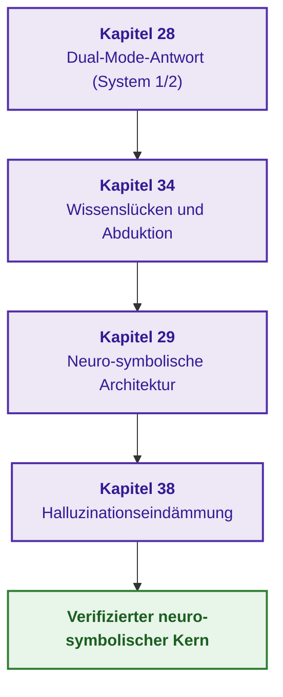

# Teil VI. Neuro-symbolische Architekturen, Abduktion und Halluzinationskontrolle

[← Zu Teil V](part-05-verification-and-learning.md) | [Zum Inhaltsverzeichnis](README.md) | [Zu Teil VII →](part-07-runtime-and-knowledge-exchange.md)

---

## Ziel des Teils

Verbindung der heuristischen Flexibilität großer Sprachmodelle mit der deterministischen Strenge symbolischer Inferenz, Überwindung von Wissensdefiziten durch mehrstufige relationale Suche, Abduktion und sokratischen Dialog sowie Errichtung mathematisch verifizierbarer Barrieren gegen generative Halluzinationen.

---

## Übersicht des Themas und Zusammenhang der Kapitel

Kapitel 28 definiert zwei Betriebsmodi (schnelle beratende Heuristik von System 1 und deterministische symbolische Beweisführung von System 2) und untersagt die automatische Rangerhöhung ungeprüfter Hypothesen. Kapitel 34 nutzt Inferenzlücken, um deterministische relationale Verknüpfungssuchen, Peirce’sche Abduktion und sokratische Klärungsdialoge mit dem Benutzer anzustoßen, noch bevor generative Modelle einbezogen werden. Kapitel 29 setzt die Rollenteilung zwischen lokalem Sprachmodell und symbolischem Zulassungsschleusenwächter („Das Modell schlägt vor, der Kern genehmigt“) auf Basis geschlossener Grammatiken, JSON-Schemata und der asymmetrischen „Mutator–Selektor“-Synthese-Pipeline um. Kapitel 38 systematisiert Ursachen maschineller Halluzinationen (einschließlich des Boxiness-Syndroms) und entfaltet eine mehrstufige Prüfung von Antwortbegründungen.

Das Ergebnis dieses Teils: ein belastbarer neuro-symbolischer kognitiver Kern, der bei epistemischen Lücken eigene Nichtkompetenz explizit deklariert, fundierte Hypothesen synthetisiert und sicher mit generativen Modellen kooperiert, ohne fundamentale Sicherheitsinvarianten zu kompromittieren. Auswahl des Technologie-Stacks, Hardware-Ausführungsinfrastruktur, sichere Aktionsausführung, reaktive Laufzeitumgebungen und verteilte epistemische SOA behandelt [Teil VII](part-07-runtime-and-knowledge-exchange.md).

---

## Kapitel dieses Teils

### [Kapitel 28. Dual-Mode-Expertensysteme: Strikte Schlussfolgerung und beratende Hypothese](ch28-dual-mode-expert-systems.md)

* **Abstract:** Striktes Ergebnis mit verifizierten Begründungen oder Ablehnung neben separat gekennzeichneten beratenden Hypothesen. Deduktion, Fallbasiertes Schließen und Abduktion erfüllen spezialisierte Aufgaben. Zweimodus-Synergie aus reproduktiver Verifikation und kombinatorischer Synthese über ein gemeinsames Wissensregister; 3 Regeln der Zweimodus-Synergie und kryptografischen Hypothesen-Promotion durch Verifikationsexperimente. Eine Ablehnung oder Fachberatung liefert Wissenskandidaten, die unabhängige Prüfungs- und Freigabeverfahren nicht umgehen dürfen.

### [Kapitel 34. Wissenslücken: Relationale Suche, Abduktion und Klärungsdialog](ch34-deterministic-relational-analysis-abduction-and-socratic-dialogue.md)

* **Abstract:** Transformation von Inferenzblockaden in identifizierbare fehlende Prämissen. Die relationale Suche findet Verbindungskandidaten, Abduktion generiert prüfbare Hypothesen und der sokratische Dialog isoliert notwendige Benutzerklärungen. Algebra zur Kompensation technischer Widersprüche und 5 Schutzgesetze der kombinatorischen Synthese vor semantischer Degradation. Induktiv abgeleitete Regeln oder ähnliche Präzedenzfälle können den Status von Hypothesen ohne formale Domänenprüfung nicht aufwerten.

### [Kapitel 29. Neuro-symbolische Architektur: Sprachmodelle und Evidenzprüfung](ch29-neuro-symbolic-architecture.md)

* **Abstract:** Aufgabenverteilung nach dem Prinzip „Das Modell schlägt vor, der Kern genehmigt“: Zulassungsschleuse mit Dokumentenrevisionsregister, geschlossenem Vokabular, bytegenauer Zitatprüfung und lexikalischer Token-Validierung; asymmetrische «Mutator–Selektor»-Pipeline für packungsübergreifende Synthese (NVIDIA Jetson AGX Orin + Föderierte Zero-Copy-Arena + 2× FPGA PYNQ-Z1) und drei Architekturprinzipien des Tandems; Beschränkung lokaler Sprachmodellausgaben über Ollama-JSON-Schemata; Validierung von Modellerklärungen; beratende Abfragestrukturierung mit Host-Verifikation; Erfassung von Ablehnungsgründen zur Telemetrieanalyse; Testsuiten zur Unterscheidung adaptierter von Basissprachmodellen; offene Forschungsfragen.

### [Kapitel 38. Maschinelle Halluzinationen und Wissensdefizite: Evidenzkontrolle von Antworten](ch38-curing-machine-hallucinations-and-knowledge-deficits.md)

* **Abstract:** Taxonomie generativer Fehler und facettenreiche Kontrollmechanismen: strukturelle Einschränkungen, Zitatprüfung, explizite Ablehnung, Hypothesenkennzeichnung und defensive Aktionskontrolle. Fine-Tuning auf verifizierten Frage-Antwort-Paaren und Machine Unlearning werden als komplementäre Ansätze analysiert. Lehrreiche Zulassungsschleusen garantieren weder vollständiges semantisches Textverständnis aller Zitate noch die universelle Beseitigung aller Halluzinationen.

---

[← Zu Teil V](part-05-verification-and-learning.md) | [Zum Inhaltsverzeichnis](README.md) | [Zu Teil VII →](part-07-runtime-and-knowledge-exchange.md)
