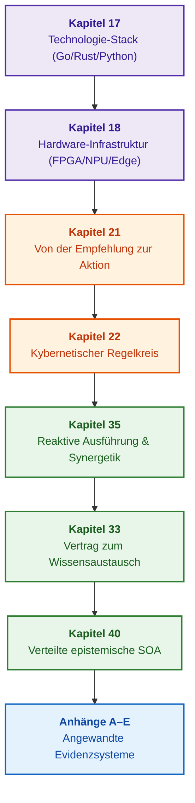

# Teil VII. Technologie-Stack, Hardware-Infrastruktur, kybernetische Ausführung und verteilte SOA

[← Zu Teil VI](part-06-frontiers-neuro-symbolic.md) | [Zum Inhaltsverzeichnis](README.md) | [Zu den Anhängen →](appendix-a-evidence-governed-framework.md)

---

## Ziel des Teils

Verkörperung des verifizierten Expertensystems in realer Software- und Hardware-Infrastruktur, Etablierung sicherer physischer Aktionen sowie geschlossener kybernetischer Regelkreise und Skalierung der Laufzeitumgebung zu einem globalen verteilten Ökosystem unternehmensweiter Intelligenz. Dieser Teil vereint die Auswahl von Programmiersprachen und Regel-Engines, heterogene Hardwarebeschleunigung (FPGA, NPU, Edge), berechtigungsgesteuerte Aktionsausführung, kybernetische Telemetrieverarbeitung, ereignisgesteuerte synergetische Selbstorganisation, sicheren systemübergreifenden Wissensaustausch und den Aufbau einer verteilten epistemischen SOA mit Pipelined-Speicher.

---

## Übersicht des Themas und Zusammenhang der Kapitel

Kapitel 17 formuliert ingenieurmäßige Kriterien für die Auswahl des Technologie-Stacks (Go, Rust, Python, Rete-/Datalog-Engines), abgestimmt auf deterministische Latenz- und Speicherbudgets. Kapitel 18 stellt die Hardware-Ausführungsinfrastruktur über CPU-, GPU-, NPU- und FPGA-Plattformen unter strikten Energie- und Thermikgrenzen bereit. Kapitel 21 regelt den sicheren Übergang von der Empfehlung zur autorisierten physischen oder produktiven Aktion mittels Berechtigungs-Tokens und idempotenter Sagas. Kapitel 22 schließt den kybernetischen Regelkreis, indem es Sensordatenströme der Peripherie verarbeitet, das Ashbysche Gesetz der erforderlichen Varietät durchsetzt und Frühindikatoren für Critical Slowing Down (CSD) erkennt. Kapitel 35 untersucht die ereignisgesteuerte Regelausführung, Mechanismen zur Aufrechterhaltung der Wahrheit (TMS), synergetische Phasenübergänge von Wissen und NPU-Runtimes. Kapitel 33 definiert den Vertrag für den systemübergreifenden Wissensaustausch: sichere Regelbereitstellung für externe Agenten, Training von Schülermodellen und Feedback-Erdung über eine Quarantäneschleuse. Kapitel 40 bildet den architektonischen Höhepunkt der Monografie und synthetisiert einen industriellen Referenzprototyp für eine epistemische SOA: schlanke mobile Clients, semantisches Routing, doppelte Pufferung von Arbeitsmengen (Active Working Sets / Ping-Pong Pipeline) zur vollständigen Latenzverbergung auf dem Bus und mehrquellenbasiertes defeasibles Schiedsverfahren auf Basis formaler Argumentation (ASPIC+).

Das Ergebnis dieses Teils: eine vollumfängliche, hardwarefundierte, verteilte Architektur evidenzbasierter KI, die vom autonomen Edge-Controller bis hin zu Unternehmensclustern mit tausenden Knoten operiert, ohne die Herkunft von Fakten zu verlieren oder Sicherheitsgarantien zu schwächen. Praktische Ingenieurmethoden und autonome Anwendungssysteme sind in den [Anhängen A–E](README.md#anhänge) gebündelt.

---

## Kapitel dieses Teils

### [Kapitel 17. Technologie-Stack: Auswahlkriterien für Werkzeuge, Programmiersprachen und Regel-Engines](ch17-implementation-stack.md)

* **Abstract:** Ingenieurmäßige Kriterien für die Sprachauswahl (Go, Rust, Python, C++), Regel-Engines (Rete, Datalog, Prolog) und eingebettete Speicher-Engines bezogen auf konkrete Problemklassen, Latenzgarantien und Speicherprofile.

### [Kapitel 18. Ausführungsinfrastruktur: Lokale Modelle, Hardwarebeschleuniger, Edge und On-Premise](ch18-execution-infrastructure.md)

* **Abstract:** Hardware-Ausführungsumgebungen: Platzierung auf CPU, GPU, NPU und FPGA; Kaltstart-Minimierung, Rechenisolation, Energiebudgets von Peripheriesystemen und Latenz-Determinismus.

### [Kapitel 21. Von der Empfehlung zur Aktion: Berechtigungskontrolle und sichere Ausführung in Produktionsumgebungen](ch21-from-recommendation-to-action.md)

* **Abstract:** Aktionsverträge, Berechtigungsprüfung, signierte Übermittlung und atomare Vorbedingungen. Idempotenz prüft Ziel und Parameter; unbestimmte Seiteneffekte erfordern einen expliziten Statusabgleich vor der Kompensation. Rollenteilung zwischen Temporal, OPA und Cedar. Lokale Planreparatur erhält nur weiterhin anwendbare Freigaben.

### [Kapitel 22. Kybernetischer Regelkreis: Sensoren, Edge Computing und Feedback](ch22-cybernetics-edge-to-backend.md)

* **Abstract:** Geschlossener kybernetischer Regelkreis: Ashbysches Gesetz der erforderlichen Varietät, Telemetrie-Streaming, Rauschfilterung, Erkennung von Critical Slowing Down (CSD) und fehlersicherer Betrieb bei partieller Peripherieautonomie.

### [Kapitel 35. Reaktives Expertensystem: Ereignisse, Widerruf und Wissensadaptation](ch35-self-organizing-expert-systems-synergetics-and-npu-runtime.md)

* **Abstract:** Ereignisgesteuerte Ausführung, unveränderliche Basisschicht, dynamische Fakten und Widerruf von Inferenzbegründungen. Ereignisbus und Begründungswartung zur Prüfung von Duplikaten, Kausalfolgen und Alternativbegründungen. Synergetische Ontologie-Evolution, Hakensche Ordnungsparameter und NPU-Runtimes.

### [Kapitel 33. Systemübergreifender Wissensaustausch: Regelbereitstellung für Drittsysteme, Modell-Training und sicheres Feedback](ch33-inter-system-knowledge-exchange-and-model-teaching.md)

* **Abstract:** Exportverträge für Regeln, Constraints und Fakten an externe Software-Konsumenten. Provenienz, Geltungsbereich, Berechtigungen, digitale Signaturen und Widerrufe als Begleitmetadaten transferierten Wissens. Training externer Schülermodellen als Wissensdistillation; Feedback-Kanäle leiten Kandidaten in die Quarantäne, anstatt die produktive Wissensbasis direkt zu überschreiben.

### [Kapitel 40. Verteilte Architektur evidenzbasierter Expertensysteme: Epistemische SOA, semantisches Routing, Speicherhierarchien und mehrquellenbasiertes defeasibles Schiedsverfahren](ch40-distributed-epistemic-architectures-soa-and-cluster-scaling.md)

* **Abstract:** Industrieller Referenzarchitektur-Prototyp für evidenzbasierte Expertensysteme. Dreischichtige Epistemic SOA (schlanke mobile Clients, semantischer Broker, föderierte Domänendienste). Überwindung der Speicherkapazitätskluft durch Active Working Sets (AWS) und Ping-Pong-Pipeline-Doppelpufferung mit vollständiger Latenzverbergung. Föderierte Zero-Copy-Arena für packungsübergreifende Inferenz ($\mathcal{S}^*(Q)$) und 3 Hardware-Generationen der Synthese-Evolution (UMA + duale PYNQ-Z1 $\to$ HBM2e-EPU $\to$ kohärente CXL-3.0-Fabrics mit digitalen Ising-Annealern). Scatter-Gather-Muster und mehrquellenbasierte defeasible Aggregation (ASPIC+) zur Bewältigung unvollständigen Wissens und regulatorischer Normenkollisionen. Technologieauswahlmatrix und budgetorientierte Skalierung.

---

[← Zu Teil VI](part-06-frontiers-neuro-symbolic.md) | [Zum Inhaltsverzeichnis](README.md) | [Zu den Anhängen →](appendix-a-evidence-governed-framework.md)
