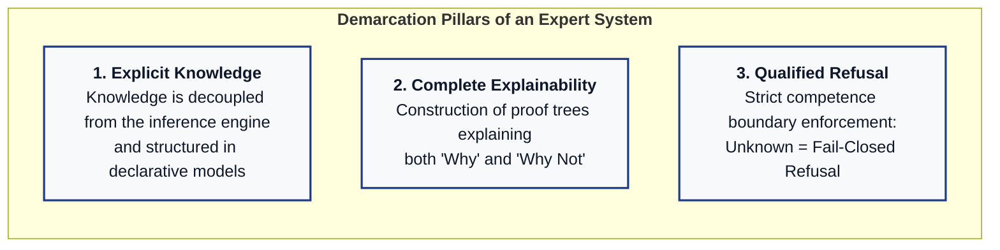
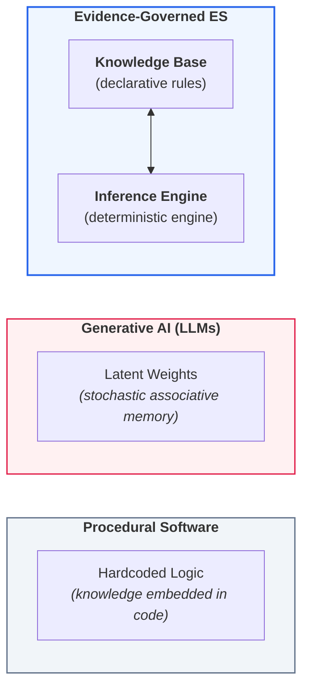
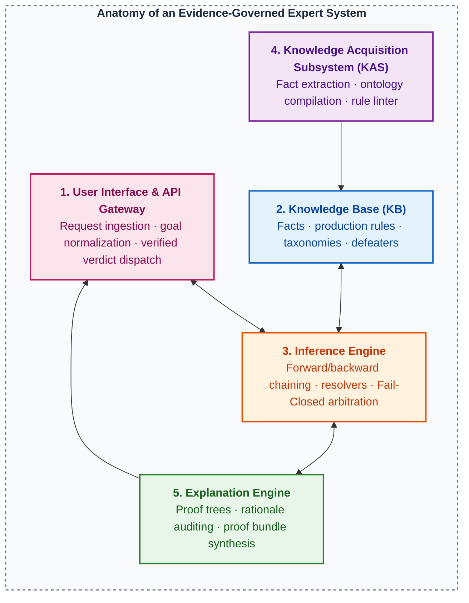
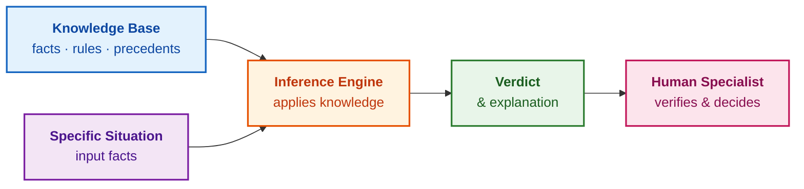

# Chapter 1. Introduction to Expert Systems: From Chaos to Governed Knowledge

> **Book:** [Architecture of Evidence-Governed Expert Systems](README.md) · [Part I: Conceptual and Epistemic Foundations](part-01-foundations.md)  
> **Previous Chapter:** [Part I. Conceptual and Epistemic Foundations](part-01-foundations.md)  
> **Next Chapter:** [Chapter 2. Philosophy for the Engineer: What a Machine Has the Right to Call Knowledge](ch02-epistemology-of-machine-knowledge.md)  
> **Table of Contents:** [README.md](README.md)  
> **Author:** [Mykola Fedchyk](about-the-author.md)  
> **Level:** Foundational Engineering  
> **Expected Outcomes:** Distinguish a verifiable expert system answer from search engine results and chatbot responses; understand the components of an expert system and the boundaries of its responsibility; evaluate whether to build an expert system for your team's task; select a reading path through the book.

## Abstract

The first chapter establishes the conceptual, historical, and architectural foundations of evidence-governed expert systems, knowledge engineering, and deterministic inference. It examines the crisis of human engineering memory in complex technological domains and demonstrates why conventional documentation search catalogs and stochastic generative language models are fundamentally incapable of bearing legal or functional responsibility for decision correctness. A rigorous definition of an expert system is formulated based on three demarcation criteria: explicit knowledge representation, complete explainability, and the capability of deterministic qualified refusal (`REFUSAL`) under incomplete or contradictory facts.

The chapter chronicles the historical evolution of expert systems: from Emil Post's canonical production systems, Alan Turing's insights, and early practical milestones (DENDRAL [[1]](#src-1), MYCIN [[2]](#src-2)) through the industrial triumph of XCON [[7]](#src-7), the commercial boom, and the hard-won lessons of the "AI Winter" to the modern neuro-symbolic renaissance. Key architectural invariants of evidence-governed expert systems are dissected, along with the anatomy of their five core subsystems, four classical knowledge representation paradigms, mission-critical application domains (automotive functional safety ASIL-D [[6]](#src-6), avionics DO-178C, clinical guidelines [[5]](#src-5), regulatory compliance [[4]](#src-4)), and trajectories toward hardware epistemic processors in silicon (EPU) and formal mathematical proof witnesses (Lean 4). The chapter concludes with systematized conclusions, updated self-assessment questions, an architectural roadmap across the seven parts of the monograph, and a virtual debate with leading AI theorists.

---

## 1. Problem Statement and Genesis: The Need for Expert Systems 

Modern high-technology engineering confronts an insurmountable cognitive boundary: **the volume of accumulated domain knowledge exponentially exceeds the biological bandwidth of the human brain**.

Consider a typical engineering scenario. An embedded systems developer inspecting the `PowerSupervisor` module observes a constant timeout of `40` ms and faces an operational question: *"Can this cold-start timeout be increased to 60 ms to stabilize low-temperature power-on sequences?"*. The answer to this seemingly mundane inquiry is fragmented across:
- Section 7.3.2 of the ISO 26262 functional safety standard;
- A footnote on page 340 of the microcontroller hardware reference manual;
- A three-year-old test report for hardware Revision C;
- Historical commentary attached to defect `BUG-817`;
- The unrecorded memory of a principal architect who left the company six months ago.

In such situations, humans inevitably resort to guesswork or rely on incomplete data. Contrast the outcomes produced by three fundamentally distinct classes of tools:

| Tool Paradigm | Result Returned | Required Next Step for the Engineer |
|---|---|---|
| **Documentation Search** (Information Retrieval) | Returns requirement `REQ-142`, defect `BUG-817`, a code comment, and 40 pages of specifications. | Manually read through all returned documents, verify document revisions, and construct the deduction chain independently. |
| **Generative Language Model** (conversational agent / chatbot) | "Yes, 60 ms is completely safe: standard requirements typically mandate a minimum threshold of 50 ms." | Investigate the provenance of the number 50. In reality, it originated from a superseded draft; the answer is a plausible hallucination. |
| **Evidence-Governed Expert System** | "40 ms violates rule `R-POWER-03` for Revision C. A value of 60 ms satisfies the constraint $t \ge 55\text{ ms}$, but the modification requires re-running test `TC-88`. Sources: `REQ-142` v5, `ADR-31` v3. Final authorization rests with the engineer upon test passage." | Verify the step-by-step reasoning chain against literal primary sources and execute the prescribed validation test. |

None of these tools replaces the ultimate engineering responsibility. However, the fundamental distinction is critical: only the third answer, delivered by the expert system, can be verified step-by-step against immutable evidence without repeating the entire investigation from scratch. Search delegates reasoning entirely to the human. Generative language models generate answers without epistemological accountability, often citing phantom sources. An expert system makes the reasoning process explicit, deterministic, and strictly bound to verifiable standards.

**The demand for expert systems arises wherever the cost of error is incompatible with probabilistic guesswork.** Three systemic drivers underline this imperative today:
1. **Plausible text has become cheap; verification has become expensive:** Generative neural networks synthesize persuasive text in milliseconds, yet verifying factual correctness often takes an engineer longer than authoring the answer from primary sources.
2. **Regulatory stringency:** The EU Artificial Intelligence Act (EU AI Act 2024/1689 [[4]](#src-4)), FDA clinical decision support guidance [[5]](#src-5), and transport safety standards (ISO 26262 [[6]](#src-6), DO-178C) legally mandate end-to-end traceability, determinism, and human auditability for high-risk automated decisions.
3. **The corporate memory crisis:** Industrial systems remain in service for decades, whereas engineering teams rotate every few years. Expert systems provide the only durable mechanism for preserving institutional knowledge as actionable, verifiable software assets.

> [!NOTE]
> **Authorial Analytical Conclusion: Three Factors of the Knowledge Crisis and the Epistemic Advantage of Evidence-Governed Systems**  
> According to the author's analysis, the necessity of transitioning to evidence-governed expert systems is driven by three critical factors:
> 1. **Devaluation of Plausible Text and Verification Asymmetry:** Generative neural networks synthesize persuasive prose in milliseconds, yet rigorous expert verification by a human requires more time than deriving the answer directly from primary sources.
> 2. **Legislative Imperative of Determinism:** International standards and regulatory frameworks (EU AI Act 2024/1689, ISO 26262 ASIL-D, FDA CDS, DO-178C) legally mandate end-to-end traceability and step-by-step auditing for every automated verdict.
> 3. **The Corporate Memory Alienation Crisis:** The lifecycle duration of complex engineering systems (decades) far exceeds personnel retention horizons, rendering the expert system the only viable mechanism for preserving engineering memory as executable, verifiable rules.
> 
> *Epistemic Advantage:* Unlike search engines (which offload logic to humans) and generative language models (prone to confabulation), an evidence-governed system renders deduction deterministic, transparent, and provably grounded in immutable primary sources.

---

## 2. Definition and Epistemic Essence: What Is an Expert System 

While literature offers diverse definitions, evidence-governed expert systems engineering relies on the following operational standard:

> **An Expert System** is an intelligent computing system that captures formalized human expert knowledge within a bounded domain and applies deterministic logical inference algorithms to solve complex analytical, diagnostic, and decision-making problems at the level of a domain specialist, providing a complete and verifiable explanation of its reasoning.

Unlike traditional procedural code, where business rules are hardcoded inside monolithic control structures (`if/else` statements), and unlike neural networks, where knowledge is diffused across trillions of uninterpretable weights within a "black box," an evidence-governed expert system is defined by three strict demarcation pillars:

1. **Explicit Knowledge Representation:** Domain knowledge is strictly decoupled from the computational engine. It is represented in transparent declarative formats (rules, ontologies, facts, constraints), permitting continuous knowledge updates without recompiling or altering the core engine codebase of the expert system.
2. **Full Explainability:** The expert system avoids arbitrary assertions. Every conclusion is accompanied by an audit trail: exactly which input facts triggered which rules, what counter-hypotheses were dismissed, and which specific document revisions substantiate the claim.
3. **Qualified Refusal (Fail-Closed Gate):** The expert system maintains rigorous self-awareness of its operational boundary. If input data falls outside the formalized rule set or exhibits irreconcilable contradictions, the system issues a typed refusal (`REFUSAL` or `CLARIFICATION`), preventing ungrounded speculation ($ZHR = 1.00$).

Three related concepts must be clearly differentiated:
* **Expertise:** The synthesized corpus of verified knowledge and the capacity to reason rigorously within a domain.
* **Authority:** The formal mandate to enact a binding decision (e.g., approving an avionics release or prescribing treatment), which always remains with a designated human operator.
* **Evidence:** The immutable primary record (standard, telemetry log, datasheet) maintaining cryptographic byte-level custody that cannot be altered during deduction.

> [!NOTE]
> **Authorial Theoretical Definition: Three Demarcation Pillars and the Responsibility Triad**  
> The author's operational definition of an evidence-governed expert system establishes a strict demarcation from procedural code and generative models based on:
> 
> *Three Immutable Demarcation Pillars:*
> 1. **Complete Knowledge Explicitness:** Declarative decoupling of domain knowledge from the execution engine (rules, ontologies, constraints).
> 2. **Step-by-Step Explainability:** Mandatory synthesis of proof graphs and transparent rationale audit trails for every conclusion.
> 3. **Qualified Refusal Gate (Fail-Closed Gate):** Rigorous enforcement of competence boundaries; under knowledge incompleteness or contradiction, the system deterministically yields a typed refusal (`REFUSAL`/`CLARIFICATION`, $ZHR = 1.00$).
> 
> *The Responsibility Triad:*
> * **Expertise:** Algorithmic computation and synthesis of verified recommendations by the computing system.
> * **Authority:** The exclusive legal right and institutional responsibility of the human operator to enact a binding decision.
> * **Evidence:** Immutable byte-level custody of primary sources (`byte_start`, `byte_end`, `quote_sha256`).

---

## 3. History and Evolution: From Mathematical Logic to the Modern Renaissance 

The developmental trajectory of expert systems spans over eight decades of profound theoretical advances, industrial booms, and paradigm shifts:

1. **Logical and Mathematical Foundations (1930s–1950s):**  
   In 1943, mathematician Emil Post formulated canonical production systems, proving that computation can be expressed entirely through formal string-rewriting rules. Alan Turing, Claude Shannon, and Norbert Wiener established the core tenets of cybernetics and information theory. In 1965, John Alan Robinson introduced the resolution principle and the Most General Unifier (MGU) algorithm, establishing the foundation for automated theorem proving in first-order predicate logic.
2. **The First Wave and the Genesis of Knowledge Engineering (1965–1970s):**  
   AI shifted away from domain-agnostic search (the General Problem Solver) toward systems rich in specialized domain knowledge:
   - **DENDRAL (1965, Edward Feigenbaum, Joshua Lederberg):** The pioneering Stanford expert system that inferred molecular structures from mass spectrometry telemetry [[1]](#src-1).
   - **MYCIN (1972, Edward Shortliffe):** Diagnosed blood-borne infectious diseases and meningitis. MYCIN introduced the decoupling of rules from the interpreter, pioneered Certainty Factors, and implemented dynamic explanation traces [[2]](#src-2).
   - Edward Feigenbaum established the term **Knowledge Engineering**, defining it as the discipline of transferring human expertise into operational symbolic systems [[3]](#src-3).
3. **Commercial Boom and Industrialization (1980–1988):**  
   Widespread enterprise adoption. John McDermott's **R1/XCON** at Digital Equipment Corporation (DEC) configured VAX computing clusters, saving over $40 million annually [[7]](#src-7). Commercial expert system shells proliferated, supported by dedicated LISP hardware architectures (Symbolics, LMI, Texas Instruments).
4. **The "AI Winter" and the First-Generation Crisis (late 1980s–1990s):**  
   The field encountered formidable technical roadblocks:
   - *Knowledge Acquisition Bottleneck:* Manually extracting and coding thousands of rules through human expert interviews proved excruciatingly slow and expensive.
   - *Brittleness at Domain Edges:* First-generation systems lacked mechanisms for graceful degradation, collapsing catastrophically when encountering unmodeled boundary conditions.
   - *Knowledge Base Maintenance Crisis:* Unversioned rule bases exceeding 10,000 rules became unmanageable due to hidden mutual contradictions.
   - *Hardware Obsolescence:* Expensive proprietary LISP machines were overtaken by rapidly advancing general-purpose commodity microprocessors (x86).
5. **The Modern Neuro-Symbolic Renaissance (2020s–Present):**  
   The rise of Large Language Models has not displaced expert systems; instead, it has resolved their classic bottlenecks. Stochastic neural models solve the knowledge acquisition challenge by parsing gigabytes of unstructured documentation, while the symbolic expert core acts as an immutable deterministic arbiter (Eligibility Gate), guaranteeing zero hallucinations and strict certification compliance.

---

## 4. Key Architectural Invariants of Evidence-Governed Expert Systems 

An evidence-governed expert system differs fundamentally from conventional monolithic software and statistical retrieval pipelines (RAG):

Key architectural invariants include:

* **Orthogonality of Knowledge and Inference Engine:** The inference engine is domain-invariant and immutable. Knowledge is managed as structured external data. Modifying a policy or regulatory standard involves publishing a versioned declarative package without altering or recompiling the execution engine.
* **Neuro-Symbolic Partitioning: Relevance versus Eligibility:**
  - *Probabilistic Perception Models (System 1):* Handle **Relevance** exclusively (heuristic document discovery, parsing intent from natural language, extracting candidate facts).
  - *Deterministic Symbolic Engines (System 2):* Handle **Eligibility** exclusively (normative admissibility, safety invariant enforcement, veto authority). No statistical model holds the mandate to independently authorize an action.
* **Byte-Level Evidence Custody:** Every atomic claim asserted in the expert system's knowledge base must trace directly to an immutable primary source segment bounded by exact byte offsets `[byte_start, byte_end]` and a verifiable `sha256` hash. Assertions failing byte-level custody verification cannot be emitted by the system.
* **Fail-Closed Gate Principle:** Under incomplete, contradictory, or absent rules, the expert system deterministically yields a typed refusal (`REFUSAL`), guaranteeing an uncompromised Zero-Hallucination Rate ($ZHR = 1.00$).

> [!NOTE]
> **Authorial Engineering Model: Four Evidence-Grounded Architectural Invariants**  
> In the author's framework, mission-critical dependability is strictly guaranteed through four architectural invariants:
> 1. **Orthogonality of Knowledge and Inference Engine:** A universal deterministic inference engine is completely decoupled from the declarative knowledge base; rules are updated without altering or recompiling the core software kernel.
> 2. **Neuro-Symbolic Partitioning (Relevance versus Eligibility):** Machine learning models handle heuristic discovery and relevance exclusively (candidate retrieval, intent parsing), while the symbolic kernel unilaterally governs normative admissibility and holds absolute veto authority.
> 3. **Byte-Level Evidence Custody:** Every atomic assertion is anchored to primary sources via exact byte boundaries `[byte_start, byte_end]` and a cryptographic `sha256` digest.
> 4. **Fail-Closed Gate Principle:** Under incomplete, contradictory, or absent rules, the system deterministically emits a typed refusal (`REFUSAL`), enforcing zero tolerance for hallucinations ($ZHR = 1.00$).

---

## 5. Anatomy of an Expert System: The Five Core Subsystems 

A production-grade evidence-governed expert system orchestrates five interconnected subsystems:

1. **Knowledge Base (KB):** The structured repository of formalized domain expertise containing ontologies, relation graphs, decision matrices, declarative production rules, and defeasible arguments.
2. **Inference Engine:** The deterministic execution core that matches observations against the knowledge base. It executes forward chaining (data-driven reasoning from facts to new conclusions) and backward chaining (goal-driven reasoning from hypotheses back to required supporting evidence).
3. **Explanation Engine:** The diagnostic tracer that records rule activations and compiles an inspectable proof tree, answering both *"Why was this verdict reached?"* and *"Why were alternative hypotheses rejected?"*.
4. **Knowledge Acquisition Subsystem (KAS):** The ingestion pipeline that parses, validates, and compiles raw documentation (standards, manuals, test logs) into machine-readable knowledge packs.
5. **User Interface and API Gateway:** The communication layer interfacing with human engineers, enterprise systems, or real-time cyber-physical controllers.

To intuitively grasp the operational principle of an expert system, consider its simplest interaction model with human operators. An expert system never usurps human authority or makes binding final choices on its own. Instead, it retrieves declarative rules from the knowledge base, matches them against the input facts of a specific operational situation, derives a rigorously substantiated recommendation, and presents an inspectable proof chain to the human specialist who retains sole accountability:

This clear division of roles guarantees that the expert system remains a dependable, human-governed decision support tool where every deduction step is visible, auditable, and subject to human oversight.

---

## 6. Construction Paradigms and Knowledge Models 

Depending on domain characteristics, four primary knowledge modeling paradigms predominate in knowledge engineering:

1. **Production Rule Systems:**  
   Expressed as condition-action pairs: $IF \ \langle \text{condition} \rangle \ THEN \ \langle \text{action/consequent} \rangle$. Sub-millisecond evaluation across hundreds of thousands of rules is achieved through compiled discrimination networks such as **Rete** (Charles Forgy, 1979) and **TREAT**.
2. **Frame-Based and Object Models:**  
   Originating from Marvin Minsky's 1974 framework. Knowledge is structured into concept frames possessing hierarchical inheritance, typed slots, and procedural attachments ("demons" triggered upon reading or mutating slot values).
3. **First-Order Logic and Formal Ontologies (Datalog / OWL):**  
   Knowledge expressed through formal logic or Horn clauses. Inference relies on resolution refutation and unification. Modern enterprise systems utilize Semantic Web standards (OWL, RDF, SPARQL) and deductive Datalog engines.
4. **Defeasible Argumentation Models (ASPIC+):**  
   Non-monotonic formalisms designed to resolve engineering conflicts and legal contradictions. Rules remain tentatively valid until defeated by counter-arguments (rebutting or undercutting defeaters), enabling dynamic belief revision without corrupting global consistency.

---

## 7. Critical Application Domains with High Stakes 

Evidence-governed expert systems are indispensable wherever stochastic hallucinations pose hazards to human safety, national security, or critical assets:

* **Functional Safety and Avionics (ISO 26262 ASIL-D [[6]](#src-6), DO-178C DAL-A, DO-254):** Real-time hardware interlocks and safety censors in autonomous driving platforms, rail traction management, and flight control computers.
* **Healthcare and Clinical Guidance (FDA CDS Guidance [[5]](#src-5)):** Pharmacological interaction validation, automated anesthetic dosage checks, and oncology therapy verification against national health protocols.
* **Critical Energy Infrastructure:** Continuous diagnostic monitoring of turbine alternators, nuclear power control loops, and autonomous real-time grid fault isolation.
* **Legal Compliance and Financial Governance (EU AI Act [[4]](#src-4), GDPR, AML):** Automated auditing of cross-border financial transactions, antitrust contract verification, and supply-chain regulatory certification.
* **Defense and Autonomous MilTech:** Mission planning and edge decision authorization in electronic-warfare-degraded, GNSS-denied environments where byte-level custody of operational directives is mandatory.

---

## 8. Future Trajectories: From Software Rules to Silicon Knowledge Processors 

The frontier of evidence-governed expert systems expands at the intersection of discrete mathematics, computer architecture, and formal methods:

1. **Epistemic Processing Units (EPU):**  
   Paralleling GPU and NPU hardware specialization, symbolic inference engines are being synthesized directly onto silicon (FPGA and custom ASICs). Hardware-accelerated pattern matchers and cryptographic hash verifiers operate within fixed clock cycles (pipeline latencies $\le 80$ ns), enabling hard real-time safety interlocks.
2. **Automated Proof Witnesses:**  
   Coupling expert system deduction with interactive theorem provers (**Lean 4**, **Coq**) and SMT solvers (**Z3**). Rather than emitting informal text, the expert system generates a cryptographically signed proof bundle independently verifiable by a minimalist external proof checker.

> [!NOTE]
> **Authorial Engineering Concept: Epistemic Processing Units (EPU) and Automated Proof Witnesses**  
> The author's forward-looking architectural concept is founded upon two complementary pillars:
> 1. **Silicon Epistemic Processing Units (EPU):** Direct hardware execution of the inference pipeline within FPGA/ASIC fabrics with deterministic fixed latency ($\le 80$ ns), enabling symbolic safety interlocks in hard real-time control loops.
> 2. **Automated Proof Witnesses:** Seamless coupling of the inference engine with formal interactive theorem provers (Lean 4) and SMT solvers (Z3) to generate cryptographically signed, machine-checkable proof certificates for every emitted decision.

---

## 9. Architectural Monograph Roadmap: A Guide Through the Seven Parts 

The contents of this monograph progress systematically from foundational theory to silicon realization across seven cohesive parts: **Part I** establishes the conceptual and epistemic foundations of machine knowledge and evidence; **Part II** develops applied mathematical models, relation lattices, knowledge base typologies, and Engineering Knowledge Graphs (EKG); **Part III** provides methodologies for automated knowledge acquisition, linguistic analysis, and requirements formalization; **Part IV** details the system architecture, implementation stack, explanation engines, and edge-to-backend cybernetics; **Part V** focuses on rigorous rule verification, system diagnosis, and Goal Structuring Notation (GSN) safety cases; **Part VI** investigates cognitive frontiers through neuro-symbolic synergies (NeSy) and hardware Epistemic Processing Units (EPU); and **Part VII** deploys distributed epistemic architectures, the Knowledge Testing Pyramid, and active Popperian falsification auditing. A complete chapter catalog, detailed syllabus, and role-based reading routes are provided in the book overview ([README.md](README.md)).

---

## 10. Pro et Contra Dialogue 

> **Epistemic Preamble and Academic Disclaimer:**  
> This section stages a simulated intellectual debate examining the historical foundations, architectural boundaries, and engineering justifications for modernizing expert systems. The discussion convenes the pioneers of the field and authors of seminal treatises in knowledge engineering: Turing Award laureate **Edward Feigenbaum** — creator of DENDRAL and father of the knowledge engineering paradigm; **Edward H. Shortliffe** — creator of MYCIN, pioneer of explainable inference and certainty factorization; and **Frederick Hayes-Roth** — lead editor and co-author of the landmark volume *Building Expert Systems* (1983).  
> *Disclaimer:* This dialogue is a synthesized academic debate derived from published foundational literature, serving as a didactic justification for the qualitative leap from first-generation systems to modern evidence-governed expert architectures. Each participant engages in direct polemics with the author of this monograph.

**Chapter Thesis (Mykola Fedchyk):**  
The classical expert systems paradigm is not an obsolete relic, but the indispensable foundation of trustworthy artificial intelligence: combining the symbolic determinism, knowledge explicitness, and complete explainability of the first generation with modern automated knowledge extraction, graph ontologies, and formal verification makes the modernization of expert systems mandatory for high-stakes domains requiring an uncompromising Zero-Hallucination Rate ($ZHR = 1.00$).

**Dialogue with Edward Feigenbaum: Does the Principle "Knowledge Is Power" Endure in the Era of Statistical Models?**

- **Edward Feigenbaum:**  
  *"Mykola Fedchyk, in the 1970s at Stanford, we formulated the core hypothesis of knowledge engineering: 'The power of an intelligent system derives from the knowledge it possesses, not from sophisticated inference methods or universal search algorithms (Knowledge is Power).' Today, however, intellectual fashion has swung entirely toward scale: multi-billion-parameter neural models attempt to solve problems purely through massive brute-force computation and associative latent weights. Do you believe our hypothesis has succumbed to computational scale, and is there still any viable purpose in building explicit, structured knowledge bases?"*

- **Mykola Fedchyk:**  
  *"Professor Feigenbaum, your hypothesis has not only endured—it is experiencing a dramatic empirical vindication.  
  When statistical models are deployed in critical engineering domains without explicit, grounded knowledge, they fail catastrophically, emitting persuasive hallucinations instead of factual truths. Attempting to substitute explicit domain knowledge with stochastic association inevitably leads to an epistemological dead end.  
  Furthermore, modern language models serve as the ideal engine for resolving the very obstacle you famously termed the 'Knowledge Acquisition Bottleneck.' They rapidly ingest raw technical literature and extract candidate rules. Yet the ultimate strength of any dependable system still resides in a verified, explicit knowledge base where every fact possesses an identifiable custodian, an exact version, and bounded applicability."*

**Dialogue with Edward Shortliffe: Is Rigorous Rule Tracing Necessary When Neural Models Generate Fluent Text?**

- **Edward H. Shortliffe:**  
  *"Mykola, when we designed MYCIN, our primary constraint was clinician acceptance: a physician will never prescribe a toxic antimicrobial regimen on computer advice unless the system explicitly demonstrates which patient symptoms and microbiological cultures triggered the recommendation. We pioneered explanation engines based on rule execution tracing. Yet contemporary generative models produce fluent, grammatically pristine natural language rationalizations for virtually any query. Why burden modern architectures with deterministic proof trees when users seem satisfied with smooth verbal narratives?"*

- **Mykola Fedchyk:**  
  *"Dr. Shortliffe, the divide between these two paradigms is the chasm between truth and deception.  
  Natural language rationalizations produced by deep neural networks represent post-hoc rationalization: they do not reflect how the network actually computed its latent tensors, but merely what sounds persuasive to a human reader. This creates a lethal illusion of trust.  
  Your foundational insight in MYCIN remains unimpeachable: an explanation must be strictly isomorphic to the actual execution path. In our modernized architecture, the explanation engine synthesizes a mathematically inspectable Proof Bundle: every step of the deduction cites an activated rule and an exact primary source citation verified by byte-level coordinates. An engineer or physician receives not a literary improvisation, but a legally binding and auditable chain of evidence."*

**Dialogue with Frederick Hayes-Roth: How Do We Avoid the Scalability Collapse and Brittleness of the First Generation?**

- **Frederick Hayes-Roth:**  
  *"Mykola, in our 1983 work 'Building Expert Systems,' we systematically mapped the discipline, yet the late 1980s brought a sobering reckoning. When rule bases scaled beyond 10,000 rules, they collapsed under their own weight: latent contradictions multiplied, human experts could not harmonize conflict resolution strategies, and at domain boundaries, systems exhibited catastrophic brittleness. What guarantees that your proposed modernization will not replicate that historical cycle of disappointment and precipitate another AI winter for knowledge-based systems?"*

- **Mykola Fedchyk:**  
  *"Professor Hayes-Roth, the crisis of the first generation was not a conceptual failure, but the consequence of immature software engineering infrastructure at the time.  
  First, first-generation systems treated knowledge as unversioned, monolithic rule sets without modularity, dependency tracking, or automated regression tests. We modernize this practice under the 'Knowledge as Code' paradigm: every rule carries semantic versioning, explicit dependency edges within an Engineering Knowledge Graph (EKG), and passes automated regression suites in continuous integration (CI/CD) pipelines.  
  Second, in place of naive monotonic logic, we employ formal defeasible argumentation (ASPIC+), which models real-world engineering contradictions mathematically through formal defeaters.  
  Third, we replaced uncontrolled brittleness with the Fail-Closed Gate principle: rather than failing unpredictably when encountering unmodeled facts, the system issues a typed refusal (`REFUSAL`). Finally, synthesizing symbolic inference directly into silicon via Epistemic Processing Units (EPU) eliminates execution latency, making expert systems a robust foundation for twenty-first-century cyber-physical infrastructure."*

**Synthesis and Scientific Verdict:**  
The virtual exchange with the founding masters affirms that the core tenets of knowledge engineering—Feigenbaum's primacy of explicit domain knowledge, Shortliffe's insistence on isomorphic explainability, and Hayes-Roth's rigorous operational typology—remain enduring architectural imperatives. The modernization of evidence-governed expert systems equips this classical legacy with a contemporary technological foundation: automated source extraction, cryptographic hallucination shields, and native silicon execution.

---

## Conclusions

1. **Epistemic Demarcation of Expert Systems:** Information retrieval catalogs leave the intellectual burden of deduction and fact comparison entirely to humans, whereas generative language models synthesize fluent prose without mathematical truth guarantees. In contrast, an evidence-governed expert system transforms problem solving into transparent, deterministic, and verifiable logical deduction, where every inference step rests on explicit rules and immutable primary sources.
2. **Three Fundamental Pillars of an Expert System:** An expert system is defined neither by code volume nor ad-hoc heuristics, but by three systemic invariants: complete knowledge explicitness (decoupling the rule base from the engine), comprehensive explainability of verdicts (generating inspectable proof trees answering "Why" and "Why Not"), and mandatory qualified refusal under incomplete or contradictory facts (Fail-Closed gate).
3. **Historical Lessons and the Neuro-Symbolic Renaissance:** The crisis of first-generation systems (the "AI Winter" of the late 1980s) was driven by the knowledge acquisition bottleneck, brittleness at domain boundaries, and the economic unsustainability of proprietary LISP hardware. The modern renaissance resolves these contradictions through synergy: large language models automate the ingestion of raw documentation, while the symbolic core of the expert system acts as an uncompromising normative arbiter ensuring a Zero-Hallucination Rate ($ZHR = 1.00$).
4. **Functional Partitioning: Relevance versus Eligibility:** Evidence-governed architectures enforce strict separation of duties. Probabilistic perceptual models handle relevance exclusively—intent parsing and candidate context retrieval. The symbolic inference engine handles normative eligibility exclusively—rule verification, safety invariant enforcement, and unconditional veto authority.
5. **Knowledge Orthogonality and the Five Core Subsystems:** An expert system orchestrates five decoupled subsystems (Knowledge Base, Inference Engine, Explanation Engine, Knowledge Acquisition Subsystem, and UI/API Gateway). The paramount engineering principle is the absolute independence of declarative knowledge from engine executable code: regulatory updates occur as versioned knowledge pack updates without recompiling the software core.
6. **Diversity of Knowledge Representation Models:** Depending on domain requirements, the expert system employs production rules with high-performance pattern matching (Rete/TREAT), hierarchical frame structures with procedural triggers, deductive first-order logic bases, or defeasible argumentation formalisms (ASPIC+) capable of adjudicating engineering conflicts and revising beliefs dynamically.
7. **High-Stakes Application Domains:** Evidence-governed expert systems are indispensable wherever stochastic error threatens human life, public infrastructure, or catastrophic financial solvency: automotive functional safety (ISO 26262 ASIL-D), avionics (DO-178C), clinical pharmacology, power grid protection, and autonomous robotics in GNSS-denied environments.
8. **Silicon Knowledge Processors and Formal Proofs:** The evolutionary frontier of expert systems involves synthesizing deterministic inference engines directly into silicon (Epistemic Processing Units on FPGA/ASIC) with sub-100-nanosecond guaranteed response times for hard real-time cyber-physical loops, coupled with interactive theorem provers (Lean 4) emitting cryptographically verifiable mathematical proof certificates.

---

## Self-Assessment Questions

1. **Epistemic Demarcation:** What is the fundamental difference in the division of responsibility for decision correctness between documentation search catalogs, generative language models, and evidence-governed expert systems?
2. **Demarcation Criteria:** What three architectural properties distinguish an expert system from procedural code bloated with nested `if-else` branches and from a black-box deep neural network?
3. **Historical Lessons:** What three engineering limitations caused the "AI Winter" in the late 1980s, and how do modern language models and graph platforms overcome these historical barriers?
4. **Knowledge Orthogonality:** Why is complete decoupling of the declarative knowledge base from the inference engine code imperative in knowledge engineering? What advantages does this provide for safety certification and system lifecycle management?
5. **Functional Partitioning:** How do the Relevance and Eligibility tiers interact in an evidence-governed architecture? Why must generative models be barred from exercising final decision authority?
6. **Byte-Level Custody:** What does byte-level evidence custody (Evidence Grounding) mandate, and how does it prevent latent hallucinations within the knowledge base?
7. **Subsystem Anatomy:** Detail the responsibilities of each of the five core expert system subsystems. How does the explanation engine construct justifications for "Why this verdict?" and "Why was the alternative rejected?"?
8. **Knowledge Representation Models:** Under what engineering circumstances should a team select production rules (Rete) versus defeasible argumentation models (ASPIC+)?
9. **Fail-Closed Gate:** What deterministic behavior must an evidence-governed expert system exhibit when encountering an unmodeled combination of input facts? What safety maneuver is initiated in cyber-physical applications?
10. **Hardware Realization:** Why is software rule interpretation on general-purpose CPUs insufficient for hard real-time safety loops (ASIL-D), and what engineering role is played by Epistemic Processing Units (EPU) implemented directly in silicon?

---

## Glossary

| Term | Ukrainian Equivalent | Definition |
|---|---|---|
| **Expert System** | Експертна система | An intelligent computing system that applies formalized expert knowledge to solve domain problems with complete explainability. |
| **Knowledge Base (KB)** | База знань | A structured repository of declarative facts, production rules, ontologies, and defeaters suitable for automated reasoning. |
| **Inference Engine** | Рушій виведення | A deterministic algorithm that matches input facts against knowledge base rules to derive valid conclusions. |
| **Explanation Engine** | Підсистема пояснень | A diagnostic subsystem that translates activated deduction chains into human-auditable proof trees. |
| **Knowledge Acquisition Subsystem (KAS)** | Підсистема здобуття знань | The tooling pipeline that extracts, validates, and compiles domain knowledge from raw documentation. |
| **Qualified Refusal** | Кваліфікована відмова | A deterministic system status (`REFUSAL`) returned when input data is incomplete, ambiguous, or unmodeled. |
| **Evidence Grounding** | Побайтове заземлення | Binding every atomic assertion to exact byte coordinates `[byte_start, byte_end]` and a primary source cryptographic hash. |
| **Production Rule** | Продукційне правило | A formal representation structured as $IF \ \langle \text{condition} \rangle \ THEN \ \langle \text{action} \rangle$. |
| **Defeasible Reasoning** | Спростовне міркування | Non-monotonic reasoning where conclusions can be retracted upon the introduction of stronger counter-evidence. |

---

## Abbreviations

| Abbreviation | Expansion | Meaning |
|---|---|---|
| **ASIL** | Automotive Safety Integrity Level | Risk classification scheme under ISO 26262 (levels A through D). |
| **DAL** | Development Assurance Level | Software criticality level under DO-178C (levels E through A). |
| **EKG** | Engineering Knowledge Graph | Traceability graph linking requirements, designs, and verification artifacts. |
| **EPU** | Epistemic Processing Unit | Hardware processor designed for symbolic rule evaluation and proof synthesis. |
| **GOFAI** | Good Old-Fashioned Artificial Intelligence | Classical symbolic AI based on explicit logic and rules. |
| **KAS** | Knowledge Acquisition System | Pipeline for extracting and structuring knowledge. |
| **LLM** | Large Language Model | Deep transformer-based natural language model. |
| **NeSy** | Neuro-Symbolic AI | Hybrid AI combining neural networks and symbolic reasoning. |
| **ZHR** | Zero-Hallucination Rate | Metric where $ZHR = 1.00$ designates 100% verifiable factual accuracy. |

---

## References

1. Robert K. Lindsay, Bruce G. Buchanan, Edward A. Feigenbaum, Joshua Lederberg. [*DENDRAL: A Case Study of the First Expert System for Scientific Hypothesis Formation*](https://doi.org/10.1016/0004-3702(93)90068-M). *Artificial Intelligence*, 61(2), 209–261, 1993.
2. Bruce G. Buchanan, Edward H. Shortliffe (eds.). [*Rule-Based Expert Systems: The MYCIN Experiments of the Stanford Heuristic Programming Project*](https://www.shortliffe.net/Buchanan-Shortliffe-1984/MYCIN%20Book.htm). Addison-Wesley, 1984.
3. Edward A. Feigenbaum. [*The Art of Artificial Intelligence: Themes and Case Studies of Knowledge Engineering*](https://doi.org/10.21236/ADA046289). Stanford University, 1977; also in *Proceedings of IJCAI-77*.
4. European Union. [*Regulation (EU) 2024/1689 (Artificial Intelligence Act)*](https://eur-lex.europa.eu/eli/reg/2024/1689/oj). *Official Journal of the European Union*, 2024.
5. FDA. [*Clinical Decision Support Software: Guidance for Industry and Food and Drug Administration Staff*](https://www.fda.gov/regulatory-information/search-fda-guidance-documents/clinical-decision-support-software). Final Guidance, 2026.
6. ISO. [*ISO 26262-8:2018. Road vehicles: Functional safety: Part 8: Supporting processes*](https://www.iso.org/standard/68390.html).
7. John McDermott. [*R1: A Rule-Based Configurer of Computer Systems*](https://doi.org/10.1016/0004-3702(82)90021-2). *Artificial Intelligence*, 19(1), 39–88, 1982.
8. Frederick Hayes-Roth, Donald A. Waterman, Douglas B. Lenat (eds.). [*Building Expert Systems*](https://openlibrary.org/works/OL16444441W). Addison-Wesley, 1983.

---

[← To Part I](part-01-foundations.md) | [Table of Contents](README.md) | [Part I](part-01-foundations.md) | [Chapter 2 →](ch02-epistemology-of-machine-knowledge.md)
