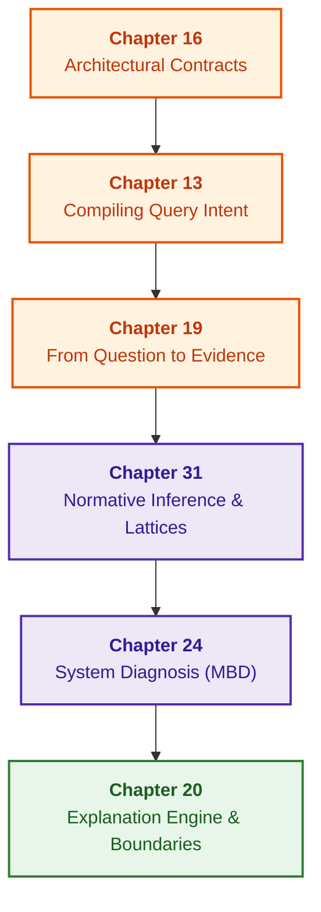

# Part IV. System Architecture, Normative Inference, Diagnosis, and Explanation

[← To Part III](part-03-knowledge-engineering-nlp.md) | [Table of Contents](README.md) | [To Part V →](part-05-verification-and-learning.md)

---

## Purpose of the Part

Construct the logical and algorithmic core of an expert system: from baseline architectural contracts and compiling variable natural language queries into deterministic logical forms to evidentiary retrieval, normative inference across predicate hierarchies, technical root-cause diagnosis, and synthesizing verifiable explanations of decisions.

---

## Overview of the Theme and Interconnection of Chapters

Chapter 16 defines baseline architectural contracts, component boundaries, and read snapshot pinning. Chapter 13 resolves the tension between user query variability and deterministic inference by compiling intent into verified logical forms. Chapter 19 decouples retrieved evidence fragments from the formal assertions they corroborate. Chapter 31 implements normative inference across predicate hierarchies and relation lattices under temporal validity constraints. Chapter 24 applies the inference engine to the classic task of technical system diagnosis, strictly segregating secondary symptoms from physical root causes via Model-Based Diagnosis (MBD). Chapter 20 concludes the reasoning cycle by synthesizing verifiable explanations and competence boundary declarations directly from the execution trace.

The deliverable of this part is a mathematically sound inference, diagnostic, and explanation kernel maintaining strictly decoupled lifecycle statuses: "architecturally specified", "query-compiled", "retrieved", "normatively derived", "diagnosed", and "explained". Formal rule verification, the knowledge testing pyramid, continual learning, and safety case synthesis are continued in [Part V](part-05-verification-and-learning.md).

---

## Chapters in This Part

### [Chapter 16. Expert System Architecture: From Formal Knowledge to Evidence-Governed Decisions](ch16-expert-systems-architecture.md)

* **Abstract:** Separation of responsibilities, pinned read contexts, and active query authorization. Positive grounding closure, independent alternative justifications, and unsupported inference cycles; decision provenance guarantees verifiable fact and rule version binding.

### [Chapter 13. Natural Language Variability vs. Determinism: Compiling Query Intent](ch13-language-variability-vs-determinism.md)

* **Abstract:** Logical form candidates, constrained decoding, and semantic invariant checking. Paraphrasing and contrastive pairs; handling unknown slots and mutually exclusive hypotheses; GLiNER, GLiNER2, and typed validators without conflating grammatical form with factual truth.

### [Chapter 19. From Question to Evidence: Retrieval, Grounding, and Assertion Verification](ch19-from-question-to-evidence.md)

* **Abstract:** Query contracts, semantic retrieval, atomic grounding, and independent assertion verification. Mandatory constraints and importance weights evaluated prior to completeness calculations; verbatim textual citations do not establish semantic roles, and missing evidence does not prove absence of a governing norm.

### [Chapter 31. Normative Inference: Predicate Hierarchies, Exceptions, and Temporal Validity](ch31-syllogistic-reasoning-and-relation-lattices.md)

* **Abstract:** Distinguishing predicate hierarchies from relation lattices; current normative revisions do not retroactively annul historical application conditions. SI physical dimensional-interval compatibility filter ($[\vec{d}_1] = [\vec{d}_2]$, $\Omega^* \neq \varnothing$) and cross-pack syllogistic chain governance rules guarding against the `0x0422 ERR_DIMENSIONAL_MISMATCH` hardware exception. The instructional Go step evaluates classes, specialization, exceptions, and competing rules; practical network examples partition operational actions by state, sequence number, and supported profile.

### [Chapter 24. System Diagnosis: Disentangling Symptoms from Root Causes under Uncertainty](ch24-system-diagnosis.md)

* **Abstract:** Fault diagnosis of complex engineering systems. Symptom-based heuristic classification versus Model-Based Diagnosis (MBD) grounded in physical structure. Minimizing the expected cost of subsequent diagnostic tests and performing abductive root-cause localization.

### [Chapter 20. Explanation Engine: Decisions, Refusals, and Competence Boundaries](ch20-explanation-engine.md)

* **Abstract:** Constructing explanations from factual execution traces; distinguishing unknown preconditions from logical incompatibilities. QuickXPlain prerequisites, subset minimality, counterfactual targets, unconstrained text filtering, and post-redaction leakage prevention.

---

## End-to-End Analysis of Architecture, Inference, and Explanation: Chapters 16, 13, 19, 31, 24, 20

This sequence integrates the complete cognitive and logical reasoning pipeline, validating transitional boundaries where local subsystem success can be mistakenly equated with global decision validity:

| Transition | Non-Automatic Deduction | Discriminative Check |
|---|---|---|
| Architecture → Decision | Rule correctness implied by the label "symbolic" | Independent alternative grounds, unsupported circularity check, snapshot mixing prevention |
| Query → Logical Form | Intent equivalence across paraphrased user queries | Slot completeness verification, mutually exclusive hypothesis separation, semantic invariance check |
| Citation → Assertion | Correct semantic role assumed from the mere presence of a number | Multiple competing figures, mismatched measurement units, empty or duplicated semantic atoms |
| Hierarchy → Norm | Automatic exception inheritance across specialized predicates | Temporal validity interval check, SI dimensional compatibility, priority arbitration of defeaters |
| Symptom → Diagnosis | Fault localization assumed from heuristic correlation | Structural model consistency (MBD), minimal hitting set calculation, diagnostic test entropy gain |
| Trace → Explanation | Correct semantic meaning assumed from entity presence | Negation alteration, omitted root cause, redacted ground leakage, valid counterfactual target |

Defects must be reproduced in an isolated, neutral simulation environment before evaluating local corrections and proceeding through independent quality gates toward production deployment.

---

[← To Part III](part-03-knowledge-engineering-nlp.md) | [Table of Contents](README.md) | [To Part V →](part-05-verification-and-learning.md)
