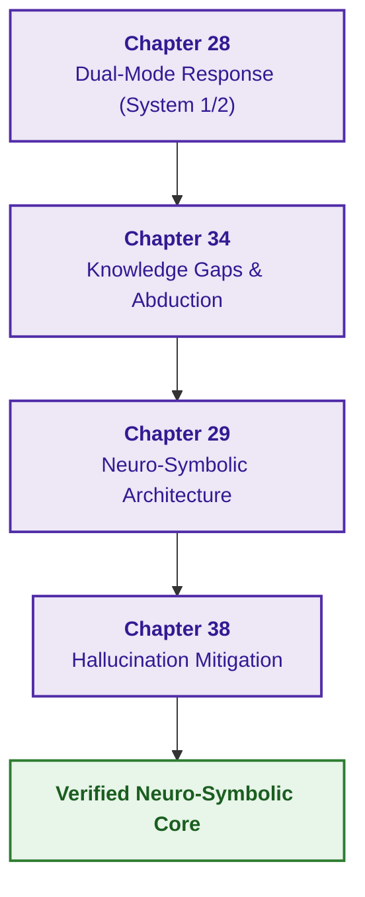

# Part VI. Neuro-Symbolic Architectures, Abduction, and Hallucination Control

[← To Part V](part-05-verification-and-learning.md) | [Table of Contents](README.md) | [To Part VII →](part-07-runtime-and-knowledge-exchange.md)

---

## Purpose of the Part

Combine the heuristic flexibility of large language models with the deterministic rigor of symbolic deduction, resolve knowledge deficit challenges via multi-hop relational search, abduction, and Socratic dialogue, and establish mathematically verifiable barriers against generative hallucinations.

---

## Overview of the Theme and Interconnection of Chapters

Chapter 28 defines dual operational modes (fast advisory heuristics of System 1 and deterministic symbolic proofs of System 2), strictly prohibiting unverified hypothesis elevation. Chapter 34 leverages inference gaps to trigger deterministic relational link discovery, Peircean abduction, and Socratic clarification dialogue with users before invoking generative models. Chapter 29 operationalizes the division of labor between local language models and a symbolic gatekeeper ("the model proposes, the symbolic engine approves") based on constrained grammars, JSON schemas, and the asymmetric "Mutator–Selector" synthesis pipeline. Chapter 38 systematizes root causes of machine hallucinations (including Boxiness Syndrome) and establishes a multi-tiered verification pipeline for answer justifications.

The deliverable of this part is a resilient neuro-symbolic cognitive core that explicitly acknowledges its own lack of competence when facing epistemic gaps, synthesizes grounded hypotheses, and safely collaborates with generative models without compromising foundational safety invariants. Implementation stack selection, hardware execution infrastructure, safe production actuation, reactive execution, and distributed epistemic SOA are explored in [Part VII](part-07-runtime-and-knowledge-exchange.md).

---

## Chapters in This Part

### [Chapter 28. Dual-Mode Expert Systems: Rigorous Deduction and Advisory Hypotheses](ch28-dual-mode-expert-systems.md)

* **Abstract:** Strict results supported by verified evidence or explicit refusals alongside distinctly flagged advisory hypotheses. Deduction, case-based reasoning, and abduction fulfill specialized roles. Dual-mode synergy of reproductive verification and combinatorial synthesis over a shared knowledge registry; 3 operational rules of dual-mode synergy and cryptographic hypothesis promotion via verification experiments. An operational refusal or specialist consultation yields a candidate knowledge artifact that cannot bypass independent verification and release governance.

### [Chapter 34. Knowledge Gaps: Relational Search, Abduction, and Socratic Clarification](ch34-deterministic-relational-analysis-abduction-and-socratic-dialogue.md)

* **Abstract:** Transforming inference impasses into identifiable missing premises. Relational search identifies candidate links, abduction synthesizes testable hypotheses, and dialogue isolates necessary user clarifications. Algebra of technical contradiction compensation and 5 authorial laws protecting combinatorial synthesis from semantic degradation. Inductively mined rules or similar historical cases cannot elevate hypothesis status without formal domain verification.

### [Chapter 29. Neuro-Symbolic Architecture: Language Models and Verifying Evidential Grounding](ch29-neuro-symbolic-architecture.md)

* **Abstract:** The division of responsibilities where "the model proposes, the symbolic engine approves": an admission gateway with document revision registries, closed vocabularies, byte-level verbatim citation verification, and token-level value validation; asymmetric "Mutator–Selector" pipeline for cross-pack synthesis (NVIDIA Jetson AGX Orin + Federated Zero-Copy Arena + 2× FPGA PYNQ-Z1) and three architectural principles of the tandem; constrained local model outputs via Ollama JSON schemas; explanation validation; advisory query reconstruction with host validation; recording refusal rationales for telemetry analysis; benchmark suites distinguishing adapted from foundation models; open research horizons.

### [Chapter 38. Machine Hallucinations and Knowledge Deficits: Evidential Control of Answers](ch38-curing-machine-hallucinations-and-knowledge-deficits.md)

* **Abstract:** Taxonomies of generative failures and multifaceted control mechanisms: structural constraints, citation verification, explicit refusal, hypothesis tagging, and defensive action gating. Fine-tuning on verified question-answer pairs and machine unlearning are examined as complementary methodologies. Instructional admission gateways do not imply complete semantic comprehension across all citations or universal eradication of hallucinations.

---

[← To Part V](part-05-verification-and-learning.md) | [Table of Contents](README.md) | [To Part VII →](part-07-runtime-and-knowledge-exchange.md)
