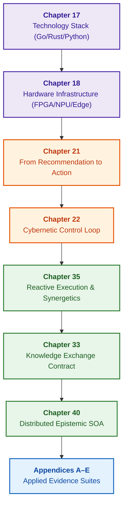

# Part VII. Implementation Stack, Hardware Infrastructure, Cybernetic Execution, and Distributed SOA

[← To Part VI](part-06-frontiers-neuro-symbolic.md) | [Table of Contents](README.md) | [To Appendices →](appendix-a-evidence-governed-framework.md)

---

## Purpose of the Part

Embody the verified expert system in real software-hardware silicon, establish safe physical actuation and closed cybernetic feedback loops, and scale the runtime into a global distributed ecosystem of enterprise intelligence. This part unites programming language and rule engine selection, heterogeneous hardware acceleration (FPGA, NPU, Edge), capability-guarded action execution, cybernetic telemetry ingestion, event-driven synergetic self-organization, secure cross-system knowledge exchange, and distributed epistemic SOA with pipelined memory.

---

## Overview of the Theme and Interconnection of Chapters

Chapter 17 establishes engineering criteria for selecting the technology stack (Go, Rust, Python, Rete/Datalog engines) tailored to deterministic latency and memory budgets. Chapter 18 deploys the execution hardware infrastructure across CPU, GPU, NPU, and FPGA targets with strict thermal and power envelopes. Chapter 21 governs the safe transition from recommendation to authorized physical or production action via capability tokens and idempotent sagas. Chapter 22 closes the cybernetic control loop by ingesting peripheral sensor streams, enforcing Ashby's Law of Requisite Variety, and detecting early signs of critical slowing down (CSD). Chapter 35 investigates reactive event-driven rule execution, truth maintenance systems (TMS), synergetic phase transitions of knowledge, and NPU-based runtimes. Chapter 33 formalizes the contract for cross-system knowledge exchange: secure rule provisioning to external agents, student model distillation, and feedback grounding through a quarantine gate. Chapter 40 serves as the architectural culmination of the monograph, synthesizing a reference prototype for an industrial epistemic SOA: thin mobile clients, semantic routing, ping-pong pipelined working sets (Active Working Sets) for complete bus latency hiding, and multi-source defeasible arbitration based on ASPIC+ formal argumentation.

The deliverable of this part is a full-scale, hardware-grounded, distributed architecture of evidence-governed AI capable of operating from autonomous edge controllers to enterprise clusters of thousands of nodes without losing provenance of facts or compromising safety guarantees. Practical engineering methodologies and autonomy application suites are consolidated in [Appendices A–E](README.md#appendices).

---

## Chapters in This Part

### [Chapter 17. Technology Stack: Selection Criteria for Tools, Programming Languages, and Rule Engines](ch17-implementation-stack.md)

* **Overview:** Engineering criteria for selecting languages (Go, Rust, Python, C++), rule engines (Rete, Datalog, Prolog), and embedded storage engines tailored to specific problem classes, latency SLOs, and memory profiles.

### [Chapter 18. Execution Infrastructure: Local Models, Hardware Accelerators, Edge, and On-Premise](ch18-execution-infrastructure.md)

* **Overview:** Hardware execution environments: placement across CPU, GPU, NPU, and FPGA targets; cold-start mitigation, compute isolation, edge thermal/power envelopes, and deterministic latency enforcement.

### [Chapter 21. From Recommendation to Action: Authorization Control and Safe Production Execution](ch21-from-recommendation-to-action.md)

* **Overview:** Action contracts, active capabilities, signed submissions, and atomic precondition guards. Idempotency verifies both target identity and parameters; uncertain side effects require explicit state reconciliation prior to compensation. Segregating orchestration roles across Temporal, OPA, and Cedar. Local plan repair preserves only still-valid approvals.

### [Chapter 22. Cybernetic Control Loop: Sensors, Edge Computing, and Feedback](ch22-cybernetics-edge-to-backend.md)

* **Overview:** Closed cybernetic control loop: Ashby's Law of Requisite Variety, streaming telemetry ingestion, signal filtering, critical slowing down (CSD) detection, and fail-safe operation during peripheral partial autonomy.

### [Chapter 35. Reactive Expert Systems: Events, Retraction, and Knowledge Adaptation](ch35-self-organizing-expert-systems-synergetics-and-npu-runtime.md)

* **Overview:** Event-driven execution, immutable baseline layer, dynamic facts, and justification retraction. Event bus and truth maintenance systems verify duplicates, causal ordering, and alternative grounds. Synergetic ontology evolution, Haken order parameters, and NPU runtimes.

### [Chapter 33. Cross-System Knowledge Exchange: Rule Provisioning, Model Teaching, and Secure Feedback](ch33-inter-system-knowledge-exchange-and-model-teaching.md)

* **Overview:** Export contracts for rules, constraints, and facts to external software consumers. Provenance, scope, permissions, cryptographic signatures, and revocation metadata accompanying transferred knowledge. Distillation of rules into external student models; feedback channels funnel candidates into quarantine rather than directly overwriting production knowledge bases.

### [Chapter 40. Distributed Architecture of Evidence-Governed Expert Systems: Epistemic SOA, Semantic Routing, Memory Hierarchies, and Multi-Source Defeasible Arbitration](ch40-distributed-epistemic-architectures-soa-and-cluster-scaling.md)

* **Overview:** Industrial reference architecture for evidence-governed expert systems. Three-tier Epistemic SOA (thin mobile clients, semantic broker, federated domain services). Bridging the memory capacity gap via Active Working Sets (AWS) and Ping-Pong pipelined double-buffering with complete latency hiding. Federated Zero-Copy Arena for cross-pack reasoning ($\mathcal{S}^*(Q)$) and 3 hardware generations of synthesis evolution (UMA + dual PYNQ-Z1 $\to$ HBM2e-EPU $\to$ coherent CXL 3.0 fabrics with digital Ising annealers). Scatter-gather pattern and multi-source defeasible aggregation (ASPIC+) for handling incomplete knowledge and regulatory collisions. Technology selection matrix and budget-guided scaling.

---

[← To Part VI](part-06-frontiers-neuro-symbolic.md) | [Table of Contents](README.md) | [To Appendices →](appendix-a-evidence-governed-framework.md)
