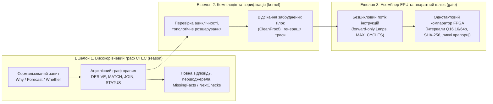

# Глава 1. Основи схемотехніки експертних систем: від запитання до доказової схеми

> **Автор:** Микола Мартинович Федчик  
> **Книга:** Схемотехніка експертних систем (СТЕС)  
> **Пов'язаний виконуваний код:** [src/model.go](src/model.go), [src/compose/compose.go](src/compose/compose.go), [src/reason/reason.go](src/reason/reason.go)

## Анотація

Ця глава відкриває підручник зі **схемотехніки експертних систем (СТЕС)** — інженерної дисципліни, яка розглядає базу правил і процедуру логічного виведення як скінченну ациклічну схему (орієнтований граф операційних вузлів і ліній стану). На початку глави вводяться базові поняття обчислювальної системи та експертної системи, після чого на конкретному інженерному прикладі показано, чому в безпеково-критичних та регламентованих застосуваннях недостатньо ні імовірнісного текстового прогнозу великих мовних моделей, ні необмеженого пошуку з поверненням у класичних логічних інтерпретаторах. Визначаються чотири основні будівельні блоки СТЕС: **лінія стану твердження**, **пакет стану**, **операційний вентиль** та **ациклічна схема правил**, а також трирівнева ієрархія їхньої реалізації — від високорівневого графа міркування через компіляцію до безциклового асемблера спеціалізованого виконавця (EPU). Глава завершується наскрізним ручним і програмно перевірюваним розрахунком елементарної схеми допуску дії за показом датчика тиску та технологічною нормою.

---

## 1. Обчислювальна система, експертна система та проблема доказовості

Перш ніж будувати схеми логічного виведення, зафіксуємо базові поняття, на які спирається весь подальший курс. Призначення цього розділу — показати, чим звичайне обчислення відрізняється від доказового рішення експертної системи та чому в інженерній практиці виникає розрив між правдоподібним текстом і перевіреним висновком.

### 1.1. Від обчислювальної системи до експертної системи

Будь-яка автоматизована обробка інформації виконується в межах певної обчислювальної системи.

<a id="def-1-1"></a>

**Означення 1.1 (Обчислювальна система).** *Обчислювальною системою* називається впорядкована сукупність формально визначених носіїв даних, допустимих операцій над ними та правил керування порядком виконання цих операцій, яка за скінченну кількість кроків перетворює вхідні дані на вихідний результат відповідно до заданої специфікації.

У звичайній арифметичній або керувальній програмі носіями даних є числа, рядки чи булеві прапорці (`true` / `false`). Коли програма обчислює суму $2 + 3 = 5$, у самому числі $5$ не потрібно зберігати історію того, з яких саме доданків і за яким правилом його одержано.

Ситуація докорінно змінюється, коли комп'ютерна система має відповісти на фахове інженерне, медичне або нормативне питання: *«Чи дозволено відкрити перепускний клапан за поточного тиску?»*, *«Чому перегрівається пристрій?»* або *«Чи призведе затримка партії комплектуючих до зриву графіка поставок?»*.

<a id="def-1-2"></a>

**Означення 1.2 (Експертна система).** *Експертною системою* називається спеціалізована обчислювальна система, яка розв'язує задачі діагностики, прогнозування, класифікації або нормативного допуску у визначеній предметній області на основі формалізованої бази знань фахівців і нормативних документів та повертає висновок разом із простежуваним обґрунтуванням [[1]](#src-1).

В інженерно відповідальних застосуваннях (енергетика, транспорт, промислова автоматика, медичні протоколи, аудит відповідності стандартам ISO 26262 [[2]](#src-2) чи IEC 61508 [[3]](#src-3)) сама лише текстова відповідь «так, дозволено» або «причина — погіршення охолодження» не має інженерної сили. Відповідь експертної системи мусить супроводжуватися **перевірюваним доказом**:

1. **Яке саме твердження** сформульовано у висновку (без підміни суб'єкта, об'єкта чи фізичної величини).
2. **На яких першоджерелах** (конкретних датчиках, актах вимірювання або байтових зрізах нормативних документів) цей висновок ґрунтується і чи не пораховано одне й те саме джерело двічі через непрямі перекази.
3. **За якими правилами і припущеннями** здійснено кожен крок переходу від вхідних даних до відповіді.
4. **Чи немає суперечності** між показами різних джерел або між загальною нормою та спеціальним винятком.
5. **Чи достатня точність і свіжість** фізичних вимірювань для застосування правила.

### 1.2. Чому відмовляють наївні підходи: дві протилежні пастки

Під час проєктування сучасних експертних систем інженер стикається з двома протилежними пастками: імовірнісною генерацією тексту без гарантій істинності та необмеженим комбінаторним пошуком у класичних логічних рушіях.

#### 1.2.1. Пастка перша: імовірнісна правдоподібність замість доказу

Авторегресивна велика мовна модель (LLM) на кожному кроці обирає наступний токен $`t_k`$ так, щоб максимізувати умовну ймовірність продовження тексту $`P(t_k \mid t_1, \dots, t_{k-1})`$ на основі статистичних кореляцій навчального корпусу. Цей механізм добре розпізнає наміри в природній мові та структурує сирий текст, але при спробі використати його як сам обчислювач висновків виникають чотири системні відмови:

- **Втрата прив'язки до першоджерела:** модель може згенерувати переконливе посилання на пункт регламенту або показ датчика, якого не існує у вхідних даних, або змішати умови з двох різних документів.
- **Інверсія семантичних ролей:** фрази *«насос охолоджує реактор»* і *«реактор охолоджує насос»* мають близькі векторні подання слів, але протилежний фізичний зміст.
- **Метрологічна сліпота на межі допуску:** якщо норма вимагає тиску не вище $`8{,}0\text{ бар}`$, а датчик показує $`7{,}9\text{ бар}`$ із похибкою $`\pm 0{,}3\text{ бар}`$ (тобто реальний тиск лежить в інтервалі $`[7{,}6;\ 8{,}2]\text{ бар}`$ і може перевищувати межу), текстова або точкова перевірка $`7{,}9 \le 8{,}0`$ помилково видасть дозвіл.
- **Ілюзія незалежного підтвердження (ефект луни):** якщо показ одного датчика `ts1` продубльовано через три інформаційні панелі, наївний агрегатор сприйме це як «три незалежні свідчення».

#### 1.2.2. Пастка друга: необмежений пошук у глибину та вибух при суперечності

Класичні символьні інтерпретатори першого покоління (наприклад, необмежений зворотний пошук із поверненням у стилі Prolog або загальні солвери задоволення обмежень) позбавлені стохастичних галюцинацій, проте в промисловому конвеєрі реального часу натрапляють на три інші перешкоди:

- **Непередбачуваний час виконання (відсутність гарантії WCET):** при коефіцієнті розгалуження $b > 1$ і глибині правил $d$ пошук із поверненням у найгіршому випадку перебирає $`\mathcal{O}(b^d)`$ станів, що неприпустимо для систем із жорстким часовим бюджетом відгуку.
- **Логічний вибух при суперечності (*ex falso quodlibet*):** у класичній двозначній логіці з двох суперечливих повідомлень $p$ і $\neg p$ формально виводиться будь-яке твердження $q$. У реальній експлуатації суперечність між двома датчиками або двома пунктами інструкцій є штатною ситуацією, яку система зобов'язана локалізувати й передати на арбітраж, а не аварійно зупинятися чи видавати довільний висновок.
- **Відсутність вбудованого обліку спільних предків:** звичайне дерево виведення без обліку множин першоджерел повторно рахує одну й ту саму посилку, якщо вона входить у дві різні гілки доказу.

Саме для подолання обох пасток у цій книзі вводиться **схемотехнічний підхід** до побудови експертних систем.

---

## 2. Предмет і базові поняття схемотехніки експертних систем (СТЕС)

У цифровій електроніці складний обчислювач не інтерпретує під час роботи текстові аксіоми булевої алгебри: інженер проєктує **схему** з елементарних логічних вентилів (`AND`, `OR`, `NOT`, мультиплексорів, компараторів), з'єднаних провідниками, якими поширюються сигнали. Така схема має скінченну глибину, передбачуваний час проходження сигналу від входів до виходу і дозволяє як пряме моделювання, так і зворотну діагностику несправностей [[4]](#src-4), [[5]](#src-5).

<a id="def-1-3"></a>

**Означення 1.3 (Схемотехніка експертних систем — СТЕС).** *Схемотехнікою експертних систем (СТЕС)* називається інженерна та прикладна математична дисципліна, яка вивчає способи подання станів тверджень, елементарні операційні вузли (вентилі) перетворення цих станів і правила їх з'єднання в скінченні ациклічні обчислювальні схеми для отримання доказових висновків, прогнозів і діагностичних рішень із вхідних вимірів, фактів, норм і припущень, а також методи компіляції таких схем у безцикловий програмний або апаратний код.

> [!NOTE]
> **Два методичні принципи викладу курсу СТЕС**
> 1. Математичну основу окремих вентилів становлять перевірені в науці конструкції: чотиризначна логіка Белнапа [[6]](#src-6), системи підтримання істинності на припущеннях (ATMS) де Клеєра [[5]](#src-5), нерекурсивний Datalog [[7]](#src-7), модельна діагностика Рейтера [[4]](#src-4) та інтервальна метрологія [[8]](#src-8). Предметом СТЕС є їхнє узгоджене поєднання в єдину схемну архітектуру, верифікація та компіляція у програмно-апаратний тракт.
> 2. Кожний розділ підручника прямо прив'язаний до універсальних виконуваних пакетів у відкритій базі [src/](src/README.md): [`reason`](src/reason/reason.go) (високорівневий граф виведення), [`compose`](src/compose/compose.go) (базові вентилі композиції), [`kernel`](src/kernel/kernel.go) та [`Kernel.lean`](src/formal/kernel/Kernel.lean) (формально верифіковане ядро допуску), [`baseline`](src/baseline/README.md) (стенд інжекції помилок), [`hardware`](src/hardware/README.md) (сайзинг слів і BRAM) та [`rtl/gate`](src/rtl/gate/README.md) (синтезований Verilog-компаратор для ПЛІС).
> *Інженерний інваріант:* кожне поняття й формула в цьому підручнику відповідає конкретній функції або апаратному модулю в каталозі `src/`, які читач може запустити й перевірити власноруч.

<a id="sec-2-1"></a>

### 2.1. Чотири будівельні елементи схеми в СТЕС

На відміну від звичайної булевої схеми, де по провіднику передається лише один біт (`0` або `1`), у схемі експертної системи кожна лінія відповідає певному змістовному твердженню і переносить структурований пакет даних.

1. **Лінія стану (провідник твердження).** Кожна лінія в схемі прив'язана до конкретного типізованого твердження (атома) вигляду `предикат(аргументи)`, наприклад `overheat(d)`, `batch_delayed(p)` або `valve_pressure_safe(v1)`. Два твердження вважаються тотожними тоді й лише тоді, коли збігаються назва предиката та впорядкований список його аргументів.
2. **Пакет стану твердження (носій сигналу на лінії).** По лінії твердження $a$ передається впорядкований запис стану за формулою (1.1):

<a id="statement-state-record"></a>

$$
S(a) = \left\langle a,\quad \beta \in \mathcal{B}_4,\quad R \subseteq \mathcal{S},\quad I = [x_{\min}, x_{\max}]_{u},\quad \mathcal{C} \right\rangle.
$$

**Формула (1.1).** Загальний запис пакета стану твердження на лінії схеми СТЕС.

Тут кожне поле виконує чітку інженерну функцію і використовується лише там, де воно потрібне задачі:
- $`a = \mathrm{pred}(x_1, \dots, x_k)`$ — формальний ідентифікатор твердження (рівень представлення змісту);
- $`\beta = (t, f) \in \mathcal{B}_4 = \{\texttt{UNKNOWN}, \texttt{FALSE}, \texttt{TRUE}, \texttt{BOTH}\}`$ — чотиризначний стан свідчень за Белнапом [[6]](#src-6), де $`t \in \{0, 1\}`$ фіксує наявність чистих підстав «за», а $`f \in \{0, 1\}`$ — наявність чистих підстав «проти»;
- $`R \subseteq \mathcal{S}`$ — скінченна множина ідентифікаторів **першоджерел** (`Root` — первинних датчиків, актів вимірювання або оригіналів документів), від яких походить поточний стан $\beta$; на відміну від першоджерела, проміжний **ретранслятор** (`Relay` — інформаційна панель SCADA, кеш, брокер повідомлень або вторинний переказ) лише передає копію вже існуючого свідчення і ніколи не додається до множини $R$ як нове незалежне джерело;
- $`I = [x_{\min}, x_{\max}]_{u}`$ — гарантований числовий інтервал фізичної величини ($`x_{\min} \le x_{\max}`$) разом із канонічним ідентифікатором одиниці вимірювання $u$ (використовується на вхідних метрологічних лініях; для суто логічних проміжних ліній не заповнюється);
- $`\mathcal{C} = (\mathrm{doc\_id}, [b_{\mathrm{start}}, b_{\mathrm{end}}), h_{\mathrm{SHA256}})`$ — криптографічний дескриптор кастодії першоджерела: ідентифікатор документа, байтові межі цитати $`0 \le b_{\mathrm{start}} < b_{\mathrm{end}}`$ та очікуваний 256-бітний геш SHA-256 [[9]](#src-9).

3. **Операційний вентиль (вузол перетворення).** Це детермінований оператор, який приймає пакети стану з однієї або кількох вхідних ліній і за фіксованим правилом обчислює пакет стану вихідної лінії. Основні класи вентилів СТЕС наведено в таблиці 1.1.
4. **Ациклічна схема правил (DAG).** Скінченний орієнтований граф без циклів, вершинами якого є лінії тверджень та операційні вентилі. Відсутність орієнтованих циклів гарантує, що схема має скінченну топологічну глибину $`D_{\max}`$ і обчислюється за фіксовану кількість кроків без зациклення.

<a id="tbl-1-1"></a>

| Клас вентиля / вузла | Позначення в коді `src/` | Входи | Вихід і виконувана дія |
|---|---|---|---|
| **Вхідний інтервальний компаратор** | `IntervalGuard`, `ObserveInterval` | інтервал виміру $`[x_{\min}, x_{\max}]_u`$, вікно норми $`[w_{\min}, w_{\max}]_{u_0}`$ | перевіряє збіг одиниць $`u = u_0`$ і взаємне розташування інтервалів; видає стан у $`\mathcal{B}_4`$ (`TRUE` при повному входженні, `FALSE` при неперетині, `BOTH`/`UNKNOWN` на межі) |
| **Вентиль злиття свідчень (`JOIN`)** | `Merge`, `store.join` | $k \ge 1$ входів одного твердження $a$ | обчислює побітове об'єднання станів Белнапа $`\beta_1 \sqcup \dots \sqcup \beta_k`$ та теоретико-множинне об'єднання першоджерел $`R_1 \cup \dots \cup R_k`$ (відсікаючи дублікати ретрансляторів і спільних гілок) |
| **Кон'юнктивний вентиль правила (`DERIVE` + `MATCH`)** | `Reason` (`forwardPropagate`), `And` | передумови $`(p_1, e_1), \dots, (p_m, e_m)`$ та припущення `Requires` | зіставляє кожну передумову $`p_j`$ з очікуваним станом $`e_j`$; якщо всі передумови підтверджено і припущення активні, виставляє очікуваний стан висновку `Then` з множиною першоджерел $`\bigcup_{j=1}^{m} R(p_j)`$ |
| **Нормативний вентиль із забороною / винятком** | `EvaluateRule`, `Gate`, `normative.Evaluate` | лінія факту $F$, лінія норми $N$, лінії винятків (дефітерів) $`D_1, \dots, D_r`$ | пропускає дозвіл лише тоді, коли факт задовольняє норму за ролями, одиницею, інтервалом і віком, а жоден виняток $`D_j`$ не активний (`Fail-Closed`) |
| **Фільтр чистого доведення (`CleanProof`)** | `ComputeClean`, `kernel.Evaluate` | граф правил зі суперечностями та атаками | виділяє підграф доведення, у якому кожна вершина підтверджена і жодна вершина піддерева не уражена суперечністю чи дефітером |

**Таблиця 1.1.** Базові операційні вентилі схемотехніки експертних систем та їхні реалізації у модулі `src/`.

---

## 3. Три рівні моделі міркування та три ешелони реалізації

Щоб схема експертної системи не перетворилася на неструктурований набір евристик, у СТЕС вводиться подвійний поділ відповідальності: **поділ самої моделі міркування на три семантичні рівні** та **поділ програмно-апаратного тракту на три ешелони виконання**.

<a id="sec-3-1"></a>

### 3.1. Три рівні моделі міркування

Кожна операція над схемою розглядається одночасно у трьох взаємопов'язаних, але роздільно перевірюваних площинах:

1. **Рівень 1 — Представлення змісту:** як формально закодовано запит користувача, атомарні твердження, правила переходу, гіпотези, предметні припущення та структуру відповіді. На цьому рівні система відрізняє твердження `cooling_degraded(d)` від `heat_gen_increased(d)`, навіть якщо їхні числові характеристики та кількість джерел однакові.
2. **Рівень 2 — Перетворення змісту:** за якими правилами з наявних тверджень утворюються нові твердження (пряме дедуктивне виведення наслідків за правилом, зворотне висування гіпотез із каталогу схем, зіставлення передумов із даними). Висока оцінка надійності джерела ніколи не створює змістовного переходу, якщо в схемі немає відповідного правила.
3. **Рівень 3 — Епістемічні характеристики та політика вибору:** як під час перетворення змісту переносяться множини першоджерел $R$, чотиризначні статуси $`\beta \in \mathcal{B}_4`$, метрологічні інтервали $I$, вік даних і криптографічна кастодія $`\mathcal{C}`$, а також за якою явно оголошеною **політикою вибору (`SELECT`)** порівнюються альтернативні гілки.

<a id="sec-3-2"></a>

### 3.2. Режими роботи зі схемою: прямий прохід і зворотна діагностика

Як і в класичній електронній схемотехніці, одна й та сама схема правил підтримує різні режими запитів залежно від того, що відомо на вході і що потрібно знайти на виході:

- **Пряма перевірка стану (`Whether`):** на вхідні клеми подаються наявні спостереження, сигнал проходить крізь вентилі до цільової лінії $a$, і на виході знімається її стан $\beta(a)$ та множина першоджерел $R(a)$.
- **Прямий умовний прогноз (`Forecast`):** вхідна умова $p$ фіксується у стані `TRUE` (наприклад, «партію комплектуючих затримано»), сигнал поширюється вперед по шарах ациклічної схеми до цільового наслідку $t$ («графік поставок зірвано»), визначаючи статус прогнозу, задіяні та оскаржені гілки й перелік невідомих вхідних фактів (`MissingFacts`), які потрібно уточнити.
- **Зворотна діагностика (`Why`):** на вихідній клемі вже спостерігається аномальний факт $`e = \texttt{TRUE}`$ (наприклад, «пристрій перегрівається»). Система за схемами можливих причин визначає, які гіпотези сумісні з наявними спостереженнями, які спростовані сильними правилами, а які контрольні точки (`NextChecks`) слід виміряти наступними для розрізнення сумісних пояснень.

### 3.3. Три ешелони реалізації: від високорівневого графа до асемблера EPU

Виконувати розбір запиту, побудову графа альтернатив і низькорівневу побітову перевірку хешів в одному монолітному циклі неефективно й небезпечно для часу відгуку. Тому в СТЕС обчислювальний тракт організовано як триступеневу ієрархію трансляції, зображену на схемі 1.2.

<a id="fig-1-2"></a>



**Схема 1.2.** Ієрархія трансляції в СТЕС: високорівневий граф міркування $\to$ компіляція та відбір чистих доведень $\to$ безцикловий асемблер EPU та апаратний шлюз допуску.

Кожен ешелон має власну зону відповідальності:
1. **Ешелон 1 (високорівневий графовий рушій, наприклад `reason`)** оперує символьними атомами, правилами переходу, альтернативними гілками та множинами першоджерел. Це «мова високого рівня» та проміжне представлення (IR) міркування.
2. **Ешелон 2 (компілятор схеми та верифікатор ядра `kernel`)** перевіряє відсутність циклів, обчислює чисте піддерево доведення (`CleanProof`) і розкладає обраний маршрут у лінійну послідовність елементарних перевірок.
3. **Ешелон 3 (регістровий виконавець EPU та апаратний шлюз `gate` на FPGA)** працює на рівні «мови асемблера»: він не висуває гіпотез і не будує графів, а за строго обмежену кількість тактів (або за один такт у комбінаційному компараторі над попередньо перевіреним знімком) звіряє інтервали, одиниці вимірювання, коди ролей, геш SHA-256 першоджерела та відсутність прапорців порушень і видає сигнал `ALLOW` (`ACCEPT`) або `DEFER` (`REFUSE`).

---

## 4. Наскрізний навчальний розрахунок елементарної схеми допуску

Щоб одразу побачити, як формула (1.1) і вентилі з таблиці 1.1 працюють у реальному обчисленні, розберемо простий інженерний приклад.

### 4.1. Постановка задачі та вхідні дані

Нехай автоматизована система керування технологічною лінією має вирішити, чи дозволено контролеру `ctrl` відкрити клапан `valve_A` на трубопроводі перегрітої пари. У системі наявні два першоджерела:

1. **Нормативний документ `N-4` (технологічний регламент):** дозволяє контролеру `ctrl` виконувати дію `open` над об'єктом `valve_A`, якщо тиск пари лежить у допустимому вікні $`W = [7{,}0;\ 8{,}0]\text{ бар}`$, а вік виміру не перевищує $`\tau_{\max} = 1000\text{ мс}`$.
2. **Показ датчика тиску `M-17`:** номінальне значення $`x = 7{,}8\text{ бар}`$ із гарантованою межею похибки датчика $`\pm 0{,}1\text{ бар}`$, тобто інтервал виміру становить $`I = [7{,}7;\ 7{,}9]\text{ бар}`$, одиниця вимірювання — `bar`, вік виміру на момент перевірки — $`\Delta t = 250\text{ мс}`$.

Ролі семантичного акту для датчика й норми наведено в таблиці 1.3.

<a id="tbl-1-3"></a>

| Поле | Запис факту `M-17` | Запис норми `N-4` | Умова збігу в схемі |
|---|---|---|---|
| Актор (`Actor`) | `ctrl` | `ctrl` | точний збіг або шаблон `*` у нормі |
| Дія (`Action`) | `open` | `open` | точний збіг або шаблон `*` у нормі |
| Об'єкт (`Target`) | `valve_A` | `valve_A` | точний збіг або шаблон `*` у нормі |
| Одиниця (`Sort`) | `bar` | `bar` | суворий збіг рядків без неявного перерахунку |
| Числовий інтервал | $`I = [7{,}7;\ 7{,}9]`$ | $`W = [7{,}0;\ 8{,}0]`$ | повне включення $I \subseteq W$ |
| Вік даних (`Age` / `MaxAge`) | $`\Delta t = 250\text{ мс}`$ | $`\tau_{\max} = 1000\text{ мс}`$ | $`0 \le \Delta t \le \tau_{\max}`$ |

**Таблиця 1.3.** Параметри вхідного факту `M-17` та дозвільної норми `N-4` у навчальному розрахунку.

### 4.2. Математичне правило інтервального та нормативного вентиля

Вхідний інтервальний компаратор порівнює інтервал виміру $`I = [x_{\min}, x_{\max}]`$ з допустимим вікном норми $`W = [w_{\min}, w_{\max}]`$ за однакових одиниць вимірювання ($`u = u_0`$) і повертає чотиризначний стан $`\beta_{\mathrm{int}} \in \mathcal{B}_4`$ за формулою (1.4):

<a id="formula-1-4"></a>

$$
\beta_{\mathrm{int}}(I, W) =
\begin{cases}
\texttt{TRUE}\ (1,0), & \text{якщо } w_{\min} \le x_{\min} \land x_{\max} \le w_{\max}, \\[4pt]
\texttt{FALSE}\ (0,1), & \text{якщо } x_{\max} < w_{\min} \lor x_{\min} > w_{\max}, \\[4pt]
\texttt{BOTH}\ (1,1), & \text{інакше (часткове перекриття межі вікна)}.
\end{cases}
$$

**Формула (1.4).** Передавальна функція інтервального компаратора (`EvaluateRule` / `IntervalGuard` у [src/model.go](src/model.go)).

Пояснення змінних та граничних умов:
- $`x_{\min}, x_{\max} \in \mathbb{R}`$ ($`x_{\min} \le x_{\max}`$) — нижня та верхня гарантовані межі виміряної величини в одиницях $u$;
- $`w_{\min}, w_{\max} \in \mathbb{R}`$ ($`w_{\min} \le w_{\max}`$) — нижня та верхня допустимі межі за нормою в одиницях $`u_0`$;
- якщо одиниці не збігаються ($`u \ne u_0`$) або порушено семантичні ролі чи вік виміру ($`\Delta t > \tau_{\max}`$), нормативний вентиль `EvaluateRule` у [src/model.go](src/model.go) виставляє стан `UNKNOWN` $(0,0)$ із відповідним кодом причини (`SORT_MISMATCH`, `ROLE_INVERSION`, `STALE`).

Далі нормативний вентиль `Gate` поєднує стан вхідного свідчення датчика $`\beta_{\mathrm{fact}}`$ зі станом перевірки норми $`\beta_{\mathrm{rule}}`$ за допомогою оператора **пріоритетної комутації** `Priority` за формулою (1.5):

<a id="formula-1-5"></a>

$$
\mathrm{Priority}(\beta_1, \beta_2) =
\begin{cases}
\texttt{FALSE}, & \text{якщо } \beta_1 = \texttt{FALSE} \lor \beta_2 = \texttt{FALSE}, \\[4pt]
\texttt{UNKNOWN}, & \text{якщо } \beta_1 \ne \texttt{FALSE} \land \beta_2 \ne \texttt{FALSE} \land (\beta_1 = \texttt{UNKNOWN} \lor \beta_2 = \texttt{UNKNOWN}), \\[4pt]
\texttt{BOTH}, & \text{якщо } \beta_1, \beta_2 \in \{\texttt{TRUE}, \texttt{BOTH}\} \land (\beta_1 = \texttt{BOTH} \lor \beta_2 = \texttt{BOTH}), \\[4pt]
\texttt{TRUE}, & \text{якщо } \beta_1 = \texttt{TRUE} \land \beta_2 = \texttt{TRUE}.
\end{cases}
$$

**Формула (1.5).** Оператор пріоритетної комутації нормативного вентиля (`Priority` у [src/model.go](src/model.go)).

Дозвіл на фізичну дію (`Permitted = true`) видається тоді й лише тоді, коли підсумковий стан дорівнює `TRUE` ($`\mathrm{Priority}(\beta_{\mathrm{fact}}, \beta_{\mathrm{rule}}) = \texttt{TRUE}`$). У всіх інших станах (`FALSE`, `UNKNOWN`, `BOTH`) дія блокується (`Permitted = false`).

### 4.3. Покроковий числовий розрахунок трьох експлуатаційних сценаріїв

Виконаємо розрахунок за формулами (1.4)–(1.5) для трьох випадків, щоб побачити, як схема реагує на штатний режим, межову похибку та застарілі дані:

1. **Сценарій А (штатний допуск):** $`I = [7{,}7;\ 7{,}9]\text{ бар}`$, $`W = [7{,}0;\ 8{,}0]\text{ бар}`$, $`\Delta t = 250\text{ мс} \le 1000\text{ мс}`$, $`\beta_{\mathrm{fact}} = \texttt{TRUE}`$.
   - Перевіряємо включення за формулою (1.4): $`7{,}0 \le 7{,}7`$ і $`7{,}9 \le 8{,}0`$. Обидві нерівності виконуються, тому $`\beta_{\mathrm{int}} = \texttt{TRUE}`$.
   - Оскільки ролі збігаються, одиниці однакові (`bar`) і $`\Delta t \le \tau_{\max}`$, маємо $`\beta_{\mathrm{rule}} = \texttt{TRUE}`$.
   - За формулою (1.5): $`\mathrm{Priority}(\texttt{TRUE}, \texttt{TRUE}) = \texttt{TRUE}`$.
   - Множина першоджерел виходу: $`R_{\mathrm{out}} = \{\texttt{M-17}\} \cup \{\texttt{N-4}\} = \{\texttt{M-17}, \texttt{N-4}\}`$.
   - **Рішення схеми:** `Permitted = true` (відкриття клапана дозволено).

2. **Сценарій Б (похибка датчика перетинає верхню межу норми):** номінал той самий $`x = 7{,}8\text{ бар}`$, але датчик має ширшу смугу невизначеності $`\pm 0{,}3\text{ бар}`$, тобто $`I = [7{,}5;\ 8{,}1]\text{ бар}`$.
   - За точковим порівнянням номіналу $`7{,}8 \le 8{,}0`$ наївна програма видала б дозвіл.
   - За формулою (1.4): нижня межа $`7{,}5 \ge 7{,}0`$ всередині вікна, але верхня межа $`8{,}1 > 8{,}0`$ виходить за вікно $`[7{,}0;\ 8{,}0]`$. Маємо часткове перекриття, тому $`\beta_{\mathrm{int}} = \texttt{BOTH}`$ та код причини `BOUNDARY`.
   - За формулою (1.5): $`\mathrm{Priority}(\texttt{TRUE}, \texttt{BOTH}) = \texttt{BOTH} \ne \texttt{TRUE}`$.
   - **Рішення схеми:** `Permitted = false` (дію заблоковано через недостатню точність виміру біля межі безпеки).

3. **Сценарій В (застарілий вимір):** інтервал $`I = [7{,}7;\ 7{,}9]\text{ бар}`$ лежить усередині вікна, але затримка доставки пакета склала $`\Delta t = 1200\text{ мс} > \tau_{\max} = 1000\text{ мс}`$.
   - Умова свіжості порушена, тому вентиль `EvaluateRule` повертає $`\beta_{\mathrm{rule}} = \texttt{UNKNOWN}`$ із причиною `STALE`.
   - За формулою (1.5): $`\mathrm{Priority}(\texttt{TRUE}, \texttt{UNKNOWN}) = \texttt{UNKNOWN}`$.
   - **Рішення схеми:** `Permitted = false` (дію заблоковано через застарілість телеметрії).

Зведені результати всіх трьох сценаріїв та ще двох граничних випадків (невідповідність одиниць `kPa` замість `bar` та інверсія ролей) подано в таблиці 1.6.

<a id="tbl-1-6"></a>

| Сценарій | Вхідний інтервал $I$ та одиниця | Вік $\Delta t$ | Стан $`\beta_{\mathrm{rule}}`$ | Вихід $`\mathrm{Priority}`$ | Причина (`Reason`) | Дозвіл (`Permitted`) |
|---|---|---|---|---|---|---|
| **А. Штатний вимір** | $`[7{,}7;\ 7{,}9]\text{ бар}`$ | $`250\text{ мс}`$ | `TRUE` | `TRUE` | — | **`true`** |
| **Б. Перетин межі** | $`[7{,}5;\ 8{,}1]\text{ бар}`$ | $`250\text{ мс}`$ | `BOTH` | `BOTH` | `BOUNDARY` | **`false`** |
| **В. Застарілі дані** | $`[7{,}7;\ 7{,}9]\text{ бар}`$ | $`1200\text{ мс}`$ | `UNKNOWN` | `UNKNOWN` | `STALE` | **`false`** |
| **Г. Інша одиниця** | $`[770;\ 790]\text{ кПа}`$ | $`250\text{ мс}`$ | `UNKNOWN` | `UNKNOWN` | `SORT_MISMATCH` | **`false`** |
| **Д. Аварійне перевищення** | $`[8{,}2;\ 8{,}5]\text{ бар}`$ | $`250\text{ мс}`$ | `FALSE` | `FALSE` | — | **`false`** |

**Таблиця 1.6.** Поведінка елементарної схеми допуску в п'яти експлуатаційних сценаріях.

### 4.4. Виконувана реалізація у модулі `src/`

Наведені формули (1.4) та (1.5) безпосередньо реалізовано у файлі [src/model.go](src/model.go) у функціях `EvaluateRule` та `Priority`:

```go
// skip-validate
func Priority(a, b State) (State, error) {
	if !a.Valid() || !b.Valid() {
		return Unknown, errors.New("priority conjunction: invalid state")
	}
	if a == False || b == False {
		return False, nil
	}
	if a == Unknown || b == Unknown {
		return Unknown, nil
	}
	if a == Both || b == Both {
		return Both, nil
	}
	return True, nil
}
```

Перевірити роботу цього вентиля на всіх $4 \times 4 = 16$ комбінаціях станів Белнапа та інтервальних сценаріях можна безпосередньо в каталозі `src/`:

```sh
cd src && go test -v -run TestAllLogicalCombinations ./compose
```

---

## 5. Питання та вправи для самоперевірки

1. **Питання 1.** Чому для представлення першоджерел у пакеті стану (1.1) використовується математична множина $`R \subseteq \mathcal{S}`$, а не числовий лічильник «кількість підтверджень»?
   - *Відповідь:* Якщо показ одного датчика `M-17` надійде двома маршрутами (наприклад, напряму і через панель оператора), числовий лічильник збільшиться до $2$, створюючи хибну видимість двох незалежних приладів. Для множини виконується тотожність ідемпотентності $`\{\texttt{M-17}\} \cup \{\texttt{M-17}\} = \{\texttt{M-17}\}`$, тому повторна передача одного першоджерела не змінює стану.
2. **Питання 2.** Датчик температури повернув інтервал $`I = [83{,}0;\ 87{,}0]^{\circ}\mathrm{C}`$, а поріг перегріву задано вікном $`W = [85{,}0;\ 1000{,}0]^{\circ}\mathrm{C}`$. Який стан поверне компаратор за формулою (1.4) і що він означає фізично?
   - *Відповідь:* Оскільки $`x_{\min} = 83{,}0 < 85{,}0`$, а $`x_{\max} = 87{,}0 \ge 85{,}0`$, інтервал виміру частково перетинає межу $`85{,}0^{\circ}\mathrm{C}`$. Формула (1.4) повертає `BOTH` (причина `BOUNDARY`). Фізично це означає, що точності приладу недостатньо, щоб гарантувати або виключити перегрів: у шлюзі безпеки це блокує дозвіл, а в діагностичній схемі трактується як `UNKNOWN` (потреба в точнішому вимірі).
3. **Питання 3.** У чому полягає принципова різниця між високорівневим графом Ешелону 1 (`reason`) та асемблером EPU Ешелону 3?
   - *Відповідь:* Ешелон 1 працює зі змістовними твердженнями, розгортає альтернативні гіпотези, виконує топологічний обхід DAG і зливає множини першоджерел у точках сходження гілок. Ешелон 3 (EPU) отримує вже скомпільовану безциклову послідовність інструкцій однієї гілки і за фіксовану кількість тактів перевіряє регістрові умови, межі, одиниці та геш SHA-256.

---

## Висновки

1. У відповідальних інженерних застосуваннях експертна система має повертати не лише текст відповіді, а й формально перевірюваний зв'язок висновку з першоджерелами, правилами, фізичними інтервалами та активними припущеннями.
2. **Схемотехніка експертних систем (СТЕС)** замінює непередбачуваний під час виконання пошук із поверненням на поширення структурованих пакетів стану крізь скінченні ациклічні схеми операційних вентилів.
3. Модель міркування в СТЕС розділяє три рівні — представлення змісту, перетворення змісту та епістемічні характеристики з політикою вибору, — а інженерна реалізація спирається на три ешелони: високорівневий граф правил, компіляцію з відсіканням забруднених гілок і безцикловий асемблер виконавця EPU.
4. Навіть одноелементна схема нормативного допуску за рахунок інтервального компаратора (1.4) та пріоритетної комутації (1.5) автоматично відсікає чотири класи помилок: вихід похибки за межу допуску, застарілість виміру, підміну одиниці вимірювання та інверсію семантичних ролей.

---

## Глосарій

| Термін | Англійський відповідник | Визначення в межах курсу СТЕС |
|---|---|---|
| **Атом (атомарне твердження)** | *Ground / Pattern Atom* | Формальний запис твердження `предикат(аргументи)`, що однозначно визначає предметний зміст лінії схеми; [§2.1](#sec-2-1), [формула (1.1)](#statement-state-record) |
| **Ациклічна схема правил** | *Rule Directed Acyclic Graph (DAG)* | Скінченний орієнтований граф без циклів, вершинами якого є лінії тверджень та операційні вентилі; гарантує скінченну глибину $`D_{\max}`$ і відсутність зациклення; [§2.1](#sec-2-1) |
| **Вентиль злиття свідчень (`JOIN`)** | *Evidence Merge / Join Gate* | Операційний вузол (`Merge`, `store.join`), що об'єднує стани Белнапа $`\beta_1 \sqcup \dots \sqcup \beta_k`$ та множини першоджерел $`R_1 \cup \dots \cup R_k`$ одного твердження без подвійного обліку; [таблиця 1.1](#tbl-1-1) |
| **Вік даних (свіжість виміру $`\Delta t`$)** | *Sample Age / Data Freshness* | Різниця часу між моментом перевірки та моментом вимірювання ($`0 \le \Delta t \le \tau_{\max}`$); перевищення порога $`\tau_{\max}`$ переводить вентиль у стан `UNKNOWN` із причиною `STALE`; [таблиця 1.3](#tbl-1-3), [таблиця 1.6](#tbl-1-6) |
| **Вхідний інтервальний компаратор** | *Input Interval Comparator* | Вузол (`IntervalGuard`, `EvaluateRule`), який перевіряє збіг фізичних одиниць $`u = u_0`$ і взаємне розташування інтервалу виміру $I$ та вікна норми $W$; [таблиця 1.1](#tbl-1-1), [формула (1.4)](#formula-1-4) |
| **Дефітер (блокувальне застереження)** | *Defeater / Rule Exception* | Спеціальна умова-виняток, за істинності якої скасовується застосовність дозвільного чи заборонного правила (підсікання) або спростовується висновок; [таблиця 1.1](#tbl-1-1) |
| **Експертна система** | *Expert System* | Обчислювальна система, що формує доказові висновки, прогнози чи діагностичні рішення у предметній області на основі формалізованої бази знань і нормативних документів; [означення 1.2](#def-1-2) |
| **Епістемічний процесор (EPU)** | *Epistemic Processing Unit* | Спеціалізований регістровий виконавець Ешелону 3, який за обмежену кількість тактів виконує безцикловий потік інструкцій перевірки станів, інтервалів, одиниць і кастодії; [схема 1.2](#fig-1-2) |
| **Зворотна діагностика (`Why`)** | *Backward Diagnostic Reasoning* | Режим роботи зі схемою, у якому за спостережуваним на виході аномальним фактом визначаються сумісні та спростовані гіпотези-причини й контрольні точки наступних перевірок (`NextChecks`); [§3.2](#sec-3-2) |
| **Інверсія семантичних ролей** | *Semantic Role Inversion* | Помилка переставлення актора (`Actor`), дії (`Action`) або об'єкта (`Target`) у твердженні; відсікається перевіркою ролей із кодом `ROLE_INVERSION`; [таблиця 1.3](#tbl-1-3) |
| **Інтервал фізичної величини ($I$)** | *Measurement Interval* | Замкнений числовий проміжок $`[x_{\min}, x_{\max}]_u`$ з явною одиницею вимірювання $u$, у межах якого гарантовано лежить істинне значення величини з урахуванням похибки приладу; [формула (1.1)](#statement-state-record), [таблиця 1.3](#tbl-1-3) |
| **Кастодія першоджерела ($`\mathcal{C}`$)** | *Source Custody Descriptor* | Криптографічний дескриптор $`(\mathrm{doc\_id}, [b_{\mathrm{start}}, b_{\mathrm{end}}), h_{\mathrm{SHA256}})`$, що прив'язує твердження або норму до конкретного байтового зрізу документа з контрольною сумою SHA-256; [формула (1.1)](#statement-state-record) |
| **Компіляція схеми (lowering)** | *Circuit Compilation / Lowering* | Перетворення високорівневого ациклічного графа правил Ешелону 1 після перевірки ациклічності та відбору чистих доведень у плоску безциклову послідовність інструкцій Ешелону 3; [схема 1.2](#fig-1-2) |
| **Кон'юнктивний вентиль правила (`DERIVE` + `MATCH`)** | *Conjunctive Rule Gate* | Вузол схеми, який зіставляє передумови правила з поточними станами ліній і за активних припущень переносить висновок разом з об'єднанням множин першоджерел передумов; [таблиця 1.1](#tbl-1-1) |
| **Лінія стану (провідник твердження)** | *Statement State Line / Wire* | З'єднання у схемі, закріплене за конкретним атомарним твердженням $a$, яким між вентилями передається пакет стану $S(a)$; [§2.1](#sec-2-1) |
| **Логічний вибух (*ex falso quodlibet*)** | *Principle of Explosion* | Властивість класичної двозначної логіки, за якої з однієї суперечності $`p \land \neg p`$ стає вивідним будь-яке довільне твердження $q$; у СТЕС блокується чотиризначною решіткою $`\mathcal{B}_4`$; [§1.2](#12-чому-відмовляють-наївні-підходи-дві-протилежні-пастки) |
| **Нормативний вентиль допуску (`Gate` / `EvaluateRule`)** | *Normative Admission Gate* | Вузол, що поєднує лінію факту та лінію норми й видає дозвіл (`Permitted = true`) лише за збігу ролей, одиниць, повного входження інтервалу $`I \subseteq W`$, свіжості даних та відсутності винятків; [таблиця 1.1](#tbl-1-1), [формула (1.5)](#formula-1-5) |
| **Обчислювальна система** | *Computing System* | Впорядкована сукупність формально визначених носіїв даних, допустимих операцій над ними та правил керування порядком їх виконання; [означення 1.1](#def-1-1) |
| **Операційний вентиль** | *Operational Gate* | Детермінований вузол схеми, який за математично визначеною передавальною функцією обчислює вихідний пакет стану з вхідних пакетів стану; [§2.1](#sec-2-1), [таблиця 1.1](#tbl-1-1) |
| **Пакет стану твердження ($S(a)$)** | *Statement State Record* | Впорядкована п'ятірка $`\langle a, \beta, R, I, \mathcal{C}\rangle`$ на лінії схеми, що поєднує зміст твердження з його епістемічними та метрологічними характеристиками; [формула (1.1)](#statement-state-record) |
| **Першоджерело (`Root`)** | *Primary Source / Root* | Первинний прилад, вимірювальний акт або незмінний документ, де свідчення виникло вперше (поле `Root` у записі спостереження); [§2.1](#sec-2-1), [формула (1.1)](#statement-state-record) |
| **Політика вибору (`SELECT`)** | *Selection Policy* | Явно відокремлений від логічної дедукції критерій порівняння сумісних альтернатив або класифікації цільового стану; [§3.1](#sec-3-1) |
| **Пріоритетна комутація (`Priority`)** | *Priority Commutation Operator* | Чотиризначний оператор нормативного вентиля з порядком домінування `FALSE` $\succ$ `UNKNOWN` $\succ$ `BOTH` $\succ$ `TRUE`; [формула (1.5)](#formula-1-5), [таблиця 1.6](#tbl-1-6) |
| **Пряма перевірка стану (`Whether`)** | *Direct State Verification* | Режим обчислення схеми, у якому за вхідними спостереженнями визначається чотиризначний стан $\beta(a)$ та множина першоджерел $R(a)$ одного цільового твердження; [§3.2](#sec-3-2) |
| **Прямий умовний прогноз (`Forecast`)** | *Forward Conditional Forecast* | Режим обчислення схеми, у якому за припущеної вхідної події $`p = \texttt{TRUE}`$ пошарово обчислюється стан наслідку $t$ та перелік невідомих вхідних даних `MissingFacts`; [§3.2](#sec-3-2) |
| **Режим безпечної відмови (`Fail-Closed`)** | *Fail-Closed Mode* | Принцип побудови вентиля, за якого будь-яка невизначеність (`UNKNOWN`), межова похибка (`BOUNDARY`), суперечність (`BOTH`) або застарілість даних (`STALE`) блокує дозвіл на дію (`Permitted = false`); [таблиця 1.1](#tbl-1-1), [таблиця 1.6](#tbl-1-6) |
| **Ретранслятор (`Relay`)** | *Relay / Forwarder* | Проміжний вузол доставлення або відображення даних (панель оператора SCADA, шлюз, вторинний звіт), який лише пересилає копію свідчення від першоджерела (поле `Relay`) і не створює незалежного підтвердження; [§2.1](#sec-2-1) |
| **Решітка Белнапа ($`\mathcal{B}_4`$)** | *Belnap Four-Valued Bilattice* | Чотиризначна множина станів свідчень $`\{\texttt{UNKNOWN}, \texttt{FALSE}, \texttt{TRUE}, \texttt{BOTH}\}`$, що роздільно кодує наявність підстав «за» ($t$) і «проти» ($f$); [формула (1.1)](#statement-state-record) |
| **Семантичні ролі (`Roles`)** | *Semantic Roles* | Впорядкована трійка `(Actor, Action, Target)`, що фіксує суб'єкт, дію та об'єкт фізичного чи нормативного акту; [таблиця 1.3](#tbl-1-3) |
| **Схемотехніка експертних систем (СТЕС)** | *Circuit Design of Expert Systems* | Інженерна та прикладна математична дисципліна побудови, аналізу, діагностики й компіляції ациклічних доказових схем виведення; [означення 1.3](#def-1-3) |
| **Фільтр чистого доведення (`CleanProof`)** | *Clean Proof Filter* | Алгоритмічний вузол Ешелону 2 (`ComputeClean`, `kernel.Evaluate`), який виділяє піддерево доведення, вільне від суперечливих предків `BOTH` та активних дефітерів; [таблиця 1.1](#tbl-1-1), [схема 1.2](#fig-1-2) |

---

## Абревіатури

| Абревіатура | Розшифрування та зміст у межах глави |
|---|---|
| **ПЛІС (FPGA)** | Field-Programmable Gate Array — програмована логічна інтегральна схема для апаратної реалізації шлюзів Ешелону 3; [схема 1.2](#fig-1-2) |
| **СТЕС** | Схемотехніка експертних систем (*Circuit Design of Expert Systems*); [означення 1.3](#def-1-3) |
| **ATMS** | Assumption-based Truth Maintenance System — система підтримання істинності на припущеннях де Клеєра [[5]](#src-5) |
| **DAG** | Directed Acyclic Graph — скінченний орієнтований ациклічний граф правил без замкнених петель зворотного зв'язку; [§2.1](#sec-2-1) |
| **EPU** | Epistemic Processing Unit — спеціалізований регістровий виконавець безциклових інструкцій перевірки допуску (Ешелон 3); [схема 1.2](#fig-1-2) |
| **GUM** | Guide to the Expression of Uncertainty in Measurement — міжнародна настанова з оцінювання невизначеності вимірювань JCGM 100:2008 [[8]](#src-8) |
| **IR** | Intermediate Representation — проміжне графове представлення схеми міркування перед компіляцією у низькорівневі інструкції; [§3.3](#33-три-ешелони-реалізації-від-високорівневого-графа-до-асемблера-epu) |
| **LLM** | Large Language Model — авторегресивна велика мовна модель; [§1.2.1](#121-пастка-перша-імовірнісна-правдоподібність-замість-доказу) |
| **SCADA** | Supervisory Control and Data Acquisition — диспетчерська система збору даних і оперативного контролю (приклад ретранслятора показів); [§2.1](#sec-2-1) |
| **SHA-256** | Secure Hash Algorithm (256-бітний криптографічний дайджест за стандартом FIPS 180-4 [[9]](#src-9)); [формула (1.1)](#statement-state-record) |
| **WCET** | Worst-Case Execution Time — гарантована верхня межа часу виконання програми в найгіршому випадку; [§1.2.2](#122-пастка-друга-необмежений-пошук-у-глибину-та-вибух-при-суперечності) |

---

## Джерела

<a id="src-1"></a>
[1] Jackson P. Introduction to Expert Systems. — 3rd ed. — Harlow : Addison-Wesley, 1998. — 560 p.

<a id="src-2"></a>
[2] ISO 26262-6:2018. Road vehicles — Functional safety — Part 6: Product development at the software level. — Geneva : ISO, 2018.

<a id="src-3"></a>
[3] IEC 61508-3:2010. Functional safety of electrical/electronic/programmable electronic safety-related systems — Part 3: Software requirements. — Geneva : IEC, 2010.

<a id="src-4"></a>
[4] Reiter R. A theory of diagnosis from first principles // Artificial Intelligence. — 1987. — Vol. 32, № 1. — P. 57–95. — DOI: [10.1016/0004-3702(87)90062-2](https://doi.org/10.1016/0004-3702(87)90062-2).

<a id="src-5"></a>
[5] de Kleer J. An assumption-based TMS // Artificial Intelligence. — 1986. — Vol. 28, № 2. — P. 127–162. — DOI: [10.1016/0004-3702(86)90080-9](https://doi.org/10.1016/0004-3702(86)90080-9).

<a id="src-6"></a>
[6] Belnap N. D. A useful four-valued logic // Modern Uses of Multiple-Valued Logic / ed. by J. M. Dunn, G. Epstein. — Dordrecht : Reidel, 1977. — P. 5–37. — DOI: [10.1007/978-94-010-1161-7_2](https://doi.org/10.1007/978-94-010-1161-7_2).

<a id="src-7"></a>
[7] Ceri S., Gottlob G., Tanca L. What you always wanted to know about Datalog (and never dared to ask) // IEEE Transactions on Knowledge and Data Engineering. — 1989. — Vol. 1, № 1. — P. 146–166. — DOI: [10.1109/69.43410](https://doi.org/10.1109/69.43410).

<a id="src-8"></a>
[8] JCGM 100:2008. Evaluation of measurement data — Guide to the expression of uncertainty in measurement (GUM). — Sèvres : BIPM, 2008.

<a id="src-9"></a>
[9] FIPS PUB 180-4. Secure Hash Standard (SHS). — Gaithersburg : NIST, 2015. — DOI: [10.6028/NIST.FIPS.180-4](https://doi.org/10.6028/NIST.FIPS.180-4).

---

[← Зміст книги](README.md) | [Глава 2. Чотиризначна логіка свідчень, інтервальні виміри та множини першоджерел →](ch02-belnap-logic-intervals-and-source-sets.md)
