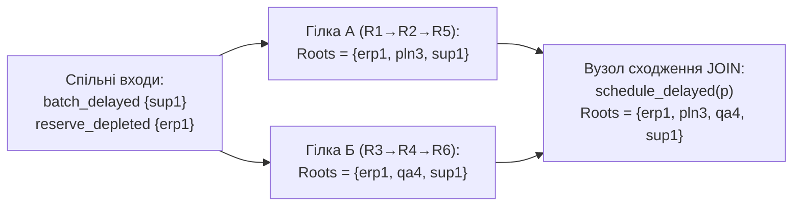

# Глава 2. Чотиризначна логіка свідчень, інтервальні виміри та множини першоджерел

> **Автор:** Микола Мартинович Федчик  
> **Книга:** Схемотехніка експертних систем (СТЕС)  
> **Пов'язаний виконуваний код:** [src/model.go](src/model.go), [src/compose/compose.go](src/compose/compose.go), [src/provenance.go](src/provenance.go), [src/provenance_sparse.go](src/provenance_sparse.go), [src/PROVENANCE-EXPERIMENTS.md](src/PROVENANCE-EXPERIMENTS.md)

## Анотація

У цій главі детально розглядаються три фундаментальні механізми, які забезпечують достовірність вхідних та проміжних ліній стану в архітектурі експертної системи: чотиризначна решітка свідчень Белнапа $`\mathcal{B}_4`$, інтервальний вхідний компаратор фізичних вимірювань та теоретико-множинний облік першоджерел у графах зі спільними предками. У реальній експлуатації експертна система постійно отримує неповні дані, неточні покази приладів поблизу меж допуску та суперечливі повідомлення від різних каналів або ретрансляторів. Показано, чому класична двозначна логіка та лінійне додавання числових ваг призводять до спотворення висновків експертної системи, і як побітове кодування станів у $`\mathcal{B}_4`$ разом із множинами першоджерел усуває ці помилки. У заключному розділі наведено чотири способи машинного подання множин першоджерел (щільні бітові маски, розріджені відсортовані списки, інтернування рівних множин та зворотний обхід від кореня) і точні результати їхнього експериментального порівняння за часом і пам'яттю.

---

## 1. Чотиризначний стан свідчень Белнапа: роздільний облік підтвердження і спростування

У класичному булевому програмуванні змінна має лише два стани: `true` ($1$) або `false` ($0$). Для замкненої математичної задачі цього достатньо, але у відкритій інженерній експертній системі невідомість і суперечність є принципово різними фізичними станами, які не можна позначати одним бітом.

### 1.1. Чому двох булевих значень недостатньо для лінії стану

Розглянемо лінію твердження `airflow_reduced(d)` («повітряний потік охолодження крізь пристрій `d` зменшився»). На практиці можливі чотири якісно відмінні ситуації:

1. Датчик повітряного потоку ще не опитано або лінія зв'язку з ним обірвана — **немає жодних даних** ні на користь зменшення потоку, ні проти нього.
2. Справний анемометр `an3` показує штатну швидкість потоку — є **чисте свідчення проти** твердження `airflow_reduced(d)`.
3. Справний анемометр `an3` фіксує падіння потоку — є **чисте свідчення за** твердження `airflow_reduced(d)`.
4. Основний анемометр `an3` показує падіння потоку, а резервний анемометр `an5` одночасно показує норму — наявні **одночасно свідчення за і проти**, тобто виникла апаратна або методична суперечність.

Якщо звести ці чотири ситуації до одного булевого біта, система неминуче припуститься однієї з двох критичних помилок: або ототожнить відсутність даних із хибністю твердження (`false`), або перезапише попередній показ останнім за часом і приховає конфлікт двох приладів.

<a id="sec-1-2"></a>

### 1.2. Двобітове кодування чотиризначної решітки $`\mathcal{B}_4`$

Щоб розрізняти всі чотири стани без втрати інформації, Н. Белнап [[1]](#src-1) запропонував подавати стан свідчень про твердження впорядкованою парою незалежних бітів:

$$
\beta = (t, f) \in \{0, 1\}^2,
$$

де:
- $`t \in \{0, 1\}`$ — біт наявності чистих підстав **«за»** істинність твердження;
- $`f \in \{0, 1\}`$ — біт наявності чистих підстав **«проти»** (за хибність твердження).

<a id="def-2-1"></a>

**Означення 2.1 (Чотиризначна решітка свідчень Белнапа $`\mathcal{B}_4`$).** *Чотиризначною решіткою свідчень Белнапа* називається множина пар бітів $`\mathcal{B}_4 = \{0, 1\}^2 = \{\texttt{Unknown}\ (0,0),\ \texttt{False}\ (0,1),\ \texttt{True}\ (1,0),\ \texttt{Both}\ (1,1)\}`$, на якій задано два часткові порядки: **порядок накопичення знань** ($`(t_1, f_1) \le_k (t_2, f_2) \iff t_1 \le t_2 \land f_1 \le f_2`$) та **порядок логічної істинності** ($`(t_1, f_1) \le_t (t_2, f_2) \iff t_1 \le t_2 \land f_1 \ge f_2`$) [[1]](#src-1), [[2]](#src-2).

У програмному ядрі [src/model.go](src/model.go) ця пара закодована одним беззнаковим цілим числом типу `State uint8` за формулою (2.1):

<a id="formula-2-1"></a>

$$
\mathrm{code}(t, f) = 2t + f \in \{0, 1, 2, 3\}.
$$

**Формула (2.1).** Побітове кодування чотиризначного стану свідчень у типі `evidence.State` ([src/model.go](src/model.go)).

Таке двійкове кодування має прямий фізичний зміст: молодший біт (`code & 1`) відповідає координаті $f$ («проти»), а другий біт (`(code >> 1) & 1`) — координаті $t$ («за»). Повну відповідність між змістовними станами, бітовими парами та константами коду зведено в таблиці 2.2.

<a id="tbl-2-2"></a>

| Константа в `src/model.go` | Числовий код | Двійковий запис `tf` | Бітова пара $(t, f)$ | Інженерна інтерпретація на лінії схеми |
|---|:---:|:---:|:---:|---|
| `Unknown` ($\bot$) | `0` | `00` | $(0, 0)$ | Дані відсутні: немає підстав ні «за», ні «проти» |
| `False` ($`\mathbf{F}`$) | `1` | `01` | $(0, 1)$ | Твердження спростовано: є чисті підстави «проти» без підстав «за» |
| `True` ($`\mathbf{T}`$) | `2` | `10` | $(1, 0)$ | Твердження підтверджено: є чисті підстави «за» без підстав «проти» |
| `Both` ($\top$) | `3` | `11` | $(1, 1)$ | Суперечність (конфлікт свідчень): одночасно наявні підстави «за» і «проти» |

**Таблиця 2.2.** Чотири стани свідчень Белнапа $`\mathcal{B}_4`$ та їхнє двійкове кодування в модулі `src/`.

---

## 2. Операції над станами свідчень: ідемпотентна решітка проти векторного додавання

Коли в схемі сходяться кілька ліній або застосовується логічне правило, вентиль мусить обчислити новий стан із вхідних станів. У чотиризначній логіці Белнапа існують два різні порядки порівняння станів і відповідні їм операції, які не можна плутати між собою.

### 2.1. Об'єднання свідчень за порядком знання ($`\sqcup`$) та помилка векторного додавання

Припустімо, що до одного й того самого атома $a$ надійшли два повідомлення зі станами $`\beta_1 = (t_1, f_1)`$ та $`\beta_2 = (t_2, f_2)`$. Оператор **об'єднання за порядком знання** (`JOIN` у [src/reason/reason.go](src/reason/reason.go) та `Merge` у [src/compose/compose.go](src/compose/compose.go)) накопичує всю інформацію з обох повідомлень за формулою (2.3):

<a id="formula-2-3"></a>

$$
\beta_1 \sqcup \beta_2 = (t_1 \lor t_2,\ f_1 \lor f_2), \qquad \mathrm{code}(\beta_1 \sqcup \beta_2) = \mathrm{code}(\beta_1)\ \texttt{|}\ \mathrm{code}(\beta_2).
$$

**Формула (2.3).** Об'єднання двох станів одного твердження за порядком накопичення знань (побітове `OR` у `src/`).

Пояснення та перевірка властивостей формули (2.3):
- якщо одне джерело дає `UNKNOWN` $(0,0)$, а друге — `TRUE` $(1,0)$, то $`(0,0) \sqcup (1,0) = (1,0) = \texttt{TRUE}`$;
- якщо одне джерело дає `TRUE` $(1,0)$, а друге — `FALSE` $(0,1)$, то $`(1,0) \sqcup (0,1) = (1,1) = \texttt{BOTH}`$ (суперечність зафіксована явно);
- для будь-якого стану $`\beta \in \mathcal{B}_4`$ виконується **закон ідемпотентності**:

$$
\beta \sqcup \beta = \beta.
$$

**Чому для об'єднання свідчень не підходить лінійне додавання векторів?**
У лінійному векторному просторі над полем дійсних чисел додавання однакових векторів дає $v + v = 2v$, а рівність $v + v = v$ виконується **лише для нульового вектора** $`v = \vec{0}`$. Якби стан підтвердження та походження обчислювався звичайним додаванням векторів, повторне надходження тієї самої телеметрії через резервний шлюз подвоювало б вектор стану ($2v \ne v$). Натомість операція решітки (2.3) у парі з теоретико-множинним об'єднанням першоджерел $`R_1 \cup R_2`$ є ідемпотентною, комутативною й асоціативною: будь-яка кількість копій одного повідомлення або будь-яка перестановка порядку їх надходження дає тотожний результат.

### 2.2. Логічна кон'юнкція істинності (`TruthAnd`), заперечення (`Not`) та пріоритетна комутація (`Priority`)

Коли вентиль поєднує **різні** умови правила $`p_1 \land p_2`$, використовується порядок істинності, у якому `FALSE` $(0,1)$ є найменшим елементом, а `TRUE` $(1,0)$ — найбільшим:
- підстава «за» кон'юнкцію $`p_1 \land p_2`$ є тоді й лише тоді, коли обидві посилки мають підставу «за» ($`t = t_1 \land t_2`$);
- підстава «проти» кон'юнкції $`p_1 \land p_2`$ виникає тоді, коли хоча б одна посилка має підставу «проти» ($`f = f_1 \lor f_2`$).

Це дає формулу (2.4) для кон'юнкції істинності `TruthAnd` та інверсії `Not` у [src/model.go](src/model.go) і [src/compose/compose.go](src/compose/compose.go):

<a id="formula-2-4"></a>

$$
\begin{aligned}
\mathrm{TruthAnd}\bigl((t_1, f_1), (t_2, f_2)\bigr) &= (t_1 \land t_2,\ f_1 \lor f_2), \\[4pt]
\mathrm{Not}\bigl((t, f)\bigr) &= (f, t).
\end{aligned}
$$

**Формула (2.4).** Кон'юнкція за порядком істинності (`TruthAnd`) та інверсія бітів свідчень (`Not`).

У побітовому кодуванні (2.1) формула (2.4) записується без розгалужень однією бітовою операцією:
- `TruthAnd(a, b) = (a & b & 2) | ((a | b) & 1)`;
- `Not(s) = ((s & 1) << 1) | ((s & 2) >> 1)` (міняє місцями `True` і `False`, залишаючи `Unknown` та `Both` нерухомими точками!).

Звернемо увагу на принципову інженерну відмінність між `TruthAnd` (2.4) і нормативною пріоритетною комутацією `Priority` (1.5) на парі входів $`(\texttt{UNKNOWN}, \texttt{BOTH})`$, тобто $(0,0)$ і $(1,1)$:
- за формулою (2.4): $`\mathrm{TruthAnd}\bigl((0,0), (1,1)\bigr) = (0 \land 1,\ 0 \lor 1) = (0,1) = \texttt{FALSE}`$, бо в стані `BOTH` вже присутній біт спростування $`f_2 = 1`$;
- за формулою (1.5): $`\mathrm{Priority}(\texttt{UNKNOWN}, \texttt{BOTH}) = \texttt{UNKNOWN}`$, бо в нормативному вентилі допуску відсутність обов'язкової перевірки (`UNKNOWN`) фіксується раніше за межовий конфлікт (`BOTH`), якщо немає чистої заборони `FALSE`.

Повні таблиці істинності всіх трьох бінарних операторів (`JOIN`, `TruthAnd`, `Priority`) наведено в таблиці 2.5 і перевіряються в `TestAllLogicalCombinations` ([src/compose/compose_test.go](src/compose/compose_test.go)).

<a id="tbl-2-5"></a>

| Вхід $`\beta_1 \setminus \beta_2`$ | `JOIN` ($`\beta_1 \sqcup \beta_2`$): `U, F, T, B` | `TruthAnd`: `U, F, T, B` | `Priority`: `U, F, T, B` |
|---|---|---|---|
| **`Unknown` (`U`)** | `U, F, T, B` | `U, F, U, F` | `U, F, U, U` |
| **`False` (`F`)** | `F, F, B, B` | `F, F, F, F` | `F, F, F, F` |
| **`True` (`T`)** | `T, B, T, B` | `U, F, T, B` | `U, F, T, B` |
| **`Both` (`B`)** | `B, B, B, B` | `F, F, B, B` | `U, F, B, B` |

**Таблиця 2.5.** Повні таблиці переходів для операторів `JOIN` ($\sqcup$), `TruthAnd` та `Priority` на множині станів `{U, F, T, B}`.

---

## 3. Вхідний інтервальний компаратор і семантика межової невизначеності

Коли вхідна лінія схеми отримує фізичний вимір від датчика (температуру, тиск, струм), його перетворення на чотиризначний стан здійснюється інтервальним компаратором `IntervalGuard` ([src/compose/compose.go](src/compose/compose.go)).

### 3.1. Дві ролі стану `BOTH` при перетині межі інтервалу

За формулою (1.4), якщо гарантований інтервал виміру $`I = [x_{\min}, x_{\max}]`$ частково перетинає межу вікна $`W = [w_{\min}, w_{\max}]`$, компаратор `IntervalGuard` повертає стан `BOTH`. Причина такого вибору у низькорівневому компараторі полягає в тому, що частина можливих значень величини лежить усередині вікна ($t = 1$), а інша частина — поза ним ($f = 1$).

Проте під час передавання цього результату у високорівневу схему виведення (`reason`) необхідно чітко розрізняти:
- **справжню суперечність двох незалежних джерел** (коли датчик `ts1` дав $`[90; 94]^{\circ}\mathrm{C} \subseteq [85; 1000]^{\circ}\mathrm{C} \Rightarrow \texttt{TRUE}`$, а другий датчик дав $`[70; 75]^{\circ}\mathrm{C} \Rightarrow \texttt{FALSE}`$, і їхнє злиття за формулою (2.3) дало $`\texttt{TRUE} \sqcup \texttt{FALSE} = \texttt{BOTH}`$);
- **недостатню роздільну здатність одного приладу біля порога** (коли інфрачервоний термометр `ir2` показав $`[83; 89]^{\circ}\mathrm{C}`$ відносно порога $`85^{\circ}\mathrm{C}`$).

Якщо трактувати межовий показ $`[83; 89]^{\circ}\mathrm{C}`$ одного неточного приладу як логічну суперечність `BOTH`, він за правилом поширення конфліктів помилково оголосить оскарженим увесь висновок, хоча прилад просто не має достатньої точності. Тому у вхідному адаптері схеми міркування `ObserveInterval` ([src/reason/reason.go](src/reason/reason.go)) застосовується явне правило перетворення (2.6):

<a id="formula-2-6"></a>

$$
\beta_{\mathrm{obs}}(I, W) =
\begin{cases}
\texttt{UNKNOWN}, & \text{якщо } \beta_{\mathrm{int}}(I, W) = \texttt{BOTH}, \\[4pt]
\beta_{\mathrm{int}}(I, W), & \text{інакше}.
\end{cases}
$$

**Формула (2.6).** Адаптація межового перекриття інтервалу у вхідному вузлі `ObserveInterval` для діагностичних схем.

Числовий приклад (сценарій `S8` першого досліду в [src/reason/reason_test.go](src/reason/reason_test.go)):
- вбудований термістор `ts1` дає інтервал $`[90; 94]^{\circ}\mathrm{C}`$ відносно вікна перегріву $`[85; 1000]^{\circ}\mathrm{C}`$: повне входження $`\Rightarrow \beta_{\mathrm{obs}}(\texttt{ts1}) = \texttt{TRUE}`$;
- ручний термометр `ir2` дає $`[83; 89]^{\circ}\mathrm{C}`$: часткове перекриття межі $`85^{\circ}\mathrm{C}`$ $`\Rightarrow \beta_{\mathrm{int}}(\texttt{ir2}) = \texttt{BOTH}`$, що за формулою (2.6) перетворюється на $`\beta_{\mathrm{obs}}(\texttt{ir2}) = \texttt{UNKNOWN}`$;
- при злитті `JOIN` за формулою (2.3) отримуємо $`\texttt{TRUE} \sqcup \texttt{UNKNOWN} = \texttt{TRUE}`$ лише за першоджерелом `{"ts1"}`, а гіпотеза похибки термістора `measurement_error(ts1, d)` залишається відкритою (`UNKNOWN`), бо другий прилад `ir2` не дав достатньо точного незалежного спростування.

---

## 4. Облік першоджерел у графах зі спільними предками та оптимізація подання множин

У реальних схемах експертних систем один і той самий вхідний факт (наприклад, повідомлення постачальника `sup1` або показ датчика тиску `s1`) часто розгалужується на кілька паралельних правил, які нижче за схемою знову сходяться в одному висновку. У цифровій схемотехніці така топологія називається **розгалуженням із повторним сходженням (reconvergent fan-out)**.

<a id="sec-4-1"></a>

### 4.1. Проблема подвійного обліку при повторному сходженні гілок

<a id="def-2-2"></a>

**Означення 2.2 (Розгалуження із повторним сходженням — Reconvergent Fan-out).** *Розгалуженням із повторним сходженням* в орієнтованій ациклічній схемі називається конфігурація шляхів, за якої принаймні два різні орієнтовані шляхи, що починаються в одній спільній вершині-предку $u$, повторно перетинаються у спільній вершині-нащадку $v$ нижче за течією схеми.

Розглянемо типовий ромбоподібний фрагмент схеми, зображений на схемі 2.7: вхідне першоджерело `sup1` подається одночасно на правило `R1` (гілка зупинки складання) і на правило `R3` (гілка втрати вікна контролю якості), після чого обидві гілки сходяться у фінальному висновку `schedule_delayed(p)`.

<a id="fig-2-7"></a>



**Схема 2.7.** Проходження спільних першоджерел `sup1` та `erp1` крізь дві паралельні гілки виведення та їхня дедуплікація у вузлі сходження.

Якби вузол сходження просто конкатенував списки джерел обох гілок або підсумовував їхні числові ваги, першоджерела `sup1` та `erp1` були б враховані двічі (шість записів замість чотирьох унікальних першоджерел).

Щоб виключити подвійний облік на довільному ациклічному графі, множина активних першоджерел $R(v)$ кожної вершини $v$ визначається рекурсивно за топологічним порядком DAG за формулою (2.8):

<a id="formula-2-8"></a>

$$
R(v) =
\begin{cases}
\{s_0\}, & \text{якщо } v \text{ — вхідне спостереження від першоджерела } s_0 \in \mathcal{S}, \\[6pt]
\bigcup\limits_{u \in \mathrm{ActivePred}(v)} R(u), & \text{якщо } v \text{ — внутрішній вентиль схеми}.
\end{cases}
$$

**Формула (2.8).** Закон перенесення множини активних першоджерел $R(v)$ у вершині ациклічної схеми.

Тут $`\mathrm{ActivePred}(v)`$ — множина активних вхідних ліній вентиля $v$, які беруть участь у формуванні його поточного стану. Оскільки операція об'єднання множин $\cup$ ідемпотентна ($A \cup A = A$), для схеми 2.7 одержуємо:

$$
R(\texttt{schedule\_delayed}) = \{\texttt{erp1}, \texttt{pln3}, \texttt{sup1}\} \cup \{\texttt{erp1}, \texttt{qa4}, \texttt{sup1}\} = \{\texttt{erp1}, \texttt{pln3}, \texttt{qa4}, \texttt{sup1}\}.
$$

Якщо над множиною унікальних першоджерел $R(v)$ додатково обчислюється агрегований модельний показник надійності $w(R(v))$ за індивідуальними вагами джерел $`w_s \in (0, 1]`$, у модулі [src/provenance.go](src/provenance.go) він обчислюється **лише один раз після дедуплікації множини $R(v)$** за формулою (2.9):

<a id="formula-2-9"></a>

$$
D(R(v)) = \sum_{s \in R(v)} \frac{1 - w_s}{w_s}, \qquad w\bigl(R(v)\bigr) = \frac{1}{1 + D(R(v))}.
$$

**Формула (2.9).** Обчислення модельного рейтингу над уже дедуплікованою множиною першоджерел $R(v)$ ([src/provenance.go](src/provenance.go)).

Наголосимо на межі застосовності формули (2.9): величина $w(R(v))$ є лише монотонною числовою характеристикою набору задіяних джерел, а не ймовірністю істинності висновку, і сама по собі не створює жодного логічного переходу без правила.

<a id="sec-4-2"></a>

### 4.2. Чотири машинні подання множин першоджерел та їхнє експериментальне порівняння

Коли кількість першоджерел у базі знань сягає сотень або тисяч ($`|\mathcal{S}| \in \{256, 1024, 4096\}`$), виникає практичне інженерне питання: **як саме зберігати та об'єднувати множини $R(v)$ у пам'яті комп'ютера?**

У пакетах [src/provenance.go](src/provenance.go) та [src/provenance_sparse.go](src/provenance_sparse.go) реалізовано й порівняно чотири алгоритмічно еквівалентні подання, які дають побітово однакову підсумкову множину джерел кореня:

1. **Щільна бітова маска (`Dense`):** кожному вузлу $v$ виділяється масив 64-бітних слів `[]uint64` довжиною $`\lceil |\mathcal{S}| / 64 \rceil`$, а об'єднання виконується побітовим `OR` слів.
2. **Розріджений відсортований список (`Sparse`, `unionWalk` у [src/provenance_sparse.go](src/provenance_sparse.go)):** кожному вузлу зберігається відсортований зріз 32-бітних індексів активних джерел `[]uint32`. Якщо під час злиття один із входів уже містить усі елементи другого (`count == len(a)` або `count == len(b)`), новий масив не виділяється взагалі — повертається посилання на наявний незмінний зріз!
3. **Розріджений список з інтернуванням (`Interned`):** доповнює `Sparse` хеш-таблицею FNV-1a в межах одного обчислення, щоб вузли з однаковими множинами джерел спільно використовували один і той самий масив `[]uint32`.
4. **Зворотний обхід активних предків від кореня (`Root-Trace`):** якщо користувачеві потрібні першоджерела лише фінального висновку (кореня схеми), проміжні множини $R(v)$ не матеріалізуються у кожному вузлі: спочатку прямим проходом обчислюються 2-бітні стани $`\beta(v) \in \mathcal{B}_4`$, після чого один зворотний обхід за активованими входами збирає першоджерела кореня в одну бітову маску.

Виміряні результати для $`|\mathcal{S}| = 4096`$ джерел на чотирьох характерних топологіях схем (із протоколу [src/PROVENANCE-EXPERIMENTS.md](src/PROVENANCE-EXPERIMENTS.md), $2304$ запуски побудови) зведено в таблиці 2.10.

<a id="tbl-2-10"></a>

| Топологія схеми ($`\lvert\mathcal{S}\rvert = 4096`$) | Час побудови, мкс (`Dense / Sparse / Interned / Root-Trace`) | Робоча пам'ять масивів, байти (`Dense / Sparse / Interned / Root-Trace`) | Інженерний висновок із вимірювання |
|---|---|---|---|
| **1. Вузька вибрана гілка** | `595,5 / 413,6 / 526,5 /` **`28,5`** | `4 202 647 /` **`319 931`** `/ 844 171 /` **`82 574`** | `Sparse` зменшує робочу пам'ять вузлів на **92,39%** відносно `Dense`; `Root-Trace` у **20,9 раза** швидший за `Dense` |
| **2. Щільні перекриття** | `1672,9 / 8060,4 / 11360,7 /` **`138,4`** | **`4 396 561`** `/ 4 539 005 / 5 212 461 /` **`86 354`** | Коли кожен вузол тягне майже всі $4096$ джерел, побітова маска `Dense` у **4,8 раза** швидша за злиття списків `Sparse` |
| **3. Повторювані однакові підтримки** | `1603,2 / 7801,9 / 10807,7 /` **`130,9`** | `4 396 561 / 4 490 345 /` **`3 099 417`** `/` **`86 354`** | `Interned` економить **30,98%** пам'яті відносно `Sparse`, але програє на **38,5%** за часом через хешування та порівняння масивів |
| **4. Збалансована кон'юнкція** | `1007,8 / 782,0 / 995,0 /` **`114,1`** | `4 202 647 /` **`434 303`** `/ 958 543 /` **`82 574`** | На дереві з малим розміром підмножин у листях `Sparse` виграє в `Dense` і за пам'яттю (у **9,7 раза**), і за часом |

**Таблиця 2.10.** Експериментальне порівняння чотирьох подань множин першоджерел для графів із $4096$ джерелами ([src/PROVENANCE-EXPERIMENTS.md](src/PROVENANCE-EXPERIMENTS.md)).

Ці вимірювання дають чітке інженерне правило вибору структури даних без вгадування:
1. Якщо від схеми потрібні першоджерела **лише кінцевого висновку**, найкращою стратегією є **`Root-Trace`** (прямий прохід 2-бітних станів Белнапа + один зворотний збір джерел по активних гілках).
2. Якщо потрібна **повна покрокова траса першоджерел у кожному проміжному вузлі** (як у діагностичному рушії `reason`), то при малій частці активних джерел на вузол ($`|R(v)| \ll |\mathcal{S}|`$) слід використовувати **`Sparse`**, а при малих універсумах ($`|\mathcal{S}| \le 256`$) або щільних підмножинах — бітову маску **`Dense`**.

Відтворити ці тести та перевірити побітову збіжність усіх чотирьох подань можна командою:

```sh
cd src && go test -v -run TestProvenance ./
```

---

## 5. Питання та вправи для самоперевірки

1. **Питання 1.** Нехай на вентиль злиття `JOIN` надходять три спостереження одного атома: $`\beta_1 = \texttt{UNKNOWN}`$ від `s1`, $`\beta_2 = \texttt{TRUE}`$ від `s2` (передане двічі: напряму і через ретранслятор `r1`) та $`\beta_3 = \texttt{FALSE}`$ від `s3`. Яким буде вихідний стан Белнапа та множина першоджерел?
   - *Відповідь:* За формулою (2.3) стан дорівнює $`(0,0) \sqcup (1,0) \sqcup (1,0) \sqcup (0,1) = (1,1) = \texttt{BOTH}`$ (код `3`). Першоджерело для `UNKNOWN` не додається, а повтор `s2` через ретранслятор `r1` дедуплікується множиною: $`R = \{\texttt{s2}\} \cup \{\texttt{s2}\} \cup \{\texttt{s3}\} = \{\texttt{s2}, \texttt{s3}\}`$.
2. **Питання 2.** Обчисліть $`\mathrm{TruthAnd}(\texttt{TRUE}, \texttt{BOTH})`$ та $`\mathrm{Not}(\texttt{BOTH})`$ за формулою (2.4). Поясніть результат змістовно.
   - *Відповідь:* Оскільки $`\texttt{TRUE} = (1,0)`$, а $`\texttt{BOTH} = (1,1)`$, маємо $`\mathrm{TruthAnd}\bigl((1,0), (1,1)\bigr) = (1 \land 1,\ 0 \lor 1) = (1,1) = \texttt{BOTH}`$: кон'юнкція чистої істини з суперечливою посилкою має як підставу «за», так і підставу «проти». Для заперечення: $`\mathrm{Not}\bigl((1,1)\bigr) = (1,1) = \texttt{BOTH}`$, бо заперечення суперечливого твердження залишається суперечливим.
3. **Питання 3.** Чому за даними таблиці 2.10 глобальне інтернування рівних множин (`Interned`) виявилося повільнішим за звичайний розріджений список (`Sparse`), хоча зменшило обсяг масивів на повторюваних підтримках на $`30{,}98\%`$?
   - *Відповідь:* Для перевірки того, чи вже існує та сама множина в пулі інтернування, алгоритм мусить на кожному об'єднанні обчислити 64-бітний геш FNV-1a по всіх елементах і у випадку колізії або збігу гешу виконати поелементне порівняння масивів. Ці обчислювальні витрати перевищують вартість лінійного проходу `unionWalk` у короткоживучому запиті.

---

## Висновки

1. Чотиризначна решітка Белнапа $`\mathcal{B}_4`$ з двобітовим кодуванням $`\mathrm{code}(t,f) = 2t + f`$ відокремлює відсутність даних (`Unknown`, `00`) від чистого спростування (`False`, `01`), чистого підтвердження (`True`, `10`) і суперечності джерел (`Both`, `11`).
2. Ідемпотентність операції об'єднання знань $`\beta_1 \sqcup \beta_2`$ та об'єднання множин першоджерел $`R_1 \cup R_2`$ гарантує захист від штучного підсилення висновку дублікатами ретрансляторів і спільними предками у збіжних гілках DAG, чого не може забезпечити лінійне додавання векторів.
3. Пряме порівняння чотирьох способів подання множин першоджерел показало, що для задач, де потрібне лише походження фінального висновку, найефективнішим є двопрохідний метод `Root-Trace`, а для повної траси проміжних станів на розріджених графах — відсортовані зрізи `Sparse` з повторним використанням підмножин.

---

## Глосарій

| Термін | Англійський відповідник | Визначення в межах курсу СТЕС |
|---|---|---|
| **Адаптер межового інтервалу (`ObserveInterval`)** | *Boundary Interval Adapter* | Вхідний вузол діагностичної схеми, що перетворює межовий стан `BOTH` інтервального компаратора на `UNKNOWN`, відокремлюючи недостатню точність одного приладу від суперечності двох джерел; [формула (2.6)](#formula-2-6) |
| **Активні передумови вузла ($`\mathrm{ActivePred}(v)`$)** | *Active Predecessors* | Підмножина вхідних ліній вентиля $v$, які беруть участь у формуванні його поточного стану та передають йому свої множини першоджерел; [формула (2.8)](#formula-2-8) |
| **Зворотний обхід від кореня (`Root-Trace`)** | *Root-Trace Provenance* | Двопрохідна стратегія обчислення походження, де спочатку прямим проходом обчислюються 2-бітні стани Белнапа, а потім один зворотний обхід від кореня збирає бітову маску активних першоджерел без матеріалізації проміжних множин; [§4.2](#sec-4-2), [таблиця 2.10](#tbl-2-10) |
| **Ідемпотентність** | *Idempotence* | Алгебраїчна властивість операції $x \circ x = x$ ($`\beta \sqcup \beta = \beta`$, $R \cup R = R$), за якої повторне подання копії свідчення або спільного предка не змінює результату; [формула (2.3)](#formula-2-3), [формула (2.8)](#formula-2-8) |
| **Інверсія свідчень (`Not`)** | *Evidence Negation* | Унарний оператор $`\mathrm{Not}(t, f) = (f, t)`$, який міняє місцями координати «за» і «проти», залишаючи стани `Unknown` $(0,0)$ та `Both` $(1,1)$ нерухомими точками; [формула (2.4)](#formula-2-4) |
| **Інтернування множин походження (`Interned`)** | *Interned Sparse Provenance* | Розріджене подання множин першоджерел із глобальним усуненням структурно рівних масивів `[]uint32` за допомогою хеш-таблиці FNV-1a та поелементної перевірки рівності; [§4.2](#sec-4-2), [таблиця 2.10](#tbl-2-10) |
| **Кон'юнкція за порядком істинності (`TruthAnd`)** | *Truth-Order Conjunction* | Бінарний оператор $`(t_1 \land t_2,\ f_1 \lor f_2)`$, у якому підстава «за» вимагає обох посилок, а підстава «проти» виникає за наявності спростування хоча б однієї посилки; [формула (2.4)](#formula-2-4), [таблиця 2.5](#tbl-2-5) |
| **Модельний рейтинг джерел ($w(R)$)** | *Model Source Credibility Rating* | Монотонна числова згортка $`1 / (1 + \sum_{s \in R} (1 - w_s)/w_s)`$, обчислена один раз над дедуплікованою множиною першоджерел $R$; не є ймовірністю істинності; [формула (2.9)](#formula-2-9) |
| **Об'єднання за порядком знання (`JOIN` / `Merge`)** | *Knowledge Join ($`\sqcup`$)* | Побітова диз'юнкція координат свідчень $`(t_1 \lor t_2,\ f_1 \lor f_2)`$ одного твердження з різних джерел; [формула (2.3)](#formula-2-3), [таблиця 2.5](#tbl-2-5) |
| **Повторне сходження гілок** | *Reconvergent Fan-out* | Топологія ациклічної схеми, де шляхи, що розійшлися з однієї спільної вершини-предка, знову зустрічаються у спільному вентилі нижче за течією; [означення 2.2](#def-2-2), [схема 2.7](#fig-2-7) |
| **Порядок накопичення знань ($`\le_k`$)** | *Knowledge / Information Order* | Частковий порядок на $`\mathcal{B}_4`$, за якого стан зростає від `Unknown` $(0,0)$ до `Both` $(1,1)$ у міру додавання свідчень «за» та «проти»; [означення 2.1](#def-2-1) |
| **Порядок логічної істинності ($`\le_t`$)** | *Truth Order* | Частковий порядок на $`\mathcal{B}_4`$, за якого `False` $(0,1)$ є найменшим елементом, а `True` $(1,0)$ — найбільшим; [означення 2.1](#def-2-1), [формула (2.4)](#formula-2-4) |
| **Пріоритетна комутація (`Priority`)** | *Priority Commutation* | Оператор нормативного вентиля з порядком домінування `False` $\succ$ `Unknown` $\succ$ `Both` $\succ$ `True` (відрізняється від `TruthAnd` на парі $`(\texttt{Unknown}, \texttt{Both})`$, де повертає `Unknown`); [таблиця 2.5](#tbl-2-5) |
| **Решітка Белнапа ($`\mathcal{B}_4`$)** | *Belnap Four-Valued Bilattice* | Чотиризначна алгебра станів свідчень `{Unknown, False, True, Both}` із двобітовим кодуванням $`\mathrm{code}(t,f) = 2t + f`$; [означення 2.1](#def-2-1), [формула (2.1)](#formula-2-1), [таблиця 2.2](#tbl-2-2) |
| **Розріджене подання походження (`Sparse`)** | *Sparse Provenance Slice* | Подання множини першоджерел вузла відсортованим масивом 32-бітних індексів `[]uint32` без дублікатів із повторним використанням незмінного підмасиву при включенні; [§4.2](#sec-4-2), [таблиця 2.10](#tbl-2-10) |
| **Стан відсутності даних (`Unknown`, $\bot$)** | *Unknown / Uninformed State* | Елемент $(0,0)$ решітки $`\mathcal{B}_4`$ (код `0`), що позначає відсутність чистих свідчень як «за», так і «проти»; [таблиця 2.2](#tbl-2-2) |
| **Стан підтвердження (`True`, $`\mathbf{T}`$)** | *True / Supported State* | Елемент $(1,0)$ решітки $`\mathcal{B}_4`$ (код `2`), що позначає наявність чистих підстав «за» за відсутності підстав «проти»; [таблиця 2.2](#tbl-2-2) |
| **Стан спростування (`False`, $`\mathbf{F}`$)** | *False / Refuted State* | Елемент $(0,1)$ решітки $`\mathcal{B}_4`$ (код `1`), що позначає наявність чистих підстав «проти» за відсутності підстав «за»; [таблиця 2.2](#tbl-2-2) |
| **Стан суперечності (`Both`, $\top$)** | *Both / Conflicted State* | Елемент $(1,1)$ решітки $`\mathcal{B}_4`$ (код `3`), що фіксує одночасну наявність підстав «за» і «проти» (конфлікт джерел або перетин межі інтервалу); [таблиця 2.2](#tbl-2-2) |
| **Щільна бітова маска походження (`Dense`)** | *Dense Bitmask Provenance* | Подання множини першоджерел вузла масивом 64-бітних слів `[]uint64` довжиною $`\lceil\lvert\mathcal{S}\rvert / 64\rceil`$, де об'єднання виконується побітовим `OR`; [§4.2](#sec-4-2), [таблиця 2.10](#tbl-2-10) |

---

## Абревіатури

| Абревіатура | Розшифрування та зміст у межах глави |
|---|---|
| **ATMS** | Assumption-based Truth Maintenance System — система підтримання істинності на припущеннях [[4]](#src-4); [§4.1](#sec-4-1) |
| **DAG** | Directed Acyclic Graph — скінченний орієнтований ациклічний граф схеми правил; [§4.1](#sec-4-1) |
| **ERP** | Enterprise Resource Planning — корпоративна система обліку ресурсів (першоджерело складських даних `erp1` у прикладі схеми 2.7); [схема 2.7](#fig-2-7) |
| **FNV-1a** | Fowler–Noll–Vo (варіант 1a) — швидка некриптографічна 64-бітна хеш-функція, використана для індексації масивів першоджерел у режимі `Interned`; [§4.2](#sec-4-2) |
| **OR** | Побітова логічна диз'юнкція (`|`), якою реалізується об'єднання станів Белнапа та бітових масок першоджерел; [формула (2.3)](#formula-2-3) |
| **SPPC** | Set-Preserving Provenance Calculus — теоретико-множинний облік першоджерел без подвійного рахунку при повторному сходженні гілок; [формула (2.8)](#formula-2-8) |

---

## Джерела

<a id="src-1"></a>
[1] Belnap N. D. A useful four-valued logic // Modern Uses of Multiple-Valued Logic / ed. by J. M. Dunn, G. Epstein. — Dordrecht : Reidel, 1977. — P. 5–37. — DOI: [10.1007/978-94-010-1161-7_2](https://doi.org/10.1007/978-94-010-1161-7_2).

<a id="src-2"></a>
[2] Fitting M. Bilattices and the semantics of logic programming // The Journal of Logic Programming. — 1991. — Vol. 11, № 2. — P. 91–116. — DOI: [10.1016/0743-1066(91)90014-G](https://doi.org/10.1016/0743-1066(91)90014-G).

<a id="src-3"></a>
[3] Green T. J., Karvounarakis G., Tannen V. Provenance semirings // Proceedings of the 26th ACM SIGMOD-SIGACT-SIGART Symposium on Principles of Database Systems (PODS '07). — 2007. — P. 31–40. — DOI: [10.1145/1265530.1265535](https://doi.org/10.1145/1265530.1265535).

<a id="src-4"></a>
[4] de Kleer J. An assumption-based TMS // Artificial Intelligence. — 1986. — Vol. 28, № 2. — P. 127–162. — DOI: [10.1016/0004-3702(86)90080-9](https://doi.org/10.1016/0004-3702(86)90080-9).

---

[← Глава 1. Основи схемотехніки експертних систем](ch01-foundations-and-circuit-architecture.md) | [Зміст книги](README.md) | [Глава 3. Високорівневі схеми виведення →](ch03-forward-forecast-and-backward-diagnosis.md)
