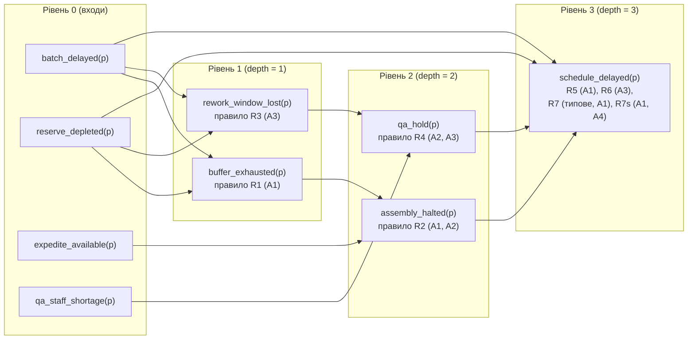

# Глава 3. Високорівневі схеми виведення: прямий прогноз наслідків і зворотна діагностика

> **Автор:** Микола Мартинович Федчик  
> **Книга:** Схемотехніка експертних систем (СТЕС)  
> **Пов'язаний виконуваний код:** [src/reason/reason.go](src/reason/reason.go), [src/reason/scenarios.go](src/reason/scenarios.go), [src/reason/forecast_scenarios.go](src/reason/forecast_scenarios.go), [src/reason/reason_test.go](src/reason/reason_test.go), [src/reason/forecast_test.go](src/reason/forecast_test.go), [src/cmd/reason/main.go](src/cmd/reason/main.go)

## Анотація

Ця глава присвячена побудові та розрахунку **високорівневих схем логічного виведення** (Ешелон 1 архітектури експертної системи). У реальній інженерній практиці від експертної системи вимагаються відповіді трьох різних типів: перевірити, чи виконується конкретне твердження (`Whether`), спрогнозувати, до яких наслідків призведе задана подія (`Forecast`), або встановити, чим пояснюється вже зафіксована аномалія та що слід перевірити далі (`Why`). Показано, як одне спільне ядро типізованих операторів (`INPUT`, `JOIN`, `REFINE`, `MATCH`, `DERIVE`, `STATUS`, `SELECT`, `ANSWER`), доповнене модулем висування гіпотез (`PROPOSE`) для зворотних задач, розв'язує всі три класи запитів без прихованих евристик і без підміни змістовних переходів арифметикою числових рейтингів. Наведено повні покрокові розрахунки двох наскрізних схем — трикрокового прямого прогнозу зриву графіка поставок ($512$ випадків повного перебору) та зворотної діагностики перегріву пристрою ($1024$ випадки повного перебору), — а також результати мутаційного тестування й межі базового поширення конфліктів, які обґрунтовують перехід до алгоритмів чистого доведення у Главі 4.

---

## 1. Типізований операторний базис високорівневої схеми виведення

У Главі 2 ми визначили, як окрема лінія схеми зберігає чотиризначний стан свідчень Белнапа $`\beta \in \mathcal{B}_4`$ та множину першоджерел $`R \subseteq \mathcal{S}`$. Тепер піднімемося на рівень цілої схеми міркування і відповімо на головне конструктивне питання: **які саме елементарні оператори потрібні, щоб перетворити формалізований запит, спостереження, правила і припущення на обґрунтовану відповідь?**

### 1.1. Відділення змістовних операторів від операторів характеристик і політики вибору

Типовою помилкою при проєктуванні експертних систем є змішування трьох різних дій в одну непрозору функцію оцінювання:
- **породження або виведення нового твердження** (рівень перетворення змісту);
- **обчислення статусу підтримки й множини першоджерел** уже відомого твердження (рівень характеристик);
- **відбір найкращої альтернативи** серед кількох сумісних варіантів (рівень політики вибору).

Якщо ці три дії не розділити явно, система може помилково оголосити висновком твердження з високою оцінкою надійності джерела, для якого в схемі взагалі немає логічного правила переходу. Тому у високорівневому графовому рушії [src/reason/reason.go](src/reason/reason.go) всі кроки траси строго типізовані за дев'ятьма операторами, зведеними в таблиці 3.1.

<a id="tbl-3-1"></a>

| Оператор | Вид переходу (`StepKind`) | Вхід $\to$ Вихід | Чи утворює нове твердження | Призначення у схемі (`Why / Forecast / Whether`) |
|---|---|---|---|---|
| `INPUT` | людський ввід | природне питання й покази приладів $\to$ формальний запит і спостереження | так (вручну на вході) | фіксує межу ручної формалізації перед запуском схеми |
| `JOIN` | характеристика (L1) | спостереження або виведені гілки одного атома $a$ $\to$ стан $\beta(a)$ та множина $R(a)$ | ні | об'єднує свідчення за формулою (2.3) і множини першоджерел за формулою (2.8) |
| `REFINE` | уточнення цілі | запит `Why(e)` або `Forecast(p,t)` $\to$ передумова L4 та ціль обчислення | так (цільова рамка) | виділяє передумову запуску схеми (`e=TRUE` або `p=TRUE`) і цільовий вузол |
| `PROPOSE` | пропонування гіпотези (недедуктивно) | ціль `explain(e)` $\times$ схема каталогу $`K_i`$ $\to$ конкретні гіпотези $h$ | **так** (у межах каталогу) | модуль зворотного розширення: використовується лише для запитів `Why` |
| `MATCH` | зіставлення (L2) | очікувана умова $`(a, v_{\mathrm{exp}})`$ $\times$ стан $a$ у сховищі $\to$ відношення `Relation` | так (твердження-відношення) | перевіряє, чи поточний стан атома $a$ підтверджує, спростовує чи оскаржує умову |
| `DERIVE` | дедукція в моделі | передумови правила $\times$ активні припущення `Requires` $\to$ виведений стан висновку `Then` | **так** | головний вентиль логічного переходу від передумов до висновку |
| `STATUS` | характеристика (L3) | усі зв'язки атома або гіпотези $\to$ підсумковий стан $\beta$, списки `Roots`, `Conflicts`, `Unmet` | ні | агрегує чисті підтвердження, сильні спростування та оскаржені правила |
| `SELECT` | політика ранжування (C1–C2) | статуси альтернатив або шляхів $\to$ сумісні/оскаржені гілки та вибраний напрям/статус | ні (лише відбір) | застосовує явно задану політику відбору без втручання в дедукцію |
| `ANSWER` / `STATE` | формування відповіді (C3) | ціль $\times$ результат `SELECT` $\times$ вузли `NO_DATA` $\to$ структура `Answer` | так (підсумкова відповідь) | формує відповідь заданого типу та список `NextChecks` або `MissingFacts` |

**Таблиця 3.1.** Типізований набір операторів високорівневої схеми у пакеті [src/reason/reason.go](src/reason/reason.go).

З таблиці 3.1 видно фундаментальну структурну властивість: вісім операторів (`INPUT`, `JOIN`, `REFINE`, `MATCH`, `DERIVE`, `STATUS`, `SELECT`, `ANSWER`/`STATE`) утворюють **спільне ядро**, яке працює в усіх трьох режимах запитів, тоді як оператор `PROPOSE` є окремим **абдуктивним модулем**, що підключається лише тоді, коли запит вимагає висування гіпотез із каталогу (`Why`).

### 1.2. Сильні та типові правила і роль явних припущень

У реальних інженерних моделях не кожне правило має силу безумовного фізичного чи логічного закону. Тому кожне правило $r$ у `reason` характеризується двома параметрами:

1. **Множина потрібних припущень `Requires`** $`\{A_{i_1}, \dots, A_{i_k}\}`$: правило $r$ активне в схемі тоді й лише тоді, коли всі припущення з `r.Requires` увімкнені в поточній конфігурації моделі (`m.Active[A] == true`). Якщо хоча б одне припущення не діє, вентиль `DERIVE` не пропускає сигнал крізь правило $r$ і фіксує в трасі, якого саме припущення бракує.
2. **Сила правила `Strength` $`\in \{\texttt{Typical}, \texttt{Strong}\}`$:**
   - **Сильне правило (`Strong`)** задає необхідну умову в межах прийнятих припущень: у прямому виведенні воно встановлює чистий біт стану висновку (`TRUE` або `FALSE`), а у зворотній діагностиці невиконання сильного прогнозу (`FAILS`) **спростовує** гіпотезу (встановлює біт `FALSE`).
   - **Типове правило (`Typical`)** описує характерну, але не обов'язкову ознаку: коли типовий прогноз підтверджується (`CONFIRMS`), він надає підтримку, але коли він не виконується (`FAILS`), він **не має права спростувати гіпотезу** чи встановити сильний біт висновку, а лише записується у поле `Unmet` («невиконане типове очікування»).

Прикладом такої різниці є зв'язок між тепловиділенням пристрою та споживаною електричною потужністю: без додаткового припущення `A4` про замкнений енергетичний баланс у сталому режимі незмінна електрична потужність сама по собі не спростовує локального перегріву (правило `R3` є лише типовим), і лише за явно увімкненого `A4` вступає в дію сильне правило `R3s`.

---

## 2. Пряме багатоступеневе виведення: прогноз наслідків на ациклічній схемі

Розглянемо роботу спільного ядра операторів у режимі прямого багатоступеневого прогнозу `Forecast(premise, target)` на прикладі виробничого ланцюга постачання ([src/reason/forecast_scenarios.go](src/reason/forecast_scenarios.go)).

### 2.1. Топологічне розшарування ациклічної схеми та закон вентиля правила

Нехай множина наземних правил моделі дорівнює $`\mathcal{R}`$, а множина всіх виведених (проміжних і цільових) атомів — $`\mathcal{D}`$. Щоб обчислити схему за один прямий прохід без ітеративного пошуку і без залежності від алфавітного порядку імен правил, кожному атому $a$ приписується ціла **топологічна глибина** $`\mathrm{depth}(a)`$ за формулою (3.2):

<a id="formula-3-2"></a>

$$
\mathrm{depth}(a) =
\begin{cases}
0, & \text{якщо } a \notin \mathcal{D}\ \text{(вхідне спостереження)}, \\[4pt]
\max\limits_{\substack{r \in \mathcal{R} \\ r.\mathrm{Then} = a}} \left(1 + \max\limits_{p \in r.\mathrm{Premises}} \mathrm{depth}(p.\mathrm{Atom})\right), & \text{якщо } a \in \mathcal{D}\ \text{(виведений атом)}.
\end{cases}
$$

**Формула (3.2).** Інваріантна до перейменування символів топологічна глибина атома в ациклічній схемі правил.

Пояснення змінних та алгоритмічної дії формули (3.2):
- для кожного вхідного спостережуваного атома глибина дорівнює $0$;
- глибина кожного виведеного атома $`a \in \mathcal{D}`$ на одиницю перевищує найбільшу глибину передумов серед усіх правил $`r \in \mathcal{R}`$, які ведуть у вершину $a$;
- якщо граф правил містить орієнтований цикл, рекурентне оновлення глибин не зупиняється за $`|\mathcal{R}| + 1`$ кроків, і функція `forwardPropagate` у [src/reason/reason.go](src/reason/reason.go) негайно відхиляє схему з помилкою `reason: cycle in forward rules`.

На кожному шарі $`l = 1, 2, \dots, D_{\max}`$ для кожного правила $r$ вигляду $`(p_1 = e_1) \land \dots \land (p_m = e_m) \Rightarrow (c = v_{\mathrm{exp}})`$ оператор `MATCH` (правило L2) визначає відношення кожної передумови $`\mathrm{Rel}(p_k, e_k) \in \{\texttt{CONFIRMS}, \texttt{NO\_DATA}, \texttt{CONFLICTED}, \texttt{FAILS}\}`$, після чого вентиль `DERIVE` обчислює результуюче відношення правила $`\mathrm{Rel}(r)`$ за лінійним порядком домінування L3 з формули (3.3):

<a id="formula-3-3"></a>

$$
\mathrm{Rel}(r) = \max_{\prec}\ \bigl\{\mathrm{Rel}(p_k, e_k)\bigr\}_{k=1}^{m}, \qquad
\texttt{CONFIRMS} \prec \texttt{NO\_DATA} \prec \texttt{CONFLICTED} \prec \texttt{FAILS}.
$$

**Формула (3.3).** Закон комбінування передумов кон'юнктивного вентиля правила в [src/reason/reason.go](src/reason/reason.go).

Керування потоком обчислень за результатом формули (3.3):
1. Якщо $`\mathrm{Rel}(r) = \texttt{FAILS}`$ (хоча б одна передумова спростована): правило $r$ заноситься до `BlockedRules`, а якщо $r$ типове — також до `Unmet(c)`. Якщо всі правила, що виводять проміжний атом $b$, отримали `FAILS`, атом $b$ залишається недосяжним і наступні за ним правила цієї гілки не запускаються.
2. Якщо $`\mathrm{Rel}(r) = \texttt{CONFLICTED}`$ (немає `FAILS`, але хоча б одна передумова має стан `BOTH` або сама виведена оскарженим правилом): правило $r$ заноситься до `ContestedRules` і додає свій ідентифікатор у `Conflicts(c)`, поширюючи маркер оскарження вниз за течією схеми.
3. Якщо $`\mathrm{Rel}(r) = \texttt{NO\_DATA}`$ (немає `FAILS` і `CONFLICTED`, але бракує даних): усі вхідні (не виведені) атоми передумов правила $r$ зі станом `UNKNOWN` додаються до множини `MissingFacts` («які дані потрібно зібрати для завершення прогнозу»).
4. Якщо $`\mathrm{Rel}(r) = \texttt{CONFIRMS}`$ (усі передумови виконано): сильне правило додає біт $`v_{\mathrm{exp}}`$ до стану $\beta(c)$, записується в `ActiveRules` та передає висновку $c$ об'єднання першоджерел усіх своїх передумов:

$$
R(c) \leftarrow R(c) \cup \bigcup_{k=1}^{m} R(p_k).
$$

### 2.2. Схема прогнозу графіка поставок і покроковий розрахунок

Розглянемо схему прогнозу для питання: **«Що станеться з графіком поставок проєкту `p`, якщо постачальник затримає партію комплектуючих?»** (`Forecast(batch_delayed(p), schedule_delayed(p))`). Повна топологія схеми з восьми правил `R1`–`R7s` зображена на схемі 3.4.

<a id="fig-3-4"></a>



**Схема 3.4.** Пошарова топологія ациклічної схеми прогнозу поставок (`depth = 0..3`).

Виконаємо покроковий розрахунок основного сценарію **`S1`**, у якому діють припущення `A1, A2, A3` (припущення `A4` про сумісність страхового запасу без переоснащення вимкнене), а на входи рівня 0 подано чотири спостереження:
- `batch_delayed(p) = TRUE` від першоджерела `sup1`;
- `reserve_depleted(p) = TRUE` від першоджерела `erp1`;
- `expedite_available(p) = FALSE` від першоджерела `pln3`;
- `qa_staff_shortage(p) = TRUE` від першоджерела `qa4`.

1. **Перевірка вхідної умови (L4):** `batch_delayed(p) = TRUE` за `{"sup1"}` — передумова прогнозу виконана.
2. **Рівень 1 ($`\mathrm{depth} = 1`$):**
   - Вентиль `R1` (`batch_delayed=TRUE` $\land$ `reserve_depleted=TRUE` $\Rightarrow$ `buffer_exhausted=TRUE`, сильне, `A1`): обидві передумови мають `CONFIRMS`. Отже, $`\beta(\texttt{buffer\_exhausted}) = \texttt{TRUE}`$, а множина першоджерел дорівнює $`\{\texttt{sup1}\} \cup \{\texttt{erp1}\} = \{\texttt{erp1}, \texttt{sup1}\}`$.
   - Вентиль `R3` (`batch_delayed=TRUE` $\land$ `reserve_depleted=TRUE` $\Rightarrow$ `rework_window_lost=TRUE`, сильне, `A3`): аналогічно дає $`\beta(\texttt{rework\_window\_lost}) = \texttt{TRUE}`$ і $`R = \{\texttt{erp1}, \texttt{sup1}\}`$.
3. **Рівень 2 ($`\mathrm{depth} = 2`$):**
   - Вентиль `R2` (`buffer_exhausted=TRUE` $\land$ `expedite_available=FALSE` $\Rightarrow$ `assembly_halted=TRUE`, сильне, `A1, A2`): перша передумова виведена на рівні 1 (`CONFIRMS`, $`R = \{\texttt{erp1}, \texttt{sup1}\}`$), друга підтверджена входом `pln3` (`CONFIRMS`, $`R = \{\texttt{pln3}\}`$). Висновок: $`\beta(\texttt{assembly\_halted}) = \texttt{TRUE}`$, $`R = \{\texttt{erp1}, \texttt{pln3}, \texttt{sup1}\}`$.
   - Вентиль `R4` (`rework_window_lost=TRUE` $\land$ `qa_staff_shortage=TRUE` $\Rightarrow$ `qa_hold=TRUE`, сильне, `A2, A3`): обидві передумови мають `CONFIRMS`. Висновок: $`\beta(\texttt{qa\_hold}) = \texttt{TRUE}`$, $`R = \{\texttt{erp1}, \texttt{qa4}, \texttt{sup1}\}`$.
4. **Рівень 3 ($`\mathrm{depth} = 3`$, точка сходження `schedule_delayed(p)`):**
   - Вентиль `R5` (`assembly_halted=TRUE` $\Rightarrow$ `schedule_delayed=TRUE`, сильне, `A1`): `CONFIRMS`, передає множину $`\{\texttt{erp1}, \texttt{pln3}, \texttt{sup1}\}`$.
   - Вентиль `R6` (`qa_hold=TRUE` $\Rightarrow$ `schedule_delayed=TRUE`, сильне, `A3`): `CONFIRMS`, передає множину $`\{\texttt{erp1}, \texttt{qa4}, \texttt{sup1}\}`$.
   - Вентиль `R7` (`batch_delayed=TRUE` $\land$ `reserve_depleted=FALSE` $\Rightarrow$ `schedule_delayed=FALSE`, типове, `A1`): друга передумова має `FAILS` (оскільки `reserve_depleted = TRUE`), тому за формулою (3.3) $`\mathrm{Rel}(\texttt{R7}) = \texttt{FAILS}`$; правило заноситься в `BlockedRules` та `Unmet`.
   - Вентиль `R7s` неактивний через відсутність припущення `A4`.
   - Вентиль злиття `JOIN` об'єднує обидві активні гілки `R5` і `R6`:

$$
R(\texttt{schedule\_delayed}) = \{\texttt{erp1}, \texttt{pln3}, \texttt{sup1}\} \cup \{\texttt{erp1}, \texttt{qa4}, \texttt{sup1}\} = \{\texttt{erp1}, \texttt{pln3}, \texttt{qa4}, \texttt{sup1}\}.
$$

Спільні першоджерела `erp1` та `sup1` враховано рівно по одному разу (4 першоджерела замість 6). Повна машинно згенерована траса всіх 26 кроків сценарію `S1` наведена у згорнутому блоці нижче.

<details>
<summary>Повна траса сценарію S1 прогнозу поставок (go run ./cmd/reason -case 2 -scenario S1)</summary>

```text
 1 INPUT          [людський ввід] формалізація питання та спостережень людиною
     <- питання природною мовою
     -> запит Forecast(batch_delayed(p),schedule_delayed(p))
     -> batch_delayed(p)=TRUE від sup1 через sup1
     -> expedite_available(p)=FALSE від pln3 через pln3
     -> qa_staff_shortage(p)=TRUE від qa4 через qa4
     -> reserve_depleted(p)=TRUE від erp1 через erp1
 2 JOIN           [характеристика] L1: об'єднання за порядком знання; першоджерела як множина
     -> batch_delayed(p)=TRUE за [sup1]
     -> expedite_available(p)=FALSE за [pln3]
     -> qa_staff_shortage(p)=TRUE за [qa4]
     -> reserve_depleted(p)=TRUE за [erp1]
 3 REFINE         [уточнення цілі] шаблон Forecast(p,t) → передумова p=TRUE і ціль оцінити t
     -> forecast(batch_delayed(p)->schedule_delayed(p))
     -> передумова batch_delayed(p)=TRUE
 4 MATCH          [зіставлення] L2: передумови правила R1
     -> CONFIRMS: спостережено TRUE за [sup1]
     -> CONFIRMS: спостережено TRUE за [erp1]
 5 DERIVE         [дедукція в моделі] правило R1 (strong) за припущень [A1]
     -> buffer_exhausted(p)=TRUE (CONFIRMS)
 6 STATUS         [характеристика] L3: статус виведеного твердження
     -> статус TRUE; за [erp1 sup1]; правила [R1]; типові []; конфлікти []; невиконані типові []
 7 MATCH          [зіставлення] L2: передумови правила R3
     -> CONFIRMS: спостережено TRUE за [sup1]
     -> CONFIRMS: спостережено TRUE за [erp1]
 8 DERIVE         [дедукція в моделі] правило R3 (strong) за припущень [A3]
     -> rework_window_lost(p)=TRUE (CONFIRMS)
 9 STATUS         [характеристика] L3: статус виведеного твердження
     -> статус TRUE; за [erp1 sup1]; правила [R3]; типові []; конфлікти []; невиконані типові []
10 MATCH          [зіставлення] L2: передумови правила R2
     -> CONFIRMS: спостережено TRUE за [erp1 sup1]
     -> CONFIRMS: спостережено FALSE за [pln3]
11 DERIVE         [дедукція в моделі] правило R2 (strong) за припущень [A1 A2]
     -> assembly_halted(p)=TRUE (CONFIRMS)
12 STATUS         [характеристика] L3: статус виведеного твердження
     -> статус TRUE; за [erp1 pln3 sup1]; правила [R2]; типові []; конфлікти []; невиконані типові []
13 MATCH          [зіставлення] L2: передумови правила R4
     -> CONFIRMS: спостережено TRUE за [erp1 sup1]
     -> CONFIRMS: спостережено TRUE за [qa4]
14 DERIVE         [дедукція в моделі] правило R4 (strong) за припущень [A2 A3]
     -> qa_hold(p)=TRUE (CONFIRMS)
15 STATUS         [характеристика] L3: статус виведеного твердження
     -> статус TRUE; за [erp1 qa4 sup1]; правила [R4]; типові []; конфлікти []; невиконані типові []
16 MATCH          [зіставлення] L2: передумови правила R5
     -> CONFIRMS: спостережено TRUE за [erp1 pln3 sup1]
17 DERIVE         [дедукція в моделі] правило R5 (strong) за припущень [A1]
     -> schedule_delayed(p)=TRUE (CONFIRMS)
18 MATCH          [зіставлення] L2: передумови правила R6
     -> CONFIRMS: спостережено TRUE за [erp1 qa4 sup1]
19 DERIVE         [дедукція в моделі] правило R6 (strong) за припущень [A3]
     -> schedule_delayed(p)=TRUE (CONFIRMS)
20 MATCH          [зіставлення] L2: передумови правила R7
     -> CONFIRMS: спостережено TRUE за [sup1]
     -> FAILS: спостережено TRUE за [erp1]
21 DERIVE         [дедукція в моделі] правило R7 (typical) за припущень [A1]
     -> schedule_delayed(p)=FALSE (FAILS)
22 DERIVE         [дедукція в моделі] правило R7s неактивне: бракує припущень A1,A4
23 JOIN           [характеристика] L1: об'єднання першоджерел збіжних гілок виведення
     <- R5, R6
     -> schedule_delayed(p)=TRUE за [erp1 pln3 qa4 sup1]
24 STATUS         [характеристика] L3: статус виведеного твердження
     -> статус TRUE; за [erp1 pln3 qa4 sup1]; правила [R5 R6]; типові []; конфлікти []; невиконані типові [R7]
25 SELECT         [політика ранжування] C1–C2: класифікація шляхів та статусу цільового прогнозу
     -> активні [R1 R2 R3 R4 R5 R6]; заблоковані [R7]; оскаржені []; ціль schedule_delayed(p)=TRUE за [erp1 pln3 qa4 sup1]
26 ANSWER         [формування відповіді] відповідь типу «прогноз наслідку» (C3)
     -> прогноз у моделі: графік поставок буде зірвано
```

</details>

Зведена поведінка схеми 3.4 на всіх контрольних сценаріях `S1`–`S8` та в повному переборі $512$ комбінацій подана в таблиці 3.5.

<a id="tbl-3-5"></a>

| Сценарій | Що змінено у вході або схемі | Статус `schedule_delayed(p)` та першоджерела | Активні / Заблоковані / Оскаржені правила | Інженерний зміст перевірки |
|---|---|---|---|---|
| **`S1`** | усі 4 входи відомі й узгоджені | `TRUE` за `{erp1, pln3, qa4, sup1}` | активні `[R1..R6]`, заблок. `[R7]` | злиття двох трикрокових гілок без дублювання спільних джерел `erp1, sup1` |
| **`S2`** | відсутні дані про `EA` та `QS` | `UNKNOWN` за `{}` | активні `[R1, R3]`, заблок. `[R7]` | зупинка на рівні 2 і точний перелік `MissingFacts = [EA, QS]` |
| **`S3`** | `aud2` суперечить `erp1` (`RD = BOTH`) | `UNKNOWN`, `Conflicts = [R5, R6, R7]` | оскаржені `[R1..R7]` | суперечність не стирається й поширюється крізь усі 3 рівні |
| **`S4b`** | `QS` і `EA` походять з одного документа `pln3` | `TRUE` за `{erp1, pln3, sup1}` (3 джерела) | активні `[R1..R6]`, заблок. `[R7]` | повний збіг множин джерел двох виведених гілок стискається до 3 джерел |
| **`S5b`** | ті самі числа входу, що в `S1`, але `EA=TRUE, QS=FALSE` | `UNKNOWN` за `{}` | активні `[R1, R3]`, заблок. `[R2, R4, R7]` | обидві гілки рівня 2 заблоковано змістом попри однаковий числовий профіль |
| **`S7a-1`** | зі схеми вилучено правило `R2` | `TRUE` за `{erp1, qa4, sup1}` (без `pln3`) | активні `[R1, R3, R4, R6]` | гілка А зупиняється на рівні 1, `EA` позначається як невикористане спостереження |
| **`S7b-0 / 1`** | `RD = FALSE` без `A4` та з активним `A4` | без `A4`: `UNKNOWN`; з `A4`: `FALSE` за `{erp1, sup1}` | без `A4`: заблок. `[R1, R3]`; з `A4`: активне `[R7s]` | типове `R7` без `A4` не дає сильного висновку; з `A4` спрацьовує сильне `R7s` |

**Таблиця 3.5.** Результати розрахунку схеми прямого прогнозу поставок на контрольних сценаріях ([src/reason/forecast_test.go](src/reason/forecast_test.go)).

---

## 3. Зворотна діагностика на схемі: від спостережуваного наслідку до гіпотез і наступних перевірок

Тепер розглянемо зворотну задачу `Why(overheat(d))` («Чому пристрій `d` перегрівається?») у тому самому пакеті [src/reason/reason.go](src/reason/reason.go).

### 3.1. Каталог схем пояснення та виключення власного першоджерела при перевірці приладу

Коли передумова `overheat(d) = TRUE` встановлена, оператор `PROPOSE` підставляє аргументи цілі в задані людиною-модельєром схеми пояснення:
- `K1`: `heat_gen_increased(?d)` пояснює `overheat(?d)`;
- `K2`: `cooling_degraded(?d)` пояснює `overheat(?d)`;
- `K3`: `measurement_error(?i, ?d)` пояснює `overheat(?d)` для кожного первинного приладу `?i`, який повідомив `overheat(?d) = TRUE`.

Особливу увагу звернемо на сильне правило `R5` для перевірки гіпотези хибного показу конкретного приладу `?i` (за припущень `A2` про не більш ніж один несправний прилад та `A3` про спільну точку вимірювання):

$$
\texttt{measurement\_error}(?i, ?d) \xRightarrow{\text{strong (R5)}} \Bigl(\texttt{overheat}(?d) = \texttt{FALSE} \quad \text{за всіма першоджерелами } s \in \mathcal{S} \setminus \{?i\}\Bigr).
$$

Чому в правилі `R5` обов'язково виключається саме першоджерело `?i` (`ExcludeRootVar: "?i"`)?
Тому що прилад `?i` не може сам себе ні підтвердити, ні спростувати!
- Якщо в системі є лише один термометр `ts1` (або показ `ts1` продубльовано через панель `scada`, як у сценарії `S4b`), то після виключення `{"ts1"}` множина інших першоджерел для `overheat(d)` порожня: `st.join(overheat(d), {"ts1"})` повертає `UNKNOWN` (`NO_DATA`). Тому гіпотеза `measurement_error(ts1, d)` залишається **невиключеною** (`UNKNOWN`), а система додає в `NextChecks` вимогу: *«перевірити `overheat(d)` без першоджерела `[ts1]`»*.
- Якщо ж перегрів одночасно підтвердив незалежний інфрачервоний термометр `ir2` (`S1`), то після виключення `{"ts1"}` залишається свідчення `overheat(d) = TRUE` від `{"ir2"}`, яке суперечить очікуванню `FALSE` сильного правила `R5` (`FAILS`). Це законно спростовує гіпотезу `measurement_error(ts1, d)` (`Status = FALSE`, `RefuteRoots = ["ir2"]`).

### 3.2. Політика вибору напряму перевірки та результати на сценаріях діагностики

Після обчислення статусів усіх висунутих гіпотез оператор `SELECT` застосовує політику ранжування `C1`–`C3`:
- **C1:** гіпотези зі статусом `FALSE` переносяться до списку `Excluded`; усі інші є `Compatible`. Гіпотези зі статусом `BOTH` або непорожнім списком `Conflicts` позначаються як `Contested`.
- **C2:** напрямом першочергової перевірки (`Direction`) обирається єдина неоскаржена гіпотеза зі статусом `TRUE`, яка має найбільшу потужність множини незалежних першоджерел підтвердження $`|R_{\mathrm{support}}(h)|`$. У разі нічиєї або відсутності чистого лідера поле `Direction` залишається порожнім (`напрям не визначено`).
- **C3:** кожен прогноз сумісної гіпотези, що отримав `NO_DATA`, перетворюється на конкретну рекомендацію у списку `NextChecks`.

Результати перевірки діагностичної схеми на сценаріях `S1`–`S8` зведено в таблиці 3.6.

<a id="tbl-3-6"></a>

| Сценарій | Спостереження на входах схеми | Статуси гіпотез (`CD / HG / ME`) | Обраний напрям (`Direction`) | Наступні перевірки (`NextChecks`) |
|---|---|---|---|---|
| **`S1`** | `ts1, ir2`: перегрів; `an3`: потік впав; `wm4`: потужність не зросла | `CD=TRUE {an3}`, `HG=UNKNOWN` (`Unmet=[R3]`), `ME(ts1)=FALSE {ir2}`, `ME(ir2)=FALSE {ts1}` | `cooling_degraded(d)` | `fan_speed_reduced(d)`, `load_increased(d)` |
| **`S2`** | лише один прилад `ts1`: перегрів | `CD=UNKNOWN`, `HG=UNKNOWN`, `ME(ts1)=UNKNOWN` | `""` (не визначено) | `airflow_reduced`, `fan_speed_reduced`, `power_increased`, `load_increased`, `overheat` без `[ts1]` |
| **`S3`** | `S1` + другий анемометр `an5`: потік у нормі | `CD=UNKNOWN` (`Conflicts=[R1]`, оскаржена), `HG=UNKNOWN`, обидві `ME=FALSE` | `""` (не визначено) | `fan_speed_reduced(d)`, `load_increased(d)` |
| **`S4b`** | `ts1` + його копія через `scada`; `an3`, `wm4` як у `S1` | `CD=TRUE {an3}`, `HG=UNKNOWN`, `ME(ts1)=UNKNOWN` | `cooling_degraded(d)` | `fan_speed_reduced(d)`, `load_increased(d)`, `overheat(d)` без `[ts1]` |
| **`S5b`** | `ts1, ir2`: перегрів; `an3`: потік у нормі; `wm4`: потужність зросла | `CD=UNKNOWN` (`Unmet=[R1]`), `HG=TRUE {wm4}`, обидві `ME=FALSE` | `heat_gen_increased(d)` | `fan_speed_reduced(d)`, `load_increased(d)` |
| **`S7b`** | `S1` за увімкненого енергетичного припущення `A4` | `CD=TRUE {an3}`, `HG=FALSE {wm4}` (`RefutedBy=[R3s]`), обидві `ME=FALSE` | `cooling_degraded(d)` | лише `fan_speed_reduced(d)` (`HG` виключено!) |

**Таблиця 3.6.** Результати роботи зворотної діагностичної схеми на контрольних сценаріях ([src/reason/reason_test.go](src/reason/reason_test.go)).

---

## 4. Інваріантність, мутаційне тестування та межі базової схеми

Щоб переконатися, що схема справді обчислює результат за формальними правилами, а не спирається на зашиті в код назви змінних чи порядок записів, у [src/reason/reason_test.go](src/reason/reason_test.go) та [src/reason/forecast_test.go](src/reason/forecast_test.go) реалізовано три рівні автоматизованої верифікації:

1. **Повний перебір простору станів проти окремих табличних еталонів:**
   - для зворотної діагностики (`Case 1`): $4^5 = 1024$ комбінації чотиризначних входів;
   - для прямого прогнозу (`Case 2`): $4^4 \times 2 = 512$ комбінацій входів та режимів припущення `A4` (разом $1536$ випадків, $0$ розбіжностей).
2. **Структурна інваріантність:**
   - бієктивне перейменування всіх предикатів, констант, джерел, правил і припущень у зворотному алфавітному порядку на всіх $12 + 13 = 25$ сценаріях (включно зі сценарієм нічиєї між двома підтриманими гіпотезами);
   - повний перебір усіх перестановок порядку вхідних спостережень ($24$ перестановки для `S1` і $120$ перестановок для `S3` у кожному з двох дослідів).
3. **Мутаційне тестування (9 навмисних пошкоджень логіки):**
   - заміна типового правила на сильне (`M1`);
   - підміна першоджерела `Root` ретранслятором `Relay` (`M2a`);
   - запис ідентифікатора правила замість об'єднання першоджерел передумов у виведених твердженнях (`M2b`);
   - розв'язання нічиєї за іменем символу (`M3` першого досліду);
   - ігнорування проміжних виведених тверджень оператором `MATCH` (`M3` другого досліду);
   - стирання конфлікту на проміжній вершині замість його поширення (`M4`).
   Усі 9 мутацій автоматично виявляються тестовим набором.

Водночас точний перебір $1536$ випадків виявив **дві принципові межі базової моделі поширення**, які не можна приховувати і які прямо визначають тему наступної глави:

1. **Межа 1 — Забруднення чистої достатньої гілки конфліктом на паралельній надлишковій гілці.** У прямому прогнозі поставок, коли гілка А (`R1 → R2 → R5`) повністю чиста і доводить `schedule_delayed(p) = TRUE`, а паралельна гілка Б (`R3 → R4 → R6`), що веде до того самого висновку `schedule_delayed(p) = TRUE`, має суперечність на вході (`qa_staff_shortage = BOTH`), базове правило L3 додає `R6` до списку `Conflicts(schedule_delayed)`. Через це політика C2 оголошує оскарженим увесь прогноз. Щоб система не втрачала чистий доказ через шум у паралельній дублювальній гілці, потрібен **алгоритм виділення чистого доведення (`CleanProof`)**, який детально розглядається у Главі 4.
2. **Межа 2 — Блокування за оскарженої передумови L4.** Коли два первинні прилади розходяться щодо самого факту перегріву (`overheat(d) = BOTH`) або затримки партії (`batch_delayed(p) = BOTH`), правило L4 зупиняє схему на передумові без запуску правил. Для задач, де потрібно дослідити причину самої розбіжності приладів або побудувати умовний прогноз «якщо факт підтвердиться», передумову L4 слід послаблювати до присутності біта $t = 1$ (`TRUE` або `BOTH`).

Запустити всі перевірки обох випадків та роздрукувати траси можна командами:

```sh
cd src
go test -race -count=1 -v ./reason
go run ./cmd/reason -case 1 -scenario S1
go run ./cmd/reason -case 2 -scenario S1
```

---

## 5. Питання та вправи для самоперевірки

1. **Питання 1.** Чому оператор `PROPOSE` викликається при запиті `Why(overheat(d))`, але жодного разу не викликається при запиті `Forecast(batch_delayed(p), schedule_delayed(p))`?
   - *Відповідь:* Запит `Why` розв'язує зворотну задачу пошуку можливих причин уже спостережуваного наслідку за каталогом схем пояснення (абдукція), тому потребує недедуктивного кроку висування кандидатів `PROPOSE`. Запит `Forecast` виконує пряме дедуктивне поширення від заданої умови до наслідків за правилами `DERIVE` та `MATCH` без висування гіпотез.
2. **Питання 2.** Обчисліть топологічну глибину $`\mathrm{depth}`$ за формулою (3.2) для всіх атомів у ланцюгу `R1: A ∧ B ⇒ C`, `R2: C ∧ D ⇒ E`, `R3: A ⇒ E`, якщо `A, B, D` — вхідні спостереження.
   - *Відповідь:* Для вхідних атомів $`\mathrm{depth}(A) = \mathrm{depth}(B) = \mathrm{depth}(D) = 0`$. Для `C` за правилом `R1`: $`\mathrm{depth}(C) = 1 + \max(0, 0) = 1`$. Для `E` маємо два правила: за `R2` глибина становить $`1 + \max(\mathrm{depth}(C), \mathrm{depth}(D)) = 1 + \max(1, 0) = 2`$, а за `R3` глибина становить $`1 + \mathrm{depth}(A) = 1`$. Максимум по всіх правилах для `E` дає $`\mathrm{depth}(E) = \max(2, 1) = 2`$.
3. **Питання 3.** Що станеться у сценарії `S1` діагностики перегріву, якщо до вхідних даних додати спостереження `fan_noise_changed(d) = TRUE` із максимальною оцінкою надійності `Reliability = 1.0`, але не додавати нового правила?
   - *Відповідь:* Висновок схеми не зміниться, а атом `fan_noise_changed(d)` буде занесено у поле `UnusedObservations` (сценарій `S7c`). Висока числова оцінка надійності без формального правила у схемі не має права змінити статус жодної гіпотези.

---

## Висновки

1. Високорівнева схема виведення в СТЕС будується з восьми базових операторів ядра (`INPUT`, `JOIN`, `REFINE`, `MATCH`, `DERIVE`, `STATUS`, `SELECT`, `ANSWER`) та модуля абдуктивного висування гіпотез (`PROPOSE`), де кожен оператор має строго визначений тип входу, виходу й ролі в трасі.
2. Топологічне розшарування ациклічної схеми за формулою (3.2) та комбінування передумов за формулою (3.3) забезпечують прямий багатоступеневий прогноз за один пошаровий прохід зі збереженням точних множин першоджерел і переліку відсутніх вхідних даних.
3. Розділення сильних і типових правил та явний облік припущень `Requires` унеможливлюють передчасне спростування гіпотез за побічними ознаками і роблять кожне виключення простежуваним до конкретного правила й припущення.

---

## Глосарій

| Термін | Англійський відповідник | Визначення в межах курсу СТЕС |
|---|---|---|
| **Зворотна діагностика (`Why`)** | *Backward Diagnostic Reasoning* | Визначення сумісних, спростованих та оскаржених гіпотез-причин і плану наступних перевірок за спостережуваним наслідком |
| **Політика вибору (`SELECT`)** | *Selection / Ranking Policy* | Явно відокремлене від дедукції правило відбору напряму перевірки або інтерпретації цільового статусу |
| **Прямий прогноз (`Forecast`)** | *Forward Consequence Forecasting* | Пошарове обчислення стану цільового наслідку, активних/оскаржених шляхів і відсутніх вхідних даних за заданої умови |
| **Сильне правило (`Strong`)** | *Strong / Strict Rule* | Правило, яке у прямому виведенні встановлює чистий біт стану, а у зворотній діагностиці при невиконанні прогнозу спростовує гіпотезу |
| **Типове правило (`Typical`)** | *Typical / Defeasible Rule* | Правило, яке при підтвердженні додає підтримку, але при невиконанні лише фіксується в `Unmet` без спростування гіпотези |
| **Топологічна глибина ($`\mathrm{depth}`$)** | *Topological Depth* | Довжина найдовшого орієнтованого шляху правил від вхідних спостережень до даного виведеного атома за формулою (3.2) |

---

## Джерела

<a id="src-1"></a>
[1] Poole D. A logical framework for default reasoning // Artificial Intelligence. — 1988. — Vol. 36, № 1. — P. 27–47. — DOI: [10.1016/0004-3702(88)90077-X](https://doi.org/10.1016/0004-3702(88)90077-X).

<a id="src-2"></a>
[2] Reiter R. A theory of diagnosis from first principles // Artificial Intelligence. — 1987. — Vol. 32, № 1. — P. 57–95. — DOI: [10.1016/0004-3702(87)90062-2](https://doi.org/10.1016/0004-3702(87)90062-2).

<a id="src-3"></a>
[3] Console L., Torasso P. A spectrum of logical definitions of model-based diagnosis // Computational Intelligence. — 1991. — Vol. 7, № 3. — P. 133–141. — DOI: [10.1111/j.1467-8640.1991.tb00388.x](https://doi.org/10.1111/j.1467-8640.1991.tb00388.x).

<a id="src-4"></a>
[4] Ceri S., Gottlob G., Tanca L. What you always wanted to know about Datalog (and never dared to ask) // IEEE Transactions on Knowledge and Data Engineering. — 1989. — Vol. 1, № 1. — P. 146–166. — DOI: [10.1109/69.43410](https://doi.org/10.1109/69.43410).

<a id="src-5"></a>
[5] de Kleer J. An assumption-based TMS // Artificial Intelligence. — 1986. — Vol. 28, № 2. — P. 127–162. — DOI: [10.1016/0004-3702(86)90080-9](https://doi.org/10.1016/0004-3702(86)90080-9).
