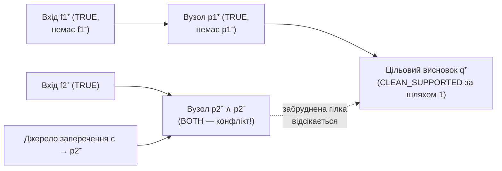

# Глава 4. Чисті доведення у графах зі суперечностями та інкрементальне кешування

> **Автор:** Микола Мартинович Федчик  
> **Книга:** Схемотехніка експертних систем (СТЕС)  
> **Пов'язаний виконуваний код:** [src/clean.go](src/clean.go), [src/clean_reference.go](src/clean_reference.go), [src/clean_witness.go](src/clean_witness.go), [src/clean_cache.go](src/clean_cache.go), [src/CLEAN-PROOF-EXPERIMENTS.md](src/CLEAN-PROOF-EXPERIMENTS.md), [src/CLEAN-CACHE-EXPERIMENTS.md](src/CLEAN-CACHE-EXPERIMENTS.md)

## Анотація

У кінці Глави 3 ми виявили суттєву межу простого пошарового поширення конфліктів у схемах експертних систем: якщо до одного й того самого висновку ведуть дві паралельні гілки, і одна з них повністю чиста, а друга спирається на суперечливий показ датчика (`BOTH`), звичайне злиття оголошує оскарженим увесь висновок. Проте в інженерних системах із резервуванням каналів наявність хоча б одного повністю безконфліктного ланцюга обґрунтування часто є достатньою підставою для прийняття рішення. У цій главі викладається математична модель і двопрохідний алгоритм виділення **чистого альтернативного доведення (`CleanProof`)**, який за лінійний час від розміру ациклічної схеми знаходить безконфліктне піддерево доведення без перебору експоненційної кількості альтернативних дерев. Далі розглядаються побудова компактного свідка доведення та інкрементальне кешування чистих доведень із відстеженням конуса залежностей заперечень (`OPPOSITION_CONE`), включно з чесним аналізом графів, де такий кеш дає прискорення, і широких графів, де він програє повній ревізійній інвалідації.

---

<a id="sec-1"></a>

## 1. Проблема зараження чистої гілки та поняття чистого доведення

Розглянемо ациклічну знакову схему правил, у якій кожному атому $a$ відповідають два знакові літерали: позитивний $a^+$ (твердження $a$ підтримано, тобто біт $t = 1$) і негативний $a^-$ (заперечення $\neg a$ підтримано, тобто біт $f = 1$). Літерал називається **ураженим суперечністю** у поточному замиканні схеми, якщо одночасно виведено обидва протилежні знаки: і $a^+$, і $a^-$ (стан `BOTH`).

<a id="def-4-1"></a>

**Означення 4.1 (Знаковий літерал та протилежний літерал).** *Знаковим літералом* називається пара $`\ell = (a, s)`$, де $a$ — атом схеми, а $`s \in \{+, -\}`$ — знак полярності ($a^+$ відповідає наявності свідчення «за», $a^-$ — наявності свідчення «проти»). *Протилежним літералом* $`\bar{\ell}`$ для $a^+$ є $a^-$, а для $a^-$ — літерал $a^+$.

<a id="def-4-2"></a>

**Означення 4.2 (Чисте альтернативне доведення — `CleanProof`).** *Чистим альтернативним доведенням* цільового знакового літерала $`q \in \mathcal{L}`$ у поточному стані ациклічної схеми називається таке піддерево виведення $W^+$ з коренем $q$, у якому кожен вхідний лист належить множині прямо підтриманих фактів $F$, кожен внутрішній крок відповідає увімкненому правилу $`r \in \mathcal{R}_{\mathrm{en}}`$, і для жодного літерала $u \in W^+$ протилежний літерал $`\bar{u}`$ не є досяжним у повному знаковому замиканні схеми ($`\neg \mathrm{Reach}(\bar{u})`$).

### 1.1. Три можливі політики оцінювання паралельних шляхів

Нехай цільовий літерал $q$ має два альтернативні шляхи виведення (схема 4.1):
- **Шлях 1:** $`f_1 \to p_1 \to q`$, де $`f_1`$ і $`p_1`$ мають лише позитивну підтримку (`TRUE`) і не мають жодної підтримки протилежного знака.
- **Шлях 2:** $`f_2 \to p_2 \to q`$, де проміжний вузол $`p_2`$ одночасно має підтримку і «за» ($`p_2^+`$), і «проти» ($`p_2^-`$ від окремого джерела $c$), тобто перебуває у стані `BOTH`.

<a id="fig-4-1"></a>



**Схема 4.1.** Ізоляція чистого шляху $`f_1^+ \to p_1^+ \to q^+`$ від паралельної гілки з проміжним конфліктом у вузлі $`p_2`$.

Під час аналізу такої схеми інженер може обрати одну з трьох політик:

1. **Політика А («чисті лише листки та корінь»):** перевіряти відсутність суперечності лише на вхідних фактах і на самому цільовому висновку $q$. *Дефект:* якщо суперечність виникла у проміжному вузлі $`p_2`$, а чистої гілки $`p_1`$ немає, така політика помилково пропустить доказ через скомпрометований проміжний вузол $`p_2`$.
2. **Політика Б («усі активні дерева доведення мають бути чистими»):** блокувати висновок $q$, щойно будь-яка активна гілка, що веде до $q$, має суперечність. *Дефект:* на схемі 4.1 ця політика відкине цілком коректний і незалежний Шлях 1 лише тому, що паралельний Шлях 2 містить конфлікт.
3. **Політика В (контракт `CleanProof` — «існує хоча б одне повністю чисте дерево доведення»):** висновок $q$ вважається чисто підтриманим (`CLEAN_SUPPORTED`), якщо в поточному повному замиканні схеми існує принаймні одне дерево виведення для $q$, у якому **кожний використаний вузол** (вхідний факт, проміжний висновок і сам корінь $q$) не має підтримки протилежного знака.

Експериментальна перевірка на повному переборі $38\,912$ станів трьох базових топологій ([src/CLEAN-PROOF-EXPERIMENTS.md](src/CLEAN-PROOF-EXPERIMENTS.md)) показала:
- слабка Політика А пропустила скомпрометований внутрішній вузол у **$16$ випадках**;
- надмірно жорстка Політика Б хибно заблокувала чисту альтернативу в **$500$ випадках**;
- контракт `CleanProof` (Політика В) у всіх $38\,912$ випадках точно збігся з незалежним еталонним перебором дерев доведення.

---

## 2. Математична модель і двопрохідний алгоритм `CleanProof`

На перший погляд може здатися, що для перевірки існування чистого дерева доведення потрібно перебрати всі можливі дерева виведення цілі $q$. Якщо схема містить $k$ послідовних чи кон'юнктивних вузлів, кожен із яких має по $2$ альтернативні підгілки, кількість дерев дорівнює $2^k$ (при $k = 24$ це вже $`2^{24} = 16\,777\,216`$ дерев!). Покажемо, чому в ациклічній схемі цей перебір непотрібний і задача розв'язується за два лінійні проходи.

### 2.1. Рівняння нерухомої точки для повного замикання та чистої підтримки

Нехай $`\mathcal{L}`$ — множина всіх знакових літералів схеми, де для кожного літерала $`\ell \in \mathcal{L}`$ визначено протилежний літерал $`\bar{\ell}`$ (якщо $\ell = a^+$, то $`\bar{\ell} = a^-`$, і навпаки). Нехай $`F \subseteq \mathcal{L}`$ — множина прямо підтриманих вхідних літералів (фактів), а $`\mathcal{R}_{\mathrm{en}}`$ — множина увімкнених знакових Хорн-правил вигляду $`r: u_1 \land \dots \land u_m \Rightarrow \mathrm{head}(r)`$.

**Прохід 1 (повне знакове замикання $`\mathrm{Reach} \subseteq \mathcal{L}`$).** Спочатку обчислюється множина всіх досяжних (підтриманих хоча б якимось шляхом) літералів $`\mathrm{Reach}`$ як найменша нерухома точка рівняння (4.2):

<a id="formula-4-2"></a>

$$
\mathrm{Reach}(\ell) \iff \bigl(\ell \in F\bigr) \lor \exists r \in \mathcal{R}_{\mathrm{en}}:\ \Bigl(\mathrm{head}(r) = \ell \ \land\ \forall u \in \mathrm{body}(r),\ \mathrm{Reach}(u)\Bigr).
$$

**Формула (4.2).** Рівняння нерухомої точки повного знакового замикання (Прохід 1 у [src/clean.go](src/clean.go) та `verifyCert` у [src/formal/kernel/Kernel.lean](src/formal/kernel/Kernel.lean)).

Чому Прохід 1 обов'язково виконується перед перевіркою чистоти? Тому що атака на проміжний вузол $`\bar{u}`$ може надійти з будь-якої іншої гілки схеми: щоб знати, чи не скомпрометовано літерал $\ell$, ми мусимо спочатку знати точне значення $`\mathrm{Reach}(\bar{\ell})`$ у всій схемі.

**Прохід 2 (чиста підтримка $`\mathrm{Clean} \subseteq \mathcal{L}`$).** Літерал $\ell$ має чисте доведення ($`\mathrm{Clean}(\ell) = \texttt{true}`$) тоді й лише тоді, коли він не має протилежної підтримки у повному замиканні ($`\neg \mathrm{Reach}(\bar{\ell})`$) і або сам є вхідним фактом, або виводиться увімкненим правилом, усі передумови якого також мають чисте доведення, згідно з формулою (4.3):

<a id="formula-4-3"></a>

$$
\mathrm{Clean}(\ell) \iff \neg \mathrm{Reach}(\bar{\ell}) \ \land\ \left[\bigl(\ell \in F\bigr) \lor \exists r \in \mathcal{R}_{\mathrm{en}}:\ \Bigl(\mathrm{head}(r) = \ell \ \land\ \forall u \in \mathrm{body}(r),\ \mathrm{Clean}(u)\Bigr)\right].
$$

**Формула (4.3).** Рівняння нерухомої точки чистої підтримки (Прохід 2 у [src/clean.go](src/clean.go) та [src/formal/kernel/Kernel.lean](src/formal/kernel/Kernel.lean)).

За парами значень $`\bigl(\mathrm{Reach}(q), \mathrm{Clean}(q)\bigr)`$ кожен запит $`q \in \mathcal{L}`$ отримує один із трьох діагностичних статусів:
1. $`\mathrm{Clean}(q) = \texttt{true} \implies \texttt{CLEAN\_SUPPORTED}`$ (існує повністю чисте доведення);
2. $`\mathrm{Reach}(q) = \texttt{true} \land \mathrm{Clean}(q) = \texttt{false} \implies \texttt{CONFLICT\_DEPENDENT}`$ (висновок підтримано, але кожне його доведення проходить через суперечливий вузол або суперечливий сам висновок);
3. $`\mathrm{Reach}(q) = \texttt{false} \implies \texttt{NOT\_SUPPORTED}`$ (підтримки в моделі немає).

### 2.2. Лінійна оцінка складності та числовий приклад на $`2^{24}`$ деревах

Оскільки схема ациклічна, обидва рівняння (4.2) і (4.3) обчислюються в одному топологічному порядку вершин без повернень. У другому проході кожний атом перевіряється рівно у двох знаках ($`2|V|`$), кожне правило розглядається не більше одного разу ($`|\mathcal{R}|`$), а кожне входження передумови — один раз ($`\sum_{r} |\mathrm{body}(r)|`$).

Зіставимо витрати двопрохідного алгоритму (4.2)–(4.3) із прямим перебором дерев на родині схем, де цільовий висновок є кон'юнкцією $k$ підцілей, кожна з яких має по 2 альтернативні шляхи виведення (таблиця 4.4, дані з [src/CLEAN-PROOF-EXPERIMENTS.md](src/CLEAN-PROOF-EXPERIMENTS.md)):

<a id="tbl-4-4"></a>

| Кількість підцілей $k$ або довжина ланцюга | Кількість альтернативних дерев $2^k$ | Розмір збереженого свідка (записів) | Кількість операцій 2-го проходу | Час обчислення `CleanProof`, мкс | Час незалежного перевірника, мкс |
|---|---|---|---|---|---|
| Кон'юнкція $k = 12$ підцілей | $4\,096$ | $25$ | $111$ | $`2{,}706`$ | $`2{,}483`$ |
| Кон'юнкція $k = 24$ підцілей | $16\,777\,216$ | $49$ | $219$ | **$`3{,}109`$** | **$`2{,}667`$** |
| Чистий ланцюг із $8\,192$ атомів | $1$ | $8\,192$ | $32\,766$ | $`554{,}460`$ | $`326{,}219`$ |

**Таблиця 4.4.** Виміряні витрати алгоритму `CleanProof` та верифікатора сертифікатів ([src/CLEAN-PROOF-EXPERIMENTS.md](src/CLEAN-PROOF-EXPERIMENTS.md)).

На прикладі $k = 24$ видно практичну інженерну цінність формули (4.3): замість перебору $`16{,}78\text{ млн}`$ комбінацій дерев (де еталонний перебір вичерпує бюджет у $100\,000$ кроків), топологічний прохід перевіряє $219$ елементів за $`3{,}1\ \mu\text{с}`$ і виділяє один компактний свідок із $49$ записів.

---

## 3. Розріджений свідок та інкрементальне кешування з конусом заперечень

Коли база фактів оновлюється у реальному часі, виникає наступне інженерне питання: **за яких умов раніше знайдений чистий свідок для запиту $q$ залишається дійсним після зміни окремих фактів або правил, без повторного обходу всієї схеми?**

<a id="sec-3-1"></a>

### 3.1. Чому не можна кешувати лише позитивне дерево свідка

Припустімо, що для запиту $q^+$ побудовано й збережено в кеші чистий позитивний свідок $`W^+ = \{f_1^+, p_1^+, q^+\}`$ (верхня гілка на схемі 4.1). Нехай у наступний момент часу самі факти й правила з $W^+$ не змінилися, але у зовнішній гілці з'явився новий факт, який вивів протилежний літерал $`p_1^-`$ (атакував проміжний вузол $`p_1`$).
- Якщо кеш перевірятиме лише незмінність позитивних елементів $W^+$, він не помітить появи $`p_1^-`$ і видасть **застарілий, уже скомпрометований дозвіл**!
- У контрольному експерименті [src/CLEAN-CACHE-EXPERIMENTS.md](src/CLEAN-CACHE-EXPERIMENTS.md) на $9\,216$ запитах така наївна політика («перевіряти лише позитивний свідок») помилково оголосила чистими **$930$ скомпрометованих запитів**.

<a id="sec-3-2"></a>

### 3.2. Замкнений конус заперечень (`OPPOSITION_CONE`) і межі його ефективності

Щоб кеш ніколи не пропускав появи суперечності у жодному вузлі свідка $W^+$, у модулях [src/clean_witness.go](src/clean_witness.go) та [src/clean_cache.go](src/clean_cache.go) для кожного літерала $u \in W^+$ будується **структурний конус предків його протилежного знака** $`\mathrm{Cone}^-(W^+)`$ за формулою (4.5):

<a id="formula-4-5"></a>

$$
\mathrm{Cone}^-(W^+) = \bigcup_{u \in W^+} \mathrm{StructAnc}(\bar{u}),
$$

**Формула (4.5).** Множина залежностей конуса заперечень для безпечного повторного використання чистого свідка $W^+$.

Тут $`\mathrm{StructAnc}(\bar{u})`$ — множина всіх літералів і правил, від яких структурно (навіть через тимчасово вимкнені правила) може залежати виведення протилежного літерала $`\bar{u}`$. Кеш зберігає номери ревізій (епох) усіх фактів і правил із $`W^+ \cup \mathrm{Cone}^-(W^+)`$. Якщо жодна з цих епох не змінилася, жоден літерал $`\bar{u}`$ ($u \in W^+$) гарантовано не міг стати досяжним, і свідок $W^+$ безпечно повертається з кешу без похибки ($0$ помилок на $27\,648$ перевірках у [src/CLEAN-CACHE-EXPERIMENTS.md](src/CLEAN-CACHE-EXPERIMENTS.md)).

Проте порівняння трьох режимів роботи при оновленнях — повного перерахунку (`RECOMPUTE`), скидання кешу за будь-якої зміни ревізії світу (`GLOBAL_REVISION`) та відстеження конуса заперечень (`OPPOSITION_CONE`) — виявило важливий інженерний компроміс, наведений у таблиці 4.6:

<a id="tbl-4-6"></a>

| Топологія залежностей заперечень ($4\,096$ атомів) | Розмір фрагмента $`\lvert W^+ \cup \mathrm{Cone}^-\rvert`$ | Час `RECOMPUTE`, мс | Час `GLOBAL_REVISION`, мс | Час `OPPOSITION_CONE`, мс | Інженерна оцінка режиму |
|---|---|---|---|---|---|
| **Локальні залежності заперечень** (16 запитів на оновлення) | до $32$ літералів | $`51{,}142`$ | $`18{,}835`$ | **`9,055`** | Виграш **`82,29%`** проти перерахунку і **`51,92%`** проти глобальної ревізії |
| **Широкий конус заперечень** (1 запит на оновлення) | до $4\,129$ літералів | **`39,495`** | $`39{,}827`$ | $`67{,}274`$ | Програш через витрати на перевірку $4\,129$ епох конуса на кожному запиті |

**Таблиця 4.6.** Порівняння режимів інкрементального кешування чистих доведень ([src/CLEAN-CACHE-EXPERIMENTS.md](src/CLEAN-CACHE-EXPERIMENTS.md)).

З таблиці 4.6 випливає практичне правило проєктування:
- кешування за конусом заперечень `OPPOSITION_CONE` дає дворазове-п'ятиразове прискорення тоді, коли потенційні атаки на вузли свідка локалізовані у вузьких підграфах ($`\lvert\mathrm{Cone}^-(W^+)\rvert \ll |V|`$);
- якщо ж протилежний знак $`\bar{u}`$ має широкий структурний конус предків, який охоплює майже всю схему, дешевше використовувати просту глобальну ревізію `GLOBAL_REVISION` або двопрохідний перерахунок `RECOMPUTE`.

Запустити перевірку семантики та кешу чистих доведень можна командами:

```sh
cd src
go test -race -count=1 -run "TestClean" ./
GOMAXPROCS=2 go run ./cmd/cleanstudy
GOMAXPROCS=2 go run ./cmd/cleancachestudy
```

---

## 4. Питання та вправи для самоперевірки

1. **Питання 1.** Чому у формулі (4.3) для чистої підтримки $`\mathrm{Clean}(\ell)`$ заперечення $`\neg \mathrm{Reach}(\bar{\ell})`$ береться від повного замикання $`\mathrm{Reach}`$ (4.2), а не у вигляді $`\neg \mathrm{Clean}(\bar{\ell})`$?
   - *Відповідь:* Навіть якщо атакуючий літерал $`\bar{\ell}`$ сам виведений через іншу суперечливу гілку (тобто $`\mathrm{Reach}(\bar{\ell}) = \texttt{true}`$, але $`\mathrm{Clean}(\bar{\ell}) = \texttt{false}`$), факт наявності свідчення проти $\ell$ вже існує в системі. Консервативний контракт безпеки вимагає вважати вузол $\ell$ ураженим конфліктом за будь-якої досяжності $`\bar{\ell}`$ у повному замиканні.
2. **Питання 2.** До висновку $q^+$ ведуть два правила: $`r_1: a^+ \land b^+ \Rightarrow q^+`$ та $`r_2: c^+ \Rightarrow q^+`$. Відомо, що у повному замиканні підтримані літерали $`\{a^+, b^+, b^-, c^+\}`$. Якими будуть значення $`\mathrm{Reach}(q^+)`$, $`\mathrm{Clean}(q^+)`$ і діагностичний статус $q^+$?
   - *Відповідь:* У першому проході обидва правила спрацьовують, тому $`\mathrm{Reach}(q^+) = \texttt{true}`$, а $`\mathrm{Reach}(q^-) = \texttt{false}`$. У другому проході $`\mathrm{Clean}(b^+) = \texttt{false}`$ (оскільки $`\mathrm{Reach}(b^-) = \texttt{true}`$), тому правило $`r_1`$ не дає чистого виводу. Проте для $c^+$ протилежний літерал $c^-$ відсутній, тому $`\mathrm{Clean}(c^+) = \texttt{true}`$, і правило $`r_2`$ дає $`\mathrm{Clean}(q^+) = \texttt{true}`$. Статус запиту — `CLEAN_SUPPORTED` зі свідком $`\{c^+, r_2, q^+\}`$.
3. **Питання 3.** Чому кеш чистого доведення в `OPPOSITION_CONE` має включати в $`\mathrm{Cone}^-(W^+)`$ предків протилежних літералів $`\bar{u}`$ навіть через наразі вимкнені правила?
   - *Відповідь:* Якщо оновлення світу увімкне раніше вимкнене правило на шляху до $`\bar{u}`$, це правило може зробити $`\bar{u}`$ досяжним без жодної зміни у позитивному свідку $W^+$. Включення таких правил у конус залежностей гарантує, що зміна їхньої епохи інвалідує кешований запис.

---

## Висновки

1. Алгоритм `CleanProof` розв'язує проблему забруднення чистої гілки паралельним конфліктом за два лінійні топологічні проходи ациклічної схеми: перший прохід обчислює повне знакове замикання $`\mathrm{Reach}`$, а другий — множину безконфліктно виведених літералів $`\mathrm{Clean}`$ та компактний свідок.
2. На схемах із комбінаторним розгалуженням ($`2^{24} = 16\,777\,216`$ альтернативних дерев) двопрохідний алгоритм знаходить чистий свідок за $`\approx 3{,}1\ \mu\text{с}`$, уникаючи експоненційного перебору дерев.
3. Безпечне кешування чистих доведень вимагає відстеження не лише позитивного свідка $W^+$, а й структурного конуса заперечень $`\mathrm{Cone}^-(W^+)`$; цей метод суттєво прискорює локальні оновлення (до $82\%$), але на широких графах поступається простій глобальній ревізії через обсяг самого конуса.

---

## Глосарій

| Термін | Англійський відповідник | Визначення в межах курсу СТЕС |
|---|---|---|
| **Глобальна ревізійна інвалідація (`GLOBAL_REVISION`)** | *Global Revision Cache Policy* | Консервативний режим кешування, за якого будь-яка зміна вхідних фактів або правил інвалідує всі закешовані свідки; виграє при повторних запитах між оновленнями та на широких графах; [§3.2](#sec-3-2), [таблиця 4.6](#tbl-4-6) |
| **Двопрохідний алгоритм чистоти** | *Two-Pass Cleanliness Algorithm* | Топологічний алгоритм у `src/clean.go`, що у першому проході обчислює повне знакове замикання $`\mathrm{Reach}`$ (4.2), а в другому — чисту підтримку $`\mathrm{Clean}`$ (4.3) за лінійний час від розміру схеми; [§2.1](#21-рівняння-нерухомої-точки-для-повного-замикання-та-чистої-підтримки), [таблиця 4.4](#tbl-4-4) |
| **Епоха (ревізія) елемента** | *Fact / Rule Revision Epoch* | Монотонний лічильник змін конкретного вхідного літерала або правила, за незмінністю якого на множині $`W^+ \cup \mathrm{Cone}^-(W^+)`$ кеш `OPPOSITION_CONE` визначає чинність свідка; [§3.2](#sec-3-2) |
| **Залежний від конфлікту висновок (`CONFLICT_DEPENDENT`)** | *Conflict-Dependent Status* | Діагностичний статус запиту $q$, який досяжний у повному замиканні ($`\mathrm{Reach}(q)=\texttt{true}`$), але не має жодного повністю безконфліктного дерева виведення ($`\mathrm{Clean}(q)=\texttt{false}`$); [§2.1](#21-рівняння-нерухомої-точки-для-повного-замикання-та-чистої-підтримки) |
| **Знаковий літерал ($`\ell \in \mathcal{L}`$)** | *Signed Literal* | Атом $a$ з явною полярністю знака ($a^+$ для свідчення «за» або $a^-$ для свідчення «проти»); [означення 4.1](#def-4-1) |
| **Знакове Хорн-правило (`EvRule`)** | *Signed Horn Rule* | Орієнтоване правило $`u_1 \land \dots \land u_m \Rightarrow \mathrm{head}(r)`$ над знаковими літералами $`u_k, \mathrm{head}(r) \in \mathcal{L}`$; [§2.1](#21-рівняння-нерухомої-точки-для-повного-замикання-та-чистої-підтримки) |
| **Конус заперечень ($`\mathrm{Cone}^-(W^+)`$)** | *Opposition Cone (`OPPOSITION_CONE`)* | Об'єднання структурних предків $`\mathrm{StructAnc}(\bar{u})`$ протилежних літералів для всіх вузлів $`u \in W^+`$ через усі (включно з вимкненими) правила теорії; [формула (4.5)](#formula-4-5), [таблиця 4.6](#tbl-4-6) |
| **Непідтриманий запит (`NOT_SUPPORTED`)** | *Unsupported Query Status* | Діагностичний статус запиту $q$, недосяжного у повному знаковому замиканні схеми ($`\mathrm{Reach}(q)=\texttt{false}`$); означає відсутність виводу в моделі, а не доведену хибність у світі; [§2.1](#21-рівняння-нерухомої-точки-для-повного-замикання-та-чистої-підтримки) |
| **Повне знакове замикання ($`\mathrm{Reach}`$)** | *Signed Reachability Closure* | Найменша нерухома точка досяжності позитивних і негативних літералів у схемі без відсікання суперечливих гілок (Прохід 1); [формула (4.2)](#formula-4-2) |
| **Повний перерахунок (`RECOMPUTE`)** | *Full Recompute Mode* | Режим обчислення без кешування, що на кожному запиті виконує обидва проходи за формулами (4.2)–(4.3); [§3.2](#sec-3-2), [таблиця 4.6](#tbl-4-6) |
| **Протилежний літерал ($`\bar{\ell}`$)** | *Opposite / Complementary Literal* | Літерал того самого атома з інвертованим знаком полярності ($`\overline{a^+} = a^-`$, $`\overline{a^-} = a^+`$); [означення 4.1](#def-4-1) |
| **Розріджений свідок чистоти ($W^+$)** | *Sparse Clean Witness* | Компактне піддерево використаних фактів і правил, достатнє для незалежної верифікації статусу `CLEAN_SUPPORTED` у `src/clean_witness.go`; [таблиця 4.4](#tbl-4-4), [§3.1](#sec-3-1) |
| **Структурні предки ($`\mathrm{StructAnc}(\ell)`$)** | *Structural Ancestors* | Множина всіх вхідних фактів і правил схеми (незалежно від поточного біта їх увімкнення), від яких за графом залежностей може бути виведений літерал $\ell$; [формула (4.5)](#formula-4-5) |
| **Уражений суперечністю літерал** | *Conflict-Tainted Literal* | Літерал $\ell$, для якого у повному знаковому замиканні одночасно досяжні обидва знаки: $`\mathrm{Reach}(\ell) = \texttt{true}`$ і $`\mathrm{Reach}(\bar{\ell}) = \texttt{true}`$; [§1](#sec-1), [схема 4.1](#fig-4-1) |
| **Чиста підтримка (`Clean` / `CLEAN_SUPPORTED`)** | *Clean Alternative Support* | Наявність у літерала принаймні одного чистого альтернативного доведення, вільного від суперечливих предків у повному замиканні (Прохід 2); [означення 4.2](#def-4-2), [формула (4.3)](#formula-4-3) |

---

## Абревіатури

| Абревіатура | Розшифрування та зміст у межах глави |
|---|---|
| **ABA** | Зміна стану $A \to B \to A$ (коли факт або правило повертається до попереднього значення); у кеші `src/clean_cache.go` виявляється монотонним лічильником епох |
| **API** | Application Programming Interface — програмний інтерфейс модуля перевірки та кешування свідків |
| **ASPIC+** | Аргументаційний каркас структурованого дефезибельного виведення з перевагами [[1]](#src-1) |
| **CSV** | Comma-Separated Values — табличний формат збереження первинних експериментальних вимірювань у `src/testdata/` |
| **DAG** | Directed Acyclic Graph — скінченний орієнтований ациклічний граф знакових правил; [§2.2](#22-лінійна-оцінка-складності-та-числовий-приклад-на-224-деревах) |
| **GC** | Garbage Collector — автоматичний збирач сміття середовища виконання Go |
| **SHA-256** | 256-бітна криптографічна контрольна сума для фіксації незмінності опублікованих таблиць вимірювань |
| **WCET** | Worst-Case Execution Time — верхня межа часу виконання у найгіршому випадку |

---

## Джерела

<a id="src-1"></a>
[1] Modgil S., Prakken H. A general account of argumentation with preferences // Artificial Intelligence. — 2013. — Vol. 195. — P. 361–397. — DOI: [10.1016/j.artint.2012.10.002](https://doi.org/10.1016/j.artint.2012.10.002).

<a id="src-2"></a>
[2] Darwiche A., Marquis P. A knowledge compilation map // Journal of Artificial Intelligence Research. — 2002. — Vol. 17. — P. 229–264. — DOI: [10.1613/jair.989](https://doi.org/10.1613/jair.989).

<a id="src-3"></a>
[3] Arieli O., Avron A. The value of the four values // Artificial Intelligence. — 1998. — Vol. 102, № 1. — P. 97–141. — DOI: [10.1016/S0004-3702(98)00032-0](https://doi.org/10.1016/S0004-3702(98)00032-0).

---

[← Глава 3. Високорівневі схеми виведення](ch03-forward-forecast-and-backward-diagnosis.md) | [Зміст книги](README.md) | [Глава 5. Нормативні схеми з винятками та зворотний синтез безпечних ремонтів →](ch05-normative-exceptions-and-safe-repairs.md)
