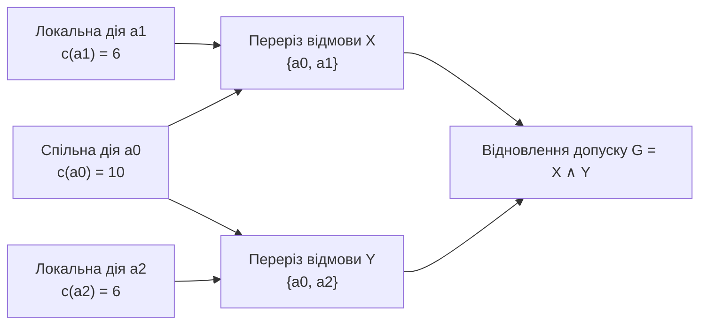

# Глава 5. Нормативні схеми з винятками та зворотний синтез безпечних ремонтів

> **Автор:** Микола Мартинович Федчик  
> **Книга:** Схемотехніка експертних систем (СТЕС)  
> **Пов'язаний виконуваний код:** [src/normative.go](src/normative.go), [src/normative_reference.go](src/normative_reference.go), [src/normative_sat.go](src/normative_sat.go), [src/normative_cache.go](src/normative_cache.go), [src/repair.go](src/repair.go), [src/NORMATIVE-EXPERIMENTS.md](src/NORMATIVE-EXPERIMENTS.md)

## Анотація

У попередніх главах було побудовано схеми виведення фактів та чистих доведень. Проте в регламентованих експертних системах (промислова безпека, авіоніка, медичні протоколи, фінансовий комплаєнс) над шаром фактів працює шар **нормативних приписів** — правил, які дозволяють (`PERMIT`) або забороняють (`PROHIBIT`) дію і містять спеціальні застереження та винятки за принципом *lex specialis derogat legi generali* (спеціальна норма скасовує загальну). Ця глава присвячена двом інженерним задачам нормативного шару експертної системи: по-перше, прямому обчисленню нормативних вентилів із винятками та частковим порядком пріоритетів із незалежною перевіркою через SAT-солвер; по-друге, зворотній задачі **синтезу мінімального безпечного ремонту (`FindRepair`)** у випадку, коли схема заблокувала дію, із вбудованим захистом від послаблювальних «ремонтів Гудхарта».

---

## 1. Нормативні вентилі з винятками (*lex specialis*) і п'ять операційних рішень

У технічних регламентах та стандартах безпеки правила майже ніколи не формулюються як безумовні імплікації. Типовий пункт регламенту має три частини:
1. **Основна умова застосовності** $C(r)$ — кон'юнкція фактів, за яких норма набирає чинності (наприклад, *«тиск у магістралі перевищує робочий поріг і клапан справний»*).
2. **Літерал винятку (блокувального застереження)** $E(r)$ — умова, за якої дія цього правила скасовується (*«...крім випадків, коли триває режим герметизації секції»*).
3. **Нормативний ефект** $`\mathrm{eff}(r) \in \{\texttt{PERMIT}, \texttt{PROHIBIT}\}`$ та **відношення пріоритету** $`r_1 \succ r_2`$ між конкуруючими нормами для однієї дії.

### 1.1. Чому відсутність винятку не тотожна невідомому стану винятку

Критичною інженерною помилкою при моделюванні норм є змішування двох принципово різних ситуацій:
- **Ситуація А:** у правилі $r$ виняток узагалі не передбачений регламентом ($`\mathrm{HasException}(r) = \texttt{false}`$).
- **Ситуація Б:** у правилі $r$ виняток $E(r)$ передбачений регламентом ($`\mathrm{HasException}(r) = \texttt{true}`$), але датчик або документ, який має повідомити стан $E(r)$, наразі не опитаний ($`\beta(E(r)) = \texttt{UNKNOWN}`$) або дає суперечливі свідчення ($`\beta(E(r)) = \texttt{BOTH}`$).

Якщо обидві ситуації закодувати одним значенням `Unknown`, система або помилково заблокує всі прості норми без винятків, або — що значно небезпечніше — видасть автоматичний дозвіл `ALLOW` тоді, коли аварійний виняток насправді існує в регламенті, але його стан ще не перевірено!

Тому в модулі [src/normative.go](src/normative.go) кожен нормативний вентиль $r$ обчислює свій статус застосовності $`\mathrm{App}(r) \in \{\texttt{INAPPLICABLE}, \texttt{APPLICABLE}, \texttt{UNCERTAIN\_UNKNOWN}, \texttt{UNCERTAIN\_CONFLICT}\}`$ за точним законом (5.1):

<a id="formula-5-1"></a>

$$
\mathrm{App}(r) =
\begin{cases}
\texttt{INAPPLICABLE}, & \text{якщо } \neg \mathrm{en}(r) \lor \beta(C(r)) = \texttt{FALSE} \lor \bigl(\mathrm{HasExc}(r) \land \beta(E(r)) = \texttt{TRUE}\bigr), \\[4pt]
\texttt{APPLICABLE}, & \text{якщо } \mathrm{en}(r) \land \beta(C(r)) = \texttt{TRUE} \land \bigl(\neg \mathrm{HasExc}(r) \lor \beta(E(r)) = \texttt{FALSE}\bigr), \\[4pt]
\texttt{UNCERTAIN\_CONFLICT}, & \text{якщо правило не виключене і } \beta(C(r)) = \texttt{BOTH} \lor \bigl(\mathrm{HasExc}(r) \land \beta(E(r)) = \texttt{BOTH}\bigr), \\[4pt]
\texttt{UNCERTAIN\_UNKNOWN}, & \text{інакше (невизначеність } \texttt{UNKNOWN}\text{ в умові або у винятку)}.
\end{cases}
$$

**Формула (5.1).** Передавальна функція нормативного вентиля з явною лінією винятку ([src/normative.go](src/normative.go)).

Пояснення інженерної логіки формули (5.1):
1. Якщо виняток $E(r)$ доведено істинний ($`\beta(E(r)) = \texttt{TRUE}`$), правило $r$ **негайно вимикається** (`INAPPLICABLE`), навіть якщо його основна умова $C(r)$ ще невідома або суперечлива. Це реалізує в схемі вентиль **немонотонного підсікання (`undercut`)**.
2. Щоб правило стало чинно застосовним (`APPLICABLE`), його умова $C(r)$ мусить мати чистий стан `TRUE`, а заданий виняток $E(r)$ мусить бути **явно спростованим** ($`\beta(E(r)) = \texttt{FALSE}`$).
3. Якщо ж основна умова істинна, але стан винятку невідомий (`UNKNOWN`) або суперечливий (`BOTH`), вентиль переходить у стан невизначеності й **блокує автоматичний дозвіл**.

### 1.2. Розв'язання пріоритетів і п'ять операційних рішень

Нехай для цільової дії $a$ множина всіх правил моделі дорівнює $`\mathcal{R}(a)`$, а на цій множині задано строгий ациклічний частковий порядок пріоритетів $\succ$ (де $`r_1 \succ r_2`$ означає, що норма $`r_1`$ має вищу юридичну або технічну силу за норму $`r_2`$).

Операційне рішення $D(a)$ обчислюється у три кроки за формулою (5.2):
1. Якщо хоча б одне правило $`r \in \mathcal{R}(a)`$ має статус $`\texttt{UNCERTAIN\_CONFLICT}`$, повертається відмова через конфлікт даних `DEFER_CONFLICT`.
2. Інакше, якщо хоча б одне правило $`r \in \mathcal{R}(a)`$ має статус $`\texttt{UNCERTAIN\_UNKNOWN}`$, повертається відмова через неповноту даних `DEFER_UNKNOWN`.
3. Інакше розглядається множина чинно застосовних правил $`A(a) = \{r \in \mathcal{R}(a) \mid \mathrm{App}(r) = \texttt{APPLICABLE}\}`$ і виділяється множина **недомінованих застосовних правил** $M(a)$:

<a id="formula-5-2"></a>

$$
M(a) = \bigl\{r \in A(a) \ \big|\ \neg \exists r' \in A(a):\ r' \succ r\bigr\},
$$

$$
D(a) =
\begin{cases}
\texttt{DEFER\_NO\_BASIS}, & \text{якщо } M(a) = \varnothing, \\[4pt]
\texttt{ALLOW}, & \text{якщо } M(a) \ne \varnothing \land \forall r \in M(a),\ \mathrm{eff}(r) = \texttt{PERMIT}, \\[4pt]
\texttt{DENY}, & \text{якщо } M(a) \ne \varnothing \land \forall r \in M(a),\ \mathrm{eff}(r) = \texttt{PROHIBIT}, \\[4pt]
\texttt{DEFER\_CONFLICT}, & \text{якщо } \exists r_1, r_2 \in M(a):\ \mathrm{eff}(r_1) = \texttt{PERMIT} \land \mathrm{eff}(r_2) = \texttt{PROHIBIT}.
\end{cases}
$$

**Формула (5.2).** Відбір недомінованих норм за частковим порядком пріоритетів та формування одного з п'яти операційних рішень ([src/normative.go](src/normative.go)).

Підкреслимо важливу властивість прозорості: домінування $r' \succ r$ керує операційним рішенням $D(a)$, але **не стирає** правило $r$ та його свідчення з сертифіката аудиту. Інженер завжди бачить у трасі і загальну норму $r$, і спеціальну норму $r'$, яка її перекрила.

---

## 2. Перевірка нормативних схем через SAT-оракул і захист контекстного кешу

Щоб виключити помилки в реалізації формул (5.1)–(5.2), у пакеті [src/normative_sat.go](src/normative_sat.go) побудовано незалежний транслятор нормативної схеми у булеву формулу в кон'юнктивній нормальній формі (CNF) для зовнішнього SAT-розв'язувача MiniSat [[1]](#src-1).

### 2.1. Результати верифікації проти SAT-оракула

У досліді [src/NORMATIVE-EXPERIMENTS.md](src/NORMATIVE-EXPERIMENTS.md) виконано $1\,448$ оцінювань (вичерпний перебір комбінацій передумов, винятків і трьох порядків пріоритету плюс $1\,000$ оцінювань на $100$ випадкових ациклічних теоріях), з яких $456$ конфігурацій додатково розв'язано через зовнішній процес MiniSat 2.2.1. У всіх $1\,448$ випадках основний виконавець, незалежний графовий еталон, верифікатор сертифікатів і SAT-оракул дали $100\%$ збіг ($158$ `ALLOW`, $192$ `DENY`, $295$ `DEFER_UNKNOWN`, $632$ `DEFER_CONFLICT`, $171$ `DEFER_NO_BASIS`).

Окремий експеримент із кешування нормативних рішень на $1\,024$ подіях зміни світу та $2\,048$ запитах показав, чому для нормативного вентиля не можна кешувати лише позитивну передумову дозвільного правила:
- якщо в системі активується нова заборона вищого пріоритету, вмикається літерал винятку $E(r)$ або змінюється відношення пріоритету $\succ$, сама позитивна передумова $C(r)$ старого дозволу не змінюється;
- наївний кеш, який перевіряє лише $C(r)$, пропустив нечинний дозвіл у **$768$ із $1\,024$ подій**;
- консервативний контекстний кеш ([src/normative_cache.go](src/normative_cache.go)), який прив'язує сертифікат до криптографічного відбитка теорії, винятків і пріоритетів, дав **$0$ помилок на всіх $2\,048$ перевірках**.

---

## 3. Зворотний синтез безпечних ремонтів після відмови схеми

Коли нормативна або діагностична схема заблокувала дію (`DENY` або `DEFER`), оператор перед пультом керування ставить практичне питання: **який найменший за вартістю набір дозволених коригувальних дій потрібно виконати, щоб усунути всі причини блокування?**

### 3.1. Чому погілковий жадібний вибір програє на DAG зі спільними предками

Нехай блокування схеми зумовлене двома кон'юнктивними підцілями відновлення $G = X \land Y$ (схема 5.3):
- підціль $X$ (відновлення каналу тиску) може бути виконана або спільною дією $`a_0`$ (перезапуск спільного модуля синхронізації шин вартістю $`c(a_0) = 10`$ умовних одиниць), або локальною дією $`a_1`$ вартістю $`c(a_1) = 6`$;
- підціль $Y$ (відновлення каналу температури) може бути виконана або тією самою спільною дією $`a_0`$ ($`c(a_0) = 10`$), або локальною дією $`a_2`$ вартістю $`c(a_2) = 6`$.

<a id="fig-5-3"></a>



**Схема 5.3.** Неоптимальність погілкового дерева рішень (`Tree-DP`) при спільному кореневому заході відновлення $`a_0`$.

Якщо обчислювати мінімум незалежно по гілках дерева (`Naive Tree-DP`), то для $X$ буде обрано $`a_1`$ (вартість $6 < 10$), а для $Y$ — $`a_2`$ (вартість $6 < 10$), що дасть сумарний набір $`\{a_1, a_2\}`$ вартістю $6 + 6 = 12$. Натомість один спільний захід $`\{a_0\}`$ одночасно перекриває обидва перерізи відмов за вартість $10 < 12$.

### 3.2. Постановка задачі зваженого покриття перерізів із фільтром Гудхарта

У модулі [src/repair.go](src/repair.go) задача відновлення формалізована як задача **мінімального зваженого покриття перерізів (Weighted Hitting Set)** з несумісностями та фільтром безпеки.

Нехай задано:
- скінченну множину кандидатів дій відновлення $`\mathcal{A} = \{a_0, a_1, \dots, a_{n-1}\}`$ ($1 \le n \le 63$), де кожна дія $`a_k`$ має додатну цілу вартість $`c_k > 0`$, прапорець верифікованості $`\mathrm{Verified}(a_k) \in \{0, 1\}`$ та прапорець послаблення безпеки $`\mathrm{Weakens}(a_k) \in \{0, 1\}`$;
- набір перерізів відмов (мінімальних диз'юнктивних умов усунення кожного блокування) $`\mathcal{K} = \{C_1, C_2, \dots, C_m\}`$, де $`C_j \subseteq \{0, \dots, n-1\}`$;
- множину пар взаємно несумісних дій $`\mathcal{I} \subseteq \{0, \dots, n-1\}^2`$.

**Захист від «ремонтів Гудхарта».** Закон Гудхарта у системах безпеки проявляється тоді, коли автоматичний оптимізатор замість реального усунення несправності пропонує «дешеву» дію, яка просто вимикає датчик, стирає прапорець помилки або розширює межі норми ($`\mathrm{Weakens}(a_k) = 1`$). Тому перед початком пошуку функція `FindRepair` відсікає всі неверифіковані та послаблювальні дії, формуючи допустиму підмножину дій $`\mathcal{A}_{\mathrm{adm}}`$ за формулою (5.4):

<a id="formula-5-4"></a>

$$
\mathcal{A}_{\mathrm{adm}} = \bigl\{k \in \{0, \dots, n-1\} \ \big|\ \mathrm{Verified}(a_k) = 1 \ \land\ \mathrm{Weakens}(a_k) = 0\bigr\}.
$$

**Формула (5.4).** Фільтр допустимих безпечних дій відновлення в `FindRepair` ([src/repair.go](src/repair.go)).

Якщо після фільтрації (5.4) хоча б один переріз відмови $`C_j \cap \mathcal{A}_{\mathrm{adm}}`$ стає порожнім, система негайно повертає гарантовану відмову `ErrNoRepair` («безпечного автоматичного ремонту не існує»). Інакше розв'язується задача дискретної оптимізації (5.5) методом гілок і меж із жорстким бюджетом відвіданих станів `maxVisited`:

<a id="formula-5-5"></a>

$$
\min_{M \subseteq \mathcal{A}_{\mathrm{adm}}} \sum_{k \in M} c_k \quad \text{за умов:} \quad
\begin{cases}
\forall j \in \{1, \dots, m\}:\ M \cap C_j \ne \varnothing, \\[4pt]
\forall (u, v) \in \mathcal{I}:\ \neg(u \in M \land v \in M).
\end{cases}
$$

**Формула (5.5).** Задача мінімального безпечного покриття перерізів відмов без подвійного обліку спільних дій ([src/repair.go](src/repair.go)).

Якщо під час пошуку кількість відвіданих станів досягає межі `maxVisited`, функція `FindRepair` **не повертає** недоведений проміжний варіант як нібито оптимальний, а явно сигналізує помилку `ErrSearchBudget`.

Перевірити роботу нормативних схем, SAT-оракула та синтезу ремонтів можна командами:

```sh
cd src
go test -race -count=1 -run "TestNormative|TestRepair" ./
```

---

## 4. Питання та вправи для самоперевірки

1. **Питання 1.** Правило $`r_1`$ дозволяє запуск насоса ($`\mathrm{eff}(r_1) = \texttt{PERMIT}`$) за умови $`C(r_1) = \texttt{TRUE}`$ і містить виняток $`E(r_1)`$ («виявлено витік у магістралі охолодження»). Датчик витоку вийшов з ладу і повертає стан $`\beta(E(r_1)) = \texttt{UNKNOWN}`$. Який статус $`\mathrm{App}(r_1)`$ та яке операційне рішення $D$ видасть схема за формулами (5.1)–(5.2)?
   - *Відповідь:* Оскільки $`\mathrm{HasExc}(r_1) = \texttt{true}`$ і $`\beta(E(r_1)) = \texttt{UNKNOWN}`$, за формулою (5.1) правило отримує статус $`\mathrm{App}(r_1) = \texttt{UNCERTAIN\_UNKNOWN}`$. За формулою (5.2) наявність невизначеного правила блокує дозвіл і видає операційне рішення `DEFER_UNKNOWN`.
2. **Питання 2.** Для однієї дії одночасно чинно застосовні (`APPLICABLE`) три правила: $`r_1`$ (`PERMIT`), $`r_2`$ (`PROHIBIT`) та $`r_3`$ (`PERMIT`). Задано лише одне відношення пріоритету: $`r_2 \succ r_1`$. Якою буде множина недомінованих правил $M(a)$ та підсумкове рішення за формулою (5.2)?
   - *Відповідь:* Правило $`r_1`$ відсікається, бо над ним домінує застосовне правило $`r_2`$ ($`r_2 \succ r_1`$). Проте між $`r_2`$ і $`r_3`$ пріоритет не заданий, тому множина недомінованих правил дорівнює $`M(a) = \{r_2, r_3\}`$. Оскільки $`r_2`$ забороняє дію, а $`r_3`$ дозволяє, формула (5.2) повертає `DEFER_CONFLICT` (нерозв'язана колізія норм).
3. **Питання 3.** У задачі відновлення на схемі 5.3 до перерізу $X$ додали ще одну дію $`a_3`$ («вимкнути аварійну сигналізацію тиску») з мінімальною вартістю $`c(a_3) = 1`$ і прапорцем $`\mathrm{Weakens}(a_3) = 1`$. Як зміниться розв'язок за формулами (5.4)–(5.5)?
   - *Відповідь:* За формулою (5.4) дія $`a_3`$ не потрапляє до допустимої множини $`\mathcal{A}_{\mathrm{adm}}`$, оскільки $`\mathrm{Weakens}(a_3) = 1`$. Оптимальним безпечним розв'язком залишається $`\{a_0\}`$ з вартістю $10$.

---

## Висновки

1. Нормативний вентиль у СТЕС строго розділяє відсутність винятку в правилі та невизначеність стану наявного винятку: доведений виняток вимикає правило (`undercut`), а невідомий чи суперечливий виняток переводить вентиль у режим відкладення `DEFER`, унеможливлюючи аварійний дозвіл.
2. Розв'язання пріоритетів *lex specialis* як часткового порядку на застосовних правилах протестовано на $1\,448$ конфігураціях і незалежно підтверджено SAT-оракулом MiniSat на $456$ формулах із повною збіжністю результатів.
3. Зворотний синтез ремонтів на бітових масках перерізів відмов знаходить глобально мінімальний набір коригувальних дій з урахуванням спільних предків DAG та блокує послаблювальні втручання Гудхарта на етапі попередньої фільтрації.

---

## Глосарій

| Термін | Англійський відповідник | Визначення в межах курсу СТЕС |
|---|---|---|
| **Недоміноване правило** | *Undominated Applicable Rule* | Чинно застосовне правило $r \in A(a)$, для якого немає іншого застосовного правила $r' \in A(a)$ вищого пріоритету ($r' \succ r$) |
| **Переріз відмови** | *Failure Cut* | Мінімальна множина дій відновлення, з яких необхідно виконати принаймні одну для усунення конкретного блокування схеми |
| **Підсікання правила (`Undercut`)** | *Rule Undercutting / Exception* | Блокування застосовності правила за істинності його явного літерала винятку $E(r)$ за формулою (5.1) |
| **Ремонт Гудхарта** | *Goodhart Weakening Repair* | Неприпустима дія, яка усуває сигнал відмови шляхом послаблення межі безпеки або вимкнення контролю ($`\mathrm{Weakens}=1`$) |

---

## Джерела

<a id="src-1"></a>
[1] Eén N., Sörensson N. An extensible SAT-solver // Theory and Applications of Satisfiability Testing (SAT 2003). Lecture Notes in Computer Science. — Berlin : Springer, 2004. — Vol. 2919. — P. 502–518. — DOI: [10.1007/978-3-540-24605-3_37](https://doi.org/10.1007/978-3-540-24605-3_37).

<a id="src-2"></a>
[2] Governatori G., Rotolo A. Defeasible logic: agency, intention and obligation // Deontic Logic in Computer Science (DEON 2004). Lecture Notes in Computer Science. — Berlin : Springer, 2004. — Vol. 3065. — P. 114–128. — DOI: [10.1007/978-3-540-25927-5_8](https://doi.org/10.1007/978-3-540-25927-5_8).

<a id="src-3"></a>
[3] Reiter R. A theory of diagnosis from first principles // Artificial Intelligence. — 1987. — Vol. 32, № 1. — P. 57–95. — DOI: [10.1016/0004-3702(87)90062-2](https://doi.org/10.1016/0004-3702(87)90062-2).
