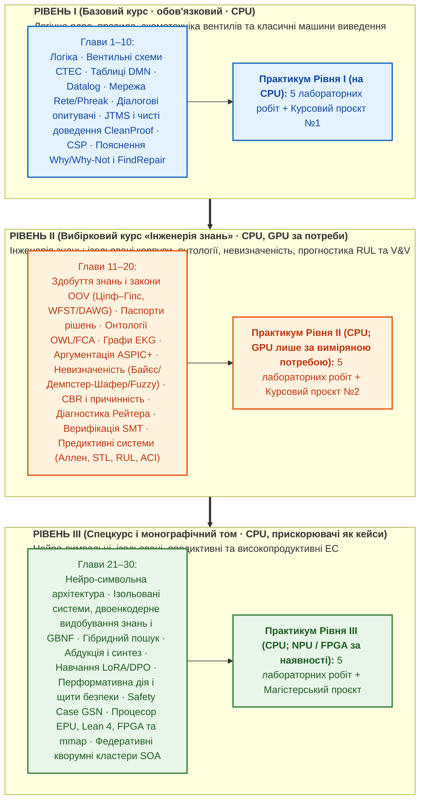

# Концепція та архітектурний план фундаментального підручника «Експертні Системи»

**Назва підручника:** **«Експертні Системи»**  
**Підзаголовок:** *Програмна інженерія систем, заснованих на знаннях: від логічних правил і продукційних мереж до нейро-символьного ШІ*  
**Автор:** Микола Мартинович Федчик  
**Цільова аудиторія:** Студенти комп'ютерних наук та програмної інженерії закладів вищої освіти (спеціальності 121 «Інженерія програмного забезпечення», 122 «Комп'ютерні науки», 124 «Системний аналіз», 126 «Інформаційні системи та технології»), викладачі та практикуючі інженери.  
**Дата затвердження візії:** 2026-11-03  
**Редакція:** 2026-11-03, прагматична перебудова: обов'язковий базовий курс (Том 1), вибірковий курс (Том 2) і спецкурс (Том 3); принцип «спершу CPU»; основні спеціалізовані мови базового курсу — `Prolog` і `DMN / FEEL`  

---

## 1. Головна мета трансформації книги

Перетворити вузькоспеціалізовану монографію з ухилом у вбудовані/апаратні системи безпеки на **універсальний, сучасний університетський підручник «Експертні Системи» широкого призначення**, який:

1. **Дає повну інженерну картину галузі:** охоплює як класичне ядро експертних систем (продукційні рушії `Rete/Phreak`, таблиці рішень `DMN`, зворотне виведення, інтерактивні діалогові опитувачі, програмування в обмеженнях `CSP`), так і сучасний передній край (онтології та графи знань, імовірнісні й нечіткі моделі, модельно-орієнтована діагностика, формальна верифікація `SMT` та нейро-символьна інтеграція з `LLM/SLM`).
2. **Будується за ітеративно-інкрементальним принципом (3 рівні = базовий курс, вибірковий курс і спецкурс):** обов'язковим є лише базовий семестровий курс (Том 1), у якому студент 2-го курсу бакалаврату рухається від простих детермінованих таблиць правил до класичних машин виведення. Том 2 становить вибірковий курс «Інженерія знань» для 3–4-го курсів, Том 3 — спецкурс і монографічний матеріал для магістратури та наукової роботи.
3. **Доводить практичну інженерну користь кожної теми без «води»:** кожен із трьох рівнів завершується серією виконуваних лабораторних робіт із автоматизованими тестами та переліком тем курсових проєктів із чіткими критеріями приймання.
4. **Очищений від математичної та термінологічної бутафорії:** жодних штучних фізично-термодинамічних метафор, жодного дублювання тих самих формул у десятках глав і жодної інфляції «іменних законів» на місці стандартних інженерних практик.

---

## 2. Розширення тематичного ядра: теми, які обов'язково вводяться до підручника

Щоб книга була повноцінним підручником із програмної інженерії експертних систем широкого призначення, до неї вводяться шість фундаментальних тем, яких бракувало або які були висвітлені лише побіжно:

### 2.1. Алгоритми продукційного зіставлення зі зразком у пам'яті (`Rete`, `Treat`, `Leaps`, `Phreak`)
* **Чому це критично:** Прямий перебір правил за `O(R \cdot F^k)` не працює у промислових продукційних системах, де факти змінюються інкрементально.
* **Що має вивчити студент:**
  - Компіляція продукційних правил у мережу `Rete` Чарльза Форджі: вузли типу об'єкта (`ObjectTypeNode`), альфа-вузли селекції констант (`AlphaNode`), альфа-пам'ять, бета-вузли з'єднання змінних (`JoinNode`), негативні вузли (`NotNode`) та бета-пам'ять часткових збігів.
  - Інкрементальне поширення токенів при додаванні (`assert`), зміні (`modify`) та вилученні (`retract`) фактів у робочій пам'яті (`Working Memory`).
  - Стратегії розв'язання конфліктів у порядку денному (`Agenda Conflict Resolution`): рефракція (`Refraction` — заборона повторного спрацювання на тому самому кортежі фактів), актуальність (`Recency`), специфічність (`Specificity`), пріоритети (`Salience`), алгоритми `LEX` та `MEA`.
  - Еволюція до алгоритму **`Phreak`** (сучасний стандарт у `Drools`): перехід від жадібного поширення токенів до відкладеного (лінивого) обчислення сегментів та наборів правил, орієнтованого на мету.

### 2.2. Промислові стандарти бізнес-правил та декларативних політик (`OMG DMN / FEEL`, `OPA / Rego`, `Cedar`)
* **Чому це критично:** Більшість комерційних експертних систем у банках, страхуванні, медицині, електронному урядуванні та хмарній інфраструктурі розробляються за стандартом **DMN (Decision Model and Notation)** або мовами політик **Rego / Cedar**.
* **Що має вивчити студент:**
  - Графи вимог до рішень (`DRD — Decision Requirements Diagram`) та композиція таблиць рішень.
  - Мова виразів `FEEL` (*Friendly Enough Expression Language*): робота з інтервалами, датами, списками та тризначною логікою.
  - Політики спрацювання таблиць рішень (`Hit Policies`): однозначні (`Unique`, `Any`, `Priority`, `First`) та множинні (`Collect +`, `Collect <`, `Collect >`, `Collect #`, `Rule Order`, `Output Order`).
  - Формальна перевірка таблиць `DMN`: виявлення перекриття правил (`Overlap`), прогалин покриття домену (`Missing Intervals`) та затінення правил (`Rule Shadowing`).
  - Рушії політик як легковагові експертні системи авторизації й комплаєнсу (`Open Policy Agent / Rego`, `AWS Cedar`).

### 2.3. Інтерактивні діалогові експертні системи та немонотонне керування сесією (`Mixed-Initiative Consultation`)
* **Чому це критично:** Класична експертна система — це не лише пакетний фільтр, а інтерактивний консультант (медичний тріаж, податковий майстер, діагностичний асистент), який сам ставить користувачеві мінімально необхідні запитання.
* **Що має вивчити студент:**
  - Зворотне виведення (`Backward Chaining`), кероване цілями, з динамічною генерацією запитань для невідомих листкових предикатів.
  - Критерій вибору наступного найкращого запитання (`Next-Best-Question`) за максимумом очікуваного інформаційного виграшу на одиницю вартості/часу опитування ($`\mathrm{IG}(q)/c(q)`$).
  - **Немонотонний відкат стану діалогу (`Non-Monotonic Session Backtracking`):** коли користувач на 8-му кроці змінює відповідь, дану на 2-му кроці, система через граф залежностей `JTMS` інвалідує лише залежні гілки опитування, зберігаючи валідні відповіді з незалежних гілок.

### 2.4. Програмування в обмеженнях та конфігураційні експертні системи (`CSP`, `AC-3`, `CP-SAT`)
* **Чому це критично:** Конфігуратори складних виробів (`CPQ`), планування терапії та розподіл інженерних ресурсів неможливо ефективно записати лише правилами `IF-THEN` — вони вимагають розв'язувачів задоволення обмежень (`Constraint Satisfaction Problems`).
* **Що має вивчити студент:**
  - Формалізація задачі $`\langle X, D, C \rangle`$, локальна узгодженість дуг (`Arc Consistency AC-3`), пошук із поверненням (`Backtracking + Forward Checking + MRV / LCV`).
  - Глобальні обмеження (`alldifferent`, `table`, `cumulative`, `circuit`) та оптимізація в обмеженнях (`CP-SAT` / `MiniZinc`).
  - Пошук мінімальної релаксації при несумісності вимог замовника.

### 2.5. Інженерія середовищ розроблення знань (`Knowledge Authoring UX, DSL & Decision Tables`)
* **Чому це критично:** Якщо базу знань може редагувати лише програміст на Go/C++ із калькулятором бітових зсувів, проєкт зазнає краху на етапі супроводу предметними експертами (лікарями, юристами, технологами).
* **Що має вивчити студент:**
  - Проєктування декларативних предметно-орієнтованих мов (`DSL`), табличних специфікацій та візуальних графів правил.
  - Двосторонній цикл «Експерт предметної області $\leftrightarrow$ Інженер знань $\leftrightarrow$ Автоматичний верифікатор CI/CD».

### 2.6. Диверсифікація предметних областей (6 наскрізних доменів замість одного)
Замість повторення в усіх главах одного прикладу про перегрів контактора `BMS` та довжину заголовка `UDP`, підручник рівномірно використовує **шість наскрізних практичних доменів**:
1. **Медицина та охорона здоров'я (`Clinical Decision Support Systems, CDSS`):** клінічні протоколи лікування, перевірка міжлікарських взаємодій та протипоказань, розрахунок дозування за віком і функцією нирок, невідкладний тріаж симптомів.
2. **Юриспруденція та правознавство (`Law / LegalTech / Computational Law`):** правова кваліфікація діянь і правовідносин, ієрархія нормативно-правових актів (`lex superior`, `lex specialis`, `lex posterior`), виявлення темпоральних і деонтичних колізій у кодексах, законах та договорах, формальна побудова ланцюгів доказування у судовому процесі.
3. **Військова справа (`Military`: логістика, технічне обслуговування, навчальні системи підтримки рішень штабу):** навчальні системи підтримки прийняття рішень (`СППР / MDMP`) у штабах, злиття розвідувальних даних із різнорідних джерел (`ISTAR`), логістика й розподіл матеріальних засобів, планування технічного обслуговування техніки, навчальна перевірка наказів на відповідність нормам права та правилам ведення бойових дій (`ROE`). Системи керування озброєнням і цілерозподіл до практикуму не входять: їх неможливо коректно відтворити на відкритих навчальних даних, а доведення відповідності специфікації не встановлює правомірності самої специфікації.
4. **Фінанси, банківська справа та економічний комплаєнс (`FinTech / RegTech`):** кредитний андеррайтинг, фінансовий моніторинг (`AML / KYC`), податкові та митні тарифи, оцінювання страхових ризиків.
5. **ІТ-інфраструктура та кібербезпека (`AIOps / SecOps`):** діагностика каскадних відмов у розподілених мікросервісах, верифікація мережевих конфігурацій та політик контролю доступу.
6. **Інженерія та промислові кіберфізичні системи (`CPS / Industrial`):** допуски компонентів, телеметрія енергетичного й промислового обладнання, прогнозування залишкового ресурсу (`RUL`) та функціональна безпека.

### 2.7. Інтеграція матеріалу та перевірених результатів із трьох суміжних книг автора

До єдиного підручника «Експертні Системи» системно включаються найкращі теоретичні моделі, алгоритми та експериментально верифіковані артефакти з трьох спеціалізованих праць автора:

1. **З книги «Схемотехніка експертних систем» ([Epistemic_Circuit_Theory / Expert_System_Circuits](../Epistemic_Circuit_Theory/README.md)):**
   - **Ациклічні обчислювальні схеми міркування (`DAG` вентилів і ліній стану):** подання бази правил у вигляді орієнтованих графів без циклів зі скінченним детермінованим часом проходження сигналу (`WCET`) та спільним 8-операторним ядром (`INPUT`, `JOIN`, `REFINE`, `MATCH`, `DERIVE`, `STATUS`, `SELECT`, `ANSWER` + `PROPOSE`) для прямого прогнозу (`Forecast`), перевірки (`Whether`) і зворотної діагностики (`Why`).
   - **Ідемпотентна алгебра першоджерел у `DAG` зі спільними предками:** двобітове кодування решітки Белнапа $`\mathcal{B}_4`$, захист від помилки повторного додавання копій одного свідчення та стиснені формати зберігання множин походження (`Sparse` — зменшення пам'яті на `92,39%`, `Root-Trace` — прискорення у `20,9` раза).
   - **Двопрохідне виділення чистих доведень (`CleanProof`) та кеш із конусом заперечень (`OPPOSITION_CONE`):** лінійний алгоритм виділення незабрудненого піддерева доведення у графах, де паралельна дублювальна гілка містить суперечність (`BOTH`), та інкрементальна інвалідація кешу вздовж конуса заперечень.
   - **Нормативні вентилі з винятками (`undercut`) та зворотний синтез безпечних ремонтів (`FindRepair`):** автоматичний пошук мінімального набору виправлень у разі відмови з фільтром проти послаблювальних «ремонтів» Гудхарта та механізована верифікація шлюзу допуску в `Lean 4` (`Kernel.lean`: теореми `soundness`, `allow_iff_P`, фільтр релевантних атомів `relevantAtom` проти телеметричного спаму).
   - **Безцикловий асемблер `EPU` (`forward-only jumps`) та апаратний компаратор на `FPGA`:** трансляція правил у потік регістрових інструкцій із переходами лише вперед та однотактовий компаратор допусків на деревах збереження переносу (`csa64`, верифікований на ПЛІС `iCE40HX8K` із частотою `104,5–110,6 МГц`).

2. **З книги «Ізольовані експертні системи» ([Isolated_Expert_Systems](../Isolated_Expert_Systems/README.md)):**
   - **Теорія ізольованих та корпусно-обмежених систем (`Air-Gapped / Corpus-Bound / On-Premise ES`):** формальна модель контрольованих каналів інформаційного обміну для систем, що працюють без доступу до Інтернету та хмарних API над фіксованим локальним корпусом документів $`\mathcal{K}_0`$.
   - **Квантитативні закони скінченного корпусу та катастрофа позасловникових слів (`OOV`):** закони Ціпфа — Мандельброта та Хердана — Гіпса ($`\lvert V(N)\rvert = K N^\beta`$), ненульова ймовірність $`p_{\mathrm{OOV}}(N) > 0`$ та доказ небезпеки припущення замкненого світу (`CWA`) при появі невідомих термінів або словоформ.
   - **Символьні та гібридні офлайн-методи подолання `OOV`:** дворівнева скінченно-автоматна морфологія Коскенніємі, зважені трансдьюсери (`WFST`), мінімальні словникові автомати (`DAWG`), автомати Левенштейна, парадигмальна аналогія та їх поєднання з субсловним кодуванням `BPE` і вентилем селективної відмови Чоу — Ель-Яніва.
   - **Двоенкодерні архітектури видобування знань без навчання (`Zero-Shot IE` екосистеми `Knowledgator`):** локальні моделі `GLiNER-bi`, `GLiNER-Relex` та `GLiClass` із попереднім офлайн-кешуванням векторів онтології, що забезпечують високошвидкісну екстракцію сутностей і відношень без звернення до зовнішніх `LLM`.

3. **З книги «Предиктивні експертні системи» ([Prediction_Expert_Systems](../Prediction_Expert_Systems/README.md)):**
   - **Демаркація предикативних і предиктивних (випереджальних за Розеном) експертних систем:** перехід від оцінки поточного стану в момент $`t_0`$ до виведення майбутньої траєкторії $`\hat{\mathbf{x}}(t_0 + \tau)`$ на горизонті випередження $`\tau > 0`$ з урахуванням нерівності горизонту прогнозу Ляпунова.
   - **Інтервальна темпоральна алгебра Аллена та сигнальна темпоральна логіка (`STL`):** 13 часових відношень між інтервалами подій за Алленом та кількісна семантика запасу стійкості Малера — Нічковича $`\rho(\varphi_{[a,b]}, \hat{\mathbf{x}}, t_0)`$ для неперервних траєкторій.
   - **Стохастичні моделі деградації та залишковий корисний ресурс (`RUL — Remaining Useful Life`, ISO 13381-1):** моделювання накопичення зносу процесами Вінера з дрейфом, гамма-процесами та оберненими гаусівськими процесами; аналітичний розрахунок часу першого досягнення порогу відмови.
   - **Каузально-конформне та перформативне прогнозування і перехід до допустимої дії (`Actionable Oracle`):** поєднання інтервенційного числення Перла $`\mathrm{do}(\mathbf{u})`$ з адаптивними конформними інтервалами (`ACI`), урахування рефлексивного впливу самого прогнозу на об'єкт керування (*Performative Prediction*) та верифікація прогнозованої дії на платах класу `PYNQ-Z1` (`Go + Ollama + FPGA`).

### 2.8. Принцип «спершу CPU» (`CPU-first`) замість прив'язки обладнання до семестрів

Апаратне забезпечення не є хребтом курсу. Навчальні бази правил, графи знань і таблиці рішень розміром $`10^3`$–$`10^6`$ елементів обробляються на звичайному процесорі, тому обов'язковим обладнанням усіх трьох томів є ноутбук або ПК студента. Прискорювач залучається лише тоді, коли вимірювання на `CPU` показує, що задача не вкладається в заданий бюджет часу або енергії, і лише в тих лабораторних, де саме це вимірювання є частиною завдання.

| Рівень | Обов'язкове обладнання | Необов'язкове обладнання та умова його залучення |
| :--- | :--- | :--- |
| **Рівень I (базовий курс)** | Багатоядерний `CPU` (`x86-64 / ARM64`) | Не потрібне. Фокус: асимптотична складність, пам'ять `RAM`, відсутність зайвих алокацій. |
| **Рівень II (вибірковий курс)** | Багатоядерний `CPU` | Дискретний `GPU` з підтримкою `PyTorch` або `ONNX Runtime` — лише для пакетного виведення двоенкодерних моделей і масового Монте-Карло, коли виміряний на `CPU` час перевищує бюджет лабораторної. |
| **Рівень III (спецкурс)** | Багатоядерний `CPU` | `NPU`, тензорні прискорювачі та навчальні плати `FPGA` — як окремі кейси енергоефективного виконання й апаратних шлюзів допуску, за наявності обладнання в лабораторії кафедри. |

Конкретні моделі відеокарт, нейропроцесорів і плат у назвах глав та обов'язкових вимогах не фіксуються, бо вони застарівають швидше за видання. Для лабораторних наводиться перелік перевірених конфігурацій із датою перевірки та посиланням на офіційну матрицю сумісності виробника. Тип прискорювача обирається за підтримкою потрібних операторів моделі, а не за брендом: прискорювачі для згорткових мереж комп'ютерного зору можуть не підтримувати трансформерні мовні моделі.

### 2.9. Принцип апріорної незалежності від мов програмування загального призначення (`Language-Agnostic General Programming`) та автентичність спеціалізованих мов

Фундаментальний методичний принцип підручника полягає в тому, що **архітектура, алгоритми та математичні моделі експертних систем є апріорно незалежними від конкретної імперативної чи об'єктно-орієнтованої мови програмування загального призначення**:

1. **Відсутність примусу до однієї мови загального призначення:**
   - Усі базові алгоритми (`Rete/Phreak`, `JTMS/ATMS`, `AC-3`, `QuickXPlain`, `HS-DAG` Рейтера, `ASPIC+`, `CleanProof`, `FindRepair`, `BM25/RRF`, `CUSUM`, `ACI`) описуються мовно-незалежними структурними специфікаціями та псевдокодом із чіткими контрактами входів, виходів і типів даних.
   - Студент, викладач або інженер має повну свободу виконувати лабораторні та курсові проєкти будь-якою мовою загального призначення: **Python, C / C++, Rust, Go, Java / Kotlin, C#, TypeScript / JavaScript, Ada / SPARK**.
2. **Об'єктивний інженерний аналіз сильних і слабких сторін мов за класами задач:**
   Замість догматичного нав'язування одного стека підручник навчає студента свідомо обирати інструмент під вимоги конкретної підсистеми:

| Клас задач експертної системи | Рекомендовані мови загального призначення | Сильні сторони | Слабкі сторони та інженерні обмеження |
| :--- | :--- | :--- | :--- |
| **Швидке прототипування, NLP-конвеєри, робота з `GPU / NPU` та наукові розрахунки** | **Python** (`PyTorch`, `ONNX`, `Z3-Python`, `NetworkX`) | Найбагатша екосистема ШІ, лінгвістики та солверів; мінімальний поріг входу для студентів. | Глобальне блокування інтерпретатора (`GIL`), високе споживання пам'яті, непередбачувані затримки для жорсткого реального часу. |
| **Корпоративні системи бізнес-правил (`BRMS`), банківський і медичний сектор** | **Java / Kotlin**, **C# (.NET)** | Промислові рушії (`Drools / Kogito`, `jBPM`), строга типізація, зріла інфраструктура корпоративної інтеграції. | Паузи збирача сміття (`GC pauses`), великий обсяг оперативної пам'яті рантайму (`JVM / CLR`). |
| **Високонавантажені мережеві сервіси знань, кластери `SOA` та хмарна інфраструктура** | **Go**, **TypeScript / Node.js** | Проста модель конкурентності, швидка компіляція, зручність побудови розподілених мікросервісів та API. | Наявність `GC` ускладнює гарантування мікросекундного `WCET` у жорстких вбудованих системах. |
| **Вбудовані системи реального часу, оборонна кібернетика, авіоніка та `Zero-Copy mmap`** | **Rust**, **C / C++**, **Ada / SPARK** | Відсутність збирача сміття (`No GC`), детермінований час відгуку (`WCET`), прямий контроль розміщення в кеші та пам'яті, висока безпека пам'яті в `Rust` і формальна верифікованість в `Ada/SPARK`. | Вища складність розроблення та повільніший цикл експериментування з високорівневими моделями. |

3. **Автентичне вивчення спеціалізованих мов інженерії знань (`Domain-Specific & Declarative Languages`) із двома основними мовами базового курсу:**
   Обов'язковими в Томі 1 є `Prolog` (`SWI-Prolog`, разом із `Datalog` як підмножиною без функціональних символів) і `OMG DMN / FEEL`. Інші мови подаються у своєму канонічному синтаксисі як короткі ілюстрації: `CLIPS` — у главі про `Rete`, `MiniZinc` — у главі про `CSP`, `Common Lisp` — в історичному огляді. Мови онтологій і `SMT-LIB` стають робочими у вибірковому курсі, `Lean 4`, `Verilog` і `GBNF` — у спецкурсі.

   Принцип мовної нейтральності **не поширюється** на спеціалізовані декларативні, логічні, символьні та верифікаційні мови, які становлять золотий фонд комп'ютерних наук. Вони подаються в підручнику у своєму **справжньому канонічному синтаксисі**:
   - **Класичні символьні та логічні мови:** `Prolog` (ISO Prolog / SWI-Prolog), `Datalog` (`Soufflé`), `Answer Set Programming` (`Clingo ASP`), `Common Lisp / Scheme` та продукційна мова `CLIPS`;
   - **Промислові мови правил і політик:** `OMG FEEL / DMN`, `Drools DRL`, `Rego` (`Open Policy Agent`), `Cedar`;
   - **Мови онтологій і графів знань:** `OWL 2` (Manchester / Turtle Syntax), `RDF / SPARQL`, `SHACL`;
   - **Мови формальної специфікації, обмежень і доведення теорем:** `SMT-LIB v2` (`Z3` / `CVC5`), `MiniZinc` (`CSP`), `Lean 4` (механізоване доведення теорем коректності шлюзу);
   - **Мови опису апаратури (для Тома 3):** `Verilog-2005 / SystemVerilog` (синтез однотактових шлюзів і компараторів на `FPGA`).

---

## 3. Критична ревізія авторських блоків (`> [!NOTE]`): відсіювання стандартних практик від справжніх авторських результатів

У попередній редакції книги налічувалося понад **150 блоків** із назвами *«Закон... автора»*, *«Принцип... автора»*, *«Парадигма... автора»*. Більшість із них описували загальновідомі інженерні практики (нормалізація одиниць СІ, перевірка `SHA-256`, кеш-вирівнювання, гістерезис, `mmap`), що розмивало наукову достовірність тексту.

### 3.1. Правило демаркації для нового підручника
1. **Класичні алгоритми та загальноприйняті інженерні практики** (Байєс, `Rete`, Демпстер–Шафер, Дунг, Рейтер, `QuickXPlain`, `SHA-256`, `Merkle Tree`, `mmap`, `SIMD`, вирівнювання по 64 байти, нормалізація СІ, тригер Шмітта, `RRF`, `BM25`, `ECE`, `Brier Score`, `Clopper-Pearson 3/N`) подаються **під їхніми канонічними світовими назвами з посиланням на першоджерела** без приписування авторові підручника.
2. У блоках `> [!TIP]` або `> [!IMPORTANT]` формулюються **«Інженерні інваріанти»** та **«Практичні правила проєктування»** без слів «закон автора».
3. Статус **авторської моделі або архітектурного патерна** зберігається лише за **14 реалістичними, наскрізними результатами** (включно з перевіреними моделями із книг «Схемотехніка експертних систем», «Ізольовані експертні системи» та «Предиктивні експертні системи»), де дійсно запропоновано нову архітектурну чи алгоритмічну композицію:

| № | Залишений авторський результат (14 ядерних концепцій на весь підручник) | У чому полягає реальний інженерний зміст (без бутафорії) | Де розташовується |
| :-: | :--- | :--- | :--- |
| **1** | **Архітектурний розподіл «Релевантність проти Допустимості» (`Relevance vs Eligibility Split`)** | Суворе відокремлення стохастичного пошуку/парсингу (`LLM/RAG` — пропонує кандидатів без права вердикту) від детермінованого ядра правил (`Datalog/SMT/DMN` — володіє монополією на допуск `ACCEPT / REFUSAL`). | Рівень I, Глава 1; Рівень III, Глава 21 |
| **2** | **Модель побайтово заземленого свідчення (`Byte-Grounded Evidence Tuple`) з картою нормалізації Unicode** | Прив'язка кожного атомарного факту у базі знань до незмінного документа через напіввідкритий байтовий інтервал $`[b_{\mathrm{start}}, b_{\mathrm{end}})`$, геш зрізу та зворотну карту індексів після нормалізації тексту. | Рівень I, Глава 4; Рівень III, Глава 22 |
| **3** | **Бітемпоральний чотиризначний шлюз застосовності правила (`Bitemporal Belnap/Kleene Gate`)** | Перевірка правила у двох часових осях (час дії норми $`t_{\mathrm{valid}}`$ та час запису в реєстр $`t_{\mathrm{tx}}`$) з розділенням станів «немає даних» ($`\mathbf{None} \to \texttt{CLARIFICATION}`$) і «колізія норм» ($`\mathbf{Both} \to \texttt{CONFLICT\_ESCALATION}`$). | Рівень I, Глава 3; Рівень II, Глава 13 |
| **4** | **Двопрохідне виділення чистих доведень (`CleanProof`) та кеш із конусом заперечень (`OPPOSITION_CONE`)** *(із книги СТЕС)* | Лінійний алгоритм побудови незабрудненого дерева доведення у графах зі суперечностями без експоненційного перебору піддерев та точкова інвалідація кешу вздовж конуса заперечень. | Рівень I, Глава 8 |
| **5** | **Зворотний синтез безпечних ремонтів (`FindRepair`) із анти-Гудхартівським фільтром** *(із книги СТЕС)* | Пошук мінімального набору корекцій параметрів для відновлення дозволу у нормативних схемах з винятками (*lex specialis*), який забороняє «ремонти» шляхом вимкнення захисних предикатів. | Рівень I, Глава 10; Рівень II, Глава 15 |
| **6** | **Паспорт інженерного рішення (`Institutional Memory Passport`) з умовами фальсифікації** | Структура збереження архітектурного правила разом із відкинутими альтернативами та формальними предикатами-фальсифікаторами $`\mathcal{D}_{\mathrm{falsifiers}}`$, спрацювання яких автоматично інвалідує правило при зміні контексту. | Рівень II, Глава 12 |
| **7** | **Гібридний офлайн-конвеєр подолання позасловникової невизначеності (`WFST + DAWG + GLiNER-bi + Chow Gate`)** *(із книги Ізольовані ЕС)* | Поєднання автоматних морфологічних трансдьюсерів із двоенкодерним `Zero-Shot` видобуванням сутностей з кешованою онтологією для повністю ізольованих (`Air-Gapped`) експертних систем. | Рівень II, Глава 11; Рівень III, Глава 22 |
| **8** | **Піраміда тестування баз знань (`Knowledge Testing Pyramid, KTP`) із антивакуумним та мутаційним контролем** | Чотирирівнева верифікація бази правил: (1) синтаксис і розмірності СІ, (2) невакуумне покриття антецедентів і граничних точок `BVA`, (3) мутаційне тестування граничних операторів правил, (4) метаморфна інваріантність до перефразувань (`SIS`). | Рівень II, Глава 19 |
| **9** | **Каузально-конформний прогностичний оракул допустимої дії (`STL + RUL + ACI + Actionable Gate`)** *(із книги Предиктивні ЕС)* | Поєднання сигнальної темпоральної логіки `STL`, стохастичної оцінки залишкового ресурсу `RUL` та адаптивних конформних меж `ACI` для превентивного переходу до безпечної дії з урахуванням перформативного впливу прогнозу. | Рівень II, Глава 20; Рівень III, Глава 26 |
| **10** | **Конвеєр компіляції нормативних вимог із граматичним маскуванням (`EARS/GBNF-to-Rule Compiler`)** | Двоетапна формалізація тексту: обмежене граматикою `GBNF` вилучення предикатно-аргументного фрейму малою моделлю із подальшою сортовою та розмірнісною перевіркою перед генерацією правила. | Рівень III, Глава 22 |
| **11** | **Дворежимна архітектура «Суворий вердикт + Ізольована абдуктивна гіпотеза» (`Dual-Mode Strict/Advisory Engine`)** | Одночасна видача гарантованого дедуктивного результату (`Strict Channel`) та відокремлених, явно промаркованих робочих гіпотез (`Advisory Channel`), яким апаратно й програмно заборонено впливати на виконавчі дозволи. | Рівень III, Глава 24 |
| **12** | **Модель операційного обліку епістемічного боргу (`Epistemic Debt & R&D Payback Calculus`)** | Кількісна пріоритезація неформалізованих прогалин бази знань за добовими витратами на ручну ескалацію запитів та строком окупності лабораторної верифікації правил. | Рівень III, Глава 24 |
| **13** | **Безцикловий процесор знань `EPU`, механізоване ядро `Lean 4` та контейнер `Zero-Copy mmap`** *(із книги СТЕС)* | Компіляція ациклічних правил у потік інструкцій `forward-only jumps` із доведеним у `Lean 4` шестискладовим контрактом допуску, синтезом на `FPGA` (`csa64`) та миттєвим монтуванням пакетів `.kp` через `mmap`. | Рівень III, Глава 28 |
| **14** | **Федеративна арена міжпакетного виведення з контролем кворуму епох (`Federated Epistemic SOA`)** | Протокол узгодженого логічного виведення над розподіленими пакетами знань різних відомств/підсистем із захистом від розколу версій (`split-brain`) через перетин кворумів епох та оренду повноважень (`lease`). | Рівень III, Глава 30 |

### 3.2. Що вилучається зі статусу «Авторський закон / принцип» (переводиться у стандартний навчальний матеріал)
* Усі стандартні перетворення одиниць СІ (`UCUM`), перевірки `UTF-8` та `SHA-256` $\to$ звичайні параграфи про інженерну гігієну даних.
* Усі апаратні прийоми (`64-byte cache line`, `SIMD popcount`, `DMA double buffering`, `Q16.16 fixed-point`, `eBPF/XDP`) $\to$ стандартні методи системного програмування у спеціалізованому розділі Рівня III.
* Стандартні статистичні й пошукові методи (`BM25`, `RRF`, `MinHash`, `Adamic-Adar`, `Clopper-Pearson`, `Wilson interval`, `CUSUM`, `SPRT`, `Mahalanobis gate`) $\to$ класичний математичний апарат із посиланням на авторів відповідних теорем.

---

## 4. Вимоги до системного дидактичного викладення матеріалу

Кожна глава нового підручника «Експертні Системи» будується за єдиним методичним стандартом університетського підручника:

1. **Прогресивна складність без забігання наперед (Закон передумов):**
   Жодна глава не використовує як робочий інструмент метод, що вивчається на пізнішому рівні. Короткий орієнтир із прямим посиланням на пізнішу главу допустимий, якщо без нього читач не зрозуміє межі поточного методу: наприклад, глава 1 розмежовує пошукову та експертну системи, не вивчаючи мовних моделей. У базовому курсі студент працює з логікою висловлювань і предикатів, таблицями рішень, машинами виведення та мережею `Rete`; методи мовних моделей, `FPGA` чи `mmap` у ньому не застосовуються.
2. **Канонічний 7-кроковий каркас кожної глави:**
   1. **Інженерна проблема та пастка наївного підходу:** реальна життєва ситуація (медична, фінансова, ІТ або інженерна), де `if/else` у коді або статистичне вгадування призводить до аварії чи суперечності.
   2. **Інтуїтивне пояснення та візуальна модель:** схема або діаграма, зрозуміла студентові без спеціальної математичної підготовки.
   3. **Формальний математичний апарат:** означення, теорема або інваріант із повним поясненням кожного символу, області допустимих значень та одиниць вимірювання.
   4. **Наскрізний покроковий розрахунок вручну (`Worked Example`):** повне трасування алгоритму на малій таблиці з 4–6 правил або фактів, яке студент може повторити з олівцем на папері.
   5. **Еталонна програмна реалізація (лістинги книги — `Python`, студент може використати будь-яку мову загального призначення) або запис спеціалізованою мовою курсу:** чистий, самодостатній лістинг (до 45 рядків у тілі тексту), який безпосередньо реалізує щойно розібрану формулу чи алгоритм і супроводжується модульним тестом.
   6. **Межі застосовності, обчислювальна складність і типові помилки:** оцінка часу `O(...)` і пам'яті, граничні випадки (порожня база, цикл у правилах, колізія норм) та коли цей метод застосовувати **не можна**.
   7. **Контрольні запитання та задачі для самостійного розв'язання (3 рівні складності):** базові (перевірка розуміння), розрахункові (трасування вручну) та інженерні (модифікація коду).
3. **Принцип «Одна формула — одне базове виведення» (Zero Duplication):**
   Кожна фундаментальна формула (`Байєс`, `RRF`, `ECE`, `Clopper-Pearson 3/N`, `SHA-256 span`) виводиться і нумерується у своїй профільній главі **рівно один раз**. Усі наступні глави посилаються на неї за номером, не роздуваючи обсяг книги.

---

## 5. Трирівнева структура підручника «Експертні Системи»: базовий курс, вибірковий курс і спецкурс (30 глав)

Замість 40 нерівномірних глав книга структурується у **3 логічно завершені рівні по 10 глав (30 глав)**. Обов'язковим є лише Рівень I — базовий семестровий курс. Рівень II є вибірковим курсом, Рівень III — спецкурсом і монографічним матеріалом; кожен рівень має власний лабораторний практикум і пул курсових проєктів.

---

### РІВЕНЬ I (Базовий курс · бакалаврат, 2 курс)
### «Основи експертних систем: логіка, продукційні правила, схемотехніка міркувань та класичні машини виведення»

* **Пререквізити студента:** Дискретна математика, базове програмування (будь-яка мова загального призначення на вибір студента: Python, C/C++, Rust, Go, Java/Kotlin, C#) та структури даних (дерева, графи, хеш-таблиці); основні спеціалізовані мови курсу вивчаються з нуля (`Prolog` разом із `Datalog`-підмножиною та `DMN / FEEL`); `CLIPS`, `MiniZinc` і `Common Lisp` подаються як короткі ілюстрації.
* **Обладнання базового курсу (`Standard Multi-Core CPU`):** Усі алгоритми, лабораторні та курсові роботи базового курсу проєктуються й виконуються виключно на **звичайному багатоядерному процесорі `CPU` (`x86-64` або `ARM64`)** стандартного студентського ноутбука без потреби у зовнішніх прискорювачах. Інженерний акцент робиться на асимптотичній складності алгоритмів у пам'яті `RAM`, локальності даних у кеші `CPU` (`L1/L2/L3`), бітових масках першоджерел та багатопотоковому виконанні.
* **Освітній результат базового курсу:** Студент уміє формалізувати прикладні правила предметної області, будувати ациклічні вентильні схеми міркувань (`СТЕС`) і таблиці рішень `DMN`, реалізовувати машини прямого (`Rete/Phreak`) і зворотного виведення, створювати інтерактивні діалогові опитувачі, виділяти чисті доведення (`CleanProof`) у суперечливих графах та розв'язувати конфігураційні задачі в обмеженнях (`CSP`).

#### Перелік глав Рівня I (Глави 1–10):
1. **Глава 1. Природа експертних систем: таксономія задач (від діагностики до прогнозування), відділення знань від коду та ациклічні схеми міркувань** *(на базі старих ch01, ch03, ch04 + СТЕС ch01 + Предиктивні ЕС ch01)*
   - Передумови розвитку інформаційних систем і межі звичайного опрацювання даних; потреба та історичне становлення експертних систем як окремого класу (`DENDRAL`, `MYCIN`, `XCON/R1`); класифікація задач за Хейєсом-Ротом (десять класів: інтерпретація, прогнозування, діагностика, проєктування, планування, моніторинг, налагодження, ремонт, навчання, керування); межа між довідковою системою та експертною системою; демаркація предикативних (оцінка в момент $`t_0`$) та предиктивних (прогноз на $`t_0 + \tau`$) систем; модель ліній стану й операційних вентилів `СТЕС`.
2. **Глава 2. Логічний фундамент представлення знань: числення висловлювань, предикати першого порядку та хорнівські диз'юнкти** *(на базі старих ch02, ch06 §1–2)*
   - Пропозиційна логіка, імплікація проти причинності, замкнені предикати, безпечні змінні, правила Горна, припущення замкненого (`CWA`) та відкритого (`OWA`) світу.
3. **Глава 3. Неповнота, суперечливість та походження фактів: логіка Кліні $`K_3`$, двобітова решітка Белнапа $`\mathcal{B}_4`$ та ідемпотентна алгебра першоджерел** *(на базі старих ch02, ch06 §3, ch31 + СТЕС ch02)*
   - Чому булевого `true/false` недостатньо; розрізнення браку даних ($`\mathbf{None}`$) та колізії правил ($`\mathbf{Both}`$); вентилі `TruthAnd`, `Priority` та `IntervalGuard`; дедуплікація першоджерел у `DAG` зі спільними предками (`Dense`, `Sparse`, `Root-Trace`) проти помилки подвійного обліку копій.
4. **Глава 4. Моделі продукційних правил і промисловий стандарт таблиць рішень OMG DMN / FEEL** *(НОВА розширена глава + елементи ch07, ch17)*
   - Анатомія продукційного правила; графи вимог до рішень (`DRD`); синтаксис інтервалів у `FEEL`; політики спрацювання таблиць рішень (`Unique`, `Priority`, `First`, `Collect`); статична перевірка повноти й відсутності перекриттів у таблицях рішень.
5. **Глава 5. Пряме виведення (`Forward Chaining`), оператор безпосередніх наслідків $`T_P`$ та топологічне розшарування ациклічних схем** *(на базі старих ch04, ch06, ch17, ch28 + СТЕС ch03)*
   - Покрокове насичення робочої пам'яті; монотонність і скінченність замикання `Datalog`; стратифіковане заперечення; спільне 8-операторне ядро `СТЕС` (`INPUT`, `JOIN`, `REFINE`, `MATCH`, `DERIVE`, `STATUS`, `SELECT`, `ANSWER`) на `CPU`.
6. **Глава 6. Високошвидкісні продукційні мережі на CPU: алгоритм `Rete`, конфліктний набір (`Agenda`) та сучасна архітектура `Phreak`** *(НОВА фундаментальна глава)*
   - Побудова альфа- та бета-мережі `Rete`; інкрементальне поширення токенів при зміні робочої пам'яті; стратегії розв'язання конфліктів (`Salience`, `Recency`, `Specificity`, `Refraction`); відкладене обчислення сегментів у `Phreak`.
7. **Глава 7. Зворотне виведення (`Backward Chaining`), дерева `AND-OR` та інтерактивні діалогові опитувачі** *(НОВА + елементи ch04, ch11, ch34 + СТЕС ch03)*
   - Редукція цілей до підцілей; побудова динамічної анкети консультації; зворотна діагностика причин із виключенням самопосилань; вибір наступного найкращого запитання за інформаційною цінністю; збереження стану сесії.
8. **Глава 8. Підтримка істинності обґрунтувань (`JTMS` / `ATMS`), чисті доведення (`CleanProof`) та інкрементальне кешування** *(на базі старих ch06, ch16, ch35 §4 + СТЕС ch04)*
   - Списки підтримки `IN-List` та винятків `OUT-List` за Дойлом; середовища `ATMS`; проблема забруднення чистої гілки конфліктом із паралельної дублювальної гілки; двопрохідний лінійний алгоритм `CleanProof` та кешування з конусом заперечень `OPPOSITION_CONE`.
9. **Глава 9. Програмування в обмеженнях (`CSP`): конфігуратори, узгодженість дуг `AC-3` та оптимізаційний пошук** *(НОВА розширена глава + елементи ch06, ch07)*
   - Формалізація задач конфігурування та розкладів як `CSP`; алгоритм `AC-3`; пошук із поверненням та евристики вибору змінних (`MRV`, `LCV`); глобальні обмеження та мінімальне послаблення несумісних вимог.
10. **Глава 10. Підсистема пояснень (`How / Why / Why-Not`), ядра конфліктів `QuickXPlain` та зворотний синтез безпечних ремонтів `FindRepair`** *(на базі старої ch20 + СТЕС ch05)*
    - Побудова графа доведення для користувача; пошук мінімального конфлікту за `QuickXPlain`; синтез мінімального безпечного покриття перерізів відмов `FindRepair` із фільтром проти послаблювальних ремонтів Гудхарта.

#### Лабораторний практикум Рівня I (5 лабораторних робіт):
* **Лаб 1.1. Таблиці рішень `DMN` та статичний аналізатор повноти й перекриттів:** реалізація інтерпретатора таблиць рішень із політиками `Unique`, `Priority`, `Collect` на прикладі медичного тріажу та кредитного скорингу; автоматичне виявлення пропущених інтервалів і колізій.
* **Лаб 1.2. Стратифікований рушій `Datalog` із контролем циклів:** реалізація прямого виведення до найменшої нерухомої точки над реляційними фактами ІТ-інфраструктури з підтримкою стратифікованого заперечення.
* **Лаб 1.3. Компілятор та виконавець продукційної мережі `Rete`:** побудова альфа- і бета-пам'яті, інкрементальне додавання/вилучення фактів (`assert`/`retract`) і порівняння швидкодії `Rete` проти наївного перебору правил на базі з 1000 правил.
* **Лаб 1.4. Інтерактивний діалоговий експерт-консультант зі зворотним виведенням та `JTMS`-відкатом:** розробка консольного/веб-опитувача, який динамічно обирає наступне запитання з максимальним інформаційним виграшем і коректно перераховує стан сесії, якщо користувач змінює попередню відповідь.
* **Лаб 1.5. Конфігуратор замовлень у обмеженнях (`CSP` + `QuickXPlain`):** реалізація перевірки сумісності компонентів за алгоритмом `AC-3` та пояснювального модуля `Why-Not`, який за допомогою `QuickXPlain` знаходить мінімальну підмножину несумісних побажань клієнта.

#### Теми курсових робіт Рівня I (базовий курс · довільна мова загального призначення + `Prolog` і `DMN / FEEL`):
1. **[Медицина / CDSS]** *Експертна система первинного клінічного тріажу та перевірки протипоказань лікарських засобів на базі таблиць рішень `DMN` і пояснювального дерева `Why / Why-Not`.*
2. **[Юриспруденція / Law]** *Експертна система правової кваліфікації адміністративних і цивільних правовідносин та перевірки допустимості доказів на базі продукційної мережі `Rete` та логіки Белнапа $`\mathcal{B}_4`$.*
3. **[Військова справа / Military]** *Навчальна система підтримки прийняття рішень (`СППР`) чергового офіцера штабу батальйону для оцінювання маршрутів висування та розподілу боєкомплекту в обмеженнях (`CSP` + `CleanProof`).*
4. **[Фінанси / RegTech]** *Продукційна експертна система податкового та митного комплаєнсу з інкрементальним рушієм `Rete / Phreak` та бітемпоральним обліком нормативних ставок.*
5. **[ІТ / SecOps]** *Діалогова експертна система технічної підтримки та локалізації збоїв корпоративних мереж із динамічним ранжуванням запитань за `Information Gain` та `JTMS`-відкатом.*
6. **[Інженерія / CPS]** *Інтерактивний експертний конфігуратор промислового обладнання (`CPQ`) на базі `CSP` із автоматичним пошуком мінімальних конфліктів `QuickXPlain` та безпечних ремонтів `FindRepair`.*

---

### РІВЕНЬ II (Вибірковий курс «Інженерія знань» · бакалаврат, 3–4 курс)
### «Програмна інженерія знань: ізольовані корпуси, онтології, невизначеність, модельно-орієнтована діагностика, прогностика та верифікація»

* **Пререквізити студента:** Курс Рівня I, теорія ймовірностей і математична статистика, бази даних, основи паралельних обчислень.
* **Обладнання вибіркового курсу:** усі лабораторні виконуються на `CPU`. Дискретний `GPU` з підтримкою `PyTorch` або `ONNX Runtime` залучається лише в лабораторних 2.1 і 2.4 як необов'язкове прискорення пакетного виведення й Монте-Карло, коли виміряний на `CPU` час перевищує бюджет завдання; результат лабораторної не залежить від наявності `GPU`.
* **Освітній результат вибіркового курсу:** Студент уміє проводити інженерію знань з експертами, розв'язувати проблему позасловникових слів (`OOV`) у замкнених ізольованих корпусах, будувати формальні онтології та графи простежуваності, працювати з нечіткими та ймовірнісними свідченнями, реалізовувати модельно-орієнтовану діагностику Рейтера, проводити формальну верифікацію баз знань у `Z3` та будувати предиктивні експертні системи оцінювання залишкового ресурсу (`RUL` і `STL`).

#### Перелік глав Рівня II (Глави 11–20):
11. **Глава 11. Інженерія здобуття знань та закони замкненого корпусу: когнітивні інтерв'ю, узгодженість $\kappa$ Коена, закони Ціпфа — Гіпса та офлайн-морфологія (`WFST / DAWG`)** *(на базі старих ch10, ch11 + Ізольовані ЕС ch01–ch03)*
    - Когнітивні упередження експертів, тріади Келлі, коефіцієнт узгодженості $\kappa$ Коена; степеневий закон росту словника Хердана — Гіпса ($`\lvert V(N)\rvert = K N^\beta`$) та катастрофа позасловникових предикатів (`OOV`) в ізольованих системах; скінченно-автоматна морфологія Коскенніємі (`WFST`), мінімальні словникові автомати `DAWG` та автомати Левенштейна.
12. **Глава 12. Типологія баз знань та інституційна пам'ять: фрейми, семантичні мережі, паспорти рішень і життєвий цикл норм** *(на базі старих ch05, ch07)*
    - Фрейми Мінського зі слотами та успадкуванням; паспорти інженерних рішень із предикатами фальсифікації; нормований індекс актуальності корпоративної пам'яті; активні вивчені уроки.
13. **Глава 13. Формальні онтології, дескрипційні логіки (`OWL 2`, `SHACL`), формальний аналіз понять (`FCA`) та решітки відношень** *(на базі старих ch06, ch07, ch15, ch31)*
    - Аксіоми `TBox` і `ABox`; жорсткість та антижорсткість класів (`OntoClean`); замкнена валідація графів за `SHACL`; відповідність Галуа та побудова ієрархії понять за `FCA`; частковий порядок предикатів і розмірний контроль одиниць СІ.
14. **Глава 14. Інженерні графи знань (`EKG`), бітемпоральна трасованість, аналіз радіуса впливу змін та GPU-прискорення графових запитів** *(на базі старих ch08, ch09, ch18 §9)*
    - Типізовані мультиграфи вимог, коду й тестів; виявлення сирітських вимог і нетрасованого коду; прогноз пропущених зв'язків за індексом Адамік–Адара; матричне замикання досяжності (`SpMV / SpGEMM`) на `CPU` з необов'язковим перенесенням на `GPU`.
15. **Глава 15. Деонтична логіка норм (`MUST / SHOULD / MAY`), нормативні винятки (*lex specialis*) та формальна теорія аргументації (`Dung AF`, `ASPIC+`)** *(на базі старих ch06, ch14, ch27, ch31 + СТЕС ch05)*
    - Модальності обов'язку, заборони й дозволу; три типи атак на аргумент (`rebutting`, `undercutting`, `undermining`); характеристичний оператор Дунга та обчислення `Grounded Extension`; нормативні вентилі з винятками та SAT-верифікація пріоритетів.
16. **Глава 16. Міркування в умовах невизначеності: байєсівські мережі, теорія свідчень Демпстера–Шафера та нечіткий висновок Мамдані / Такагі–Сугено** *(на базі старих ch04, ch06, ch07, ch37)*
    - Коли потрібні неперервні оцінки ризику; умовна незалежність і логарифмічні шанси Байєса; базова маса ймовірності та коефіцієнт конфлікту $K$ у правилі Демпстера; $t$-норми, нечітка фазифікація та дефазифікація за центром тяжіння (`COG`) і моделлю `TSK`.
17. **Глава 17. Міркування на основі прецедентів (`Case-Based Reasoning, CBR`) та структурний причинно-наслідковий аналіз Перла** *(на базі старих ch04, ch06 §13, ch07)*
    - Чотири фази циклу `CBR` (`Retrieve, Reuse, Revise, Retain`); зважені метрики близькості, індекс Тверські та структурна схожість графів `1-WL`; пакетний пошук прецедентів; парадокс Сімпсона, $do$-числення втручань $`P(Y \mid \mathrm{do}(X))`$ та контрфактичні запити у структурних причинних моделях (`SCM`).
18. **Глава 18. Модельно-орієнтована діагностика систем (`Model-Based Diagnosis` Рейтера): мінімальні конфлікти, покриваючі множини та послідовний вибір тестів** *(на базі старої ch24)*
    - Діагностика від перших принципів за описом структури системи `SD` та спостереженнями `OBS`; предикати несправності `AB(c)`; побудова дерева перетинів конфліктів (`HS-DAG`); байєсівське оновлення апостеріорних імовірностей діагнозів та ентропійний вибір наступного вимірювання.
19. **Глава 19. Формальна верифікація баз знань (`SAT / SMT`), темпоральна логіка `LTL` та піраміда тестування правил** *(на базі старих ch14, ch23, ch36, ch39)*
    - Перевірка внутрішньої несуперечливості, повноти покриття домену та відсутності мертвих правил через `SMT`-розв'язувач (`Z3`); темпоральні контракти безпеки й живучості `LTL`; захист від порожньої істинності (*vacuous truth*); аналіз граничних значень (`BVA`), мутаційне тестування правил та матрична перевірка циклів перерахунку між модулями.
20. **Глава 20. Предиктивні експертні системи: інтервальна алгебра Аллена, сигнальна логіка `STL`, деградація ресурсу (`RUL`) та конформне калібрування (`ECE / ACI`)** *(на базі старих ch03, ch16, ch25, ch36 + Предиктивні ЕС ch01–ch04)*
    - 13 часових відношень Аллена; сигнальна темпоральна логіка `STL` із кількісним запасом стійкості $`\rho(\varphi_{[a,b]}, \hat{\mathbf{x}}, t_0)`$; стохастичні процеси деградації (Вінера, гамма, обернені гаусівські) та розрахунок розподілу залишкового корисного ресурсу (`RUL`, ISO 13381-1); оцінка калібрування (`ECE`, `Brier Score`), точні довірчі межі Клоппера–Пірсона та адаптивні конформні інтервали (`ACI`).

#### Лабораторний практикум Рівня II (5 лабораторних робіт · `CPU`; `GPU` — лише за виміряною потребою):
* **Лаб 2.1. Офлайн-морфологічний аналізатор (`DAWG + WFST`) та інженерний граф трасованості (`EKG`) з GPU-матричним замиканням:** побудова словникового автомата для розв'язання `OOV` у замкненому корпусі та аналіз досяжності/радіуса впливу змін (матричне замикання на `CPU`; `GPU` — необов'язкове прискорення).
* **Лаб 2.2. Аргументаційний рушій `ASPIC+ / Dung AF` та нормативні схеми з винятками (*lex specialis*):** побудова графа аргументів та атак (`rebut` / `undercut`), обчислення `Grounded Extension` і звірка нормативних рішень із SAT-оракулом.
* **Лаб 2.3. Гібридний модуль оцінювання невизначеності (Байєс + Демпстер–Шафер + Такагі–Сугено):** реалізація злиття показів кількох незалежних джерел із детектуванням високого конфлікту $`K \ge \tau_K`$ та нечіткого регулятора плавного керування.
* **Лаб 2.4. Модельно-орієнтований діагност Рейтера (`HS-DAG`) та предиктивний оцінювач залишкового ресурсу (`STL + RUL`):** автоматична локалізація кратних відмов та симуляція Монте-Карло траєкторій деградації (на `CPU`; `GPU` — необов'язково) з обчисленням конформних меж `ACI` для `RUL`.
* **Лаб 2.5. Автоматизований `SMT`-верифікатор та мутаційний тестувальник бази правил (`Z3`):** програмна перевірка бази правил на суперечності, непокриті прогалини діапазонів (`Gaps`), порожню істинність і стійкість тестового набору до автоматично згенерованих мутантів операторів (`<` $\to$ `<=`, `AND` $\to$ `OR`).

#### Теми курсових робіт Рівня II (вибірковий курс · `CPU`; `GPU` за потреби):
1. **[Інженерія / CPS]** *Предиктивна експертна система технічної прогностики та оцінювання залишкового корисного ресурсу (`RUL`) промислового обладнання на базі сигнальної логіки `STL`, процесів деградації Вінера та конформного виведення `ACI`.*
2. **[Юриспруденція / Law]** *Ізольована корпусно-обмежена експертна система автоматизованого аудиту нормативно-правових актів та виявлення колізій (`lex superior / lex specialis / lex posterior`) на базі автоматів `DAWG/WFST` та аргументаційних рамок `ASPIC+`.*
3. **[Військова справа / Military]** *Оперативно-штабна експертна система оцінювання обстановки (`C4ISR`) та злиття суперечливих розвідувальних донесень на базі теорії свідчень Демпстера–Шафера, байєсівських мереж та модельно-орієнтованої діагностики.*
4. **[Медицина / CDSS]** *Верифікатор правил клінічної фармакотерапії на базі онтологій `OWL/SHACL` та `SMT`-солвера `Z3` з гарантованим виявленням конфліктних призначень.*
5. **[Фінанси / FinTech]** *Прецедентна експертна система (`CBR`) оцінювання операційних та страхових ризиків із графовим пошуком `1-WL`, причинно-наслідковою корекцією парадоксу Сімпсона та калібруванням `ECE`.*
6. **[ІТ / AIOps]** *Модельно-орієнтований діагност каскадних відмов у хмарній мікросервісній архітектурі за методом Рейтера (`HS-DAG`) з ентропійним плануванням діагностичних зондів.*

---

### РІВЕНЬ III (Спецкурс і монографічний том · магістратура, наукова робота)
### «Нейро-символьні, ізольовані, критичні до безпеки та високопродуктивні експертні системи»

* **Пререквізити студента:** Курси Рівнів I–II, основи машинного навчання та NLP, операційні системи, архітектура обчислювальних систем і розподілені системи.
* **Обладнання спецкурсу:** базове виконання — на `CPU`. Нейропроцесори (`NPU`), тензорні прискорювачі та навчальні плати `FPGA` розглядаються як кейси енергоефективного виконання квантованих моделей і апаратних шлюзів допуску; кожна відповідна лабораторна має `CPU`-варіант і виконується на прискорювачі лише за наявності обладнання в лабораторії кафедри.
* **Освітній результат спецкурсу:** Студент уміє проектувати повністю автономні (`Air-Gapped`) та нейро-символьні експертні системи, будувати конвеєри екстракції знань на базі двоенкодерних архітектур (на прикладі відкритих моделей сімейства `GLiNER`) і граматик `GBNF`, реалізовувати перформативно-стійкі превентивні дії, механізовано доводити коректність шлюзів допуску в `Lean 4`, компілювати правила для `NPU/FPGA` та розгортати розподілені кворумні кластери експертних систем.

#### Перелік глав Рівня III (Глави 21–30):
21. **Глава 21. Архітектура нейро-символьних та ізольованих експертних систем: двосистемне мислення, модель контрольованих каналів та межа «Релевантність — Допустимість»** *(на базі старих ch16, ch28, ch29 + Ізольовані ЕС ch01, ch04)*
    - Чому `LLM` не може бути самостійним нормативним суддею (`LLM-as-a-Judge Trap`); теорема про каскадне накопичення помилок; п'ятикомпонентний вектор стану ізольованої системи $`\Xi(\mathcal{K}_0, q)`$; архітектура `System 1 (SLM/Bi-Encoder) + System 2 (Symbolic Verifier)` та вентиль селективної відмови Чоу — Ель-Яніва.
22. **Глава 22. Інженерна лінгвістика та `Zero-Shot` видобування знань: двоенкодерні архітектури видобування сутностей і відношень, граматичне декодування `GBNF` та валентні фрейми** *(на базі старих ch12, ch13, ch14, ch15 + Ізольовані ЕС ch04, ch06)*
    - Офлайн-кешування ембедінгів онтології у двоенкодерних моделях видобування сутностей, відношень і класів (на прикладі відкритих моделей сімейства `GLiNER`) для високошвидкісного видобування сутностей і відношень без донавчання; ізоляція числових констант і одиниць СІ; маскований `softmax` під магазинною граматикою `GBNF`; перевірка онтологічних сортів актантів та побудова побайтово заземлених правил.
23. **Глава 23. Гібридний інформаційно-графовий пошук, антонімічна стійкість та верифікація логічного слідування з першоджерела** *(на базі старих ch06 §10, ch16, ch19, ch29 + Ізольовані ЕС ch02, ch05)*
    - Поєднання лексичного пошуку (`BM25`), щільних векторів та графового розширення за ребрами трасованості; рангове злиття `RRF`; захист від антонімічного колапсу векторних ембедінгів; оцінка ймовірності пропуску обов'язкового дефітера; чотиризначна перевірка текстового слідування та вхідний шлюз `SPRT`.
24. **Глава 24. Детермінований реляційний аналіз, абдуктивний пошук прогалин, числення епістемічного боргу та синтез нових правил** *(на базі старих ch34, ch38)*
    - Автоматичний майнінг кандидатів у правила над графами знань за припущенням часткової повноти (`PCA / AMIE`); абдуктивне висунення гіпотез відсутніх передумов; ортогональне вирівнювання просторів ознак (задача Прокруста); комбінаторне покриття 3-сторонніх взаємодій; розмірний синтез за $\Pi$-теоремою Бакінгема; добовий облік епістемічного боргу та строк окупності лабораторних досліджень.
25. **Глава 25. Еволюція та безперервне навчання експертних систем: дистиляція знань у `LoRA / DPO`, детектування дрейфу та захист від забування** *(на базі старих ch25, ch26, ch33 + Предиктивні ЕС)*
    - Семантична функція втрат (`Semantic Loss`) і регуляризована дистиляція правил у малі моделі; точкове оновлення правил без катастрофічного забування (`EWC` та скорочення за ядрами `AGM`); виявлення зсуву розподілу (`Hoeffding / ADWIN`, `CUSUM`); позаполітичне оцінювання нових версій (`IPS`, `ESS`) та парний регресійний шлюз просування (`McNemar + Bootstrap`).
26. **Глава 26. Від прогнозу й рекомендації до безпечної дії: перформативна стійкість, транзакційні саги, реактивні черги `JTMS` та кіберфізичні щити** *(на базі старих ch21, ch22, ch35 + Предиктивні ЕС ch05–ch06)*
    - Перформативна рівновага прогнозу $`\theta^* = \mathcal{A}(\mathcal{D}(\theta^*))`$, коли превентивна дія змінює майбутній стан об'єкта; доказовий оракул допустимих дій (`Actionable Oracle`); п'ятирівнева шкала автономності (`A0–A4`), ідемпотентні ключі та компенсаційні саги; оцінювання стану (`alpha-beta` фільтр, процес Орнштейна–Уленбека); двопороговий гістерезис безпеки, баланс робочої пам'яті `JTMS`, контроль збіжності черг за Ляпуновим та синтез реактивних щитів у іграх `GR(1)`.
27. **Глава 27. Формально верифікований шлюз допуску в `Lean 4`, випробування інжекцією помилок та автоматизований синтез `Safety Case (GSN)`** *(на базі старих ch27, ch30 + СТЕС ch06)*
    - Механізоване доведення теорем коректності шлюзу допуску (`soundness`, `allow_iff_P`) у `Lean 4`; захист від телеметричного спаму через область релевантних атомів `relevantAtom`; методологія випробувань інжекцією 11 класів помилок (`F01..F11`); узгодження часових бюджетів `FTTI / ARTI`, метрики `SPFM / LFM` та компіляція графа аргументації безпеки за нотацією `GSN`.
28. **Глава 28. Апаратні прискорювачі ШІ та логіки (`NPU`, тензорні прискорювачі, `FPGA`): безцикловий асемблер `EPU`, `WPMaxSAT`, однотактові компаратори та бінарні пакети `Zero-Copy mmap`** *(на базі старих ch17, ch18, ch32 + СТЕС ch07 + Предиктивні ЕС звіти PYNQ-Z1)*
    - Модель продуктивності `Roofline` та енергетичний бюджет периферійних `NPU`; виконання квантованих моделей на `NPU` (`AMD XDNA / Intel NPU / Hailo-8`); розв'язання колізій м'яких правил через `Weighted Partial MaxSAT`; компіляція ациклічних правил у безцикловий асемблер `EPU` (`forward-only jumps` з гарантією `WCET`); синтез однотактового компаратора на `FPGA` (`iCE40HX8K` / `Xilinx PYNQ-Z1` на деревах збереження переносу `csa64`); бінарні пакети `.kp` із вирівнюванням по 64 байти, каскадними таблицями `MDD` та сертифікатами контрактів.
29. **Глава 29. Міжсистемний обмін знаннями, криптографічні дельта-пакети для ізольованих мереж та мандатний захист потоків** *(на базі старих ch05, ch16, ch33 + Ізольовані ЕС)*
    - Канонічне проміжне представлення правил (`OEIR`); умова консервативності імпорту онтологічного модуля; захищений імпорт підписаних дельта-пакетів знань через шлюз «повітряного проміжку» (`Air-Gap Data Diode`); мандатне керування інформаційними потоками на решітці міток Деннінг (`Bell-LaPadula / Biba`) та порогові підписи випуску.
30. **Глава 30. Розподілені кластерні архітектури експертних систем (`SOA`): шардінг графів знань, рандеву-маршрутизація та кворумна консистентність** *(на базі старих ch07 §10, ch32 §8, ch40)*
    - Горизонтальне секціонування великих графів знань із мінімізацією міжшардового розрізу; консистентне рандеву-хешування (`HRW`) та дедуплікація `SimHash`; локальний буфер автономної живучості (`WAL`) при втраті зв'язку; контроль відставання реплікації епох, оренда повноважень (`lease`) та умова строгого перетину кворумів $`Q_W + Q_R > N`$.

#### Лабораторний практикум Рівня III (5 лабораторних робіт · `CPU`; `NPU` / `FPGA` — за наявності):
* **Лаб 3.1. Офлайн-екстрактор знань для ізольованої системи (двоенкодер + `GBNF` + `Z3`):** запуск квантованого двоенкодера та локальної `SLM` на `CPU` (за наявності — на `NPU` через `ONNX Runtime` або `OpenVINO`) із попереднім кешуванням онтології, граматичним маскуванням `GBNF` та відсіканням галюцинацій на `SMT`-шлюзі; обов'язковим результатом є виміряна затримка й енергія на висновок.
* **Лаб 3.2. Гібридний пошуково-доказовий рушій із захистом від антонімічного колапсу та виділенням чистих доведень (`CleanProof`):** побудова багатоканального пошуку (`BM25 + Dense + Graph`), виділення незабрудненого свідка `CleanProof` за наявності конфліктних гілок та кешування з конусом заперечень `OPPOSITION_CONE`.
* **Лаб 3.3. Каузально-конформний предиктивний шлюз дії (`STL + RUL + Actionable Oracle`):** реалізація потокового монітора, який прогнозує траєкторію деградації, перевіряє запас стійкості за сигнальною логікою `STL`, обчислює адаптивний конформний інтервал `ACI` і вибирає безпечну превентивну дію з урахуванням її перформативного зворотного впливу.
* **Лаб 3.4. Механізована верифікація шлюзу допуску в `Lean 4`, компілятор безциклового асемблера `EPU` та апаратний компаратор (`Verilator` обов'язково, синтез `Yosys` на навчальній платі `FPGA` — за наявності):** перевірка формального доказу теорем `soundness` і `allow_iff_P` у `Lean 4`, компіляція правил у потік інструкцій `forward-only jumps`, пакування у `Zero-Copy mmap` та симуляція/синтез однотактового компаратора `PrevalidatedGate` у Verilog.
* **Лаб 3.5. Розподілений кластер експертних сервісів із рандеву-маршрутизацією та кворумним захистом від `Split-Brain`:** розгортання 3–5 вузлів експертної системи, реалізація маршрутизації запитів за паспортами компетенцій, перевірка умови $`Q_W + Q_R > N`$ та симуляція мережевого розділення (`network partition`) з автоматичним переходом ізольованої меншості у стан `LEASE_EXPIRED_REFUSAL`.

#### Теми курсових та магістерських кваліфікаційних робіт Рівня III (спецкурс · `CPU`; прискорювачі — за наявності):
1. **[Медицина / CDSS]** *Ізольована (`Air-Gapped`) нейро-символьна експертна система клінічної підтримки рішень на базі двоенкодерного видобування знань із вимірюванням затримки й енергії на висновок на `CPU` і, за наявності, на `NPU`.*
2. **[Юриспруденція / Law]** *Нейро-символьна експертна система судово-правового аналізу та верифікації договірних зобов'язань із граматично обмеженою екстракцією норм (`GBNF`), побайтовою прив'язкою до кодексів та перевіркою слідування.*
3. **[Військова справа / Military]** *Експертна система планування технічного обслуговування та логістики військової техніки з верифікованим у `Lean 4` шлюзом допуску рішень і поясненням відмов.*
4. **[Інженерія / CPS]** *Предиктивна експертна система раннього попередження та превентивного керування енергетичним об'єктом на базі сигнальної логіки `STL`, каузально-конформного оракула дії та апаратного шлюзу на навчальній платі `FPGA` (за наявності).*
5. **[Фінанси / RegTech]** *Високопродуктивний розподілений кластер експертної перевірки фінансових транзакцій і регуляторного комплаєнсу в реальному часі на базі `Zero-Copy mmap`, `CleanProof` та кворумної реплікації епох.*
6. **[ІТ / SecOps]** *Система автономного виявлення прогалин у корпоративній базі знань безпеки, обліку епістемічного боргу та безпечного донавчання локальних мовних адаптерів (`LoRA/DPO`) без регресій на контрольному ядрі правил.*

---

## 6. Таблиця консолідації 4 книг автора у нову 30-главну структуру підручника

Уніфікована 30-главна структура об'єднує матеріал базової монографії `ExpertSystem` (`ch01`–`ch40`) із трьома спеціалізованими працями автора (`Expert_System_Circuits / СТЕС`, `Isolated_Expert_Systems`, `Prediction_Expert_Systems`) за принципом «спершу CPU»:

| Нова глава (1–30) | Джерела з 4 книг (`ES`, `СТЕС`, `Ізол. ЕС`, `Предикт. ЕС`) | Що змінюється під час трансформації та який апаратний профіль використовується |
| :--- | :--- | :--- |
| **Рівень I (базовий курс · `CPU`)** | | |
| **Глава 1.** Природа експертних систем і схеми міркувань | `ES` ch01, ch03, ch04; `СТЕС` ch01; `Предикт.` ch01 | Починається з передумов розвитку інформаційних систем і причин появи експертних систем; вводяться десять класів задач Хейєса-Рота, демаркація предикативних і предиктивних систем та модель вентильних схем `СТЕС`. |
| **Глава 2.** Логічний фундамент: висловлювання, предикати, Горн | `ES` ch02 (§1), ch06 (§1–2) | Навчальний вступ для 2-го курсу з таблицями істинності та уніфікацією змінних. |
| **Глава 3.** Логіка $`K_3`$, решітка Белнапа $`\mathcal{B}_4`$ та множини першоджерел | `ES` ch02, ch06 (§3), ch31; `СТЕС` ch02 | Зводиться воєдино багатозначна логіка, двобітове кодування $`\mathcal{B}_4`$ та ідемпотентна дедуплікація першоджерел (`Sparse / Root-Trace`). |
| **Глава 4.** Продукційні правила та стандарт таблиць рішень `OMG DMN` | **НОВА** + `ES` ch07 (§1), ch17 (§6) | Повноцінне викладення `DMN`, `FEEL`, `Hit Policies` та верифікації таблиць рішень на `CPU`. |
| **Глава 5.** Пряме виведення, оператор $`T_P`$ у `Datalog` і 8-операторне ядро | `ES` ch04, ch06, ch17, ch28; `СТЕС` ch03 | Усувається чотирикратне дублювання формули замикання $`I_{k+1} = T_P(I_k)`$; додається 8-операторне ядро `СТЕС`. |
| **Глава 6.** Продукційні мережі `Rete`, `Agenda` та алгоритм `Phreak` | **НОВА фундаментальна глава** | Детальна побудова `Alpha/Beta` вузлів, інкрементальних токенів, стратегій `LEX/MEA` та `Phreak` у пам'яті `CPU`. |
| **Глава 7.** Зворотне виведення, дерева `AND-OR` та діалогові опитувачі | **НОВА** + `ES` ch04, ch11, ch34; `СТЕС` ch03 | Об'єднує зворотне виведення з інтерактивним вибором запитань за `Information Gain` та керуванням сесією. |
| **Глава 8.** Підтримка істинності (`JTMS/ATMS`), `CleanProof` і кешування | `ES` ch06, ch16, ch35; `СТЕС` ch04 | Поєднує `JTMS` із двопрохідним виділенням чистих доведень `CleanProof` та кешем із конусом заперечень `OPPOSITION_CONE`. |
| **Глава 9.** Програмування в обмеженнях (`CSP`, `AC-3`, `CP-SAT`) | **НОВА розширена** + `ES` ch06 (§9), ch07 (§6) | Перетворює побіжну згадку `CSP` на повноцінну главу про конфігуратори та планування на багатоядерному `CPU`. |
| **Глава 10.** Пояснення (`Why / Why-Not`), `QuickXPlain` та `FindRepair` | `ES` ch20; `СТЕС` ch05 | Доповнює `QuickXPlain` зворотним синтезом безпечних ремонтів `FindRepair` із анти-Гудхартівським фільтром. |
| **Рівень II (вибірковий курс · `CPU`, `GPU` за потреби)** | | |
| **Глава 11.** Здобуття знань, закони Ціпфа — Гіпса (`OOV`) та `WFST / DAWG` | `ES` ch10, ch11; `Ізол. ЕС` ch01–ch03 | Поєднує роботу з експертами ($\kappa$ Коена) із законами скінченного корпусу та автоматним розв'язанням `OOV`. |
| **Глава 12.** Типологія баз знань, фрейми та інституційна пам'ять | `ES` ch05, ch07 (§1–3) | Паспорти рішень, нормований індекс пам'яті та активні уроки без зайвої криптографії на кожному кроці. |
| **Глава 13.** Формальні онтології (`OWL 2`, `SHACL`), `FCA` та решітки відношень | `ES` ch06 (§8), ch07 (§4), ch15 (§4), ch31 | Єдина цілісна глава про онтології, дескрипційні логіки, відповідність Галуа та розмірності СІ. |
| **Глава 14.** Інженерні графи знань (`EKG`), трасованість і `GPU`-замикання | `ES` ch08, ch09, ch18 (§9) | Об'єднує графовий аналіз трасованості з матричним обчисленням досяжності на `CPU` і необов'язковим прискоренням на `GPU`. |
| **Глава 15.** Деонтична логіка норм, винятки (*lex specialis*) та `ASPIC+` | `ES` ch06, ch14, ch27, ch31; `СТЕС` ch05 | Усуває трикратне дублювання оператора Дунга $\Gamma(S)$ та додає нормативні вентилі з `SAT`-перевіркою. |
| **Глава 16.** Невизначеність: Байєс, Демпстер–Шафер та нечіткі системи | `ES` ch04 (§3–4), ch06 (§6–7), ch07 (§7), ch37 | Збирає всі класичні чисельні методи роботи з невизначеністю в одну фундаментальну главу. |
| **Глава 17.** Прецедентне міркування (`CBR`) та причинний аналіз Перла (`SCM`) | `ES` ch04 (§5), ch06 (§13), ch07 (§5) | Поєднує пошук прецедентів із причинно-наслідковою перевіркою перенесення рішення. |
| **Глава 18.** Модельно-орієнтована діагностика систем (`MBD` Рейтера) | `ES` ch24 | Зберігається як еталонна глава про діагностику з прикладами для ІТ та інженерії. |
| **Глава 19.** Формальна верифікація баз знань (`SMT`, `LTL`) та піраміда тестування | `ES` ch14 (§3), ch23, ch36 (§1–4), ch39 | Об'єднує статичну верифікацію `Z3`, матричну перевірку інтерфейсів, `BVA` та мутаційне тестування правил. |
| **Глава 20.** Предиктивні системи (`Аллен`, `STL`, `RUL`) та конформне калібрування | `ES` ch03, ch16, ch25, ch36; `Предикт.` ch01–ch04 | Інтегрує темпоральну логіку `STL`, стохастичний залишковий ресурс `RUL` та конформні межі `ACI`. |
| **Рівень III (спецкурс · `CPU`, прискорювачі як кейси)** | | |
| **Глава 21.** Архітектура нейро-символьних та ізольованих (`Air-Gapped`) ЕС | `ES` ch16, ch28, ch29; `Ізол. ЕС` ch01, ch04 | Вектор стану ізольованої системи $`\Xi(\mathcal{K}_0, q)`$, межа *Relevance vs Eligibility* та вентиль Чоу — Ель-Яніва. |
| **Глава 22.** Інженерна лінгвістика, двоенкодерне видобування знань та `GBNF` | `ES` ch12–ch15; `Ізол. ЕС` ch04, ch06 | Офлайн-кешування онтології у двоенкодерних моделях, маскований `softmax` під `GBNF` та валентні фрейми. |
| **Глава 23.** Гібридний пошук, антонімічна стійкість та верифікація слідування | `ES` ch06, ch10, ch16, ch19, ch37; `Ізол. ЕС` ch02, ch05 | Єдине виведення `BM25`, `RRF`, захист від антонімічного колапсу ембедінгів, `SPRT` та побайтова перевірка цитат. |
| **Глава 24.** Реляційний майнінг правил (`PCA`), абдукція та епістемічний борг | `ES` ch34, ch38 | Автоматичний пошук закономірностей у графах, вирівнювання Прокруста, $\Pi$-теорема та окупність R&D. |
| **Глава 25.** Безперервне навчання ЕС: дистиляція `LoRA/DPO`, дрейф (`CUSUM`) та `IPS` | `ES` ch25, ch26, ch33; `Предикт.` звіти | Повний цикл безпечного оновлення знань і локальних моделей з регресійним контролем. |
| **Глава 26.** Перформативна дія, `Actionable Oracle`, реактивні черги та щити `GR(1)` | `ES` ch21, ch22, ch35; `Предикт.` ch05–ch06 | Враховує перформативний вплив прогнозу на об'єкт, оракул допустимих дій, тригер Шмітта та функції Ляпунова черг. |
| **Глава 27.** Верифікований шлюз у `Lean 4`, інжекція помилок та `Safety Case (GSN)` | `ES` ch27, ch30; `СТЕС` ch06 | Механізовані теореми `Kernel.lean`, фільтр `relevantAtom`, інжекція 11 класів помилок `F01..F11` та `GSN`. |
| **Глава 28.** Прискорювачі `NPU / FPGA`, безцикловий процесор `EPU`, `WPMaxSAT` і `mmap` | `ES` ch17, ch18, ch32; `СТЕС` ch07; `Предикт.` PYNQ-Z1 | Концентрує виконання на `NPU`, компіляцію в асемблер `EPU`, синтез `csa64` на `FPGA` та контейнери `Zero-Copy mmap`. |
| **Глава 29.** Міжсистемний обмін (`OEIR`), дельта-пакети `Air-Gap` та мандатний захист | `ES` ch02, ch05, ch33; `Ізол. ЕС` | Безпечна федерація правил, криптографічні дельта-оновлення через інформаційний діод та решітки Деннінг. |
| **Глава 30.** Розподілені кластерні архітектури (`SOA`): шардінг, рандеву-хешування та кворуми | `ES` ch07 (§9), ch32 (§8), ch40 | Масштабування експертних систем на кластер із суворим доказом захисту від `split-brain` ($`Q_W + Q_R > N`$). |

---

## 7. План впровадження (Дорожня карта реорганізації)

1. **Етап 1 (Базовий курс як мінімальний повноцінний підручник):** повне написання й вичитування глав 1–10 Тому 1, починаючи з глав 1 і 2, з виконуваними лістингами `Python`, `SWI-Prolog` і таблицями `DMN / FEEL`. Томи 2 і 3 до завершення Тому 1 лишаються структурованим планом.
2. **Етап 2 (Написання нових класичних глав та інтеграція 3 спеціалізованих книг):** створення глав про продукційні мережі **`Rete / Phreak`** (Глава 6), таблиці рішень **`OMG DMN / FEEL`** (Глава 4), **діалогові опитувачі** (Глава 7) і **`CSP / AC-3`** (Глава 9), а також органічне вплітання розділів із книг **«Схемотехніка експертних систем»**, **«Ізольовані експертні системи»** та **«Предиктивні експертні системи»**.
3. **Етап 3 (Дедуплікація формул і ревізія авторських блоків):** зведення повторюваних формул (`3/N`, `RRF`, `BM25`, `ECE`, `Brier`, `SHA-256 span`, оператор Дунга) до єдиного канонічного місця виведення та скорочення ~150+ блоків `> [!NOTE]` до 14 фундаментальних авторських моделей.
4. **Етап 4 (Диверсифікація прикладів і лабораторний практикум):** шість наскрізних доменів (медицина `CDSS`, правознавство `Law`, військова логістика й навчальні `СППР`, фінанси `RegTech`, ІТ-діагностика `AIOps`, інженерія `CPS`), 15 лабораторних робіт із `CPU`-варіантом кожної (прискорювачі — лише як необов'язкове розширення з вимірюванням) та 18 тем курсових проєктів з автоматичними тестами приймання.
