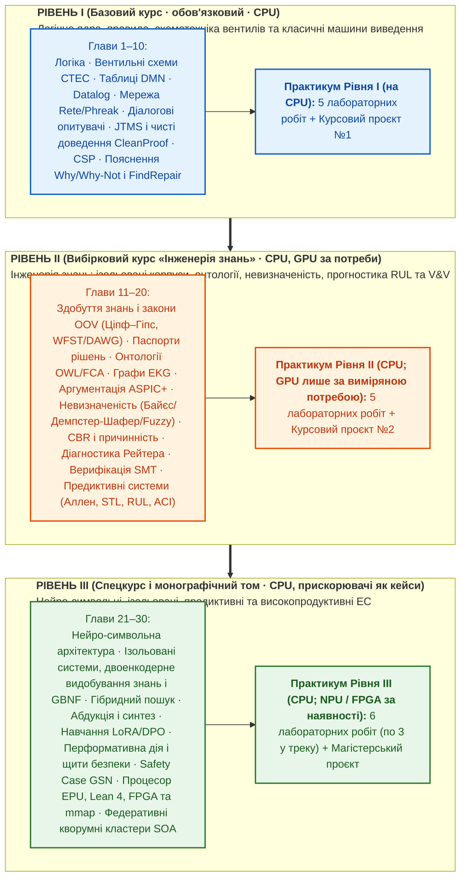

# Концепція та архітектурний план фундаментального підручника «Експертні Системи»

**Назва підручника:** **«Експертні Системи»**  
**Підзаголовок:** *Програмна інженерія систем, заснованих на знаннях: від логічних правил і продукційних мереж до нейро-символьного ШІ*  
**Автор:** Микола Мартинович Федчик  
**Цільова аудиторія:** Студенти комп'ютерних наук та програмної інженерії закладів вищої освіти (спеціальності F2 «Інженерія програмного забезпечення», F3 «Комп'ютерні науки», F4 «Системний аналіз та наука про дані», F6 «Інформаційні системи і технології» (перелік за постановою КМУ № 1021 від 30.08.2024; попередні коди — 121, 122, 124, 126)), викладачі та практикуючі інженери.  
**Дата затвердження візії:** 2026-11-03  
**Редакція:** 2026-11-03, прагматична перебудова: обов'язковий базовий курс (Том 1), вибірковий курс (Том 2) і спецкурс (Том 3); принцип «спершу CPU»; основні спеціалізовані мови базового курсу — `Prolog` і `DMN / FEEL`  

---

## 1. Головна мета трансформації книги

Перетворити вузькоспеціалізовану монографію з ухилом у вбудовані/апаратні системи безпеки на **універсальний, сучасний університетський підручник «Експертні Системи» широкого призначення**, який:

1. **Дає повну інженерну картину галузі:** охоплює як класичне ядро експертних систем (продукційні рушії `Rete/Phreak`, таблиці рішень `DMN`, зворотне виведення, інтерактивні діалогові опитувачі, програмування в обмеженнях `CSP`), так і сучасний передній край (онтології та графи знань, імовірнісні й нечіткі моделі, модельно-орієнтована діагностика, формальна верифікація `SMT` та нейро-символьна інтеграція з `LLM/SLM`).
2. **Будується за ітеративно-інкрементальним принципом (3 рівні = базовий курс, вибірковий курс і спецкурс):** обов'язковим є лише базовий семестровий курс (Том 1), у якому студент 2-го курсу бакалаврату рухається від простих детермінованих таблиць правил до класичних машин виведення. Том 2 становить вибірковий курс «Інженерія знань» для 3–4-го курсів, Том 3 — спецкурс і монографічний матеріал для магістратури та наукової роботи.
3. **Доводить практичну інженерну користь кожної теми без «води»:** кожен із трьох рівнів завершується серією виконуваних лабораторних робіт із автоматизованими тестами та переліком тем курсових проєктів із чіткими критеріями приймання.
4. **Очищений від математичної та термінологічної бутафорії:** жодних штучних фізично-термодинамічних метафор, жодного дублювання тих самих формул у десятках глав і жодної інфляції «іменних законів» на місці стандартних інженерних практик.

---

## 2. Розширення тематичного ядра: теми, які обов'язково вводяться до підручника

Щоб книга була повноцінним підручником із програмної інженерії експертних систем широкого призначення, до неї вводяться шість фундаментальних тем, яких бракувало або які були висвітлені лише побіжно:

### 2.1. Алгоритми продукційного зіставлення зі зразком у пам'яті (`Rete`, `Treat`, `Leaps`, `Phreak`)
* **Чому це критично:** Прямий перебір правил за `O(R \cdot F^k)` не працює у промислових продукційних системах, де факти змінюються інкрементально.
* **Що має вивчити студент:**
  - Компіляція продукційних правил у мережу `Rete` Чарльза Форджі: вузли типу об'єкта (`ObjectTypeNode`), альфа-вузли селекції констант (`AlphaNode`), альфа-пам'ять, бета-вузли з'єднання змінних (`JoinNode`), негативні вузли (`NotNode`) та бета-пам'ять часткових збігів.
  - Інкрементальне поширення токенів при додаванні (`assert`), зміні (`modify`) та вилученні (`retract`) фактів у робочій пам'яті (`Working Memory`).
  - Стратегії розв'язання конфліктів у порядку денному (`Agenda Conflict Resolution`): рефракція (`Refraction` — заборона повторного спрацювання на тому самому кортежі фактів), актуальність (`Recency`), специфічність (`Specificity`), пріоритети (`Salience`), алгоритми `LEX` та `MEA`.
  - Еволюція до алгоритму **`Phreak`** (сучасний стандарт у `Drools`): перехід від жадібного поширення токенів до відкладеного (лінивого) обчислення сегментів та наборів правил, орієнтованого на мету.

### 2.2. Промислові стандарти бізнес-правил та декларативних політик (`OMG DMN / FEEL`, `OPA / Rego`, `Cedar`)
* **Чому це критично:** Більшість комерційних експертних систем у банках, страхуванні, медицині, електронному урядуванні та хмарній інфраструктурі розробляються за стандартом **DMN (Decision Model and Notation)** або мовами політик **Rego / Cedar**.
* **Що має вивчити студент:**
  - Графи вимог до рішень (`DRD — Decision Requirements Diagram`) та композиція таблиць рішень.
  - Мова виразів `FEEL` (*Friendly Enough Expression Language*): робота з інтервалами, датами, списками та тризначною логікою.
  - Політики спрацювання таблиць рішень (`Hit Policies`): однозначні (`Unique`, `Any`, `Priority`, `First`) та множинні (`Collect +`, `Collect <`, `Collect >`, `Collect #`, `Rule Order`, `Output Order`).
  - Формальна перевірка таблиць `DMN`: виявлення перекриття правил (`Overlap`), прогалин покриття домену (`Missing Intervals`) та затінення правил (`Rule Shadowing`).
  - Рушії політик як легковагові експертні системи авторизації й комплаєнсу (`Open Policy Agent / Rego`, `AWS Cedar`).

### 2.3. Інтерактивні діалогові експертні системи та немонотонне керування сесією (`Mixed-Initiative Consultation`)
* **Чому це критично:** Класична експертна система — це не лише пакетний фільтр, а інтерактивний консультант (медичний тріаж, податковий майстер, діагностичний асистент), який сам ставить користувачеві мінімально необхідні запитання.
* **Що має вивчити студент:**
  - Зворотне виведення (`Backward Chaining`), кероване цілями, з динамічною генерацією запитань для невідомих листкових предикатів.
  - Критерій вибору наступного найкращого запитання (`Next-Best-Question`) за максимумом очікуваного інформаційного виграшу на одиницю вартості/часу опитування ($`\mathrm{IG}(q)/c(q)`$).
  - **Немонотонний відкат стану діалогу (`Non-Monotonic Session Backtracking`):** коли користувач на 8-му кроці змінює відповідь, дану на 2-му кроці, система через граф залежностей `JTMS` інвалідує лише залежні гілки опитування, зберігаючи валідні відповіді з незалежних гілок.

### 2.4. Програмування в обмеженнях та конфігураційні експертні системи (`CSP`, `AC-3`, `CP-SAT`)
* **Чому це критично:** Конфігуратори складних виробів (`CPQ`), планування терапії та розподіл інженерних ресурсів неможливо ефективно записати лише правилами `IF-THEN` — вони вимагають розв'язувачів задоволення обмежень (`Constraint Satisfaction Problems`).
* **Що має вивчити студент:**
  - Формалізація задачі $`\langle X, D, C \rangle`$, локальна узгодженість дуг (`Arc Consistency AC-3`), пошук із поверненням (`Backtracking + Forward Checking + MRV / LCV`).
  - Глобальні обмеження (`alldifferent`, `table`, `cumulative`, `circuit`) та оптимізація в обмеженнях (`CP-SAT` / `MiniZinc`).
  - Пошук мінімальної релаксації при несумісності вимог замовника.

### 2.5. Інженерія середовищ розроблення знань (`Knowledge Authoring UX, DSL & Decision Tables`)
* **Чому це критично:** Якщо базу знань може редагувати лише програміст на Go/C++ із калькулятором бітових зсувів, проєкт зазнає краху на етапі супроводу предметними експертами (лікарями, юристами, технологами).
* **Що має вивчити студент:**
  - Проєктування декларативних предметно-орієнтованих мов (`DSL`), табличних специфікацій та візуальних графів правил.
  - Двосторонній цикл «Експерт предметної області $\leftrightarrow$ Інженер знань $\leftrightarrow$ Автоматичний верифікатор CI/CD».

### 2.6. Предметні домени: п'ять загальних і чотири інженерні (рішення автора від 2026-11-04)

Попередня редакція замінила повторюваний у всіх главах приклад про перегрів контактора `BMS` шістьма доменами, і автомобільна тематика розчинилася в загальному домені «Інженерія та промислові кіберфізичні системи». За рішенням автора від 2026-11-04 інженерний домен розгорнуто в чотири окремі галузі, які активно розвиваються в Україні, зокрема під впливом війни та потреб відбудови. Підручник використовує дев'ять предметних доменів:

1. **Медицина та охорона здоров'я (`Clinical Decision Support Systems, CDSS`):** клінічні протоколи лікування, перевірка міжлікарських взаємодій та протипоказань, розрахунок дозування за віком і функцією нирок, невідкладний тріаж симптомів.
2. **Юриспруденція та правознавство (`Law / LegalTech / Computational Law`):** правова кваліфікація діянь і правовідносин, ієрархія нормативно-правових актів (`lex superior`, `lex specialis`, `lex posterior`), виявлення темпоральних і деонтичних колізій у кодексах, законах та договорах, формальна побудова ланцюгів доказування у судовому процесі.
3. **Фінанси, банківська справа та економічний комплаєнс (`FinTech / RegTech`):** кредитний андеррайтинг, фінансовий моніторинг (`AML / KYC`), податкові та митні тарифи, оцінювання страхових ризиків.
4. **ІТ-інфраструктура та кібербезпека (`AIOps / SecOps`):** діагностика каскадних відмов у розподілених мікросервісах, верифікація мережевих конфігурацій та політик контролю доступу.
5. **Військова справа (`Military`: логістика, технічне обслуговування, навчальні системи підтримки рішень штабу):** навчальні системи підтримки прийняття рішень (`СППР / MDMP`) у штабах, злиття розвідувальних даних із різнорідних джерел (`ISTAR`), логістика й розподіл матеріальних засобів, планування технічного обслуговування техніки, навчальна перевірка наказів на відповідність нормам права та правилам ведення бойових дій (`ROE`). Системи керування озброєнням і цілерозподіл до практикуму не входять: їх неможливо коректно відтворити на відкритих навчальних даних, а доведення відповідності специфікації не встановлює правомірності самої специфікації.
6. **Automotive:** діагностика електронних блоків керування (ЕБУ) за кодами несправностей, шлюзи випуску програмного забезпечення за повнотою свідчень, функціональна безпека й кібербезпека транспортних засобів; нормативна база: `ISO 26262`, `ISO 21448` (`SOTIF`), `ISO/SAE 21434`, правила ЄЕК ООН № 155 і № 156.
7. **Енергетичні системи:** діагностика силового обладнання (зокрема інтерпретація аналізу розчинених у маслі трансформатора газів за `IEC 60599`), планування ремонтних перемикань, стійкість розподіленої генерації та захист інфраструктури; нормативна база: `IEC 61850`, `IEC 62443`, `IEC 60599`.
8. **Мікроелектроніка:** перевірка правил проєктування топології (`DRC`), діагностика несправностей цифрових схем за результатами тестування, трасованість вимог до `RTL` і тестів, кваліфікація мікросхем; нормативна база: `ISO 26262-11`, `AEC-Q100`.
9. **Навігаційні системи та безпілотні літальні апарати (БпЛА) цивільного й військового призначення:** контроль цілісності навігації (узгодженість `GNSS`, інерціальної системи й барометра, ознаки спуфінгу та глушіння), передпольотний допуск, геозонування й безпека польоту, планування техобслуговування; нормативна база: `DO-178C`, Регламент (ЄС) 2019/947 для цивільних операцій. **Межа:** наведення на ціль і керування ураженням до курсу не входять, так само як системи керування озброєнням у військовому домені.

**Правило використання.** Кожна глава спирається на 2–4 основні домени, у яких її метод застосовується природно, а не на всі дев'ять: так кожен приклад можна розібрати глибоко. Кожен домен з'являється щонайменше в шести главах. Глава 1 оглядає всі домени.

| Глава | Основні домени |
|---|---|
| 1 | усі дев'ять доменів (огляд) |
| 2 | медицина, право, військова справа, фінанси, ІТ-інфраструктура, енергетичні системи |
| 3 | навігаційні системи та БпЛА, медицина, право |
| 4 | фінанси, медицина, Automotive |
| 5 | ІТ-інфраструктура, Automotive, енергетичні системи |
| 6 | фінанси, ІТ-інфраструктура, енергетичні системи |
| 7 | медицина, Automotive, ІТ-інфраструктура |
| 8 | навігаційні системи та БпЛА, мікроелектроніка, медицина |
| 9 | Automotive, мікроелектроніка, військова справа, медицина |
| 10 | право, фінанси, мікроелектроніка |
| 11 | право, медицина, військова справа, Automotive |
| 12 | мікроелектроніка, медицина, енергетичні системи |
| 13 | право, Automotive, ІТ-інфраструктура |
| 14 | Automotive, мікроелектроніка, ІТ-інфраструктура |
| 15 | право, військова справа, фінанси |
| 16 | навігаційні системи та БпЛА, медицина, військова справа |
| 17 | фінанси, медицина, енергетичні системи |
| 18 | мікроелектроніка, Automotive, ІТ-інфраструктура |
| 19 | Automotive, медицина, фінанси |
| 20 | енергетичні системи, навігаційні системи та БпЛА, Automotive |
| 21 | медицина, військова справа, енергетичні системи |
| 22 | право, Automotive, медицина |
| 23 | право, мікроелектроніка, Automotive |
| 24 | ІТ-інфраструктура, енергетичні системи, мікроелектроніка |
| 25 | фінанси, ІТ-інфраструктура, навігаційні системи та БпЛА |
| 26 | навігаційні системи та БпЛА, енергетичні системи, Automotive |
| 27 | Automotive, навігаційні системи та БпЛА, енергетичні системи |
| 28 | мікроелектроніка, Automotive, навігаційні системи та БпЛА |
| 29 | військова справа, енергетичні системи, право |
| 30 | фінанси, ІТ-інфраструктура, енергетичні системи |

### 2.7. Інтеграція матеріалу та перевірених результатів із трьох суміжних книг автора

До єдиного підручника «Експертні Системи» системно включаються найкращі теоретичні моделі, алгоритми та експериментально верифіковані артефакти з трьох спеціалізованих праць автора:

1. **З книги «Схемотехніка експертних систем» ([Epistemic_Circuit_Theory / Expert_System_Circuits](../Epistemic_Circuit_Theory/README.md)):**
   - **Ациклічні обчислювальні схеми міркування (`DAG` вентилів і ліній стану):** подання бази правил у вигляді орієнтованих графів без циклів зі скінченним детермінованим часом проходження сигналу (`WCET`) та спільним 8-операторним ядром (`INPUT`, `JOIN`, `REFINE`, `MATCH`, `DERIVE`, `STATUS`, `SELECT`, `ANSWER` + `PROPOSE`) для прямого прогнозу (`Forecast`), перевірки (`Whether`) і зворотної діагностики (`Why`).
   - **Ідемпотентна алгебра першоджерел у `DAG` зі спільними предками:** двобітове кодування решітки Белнапа $`\mathcal{B}_4`$, захист від помилки повторного додавання копій одного свідчення та стиснені формати зберігання множин походження (`Sparse` — зменшення пам'яті на `92,39%`, `Root-Trace` — прискорення у `20,9` раза).
   - **Двопрохідне виділення чистих доведень (`CleanProof`) та кеш із конусом заперечень (`OPPOSITION_CONE`):** лінійний алгоритм виділення незабрудненого піддерева доведення у графах, де паралельна дублювальна гілка містить суперечність (`BOTH`), та інкрементальна інвалідація кешу вздовж конуса заперечень.
   - **Нормативні вентилі з винятками (`undercut`) та зворотний синтез безпечних ремонтів (`FindRepair`):** автоматичний пошук мінімального набору виправлень у разі відмови з фільтром проти послаблювальних «ремонтів» Гудхарта та механізована верифікація шлюзу допуску в `Lean 4` (`Kernel.lean`: теореми `soundness`, `allow_iff_P`, фільтр релевантних атомів `relevantAtom` проти телеметричного спаму).
   - **Безцикловий асемблер `EPU` (`forward-only jumps`) та апаратний компаратор на `FPGA`:** трансляція правил у потік регістрових інструкцій із переходами лише вперед та однотактовий компаратор допусків на деревах збереження переносу (`csa64`): функціональну відповідність еталонній моделі на Go перевірено на 58 627 векторах у двох симуляторах (`Icarus Verilog`, `Verilator`) без розбіжностей, а статичний аналіз таймінгу після розміщення (`nextpnr-ice40`) для `iCE40HX8K` дає `104,5–110,6 МГц` за п'яти зерен; вимірювань на фізичній платі не виконано, і результат стосується лише фінального компаратора, а не всього ядра виведення.

2. **З книги «Ізольовані експертні системи» ([Isolated_Expert_Systems](../Isolated_Expert_Systems/README.md)):**
   - **Теорія ізольованих та корпусно-обмежених систем (`Air-Gapped / Corpus-Bound / On-Premise ES`):** формальна модель контрольованих каналів інформаційного обміну для систем, що працюють без доступу до Інтернету та хмарних API над фіксованим локальним корпусом документів $`\mathcal{K}_0`$.
   - **Квантитативні закони скінченного корпусу та катастрофа позасловникових слів (`OOV`):** закони Ціпфа — Мандельброта та Хердана — Гіпса ($`\lvert V(N)\rvert = K N^\beta`$), ненульова ймовірність $`p_{\mathrm{OOV}}(N) > 0`$ та доказ небезпеки припущення замкненого світу (`CWA`) при появі невідомих термінів або словоформ.
   - **Символьні та гібридні офлайн-методи подолання `OOV`:** дворівнева скінченно-автоматна морфологія Коскенніємі, зважені трансдьюсери (`WFST`), мінімальні словникові автомати (`DAWG`), автомати Левенштейна, парадигмальна аналогія та їх поєднання з субсловним кодуванням `BPE` і вентилем селективної відмови Чоу — Ель-Яніва.
   - **Двоенкодерні архітектури видобування знань без навчання (`Zero-Shot IE` екосистеми `Knowledgator`):** локальні моделі `GLiNER-bi`, `GLiNER-Relex` та `GLiClass` із попереднім офлайн-кешуванням векторів онтології, що забезпечують високошвидкісну екстракцію сутностей і відношень без звернення до зовнішніх `LLM`.

3. **З книги «Предиктивні експертні системи» ([Prediction_Expert_Systems](../Prediction_Expert_Systems/README.md)):**
   - **Демаркація предикативних і предиктивних (випереджальних за Розеном) експертних систем:** перехід від оцінки поточного стану в момент $`t_0`$ до виведення майбутньої траєкторії $`\hat{\mathbf{x}}(t_0 + \tau)`$ на горизонті випередження $`\tau > 0`$ з урахуванням нерівності горизонту прогнозу Ляпунова.
   - **Інтервальна темпоральна алгебра Аллена та сигнальна темпоральна логіка (`STL`):** 13 часових відношень між інтервалами подій за Алленом та кількісна семантика запасу стійкості Малера — Нічковича $`\rho(\varphi_{[a,b]}, \hat{\mathbf{x}}, t_0)`$ для неперервних траєкторій.
   - **Стохастичні моделі деградації та залишковий корисний ресурс (`RUL — Remaining Useful Life`):** моделювання накопичення зносу процесами Вінера з дрейфом і гамма-процесами; аналітичний розрахунок часу першого досягнення порогу відмови.
   - **Каузально-конформне та перформативне прогнозування і перехід до допустимої дії (`Actionable Oracle`):** поєднання інтервенційного числення Перла $`\mathrm{do}(\mathbf{u})`$ з адаптивними конформними інтервалами (`ACI`), урахування рефлексивного впливу самого прогнозу на об'єкт керування (*Performative Prediction*) та верифікація прогнозованої дії на платах класу `PYNQ-Z1` (`Go + Ollama + FPGA`).

### 2.8. Принцип «спершу CPU» (`CPU-first`) замість прив'язки обладнання до семестрів

Апаратне забезпечення не є хребтом курсу. Навчальні бази правил, графи знань і таблиці рішень розміром $`10^3`$–$`10^6`$ елементів обробляються на звичайному процесорі, тому обов'язковим обладнанням усіх трьох томів є ноутбук або ПК студента. Прискорювач залучається лише тоді, коли вимірювання на `CPU` показує, що задача не вкладається в заданий бюджет часу або енергії, і лише в тих лабораторних, де саме це вимірювання є частиною завдання.

| Рівень | Обов'язкове обладнання | Необов'язкове обладнання та умова його залучення |
| :--- | :--- | :--- |
| **Рівень I (базовий курс)** | Багатоядерний `CPU` (`x86-64 / ARM64`) | Не потрібне. Фокус: асимптотична складність, пам'ять `RAM`, відсутність зайвих алокацій. |
| **Рівень II (вибірковий курс)** | Багатоядерний `CPU` | Дискретний `GPU` з підтримкою `PyTorch` або `ONNX Runtime` — лише для пакетного виведення двоенкодерних моделей і масового Монте-Карло, коли виміряний на `CPU` час перевищує бюджет лабораторної. |
| **Рівень III (спецкурс)** | Багатоядерний `CPU` | `NPU`, тензорні прискорювачі та навчальні плати `FPGA` — як окремі кейси енергоефективного виконання й апаратних шлюзів допуску, за наявності обладнання в лабораторії кафедри. |

Конкретні моделі відеокарт, нейропроцесорів і плат у назвах глав та обов'язкових вимогах не фіксуються, бо вони застарівають швидше за видання. Для лабораторних наводиться перелік перевірених конфігурацій із датою перевірки та посиланням на офіційну матрицю сумісності виробника. Тип прискорювача обирається за підтримкою потрібних операторів моделі, а не за брендом: прискорювачі для згорткових мереж комп'ютерного зору можуть не підтримувати трансформерні мовні моделі.

### 2.9. Принцип апріорної незалежності від мов програмування загального призначення (`Language-Agnostic General Programming`) та автентичність спеціалізованих мов

Фундаментальний методичний принцип підручника полягає в тому, що **архітектура, алгоритми та математичні моделі експертних систем є апріорно незалежними від конкретної імперативної чи об'єктно-орієнтованої мови програмування загального призначення**:

1. **Відсутність примусу до однієї мови загального призначення:**
   - Усі базові алгоритми (`Rete/Phreak`, `JTMS/ATMS`, `AC-3`, `QuickXPlain`, `HS-DAG` Рейтера, `ASPIC+`, `CleanProof`, `FindRepair`, `BM25/RRF`, `CUSUM`, `ACI`) описуються мовно-незалежними структурними специфікаціями та псевдокодом із чіткими контрактами входів, виходів і типів даних.
   - Студент, викладач або інженер має повну свободу виконувати лабораторні та курсові проєкти будь-якою мовою загального призначення: **Python, C / C++, Rust, Go, Java / Kotlin, C#, TypeScript / JavaScript, Ada / SPARK**.
2. **Об'єктивний інженерний аналіз сильних і слабких сторін мов за класами задач:**
   Замість догматичного нав'язування одного стека підручник навчає студента свідомо обирати інструмент під вимоги конкретної підсистеми:

| Клас задач експертної системи | Рекомендовані мови загального призначення | Сильні сторони | Слабкі сторони та інженерні обмеження |
| :--- | :--- | :--- | :--- |
| **Швидке прототипування, NLP-конвеєри, робота з `GPU / NPU` та наукові розрахунки** | **Python** (`PyTorch`, `ONNX`, `Z3-Python`, `NetworkX`) | Найбагатша екосистема ШІ, лінгвістики та солверів; мінімальний поріг входу для студентів. | Глобальне блокування інтерпретатора (`GIL`), високе споживання пам'яті, непередбачувані затримки для жорсткого реального часу. |
| **Корпоративні системи бізнес-правил (`BRMS`), банківський і медичний сектор** | **Java / Kotlin**, **C# (.NET)** | Промислові рушії (`Drools / Kogito`, `jBPM`), строга типізація, зріла інфраструктура корпоративної інтеграції. | Паузи збирача сміття (`GC pauses`), великий обсяг оперативної пам'яті рантайму (`JVM / CLR`). |
| **Високонавантажені мережеві сервіси знань, рушії правил і політик, кластери `SOA` та хмарна інфраструктура** | **Go** | Компіляція в один статичний виконуваний файл, легкі горутини й канали для конкурентності, швидка збірка, багата стандартна бібліотека для мереж; мовою Go написано `Open Policy Agent`, `Kubernetes`, `etcd` та еталонну реалізацію `СТЕС`. | Збирач сміття з короткими, але недетермінованими паузами не дає гарантувати мікросекундний `WCET`; бібліотек для ШІ та обробки природної мови значно менше, ніж для `Python`. |
| **Веб-інтерфейси експертних систем, редактори правил і таблиць рішень, діалогові консультанти, API-шлюзи** | **TypeScript / Node.js** | Одна мова для браузера й сервера, асинхронний цикл подій для навантаження з переважанням введення-виведення, статична типізація `TypeScript` і екосистема `npm`, зокрема браузерний редактор таблиць `DMN` `dmn-js`. | Один потік циклу подій: тривале виведення блокує обробку запитів без робочих потоків (`worker threads`). Тип `number` є 64-бітним числом із рухомою комою, тому грошові суми й великі цілі потребують `BigInt` або десяткової арифметики. Типи `TypeScript` під час виконання не перевіряються, отже вхідні дані потрібно валідувати окремо. |
| **Вбудовані системи реального часу, оборонна кібернетика, авіоніка та `Zero-Copy mmap`** | **Rust**, **C / C++**, **Ada / SPARK** | Відсутність збирача сміття (`No GC`), детермінований час відгуку (`WCET`), прямий контроль розміщення в кеші та пам'яті, висока безпека пам'яті в `Rust` і формальна верифікованість в `Ada/SPARK`. | Вища складність розроблення та повільніший цикл експериментування з високорівневими моделями. |

3. **Автентичне вивчення спеціалізованих мов інженерії знань (`Domain-Specific & Declarative Languages`) із двома основними мовами базового курсу:**
   Обов'язковими в Томі 1 є `Prolog` (`SWI-Prolog`, разом із `Datalog` як підмножиною без функціональних символів) і `OMG DMN / FEEL`. Інші мови подаються у своєму канонічному синтаксисі як короткі ілюстрації: `CLIPS` — у главі про `Rete`, `MiniZinc`, `clingo` (`ASP`) і `PDDL` — у главі про обмеження, набори відповідей і планування, `Common Lisp` — в історичному огляді. Мови онтологій і `SMT-LIB` стають робочими у вибірковому курсі, `Lean 4`, `Verilog` і `GBNF` — у спецкурсі.

   Принцип мовної нейтральності **не поширюється** на спеціалізовані декларативні, логічні, символьні та верифікаційні мови, які становлять золотий фонд комп'ютерних наук. Вони подаються в підручнику у своєму **справжньому канонічному синтаксисі**:
   - **Класичні символьні та логічні мови:** `Prolog` (ISO Prolog / SWI-Prolog), `Datalog` (`Soufflé`), `Answer Set Programming` (`Clingo ASP`), `Common Lisp / Scheme` та продукційна мова `CLIPS`;
   - **Промислові мови правил і політик:** `OMG FEEL / DMN`, `Drools DRL`, `Rego` (`Open Policy Agent`), `Cedar`;
   - **Мови онтологій і графів знань:** `OWL 2` (Manchester / Turtle Syntax), `RDF / SPARQL`, `SHACL`;
   - **Мови формальної специфікації, обмежень і доведення теорем:** `SMT-LIB v2` (`Z3` / `CVC5`), `MiniZinc` (`CSP`), `Lean 4` (механізоване доведення теорем коректності шлюзу);
   - **Мови опису апаратури (для Тома 3):** `Verilog-2005 / SystemVerilog` (синтез однотактових шлюзів і компараторів на `FPGA`).

---

## 3. Критична ревізія авторських блоків (`> [!NOTE]`): відсіювання стандартних практик від справжніх авторських результатів

У попередній редакції книги налічувалося понад **150 блоків** із назвами *«Закон... автора»*, *«Принцип... автора»*, *«Парадигма... автора»*. Більшість із них описували загальновідомі інженерні практики (нормалізація одиниць СІ, перевірка `SHA-256`, кеш-вирівнювання, гістерезис, `mmap`), що розмивало наукову достовірність тексту.

### 3.1. Правило демаркації для нового підручника
1. **Класичні алгоритми та загальноприйняті інженерні практики** (Байєс, `Rete`, Демпстер–Шафер, Дунг, Рейтер, `QuickXPlain`, `SHA-256`, `Merkle Tree`, `mmap`, `SIMD`, вирівнювання по 64 байти, нормалізація СІ, тригер Шмітта, `RRF`, `BM25`, `ECE`, `Brier Score`, `Clopper-Pearson 3/N`) подаються **під їхніми канонічними світовими назвами з посиланням на першоджерела** без приписування авторові підручника.
2. У блоках `> [!TIP]` або `> [!IMPORTANT]` формулюються **«Інженерні інваріанти»** та **«Практичні правила проєктування»** без слів «закон автора».
3. Статус **авторської моделі або архітектурного патерна** зберігається лише за **14 реалістичними, наскрізними результатами** (включно з перевіреними моделями із книг «Схемотехніка експертних систем», «Ізольовані експертні системи» та «Предиктивні експертні системи»), де дійсно запропоновано нову архітектурну чи алгоритмічну композицію:

| № | Залишений авторський результат (14 ядерних концепцій на весь підручник) | У чому полягає реальний інженерний зміст (без бутафорії) | Де розташовується | Рівень підстав (2026-11-04) | Найближчі попередні роботи |
| :-: | :--- | :--- | :--- | :--- | :--- |
| **1** | **Архітектурний розподіл «Релевантність проти Допустимості» (`Relevance vs Eligibility Split`)** | Суворе відокремлення стохастичного пошуку/парсингу (`LLM/RAG` — пропонує кандидатів без права вердикту) від детермінованого ядра правил (`Datalog/SMT/DMN` — володіє монополією на допуск `ACCEPT / REFUSAL`). | Рівень I, Глава 1; Рівень III, Глава 21 | Навчальний виконуваний приклад (глава 1, формула 1.23); новизну не встановлено | LLM-Modulo (2024), Logic-LM (2023), Amazon Bedrock Automated Reasoning checks |
| **2** | **Модель побайтово заземленого свідчення (`Byte-Grounded Evidence Tuple`) з картою нормалізації Unicode** | Прив'язка кожного атомарного факту у базі знань до незмінного документа через напіввідкритий байтовий інтервал $`[b_{\mathrm{start}}, b_{\mathrm{end}})`$, геш зрізу та зворотну карту індексів після нормалізації тексту. | Рівень I, Глава 4; Рівень III, Глава 22 | Заявлено; не перевірялося | W3C Web Annotation Data Model (2017), PROV-O (2013) |
| **3** | **Бітемпоральний чотиризначний шлюз застосовності правила (`Bitemporal Belnap/Kleene Gate`)** | Перевірка правила у двох часових осях (час дії норми $`t_{\mathrm{valid}}`$ та час запису в реєстр $`t_{\mathrm{tx}}`$) з розділенням станів «немає даних» ($`\mathbf{None} \to \texttt{CLARIFICATION}`$) і «колізія норм» ($`\mathbf{Both} \to \texttt{CONFLICT\_ESCALATION}`$). | Рівень I, Глава 3; Рівень II, Глава 12 | Заявлено; не перевірялося | Бітемпоральні бази даних, логіка Белнапа (1977); пошук не завершено |
| **4** | **Двопрохідне виділення чистих доведень (`CleanProof`) та кеш із конусом заперечень (`OPPOSITION_CONE`)** *(із книги СТЕС)* | Лінійний алгоритм побудови незабрудненого дерева доведення у графах зі суперечностями без експоненційного перебору піддерев та точкова інвалідація кешу вздовж конуса заперечень. | Рівень I, Глава 8 | Формалізовано в ядрі шлюзу на Lean 4 (компіляцію перевірено); тести Go проходять | JTMS Дойла (1979), ATMS де Клеєра (1986), ASPIC+ (2014) |
| **5** | **Зворотний синтез безпечних ремонтів (`FindRepair`) із анти-Гудхартівським фільтром** *(із книги СТЕС)* | Пошук мінімального набору корекцій параметрів для відновлення дозволу у нормативних схемах з винятками (*lex specialis*), який забороняє «ремонти» шляхом вимкнення захисних предикатів. | Рівень I, Глава 10; Рівень II, Глава 15 | Реалізовано на Go (`repair.go`), тести проходять | Діагностика Рейтера (1987), MUS/MCS (2008), FastDiag (2012) |
| **6** | **Паспорт інженерного рішення (`Institutional Memory Passport`) з умовами фальсифікації** | Структура збереження архітектурного правила разом із відкинутими альтернативами та формальними предикатами-фальсифікаторами $`\mathcal{D}_{\mathrm{falsifiers}}`$, спрацювання яких автоматично інвалідує правило при зміні контексту. | Рівень II, Глава 14 | Заявлено; не перевірялося | Architecture Decision Records (Nygard, 2011) |
| **7** | **Гібридний офлайн-конвеєр подолання позасловникової невизначеності (`WFST + DAWG + GLiNER-bi + Chow Gate`)** *(із книги Ізольовані ЕС)* | Поєднання автоматних морфологічних трансдьюсерів із двоенкодерним `Zero-Shot` видобуванням сутностей з кешованою онтологією для повністю ізольованих (`Air-Gapped`) експертних систем. | Рівень II, Глава 11; Рівень III, Глава 22 | Заявлено; не перевірялося | Пошук не виконувався |
| **8** | **Піраміда тестування баз знань (`Knowledge Testing Pyramid, KTP`) із антивакуумним та мутаційним контролем** | Чотирирівнева верифікація бази правил: (1) синтаксис і розмірності СІ, (2) невакуумне покриття антецедентів і граничних точок `BVA`, (3) мутаційне тестування граничних операторів правил, (4) метаморфна інваріантність до перефразувань (`SIS`). | Рівень II, Глава 19 | Заявлено; не перевірялося | Мутаційне тестування (1978), виявлення порожньої істинності (2001) |
| **9** | **Каузально-конформний прогностичний оракул допустимої дії (`STL + RUL + ACI + Actionable Gate`)** *(із книги Предиктивні ЕС)* | Поєднання сигнальної темпоральної логіки `STL`, стохастичної оцінки залишкового ресурсу `RUL` та адаптивних конформних меж `ACI` для превентивного переходу до безпечної дії з урахуванням перформативного впливу прогнозу. | Рівень II, Глава 20; Рівень III, Глава 26 | Заявлено; не перевірялося | Пошук не виконувався |
| **10** | **Конвеєр компіляції нормативних вимог із граматичним маскуванням (`EARS/GBNF-to-Rule Compiler`)** | Двоетапна формалізація тексту: обмежене граматикою `GBNF` вилучення предикатно-аргументного фрейму малою моделлю із подальшою сортовою та розмірнісною перевіркою перед генерацією правила. | Рівень III, Глава 22 | Заявлено; не перевірялося | Пошук не виконувався; споріднене: декодування з граматичними обмеженнями (2023) |
| **11** | **Дворежимна архітектура «Суворий вердикт + Ізольована абдуктивна гіпотеза» (`Dual-Mode Strict/Advisory Engine`)** | Одночасна видача гарантованого дедуктивного результату (`Strict Channel`) та відокремлених, явно промаркованих робочих гіпотез (`Advisory Channel`), яким апаратно й програмно заборонено впливати на виконавчі дозволи. | Рівень III, Глава 24 | Заявлено; не перевірялося | Пошук не виконувався |
| **12** | **Модель операційного обліку епістемічного боргу (`Epistemic Debt & R&D Payback Calculus`)** | Кількісна пріоритезація неформалізованих прогалин бази знань за добовими витратами на ручну ескалацію запитів та строком окупності лабораторної верифікації правил. | Рівень III, Глава 24 | Заявлено; не перевірялося | Технічний борг (Cunningham, 1992); попередні вживання терміна не перевірено |
| **13** | **Безцикловий процесор знань `EPU`, механізоване ядро `Lean 4` та контейнер `Zero-Copy mmap`** *(із книги СТЕС)* | Компіляція ациклічних правил у потік інструкцій `forward-only jumps` із доведеним у `Lean 4` шестискладовим контрактом допуску, синтезом на `FPGA` (`csa64`) та миттєвим монтуванням пакетів `.kp` через `mmap`. | Рівень III, Глава 28 | Доведення Lean 4 перевірено; еквівалентність RTL і таймінг після розміщення відтворено; на фізичній платі не вимірювалося | Верифікатор eBPF до Linux 5.3 (2019), аналіз WCET (Wilhelm та ін., 2008) |
| **14** | **Федеративна арена міжпакетного виведення з контролем кворуму епох (`Federated Epistemic SOA`)** | Протокол узгодженого логічного виведення над розподіленими пакетами знань різних відомств/підсистем із захистом від розколу версій (`split-brain`) через перетин кворумів епох та оренду повноважень (`lease`). | Рівень III, Глава 30 | Заявлено; не перевірялося | Зважене голосування Гіффорда (1979), оренди Грея й Черітона (1989), Paxos |

4. **Єдина будова подання авторських конструкцій у главах (рішення автора від 2026-11-04):** класичний базис із першоджерелами → авторське розширення → рівень підстав (доведено в Lean, відтворено, виміряно, гіпотеза) → відкриті питання. Новизна не заявляється без порівняння з попередніми роботами, наведеними в останньому стовпці таблиці.

### 3.2. Що вилучається зі статусу «Авторський закон / принцип» (переводиться у стандартний навчальний матеріал)
* Усі стандартні перетворення одиниць СІ (`UCUM`), перевірки `UTF-8` та `SHA-256` $\to$ звичайні параграфи про інженерну гігієну даних.
* Усі апаратні прийоми (`64-byte cache line`, `SIMD popcount`, `DMA double buffering`, `Q16.16 fixed-point`, `eBPF/XDP`) $\to$ стандартні методи системного програмування у спеціалізованому розділі Рівня III.
* Стандартні статистичні й пошукові методи (`BM25`, `RRF`, `MinHash`, `Adamic-Adar`, `Clopper-Pearson`, `Wilson interval`, `CUSUM`, `SPRT`, `Mahalanobis gate`) $\to$ класичний математичний апарат із посиланням на авторів відповідних теорем.

---

## 4. Вимоги до системного дидактичного викладення матеріалу

Кожна глава нового підручника «Експертні Системи» будується за єдиним методичним стандартом університетського підручника:

1. **Прогресивна складність без забігання наперед (Закон передумов):**
   Жодна глава не використовує як робочий інструмент метод, що вивчається на пізнішому рівні. Короткий орієнтир із прямим посиланням на пізнішу главу допустимий, якщо без нього читач не зрозуміє межі поточного методу: наприклад, глава 1 розмежовує пошукову та експертну системи, не вивчаючи мовних моделей. У базовому курсі студент працює з логікою висловлювань і предикатів, таблицями рішень, машинами виведення та мережею `Rete`; методи мовних моделей, `FPGA` чи `mmap` у ньому не застосовуються. Виняток, погоджений автором 2026-11-04: розширений рівень лабораторної 1.1 використовує заздалегідь записані відповіді мовної моделі як кандидатів, яких перевіряє таблиця рішень за розподілом «Релевантність проти Допустимості»; модель у базовому курсі не запускається й не вивчається.
2. **Канонічний 7-кроковий каркас кожної глави:**
   1. **Інженерна проблема та пастка наївного підходу:** реальна життєва ситуація (медична, фінансова, ІТ або інженерна), де `if/else` у коді або статистичне вгадування призводить до аварії чи суперечності.
   2. **Інтуїтивне пояснення та візуальна модель:** схема або діаграма, зрозуміла студентові без спеціальної математичної підготовки.
   3. **Формальний математичний апарат:** означення, теорема або інваріант із повним поясненням кожного символу, області допустимих значень та одиниць вимірювання.
   4. **Наскрізний покроковий розрахунок вручну (`Worked Example`):** повне трасування алгоритму на малій таблиці з 4–6 правил або фактів, яке студент може повторити з олівцем на папері.
   5. **Еталонна програмна реалізація (лістинги книги — `Python`, студент може використати будь-яку мову загального призначення) або запис спеціалізованою мовою курсу:** чистий, самодостатній лістинг (до 45 рядків у тілі тексту), який безпосередньо реалізує щойно розібрану формулу чи алгоритм і супроводжується модульним тестом.
   6. **Межі застосовності, обчислювальна складність і типові помилки:** оцінка часу `O(...)` і пам'яті, граничні випадки (порожня база, цикл у правилах, колізія норм) та коли цей метод застосовувати **не можна**.
   7. **Контрольні запитання та задачі для самостійного розв'язання (3 рівні складності):** базові (перевірка розуміння), розрахункові (трасування вручну) та інженерні (модифікація коду).
3. **Принцип «Одна формула — одне базове виведення» (Zero Duplication):**
   Кожна фундаментальна формула (`Байєс`, `RRF`, `ECE`, `Clopper-Pearson 3/N`, `SHA-256 span`) виводиться і нумерується у своїй профільній главі **рівно один раз**. Усі наступні глави посилаються на неї за номером, не роздуваючи обсяг книги.
4. **Наскрізна лінія суспільних наслідків і регулювання (рішення автора від 2026-11-04):**
   Етика, упередження даних, приватність, людський нагляд і регуляторні вимоги вивчаються разом із методами, до яких вони застосовуються, а не окремим заняттям, як рекомендує CS2023. Кожен приклад із регульованого домену показує, яку вимогу виконує механізм глави: облік першоджерел — журналювання (стаття 12 Регламенту ЄС про ШІ), пояснення — прозорість (стаття 13), стани `CLARIFICATION` і `QUALIFIED` та безпечна відмова — людський нагляд (стаття 14). Зведену регуляторну карту доменів подано в главі 10 (підрозділ 1.4).

---

## 5. Трирівнева структура підручника «Експертні Системи»: базовий курс, вибірковий курс і спецкурс (30 глав)

Замість 40 нерівномірних глав книга структурується у **3 логічно завершені рівні по 10 глав (30 глав)**. Обов'язковим є лише Рівень I — базовий семестровий курс. Рівень II є вибірковим курсом, Рівень III — спецкурсом і монографічним матеріалом; кожен рівень має власний лабораторний практикум і пул курсових проєктів. Орієнтовний обсяг кожного рівня — 6 кредитів ЄКТС (180 год), курсовий проєкт має окремі кредити (2–3 кредити ЄКТС). Академічна програма слугує автору методичним орієнтиром для послідовного викладу великого обсягу матеріалу, а не обов'язковою вимогою акредитації; навантаження й зрозумілість першим перевірить пробний курс усередині компанії. Над томами введено **модулі** (рішення автора від 2026-11-04): кожен модуль об'єднує 1–2 послідовні глави й одну лабораторну. Базовий і вибірковий курси складаються з п'яти модулів (близько 1,2 кредиту ЄКТС кожен). Том 3 поділено на два треки по три модулі (близько 2 кредитів кожен), і спецкурс обсягом 6 кредитів — це один трек на вибір: трек A «Нейро-символьні системи й мовні моделі» (глави 21–25) або трек B «Критичні до безпеки й високопродуктивні системи» (глави 26–30). Склад модулів наведено в змістах томів.

---

### РІВЕНЬ I (Базовий курс · бакалаврат, 2 курс · 6 кредитів ЄКТС, курсовий проєкт — окремі кредити)
### «Основи експертних систем: логіка, продукційні правила, схемотехніка міркувань та класичні машини виведення»

* **Пререквізити студента:** Дискретна математика, базове програмування (будь-яка мова загального призначення на вибір студента: Python, C/C++, Rust, Go, Java/Kotlin, C#) та структури даних (дерева, графи, хеш-таблиці); основні спеціалізовані мови курсу вивчаються з нуля (`Prolog` разом із `Datalog`-підмножиною та `DMN / FEEL`); `CLIPS`, `MiniZinc`, `clingo` (`ASP`), `PDDL` і `Common Lisp` подаються як короткі ілюстрації.
* **Обладнання базового курсу (`Standard Multi-Core CPU`):** Усі алгоритми, лабораторні та курсові роботи базового курсу проєктуються й виконуються виключно на **звичайному багатоядерному процесорі `CPU` (`x86-64` або `ARM64`)** стандартного студентського ноутбука без потреби у зовнішніх прискорювачах. Інженерний акцент робиться на асимптотичній складності алгоритмів у пам'яті `RAM`, локальності даних у кеші `CPU` (`L1/L2/L3`), бітових масках першоджерел та багатопотоковому виконанні.
* **Освітній результат базового курсу:** Студент уміє формалізувати прикладні правила предметної області, будувати ациклічні вентильні схеми міркувань (`СТЕС`) і таблиці рішень `DMN`, реалізовувати машини прямого (`Rete/Phreak`) і зворотного виведення, створювати інтерактивні діалогові опитувачі, виділяти чисті доведення (`CleanProof`) у суперечливих графах та розв'язувати конфігураційні задачі в обмеженнях (`CSP`).

#### Перелік глав Рівня I (Глави 1–10):
1. **Глава 1. Передумови та основні поняття експертних систем**
   - Потреби розвитку інформаційних систем, історія експертних систем і класифікація задач; базові поняття, архітектура та цикл консультації; ролі учасників і перевірка знань; межі висновків, прикладні сценарії та карта навчальних результатів глав 2–10. Спеціалізовані лінії стану, оператори й оцінки часу ациклічного виконання розглядаються після логічних основ у Главі 5, а не як фундамент вступної глави.
2. **Глава 2. Логічні основи подання знань** *(на базі старих ch02, ch06 §1–2)*
   - Пропозиційна логіка, імплікація проти причинності, замкнені предикати, безпечні змінні, правила Горна, припущення замкненого (`CWA`) та відкритого (`OWA`) світу.
3. **Глава 3. Неповні дані, суперечності та походження фактів** *(на базі старих ch02, ch06 §3, ch31 + СТЕС ch02)*
   - Чому булевого `true/false` недостатньо; розрізнення браку даних ($`\mathbf{None}`$) та колізії правил ($`\mathbf{Both}`$); вентилі `TruthAnd`, `Priority` та `IntervalGuard`; дедуплікація першоджерел у `DAG` зі спільними предками (`Dense`, `Sparse`, `Root-Trace`) проти помилки подвійного обліку копій.
4. **Глава 4. Продукційні правила й таблиці рішень** *(НОВА розширена глава + елементи ch07, ch17)*
   - Анатомія продукційного правила; графи вимог до рішень (`DRD`); синтаксис інтервалів у `FEEL`; політики спрацювання таблиць рішень (`Unique`, `Priority`, `First`, `Collect`); статична перевірка повноти й відсутності перекриттів у таблицях рішень.
5. **Глава 5. Пряме виведення та організація обчислень** *(на базі старих ch04, ch06, ch17, ch28 + СТЕС ch03)*
   - Покрокове насичення робочої пам'яті; монотонність і скінченність замикання `Datalog`; стратифіковане заперечення; спільне 8-операторне ядро `СТЕС` (`INPUT`, `JOIN`, `REFINE`, `MATCH`, `DERIVE`, `STATUS`, `SELECT`, `ANSWER`) на `CPU`.
6. **Глава 6. Продукційні мережі та керування активаціями правил** *(НОВА фундаментальна глава)*
   - Побудова альфа- та бета-мережі `Rete`; інкрементальне поширення токенів при зміні робочої пам'яті; стратегії розв'язання конфліктів (`Salience`, `Recency`, `Specificity`, `Refraction`); відкладене обчислення сегментів у `Phreak`.
7. **Глава 7. Зворотне виведення та консультаційний діалог** *(НОВА + елементи ch04, ch11, ch34 + СТЕС ch03)*
   - Редукція цілей до підцілей; побудова динамічної анкети консультації; зворотна діагностика причин із виключенням самопосилань; вибір наступного найкращого запитання за інформаційною цінністю; збереження стану сесії.
8. **Глава 8. Підтримка висновків і залежностей** *(на базі старих ch06, ch16, ch35 §4 + СТЕС ch04)*
   - Списки підтримки `IN-List` та винятків `OUT-List` за Дойлом; середовища `ATMS`; проблема забруднення чистої гілки конфліктом із паралельної дублювальної гілки; двопрохідний лінійний алгоритм `CleanProof` та кешування з конусом заперечень `OPPOSITION_CONE`.
9. **Глава 9. Обмеження, конфігурування та планування** *(НОВА розширена глава + елементи ch06, ch07)*
   - Формалізація задач конфігурування та розкладів як `CSP`; алгоритм `AC-3`; пошук із поверненням та евристики вибору змінних (`MRV`, `LCV`); глобальні обмеження та мінімальне послаблення несумісних вимог; та сама задача як програма наборів відповідей (`clingo`); класичне планування (`STRIPS / PDDL`) і межа класу «планування» за Хейєсом-Ротом.
10. **Глава 10. Пояснення рішень і пошук допустимих змін** *(на базі старої ch20 + СТЕС ch05)*
    - Побудова графа доведення для користувача; пошук мінімального конфлікту за `QuickXPlain`; синтез мінімального безпечного покриття перерізів відмов `FindRepair` із фільтром проти послаблювальних ремонтів Гудхарта.

#### Лабораторний практикум Рівня I (5 лабораторних робіт):
* **Лаб 1.1. Мала база знань мовою `Prolog` і перша таблиця рішень `DMN` (модуль М1.1):** запис навчальних правил тріажу й кредитного допуску як фактів і правил `Prolog` та як таблиці рішень із політикою `First`; пошук комбінацій, які таблиця не покриває, і безпечна відмова для них. *Розширений рівень:* таблиця рішень перевіряє кандидатів, запропонованих мовною моделлю (заздалегідь записані відповіді, без запуску моделі), і повертає `ACCEPT`, `CLARIFICATION` або `REFUSAL`.
* **Лаб 1.2. Статичний аналізатор таблиць рішень `DMN / FEEL` зі станами Кліні та Белнапа (модуль М1.2):** інтерпретатор таблиць із політиками `Unique`, `Priority`, `Collect`; автоматичне виявлення пропущених інтервалів (стан `UNKNOWN`) і перекриттів із суперечливими висновками (стан `BOTH`) на прикладах медичного тріажу, кредитного скорингу та допуску калібрування електронного блоку керування (ЕБУ).
* **Лаб 1.3. Рушій прямого виведення в трьох реалізаціях (модуль М1.3):** насичення стратифікованої програми `Datalog` до найменшої нерухомої точки, та сама база правил як ациклічна схема `СТЕС` і як мережа `Rete` з інкрементальним додаванням і вилученням фактів; порівняння часу відповіді на фактах ІТ-інфраструктури та енергетичної диспетчеризації.
* **Лаб 1.4. Інтерактивний діалоговий експерт-консультант зі зворотним виведенням та `JTMS`-відкатом (модуль М1.4):** розробка консольного/веб-опитувача, який динамічно обирає наступне запитання з максимальним інформаційним виграшем і коректно перераховує стан сесії, якщо користувач змінює попередню відповідь. Домени: медичний тріаж, діагностика автомобільних ЕБУ за кодами несправностей, техпідтримка.
* **Лаб 1.5. Конфігуратор замовлень у обмеженнях (`CSP` + `QuickXPlain`) (модуль М1.5):** реалізація перевірки сумісності компонентів за алгоритмом `AC-3` та пояснювального модуля `Why-Not`, який за допомогою `QuickXPlain` знаходить мінімальну підмножину несумісних побажань клієнта. *Розширений рівень:* та сама модель мовою наборів відповідей `clingo`. Домени: військова логістика, конфігурування варіантів ЕБУ, мікроелектроніка.

#### Теми курсових робіт Рівня I (базовий курс · довільна мова загального призначення + `Prolog` і `DMN / FEEL`):
1. **[Медицина / CDSS]** *Експертна система первинного клінічного тріажу та перевірки протипоказань лікарських засобів на базі таблиць рішень `DMN` і пояснювального дерева `Why / Why-Not`.*
2. **[Юриспруденція / Law]** *Експертна система правової кваліфікації адміністративних і цивільних правовідносин та перевірки допустимості доказів на базі продукційної мережі `Rete` та логіки Белнапа $`\mathcal{B}_4`$.*
3. **[Військова справа / Military]** *Навчальна система підтримки прийняття рішень (`СППР`) чергового офіцера штабу батальйону для оцінювання маршрутів висування та розподілу боєкомплекту в обмеженнях (`CSP` + `CleanProof`).*
4. **[Фінанси / RegTech]** *Продукційна експертна система податкового та митного комплаєнсу з інкрементальним рушієм `Rete / Phreak` та бітемпоральним обліком нормативних ставок.*
5. **[ІТ / SecOps]** *Діалогова експертна система технічної підтримки та локалізації збоїв корпоративних мереж із динамічним ранжуванням запитань за `Information Gain` та `JTMS`-відкатом.*
6. **[Automotive / Мікроелектроніка]** *Інтерактивний експертний конфігуратор варіантів електронного блоку керування (ЕБУ) на базі `CSP` із пошуком мінімальних конфліктів `QuickXPlain` та безпечних ремонтів `FindRepair`.*

---

### РІВЕНЬ II (Вибірковий курс «Інженерія знань» · бакалаврат, 3–4 курс · 6 кредитів ЄКТС)
### «Програмна інженерія знань: ізольовані корпуси, онтології, невизначеність, модельно-орієнтована діагностика, прогностика та верифікація»

* **Пререквізити студента:** Курс Рівня I, теорія ймовірностей і математична статистика, бази даних, основи паралельних обчислень.
* **Обладнання вибіркового курсу:** усі лабораторні виконуються на `CPU`. Дискретний `GPU` з підтримкою `PyTorch` або `ONNX Runtime` залучається лише в лабораторних 2.1 і 2.4 як необов'язкове прискорення пакетного виведення й Монте-Карло, коли виміряний на `CPU` час перевищує бюджет завдання; результат лабораторної не залежить від наявності `GPU`.
* **Освітній результат вибіркового курсу:** Студент уміє проводити інженерію знань з експертами, розв'язувати проблему позасловникових слів (`OOV`) у замкнених ізольованих корпусах, будувати формальні онтології та графи простежуваності, працювати з нечіткими та ймовірнісними свідченнями, реалізовувати модельно-орієнтовану діагностику Рейтера, проводити формальну верифікацію баз знань у `Z3` та будувати предиктивні експертні системи оцінювання залишкового ресурсу (`RUL` і `STL`).

#### Перелік глав Рівня II (Глави 11–20):
11. **Глава 11. Здобуття знань для експертної системи** *(на базі старих ch10, ch11 + Ізольовані ЕС ch01–ch03)*
    - Когнітивні упередження експертів, тріади Келлі, коефіцієнт узгодженості $\kappa$ Коена; степеневий закон росту словника Хердана — Гіпса ($`\lvert V(N)\rvert = K N^\beta`$) та катастрофа позасловникових предикатів (`OOV`) в ізольованих системах; скінченно-автоматна морфологія Коскенніємі (`WFST`), мінімальні словникові автомати `DAWG` та автомати Левенштейна.
12. **Глава 12. Моделі подання знань та онтології** *(на базі старих ch05, ch06, ch07, ch15, ch31; об'єднує колишні глави 12 і 13)*
    - Типологія моделей подання знань; фрейми Мінського зі слотами та успадкуванням як попередники онтологій; аксіоми `TBox` і `ABox`, профілі `OWL 2`, `OntoClean`; замкнена валідація графів за `SHACL`; відповідність Галуа та ієрархія понять за `FCA`; частковий порядок предикатів. Розмірний аналіз одиниць СІ не повторюється: його викладено в главі 2.
13. **Глава 13. Мовні моделі в підготовці та перевірці знань** *(НОВА глава, рішення автора від 2026-11-04)*
    - Мовна модель пропонує чернетки фактів, правил і фрагментів онтології, а інженер знань і перевірки бази правил вирішують, що потрапить до бази знань; структурований вихід із прив'язкою до першоджерела; шаблони вимог `EARS`; розв'язання тотожності сутностей і поповнення графа знань з обліком походження (`PROV-O`); точність, повнота, узгодженість з експертами та відтворюваність видобутого знання.
14. **Глава 14. Графи знань, трасованість та організаційна пам'ять** *(на базі старих ch08, ch09, ch18 §9)*
    - Типізовані мультиграфи вимог, коду й тестів; паспорти інженерних рішень із предикатами фальсифікації, нормований індекс актуальності корпоративної пам'яті та активні вивчені уроки (перенесено з колишньої глави 12); виявлення сирітських вимог і нетрасованого коду; прогноз пропущених зв'язків за індексом Адамік–Адара; матричне замикання досяжності (`SpMV / SpGEMM`) на `CPU` з необов'язковим перенесенням на `GPU`.
15. **Глава 15. Нормативні правила та аргументація** *(на базі старих ch06, ch14, ch27, ch31 + СТЕС ch05)*
    - Обов'язки, заборони й дозволи та межі їх формалізації; явне обґрунтування нормативних винятків і перевірка сумісності обмежень через SAT; абстрактні аргументи й кілька семантик прийнятності; три типи атак у структурованій аргументації.
16. **Глава 16. Невизначеність і способи оцінювання висновків** *(на базі старих ch04, ch06, ch07, ch37)*
    - Коли потрібні неперервні оцінки ризику; умовна незалежність і логарифмічні шанси Байєса; базова маса ймовірності та коефіцієнт конфлікту $K$ у правилі Демпстера; $t$-норми, нечітка фазифікація та дефазифікація за центром тяжіння (`COG`) і моделлю `TSK`.
17. **Глава 17. Міркування за прецедентами та причинні пояснення** *(на базі старих ch04, ch06 §13, ch07)*
    - Чотири фази циклу `CBR` (`Retrieve, Reuse, Revise, Retain`); зважені метрики близькості, індекс Тверські та структурна схожість графів `1-WL`; пакетний пошук прецедентів; парадокс Сімпсона, $do$-числення втручань $`P(Y \mid \mathrm{do}(X))`$ та контрфактичні запити у структурних причинних моделях (`SCM`).
18. **Глава 18. Діагностика на основі моделі об'єкта** *(на базі старої ch24)*
    - Діагностика від перших принципів за описом структури системи `SD` та спостереженнями `OBS`; предикати несправності `AB(c)`; побудова дерева перетинів конфліктів (`HS-DAG`); байєсівське оновлення апостеріорних імовірностей діагнозів та ентропійний вибір наступного вимірювання.
19. **Глава 19. Формальна перевірка й тестування баз знань** *(на базі старих ch14, ch23, ch36, ch39)*
    - Перевірка внутрішньої несуперечливості, повноти покриття домену та відсутності мертвих правил через `SMT`-розв'язувач (`Z3`); темпоральні контракти безпеки й живучості `LTL`; захист від порожньої істинності (*vacuous truth*); аналіз граничних значень (`BVA`), мутаційне тестування правил та матрична перевірка циклів перерахунку між модулями.
20. **Глава 20. Часові моделі, прогнозування та калібрування** *(на базі старих ch03, ch16, ch25, ch36 + Предиктивні ЕС ch01–ch04)*
    - 13 часових відношень Аллена; сигнальна темпоральна логіка `STL` із кількісним запасом стійкості $`\rho(\varphi_{[a,b]}, \hat{\mathbf{x}}, t_0)`$; стохастичні процеси деградації (Вінера, гамма) та розрахунок розподілу залишкового корисного ресурсу (`RUL`); оцінка калібрування (`ECE`, `Brier Score`), інтервали для біноміальних часток і адаптивні конформні інтервали (`ACI`).

#### Лабораторний практикум Рівня II (5 лабораторних робіт · `CPU`; `GPU` — лише за виміряною потребою):
* **Лаб 2.1. Від інтерв'ю до онтології (модуль М2.1):** словник термінів предметної області з автоматною нормалізацією словоформ (`DAWG + WFST`) для розв'язання `OOV`, онтологія `OWL 2` і форми `SHACL`, що блокують неповні записи; домени: право, медицина, енергетика.
* **Лаб 2.2. Видобування знань мовною моделлю з перевіркою (модуль М2.2):** мовна модель пропонує факти й правила з текстів норм і специфікацій (записані відповіді або локальна мала модель на `CPU`); кожен факт прив'язується до фрагмента першоджерела, перевіряється за онтологією й формами `SHACL` і лише після цього потрапляє до графа трасованості `EKG`; вимірюються точність, повнота й частка відхилених пропозицій. Домени: Automotive, право, ІТ.
* **Лаб 2.3. Аргументаційний рушій `ASPIC+ / Dung AF` та нормативні схеми з винятками (*lex specialis*) (модуль М2.3):** побудова графа аргументів та атак (`rebut` / `undercut`), обчислення `Grounded Extension` і звірка нормативних рішень із SAT-оракулом. *Розширений рівень:* злиття суперечливих свідчень за правилом Демпстера–Шафера з детектуванням високого конфлікту (навігація БпЛА: розбіжність показів GNSS та інерціальної системи).
* **Лаб 2.4. Модельно-орієнтований діагност Рейтера (`HS-DAG`) з байєсівським ранжуванням діагнозів (модуль М2.4):** автоматична локалізація кратних відмов за мінімальними конфліктами, ранжування діагнозів за апостеріорною ймовірністю та порівняння з прецедентним пошуком `CBR` на тих самих випадках; домени: мікроелектроніка (цифрові схеми), мережі ЕБУ Automotive, ІТ `AIOps`.
* **Лаб 2.5. Статична й динамічна верифікація бази правил (модуль М2.5):** `SMT`-перевірка бази правил (`Z3`) на суперечності, прогалини діапазонів і порожню істинність із мутаційним тестуванням операторів, а також темпоральні контракти `STL` для монітора залишкового ресурсу з кількісним запасом стійкості; домени: Automotive, енергетика, медичні протоколи.

#### Теми курсових робіт Рівня II (вибірковий курс · `CPU`; `GPU` за потреби):
1. **[Енергетика]** *Предиктивна експертна система оцінювання залишкового корисного ресурсу (`RUL`) силових трансформаторів на базі сигнальної логіки `STL`, процесів деградації Вінера та конформного виведення `ACI`.*
2. **[Юриспруденція / Law]** *Ізольована корпусно-обмежена експертна система автоматизованого аудиту нормативно-правових актів та виявлення колізій (`lex superior / lex specialis / lex posterior`) на базі автоматів `DAWG/WFST` та аргументаційних рамок `ASPIC+`.*
3. **[Навігація БпЛА / Військова справа]** *Експертна система контролю цілісності навігації БпЛА цивільного й військового призначення: злиття показів `GNSS`, інерціальної системи й барометра та виявлення спуфінгу й глушіння на базі теорії свідчень Демпстера–Шафера та модельно-орієнтованої діагностики.*
4. **[Медицина / CDSS]** *Верифікатор правил клінічної фармакотерапії на базі онтологій `OWL/SHACL` та `SMT`-солвера `Z3` з гарантованим виявленням конфліктних призначень.*
5. **[Фінанси / FinTech]** *Прецедентна експертна система (`CBR`) оцінювання операційних та страхових ризиків із графовим пошуком `1-WL`, причинно-наслідковою корекцією парадоксу Сімпсона та калібруванням `ECE`.*
6. **[ІТ / AIOps]** *Модельно-орієнтований діагност каскадних відмов у хмарній мікросервісній архітектурі за методом Рейтера (`HS-DAG`) з ентропійним плануванням діагностичних зондів.*

---

### РІВЕНЬ III (Спецкурс і монографічний том · магістратура, наукова робота · 6 кредитів ЄКТС на один трек)
### «Нейро-символьні, ізольовані, критичні до безпеки та високопродуктивні експертні системи»

* **Пререквізити студента:** Курси Рівнів I–II, основи машинного навчання та NLP, операційні системи, архітектура обчислювальних систем і розподілені системи.
* **Обладнання спецкурсу:** базове виконання — на `CPU`. Нейропроцесори (`NPU`), тензорні прискорювачі та навчальні плати `FPGA` розглядаються як кейси енергоефективного виконання квантованих моделей і апаратних шлюзів допуску; кожна відповідна лабораторна має `CPU`-варіант і виконується на прискорювачі лише за наявності обладнання в лабораторії кафедри.
* **Освітній результат спецкурсу:** Студент уміє проектувати повністю автономні (`Air-Gapped`) та нейро-символьні експертні системи, будувати конвеєри екстракції знань на базі двоенкодерних архітектур (на прикладі відкритих моделей сімейства `GLiNER`) і граматик `GBNF`, реалізовувати перформативно-стійкі превентивні дії, механізовано доводити коректність шлюзів допуску в `Lean 4`, компілювати правила для `NPU/FPGA` та розгортати розподілені кворумні кластери експертних систем.

#### Перелік глав Рівня III (Глави 21–30):
21. **Глава 21. Архітектура нейро-символьних та ізольованих систем** *(на базі старих ch16, ch28, ch29 + Ізольовані ЕС ch01, ch04)*
    - Чому `LLM` не може бути самостійним нормативним суддею (`LLM-as-a-Judge Trap`); теорема про каскадне накопичення помилок; п'ятикомпонентний вектор стану ізольованої системи $`\Xi(\mathcal{K}_0, q)`$; архітектура `System 1 (SLM/Bi-Encoder) + System 2 (Symbolic Verifier)` та вентиль селективної відмови Чоу — Ель-Яніва.
22. **Глава 22. Мовне опрацювання та структуроване видобування знань** *(на базі старих ch12, ch13, ch14, ch15 + Ізольовані ЕС ch04, ch06)*
    - Офлайн-кешування ембедінгів онтології у двоенкодерних моделях видобування сутностей, відношень і класів (на прикладі відкритих моделей сімейства `GLiNER`) для високошвидкісного видобування сутностей і відношень без донавчання; ізоляція числових констант і одиниць СІ; маскований `softmax` під магазинною граматикою `GBNF`; перевірка онтологічних сортів актантів та побудова побайтово заземлених правил.
23. **Глава 23. Пошук знань і перевірка підстав тверджень** *(на базі старих ch06 §10, ch16, ch19, ch29 + Ізольовані ЕС ch02, ch05)*
    - Поєднання лексичного пошуку (`BM25`), щільних векторів та графового розширення за ребрами трасованості; рангове злиття `RRF`; захист від антонімічного колапсу векторних ембедінгів; оцінка ймовірності пропуску обов'язкового дефітера; чотиризначна перевірка текстового слідування та вхідний шлюз `SPRT`.
24. **Глава 24. Виявлення прогалин і синтез нових правил** *(на базі старих ch34, ch38)*
    - Автоматичний майнінг кандидатів у правила над графами знань за припущенням часткової повноти (`PCA / AMIE`); абдуктивне висунення гіпотез відсутніх передумов; ортогональне вирівнювання просторів ознак (задача Прокруста); комбінаторне покриття 3-сторонніх взаємодій; розмірний синтез за $\Pi$-теоремою Бакінгема; добовий облік епістемічного боргу та строк окупності лабораторних досліджень.
25. **Глава 25. Оновлення знань і безперервне навчання** *(на базі старих ch25, ch26, ch33 + Предиктивні ЕС)*
    - Семантична функція втрат (`Semantic Loss`) і регуляризована дистиляція правил у малі моделі; точкове оновлення правил без катастрофічного забування (`EWC` та скорочення за ядрами `AGM`); виявлення зсуву розподілу (`Hoeffding / ADWIN`, `CUSUM`); позаполітичне оцінювання нових версій (`IPS`, `ESS`) та парний регресійний шлюз просування (`McNemar + Bootstrap`).
26. **Глава 26. Від рекомендації до контрольованої дії** *(на базі старих ch21, ch22, ch35 + Предиктивні ЕС ch05–ch06)*
    - Перформативна рівновага прогнозу $`\theta^* = \mathcal{A}(\mathcal{D}(\theta^*))`$, коли превентивна дія змінює майбутній стан об'єкта; доказовий оракул допустимих дій (`Actionable Oracle`); п'ятирівнева шкала автономності (`A0–A4`), ідемпотентні ключі та компенсаційні саги; оцінювання стану (`alpha-beta` фільтр, процес Орнштейна–Уленбека); двопороговий гістерезис безпеки, баланс робочої пам'яті `JTMS`, контроль збіжності черг за Ляпуновим та синтез реактивних щитів у іграх `GR(1)`.
27. **Глава 27. Доведення коректності та обґрунтування безпеки** *(на базі старих ch27, ch30 + СТЕС ch06)*
    - Механізоване доведення теорем коректності шлюзу допуску (`soundness`, `allow_iff_P`) у `Lean 4`; захист від телеметричного спаму через область релевантних атомів `relevantAtom`; методологія випробувань інжекцією 11 класів помилок (`F01..F11`); узгодження часових бюджетів `FTTI / ARTI`, метрики `SPFM / LFM` та компіляція графа аргументації безпеки за нотацією `GSN`.
28. **Глава 28. Апаратне прискорення та подання знань у пам'яті** *(на базі старих ch17, ch18, ch32 + СТЕС ch07 + Предиктивні ЕС звіти PYNQ-Z1)*
    - Модель продуктивності `Roofline` та енергетичний бюджет периферійних `NPU`; виконання квантованих моделей на `NPU` (`AMD XDNA / Intel NPU / Hailo-8`); розв'язання колізій м'яких правил через `Weighted Partial MaxSAT`; компіляція ациклічних правил у безцикловий асемблер `EPU` (`forward-only jumps` з гарантією `WCET`); синтез однотактового компаратора на `FPGA` (`iCE40HX8K` / `Xilinx PYNQ-Z1` на деревах збереження переносу `csa64`); бінарні пакети `.kp` із вирівнюванням по 64 байти, каскадними таблицями `MDD` та сертифікатами контрактів.
29. **Глава 29. Захищений обмін знаннями між системами** *(на базі старих ch05, ch16, ch33 + Ізольовані ЕС)*
    - Канонічне проміжне представлення правил (`OEIR`); умова консервативності імпорту онтологічного модуля; захищений імпорт підписаних дельта-пакетів знань через шлюз «повітряного проміжку» (`Air-Gap Data Diode`); мандатне керування інформаційними потоками на решітці міток Деннінг (`Bell-LaPadula / Biba`) та порогові підписи випуску.
30. **Глава 30. Розподілені експертні системи та узгодженість даних** *(на базі старих ch07 §10, ch32 §8, ch40)*
    - Горизонтальне секціонування великих графів знань із мінімізацією міжшардового розрізу; консистентне рандеву-хешування (`HRW`) та дедуплікація `SimHash`; локальний буфер автономної живучості (`WAL`) при втраті зв'язку; контроль відставання реплікації епох, оренда повноважень (`lease`) та умова строгого перетину кворумів $`Q_W + Q_R > N`$.

#### Лабораторний практикум Рівня III (6 лабораторних робіт, по 3 у кожному треку · `CPU`; `NPU` / `FPGA` — за наявності):
* **Лаб 3.1. Офлайн-екстрактор знань для ізольованої системи (двоенкодер + `GBNF` + `Z3`) (трек A, модуль М3.A1):** запуск квантованого двоенкодера та локальної `SLM` на `CPU` (за наявності — на `NPU` через `ONNX Runtime` або `OpenVINO`) із попереднім кешуванням онтології, граматичним маскуванням `GBNF` та відсіканням галюцинацій на `SMT`-шлюзі; обов'язковим результатом є виміряна затримка й енергія на висновок.
* **Лаб 3.2. Гібридний пошуково-доказовий рушій із захистом від антонімічного колапсу та виділенням чистих доведень (`CleanProof`) (трек A, модуль М3.A2):** побудова багатоканального пошуку (`BM25 + Dense + Graph`), виділення незабрудненого свідка `CleanProof` за наявності конфліктних гілок та кешування з конусом заперечень `OPPOSITION_CONE`.
* **Лаб 3.3. Майнінг правил і безпечне оновлення знань (трек A, модуль М3.A3):** пошук реляційних закономірностей у графі знань за припущенням часткової повноти, абдуктивне висування гіпотез для прогалин і регресійний шлюз, який допускає оновлення бази знань або локальної моделі лише без погіршення на контрольному наборі правил; домени: ІТ `SecOps`, енергетика, мікроелектроніка.
* **Лаб 3.4. Каузально-конформний предиктивний шлюз дії (`STL + RUL + Actionable Oracle`) (трек B, модуль М3.B1):** реалізація потокового монітора, який прогнозує траєкторію деградації, перевіряє запас стійкості за сигнальною логікою `STL`, обчислює адаптивний конформний інтервал `ACI` і вибирає безпечну превентивну дію з урахуванням її перформативного зворотного впливу. Домени: енергетика, навігація БпЛА (геозонування й безпечне повернення), військова логістика.
* **Лаб 3.5. Механізована верифікація шлюзу допуску в `Lean 4`, компілятор безциклового асемблера `EPU` та апаратний компаратор (`Verilator` обов'язково, синтез `Yosys` на навчальній платі `FPGA` — за наявності) (трек B, модуль М3.B2):** перевірка формального доказу теорем `soundness` і `allow_iff_P` у `Lean 4`, компіляція правил у потік інструкцій `forward-only jumps`, пакування у `Zero-Copy mmap` та симуляція/синтез однотактового компаратора `PrevalidatedGate` у Verilog.
* **Лаб 3.6. Розподілений кластер експертних сервісів із рандеву-маршрутизацією та кворумним захистом від `Split-Brain` (трек B, модуль М3.B3):** розгортання 3–5 вузлів експертної системи, реалізація маршрутизації запитів за паспортами компетенцій, перевірка умови $`Q_W + Q_R > N`$ та симуляція мережевого розділення (`network partition`) з автоматичним переходом ізольованої меншості у стан `LEASE_EXPIRED_REFUSAL`.

#### Теми курсових та магістерських кваліфікаційних робіт Рівня III (спецкурс · `CPU`; прискорювачі — за наявності):
1. **[Трек A · Медицина / CDSS]** *Ізольована (`Air-Gapped`) нейро-символьна експертна система клінічної підтримки рішень на базі двоенкодерного видобування знань із вимірюванням затримки й енергії на висновок на `CPU` і, за наявності, на `NPU`.*
2. **[Трек A · Юриспруденція / Law]** *Нейро-символьна експертна система судово-правового аналізу та верифікації договірних зобов'язань із граматично обмеженою екстракцією норм (`GBNF`), побайтовою прив'язкою до кодексів та перевіркою слідування.*
3. **[Трек B · Військова справа / Military]** *Експертна система планування технічного обслуговування та логістики військової техніки з верифікованим у `Lean 4` шлюзом допуску рішень і поясненням відмов.*
4. **[Трек B · Енергетика]** *Предиктивна експертна система раннього попередження та превентивного керування енергетичним об'єктом на базі сигнальної логіки `STL`, каузально-конформного оракула дії та апаратного шлюзу на навчальній платі `FPGA` (за наявності).*
5. **[Трек B · Фінанси / RegTech]** *Високопродуктивний розподілений кластер експертної перевірки фінансових транзакцій і регуляторного комплаєнсу в реальному часі на базі `Zero-Copy mmap`, `CleanProof` та кворумної реплікації епох.*
6. **[Трек A · ІТ / SecOps]** *Система автономного виявлення прогалин у корпоративній базі знань безпеки, обліку епістемічного боргу та безпечного донавчання локальних мовних адаптерів (`LoRA/DPO`) без регресій на контрольному ядрі правил.*
7. **[Трек A · Мікроелектроніка]** *Асистент верифікації проєктів мікросхем: видобування вимог зі специфікацій мовною моделлю з граматичними обмеженнями (`GBNF`), трасованість вимог до `RTL` і тестів та `SMT`-перевірка несуперечливості.*
8. **[Трек B · Automotive]** *Шлюз випуску програмного забезпечення ЕБУ за `ISO 26262` і `ISO/SAE 21434`: перевірка повноти свідчень, верифіковане в `Lean 4` ядро допуску та автоматизований синтез `Safety Case (GSN)`.*

---

## 6. Таблиця консолідації 4 книг автора у нову 30-главну структуру підручника

Уніфікована 30-главна структура об'єднує матеріал базової монографії `ExpertSystem` (`ch01`–`ch40`) із трьома спеціалізованими працями автора (`Expert_System_Circuits / СТЕС`, `Isolated_Expert_Systems`, `Prediction_Expert_Systems`) за принципом «спершу CPU»:

| Нова глава (1–30) | Джерела з 4 книг (`ES`, `СТЕС`, `Ізол. ЕС`, `Предикт. ЕС`) | Що змінюється під час трансформації та який апаратний профіль використовується |
| :--- | :--- | :--- |
| **Рівень I (базовий курс · `CPU`)** | | |
**Глава 1.** Передумови та основні поняття експертних систем | Історичні матеріали `ES` ch01, ch03, ch04; поточні базові означення й карта тому | Потреби й історія класу; відмінність фактів, правил, запитів і висновків; архітектура, консультація, учасники, межі та очікувані результати всіх наступних глав тому. Спеціалізовану схемну модель винесено до Глави 5. |
**Глава 2.** Логічні основи подання знань | `ES` ch02 (§1), ch06 (§1–2) | Навчальний вступ для 2-го курсу з таблицями істинності та уніфікацією змінних. |
**Глава 3.** Неповні дані, суперечності та походження фактів | `ES` ch02, ch06 (§3), ch31; `СТЕС` ch02 | Зводиться воєдино багатозначна логіка, двобітове кодування $`\mathcal{B}_4`$ та ідемпотентна дедуплікація першоджерел (`Sparse / Root-Trace`). |
**Глава 4.** Продукційні правила й таблиці рішень | **НОВА** + `ES` ch07 (§1), ch17 (§6) | Повноцінне викладення `DMN`, `FEEL`, `Hit Policies` та верифікації таблиць рішень на `CPU`. |
**Глава 5.** Пряме виведення та організація обчислень | `ES` ch04, ch06, ch17, ch28; `СТЕС` ch01, ch03 | Після замикання й стратифікації розглядається окремий профіль ациклічного виконання: пакети стану, схема й оператори, топологічний порядок, дерево пошуку та модельна оцінка часу паралельного виконання. |
**Глава 6.** Продукційні мережі та керування активаціями правил | **НОВА фундаментальна глава** | Детальна побудова `Alpha/Beta` вузлів, інкрементальних токенів, стратегій `LEX/MEA` та `Phreak` у пам'яті `CPU`. |
**Глава 7.** Зворотне виведення та консультаційний діалог | **НОВА** + `ES` ch04, ch11, ch34; `СТЕС` ch03 | Об'єднує зворотне виведення з інтерактивним вибором запитань за `Information Gain` та керуванням сесією. |
**Глава 8.** Підтримка висновків і залежностей | `ES` ch06, ch16, ch35; `СТЕС` ch04 | Поєднує `JTMS` із двопрохідним виділенням чистих доведень `CleanProof` та кешем із конусом заперечень `OPPOSITION_CONE`. |
**Глава 9.** Обмеження, конфігурування та планування | **НОВА розширена** + `ES` ch06 (§9), ch07 (§6) | Перетворює побіжну згадку `CSP` на повноцінну главу про конфігуратори та планування на багатоядерному `CPU`. |
**Глава 10.** Пояснення рішень і пошук допустимих змін | `ES` ch20; `СТЕС` ch05 | Доповнює `QuickXPlain` зворотним синтезом безпечних ремонтів `FindRepair` із анти-Гудхартівським фільтром. |
| **Рівень II (вибірковий курс · `CPU`, `GPU` за потреби)** | | |
**Глава 11.** Здобуття знань для експертної системи | `ES` ch10, ch11; `Ізол. ЕС` ch01–ch03 | Розглядає способи виявлення знань у досвіді фахівців, межі статистичної оцінки згоди, обмеження корпусу й автоматну нормалізацію словоформ. |
**Глава 12.** Моделі подання знань та онтології | `ES` ch05, ch06 (§8), ch07, ch15 (§4), ch31 | Об'єднує колишні глави 12 і 13: фрейми й семантичні мережі подано як попередників дескрипційних логік; розмірність СІ не дублюється з главою 2. |
**Глава 13.** Мовні моделі в підготовці та перевірці знань | **НОВА** + `ES` ch12–ch14 (окремі елементи) | Закриває прогалину сучасності у вибірковому курсі: мовна модель пропонує, правила й інженер знань приймають. |
**Глава 14.** Графи знань, трасованість та організаційна пам'ять | `ES` ch05, ch07 (§1–3), ch08, ch09, ch18 (§9) | Об'єднує графовий аналіз трасованості з інституційною пам'яттю (паспорти рішень із колишньої глави 12) і матричним обчисленням досяжності на `CPU` з необов'язковим прискоренням на `GPU`. |
**Глава 15.** Нормативні правила та аргументація | `ES` ch06, ch14, ch27, ch31; `СТЕС` ch05 | Усуває трикратне дублювання оператора Дунга $\Gamma(S)$ та додає нормативні вентилі з `SAT`-перевіркою. |
**Глава 16.** Невизначеність і способи оцінювання висновків | `ES` ch04 (§3–4), ch06 (§6–7), ch07 (§7), ch37 | Збирає всі класичні чисельні методи роботи з невизначеністю в одну фундаментальну главу. |
**Глава 17.** Міркування за прецедентами та причинні пояснення | `ES` ch04 (§5), ch06 (§13), ch07 (§5) | Поєднує пошук прецедентів із причинно-наслідковою перевіркою перенесення рішення. |
**Глава 18.** Діагностика на основі моделі об'єкта | `ES` ch24 | Зберігається як еталонна глава про діагностику з прикладами для ІТ та інженерії. |
**Глава 19.** Формальна перевірка й тестування баз знань | `ES` ch14 (§3), ch23, ch36 (§1–4), ch39 | Об'єднує статичну верифікацію `Z3`, матричну перевірку інтерфейсів, `BVA` та мутаційне тестування правил. |
**Глава 20.** Часові моделі, прогнозування та калібрування | `ES` ch03, ch16, ch25, ch36; `Предикт.` ch01–ch04 | Інтегрує темпоральну логіку `STL`, стохастичний залишковий ресурс `RUL` та конформні межі `ACI`. |
| **Рівень III (спецкурс · `CPU`, прискорювачі як кейси)** | | |
**Глава 21.** Архітектура нейро-символьних та ізольованих систем | `ES` ch16, ch28, ch29; `Ізол. ЕС` ch01, ch04 | Вектор стану ізольованої системи $`\Xi(\mathcal{K}_0, q)`$, межа *Relevance vs Eligibility* та вентиль Чоу — Ель-Яніва. |
**Глава 22.** Мовне опрацювання та структуроване видобування знань | `ES` ch12–ch15; `Ізол. ЕС` ch04, ch06 | Офлайн-кешування онтології у двоенкодерних моделях, маскований `softmax` під `GBNF` та валентні фрейми. |
**Глава 23.** Пошук знань і перевірка підстав тверджень | `ES` ch06, ch10, ch16, ch19, ch37; `Ізол. ЕС` ch02, ch05 | Єдине виведення `BM25`, `RRF`, захист від антонімічного колапсу ембедінгів, `SPRT` та побайтова перевірка цитат. |
**Глава 24.** Виявлення прогалин і синтез нових правил | `ES` ch34, ch38 | Автоматичний пошук закономірностей у графах, вирівнювання Прокруста, $\Pi$-теорема та окупність R&D. |
**Глава 25.** Оновлення знань і безперервне навчання | `ES` ch25, ch26, ch33; `Предикт.` звіти | Повний цикл безпечного оновлення знань і локальних моделей з регресійним контролем. |
**Глава 26.** Від рекомендації до контрольованої дії | `ES` ch21, ch22, ch35; `Предикт.` ch05–ch06 | Враховує перформативний вплив прогнозу на об'єкт, оракул допустимих дій, тригер Шмітта та функції Ляпунова черг. |
**Глава 27.** Доведення коректності та обґрунтування безпеки | `ES` ch27, ch30; `СТЕС` ch06 | Механізовані теореми `Kernel.lean`, фільтр `relevantAtom`, інжекція 11 класів помилок `F01..F11` та `GSN`. |
**Глава 28.** Апаратне прискорення та подання знань у пам'яті | `ES` ch17, ch18, ch32; `СТЕС` ch07; `Предикт.` PYNQ-Z1 | Концентрує виконання на `NPU`, компіляцію в асемблер `EPU`, синтез `csa64` на `FPGA` та контейнери `Zero-Copy mmap`. |
**Глава 29.** Захищений обмін знаннями між системами | `ES` ch02, ch05, ch33; `Ізол. ЕС` | Безпечна федерація правил, криптографічні дельта-оновлення через інформаційний діод та решітки Деннінг. |
**Глава 30.** Розподілені експертні системи та узгодженість даних | `ES` ch07 (§9), ch32 (§8), ch40 | Масштабування експертних систем на кластер із суворим доказом захисту від `split-brain` ($`Q_W + Q_R > N`$). |

---

## 7. План впровадження (Дорожня карта реорганізації)

1. **Етап 1 (Базовий курс як мінімальний повноцінний підручник):** повне написання й вичитування глав 1–10 Тому 1, починаючи з глав 1 і 2, з виконуваними лістингами `Python`, `SWI-Prolog` і таблицями `DMN / FEEL`. Томи 2 і 3 до завершення Тому 1 лишаються структурованим планом.
2. **Етап 2 (Написання нових класичних глав та інтеграція 3 спеціалізованих книг):** створення глав про продукційні мережі **`Rete / Phreak`** (Глава 6), таблиці рішень **`OMG DMN / FEEL`** (Глава 4), **діалогові опитувачі** (Глава 7) і **`CSP / AC-3`** (Глава 9), а також органічне вплітання розділів із книг **«Схемотехніка експертних систем»**, **«Ізольовані експертні системи»** та **«Предиктивні експертні системи»**.
3. **Етап 3 (Дедуплікація формул і ревізія авторських блоків):** зведення повторюваних формул (`3/N`, `RRF`, `BM25`, `ECE`, `Brier`, `SHA-256 span`, оператор Дунга) до єдиного канонічного місця виведення та скорочення ~150+ блоків `> [!NOTE]` до 14 фундаментальних авторських моделей.
4. **Етап 4 (Диверсифікація прикладів і лабораторний практикум):** дев'ять предметних доменів — п'ять загальних (медицина `CDSS`, право `Law`, фінанси `RegTech`, ІТ-інфраструктура `AIOps / SecOps`, військова справа: логістика, техобслуговування й навчальні `СППР`) і чотири інженерні (Automotive, енергетичні системи, мікроелектроніка, навігаційні системи та БпЛА), по 2–4 основні домени на главу за матрицею з розділу 2.6; 16 лабораторних робіт із `CPU`-варіантом кожної (прискорювачі — лише як необов'язкове розширення з вимірюванням) та 20 тем курсових проєктів з автоматичними тестами приймання.

## 8. Вимоги автора до міжнародної конкурентоспроможності програми (2026-11-04)

Автор поставив програмі мету бути сучасною й конкурентною на міжнародному рівні. Щоб ця мета не лишилася декларацією, її розкладено на перевірювані вимоги. Їх виконання оцінюється окремим критичним аналізом: [Curriculum_Critical_Review.md](Curriculum_Critical_Review.md).

1. **Міжнародне порівняння.** Структура, теми й обсяг програми звіряються з рекомендаціями ACM/IEEE-CS/AAAI CS2023, навчальними планами провідних університетів, сучасними підручниками та промисловою практикою. Кожну розбіжність або обґрунтовують, або усувають.
2. **Сучасність змісту.** Програма охоплює поєднання символьних методів із мовними моделями, формальну верифікацію, графи знань, регуляторні вимоги до систем штучного інтелекту та людський нагляд за рішеннями. Актуальність переглядається щонайменше раз на рік.
3. **Відмінні переваги.** Чим програма вигідно відрізняється від інших (виконувані й перевірені лабораторні артефакти, доказова дисципліна висновків, промислові стандарти правил), формулюється явно й підтверджується перевіркою, а не декларацією.
4. **Авторські досягнення зі статусом підстав.** Кожен авторський результат подається з явним статусом: перевірено виконанням, опубліковано з даними, заявлено без незалежної перевірки. Новизну заявляють лише після порівняння з попередніми роботами.
5. **Критичний аналіз без підлабузництва.** Кожна оцінка спирається на перевірюваний доказ. Сильні сторони й дефекти описуються з однаковою точністю, а пріоритетом є якість навчання й безпека висновків, а не підтвердження задуму.
6. **Методична орієнтація на академічну програму.** Жорсткої вимоги акредитації наразі немає: академічна програма слугує орієнтиром для методичного викладу великого обсягу матеріалу. Для кожного курсу визначають результати навчання, орієнтовний обсяг у кредитах ЄКТС і форми самоперевірки; навантаження й зрозумілість перевіряють пробним курсом.
7. **Рішення автора за результатами аналізу.** Рішення від 2026-11-04 щодо обсягу курсів, глав, мовних моделей, ASP і планування, регулювання, авторських конструкцій і пілотування зафіксовано в розділі 9 [критичного аналізу](Curriculum_Critical_Review.md).
