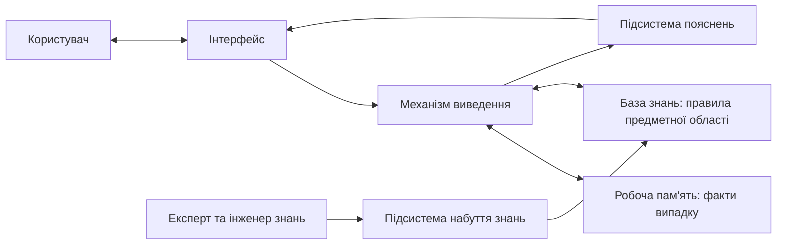
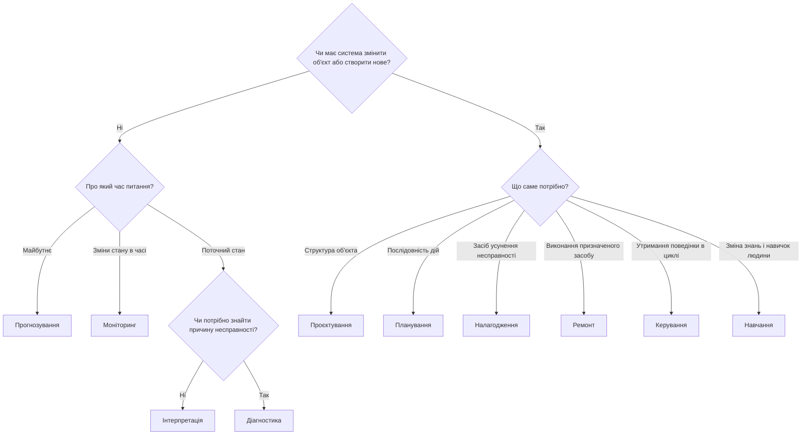

# Глава 1. Природа експертних систем: передумови, базові поняття та навчальний маршрут

<a id="глава-1-природа-експертних-систем-таксономія-задач-відділення-знань-від-коду-та-ациклічні-схеми-міркувань"></a>

> **Підручник:** [Експертні Системи](../README.md) · [Том 1. Основи експертних систем: логіка, продукційні правила, схемотехніка міркувань та класичні машини виведення](README.md)  
> **Навчальний рівень:** Базовий курс (бакалаврат, 2 курс; базові пояснення — з рівня першого курсу)  
> **Обладнання:** звичайний ноутбук або ПК (x86-64 / ARM64) без прискорювачів  
> **Мови:** реалізація — будь-яка мова загального призначення (лістинги — Python); основні спеціалізовані мови курсу — Prolog (SWI-Prolog) і OMG DMN/FEEL  
> **Попередня глава:** [Зміст підручника](../README.md)  
> **Наступна глава:** [Глава 2. Логічний фундамент представлення знань: числення висловлювань, предикати першого порядку та хорнівські диз'юнкти](ch02-logical-foundations-propositions-predicates-horn.md)  
> **Автор:** Микола Мартинович Федчик

---

## Анотація

Глава відкриває курс питанням, навіщо знадобився окремий клас експертних систем, якщо інформаційні системи вже десятиліттями зберігають, шукають і обробляють дані. Спершу простежено потреби, які вели від автоматизації обліку до підтримки рішень, і показано, чому самого пошуку записів недостатньо: висновок вимагає предметного знання, застосованого до неповних і суперечливих фактів, та пояснення, на чому він ґрунтується. Звідси архітектурна потреба явно відокремити базу знань, механізм виведення та підсистему пояснень.

На прикладах DENDRAL, MYCIN і XCON/R1 показано, як така архітектура виникла, а за класифікацією Хейєса-Рота — які десять класів задач розв'язують експертні системи. Далі розмежовано спостереження, факти, знання, правила, запити, гіпотези й висновки; пояснено роботу консультації, ролі її учасників та межі відповідальності системи. Приклади з медицини, права, фінансів та інженерних доменів показують, чому однакові механізми потребують різних предметних знань.

Глава має дві навчальні цілі: дати початкову мову опису експертної системи й показати, чого студент навчиться в кожній із наступних глав Тому 1. Окремий розділ пов'язує логіку, таблиці рішень, пряме й зворотне виведення, підтримку висновків, обмеження та пояснення в єдиний маршрут. Спеціалізовані ациклічні схеми виконання не є означенням чи обов'язковою архітектурою експертної системи; їх розглянуто після логічних основ і правил у [Главі 5](ch05-forward-chaining-datalog-and-circuit-evaluation.md#3-обчислення-правил-за-ациклічною-схемою).

---

<!-- chapter-toc:start -->
## Зміст глави

- [1. Від розвитку інформаційних систем до виникнення експертних систем](#1-від-розвитку-інформаційних-систем-до-виникнення-експертних-систем)
  - [1.1. Передумови розвитку інформаційних систем: облік, зберігання, передавання та пошук даних](#11-передумови-розвитку-інформаційних-систем-облік-зберігання-передавання-та-пошук-даних)
  - [1.2. Еволюція функцій інформаційних систем: від автоматизації операцій до підтримки рішень](#12-еволюція-функцій-інформаційних-систем-від-автоматизації-операцій-до-підтримки-рішень)
  - [1.3. Межі звичайного опрацювання даних: потреба в предметному знанні та експертному судженні](#13-межі-звичайного-опрацювання-даних-потреба-в-предметному-знанні-та-експертному-судженні)
  - [1.4. Потреба в окремому класі систем: явне подання знань і механізм виведення](#14-потреба-в-окремому-класі-систем-явне-подання-знань-і-механізм-виведення)
  - [1.5. Історичне становлення експертних систем](#15-історичне-становлення-експертних-систем)
  - [1.6. Відокремлення декларативної бази знань від процедурного механізму виведення](#16-відокремлення-декларативної-бази-знань-від-процедурного-механізму-виведення)
  - [1.7. Класифікація задач за Хейєсом-Ротом: десять класів від інтерпретації до керування](#17-класифікація-задач-за-хейєсом-ротом-десять-класів-від-інтерпретації-до-керування)
- [2. Межі висновку та підстави для рішення](#2-межі-висновку-та-підстави-для-рішення)
  - [2.1. Оцінювання поточного стану та прогнозування майбутнього](#21-оцінювання-поточного-стану-та-прогнозування-майбутнього)
  - [2.2. Прогнозування для випереджального рішення](#22-прогнозування-для-випереджального-рішення)
  - [2.3. Пошук інформації та перевірка підстав висновку](#23-пошук-інформації-та-перевірка-підстав-висновку)
- [3. Базові поняття та робота експертної консультації](#3-базові-поняття-та-робота-експертної-консультації)
  - [3.1. Від спостереження до факту, правила та висновку](#31-від-спостереження-до-факту-правила-та-висновку)
  - [3.2. Послідовність запитань, перевірок і пояснень](#32-послідовність-запитань-перевірок-і-пояснень)
  - [3.3. Учасники та життєвий цикл бази знань](#33-учасники-та-життєвий-цикл-бази-знань)
  - [3.4. Місце експертної системи серед інших програмних засобів](#34-місце-експертної-системи-серед-інших-програмних-засобів)
- [4. Засоби реалізації та подання знань](#4-засоби-реалізації-та-подання-знань)
  - [4.1. Вибір мови для реалізації системи](#41-вибір-мови-для-реалізації-системи)
  - [4.2. Мови для запису фактів, правил і таблиць рішень](#42-мови-для-запису-фактів-правил-і-таблиць-рішень)
  - [4.3. Вибір відповіді лише серед допустимих кандидатів](#43-вибір-відповіді-лише-серед-допустимих-кандидатів)
- [5. Наскрізні практичні сценарії в предметних доменах курсу](#5-наскрізні-практичні-сценарії-в-предметних-доменах-курсу)
  - [5.1. Клінічне сортування та правова кваліфікація](#51-клінічне-сортування-та-правова-кваліфікація)
  - [5.2. Ресурсне планування та фінансовий моніторинг](#52-ресурсне-планування-та-фінансовий-моніторинг)
  - [5.3. Перевірка вимірювань в інфраструктурі та енергетиці](#53-перевірка-вимірювань-в-інфраструктурі-та-енергетиці)
  - [5.4. Автомобільні, мікроелектронні та навігаційні застосування](#54-автомобільні-мікроелектронні-та-навігаційні-застосування)
- [6. Навчальний маршрут тому](#6-навчальний-маршрут-тому)
  - [6.1. Теми наступних глав та очікувані вміння](#61-теми-наступних-глав-та-очікувані-вміння)
  - [6.2. Поєднання опанованих механізмів](#62-поєднання-опанованих-механізмів)
  - [6.3. Критерії готовності до подальшого навчання](#63-критерії-готовності-до-подальшого-навчання)
- [7. Практичні завдання та лабораторний практикум](#7-практичні-завдання-та-лабораторний-практикум)
  - [7.1. Контрольні запитання для самоперевірки](#71-контрольні-запитання-для-самоперевірки)
  - [7.2. Розрахункові задачі та ручне трасування](#72-розрахункові-задачі-та-ручне-трасування)
  - [7.3. Завдання з програмної реалізації](#73-завдання-з-програмної-реалізації)
  - [7.4. Зв'язок із лабораторною та курсовою роботою курсу](#74-звязок-із-лабораторною-та-курсовою-роботою-курсу)
- [Висновки](#висновки)
- [Глосарій](#глосарій)
- [Скорочення та терміни](#скорочення-та-терміни)
- [Джерела](#джерела)
<!-- chapter-toc:end -->

---

## 1. Від розвитку інформаційних систем до виникнення експертних систем

Потреба в інформаційних системах виникає там, де обсяг, швидкість і взаємозалежність відомостей перевищують можливості ручного обліку. Поки записів сотні, організація справляється вручну; коли їх мільйони, а рішення залежить від зіставлення записів різних підрозділів, помилки ручної обробки стають системними. Тому перші інформаційні системи автоматизували збирання, зберігання, пошук і обчислення над даними, а подальший розвиток поступово переніс їх від реєстрації операцій до підтримки рішень фахівця.

Однак відповідь на запит або обчислення за фіксованим алгоритмом самі по собі не пояснюють, що означають неповні чи суперечливі факти в конкретній предметній області. Лікар, інженер чи юрист ухвалює рішення не лише за даними, а й за знанням, як ці дані тлумачити. Коли результат залежить від такого спеціалізованого знання, виникає окрема інженерна потреба: явно подати знання, застосувати його до фактів і сформувати висновок разом з обґрунтуванням. Саме ця потреба окреслює експертні системи як окремий клас інформаційних систем, а не як назву для будь-якої програми, що автоматизує рішення.

Розділ проходить цей шлях послідовно: від загальних передумов (підрозділи 1.1–1.2) через межі звичайного опрацювання даних (1.3) до потреби в окремому класі систем (1.4), його історичного становлення (1.5), головного архітектурного принципу (1.6) і класифікації задач (1.7).

### 1.1. Передумови розвитку інформаційних систем: облік, зберігання, передавання та пошук даних

Експертна система не замінює інформаційну систему, а спирається на неї: без надійного зберігання й пошуку фактів жодному правилу не буде до чого застосовуватися. Тому спершу варто зрозуміти, які проблеми інформаційні системи вже розв'язали і де закінчується їхня відповідальність. У підручнику **інформаційна система** розуміється як сукупність даних, програм, обладнання й людей, що збирає, зберігає, обробляє та видає відомості для діяльності організації.

Розвиток інформаційних систем зумовили чотири послідовні потреби:

1. **Облік.** Кожну операцію (продаж, оплату, видачу медикаменту, рух техніки) потрібно зафіксувати так, щоб запис не загубився й не суперечив іншим записам.
2. **Зберігання та спільний доступ.** Ті самі відомості потрібні бухгалтерії, складу й керівництву; окремі копії з часом розходяться, тому потрібна одна узгоджена версія фактів.
3. **Передавання.** Дані, зібрані в одному місці, потрібні в іншому, причому вчасно: застаріла звістка може бути гіршою за відсутню.
4. **Пошук і звітність.** З мільйонів записів потрібно швидко відібрати потрібні та звести їх у підсумки.

Відповіддю на другу потребу став принцип незалежності даних. У 1970 році Едгар Кодд запропонував реляційну модель, у якій користувач описує, *які* дані потрібні, а не *як* їх фізично знайти на носії; логічне подання даних відокремлено від способу зберігання [[1]](#src-1). Цей крок варто запам'ятати: згодом експертні системи зроблять аналогічне відокремлення вже для знань (підрозділ 1.6).

Масштабні інформаційні системи проєктувалися й в Україні. В Інституті кібернетики АН УРСР під керівництвом В. М. Глушкова з 1960-х років розроблялася концепція загальнодержавної автоматизованої системи збирання та обробки інформації для обліку й планування економіки (ОГАС). У задуманому масштабі проєкт реалізовано не було, і його історія показує, що перешкоди для таких систем лежать не лише в обчислювальній техніці, а й в організації та розподілі відповідальності [[2]](#src-2). Питання відповідальності за рішення ще не раз повернеться в цьому підручнику.

Таблиця 1.1 зводить ці потреби та показує, що саме дає кожна відповідь і чого вона дати не може.

<a id="obj-1-1"></a>

**Таблиця 1.1. Потреби, що зумовили розвиток інформаційних систем, і межа кожної відповіді.**

| Потреба | Типова відповідь інформаційної системи | Що система дає | Чого система не дає |
|---|---|---|---|
| Облік операцій | Транзакційна обробка даних | Повний і несуперечливий журнал операцій | Оцінки, чи була операція доречною |
| Зберігання та спільний доступ | Бази даних, реляційна модель | Одну узгоджену версію фактів для всіх підрозділів | Тлумачення фактів |
| Передавання | Мережі, обмін повідомленнями | Своєчасну доставку даних | Перевірки, чи дані ще придатні для рішення |
| Пошук і звітність | Запити, звіти, пошукові системи | Відбір і зведення релевантних записів | Висновку, що з цих записів випливає |

Останній стовпець таблиці 1.1 підказує напрям подальшого розвитку: кожна відповідь закриває свою потребу, але жодна не відповідає на питання «що робити?».

### 1.2. Еволюція функцій інформаційних систем: від автоматизації операцій до підтримки рішень

Коли облік і пошук стали надійними, від інформаційних систем почали вимагати більшого: не лише показати дані, а й допомогти вирішити. Щоб зрозуміти, де саме в цьому русі з'являється місце для експертних систем, корисно розрізняти типи рішень, які людина ухвалює в роботі.

Герберт Саймон розділив управлінські рішення на **програмовані**, для яких відома процедура (нарахувати зарплату, видати товар за накладною), і **непрограмовані**, які доводиться ухвалювати щоразу заново, спираючись на судження [[3]](#src-3). Ентоні Горрі та Майкл Скотт Мортон розвинули цей поділ у шкалу **структурованих**, **напівструктурованих** і **неструктурованих** рішень і показали, що звичайні інформаційні системи добре автоматизують структуровані рішення, а для напівструктурованих потрібні системи підтримки рішень, які допомагають людині, але не замінюють її [[4]](#src-4).

<a id="obj-1-2"></a>

**Таблиця 1.2. Типи рішень і роль інформаційної системи за Саймоном, Горрі та Скоттом Мортоном.**

| Тип рішення | Чи відома процедура | Приклад | Що може зробити система |
|---|---|---|---|
| Структуроване | Так, повністю | Нарахування пені за простроченим платежем за формулою договору | Автоматично виконати процедуру |
| Напівструктуроване | Частково: правила є, але потрібне тлумачення | Чи допустити пацієнта до планової операції за результатами аналізів | Застосувати відомі правила, пояснити висновок, передати людині незрозуміле |
| Неструктуроване | Ні | Вибір стратегії розвитку підприємства | Надати дані й аналітику; рішення лишається за людиною |

Експертні системи найкраще працюють у середньому рядку таблиці 1.2. Правил достатньо, щоб їх записати, але застосування правил до конкретного випадку вимагає знання, якого немає в самих даних. Саме тут звичайна інформаційна система вичерпує свої можливості, і наступний підрозділ показує чому.

### 1.3. Межі звичайного опрацювання даних: потреба в предметному знанні та експертному судженні

Цей підрозділ показує, де саме ламається підхід «досить мати всі дані й правильний запит до них». Без цього кроку незрозуміло, чому для напівструктурованих рішень не вистачає ні бази даних, ні жорстко закодованої програми.

Нехай медична інформаційна система зберігає результати аналізів. Запит повертає факт: рівень калію в крові пацієнта становить 5,8 ммоль/л. Але питання лікаря інше: чи можна призначити пацієнтові конкретний препарат? Для відповіді потрібне знання, якого немає в записі: які значення вважаються підвищеними, як вони пов'язані з функцією нирок, які препарати протипоказані за такого стану і що робити, якщо частини аналізів бракує. **Дані** відповідають на питання «що відомо?», **знання** — на питання «що з цього випливає?», а **експертне судження** — на питання «що робити в цьому випадку і чому?».

Можна спробувати обійтися без знання: заздалегідь перелічити всі комбінації вхідних даних і для кожної записати відповідь у таблицю. Формула 1.3 показує, скільки рядків потребуватиме така вичерпна таблиця.

<a id="obj-1-3"></a>

**Формула 1.3. Кількість рядків вичерпної таблиці рішень.**

$$
N = \prod_{i=1}^{n} \lvert D_i \rvert
$$

Позначення у формулі 1.3:

- $n$ — кількість вхідних ознак, від яких залежить рішення (ціле, $`n \ge 1`$);
- $`D_i`$ — множина можливих значень $i$-ї ознаки після поділу на інтервали (наприклад, температура: «нижче 38 °C», «38–39 °C», «39 °C і вище»);
- $`\lvert D_i \rvert`$ — кількість значень $i$-ї ознаки (ціле, $`\lvert D_i \rvert \ge 2`$);
- $N$ — кількість рядків, тобто окремих комбінацій, для кожної з яких таблиця мусить містити відповідь.

**Покроковий приклад.** Навчальна таблиця первинного медичного сортування (тріажу) враховує шість ознак: вікову групу (4 значення), температуру (3 інтервали), насичення крові киснем SpO2 (3 інтервали), частоту серцевих скорочень (3 інтервали), рівень свідомості (2 значення) та біль (3 рівні). За формулою 1.3 кількість рядків становить $`N = 4 \cdot 3 \cdot 3 \cdot 3 \cdot 2 \cdot 3 = 648`$. Якщо ж ознаками є 20 симптомів, кожен з яких або є, або його немає ($`\lvert D_i \rvert = 2`$), то $`N = 2^{20} = 1\,048\,576`$. Жоден експерт не заповнить і не перевірить мільйон рядків, і жоден реєстр не міститиме прикладів для кожного з них.

**Що означає результат.** Знання експерта влаштоване інакше. Правило «якщо SpO2 нижче 90 %, пацієнт отримує червоний пріоритет незалежно від інших ознак» одним рядком покриває всі комбінації, де SpO2 нижче 90 %, тобто в прикладі з шістьма ознаками $`648 / 3 = 216`$ рядків. Тому замість вичерпної таблиці експертна система зберігає узагальнені правила й механізм, який застосовує їх до конкретних фактів. Інженерне використання формули 1.3: якщо $N$ перевищує кількість комбінацій, яку реально заповнити й перевірити вручну (на практиці — сотні), предметну логіку слід подавати правилами з узагальненнями («будь-яке значення», інтервали), а повноту покриття перевіряти автоматично (глава 4).

**Межі висновку.** Формула 1.3 рахує комбінації за умови, що кожна ознака має скінченну кількість інтервалів. Для неперервних величин кількість рядків залежить від обраного поділу на інтервали, тому формула не визначає «правильної» кількості правил; вона лише показує, чому перелічування комбінацій не масштабується.

### 1.4. Потреба в окремому класі систем: явне подання знань і механізм виведення

Підрозділ 1.3 показав користь узагальнених правил замість переліку відповідей. Звідси виникає окремий клас систем із явною базою знань і механізмом її застосування. Предметні розгалуження `if/else` теж можна перевіряти й пояснювати, проте без окремого подання знань зміни протоколу тісно пов'язані зі зміною коду. Відокремлення правил полегшує їхній перегляд експертом і повторне використання рушія; воно не скасовує тестування після зміни бази знань.

Едвард Фейгенбаум, один із засновників галузі, сформулював цю думку як **принцип знань**: якість роботи інтелектуальної програми в конкретній задачі визначається передусім обсягом і якістю знань про цю задачу, а не універсальністю методу міркування [[5]](#src-5).

**Означення.** *Експертною системою* в підручнику називається інформаційна система, що розв'язує задачі вузької предметної області, які потребують фахової експертизи. Вона застосовує явно подані знання фахівців до фактів конкретного випадку за допомогою механізму виведення та видає висновок разом з поясненням, на яких знаннях і фактах він ґрунтується [[6]](#src-6).

Схема 1.4 показує складники, які випливають з означення.

<a id="obj-1-4"></a>

**Схема 1.4. Архітектура експертної системи.**



Складники на схемі 1.4 мають такі ролі:

1. **База знань** містить загальні знання предметної області: правила, норми, довідкові факти. Вона однакова для всіх випадків.
2. **Робоча пам'ять** містить факти конкретного випадку: показники пацієнта, параметри замовлення, покази датчиків.
3. **Механізм виведення** — загальний алгоритм, який застосовує правила бази знань до фактів робочої пам'яті й отримує нові факти та висновки. Він не містить предметних знань.
4. **Підсистема пояснень** відповідає на питання «як отримано висновок?» і «чому система про це питає?».
5. **Підсистема набуття знань** дає експертові та **інженерові знань** (фахівцеві, який перекладає знання експерта у формальні правила) засоби поповнювати й перевіряти базу знань.
6. **Інтерфейс** приймає запити й факти та показує висновки з поясненнями.

Відмінність від звичайної програми зручно побачити через відому формулу Ніклауса Вірта «алгоритми + структури даних = програми» [[7]](#src-7). У звичайній програмі знання про предметну область розчинене в алгоритмі. В експертній системі знання стає окремим артефактом поряд з алгоритмом: його можна прочитати, перевірити й змінити, не змінюючи механізму виведення. Звідси три практичні відмінності від звичайної інформаційної системи:

- **що зберігається:** не лише дані про випадки, а й загальні знання, які до них застосовуються;
- **що повертається:** не записи, а висновок із поясненням або повідомлення, яких фактів бракує;
- **як змінюється поведінка:** редагуванням бази знань, а не переписуванням коду.

<a id="15-історичне-становлення-експертних-систем-dendral-mycin-і-xconr1"></a>

### 1.5. Історичне становлення експертних систем

Архітектура з підрозділу 1.4 не була вигадана заздалегідь: вона виникла з досвіду конкретних систем, кожна з яких показала окрему властивість класу. Знання цієї історії потрібне не заради дат, а щоб розуміти, які проблеми перших систем досі визначають вимоги до сучасних.

**DENDRAL.** Роботу над системою розпочали в Стенфордському університеті 1965 року Едвард Фейгенбаум, Джошуа Ледерберг і Брюс Б'юкенен разом із хіміками. За даними мас-спектрометрії DENDRAL висувала гіпотези про молекулярну структуру органічних сполук. Головний урок: знання хіміків, записане у вигляді правил, радикально скорочує перебір можливих структур, тобто сила системи походить від знань, а не від універсального пошуку. Автори пізнішого огляду називають DENDRAL першою експертною системою [[8]](#src-8).

**MYCIN.** Систему створили в Стенфорді в 1970-х роках під керівництвом Едварда Шортліффа та Брюса Б'юкенена для консультацій з антимікробної терапії бактеріальних інфекцій [[9]](#src-9). MYCIN застосовувала правила у зворотному напрямку, від гіпотези до фактів (глава 7), уміла пояснювати, чому ставить запитання і як дійшла висновку, а невизначеність виражала коефіцієнтами впевненості (глава 16). У сліпому оцінюванні 1979 року вісім незалежних експертів порівняли рекомендації MYCIN для десяти випадків менінгіту з рекомендаціями дев'яти лікарів: рекомендації системи визнано прийнятними в 65 % оцінок, а рекомендації п'яти викладачів-інфекціоністів — у 42,5–62,5 % [[10]](#src-10). Попри це, у рутинну клінічну практику MYCIN не впровадили [[9]](#src-9): якість рекомендацій ще не розв'язувала питань вбудовування системи в роботу лікарні та відповідальності за рішення. Важливим побічним результатом стала оболонка EMYCIN — той самий механізм виведення з порожньою базою знань, придатний для інших предметних областей [[9]](#src-9). Вона практично довела, що знання й механізм виведення можна розділити.

**XCON/R1.** Систему R1 (пізніше XCON) створив Джон Мак-Дермотт для компанії Digital Equipment Corporation: вона комплектувала замовлення комп'ютерів VAX-11/780, добирала сумісні компоненти й визначала їхнє розміщення [[11]](#src-11). XCON роками працювала у виробничому процесі компанії та стала прикладом промислово корисної продукційної системи. Водночас база правил постійно зростала, і її супровід перетворився на окрему інженерну задачу [[12]](#src-12).

<a id="obj-1-5"></a>

**Таблиця 1.5. Перші експертні системи та їхні уроки.**

| Система | Початок робіт | Предметна область | Клас задачі (підрозділ 1.7) | Що показала | Що обмежувало |
|---|---|---|---|---|---|
| DENDRAL | 1965 | Хімія, мас-спектрометрія | Інтерпретація | Знання предметної області скорочує перебір гіпотез | Дорога формалізація знань хіміків |
| MYCIN | 1970-ті | Медицина, антимікробна терапія | Діагностика та добір засобу усунення | Рекомендації рівня експертів і пояснення «як» і «чому» | Вбудовування в роботу лікарні, відповідальність за рішення |
| XCON/R1 | 1980 | Комплектування комп'ютерних систем | Проєктування (конфігурування) | Промислова користь продукційних правил | Зростання й супровід бази правил |

Паралельно з формуванням експертних систем в Україні розвивалися суміжні напрями кібернетики та інженерії знань. Олексій Івахненко й Валентин Лапа досліджували кібернетичні методи моделювання та прогнозування; у методі групового урахування аргументів (МГУА, англ. GMDH) поліноміальні моделі формуються поетапно, а їхню складність добирають за зовнішнім критерієм [[34]](#src-34) [[35]](#src-35). Це важлива лінія історії індуктивного моделювання, але не різновид класичних баз правил DENDRAL чи MYCIN і не підстава приписувати їй пряме походження всіх сучасних методів глибинного навчання.

Інший суміжний приклад — онтологічне опрацювання предметних знань у працях Олександра Палагіна та співавторів [[36]](#src-36). Онтології формалізують поняття й відношення предметної області, тому ця робота стосується інженерії знань; однак її не слід подавати як пряме продовження історії експертних систем. У цьому огляді наведено лише напрями з доступними для перевірки джерелами: спеціальні твердження про інші школи формальних методів потребують окремої звірки першоджерел.

Досвід перших систем показав і головну трудність: найдорожчим етапом є не програмування механізму виведення, а набуття знань від експертів та їх формалізація [[13]](#src-13). Завищені очікування 1980-х років змінилися розчаруванням, проте ідеї класу не зникли: вони продовжили існування в системах бізнес-правил і таблицях рішень (глава 4) та повертаються в поєднанні з мовними моделями (Том 3).

### 1.6. Відокремлення декларативної бази знань від процедурного механізму виведення

З історії перших систем випливає головний архітектурний принцип класу: знання записують **декларативно**, тобто як твердження про предметну область, а механізм виведення реалізують **процедурно**, як загальний алгоритм, однаковий для будь-якої бази знань. Без цього розділення кожна зміна протоколу перетворюється на зміну програми, а пояснення висновку доводиться писати вручну для кожного розгалуження. Ідея правила «умова → наслідок» сягає формальних систем Еміля Поста [[14]](#src-14), і саме вона стала основою продукційних систем.

Щоб побачити розділення в дії, достатньо найпростішої моделі. Нехай кожне правило $r$ має множину передумов $`P_r`$ і один висновок $`c_r`$. Механізм виведення застосовує правила до поточної множини фактів, доки з'являються нові факти. Формула 1.6 описує один крок такого **прямого виведення**: від відомих фактів до нових.

<a id="obj-1-6"></a>

**Формула 1.6. Один крок прямого виведення.**

$$
F_{k+1} = F_k \cup \{\, c_r \mid r \in R,\ P_r \subseteq F_k \,\}
$$

Позначення у формулі 1.6:

- $R$ — база знань: скінченна множина правил;
- $`P_r`$ — множина передумов правила $r$ (атомарних тверджень, які мають бути відомими);
- $`c_r`$ — висновок правила $r$;
- $`F_k`$ — множина фактів після $k$ кроків; $`F_0`$ — початкові факти випадку в робочій пам'яті;
- умова $`P_r \subseteq F_k`$ означає, що всі передумови правила вже відомі.

Виведення зупиняється, коли черговий крок не додає нових фактів: $`F_{k+1} = F_k`$. Оскільки кожен крок лише додає висновки зі скінченного переліку, зупинка настає не пізніше ніж за кількість кроків, що дорівнює кількості різних висновків.

**Покроковий приклад.** Навчальна база знань (не клінічний протокол) містить чотири правила. Ідентифікатори записано латиницею, бо їх читатиме програма:

- R1: `fever_high` (температура понад 39 °C) і `chills` (озноб) → `suspected_infection` (підозра на інфекцію);
- R2: `suspected_infection` і `spo2_low` (SpO2 нижче 92 %) → `urgent_review` (потрібен терміновий огляд лікаря);
- R3: `resp_rate_high` (частота дихання понад 24 за хвилину) → `resp_failure_possible` (можлива дихальна недостатність);
- R4: `resp_failure_possible` і `spo2_low` → `urgent_review`.

Початкові факти: $`F_0 = \{\texttt{fever\_high}, \texttt{chills}, \texttt{spo2\_low}\}`$.

1. **Крок 1.** Передумови R1 містяться в $`F_0`$, тому до фактів додається `suspected_infection`. Передумови R2 ще неповні (немає `suspected_infection` у $`F_0`$), R3 і R4 не застосовуються. Отже, $`F_1 = F_0 \cup \{\texttt{suspected\_infection}\}`$.
2. **Крок 2.** Тепер передумови R2 містяться в $`F_1`$, тому додається `urgent_review`: $`F_2 = F_1 \cup \{\texttt{urgent\_review}\}`$.
3. **Крок 3.** Жодне правило не дає нового факту, тобто $`F_3 = F_2`$, і виведення зупиняється.

Висновок `urgent_review` має пояснення, яке механізм виведення будує автоматично: R2 спрацювало, бо відомі `spo2_low` і `suspected_infection`, а останній факт отримано за R1 з `fever_high` і `chills`.

**Як це використовується.** Механізм виведення не містить жодного медичного знання. Якщо лікарня додасть до протоколу правило R5 «вік понад 75 років і підозра на інфекцію → терміновий огляд», зміниться лише база знань; код механізму лишиться тим самим. Саме цю властивість на практиці довела оболонка EMYCIN.

**Реалізація формули 1.6 мовою Python.** На вхід подаються правила як дані та початкові факти. Функція `step` дослівно реалізує формулу 1.6: відбирає правила з виконаними передумовами й додає їхні висновки. Функція `forward_chain` повторює крок до нерухомої точки й друкує трасу.

```python
RULES = [
    ("R1", {"fever_high", "chills"}, "suspected_infection"),
    ("R2", {"suspected_infection", "spo2_low"}, "urgent_review"),
    ("R3", {"resp_rate_high"}, "resp_failure_possible"),
    ("R4", {"resp_failure_possible", "spo2_low"}, "urgent_review"),
]


def step(facts, rules):
    """Формула 1.6: F_{k+1} = F_k ∪ {c_r | P_r ⊆ F_k}."""
    fired = [(name, c) for name, p, c in rules if p <= facts and c not in facts]
    return facts | {c for _, c in fired}, fired


def forward_chain(facts, rules):
    k = 0
    while True:
        new_facts, fired = step(facts, rules)
        if not fired:
            return facts
        k += 1
        print(f"крок {k}: " + ", ".join(f"{n} -> {c}" for n, c in fired))
        facts = new_facts


result = forward_chain({"fever_high", "chills", "spo2_low"}, RULES)
print("висновок:", "urgent_review" in result)
```

Очікуваний вивід, отриманий запуском лістингу в Python 3:

```text
крок 1: R1 -> suspected_infection
крок 2: R2 -> urgent_review
висновок: True
```

Траса збігається з ручним розрахунком: два кроки, правила R1 і R2.

**Межі висновку.** Ця модель працює лише з позитивними передумовами без змінних і без заперечення. Формальну семантику прямого виведення, теорему про нерухому точку та коректну обробку заперечення розглянуто в главі 5, виведення від мети до фактів, як у MYCIN, — у главі 7. На кожному кроці перевіряються всі правила, тому для великих баз знань потрібні спеціальні алгоритми зіставлення (мережа Rete, глава 6).

### 1.7. Класифікація задач за Хейєсом-Ротом: десять класів від інтерпретації до керування

Перш ніж обирати метод виведення, інженер має зрозуміти, яку саму задачу розв'язує система. Клас задачі визначає, що є входом і виходом, яке знання потрібне і як перевіряти результат. Помилка класифікації дорого коштує: якщо задачу прогнозування розв'язувати як діагностику, система перевірятиме майбутнє даними про теперішнє (розділ 2).

Фредерік Хейєс-Рот, Дональд Вотермен і Дуглас Ленат виділили десять загальних класів задач, які розв'язують експертні системи [[13]](#src-13). Таблиця 1.7 подає ці класи, приклад для кожного з наскрізних доменів підручника та главу, де вивчаються відповідні методи. Клас «налагодження» в оригінальному сенсі означає не налагодження програм, а призначення засобу усунення несправності.

<a id="obj-1-7"></a>

**Таблиця 1.7. Десять класів задач експертних систем за Хейєсом-Ротом, Вотерменом і Ленатом.**

| № | Клас задачі | Що робить система | Приклад | Де в підручнику |
|---|---|---|---|---|
| 1 | Інтерпретація | Виводить опис ситуації з даних спостережень | Розпізнати режим роботи трансформатора за телеметрією (енергетика) | Глави 2–5 |
| 2 | Прогнозування | Виводить імовірні наслідки заданої ситуації | Оцінити, чи вистачить пального колоні на маршрут (військова логістика) | Розділ 2 цієї глави, глава 20 |
| 3 | Діагностика | Визначає несправність за спостережуваними ознаками | Знайти причину каскадної відмови мікросервісів (AIOps) | Глави 7, 18 |
| 4 | Проєктування | Конфігурує об'єкт за заданих обмежень | Скомплектувати варіант електронного блоку керування із сумісних компонентів (Automotive, як XCON) | Глава 9 |
| 5 | Планування | Будує послідовність дій для досягнення мети | Скласти графік планового технічного обслуговування техніки (військова логістика) | Глава 9 |
| 6 | Моніторинг | Порівнює спостереження з очікуваними й виявляє відхилення | Стежити за транзакціями на відповідність пороговим правилам (RegTech) | Глави 3, 20 |
| 7 | Налагодження | Призначає засіб усунення несправності | Запропонувати мінімальне виправлення суперечливого замовлення чи правила | Глава 10 |
| 8 | Ремонт | Виконує план застосування призначеного засобу | Перезапустити сервіс за погодженою процедурою (SecOps) | Глави 10, 26 |
| 9 | Навчання | Діагностує та виправляє помилки того, хто навчається | Тренажер з кваліфікації правовідносин для студента-правника (Law) | Глава 7 (діалогові механізми) |
| 10 | Керування | Інтерпретує, прогнозує, виправляє й відстежує поведінку системи в циклі | Утримувати тиск у трубопроводі в допустимому вікні (енергетика) | Глава 26 |

Реальні задачі часто складені. MYCIN поєднувала діагностику з добором терапії (клас 7), а керування за визначенням охоплює інтерпретацію, прогнозування, налагодження й моніторинг. Тому класифікація слугує не ярликом, а першим кроком декомпозиції: кожну частину задачі відносять до класу й обирають для неї метод. Схема 1.8 показує послідовність запитань для такої класифікації.

<a id="obj-1-8"></a>

**Схема 1.8. Послідовність запитань для визначення класу задачі.**



**Логічний приклад застосування схеми 1.8.** Три запити користувачів класифікуються так:

1. «Чому вчора о 14:00 зупинився платіжний шлюз?» Система нічого не змінює, питання про стан, потрібна причина несправності, отже, це **діагностика**; методи — глави 7 і 18.
2. «Чи вистачить колоні пального на 180 км?» Система нічого не змінює, питання про майбутнє, отже, це **прогнозування**; методи — розділ 2 і підрозділ 5.2.
3. «Скомплектуй сервер із сумісних компонентів у межах бюджету». Система створює структуру об'єкта, отже, це **проєктування**; методи — глава 9.

**Як це використовується.** Клас задачі визначає контракт входів і виходів: для діагностики вихід — перелік можливих причин і наступна перевірка, для прогнозування — оцінка з горизонтом і невизначеністю, для проєктування — допустима конфігурація або мінімальний конфлікт. Якщо запит не вдається віднести до жодного класу, це сигнал, що задачу ще не сформульовано і проєктувати базу знань зарано.

<a id="2-демаркація-предикативних-і-предиктивних-прогностичних-експертних-систем"></a>

## 2. Межі висновку та підстави для рішення

Серед десяти класів задач прогнозування відрізняється від решти ставленням до підстав висновку. Про теперішній стан об'єкта підстави вже існують: це покази датчиків, аналізи, документи. Про майбутній стан таких підстав немає, бо майбутнього факту ще не сталося; є лише модель того, як стан змінюється. Якщо змішати ці два випадки, система почне перевіряти прогноз так, ніби це вже встановлений факт, і видасть дозвіл на підставі екстраполяції далеко за межею, де їй можна довіряти.

Наївний підхід полягає в тому, щоб підставити у звичайні діагностичні правила прогнозовані значення замість виміряних. Він може дати необґрунтований висновок: похибка залежить від моделі, часу випередження й збурень, а правила для виміряних значень цього не враховують. Розділ розмежовує два типи задач (підрозділ 2.1), розбирає одну модель допустимого горизонту прогнозу (підрозділ 2.2) і проводить ще одну практично важливу межу — між пошуком інформації та відповідальним рішенням (підрозділ 2.3).

<a id="21-оцінювання-поточного-стану-обєкта-у-момент-t0-проти-екстраполяції-траєкторії-на-горизонті-випередження-t0--tau"></a>

### 2.1. Оцінювання поточного стану та прогнозування майбутнього

Щоб коректно спроєктувати базу знань, потрібно заздалегідь знати, про який момент часу система виносить судження. Від цього залежать і підстави висновку, і спосіб його перевірки.

За класифікацією автора **предикативною** називається експертна система, яка виносить судження (логічний предикат) про стан об'єкта на момент останнього спостереження $`t_0`$: «тиск у нормі», «пацієнт потребує термінового огляду». **Предиктивною** (прогностичною) називається система, яка оцінює стан на момент $`t_0 + \tau`$ при $`\tau > 0`$, тобто стан, якого ще не існує. Подібність назв невипадкова: обидві системи формулюють твердження, але про різні моменти часу.

Для запису використовуються такі позначення: $`\mathcal{H}_{t_0}`$ — усі спостереження до моменту $`t_0`$ включно; $`x(t_0)`$ — поточний стан об'єкта; $`\hat{x}(t_0 + \tau)`$ — прогноз стану на момент $`t_0 + \tau`$, обчислений за даними $`\mathcal{H}_{t_0}`$. Предиктивна система завжди спирається на предикативну: щоб прогнозувати, потрібно спершу оцінити початковий стан $`x(t_0)`$.

<a id="obj-1-9"></a>

**Таблиця 1.9. Відмінності предикативної та предиктивної експертних систем.**

| Критерій | Предикативна система | Предиктивна система |
|---|---|---|
| Питання | Який стан зараз? | Яким буде стан через час $`\tau`$? |
| Підстава висновку | Спостереження до $`t_0`$ включно | Спостереження до $`t_0`$ та модель зміни стану |
| Як перевірити висновок | Одразу, повторним вимірюванням | Лише після настання моменту $`t_0 + \tau`$ |
| Поведінка невизначеності | Залежить від якості й актуальності спостережень; дублювання датчиків не гарантує нової інформації | Залежить від динаміки й збурень; може зростати, лишатися сталою або зменшуватися |
| Типові класи задач (таблиця 1.7) | Інтерпретація, діагностика, моніторинг | Прогнозування, планування, керування |
| Типова помилка | Застарілі дані видано за поточні | Прогноз за межею достовірного горизонту видано за факт |

Приклад з енергетичних систем. Температура масла трансформатора зараз становить 78 °C за допустимої межі 90 °C. Предикативна система відповідає «у нормі», і цю відповідь можна одразу перевірити другим датчиком. Питання «чи перевищить температура 90 °C протягом найближчих 40 хвилин при зростанні навантаження?» належить предиктивній системі, і її відповідь має сенс лише разом з оцінкою, наскільки далеко вперед прогнозу можна довіряти. Цю оцінку дає наступний підрозділ.

<a id="22-випереджальні-системи-за-робертом-розеном-та-нерівність-горизонту-прогнозу"></a>

### 2.2. Прогнозування для випереджального рішення

Роберт Розен назвав **випереджальною** (*anticipatory*) систему, яка містить прогностичну модель себе або середовища й змінює свій стан зараз відповідно до передбачень цієї моделі щодо пізнішого моменту [[15]](#src-15). Для експертної системи це означає, що прогноз потрібен не сам по собі, а для рішення, яке треба ухвалити вже зараз: знизити навантаження до перегріву, змінити маршрут до того, як скінчиться пальне. Отже, система мусить знати, на який час уперед прогноз ще досить точний для такого рішення.

Простою моделлю зростання похибки прогнозу є експоненційна: якщо в момент $`t_0`$ стан виміряно з невизначеністю $`u_0`$, то через час $`\tau`$ невизначеність прогнозу становить $`u(\tau) = u_0 e^{\lambda \tau}`$, де $\lambda$ — швидкість розбіжності близьких траєкторій. У теорії динамічних систем $\lambda$ відповідає найбільшому показнику Ляпунова, а час, після якого прогноз втрачає точність, називають горизонтом передбачуваності [[16]](#src-16). Вимога точності формулюється так: розширена невизначеність $`k \cdot u(\tau)`$ не повинна перевищувати допустимої похибки $\Delta$. Розв'язавши нерівність $`k u_0 e^{\lambda \tau} \le \Delta`$ відносно $\tau$ (поділити на $`k u_0`$, взяти натуральний логарифм, поділити на $`\lambda > 0`$), отримано формулу 1.10.

<a id="obj-1-10"></a>

**Формула 1.10. Межа достовірного горизонту прогнозу.**

$$
\tau_{\max} = \frac{1}{\lambda} \ln\!\left( \frac{\Delta}{k\, u_0} \right), \qquad \text{прогноз на горизонт } \tau \text{ допустимий, якщо } \tau \le \tau_{\max}
$$

Позначення у формулі 1.10:

- $\lambda$ — швидкість зростання похибки прогнозу (у прикладі — $`\text{хв}^{-1}`$), $`\lambda > 0`$; оцінюється за даними об'єкта;
- $`u_0`$ — стандартна невизначеність вимірювання початкового стану (у прикладі — °C), $`u_0 > 0`$;
- $k$ — коефіцієнт охоплення, $`k \ge 1`$; для нормального розподілу значення $`k = 2`$ відповідає приблизно 95 % імовірності;
- $\Delta$ — допустима похибка прогнозу, задана вимогою до рішення (°C), $`\Delta > k u_0`$; якщо $`\Delta \le k u_0`$, то навіть поточне вимірювання недостатньо точне, і $`\tau_{\max} = 0`$;
- $`\tau_{\max}`$ — найбільший горизонт, на який прогноз ще задовольняє вимогу точності (хв).

**Покроковий приклад.** Нехай для трансформатора $`\lambda = 0{,}04\ \text{хв}^{-1}`$, $`u_0 = 0{,}2`$ °C, $`k = 2`$, $`\Delta = 2{,}0`$ °C.

1. Відношення під логарифмом: $`\Delta / (k u_0) = 2{,}0 / 0{,}4 = 5`$.
2. Логарифм: $`\ln 5 \approx 1{,}609`$.
3. Горизонт: $`\tau_{\max} = 1{,}609 / 0{,}04 \approx 40{,}2`$ хв.

Оператор запитує прогноз на 60 хвилин. Оскільки $`60 > 40{,}2`$, система не видає числового вердикту на 60 хвилин як достовірного. Вона повертає умовну відповідь: прогноз на 40 хвилин із зазначеною невизначеністю та рекомендацію повторно виміряти температуру або вже зараз знизити навантаження. Якщо замінити датчик на вдвічі точніший ($`u_0 = 0{,}1`$ °C), то $`\tau_{\max} = \ln 10 / 0{,}04 \approx 57{,}6`$ хв. Удвічі точніший датчик подовжив горизонт лише на $`\ln 2 / \lambda \approx 17{,}3`$ хв, і для 60 хвилин цього все одно замало. Інженерний висновок: горизонт зростає з точністю вимірювання лише логарифмічно, тому для далеких прогнозів потрібні не лише кращі датчики, а й випереджальна дія, як у Розена.

**Реалізація формули 1.10 мовою Python.** Вхід: $\lambda$, $`u_0`$, $\Delta$, $k$. Функція повертає $`\tau_{\max}`$ у хвилинах або нуль, якщо вимога точності не виконується навіть для поточного вимірювання.

```python
import math


def horizon(lam, u0, delta, k=2.0):
    """Формула 1.10: tau_max = ln(delta / (k * u0)) / lam, хвилини."""
    if k * u0 >= delta:
        return 0.0
    return math.log(delta / (k * u0)) / lam


print(f"u0 = 0.2 °C: tau_max = {horizon(0.04, 0.2, 2.0):.1f} хв")
print(f"u0 = 0.1 °C: tau_max = {horizon(0.04, 0.1, 2.0):.1f} хв")
```

Очікуваний вивід, отриманий запуском лістингу:

```text
u0 = 0.2 °C: tau_max = 40.2 хв
u0 = 0.1 °C: tau_max = 57.6 хв
```

Обидва значення збігаються з ручним розрахунком.

**Межі висновку.** Числа прикладу навчальні. Формула 1.10 припускає сталу швидкість $\lambda$ і відсутність випадкових збурень процесу. Якщо такі збурення є, горизонт обмежений навіть за ідеально точного початкового вимірювання; повну формулу з шумом процесу розглянуто в главі 20.

<a id="23-межа-між-довідково-інформаційною-системою-ragпошук-і-системою-прийняття-відповідальних-рішень"></a>

### 2.3. Пошук інформації та перевірка підстав висновку

На практиці найчастіше систему, що знаходить потрібні документи, плутають із системою, що ухвалює рішення. Пошукова система впорядковує документи за **релевантністю**, тобто за тим, наскільки документ стосується запиту. Експертна система визначає **допустимість**: чи випливає висновок із правил бази знань і фактів випадку. Якщо цю різницю не врахувати, користувач прочитає перший знайдений документ і діятиме так, ніби це вердикт. Перший документ при цьому може стосуватися іншої групи пацієнтів, застарілої редакції норми або загального правила, до якого в іншому документі є виняток.

Сучасні пошукові системи можуть ще й генерувати зв'язну відповідь на основі знайдених документів (підхід RAG, *retrieval-augmented generation*). Будову таких систем розглянуто в Томі 3; тут достатньо зафіксувати межу, яку не змінює жодна генерація тексту.

<a id="obj-1-11"></a>

**Таблиця 1.11. Довідково-інформаційна система проти експертної системи.**

| Критерій | Довідково-інформаційна система (пошук, зокрема з генерацією відповіді) | Експертна система |
|---|---|---|
| Вихід | Упорядкований список документів або переказ їхнього змісту | Висновок із заздалегідь визначеного переліку вердиктів разом з обґрунтуванням |
| Міра якості | Релевантність документа запиту | Допустимість висновку за правилами й фактами |
| Неповні дані | Повертає найближче з наявного | Повідомляє, яких фактів бракує, або відмовляє |
| Суперечливі джерела | Може показати обидва без розв'язання | Застосовує правило розв'язання колізій або передає рішення людині |
| Відповідальність | За рішення відповідає читач | Система відповідає за дотримання своїх правил, власник бази знань — за самі правила |
| Перевірність | Важко відтворити, чому саме такий порядок документів | Траса: які правила, факти й джерела використано |

Приклад. На запит «чи можна пацієнтові з показником функції нирок eGFR 25 мл/хв/1,73 м² призначити препарат A?» пошук першою видає інструкцію до препарату A з високою релевантністю, бо в ній багато разів трапляється назва препарату. Протипоказання при eGFR нижче 30 записане в цій самій інструкції одним рядком. Експертна система застосовує правило протипоказання й повертає «недопустимо» з посиланням на цей рядок. Як поєднати обидва компоненти так, щоб висока релевантність ніколи не перетворювалася на дозвіл, показано в підрозділі 4.3.

## 3. Базові поняття та робота експертної консультації

Архітектура з підрозділу 1.4 називає частини системи, але для читання наступних глав потрібно також розуміти, що саме між ними передається. Запис датчика, загальне правило й отриманий висновок можуть виглядати як однакові рядки тексту, проте мають різне походження й різні підстави для перегляду. Якщо не розрізняти ці об'єкти, студент легко сплутає вхідний факт із результатом міркування або вважатиме будь-яку відповідь програми доведеним знанням.

### 3.1. Від спостереження до факту, правила та висновку

Базові поняття зручно ввести на одному невисокоризиковому прикладі: система допомагає визначити, яку перевірку виконати, якщо навчальний вентилятор не обертається. Вона не ремонтує пристрій і не встановлює фізичну причину без перевірки; її результат — обґрунтована пропозиція наступного кроку.

<a id="intro-concepts"></a>

**Таблиця 1.12. Базові поняття на прикладі консультації з діагностики.**

| Поняття | Що означає | Навчальний приклад |
|---|---|---|
| Предметна область | Обмежене коло об'єктів, задач і знань | Перевірка стану навчального вентилятора |
| Об'єкт та ознака | Те, про що міркують, і його властивість | Вентилятор `fan_A`; ознака «обертається» |
| Спостереження | Отриманий запис із джерелом, часом та умовами | Оператор о 10:00 повідомив, що лопаті не обертаються |
| Твердження | Висловлювання, яке можна підтверджувати або спростовувати | «Вентилятор `fan_A` обертається» |
| Вхідний факт | Твердження, прийняте до робочої пам'яті з певного джерела | «Лопаті не обертаються»; «живлення ввімкнено» |
| Знання | Загальне положення про предметну область, а не лише один випадок | За наявності живлення відсутність обертання потребує додаткової перевірки |
| Правило | Умови застосування загального знання та висновок із них | Якщо лопаті не обертаються й живлення ввімкнено, запропонувати перевірку привода |
| Запит | Питання, на яке система має відповісти | «Чи є підстава перевірити привод?» |
| Гіпотеза | Кандидатне твердження, для якого ще шукають підстави | «Привод несправний» — ще не встановлений факт |
| Виведений факт або висновок | Результат застосування правил до відомих фактів | «За навчальним правилом є підстава перевірити привод» |
| Обґрунтування | Використані факти, правила та їхні джерела | Відповідь оператора, запис живлення й ідентифікатор правила |

Термін **«факт» у робочій пам'яті не гарантує істинності у світі**: оператор міг помилитися, а запис міг застаріти. Виведений факт відрізняється від вхідного не силою переконаності, а способом отримання. Після зміни початкового запису потрібно переглянути залежні висновки, але не видаляти незалежні від нього знання.

Предметна область також потребує узгодженого словника: що називається живленням, якими значеннями описується його стан, чи стосується запис саме `fan_A`. Такий словник понять і відношень є початком **моделі предметної області**; розвинене формальне подання називають онтологією. Для першого прикладу достатньо однозначних назв, а не спеціального онтологічного інструмента.

### 3.2. Послідовність запитань, перевірок і пояснень

Консультація пов'язує базу знань із конкретним випадком: система отримує запит, збирає потрібні факти, застосовує правила та пояснює результат. Просте виконання всіх правил без урахування запиту може ставити зайві питання; негайна відповідь за першим спостереженням може видати припущення за діагноз.

<a id="intro-consultation"></a>

**Таблиця 1.13. Один цикл навчальної консультації.**

| Крок | Що робить система | Що перевіряє студент |
|---|---|---|
| 1. Уточнення запиту | Фіксує об'єкт і питання про підставу для перевірки привода | Запит не підмінено командою на ремонт |
| 2. Збирання фактів | Отримує стан обертання; за відсутності стану живлення ставить запитання | Невідоме живлення не оголошено вимкненим |
| 3. Застосування правила | Перевіряє обидві передумови | Наявність однієї передумови недостатня |
| 4. Відповідь | Повертає підставу для перевірки або вказує, яких даних бракує | Пропозиція перевірки не названа доведеною несправністю |
| 5. Пояснення | Показує правило та використані факти | Пояснення відповідає фактичному виконанню |
| 6. Уточнення випадку | Після виправлення відповіді переглядає залежний висновок | Старий висновок не лишився чинним без підтримки |

**Пряме виведення** рухається від наявних фактів до їхніх наслідків, як у підрозділі 1.6. **Зворотне виведення** починає з питання «чи є підстава перевірити привод?» і з'ясовує, які факти потрібні для його доведення. Обидва способи працюють зі знаннями, але організовують обчислення по-різному; докладні алгоритми вивчаються в главах 5 і 7.

Коли даних немає, відповідь має бути «поки не встановлено», а не «хибно». Коли два актуальні джерела заперечують одне одного, потрібно зберегти конфлікт, а не називати його відсутністю відомостей. Саме це розрізнення мотивує багатозначну логіку в [Главі 3](ch03-multi-valued-logics-kleene-belnap-provenance.md) [[17]](#src-17). Поки що студенту достатньо вміти пояснити різницю словами.

### 3.3. Учасники та життєвий цикл бази знань

Базу знань потрібно не лише наповнити, а й перевіряти та оновлювати протягом використання системи. Інакше правильний алгоритм продовжуватиме застосовувати застарілий регламент або правило, що ніколи не відповідало предметній області.

1. **Предметний експерт** пояснює правила, винятки й межі компетенції та погоджує навчальні приклади.
2. **Інженер знань** формалізує ці пояснення, узгоджує терміни й шукає прогалини та суперечності.
3. **Розробник** реалізує механізм виведення й інтерфейс, а також зберігає походження даних і версії правил.
4. **Користувач** формулює випадок і надає доступні спостереження; він не зобов'язаний знати внутрішній алгоритм.
5. **Власник процесу** визначає допустиме застосування результату, відповідальних за перегляд і порядок зміни правил. У малому навчальному проєкті кілька ролей може виконувати одна людина, але перевірки від цього не зникають.

Життєвий цикл починається з постановки задачі й меж предметної області, далі охоплює здобуття та формалізацію знань, перевірку, використання, спостереження за помилками й випуск нової версії. **Верифікація** перевіряє відповідність реалізації формалізованим правилам; **валідація** — придатність самих правил і результатів для погодженого призначення. Для вентилятора перша перевіряє, чи виконано правило за двох передумов, а друга — чи справді це правило допомагає обирати корисну наступну перевірку.

Том 1 навчає подання й виконання невеликої бази знань. Методи здобуття знань, їхньої поглибленої валідації та промислового супроводу розвиваються в наступних томах; наявність навчального прототипу не означає завершення цього життєвого циклу.

### 3.4. Місце експертної системи серед інших програмних засобів

Експертна система є способом організації предметного знання, а не універсальною заміною бази даних, пошуку чи машинного навчання. Без цього уточнення легко приписати їй можливості, яких немає в обраній моделі, або вважати будь-яку програму з умовними переходами експертною системою.

- **База даних** зберігає записи й виконує запити; ці записи можуть постачати факти для виведення. Частину правил можна реалізувати й засобами самої бази даних.
- **Звичайна програма** також здатна обчислювати й пояснювати предметний висновок. Відокремлена база знань полегшує явний облік, перевірку та зміну правил, але не створює принципово недоступної іншим програмам обчислювальної можливості.
- **Модель машинного навчання** зазвичай добирає параметри за даними. Її оцінка може бути входом або кандидатною гіпотезою для експертної системи, але не стає перевіреним фактом лише через високе числове значення.
- **Пошуковий або мовний компонент** знаходить чи формулює кандидатні відповіді. Перевірка їхніх підстав і меж застосовності є окремим завданням.

Правила — не єдина форма знання: використовуються також структуровані описи об'єктів, відношення, попередні випадки й обмеження. У цьому томі продукційні правила є головною навчальною опорою; конфігурування в обмеженнях розглядається в Главі 9. Жодна конкретна мова, нейронна модель чи схема виконання не є обов'язковою ознакою всього класу експертних систем.

<a id="4-апріорна-незалежність-від-мов-програмування-загального-призначення-та-роль-спеціалізованих-dsl"></a>

## 4. Засоби реалізації та подання знань

Коли знання відокремлено від механізму виведення, постають два різні питання: якою мовою писати механізм виведення та якою мовою записувати знання. Прив'язування всього курсу до одного синтаксису заважає побачити спільний метод, а приховування правил у процедурному коді ускладнює предметний перегляд. Знання можна подати й засобами мови загального призначення, якщо їх явно відокремлено від алгоритму. У підручнику алгоритми описано незалежно від мови, лістинги подано мовою Python, а спеціалізовані декларативні мови (*domain-specific languages*, DSL) показано в їхньому справжньому синтаксисі.

<a id="41-критерії-вибору-мови-загального-призначення-python-cc-rust-go-java-c-adaspark-під-профіль-задачі"></a>

### 4.1. Вибір мови для реалізації системи

Мову для механізму виведення та інтеграції обирають не за смаком, а за вимогами підсистеми: гарантіями часу відгуку, наявністю готових рушіїв і бібліотек, можливостями супроводу та вимогами до верифікації. Неправильний вибір проявляється пізно: наприклад, паузи збирача сміття, непомітні в прототипі, порушують бюджет часу в промисловому шлюзі допуску.

<a id="obj-1-17"></a>

**Таблиця 1.14. Мови загального призначення за класами задач експертних систем.**

| Клас задач | Мови | Сильні сторони | Обмеження |
|---|---|---|---|
| Прототипування, навчання, інтеграція з моделями машинного навчання | Python | Найбагатша екосистема бібліотек і розв'язувачів, низький поріг входу | Висока витрата пам'яті, непередбачувані затримки для реального часу |
| Корпоративні системи бізнес-правил (банки, страхування, медицина) | Java, Kotlin, C# | Промислові рушії правил, строга типізація, зріла інтеграція | Паузи збирача сміття, великий обсяг пам'яті середовища виконання |
| Мережеві сервіси знань, рушії правил і політик, розподілені системи | Go | Компіляція в один виконуваний файл, легка конкурентність (горутини й канали), швидка збірка сервісів | Збирач сміття не дає гарантувати мікросекундний час відгуку; мало бібліотек для ШІ |
| Веб-інтерфейси експертних систем, редактори правил і таблиць рішень, API-шлюзи | TypeScript (Node.js) | Одна мова для браузера й сервера, асинхронна обробка запитів, статична типізація | Тривале виведення блокує єдиний потік обробки запитів; числа з рухомою комою за замовчуванням незручні для грошових сум |
| Вбудовані системи реального часу, шлюзи допуску | Rust, C, C++, Ada/SPARK | Без збирача сміття, контроль пам'яті, формальна верифікованість в Ada/SPARK | Вища складність розроблення, повільніший цикл експериментів |

Практичне правило: для лабораторних базового курсу достатньо будь-якої мови з таблиці 1.14. Вибір для систем жорсткого реального часу потребує окремого аналізу середовища виконання; модельну оцінку витрат розглянуто в [Главі 5](ch05-forward-chaining-datalog-and-circuit-evaluation.md#36-оцінювання-часу-паралельного-виконання). Прототип алгоритму на Python може слугувати еталоном для порівняння результатів, але не доказом часової гарантії.

<a id="42-канонічні-декларативні-та-символьні-мови-інженерії-знань-lisp-prolog-datalog-clips-dmnfeel"></a>

### 4.2. Мови для запису фактів, правил і таблиць рішень

Спеціалізовані мови виникли тому, що знання природніше записувати твердженнями й правилами, ніж послідовністю команд. Кожна з канонічних мов закріпила один спосіб подання знань, і знання цих способів потрібне, щоб читати промислові бази знань і наукову літературу.

1. **Lisp** (Джон Мак-Карті, 1960) — мова символьної обробки, у якій програма й дані мають однакову форму списків [[24]](#src-24). На діалектах Lisp написано багато ранніх експертних систем, зокрема MYCIN [[9]](#src-9).
2. **Prolog** (Ален Кольмерое та Філіп Руссель, Марсель, 1972) — мова логічного програмування, у якій програма складається з фактів і правил, а вбудоване зворотне виведення відіграє роль механізму виведення [[25]](#src-25). У курсі використовується вільна реалізація SWI-Prolog [[26]](#src-26).
3. **Datalog** — підмножина Prolog без функціональних символів, для якої виведення завжди завершується; її застосовують для прямого виведення над реляційними фактами [[19]](#src-19) (глава 5).
4. **CLIPS** — мова продукційних правил із прямим виведенням, створена в NASA в 1980-х роках [[27]](#src-27); у курсі вона ілюструє мережу Rete (глава 6).
5. **DMN/FEEL** — стандарт Object Management Group для моделювання рішень таблицями рішень із мовою виразів FEEL (*Friendly Enough Expression Language*) [[28]](#src-28). Таблиці DMN читають і редагують аналітики та предметні експерти без програмування (глава 4).

**Основними спеціалізованими мовами базового курсу є Prolog і DMN/FEEL.** Prolog охоплює логічні глави (2, 5, 7): правила, Datalog-підмножину та зворотне виведення. DMN/FEEL охоплює промислову форму подання правил для експертів. Решту мов курс подає як короткі ілюстрації.

Таблиця 1.15 показує ту саму навчальну логіку тріажу у формі таблиці рішень DMN. Кожен рядок — правило; вирази FEEL у комірках є умовами: `< 90` означає «менше 90», `[90..94]` — закритий інтервал від 90 до 94 включно, `-` — будь-яке значення. Політика спрацювання F (*First*) означає, що застосовується перший рядок, умови якого виконано.

<a id="obj-1-18"></a>

**Таблиця 1.15. Навчальна таблиця рішень DMN для первинного тріажу (політика F; не клінічний протокол).**

| № | Температура, °C | SpO2, % | Частота дихання, /хв | Пріоритет |
|---|---|---|---|---|
| 1 | `-` | `< 90` | `-` | `"червоний"` |
| 2 | `>= 39.0` | `[90..94]` | `-` | `"жовтий"` |
| 3 | `-` | `[90..94]` | `> 24` | `"жовтий"` |
| 4 | `< 39.0` | `>= 95` | `<= 24` | `"зелений"` |

**Реалізація таблиці 1.15 мовою Prolog.** Кожен рядок таблиці стає клаузою предиката `triage/4`; порядок клауз і відсікання `!` реалізують політику F. Остання клауза повертає `unknown` для комбінацій, які таблиця не покриває: система не вигадує пріоритету, а безпечно відмовляє.

```prolog
% Навчальна таблиця тріажу (не клінічний протокол); порядок клаузул = політика FIRST.
triage(_, SpO2, _, red)     :- SpO2 < 90, !.
triage(T, SpO2, _, yellow)  :- T >= 39.0, SpO2 >= 90, SpO2 =< 94, !.
triage(_, SpO2, RR, yellow) :- SpO2 >= 90, SpO2 =< 94, RR > 24, !.
triage(T, SpO2, RR, green)  :- T < 39.0, SpO2 >= 95, RR =< 24, !.
triage(_, _, _, unknown).   % прогалина таблиці: безпечна відмова

main :-
    forall(member(p(T, S, R), [p(38.2, 88, 20), p(39.4, 93, 18),
                               p(37.0, 97, 16), p(39.5, 97, 16)]),
           ( triage(T, S, R, Level),
             format("T=~w SpO2=~w RR=~w -> ~w~n", [T, S, R, Level]) )).
```

Очікуваний вивід, отриманий командою `swipl -q -g main -t halt triage.pl` у SWI-Prolog 9.2:

```text
T=38.2 SpO2=88 RR=20 -> red
T=39.4 SpO2=93 RR=18 -> yellow
T=37.0 SpO2=97 RR=16 -> green
T=39.5 SpO2=97 RR=16 -> unknown
```

Перші три пацієнти отримують пріоритет за рядками 1, 2 і 4 таблиці 1.15. Четвертий пацієнт (температура 39,5 °C за нормального SpO2) не підпадає під жоден рядок: таблиця має прогалину. Пошук таких прогалин вручну ненадійний, тому методи перевірки повноти розглянуто в Главі 4, а задача 7.2-A пропонує знайти прогалини цієї навчальної таблиці.

<a id="43-архітектурний-розподіл-релевантність-проти-допустимості-relevance-vs-eligibility"></a>

### 4.3. Вибір відповіді лише серед допустимих кандидатів

Сучасна експертна система часто отримує кандидатів від пошукового або ранжувального компонента: перелік препаратів, норм, конфігурацій. Тоді постає питання, де провести межу між компонентами (підрозділ 2.3). Найнебезпечніша помилка — використати оцінку релевантності як дозвіл: «перший у списку і є відповіддю». У цій монографії автором запропоновано правило вибору, яке робить таку помилку неможливою за побудовою (формула 1.16).

<a id="obj-1-19"></a>

**Формула 1.16. Вибір відповіді за релевантністю лише серед допустимих кандидатів.**

$$
A(q) =
\begin{cases}
\arg\max\limits_{d \in C(q),\ E(d, q) = \texttt{TRUE}} r(d, q), & \text{якщо допустимий кандидат існує}, \\
\texttt{CLARIFICATION}, & \text{якщо допустимих немає, але є кандидат з } E(d, q) = \texttt{UNKNOWN}, \\
\texttt{REFUSAL}, & \text{інакше}.
\end{cases}
$$

Позначення у формулі 1.16:

- $q$ — запит разом із фактами випадку;
- $`C(q)`$ — множина кандидатів, запропонованих пошуковим компонентом;
- $`r(d, q) \in [0, 1]`$ — оцінка релевантності кандидата $d$; використовується лише для впорядкування;
- $`E(d, q) \in \{\texttt{TRUE}, \texttt{FALSE}, \texttt{UNKNOWN}\}`$ — допустимість кандидата, обчислена детермінованими правилами бази знань: допустимо, недопустимо або бракує даних;
- $`A(q)`$ — відповідь системи: обраний кандидат, запит бракуючих фактів (`CLARIFICATION`) або відмова (`REFUSAL`).

**Покроковий приклад.** Пошук запропонував три препарати: A ($r = 0{,}92$), B ($r = 0{,}85$) і C ($r = 0{,}40$). Навчальні правила допустимості такі: препарат A протипоказаний при eGFR нижче 30; препарат B допустимий лише за відомого рівня калію не вище 5,0 ммоль/л; на препарат C у пацієнта алергія. Пацієнт має eGFR 25, рівень калію не виміряно.

1. $`E(\text{A}) = \texttt{FALSE}`$ (eGFR нижче 30), $`E(\text{B}) = \texttt{UNKNOWN}`$ (немає рівня калію), $`E(\text{C}) = \texttt{FALSE}`$ (алергія).
2. Допустимих кандидатів немає, але є кандидат зі станом `UNKNOWN`, тому $`A(q) = \texttt{CLARIFICATION}`$: система просить виміряти рівень калію.
3. Після вимірювання рівень калію становить 4,5 ммоль/л, отже, $`E(\text{B}) = \texttt{TRUE}`$, і $`A(q) = \text{B}`$.

Препарат A, найрелевантніший за пошуком, не був обраний жодного разу, бо релевантність не змінює допустимості.

**Реалізація формули 1.16 мовою Python.** Функція `eligibility` обчислює $`E(d, q)`$ за навчальними правилами, функція `decide` реалізує три гілки формули 1.16. Назви препаратів умовні.

```python
def eligibility(drug, patient):
    """Навчальні правила допустимості: TRUE, FALSE або UNKNOWN."""
    if drug in patient["allergies"]:
        return "FALSE", "алергія"
    if drug == "drug_A":
        return ("FALSE", "eGFR < 30") if patient["egfr"] < 30 else ("TRUE", "eGFR >= 30")
    if drug == "drug_B":
        if patient.get("potassium") is None:
            return "UNKNOWN", "немає рівня калію"
        return ("TRUE", "K <= 5.0") if patient["potassium"] <= 5.0 else ("FALSE", "K > 5.0")
    return "UNKNOWN", "немає правила"


def decide(candidates, patient):
    """Формула 1.16: найрелевантніший кандидат лише серед допустимих."""
    verdicts = [(d, r, *eligibility(d, patient)) for d, r in candidates]
    for d, r, e, why in verdicts:
        print(f"  {d}: r = {r:.2f}, E = {e} ({why})")
    admissible = [(r, d) for d, r, e, _ in verdicts if e == "TRUE"]
    if admissible:
        return "ACCEPT", max(admissible)[1]
    missing = [why for _, _, e, why in verdicts if e == "UNKNOWN"]
    return ("CLARIFICATION", missing) if missing else ("REFUSAL", None)


candidates = [("drug_A", 0.92), ("drug_B", 0.85), ("drug_C", 0.40)]
patient = {"egfr": 25, "potassium": None, "allergies": {"drug_C"}}
print("запит 1:", decide(candidates, patient))
patient["potassium"] = 4.5
print("запит 2:", decide(candidates, patient))
```

Очікуваний вивід, отриманий запуском лістингу:

```text
  drug_A: r = 0.92, E = FALSE (eGFR < 30)
  drug_B: r = 0.85, E = UNKNOWN (немає рівня калію)
  drug_C: r = 0.40, E = FALSE (алергія)
запит 1: ('CLARIFICATION', ['немає рівня калію'])
  drug_A: r = 0.92, E = FALSE (eGFR < 30)
  drug_B: r = 0.85, E = TRUE (K <= 5.0)
  drug_C: r = 0.40, E = FALSE (алергія)
запит 2: ('ACCEPT', 'drug_B')
```

Вивід відтворює всі три кроки ручного розрахунку.

> [!NOTE]
> **Авторський архітектурний розподіл «Релевантність проти Допустимості»: три правила**
> 1. Пошуковий або ранжувальний компонент лише пропонує кандидатів і впорядковує їх за релевантністю; права виносити вердикт він не має.
> 2. Допустимість кожного кандидата обчислюється детермінованими правилами бази знань і має три значення: допустимо, недопустимо, бракує даних.
> 3. Відповідь обирається за релевантністю лише серед допустимих кандидатів; якщо таких немає, система запитує бракуючі факти або відмовляє.
> *Керування рантаймом:* висока оцінка релевантності ніколи не перетворює недопустимого кандидата на відповідь.

**Межі висновку.** Поділ на «запропонувати» й «перевірити» відомий і в інших підходах до поєднання пошуку чи генерації з перевіркою; порівняння з ними наведено в главі 21. Розподіл не робить правила допустимості правильними: якщо правило протипоказання записано з помилкою, система так само детерміновано видасть помилкову відповідь. Тому база знань потребує власної верифікації (глава 19).

## 5. Наскрізні практичні сценарії в предметних доменах курсу

Поняття глави поводяться по-різному в різних предметних областях: різниться те, що вважається підставою, ціна помилки і те, хто відповідає за рішення. Дев'ять доменів підручника згруповано в чотири блоки, і кожен блок показує інший механізм з цієї глави: таблицю рішень і колізію норм (підрозділ 5.1), інтервальну перевірку прогнозу й моніторинг у часовому вікні (5.2), елементарну схему допуску (5.3) і межу відповідальності в інженерних доменах (5.4). Числа в усіх прикладах навчальні.

<a id="51-медицина-cdss-та-юриспруденція-law-клінічний-тріаж-і-правова-кваліфікація-норми"></a>

### 5.1. Клінічне сортування та правова кваліфікація

**Медицина.** Система підтримки клінічних рішень (*clinical decision support system*, CDSS) лише пропонує лікареві висновок, а рішення ухвалює лікар. Ціна помилок тут несиметрична: помилковий «зелений» пріоритет для важкого пацієнта небезпечніший за помилковий «жовтий» для легкого. Тому таблиця 1.15 і її реалізація мовою Prolog для непокритих комбінацій повертають `unknown`, а не найближчий пріоритет, а вибір препарату в підрозділі 4.3 для бракуючого аналізу повертає запит, а не здогадку.

**Право.** Кваліфікація ситуації за нормами часто натрапляє на колізію: дві чинні норми вимагають різного. Юридична техніка має для цього три класичні правила пріоритету: вища за юридичною силою норма скасовує нижчу (*lex superior*), спеціальна норма — загальну (*lex specialis*), пізніша — ранішу (*lex posterior*).

**Логічний приклад.** Дві вигадані навчальні норми однакового рівня: N1 (загальна, ухвалена 2019 року) вимагає видалити первинні документи одразу після 3 років; N2 (спеціальна, ухвалена 2017 року) вимагає зберігати документи з оплати праці щонайменше 75 років. Для документа з оплати праці обидві норми застосовні, але видалити його через 3 роки й зберігати 75 років одночасно неможливо. Дві вимоги лише до мінімального строку зберігання самі по собі не створили б такого конфлікту.

1. За правилом *lex posterior* перемагає N1 (вона пізніша): 3 роки.
2. За правилом *lex specialis* перемагає N2 (вона спеціальна): 75 років.
3. Правила пріоритету самі суперечать одне одному, тому потрібне метаправило. Юридична доктрина зазвичай віддає перевагу спеціальній нормі перед пізнішою загальною; за цим метаправилом відповідь — 75 років.

Якщо метаправила в базі знань немає, система не може обрати відповідь і має повернути стан суперечності `BOTH` з обома нормами як підставами, передавши рішення юристові. Обрати одну норму «навмання» означає приховати колізію. Формальні засоби для норм і винятків розглянуто в главі 15. Приклад є навчальним спрощенням і не є юридичною консультацією.

<a id="52-військова-справа-навчальна-сппр-штабу-та-логістика-та-фінанси-regtech"></a>

### 5.2. Ресурсне планування та фінансовий моніторинг

**Військова логістика.** Навчальна система підтримки прийняття рішень (СППР) штабу перевіряє, чи вистачить колоні пального на маршрут. Це задача прогнозування (таблиця 1.7): факт «пальне закінчилося» ще не стався. Витрата пального залежить від навантаження й місцевості, тому її задано інтервалом, а не одним числом.

<a id="obj-1-20"></a>

**Формула 1.17. Потреба в пальному на маршрут із резервом.**

$$
V_{\mathrm{req}} = \frac{L}{100} \cdot c \cdot (1 + \rho), \qquad c \in [c_{\min},\ c_{\max}]
$$

Позначення у формулі 1.17:

- $L$ — довжина маршруту (км);
- $c$ — витрата пального (л/100 км), відома з точністю до інтервалу $`[c_{\min}, c_{\max}]`$;
- $\rho$ — частка обов'язкового резерву, $`0 \le \rho < 1`$ (наприклад, 0,25 — це 25 %);
- $`V_{\mathrm{req}}`$ — потрібний об'єм пального (л); через інтервал витрати він також є інтервалом;
- $`V_{\mathrm{av}}`$ — наявний об'єм пального (л).

**Покроковий приклад.** Маршрут $`L = 180`$ км, витрата $`c \in [32;\ 38]`$ л/100 км, резерв $`\rho = 0{,}25`$.

1. Нижня межа потреби: $`1{,}8 \cdot 32 \cdot 1{,}25 = 72{,}0`$ л; верхня: $`1{,}8 \cdot 38 \cdot 1{,}25 = 85{,}5`$ л.
2. Якщо наявно $`V_{\mathrm{av}} = 90`$ л, то $`90 \ge 85{,}5`$, і запасу вистачає за будь-якої витрати з інтервалу: вердикт `ACCEPT`.
3. Якщо наявно 80 л, то $`72{,}0 \le 80 < 85{,}5`$: результат залежить від фактичної витрати, вердикт `QUALIFIED` з рекомендацією запланувати пункт дозаправлення або зменшити навантаження.
4. Якщо наявно 70 л, то $`70 < 72{,}0`$: пального не вистачає за жодної витрати з інтервалу, вердикт `REFUSAL` для маршруту без дозаправлення.

Це та сама логіка порівняння інтервалів, що й в інтервальному компараторі (формула 1.18): повне виконання умови, повне невиконання або перетин межі. Остаточне рішення ухвалює посадова особа.

**Фінанси.** Фінансовий моніторинг (*RegTech*) — задача моніторингу за таблицею 1.7: система порівнює потік операцій з очікуваною поведінкою. Нехай навчальне правило вимагає реєструвати операції на суму від $`P = 400\,000`$ грн, а друге правило позначає ознаку дроблення, коли операції одного клієнта за 24 години окремо менші за поріг, але разом його досягають. Клієнт за шість годин провів операції на 150 000, 140 000 і 130 000 грн. Кожна з них менша за $P$, тому перше правило не спрацьовує. Сума $`150\,000 + 140\,000 + 130\,000 = 420\,000 \ge P`$, тому друге правило позначає ознаку дроблення, а система передає випадок аналітикові з переліком трьох операцій як підставою. Приклад показує, що для моніторингу потрібне знання про часове вікно, якого немає в жодному окремому записі. Чинні порогові значення визначає законодавство.

<a id="53-іт-інфраструктура-aiops-та-енергетичні-системи-покроковий-розрахунок-елементарної-схеми-допуску"></a>

### 5.3. Перевірка вимірювань в інфраструктурі та енергетиці

**Енергетичні системи.** Автоматизована система керування енергоблоком теплової електростанції має вирішити, чи дозволено контролеру відкрити клапан `valve_A` на паропроводі. Технологічний регламент `N-4` дозволяє дію, якщо тиск лежить у вікні $`W = [7{,}0;\ 8{,}0]`$ бар, а вимір не старший за 1000 мс. Датчик тиску `M-17` показує 7,8 бар із межею похибки $`\pm 0{,}1`$ бар, тобто інтервал виміру $`I = [7{,}7;\ 7{,}9]`$ бар. Перший вентиль схеми допуску — інтервальний компаратор (формула 1.18).

<a id="obj-1-21"></a>

**Формула 1.18. Передавальна функція інтервального компаратора.**

$$
\beta_{\mathrm{int}}(I, W) =
\begin{cases}
\texttt{TRUE}, & w_{\min} \le x_{\min} \ \text{і}\ x_{\max} \le w_{\max}, \\
\texttt{FALSE}, & x_{\max} < w_{\min} \ \text{або}\ x_{\min} > w_{\max}, \\
\texttt{UNKNOWN}, & \text{інакше (інтервал виміру перетинає межу вікна)}.
\end{cases}
$$

Позначення у формулі 1.18:

- $`I = [x_{\min}, x_{\max}]`$ — гарантований інтервал виміряної величини, $`x_{\min} \le x_{\max}`$ (бар);
- $`W = [w_{\min}, w_{\max}]`$ — допустиме вікно за нормою, $`w_{\min} \le w_{\max}`$ (бар);
- $`\beta_{\mathrm{int}}`$ — стан твердження «величина в межах норми»: `TRUE` — увесь інтервал усередині вікна, `FALSE` — увесь інтервал поза вікном, `UNKNOWN` — точності виміру недостатньо для однозначної відповіді. Це не конфлікт двох свідчень: один інтервал допускає різні значення.

Компаратор застосовується лише тоді, коли одиниці виміру й норми збігаються і вимір не застарів. Інакше перевірка повертає `UNKNOWN` з причиною `SORT_MISMATCH` (різні одиниці) або `STALE` (застарілий вимір). Підсумковий стан обчислює пріоритетний комутатор (формула 1.19), який поєднує стан самого виміру зі станом перевірки.

<a id="obj-1-22"></a>

**Формула 1.19. Пріоритетний комутатор нормативного вентиля.**

$$
\mathrm{Priority}(\beta_1, \beta_2) = \min\nolimits_{\preceq}(\beta_1, \beta_2), \qquad \texttt{FALSE} \prec \texttt{UNKNOWN} \prec \texttt{BOTH} \prec \texttt{TRUE}
$$

Позначення у формулі 1.19:

- $`\beta_1`$ — стан вхідного твердження про вимір (`TRUE`, якщо датчик справний і вимір доставлено);
- $`\beta_2`$ — стан перевірки норми (результат формули 1.18 або `UNKNOWN` з причиною);
- $\preceq$ — порядок «від найсильнішої заборони до дозволу»; $`\min_{\preceq}`$ обирає стан, ближчий до заборони.

Дозвіл на фізичну дію видається тоді й лише тоді, коли $`\mathrm{Priority}(\beta_1, \beta_2) = \texttt{TRUE}`$. У решті станів дія блокується: це принцип безпечної відмови (*fail-closed*).

**Покроковий розрахунок чотирьох сценаріїв.**

1. **Сценарій A (штатний вимір):** $`I = [7{,}7;\ 7{,}9]`$, вік 250 мс. Перевіряються нерівності $`7{,}0 \le 7{,}7`$ і $`7{,}9 \le 8{,}0`$; обидві виконано, тому $`\beta_2 = \texttt{TRUE}`$, і $`\mathrm{Priority}(\texttt{TRUE}, \texttt{TRUE}) = \texttt{TRUE}`$: дію дозволено.
2. **Сценарій B (ширша похибка):** номінал той самий, але похибка $`\pm 0{,}3`$ бар, тобто $`I = [7{,}5;\ 8{,}1]`$. Верхня межа $`8{,}1 > 8{,}0`$, а нижня $`7{,}5 \ge 7{,}0`$: інтервал перетинає межу вікна, $`\beta_2 = \texttt{UNKNOWN}`$ (причина `BOUNDARY`). Підсумок `UNKNOWN`, дію заблоковано. Наївна точкова перевірка $`7{,}8 \le 8{,}0`$ дала б дозвіл, хоча фактичний тиск може перевищувати 8,0 бар.
3. **Сценарій C (застарілий вимір):** $`I = [7{,}7;\ 7{,}9]`$, але вік 1200 мс > 1000 мс. Перевірка повертає `UNKNOWN` (причина `STALE`), підсумок `UNKNOWN`, дію заблоковано.
4. **Сценарій D (інша одиниця):** вимір надійшов у кілопаскалях, $`I = [770;\ 790]`$ кПа. Без явного перерахунку одиниць порівняння з вікном у барах неприпустиме: `UNKNOWN` (причина `SORT_MISMATCH`), дію заблоковано.

<a id="obj-1-23"></a>

**Таблиця 1.20. Результати елементарної схеми допуску для чотирьох сценаріїв.**

| Сценарій | Інтервал виміру | Вік, мс | Стан перевірки | Причина | Підсумок Priority | Дію дозволено |
|---|---|---|---|---|---|---|
| A. Штатний вимір | [7,7; 7,9] бар | 250 | `TRUE` | `OK` | `TRUE` | Так |
| B. Ширша похибка | [7,5; 8,1] бар | 250 | `UNKNOWN` | `BOUNDARY` | `UNKNOWN` | Ні |
| C. Застарілий вимір | [7,7; 7,9] бар | 1200 | `UNKNOWN` | `STALE` | `UNKNOWN` | Ні |
| D. Інша одиниця | [770; 790] кПа | 250 | `UNKNOWN` | `SORT_MISMATCH` | `UNKNOWN` | Ні |

**Реалізація формул 1.18 і 1.19 мовою Python.** Функція `interval_state` реалізує формулу 1.18, функція `priority` — формулу 1.19 через порядок станів у списку `ORDER`, а функція `gate` спершу перевіряє одиниці й вік, а потім поєднує стани.

```python
ORDER = ["FALSE", "UNKNOWN", "BOTH", "TRUE"]  # від найсильнішої заборони до дозволу


def interval_state(x_min, x_max, w_min, w_max):
    """Формула 1.18: стан входження інтервалу виміру I у вікно норми W."""
    if w_min <= x_min and x_max <= w_max:
        return "TRUE"
    if x_max < w_min or x_min > w_max:
        return "FALSE"
    return "UNKNOWN"


def priority(b1, b2):
    """Формула 1.19: перемагає стан, ближчий до заборони."""
    return ORDER[min(ORDER.index(b1), ORDER.index(b2))]


def gate(meas, norm):
    if meas["unit"] != norm["unit"]:
        check, reason = "UNKNOWN", "SORT_MISMATCH"
    elif meas["age_ms"] > norm["max_age_ms"]:
        check, reason = "UNKNOWN", "STALE"
    else:
        check = interval_state(meas["lo"], meas["hi"], norm["lo"], norm["hi"])
        reason = {"TRUE": "OK", "FALSE": "OUT_OF_RANGE", "UNKNOWN": "BOUNDARY"}[check]
    verdict = priority(meas["state"], check)
    return verdict, reason, verdict == "TRUE"


norm = {"unit": "bar", "lo": 7.0, "hi": 8.0, "max_age_ms": 1000}
scenarios = {
    "A": {"state": "TRUE", "unit": "bar", "lo": 7.7, "hi": 7.9, "age_ms": 250},
    "B": {"state": "TRUE", "unit": "bar", "lo": 7.5, "hi": 8.1, "age_ms": 250},
    "C": {"state": "TRUE", "unit": "bar", "lo": 7.7, "hi": 7.9, "age_ms": 1200},
    "D": {"state": "TRUE", "unit": "kPa", "lo": 770, "hi": 790, "age_ms": 250},
}
for name, meas in scenarios.items():
    print(name, gate(meas, norm))
```

Очікуваний вивід, отриманий запуском лістингу:

```text
A ('TRUE', 'OK', True)
B ('UNKNOWN', 'BOUNDARY', False)
C ('UNKNOWN', 'STALE', False)
D ('UNKNOWN', 'SORT_MISMATCH', False)
```

Кожен рядок збігається з відповідним рядком таблиці 1.20.

**ІТ-інфраструктура.** Та сама схема допуску перевіряє навчальну політику автоматичних дій в AIOps. Нехай автоматичний перезапуск сервісу дозволено, якщо частка помилкових відповідей лежить у вікні $`[0;\ 5]`$ %, а дані моніторингу не старші за 60 с. Система моніторингу оцінила частку помилок за вибіркою інтервалом $`[3{,}8;\ 5{,}6]`$ %. Інтервал перетинає верхню межу вікна, тому за формулою 1.18 стан дорівнює `UNKNOWN`: точності недостатньо для дозволу, автоматичний перезапуск блокується, а випадок передається черговому інженерові.

**Межі висновку.** Схема допуску з цього підрозділу перевіряє одне твердження за однією нормою. Справжні нормативні вентилі враховують ролі (хто, що, над чим), винятки й кілька джерел, а одиниці вимірювання перераховуються явно за правилами Міжнародної системи одиниць; ці розширення розглянуто в главах 2 і 3.

<a id="54-automotive-мікроелектроніка-та-навігаційні-системи-бпла-задачі-нормативна-база-і-межа-відповідальності"></a>

### 5.4. Автомобільні, мікроелектронні та навігаційні застосування

Чотири інженерні домени курсу (Automotive, енергетичні системи, мікроелектроніка, навігаційні системи та БпЛА) мають спільну рису: висновок експертної системи впливає на фізичний об'єкт, а вимоги до доказовості задають галузеві стандарти функціональної безпеки. Енергетичний приклад розібрано в підрозділі 5.3. Для трьох інших доменів таблиця 1.21 показує типові задачі з таблиці 1.7, приклад правила, нормативну базу і межу відповідальності експертної системи. Межу потрібно записувати явно: інакше систему легко помилково сприйняти як заміну механізмів безпеки самого виробу.

<a id="obj-1-24"></a>

**Таблиця 1.21. Інженерні домени курсу: типові задачі, приклад правила та межа відповідальності.**

| Домен | Типові класи задач (таблиця 1.7) | Приклад правила або висновку (навчальний) | Нормативна база | Чого експертна система не робить |
|---|---|---|---|---|
| Automotive | Діагностика, моніторинг | Шлюз випуску програмного забезпечення електронного блоку керування (ЕБУ): якщо вимога має рівень ASIL D, а немає ні звіту про структурне покриття модульних тестів за критерієм MC/DC, ні затвердженого обґрунтування відхилення, випуск блокується з посиланням на відсутній артефакт | ISO 26262 [[29]](#src-29), ISO/SAE 21434 [[30]](#src-30) | Не замінює механізмів безпеки в самому ЕБУ; перевіряє свідчення й допомагає діагностиці |
| Мікроелектроніка | Інтерпретація, діагностика | Перевірка правил проєктування топології: якщо відстань між провідниками одного шару менша за мінімальну для техпроцесу, система фіксує порушення з координатами та правилом-джерелом | ISO 26262-11 [[29]](#src-29), AEC-Q100 [[31]](#src-31) | Не встановлює правил техпроцесу: їх задає виробник у наборі правил проєктування |
| Навігаційні системи та БпЛА | Моніторинг, інтерпретація | Якщо два джерела дають несумісні оцінки координат, система показує розбіжність і запитує незалежну перевірку; сама розбіжність не доводить причини й не визначає, якому джерелу довіряти | DO-178C [[32]](#src-32), Регламент (ЄС) 2019/947 [[33]](#src-33) | Не підміняє алгоритми керування польотом чи підтвердження цілісності навігації; курс охоплює навчальні перевірки даних, передпольотний допуск і техобслуговування |

Усі три приклади показують спільні потреби: застосувати правило, перевірити підстави й пояснити межу висновку. Це не означає, що предметні методи взаємозамінні: кожен домен потребує власної моделі, даних і валідації. Галузевий стандарт не підтверджує конкретного навчального правила лише через згадку в таблиці. Наступний розділ показує, які загальні механізми цього тому готують студента до таких задач.

<a id="6-навчальний-маршрут-тому-1"></a>

## 6. Навчальний маршрут тому

Навчальний маршрут потрібний, щоб студент розумів не лише сьогоднішній приклад, а й обсяг знань, який доведеться опанувати. Класифікація задач із таблиці 1.7 описує предметні потреби всієї книги; вона не замінює послідовності навчання. Том 1 веде від запису твердження до невеликої системи, яка застосовує правила, працює з неповними даними та пояснює результат.

### 6.1. Теми наступних глав та очікувані вміння

Кожна наступна глава розв'язує окреме питання, яке виникає під час побудови навчального прототипу. Назви методів у таблиці є орієнтирами майбутнього навчання, а не вимогою вже знати їхні формули.

<a id="intro-volume-route"></a>

**Таблиця 1.22. Навчальний маршрут від логічного запису до пояснення рішення.**

| Глава | Питання студента | Що вивчається | Перевірний результат навчання |
|---|---|---|---|
| [2](ch02-logical-foundations-propositions-predicates-horn.md) | Як однозначно записати факт і правило? | Висловлювання, предикати, змінні, уніфікація, правила Горна, відкритий і замкнений світ | Записати правило зі змінними, виконати підстановку та пояснити, коли відсутність факту не є його спростуванням |
| [3](ch03-multi-valued-logics-kleene-belnap-provenance.md) | Що робити, якщо дані неповні або суперечливі? | Тризначна й чотиризначна логіка, походження фактів | Розрізнити відсутність і конфлікт свідчень; обчислити просту логічну умову та вказати її джерела |
| [4](ch04-production-rules-and-dmn-decision-tables.md) | Як упорядкувати правила, щоб їх міг перевірити експерт? | Продукційна система, таблиці рішень, мова умов і політики вибору рядків | Побудувати таблицю, знайти прогалину чи перекриття й визначити результат для заданого входу |
| [5](ch05-forward-chaining-datalog-and-circuit-evaluation.md) | Як отримати всі наслідки відомих фактів? | Пряме виведення, нерухома точка, стратифікація; окремо — ациклічне виконання | Простежити раунди до завершення, пояснити допустимий позитивний цикл і межі одноразового проходу |
| [6](ch06-rete-network-agenda-and-phreak-algorithm.md) | Як не перевіряти всю базу після кожного оновлення? | Мережа зіставлення, проміжні збіги, активації та їхня черга | Простежити додавання й вилучення факту в мережі та вибір наступної активації |
| [7](ch07-backward-chaining-and-interactive-dialogue-systems.md) | Як перевіряти конкретну гіпотезу й ставити потрібні запитання? | Зворотне виведення, підцілі, повернення, повторне використання відповідей, вибір запитань | Побудувати дерево підцілей, відокремити запитувані факти та обробити відповідь «не знаю» |
| [8](ch08-truth-maintenance-systems-clean-proofs-and-caching.md) | Що стається з висновком після зміни його підстав? | Підтримка обґрунтувань, альтернативні припущення та інвалідація кешу | Відкликати залежний висновок, не втративши незалежної підтримки, і звірити результат із повним перерахунком |
| [9](ch09-constraint-satisfaction-problems-and-configurators.md) | Як знайти сумісну конфігурацію або послідовність дій? | Змінні, домени, обмеження, локальна узгодженість і пошук; огляд наборів відповідей та планування | Задати малу модель, звузити домени, знайти допустиме призначення й не сплутати його з доказом оптимальності |
| [10](ch10-explanation-engine-quickxplain-and-safe-repairs.md) | Як показати підстави відповіді та пояснити конфлікт? | Траса пояснення, мінімальні конфлікти, дозволені зміни | Пояснити отриманий чи заблокований висновок, знайти малий конфлікт і перевірити кандидат зміни без послаблення жорстких вимог |

Базовий результат тому — не запам'ятовування всіх назв, а вміння пов'язати **вхідні факти → подання знань → спосіб виведення → перевірку результату → пояснення**. Після кожної глави студент має відтворити хоча б один малий приклад і один випадок відсутніх, помилкових або суперечливих даних.

<a id="62-як-поєднуються-опановані-механізми"></a>

### 6.2. Поєднання опанованих механізмів

Механізми тому накопичуються, а не замінюють один одного за принципом «новіший завжди кращий». Для консультації з вентилятором спершу потрібні однозначні факти й правила, потім обробка невідомого живлення, далі вибір способу пошуку й перегляд висновку після уточнення відповіді.

1. **Глави 2–4 формують подання знань.** Студент навчається записувати твердження, розрізняти стани даних і перевіряти структуру правил.
2. **Глави 5–8 формують механізм роботи з випадком.** Прямий і зворотний пошук відповідають на різні потреби, мережа зіставлення зменшує повторну роботу, а підтримка істинності переглядає залежні висновки [[18]](#src-18) [[19]](#src-19).
3. **Глави 9–10 додають пошук допустимого варіанта й пояснення невдачі.** Для макета можна перевірити сумісність компонентів, а для суперечливих вимог — показати конфлікт і дозволений кандидат зміни [[20]](#src-20).

<a id="3-ациклічні-обчислювальні-схеми-міркувань-стес-як-базова-модель-виконання"></a>
<a id="31-лінії-стану-пакети-стану-тверджень-операційні-вентилі-та-орієнтовані-ациклічні-графи-dag"></a>
<a id="32-чому-необмежений-пошук-із-поверненням-втрачає-передбачуваний-час-відгуку-при-розгалуженні"></a>
<a id="33-гарантований-верхній-час-виконання-на-звичайному-багатоядерному-cpu"></a>
<a id="obj-1-12"></a>
<a id="obj-1-13"></a>
<a id="obj-1-14"></a>
<a id="obj-1-15"></a>
<a id="obj-1-16"></a>

Спеціалізовану модель ациклічних схем розглянуто в [розділі 3 Глави 5](ch05-forward-chaining-datalog-and-circuit-evaluation.md#3-обчислення-правил-за-ациклічною-схемою): там визначено пакети стану й оператори, наведено схему, оцінку дерева пошуку та приклад паралельного виконання [[21]](#src-21) [[22]](#src-22) [[23]](#src-23). Вона є одним із варіантів реалізації після вивчення основ, а не базовою ознакою всіх експертних систем.

### 6.3. Критерії готовності до подальшого навчання

Готовність після вступної глави перевіряється поясненням малого випадку, а не знанням ще не вивчених алгоритмів. Студент має:

1. Назвати предметну область, запит і межу відповідальності своєї навчальної системи.
2. Відокремити в описі випадку спостереження, вхідні факти, загальне правило та виведений висновок.
3. Показати, які дані містяться в базі знань, а які — у робочій пам'яті.
4. Пояснити різницю між «підтверджено», «спростовано», «не встановлено» та «джерела суперечать одне одному».
5. За таблицею 1.22 знайти главу, потрібну для формалізації правила, організації діалогу, відкликання висновку чи пояснення конфлікту.

Якщо ці дії не вдаються, варто повернутися до прикладу консультації з розділу 3. Формальні алгоритми наступних глав потрібні саме для реалізації цих зрозумілих дій.

<a id="6-практичні-завдання-та-лабораторний-практикум"></a>

## 7. Практичні завдання та лабораторний практикум

Цей розділ закріплює матеріал Глави 1 через теоретичний самоконтроль, ручне трасування алгоритмів та програмну реалізацію на звичайному ноутбуці або ПК без прискорювачів.

<a id="61-контрольні-запитання-для-самоперевірки"></a>

### 7.1. Контрольні запитання для самоперевірки

1. *[Базовий рівень]* Чим відповідь на запит до бази даних відрізняється від висновку експертної системи? Наведіть приклад для кожного рядка таблиці 1.1.
2. *[Базовий рівень]* Назвіть складники архітектури експертної системи (схема 1.4). Що саме зміниться в кожному з них, якщо лікарня оновить клінічний протокол?
3. *[Аналітичний рівень]* Чому вичерпна таблиця рішень (формула 1.3) не масштабується, і що в правилі замінює сотні її рядків?
4. *[Аналітичний рівень]* До яких класів Хейєса-Рота належать задачі «чому вчора зупинилася лінія розливу?» і «скільки пального залишиться в колони на фініші?»? Обґрунтуйте відповідь за схемою 1.8.
5. *[Аналітичний рівень]* Чому висока релевантність документа чи кандидата не є підставою для дозволу (формула 1.16)?
6. *[Предметно-прикладний рівень]* Поясніть, чому в прикладі з клапаном (таблиця 1.20) точкова перевірка номіналу 7,8 бар небезпечна, і що спільного між цим прикладом та перевіркою пального колони (формула 1.17).
7. Розділіть опис консультації з вентилятором на запит, спостереження, правило, гіпотезу й висновок. Чому пропозиція перевірити привод не означає, що несправність уже доведено?
8. Яка відмінність між верифікацією та валідацією навчальної бази знань? Хто перевіряє предметну правильність правила?
9. Які глави допоможуть поставити запитання користувачеві, відкликати застарілий висновок і пояснити відсутність сумісної конфігурації?

<a id="62-розрахункові-задачі-трасування-вручну"></a>

### 7.2. Розрахункові задачі та ручне трасування

1. **Задача A (Медицина та Правознавство):**
   - (а) Знайдіть усі області значень, які не покриває таблиця 1.15 (вважайте SpO2 і частоту дихання цілими числами), і запропонуйте найменшу кількість нових рядків, що закривають прогалини.
   - (б) Для норм N1 і N2 з підрозділу 5.1 визначте відповідь системи за відсутності метаправила й за метаправилом «спеціальна норма переважає пізнішу загальну».
2. **Задача B (Військова логістика та Інженерні системи):**
   - (а) За формулою 1.17 знайдіть найменший запас пального, за якого маршрут довжиною 240 км з витратою $`c \in [30;\ 36]`$ л/100 км і резервом $`\rho = 0{,}2`$ отримує вердикт `ACCEPT`.
   - (б) Для клапана з підрозділу 5.3 знайдіть найбільшу симетричну похибку датчика $`\pm\delta`$ за номіналу 7,8 бар, за якої компаратор ще видає `TRUE`.
   - (в) Для правила з таблиці 1.12 визначте відповідь, якщо обертання відсутнє, але стан живлення невідомий. Назвіть потрібне уточнення й поясніть, чому відсутня передумова не дає висновку про несправність.

<details>
<summary>Відповіді для самоперевірки до задачі B</summary>

- (а) Верхня межа потреби: $`2{,}4 \cdot 36 \cdot 1{,}2 = 103{,}68`$ л, тому потрібно щонайменше 103,68 л.
- (б) Потрібно $`7{,}8 + \delta \le 8{,}0`$ і $`7{,}8 - \delta \ge 7{,}0`$, тобто $`\delta \le 0{,}2`$ бар.
- (в) Підставу перевірити привод за цим правилом ще не встановлено; потрібно уточнити живлення. Висновок про фізичну несправність із цих даних не випливає.

</details>

<a id="63-інженерні-завдання-з-програмування-мовна-незалежність--спеціалізовані-dsl"></a>

### 7.3. Завдання з програмної реалізації

1. **Реалізація мовою загального призначення на вибір студента:** розширте реалізацію формули 1.6 так, щоб кожен виведений факт зберігав правило й передумови, з яких його отримано. Напишіть тести для отриманого висновку, відсутньої передумови й порожньої бази фактів. Позитивне правило з власним висновком у передумовах не повинно породжувати цей висновок без початкової підтримки.
2. **Моделювання спеціалізованою мовою курсу:** доповніть реалізацію таблиці 1.15 мовою Prolog рядками із задачі 7.2-A і напишіть предикат, який перебирає цілі значення SpO2 від 70 до 100 і частоти дихання від 8 до 40 для температур 36,0; 38,5; 39,5 і перевіряє, що результат `unknown` більше не трапляється. Це навчальне покриття синтетичних входів, не клінічна валідація.
3. **Модель консультації:** подайте приклад із вентилятором як окремі вхідні факти та правило. Для відомого й невідомого живлення покажіть відповідь і використані підстави. Алгоритм пошуку від цілі реалізовуватиметься після Глави 7; тут перевіряється правильність подання випадку.

<a id="64-звязок-із-лабораторною-та-курсовою-роботою-курсу"></a>

### 7.4. Зв'язок із лабораторною та курсовою роботою курсу

* **Базова лабораторна робота:** Лабораторна робота №1.1 — *Мала база знань мовою Prolog і перша таблиця рішень DMN: тріаж, прогалини покриття та безпечна відмова (домени: Медицина CDSS, Право Law, Фінанси)* (модуль М1.1 «Природа експертних систем і логічний фундамент»). Таблиця 1.15 з її прогалинами та реалізація цієї таблиці мовою Prolog із підрозділу 4.2 стають першими завданнями лабораторної.
* **Інтеграція у курсовий проєкт Тома 1:** результати виконання завдання стають окремим верифікованим модулем обраного студентом курсового проєкту (див. [перелік тем Тома 1](README.md)).

---

## Висновки

1. Інформаційні системи розвивалися від обліку, зберігання, передавання й пошуку даних до підтримки рішень; кожен етап закривав свою потребу, але не відповідав на питання «що робити?» (таблиця 1.1).
2. Експертні системи виникли для напівструктурованих рішень, де правила існують, але їх застосування до конкретного випадку вимагає предметного знання; вичерпні таблиці комбінацій для таких рішень не масштабуються (формула 1.3).
3. Головний архітектурний принцип класу — відокремлення декларативної бази знань від процедурного механізму виведення; його практично довели DENDRAL, MYCIN з оболонкою EMYCIN та XCON/R1 (підрозділи 1.5–1.6).
4. Десять класів задач за Хейєсом-Ротом визначають контракт входів і виходів системи та вибір методів; реальні задачі розкладаються на кілька класів (таблиця 1.7, схема 1.8).
5. Оцінювання поточного стану й прогнозування потребують різних підстав. Залежність горизонту від точності у формулі 1.10 стосується прийнятої експоненційної моделі, а не всіх систем прогнозування.
6. Релевантність знайденого документа чи кандидата не є допустимістю; авторський розподіл «Релевантність проти Допустимості» робить цю підміну неможливою за побудовою (формула 1.16).
7. Спостереження, вхідний факт, правило, гіпотеза й висновок мають різні ролі. Коректне виконання правила не доводить його предметної правильності.
8. Глави 2–10 поступово розвивають подання знань, способи виведення, роботу з оновленнями, пошук допустимих варіантів і пояснення. Ациклічна схема виконання є окремою реалізаційною моделлю Глави 5, а не фундаментом усіх експертних систем.

Правила в цій главі записано неформально, словами та простими множинами. Щоб міркувати про них строго (коли висновок справді випливає з передумов, чому імплікація з хибною передумовою може бути небезпечною, як записати правило зі змінними), потрібна логіка висловлювань і предикатів. Цьому присвячено главу 2.

## Глосарій

* **Інформаційна система** (*information system*) — сукупність даних, програм, обладнання й людей, що збирає, зберігає, обробляє та видає відомості для діяльності організації.
* **Експертна система** (*expert system*) — інформаційна система, що застосовує явно подані знання фахівців до фактів конкретного випадку за допомогою механізму виведення й видає висновок із поясненням.
* **База знань** (*knowledge base*) — загальні знання предметної області (правила, норми, довідкові факти), однакові для всіх випадків.
* **Робоча пам'ять** (*working memory*) — факти конкретного випадку, до яких застосовуються правила.
* **Механізм виведення** (*inference engine*) — загальний алгоритм, що застосовує правила бази знань до фактів і отримує нові факти та висновки.
* **Інженер знань** (*knowledge engineer*) — фахівець, який перекладає знання експерта у формальні правила й перевіряє їх.
* **Пряме виведення** (*forward chaining*) — виведення від відомих фактів до нових за правилами, у яких передумови вже виконано.
* **Предикативна експертна система** — у класифікації автора система, що виносить судження про стан об'єкта на момент останнього спостереження.
* **Предиктивна (прогностична) експертна система** (*predictive expert system*) — система, що оцінює стан об'єкта на майбутній момент.
* **Горизонт прогнозу** (*forecast horizon*) — найбільший час випередження, на який прогноз задовольняє вимогу точності.
* **Релевантність** (*relevance*) — міра того, наскільки документ або кандидат стосується запиту.
* **Допустимість** (*eligibility*) — властивість кандидата відповідати правилам бази знань для конкретного випадку.
* **Спостереження** — запис, отриманий від джерела за певних умов і в певний момент часу.
* **Вхідний факт** — твердження, прийняте до робочої пам'яті з указаного джерела; його наявність не гарантує безпомилковості джерела.
* **Правило** — явний зв'язок між передумовами та висновком, застосовний у визначених умовах.
* **Запит** — питання до бази знань про конкретний випадок.
* **Гіпотеза** — кандидатне твердження, підтримку якого потрібно перевірити.
* **Виведений факт** — твердження, отримане застосуванням правила до наявних передумов.
* **Обґрунтування** — використані факти, правила та їхні джерела, які пояснюють отриманий результат.
* **Модель предметної області** — узгоджене подання об'єктів, понять, ознак і відношень, потрібних для задачі.
* **Верифікація** — перевірка відповідності реалізації формалізованим вимогам і правилам.
* **Валідація** — перевірка придатності правил і результатів для погодженого призначення.
* **Безпечна відмова** (*fail-closed*) — принцип, за яким система блокує дію в усіх станах, крім підтвердженого дозволу.
* **Таблиця рішень** (*decision table*) — подання правил у вигляді таблиці, де рядок є правилом, а стовпці — умовами й висновками.

## Скорочення та терміни

* **AIOps** — *artificial intelligence for IT operations*, застосування методів ШІ до експлуатації ІТ-інфраструктури.
* **ASIL** — *Automotive Safety Integrity Level*, рівень цілісності безпеки автомобільної системи за ISO 26262 (від A до D).
* **CDSS** — *clinical decision support system*, система підтримки клінічних рішень.
* **CPS** — *cyber-physical system*, кіберфізична система.
* **DMN** — *Decision Model and Notation*, стандарт OMG моделювання рішень.
* **DSL** — *domain-specific language*, предметно-орієнтована (спеціалізована) мова.
* **eGFR** — *estimated glomerular filtration rate*, розрахункова швидкість клубочкової фільтрації, показник функції нирок.
* **FEEL** — *Friendly Enough Expression Language*, мова виразів стандарту DMN.
* **GNSS** — *global navigation satellite system*, глобальна навігаційна супутникова система.
* **MC/DC** — *modified condition/decision coverage*, критерій покриття модифікованих умов і рішень.
* **OMG** — *Object Management Group*, консорціум розробників стандартів.
* **RAG** — *retrieval-augmented generation*, генерація відповіді з опорою на знайдені документи.
* **RegTech** — *regulatory technology*, технології забезпечення відповідності регуляторним вимогам.
* **SpO2** — насичення гемоглобіну крові киснем, виміряне пульсоксиметром, %.
* **БпЛА** — безпілотний літальний апарат.
* **ЕБУ** — електронний блок керування (*electronic control unit, ECU*).
* **СППР** — система підтримки прийняття рішень.
* **ОГАС** — загальнодержавна автоматизована система збирання та обробки інформації, проєкт В. М. Глушкова.

## Джерела

1. <a id="src-1"></a>Edgar F. Codd. [*A Relational Model of Data for Large Shared Data Banks*](https://doi.org/10.1145/362384.362685). *Communications of the ACM*, 13(6), 377–387, 1970.
2. <a id="src-2"></a>Slava Gerovitch. [*InterNyet: Why the Soviet Union Did Not Build a Nationwide Computer Network*](https://doi.org/10.1080/07341510802044736). *History and Technology*, 24(4), 335–350, 2008.
3. <a id="src-3"></a>Herbert A. Simon. *The New Science of Management Decision*. Harper & Row, 1960.
4. <a id="src-4"></a>G. Anthony Gorry, Michael S. Scott Morton. *A Framework for Management Information Systems*. *Sloan Management Review*, 13(1), 55–70, 1971.
5. <a id="src-5"></a>Edward A. Feigenbaum. [*The Art of Artificial Intelligence: Themes and Case Studies of Knowledge Engineering*](https://doi.org/10.21236/ADA046289). Stanford University, 1977; також *Proceedings of IJCAI-77*.
6. <a id="src-6"></a>Peter Jackson. *Introduction to Expert Systems*. 3rd ed. Addison-Wesley, 1998.
7. <a id="src-7"></a>Niklaus Wirth. *Algorithms + Data Structures = Programs*. Prentice-Hall, 1976.
8. <a id="src-8"></a>Robert K. Lindsay, Bruce G. Buchanan, Edward A. Feigenbaum, Joshua Lederberg. [*DENDRAL: A Case Study of the First Expert System for Scientific Hypothesis Formation*](https://doi.org/10.1016/0004-3702(93)90068-M). *Artificial Intelligence*, 61(2), 209–261, 1993.
9. <a id="src-9"></a>Bruce G. Buchanan, Edward H. Shortliffe (ред.). [*Rule-Based Expert Systems: The MYCIN Experiments of the Stanford Heuristic Programming Project*](https://www.shortliffe.net/Buchanan-Shortliffe-1984/MYCIN%20Book.htm). Addison-Wesley, 1984.
10. <a id="src-10"></a>V. L. Yu, L. M. Fagan, S. M. Wraith, W. J. Clancey, A. C. Scott, J. Hannigan, R. L. Blum, B. G. Buchanan, S. N. Cohen. [*Antimicrobial Selection by a Computer: A Blinded Evaluation by Infectious Diseases Experts*](https://doi.org/10.1001/jama.1979.03300120033020). *JAMA*, 242(12), 1279–1282, 1979.
11. <a id="src-11"></a>John McDermott. [*R1: A Rule-Based Configurer of Computer Systems*](https://doi.org/10.1016/0004-3702(82)90021-2). *Artificial Intelligence*, 19(1), 39–88, 1982.
12. <a id="src-12"></a>Virginia E. Barker, Dennis E. O'Connor, Judith Bachant, Elliot Soloway. [*Expert Systems for Configuration at Digital: XCON and Beyond*](https://doi.org/10.1145/62065.62067). *Communications of the ACM*, 32(3), 298–318, 1989.
13. <a id="src-13"></a>Frederick Hayes-Roth, Donald A. Waterman, Douglas B. Lenat (ред.). [*Building Expert Systems*](https://openlibrary.org/works/OL16444441W). Addison-Wesley, 1983.
14. <a id="src-14"></a>Emil L. Post. [*Formal Reductions of the General Combinatorial Decision Problem*](https://doi.org/10.2307/2371809). *American Journal of Mathematics*, 65(2), 197–215, 1943.
15. <a id="src-15"></a>Robert Rosen. [*Anticipatory Systems: Philosophical, Mathematical, and Methodological Foundations*](https://doi.org/10.1007/978-1-4614-1269-4). 2nd ed. Springer, 2012 (перше видання — Pergamon Press, 1985).
16. <a id="src-16"></a>Steven H. Strogatz. [*Nonlinear Dynamics and Chaos: With Applications to Physics, Biology, Chemistry, and Engineering*](https://doi.org/10.1201/9780429492563). 2nd ed. CRC Press, 2018.
17. <a id="src-17"></a>Nuel D. Belnap. [*A Useful Four-Valued Logic*](https://doi.org/10.1007/978-94-010-1161-7_2). In: J. M. Dunn, G. Epstein (ред.). *Modern Uses of Multiple-Valued Logic*. Reidel, 5–37, 1977.
18. <a id="src-18"></a>Johan de Kleer. [*An Assumption-Based TMS*](https://doi.org/10.1016/0004-3702(86)90080-9). *Artificial Intelligence*, 28(2), 127–162, 1986.
19. <a id="src-19"></a>Stefano Ceri, Georg Gottlob, Letizia Tanca. [*What You Always Wanted to Know About Datalog (And Never Dared to Ask)*](https://doi.org/10.1109/69.43410). *IEEE Transactions on Knowledge and Data Engineering*, 1(1), 146–166, 1989.
20. <a id="src-20"></a>Raymond Reiter. [*A Theory of Diagnosis from First Principles*](https://doi.org/10.1016/0004-3702(87)90062-2). *Artificial Intelligence*, 32(1), 57–95, 1987.
21. <a id="src-21"></a>Stuart Russell, Peter Norvig. *Artificial Intelligence: A Modern Approach*. 4th ed. Pearson, 2020.
22. <a id="src-22"></a>Richard P. Brent. [*The Parallel Evaluation of General Arithmetic Expressions*](https://doi.org/10.1145/321812.321815). *Journal of the ACM*, 21(2), 201–206, 1974.
23. <a id="src-23"></a>Arthur B. Kahn. [*Topological Sorting of Large Networks*](https://doi.org/10.1145/368996.369025). *Communications of the ACM*, 5(11), 558–562, 1962.
24. <a id="src-24"></a>John McCarthy. [*Recursive Functions of Symbolic Expressions and Their Computation by Machine, Part I*](https://doi.org/10.1145/367177.367199). *Communications of the ACM*, 3(4), 184–195, 1960.
25. <a id="src-25"></a>Alain Colmerauer, Philippe Roussel. [*The Birth of Prolog*](https://doi.org/10.1145/154766.155362). *HOPL-II: The Second ACM SIGPLAN Conference on History of Programming Languages*, 37–52, 1993.
26. <a id="src-26"></a>Jan Wielemaker, Tom Schrijvers, Markus Triska, Torbjörn Lager. [*SWI-Prolog*](https://doi.org/10.1017/S1471068411000494). *Theory and Practice of Logic Programming*, 12(1–2), 67–96, 2012.
27. <a id="src-27"></a>Joseph C. Giarratano, Gary D. Riley. *Expert Systems: Principles and Programming*. 4th ed. Thomson Course Technology, 2005.
28. <a id="src-28"></a>Object Management Group. [*Decision Model and Notation (DMN), Version 1.5*](https://www.omg.org/spec/DMN/1.5). OMG, 2024.
29. <a id="src-29"></a>ISO. *ISO 26262:2018. Road vehicles — Functional safety*, частини 1–12, зокрема частина 6 «Product development at the software level» і частина 11 «Guidelines on application of ISO 26262 to semiconductors». ISO, 2018.
30. <a id="src-30"></a>ISO, SAE International. *ISO/SAE 21434:2021. Road vehicles — Cybersecurity engineering*. ISO, 2021.
31. <a id="src-31"></a>Automotive Electronics Council. [*AEC-Q100: Failure Mechanism Based Stress Test Qualification for Integrated Circuits*](http://www.aecouncil.com/AECDocuments.html). AEC, чинна редакція.
32. <a id="src-32"></a>RTCA. *DO-178C: Software Considerations in Airborne Systems and Equipment Certification*. RTCA, 2011.
33. <a id="src-33"></a>European Commission. [*Commission Implementing Regulation (EU) 2019/947 of 24 May 2019 on the Rules and Procedures for the Operation of Unmanned Aircraft*](https://eur-lex.europa.eu/eli/reg_impl/2019/947/oj). *Official Journal of the European Union*, 2019.
34. <a id="src-34"></a>A. G. Ivakhnenko, V. G. Lapa. *Cybernetics and Forecasting Techniques*. American Elsevier Publishing Company, 1967.
35. <a id="src-35"></a>A. G. Ivakhnenko. [*Polynomial Theory of Complex Systems*](https://doi.org/10.1109/TSMC.1971.4308320). *IEEE Transactions on Systems, Man, and Cybernetics*, SMC-1(4), 364–378, 1971.
36. <a id="src-36"></a>O. Palagin, M. Petrenko, S. Kryvyi, M. Boyko, K. Malakhov. [*Ontology-Driven Processing of Transdisciplinary Domain Knowledge*](https://doi.org/10.31274/isudp.2023.140). Iowa State University Digital Press, 2023.
