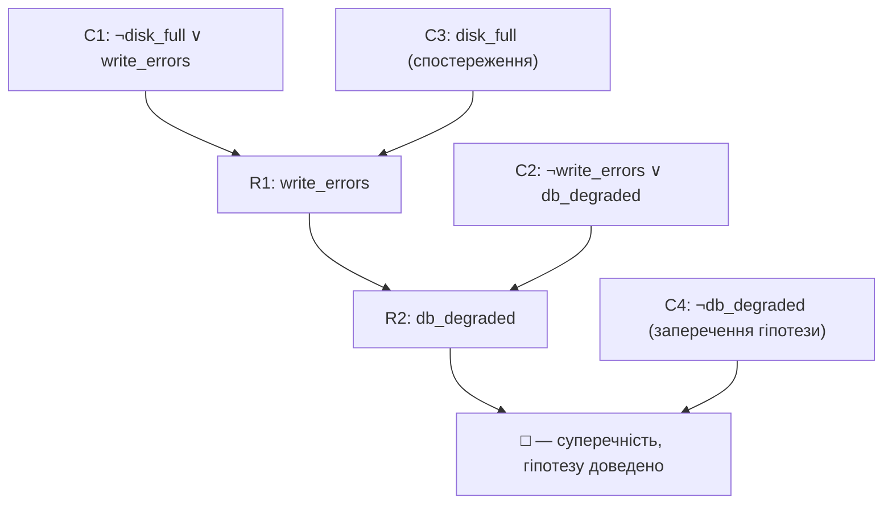
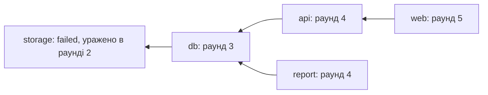
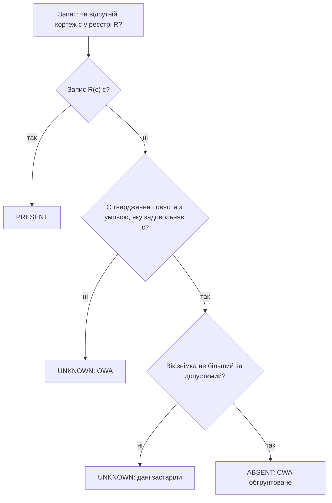

# Глава 2. Логічні основи подання знань

<a id="глава-2-логічний-фундамент-представлення-знань-числення-висловлювань-предикати-першого-порядку-та-хорнівські-дизюнкти"></a>

> **Підручник:** [Експертні Системи](../README.md) · [Том 1. Основи експертних систем: логіка, продукційні правила, схемотехніка міркувань та класичні машини виведення](README.md)  
> **Навчальний рівень:** Базовий курс (бакалаврат, 2 курс; базові пояснення — з рівня першого курсу)  
> **Обладнання:** звичайний ноутбук або ПК (x86-64 / ARM64) без прискорювачів  
> **Мови:** реалізація — будь-яка мова загального призначення (лістинги — Python); основні спеціалізовані мови курсу — Prolog (SWI-Prolog) і OMG DMN/FEEL  
> **Попередня глава:** [Глава 1. Передумови та основні поняття експертних систем](ch01-expert-systems-foundations.md)\
> **Наступна глава:** [Глава 3. Неповні дані, суперечності та походження фактів](ch03-incomplete-and-conflicting-data.md)\
> **Автор:** Микола Мартинович Федчик

---

## Анотація

У главі 1 експертну систему описано як поєднання декларативної бази знань і механізму виведення, який застосовує ці знання до фактів конкретного випадку. Ця глава відповідає на два питання, без яких таку архітектуру неможливо реалізувати: якою мовою записувати знання, щоб правило мало один-єдиний зміст, і за якими правилами механізм виведення має право отримувати нові твердження. Відповіддю є класична двозначна логіка. Числення висловлювань дає точний зміст зв'язкам «і», «або», «не», «якщо — то» в умовах продукційних правил і рядках таблиць рішень. Логіка предикатів першого порядку дозволяє записувати загальні правила про пацієнтів, договори, сервіси та склади, а не про окремі змінні p і q. Хорнівські диз'юнкти виділяють із логіки предикатів фрагмент, для якого існує єдина найменша модель і ефективне виведення; Datalog обмежує цей фрагмент ще більше і гарантує скінченність відповіді.

Для експертної системи логічний апарат виконує три інженерні функції. По-перше, він задає однозначну семантику бази знань: зміст правила не залежить від того, хто і якою мовою реалізує рушій. По-друге, він дає критерій коректності (soundness) механізму виведення: рушій не має права видати висновок, який логічно не випливає з бази знань і фактів. По-третє, він забезпечує детермінований і пояснюваний вердикт: той самий набір фактів завжди дає ту саму множину висновків, а кожен висновок можна обґрунтувати ланцюгом застосувань правил.

Окремо розглянуто три пастки, у яких формально правильна логіка призводить до хибних рішень: порожню істинність імплікації за відсутності даних, уніфікацію без перевірки входження і припущення замкненого світу для неповного реєстру. Приклади взято з шести доменів курсу: медицини (CDSS), правознавства, військової справи (лише логістика, технічне обслуговування, підтримка рішень з підготовки особового складу та аналіз розвідувальних даних), фінансового моніторингу (RegTech), ІТ-інфраструктури (AIOps/SecOps) та енергетичних систем (насосні станції, силові приводи). Лістинги подано мовою Python і SWI-Prolog; усі їх виконано, а наведені результати є фактичним виводом програм. Усі предметні правила в главі є навчальними прикладами, а не клінічними, юридичними чи експлуатаційними настановами.

---

<!-- chapter-toc:start -->
## Зміст глави

- [1. Числення висловлювань та пастка матеріальної імплікації в експертних правилах](#1-числення-висловлювань-та-пастка-матеріальної-імплікації-в-експертних-правилах)
  - [1.1. Логічні зв'язки, таблиці істинності та нормальні форми](#11-логічні-звязки-таблиці-істинності-та-нормальні-форми)
  - [1.2. Матеріальна імплікація та порожня істинність](#12-матеріальна-імплікація-та-порожня-істинність)
  - [1.3. Основні правила логічного виведення](#13-основні-правила-логічного-виведення)
- [2. Логіка предикатів і типізація термів](#2-логіка-предикатів-і-типізація-термів)
  - [2.1. Предметні константи, змінні, функціональні символи, предикати та квантори загальності й існування](#21-предметні-константи-змінні-функціональні-символи-предикати-та-квантори-загальності-й-існування)
  - [2.2. Типи об'єктів і сумісність фізичних розмірностей](#22-типи-обєктів-і-сумісність-фізичних-розмірностей)
  - [2.3. Уніфікація термів і найбільш загальна підстановка](#23-уніфікація-термів-і-найбільш-загальна-підстановка)
- [3. Хорнівські правила та обмеження логічної програми](#3-хорнівські-правила-та-обмеження-логічної-програми)
  - [3.1. Визначені диз'юнкти Хорна: факти, правила та запити-цілі](#31-визначені-дизюнкти-хорна-факти-правила-та-запити-цілі)
  - [3.2. Безпека змінних у логічних правилах](#32-безпека-змінних-у-логічних-правилах)
  - [3.3. Запис фактів і правил мовою логічного програмування](#33-запис-фактів-і-правил-мовою-логічного-програмування)
- [4. Відкритий і замкнений світ у прикладних задачах](#4-відкритий-і-замкнений-світ-у-прикладних-задачах)
  - [4.1. Заперечення як невдача доведення](#41-заперечення-як-невдача-доведення)
  - [4.2. Ризики замкненого світу за неповних даних](#42-ризики-замкненого-світу-за-неповних-даних)
  - [4.3. Перевірка локальної повноти реєстру](#43-перевірка-локальної-повноти-реєстру)
- [5. Практичні завдання та лабораторний практикум](#5-практичні-завдання-та-лабораторний-практикум)
  - [5.1. Контрольні запитання для самоперевірки](#51-контрольні-запитання-для-самоперевірки)
  - [5.2. Розрахункові задачі (трасування вручну)](#52-розрахункові-задачі-трасування-вручну)
  - [5.3. Завдання з програмної реалізації](#53-завдання-з-програмної-реалізації)
  - [5.4. Зв'язок із лабораторною та курсовою роботою семестру](#54-звязок-із-лабораторною-та-курсовою-роботою-семестру)
- [Висновки](#висновки)
- [Глосарій](#глосарій)
- [Скорочення та терміни](#скорочення-та-терміни)
- [Джерела](#джерела)
<!-- chapter-toc:end -->

---

## 1. Числення висловлювань та пастка матеріальної імплікації в експертних правилах

Найнижчий рівень бази знань утворюють умови, кожна з яких може бути лише істинною або хибною: «засувка на вході насоса відкрита», «у пацієнта зафіксовано алергію на пеніцилін», «транзакція перевищує поріг фінансового моніторингу». З таких умов складаються тіла продукційних правил (глава 4), рядки таблиць рішень DMN і вентилі ациклічних схем міркувань СТЕС (глава 1). Числення висловлювань визначає, що саме означає поєднання цих умов зв'язками «і», «або», «не», «якщо — то».

Якщо цей зміст залишити на інтуїцію розробника, два записи одного правила, наприклад у специфікації експерта і в коді на Python, можуть розійтися на окремих комбінаціях входів, яких не було в тестах. Найнебезпечніша розбіжність стосується зв'язки «якщо — то»: у природній мові вона передбачає зв'язок між причиною і наслідком, а в логіці означає лише «не буває так, що умова істинна, а висновок хибний». Тому перевірка «кожна велика транзакція перевірена» повертає «істину» і тоді, коли за день не надійшло жодного запису. Наївний підхід, за якого правило перевіряють на кількох прикладах, не захищає від цього: для правила з n умовами існує $2^n$ комбінацій, і помилка може ховатися саме в неперевіреній.

Розділ ставить дві вимірювані задачі. Перша: для двох записів одного правила з n умовами з'ясувати, чи збігаються вони на всіх $2^n$ комбінаціях, а якщо ні — знайти контрприклад. Друга: для перевірки відповідності над набором записів відрізнити істинність, підтверджену даними, від порожньої істинності за відсутності застосовних записів.

<a id="11-булеві-звязки-таблиці-істинності-нормальні-форми-кнф-днф-і-тавтології"></a>

### 1.1. Логічні зв'язки, таблиці істинності та нормальні форми

Розглянемо типову ситуацію в проєкті експертної системи. Технолог формулює умову словами, інженер знань записує її в базу правил, програміст переносить її в код сервісу, а аудитор має підтвердити, що всі три записи означають одне й те саме. Для цього потрібні три речі: точне означення кожної зв'язки, стандартна форма запису, у якій формули зручно зберігати й порівнювати, і механічна процедура, що доводить рівносильність двох формул або знаходить контрприклад. Без такої процедури рівносильність доводиться приймати на віру, а помилка в пріоритеті операторів залишається непоміченою, доки не спрацює на реальному обладнанні.

Висловлюванням називають розповідне речення, яке має рівно одне з двох значень істинності: 1 (істина) або 0 (хиба). Атомарні висловлювання позначають літерами p, q або змістовними іменами, наприклад V — «кінцевий вимикач фіксує, що засувка на вході насоса відкрита». Складні формули будують із атомарних за допомогою зв'язок, зміст яких задано таблицею 2.1.

<a id="obj-2-1"></a>

**Таблиця 2.1. Таблиці істинності базових зв'язок числення висловлювань.**

| $p$ | $q$ | $\neg p$ | $p \land q$ | $p \lor q$ | $p \to q$ | $p \leftrightarrow q$ |
| :-: | :-: | :-: | :-: | :-: | :-: | :-: |
| 0 | 0 | 1 | 0 | 0 | 1 | 1 |
| 0 | 1 | 1 | 0 | 1 | 1 | 0 |
| 1 | 0 | 0 | 0 | 1 | 0 | 0 |
| 1 | 1 | 0 | 1 | 1 | 1 | 1 |

Звернемо увагу на стовпець $p \to q$: імплікація хибна лише в одному рядку, коли передумова p істинна, а висновок q хибний. Саме ця властивість стане джерелом пастки в підрозділі 1.2.

Літералом називають атом або його заперечення ($p$, $\neg p$). Диз'юнкт — це диз'юнкція літералів, наприклад $\neg p \lor q$. Кон'юнктивна нормальна форма (КНФ) — кон'юнкція диз'юнктів; диз'юнктивна нормальна форма (ДНФ) — диз'юнкція кон'юнкцій літералів. Відомий результат класичної логіки стверджує, що кожна формула числення висловлювань рівносильна деякій ДНФ і деякій КНФ: ДНФ можна зібрати з рядків таблиці істинності зі значенням 1, а КНФ — із рядків зі значенням 0. Для експертної системи обидві форми мають прямий зміст. ДНФ — це набір альтернативних правил, кожного з яких достатньо для висновку; так влаштовані рядки таблиці рішень DMN з однаковим результатом. КНФ — це перелік обмежень, які мають виконуватися одночасно; у цій формі записують перевірні списки (чек-листи) та вхід для методу резолюції з підрозділу 1.3.

Щоб довести, що два записи правила рівносильні, потрібен критерій тавтології. Результатом перевірки має бути одне з двох: доведення рівносильності або конкретний контрприклад — набір значень атомів, на якому записи розходяться.

<a id="obj-2-2"></a>

**Формула 2.2. Критерій тавтології та логічної рівносильності через перебір інтерпретацій.**

$$
\models \varphi \iff \forall v \in \{0,1\}^{n}:\ \hat{v}(\varphi) = 1,
\qquad
\varphi \equiv \psi \iff\ \models (\varphi \leftrightarrow \psi)
$$

- $\varphi$, $\psi$ — формули числення висловлювань над спільним набором атомів $`p_1, \dots, p_n`$; n — кількість різних атомів, ціле число $n \ge 1$.
- $v$ — інтерпретація (оцінка): вектор із n значень 0 або 1, який кожному атому приписує значення істинності; усього інтерпретацій $2^n$.
- $`\hat{v}(\varphi)`$ — значення формули $\varphi$ за інтерпретації v, обчислене знизу вгору за таблицею 2.1; набуває значень 0 або 1.
- $\models \varphi$ — «формула $\varphi$ є тавтологією», тобто істинна за будь-якої інтерпретації.
- $\varphi \equiv \psi$ — «формули рівносильні»: вони мають однакове значення за кожної інтерпретації, що те саме, що тавтологічність формули $\varphi \leftrightarrow \psi$.
- Контрприклад — інтерпретація v, для якої $`\hat{v}(\varphi) = 0`$; одного контрприкладу достатньо, щоб спростувати тавтологічність.

Покроковий логічний приклад для формули $(p \to q) \leftrightarrow (\neg p \lor q)$, n = 2, тобто 4 інтерпретації. Для $(p, q) = (0, 0)$: $p \to q = 1$, $\neg p \lor q = 1 \lor 0 = 1$, обидві частини рівні, отже еквіваленція дає 1. Для $(0, 1)$: $1$ і $1 \lor 1 = 1$, результат 1. Для $(1, 0)$: $0$ і $0 \lor 0 = 0$, результат 1. Для $(1, 1)$: $1$ і $0 \lor 1 = 1$, результат 1. Усі чотири рядки дають 1, отже формула є тавтологією, і в базі знань імплікацію $p \to q$ можна зберігати як диз'юнкт $\neg p \lor q$ без зміни змісту. Для формули $(p \to q) \to (q \to p)$ уже рядок $(0, 1)$ дає $1 \to 0 = 0$: це контрприклад, який спростовує поширену помилку «якщо з p випливає q, то з q випливає p».

Результат перевірки використовується як вердикт інструмента верифікації бази знань. Якщо формула-еквіваленція є тавтологією, нова редакція правила приймається як рівносильна попередній. Якщо знайдено контрприклад, редакція відхиляється, а контрприклад додається до звіту як конкретний тестовий випадок для експерта.

Межі висновку. Перебір охоплює $2^n$ рядків: для n = 20 це близько $10^6$ рядків, що ще цілком придатно для перебору на ноутбуці, а для n = 60 — близько $`1{,}15 \cdot 10^{18}`$, що практично недосяжно. Це не недолік конкретної реалізації: з теореми Кука випливає, що перевірка тавтологічності є coNP-повною задачею [[1]](#src-1), тож для великих n застосовують SAT-розв'язувачі або обмежують клас формул (розділ 3). Крім того, критерій доводить лише рівносильність двох записів; він нічого не каже про те, чи правильна сама специфікація і чи достовірні датчики, які постачають значення атомів.

Застосуємо критерій до правила дозволу пуску насоса в промисловій кіберфізичній системі. Експертна система тут не керує насосом: реальні функції безпеки проєктують за вимогами функціональної безпеки (наприклад, IEC 61508) і виконують у сертифікованих контролерах безпеки. Роль експертної системи — перевірити, що логіка, записана в конфігурації, збігається зі специфікацією технолога.

<a id="obj-2-3"></a>

**Формула 2.3. Умова дозволу пуску насоса та її нормальні форми.**

$$
\begin{aligned}
S &\leftrightarrow V \land (P \lor B) \land \neg E, \\
\text{КНФ: } S &\leftrightarrow V \land (P \lor B) \land \neg E, \\
\text{ДНФ: } S &\leftrightarrow (V \land P \land \neg E) \lor (V \land B \land \neg E)
\end{aligned}
$$

- $S$ — висновок «пуск насоса дозволено» (1 — дозволено, 0 — заборонено).
- $V$ — «засувка на вході насоса відкрита» за сигналом кінцевого вимикача (1 або 0).
- $P$ — «тиск у всмоктувальній лінії в допустимих межах» (1 або 0).
- $B$ — «санкціоновано режим обходу датчика тиску», наприклад під час планового обслуговування (1 або 0).
- $E$ — «натиснуто кнопку аварійної зупинки» (1 або 0).

Права частина вже є КНФ: три диз'юнкти $V$, $P \lor B$ і $\neg E$. ДНФ отримано за дистрибутивним законом $V \land (P \lor B) = (V \land P) \lor (V \land B)$. Покроковий розрахунок для стану $V = 1$, $P = 0$, $B = 1$, $E = 0$: $P \lor B = 0 \lor 1 = 1$; $\neg E = 1$; $S = 1 \land 1 \land 1 = 1$, тобто пуск дозволено в режимі обходу. Для стану $V = 0$, $P = 0$, $B = 1$, $E = 0$ перший співмножник дорівнює 0, тому $S = 0$: із закритою засувкою пуск заборонено за будь-яких інших сигналів.

Тепер припустимо, що програміст записав умову як `(V and P) or (B and not E)`, пропустивши дужки. Перевірка за формулою 2.2 знаходить 4 контрприклади з 16, зокрема щойно розглянутий стан $V = 0$, $P = 0$, $B = 1$, $E = 0$: помилковий запис дозволяє пуск із закритою засувкою. Інструмент верифікації в такому разі повертає вердикт «редакцію відхилено» з цим контрприкладом. Межі висновку: формула 2.3 є навчальною моделлю, а не проєктом реальної функції безпеки; вона не враховує затримок сигналів, відмов датчиків і вимог до часу реакції.

**Реалізація формули 2.2 мовою Python.**

Вхід: формула як функція Python від булевих аргументів і список імен атомів. Рядок `rows = list(product(...))` будує всі $2^n$ інтерпретації; рядок зі списком `bad` обчислює $`\hat{v}(\varphi)`$ для кожної інтерпретації і збирає контрприклади. Функції `spec`, `dnf` і `buggy` реалізують формулу 2.3, її ДНФ і помилковий запис без дужок. Очікуваний результат: перші три формули й еквіваленція `spec <-> dnf` є тавтологіями; обернення імплікації має 1 контрприклад, помилковий запис — 4.

```python
from itertools import product


def implies(a, b):
    return (not a) or b


def check(formula, names):
    """Формула 2.2: перебір усіх 2^n інтерпретацій і збір контрприкладів."""
    rows = list(product([False, True], repeat=len(names)))
    bad = [dict(zip(names, map(int, r))) for r in rows if not formula(*r)]
    return len(rows), bad


def spec(v, p, b, e):          # Формула 2.3, специфікація блокування
    return v and (p or b) and not e


def dnf(v, p, b, e):           # ДНФ тієї самої умови
    return (v and p and not e) or (v and b and not e)


def buggy(v, p, b, e):         # помилка пріоритету операторів у коді
    return (v and p) or (b and not e)


CASES = [
    ("(p->q) <-> (~p v q)", lambda p, q: implies(p, q) == ((not p) or q), "pq"),
    ("(p->q) <-> (~q->~p)", lambda p, q: implies(p, q) == implies(not q, not p), "pq"),
    ("((p->q) & p) -> q", lambda p, q: implies(implies(p, q) and p, q), "pq"),
    ("(p->q) -> (q->p)", lambda p, q: implies(implies(p, q), implies(q, p)), "pq"),
    ("spec <-> dnf", lambda *x: spec(*x) == dnf(*x), "VPBE"),
    ("spec <-> buggy", lambda *x: spec(*x) == buggy(*x), "VPBE"),
]

for text, f, names in CASES:
    n, bad = check(f, list(names))
    first = bad[0] if bad else "-"
    print(f"{text:21} rows={n:2} tautology={not bad!s:5} "
          f"counterexamples={len(bad)} first={first}")
```

Фактичний вивід (Python 3.14, команда `python3 tautology.py`):

```text
(p->q) <-> (~p v q)   rows= 4 tautology=True  counterexamples=0 first=-
(p->q) <-> (~q->~p)   rows= 4 tautology=True  counterexamples=0 first=-
((p->q) & p) -> q     rows= 4 tautology=True  counterexamples=0 first=-
(p->q) -> (q->p)      rows= 4 tautology=False counterexamples=1 first={'p': 0, 'q': 1}
spec <-> dnf          rows=16 tautology=True  counterexamples=0 first=-
spec <-> buggy        rows=16 tautology=False counterexamples=4 first={'V': 0, 'P': 0, 'B': 1, 'E': 0}
```

Перевірка: перший рядок збігається з ручним розрахунком вище; кількість контрприкладів для помилкового запису (4) підтверджено ручним аналізом — помилкова формула відрізняється від специфікації на станах $V \land P \land E$ (2 рядки за довільного B) і $\neg V \land B \land \neg E$ (2 рядки за довільного P). Другий і третій рядки виводу знадобляться в підрозділі 1.3: вони підтверджують, що закон контрапозиції і modus ponens відповідають тавтологіям.

<a id="12-парадокс-матеріальної-імплікації-та-поняття-порожньої-істинності-vacuous-truth-при-хибній-передумові"></a>

### 1.2. Матеріальна імплікація та порожня істинність

Таблиця 2.1 визначає імплікацію як матеріальну: $p \to q$ хибна тільки тоді, коли p істинна, а q хибна. Для механізму виведення це правильне і необхідне означення, але воно відрізняється від буденного «якщо — то» у двох місцях. По-перше, за хибної передумови імплікація істинна незалежно від висновку; по-друге, за істинного висновку вона істинна незалежно від передумови. Між передумовою і висновком не вимагається жодного змістовного чи причинного зв'язку. Доки правило використовують для виведення (з p отримати q), ці властивості нешкідливі. Проблема виникає, коли експертна система перевіряє, чи виконується правило на наборі записів, і повідомляє людині результат «порушень немає».

**Тематичний обсяг:** Парадокс матеріальної імплікації та поняття порожньої істинності (vacuous truth) при хибній передумові

Розглянемо підсистему фінансового моніторингу (RegTech), яка щодня перевіряє правило «кожна транзакція на суму від $\theta$ гривень має позначку перевірки». Тут $\theta = 400\,000$ грн — навчальне значення порогу. Якщо постачання даних з операційної системи банку зламалося і за день надійшло нуль записів, перевірка повертає «істину»: серед нуля транзакцій немає жодної неперевіреної. Те саме станеться в день, коли великих транзакцій просто не було. В обох випадках звіт «правило виконано» звучить як підтвердження відповідності, хоча жоден запис не був перевірений. У медицині аналогічно поводиться аудит «жоден пацієнт з алергією на пеніцилін не отримав амоксициліну» за день, коли в систему не надійшло жодного запису про алергію.

<a id="obj-2-4"></a>

**Формула 2.4. Матеріальна імплікація та порожня істинність універсального правила на скінченному наборі записів.**

$$
(A \to B) \equiv (\neg A \lor B),
\qquad
D_A = \varnothing \ \Longrightarrow\ \forall x \in D\ \bigl(A(x) \to B(x)\bigr) = 1
$$

- $A$, $B$ — висловлювання або умови над одним записом; $A$ — передумова (умова застосовності правила), $B$ — вимога.
- $D$ — скінченна множина записів, що надійшли на перевірку (транзакції за день, призначення за зміну); може бути порожньою.
- $A(x)$, $B(x)$ — значення умов для конкретного запису x (0 або 1).
- $`D_A = \{x \in D \mid A(x) = 1\}`$ — множина застосовних записів, тобто тих, для яких передумова істинна.
- $\forall x \in D\ (\dots)$ — «для кожного запису з D»; на скінченній множині це кон'юнкція значень для всіх записів (детально — у формулі 2.10 розділу 2).
- Позначення $= 1$ означає, що формула істинна.

Перша частина формули 2.4 — тавтологія, перевірена в першому рядку виводу попереднього лістингу. Друга частина випливає з неї: якщо $`D_A = \varnothing`$, то для кожного x значення $A(x) = 0$, отже $\neg A(x) \lor B(x) = 1$, а кон'юнкція одиниць (або порожня кон'юнкція при $D = \varnothing$) дорівнює 1. Покроковий приклад: за день надійшов один запис $`T_6`$ на 9 900 грн без позначки перевірки. Для нього $A(x) = 0$, тож $\neg A(x) \lor B(x) = 1 \lor 0 = 1$, і правило «виконано», хоча жодної позначки перевірки не існує.

Щоб звіт розрізняв ці ситуації, вердикт перевірки має залежати не лише від значення формули, а й від кількості записів, на яких її реально перевірено.

<a id="obj-2-5"></a>

**Формула 2.5. Захищений вердикт перевірки універсального правила.**

$$
\mathrm{verdict}(D) =
\begin{cases}
\mathtt{NO\_DATA}, & n_D = 0, \\
\mathtt{VIOLATION}, & \exists x \in D_A:\ B(x) = 0, \\
\mathtt{NOT\_APPLICABLE}, & n_D > 0,\ n_A = 0, \\
\mathtt{COMPLIANT}, & n_A > 0,\ \forall x \in D_A:\ B(x) = 1
\end{cases}
$$

- $`n_D = \lvert D \rvert`$ — кількість записів, що надійшли; ціле число $`n_D \ge 0`$.
- $`n_A = \lvert D_A \rvert`$ — кількість застосовних записів; $`0 \le n_A \le n_D`$.
- $`D_A`$, $B(x)$ — як у формулі 2.4.
- Умови перевіряються згори донизу; вибирається перший рядок, умова якого істинна. Чотири вердикти взаємно виключні.
- $`\mathtt{NO\_DATA}`$ — перевірку не виконано через відсутність даних; $`\mathtt{VIOLATION}`$ — знайдено порушення; $`\mathtt{NOT\_APPLICABLE}`$ — дані є, але правило не мало до чого застосовуватися; $`\mathtt{COMPLIANT}`$ — правило перевірено щонайменше на одному застосовному записі і порушень не знайдено.

Покроковий розрахунок для чотирьох днів із лістингу нижче. День 1: $`n_D = 3`$, застосовні $`T_1`$ (520 000 грн) і $`T_2`$ (410 000 грн), $`T_2`$ без позначки, тож вердикт VIOLATION. День 2: $`n_D = 2`$, $`n_A = 1`$, $`T_4`$ має позначку — COMPLIANT. День 3: $`n_D = 1`$, $`n_A = 0`$ — NOT_APPLICABLE. День 4: $`n_D = 0`$ — NO_DATA. Наївна перевірка повертає «істину» для днів 2, 3 і 4, тобто в трьох випадках з чотирьох, хоча лише в одному з них відповідність підтверджено даними.

Вердикт керує подальшою дією системи. VIOLATION відкриває справу для офіцера з фінансового моніторингу; COMPLIANT зараховується як свідчення відповідності; NOT_APPLICABLE записується до журналу, але не зараховується як свідчення; NO_DATA блокує формування звіту про відповідність і ескалює проблему власнику джерела даних. Межі висновку: умова $`n_A > 0`$ гарантує, що правило перевірено хоча б на одному записі, але не гарантує, що надійшли всі записи. Неповнота потоку даних є окремою проблемою, критерії для якої наведено в підрозділі 4.3; організація може також вимагати мінімальний обсяг вибірки, більший за 1.

**Реалізація формули 2.5 мовою Python.**

Вхід: словник денних наборів транзакцій. Функція `naive_rule` реалізує формулу 2.4 як `all(not A or B)`; функція `guarded_verdict` перевіряє рядки формули 2.5 у тому самому порядку: спочатку $`n_D = 0`$, потім наявність порушення, потім $`n_A = 0`$. Очікуваний результат: наївна перевірка дає `True` для днів 2–4, захищена — чотири різні вердикти.

```python
THETA = 400_000  # грн, навчальне значення порогу


def large(t):
    return t["amount"] >= THETA


def naive_rule(feed):
    """Формула 2.4: forall t (Large(t) -> Verified(t)) як all(not A or B)."""
    return all((not large(t)) or t["verified"] for t in feed)


def guarded_verdict(feed):
    """Формула 2.5: вердикт з урахуванням n_D і n_A."""
    if len(feed) == 0:
        return "NO_DATA"
    applicable = [t for t in feed if large(t)]
    if any(not t["verified"] for t in applicable):
        return "VIOLATION"
    if len(applicable) == 0:
        return "NOT_APPLICABLE"
    return "COMPLIANT"


FEEDS = {
    "day 1: violation": [
        {"id": "T1", "amount": 520_000, "verified": True},
        {"id": "T2", "amount": 410_000, "verified": False},
        {"id": "T3", "amount": 12_000, "verified": False}],
    "day 2: all verified": [
        {"id": "T4", "amount": 650_000, "verified": True},
        {"id": "T5", "amount": 3_500, "verified": False}],
    "day 3: small only": [
        {"id": "T6", "amount": 9_900, "verified": False}],
    "day 4: empty feed": [],
}

for name, feed in FEEDS.items():
    print(f"{name:20} naive={naive_rule(feed)!s:5} "
          f"guarded={guarded_verdict(feed)}")
```

Фактичний вивід (`python3 vacuous.py`):

```text
day 1: violation     naive=False guarded=VIOLATION
day 2: all verified  naive=True  guarded=COMPLIANT
day 3: small only    naive=True  guarded=NOT_APPLICABLE
day 4: empty feed    naive=True  guarded=NO_DATA
```

Перевірка: кожен рядок виводу збігається з ручним розрахунком за формулою 2.5, а день 3 відтворює приклад до формули 2.4.

<a id="13-правила-виведення-modus-ponens-modus-tollens-та-резолюція-робінсона"></a>

### 1.3. Основні правила логічного виведення

Після того як правила записано, механізм виведення має отримувати з них нові факти. Головна вимога до кожного кроку виведення — коректність (soundness): якщо всі посилки істинні, то й отриманий висновок істинний. Порушення цієї вимоги неможливо виправити пізніше: хибний проміжний факт стає посилкою для наступних правил, і помилка поширюється всією схемою міркувань. Наївний підхід «додати висновок, якщо він виглядає правдоподібно» часто зводиться до схеми «з $A \to B$ і B вивести A» (стверджування наслідку). Формула $((A \to B) \land B) \to A$ не є тавтологією: інтерпретація $A = 0$, $B = 1$ дає $(1 \land 1) \to 0 = 0$ — це той самий контрприклад, що й у четвертому рядку виводу лістингу з підрозділу 1.1. Отже, така схема некоректна: з того, що при відмові насоса падає тиск, і того, що тиск упав, не випливає відмова саме насоса.

Розглянемо три коректні правила виведення, на яких побудовано класичні рушії: modus ponens (пряме застосування правила), modus tollens (заперечення передумови через заперечення висновку) і резолюцію, яка узагальнює обидва.

<a id="obj-2-6"></a>

**Формула 2.6. Правила виведення modus ponens і modus tollens.**

$$
\frac{A \to B \qquad A}{B}\ (\mathrm{MP}),
\qquad
\frac{A \to B \qquad \neg B}{\neg A}\ (\mathrm{MT})
$$

- Над рискою записано посилки, під рискою — висновок, який дозволено додати до бази фактів.
- $A$, $B$ — висловлювання (атоми або формули).
- MP (modus ponens) — якщо правило $A \to B$ є в базі знань і факт A встановлено, можна вивести B.
- MT (modus tollens) — якщо правило $A \to B$ є в базі знань і встановлено, що B хибне, можна вивести, що A хибне.

Коректність обох правил випливає з тавтологій, перевірених у підрозділі 1.1: для MP — $((A \to B) \land A) \to B$ (третій рядок виводу), для MT — закон контрапозиції $(A \to B) \leftrightarrow (\neg B \to \neg A)$ (другий рядок). Логічний приклад із промислової CPS: правило «якщо насос P-101 працює (A), то тиск нагнітання не менший за 2 бар (B)». Якщо надійшов сигнал «насос працює», MP дає очікуваний тиск, і система може перевірити, чи відповідає йому показ манометра. Якщо манометр показує 0,4 бар, тобто $\neg B$, MT дає висновок «насос не працює», і система рекомендує оператору перевірити стан приводу.

Межі висновку. Обидва правила коректні лише за двох умов: правило $A \to B$ не має винятків, а спостереження достовірне. Якщо манометр несправний, «факт» $\neg B$ хибний, і MT коректно виводить хибний висновок із хибної посилки. Якщо правило має винятки (наприклад, перші 30 с після пуску тиск ще не встановився), воно не є строгою імплікацією. Облік достовірності й походження спостережень розглянуто в главі 3.

Обидва правила є окремими випадками резолюції. Резолюцію запропонував Джон Алан Робінсон як єдине правило виведення, достатнє для автоматичного доведення теорем [[2]](#src-2). Вона працює з диз'юнктами, тобто з формулами в КНФ.

<a id="obj-2-7"></a>

**Формула 2.7. Правило резолюції для диз'юнктів.**

$$
\frac{C_1 \lor L \qquad C_2 \lor \neg L}{C_1 \lor C_2}
$$

- $L$ — атом, що входить в один диз'юнкт позитивно, а в інший — із запереченням; такі літерали називають контрарною парою.
- $`C_1`$, $`C_2`$ — решта літералів відповідних диз'юнктів (можуть бути порожніми).
- $`C_1 \lor C_2`$ — резольвента; якщо обидві частини порожні, резольвента є порожнім диз'юнктом $\square$, який завжди хибний і означає суперечність.

Звідки випливають MP і MT: запишемо $A \to B$ як диз'юнкт $\neg A \lor B$. Резолюція з фактом A (тут $`C_1`$ порожній, $L = A$) дає B — це MP. Резолюція з фактом $\neg B$ дає $\neg A$ — це MT.

Перед використанням резолюції нагадаємо відомий результат, на якому ґрунтується її застосування в рушіях. Теорема Робінсона про повноту резолюції для спростування [[2]](#src-2): скінченна множина диз'юнктів S невиконувана тоді і тільки тоді, коли з S резолюцією можна вивести порожній диз'юнкт $\square$. Умови теореми: формули подано в КНФ; для логіки предикатів резолюцію виконують разом з уніфікацією (підрозділ 2.3) і склеюванням однакових літералів. Звідси метод доведення від супротивного: щоб довести G із бази знань KB, до KB додають $\neg G$ і шукають $\square$.

Логічний приклад з AIOps. База знань: «якщо диск заповнено, то виникають помилки запису» і «якщо виникають помилки запису, то база даних деградує». Спостереження: диск заповнено. Потрібно довести гіпотезу «база даних деградує». Діаграма 2.8 показує повне спростування.

<a id="obj-2-8"></a>

**Діаграма 2.8. Спростування резолюцією для гіпотези «база даних деградує».**



Покроково: C1 і C3 мають контрарну пару disk_full, резольвента R1 = write_errors; R1 і C2 мають контрарну пару write_errors, резольвента R2 = db_degraded; R2 і C4 дають $\square$. Отже, множина {C1, C2, C3, C4} невиконувана, і гіпотеза db_degraded логічно випливає з бази знань і спостереження. Дерево спростування одночасно є поясненням для оператора: кожна вершина вказує, які правило і факт використано. Межі висновку: повнота резолюції гарантує, що доведення існує, якщо гіпотеза випливає, але для довільних диз'юнктів кількість резольвент може зростати експоненційно. У розділі 3 показано, що для хорнівських диз'юнктів пошук доведення стає ефективним.

<a id="2-логіка-предикатів-першого-порядку-fol-і-сортована-типізація-термів"></a>

## 2. Логіка предикатів і типізація термів

Числення висловлювань розглядає кожне твердження як неподільний атом. Для бази знань реальної експертної системи цього недостатньо: твердження «у пацієнта 17 алергія на пеніцилін» і «у пацієнта 18 алергія на пеніцилін» стають двома не пов'язаними атомами, а правило протипоказання доводиться повторювати для кожної пари «пацієнт — препарат». Для лікарні з 10 000 пацієнтів і 50 класами препаратів це 500 000 копій одного правила, і виправлення помилки в одній копії не виправляє решти. Експерт формулює знання загально: «для будь-якого пацієнта і будь-якого препарату: якщо препарат належить до класу, на який у пацієнта алергія, то препарат протипоказаний». Мова, що дозволяє записати таке правило один раз, — логіка предикатів першого порядку (First-Order Logic, FOL).

В архітектурі експертної системи FOL є мовою бази знань, а механізм виведення під час роботи підставляє в загальні правила конкретні константи з фактів. Із цього випливають три інженерні задачі розділу: обчислити значення правила з кванторами на скінченній множині об'єктів і оцінити вартість цього обчислення; ще під час завантаження бази знань відхилити правила, які змішують різні види об'єктів або несумісні фізичні величини; механічно знайти підстановку, яка робить атом правила тотожним факту.

### 2.1. Предметні константи, змінні, функціональні символи, предикати та квантори загальності й існування

Щоб записати загальне правило, потрібно розрізняти імена конкретних об'єктів, змінні, які пробігають множину об'єктів, і властивості чи відношення між об'єктами. Таблиця 2.9 зводить синтаксичні категорії FOL разом із прикладами з доменів курсу. Імена записано в нотації Prolog: константи й імена предикатів — з малої літери, змінні — з великої.

<a id="obj-2-9"></a>

**Таблиця 2.9. Синтаксичні категорії мови логіки предикатів першого порядку.**

| Категорія | Призначення | Приклад |
| :-- | :-- | :-- |
| Предметна константа | Ім'я конкретного об'єкта | `patient17`, `amoxicillin`, `depot1`, `contract_041` |
| Змінна | Позначення довільного об'єкта з предметної області | `P`, `D`, `X` |
| Функціональний символ | Побудова складеного імені об'єкта з інших імен | `period(2026, q3)` — звітний період; `cost(unit7, 40)` |
| Терм | Константа, змінна або функціональний символ, застосований до термів | `cost(Z, C)` |
| Предикат і атом | Властивість або відношення; атом має значення 0 чи 1 | `allergy(patient17, penicillin)`, `depends(web, api)` |
| Зв'язки | Як у численні висловлювань | $\neg$, $\land$, $\lor$, $\to$, $\leftrightarrow$ |
| Квантори | «Для кожного» ($\forall$) та «існує» ($\exists$) | $\forall P\, \forall D\ (\dots)$ |

Інтерпретація формули FOL задається непорожньою предметною областю D, відображенням кожної константи в елемент D і кожного n-місного предиката у відношення на $D^n$. У Prolog і Datalog квантори не пишуть явно: усі змінні правила вважаються зв'язаними квантором загальності на все правило. Правило `has_owner(S) :- owner(S, T).` читається як $`\forall S\, \forall T\ (\mathit{owner}(S, T) \to \mathit{has\_owner}(S))`$, що рівносильно $`\forall S\ (\exists T\ \mathit{owner}(S, T) \to \mathit{has\_owner}(S))`$. Отже, змінна, яка є лише в тілі правила, за змістом зв'язана квантором існування всередині умови. Це правило читання знадобиться в розділах 3 і 4.

Експертна система завжди обчислює правила на скінченному наборі об'єктів, які є в базі фактів. Для такого набору квантори зводяться до звичайних кон'юнкцій і диз'юнкцій, що дає і алгоритм обчислення, і оцінку його вартості.

<a id="obj-2-10"></a>

**Формула 2.10. Квантори на скінченній предметній області.**

$$
\forall x\ \varphi(x) \equiv \bigwedge_{i=1}^{n} \varphi(d_i),
\qquad
\exists x\ \varphi(x) \equiv \bigvee_{i=1}^{n} \varphi(d_i),
\qquad
D = \{d_1, \dots, d_n\}
$$

- $D$ — скінченна непорожня предметна область (усі договори пакета, усі джерела повідомлень); n — кількість її елементів, $n \ge 1$.
- $`d_i`$ — i-й елемент області; $`\varphi(d_i)`$ — значення формули $\varphi$ після підстановки $`d_i`$ замість змінної x (0 або 1).
- $\bigwedge$ і $\bigvee$ — кон'юнкція та диз'юнкція по всіх n елементах.
- Для k вкладених кванторів над тією самою областю матрицю формули доводиться обчислити до $n^k$ разів.

Приклад із правознавства (навчальна норма): «кожен договір у пакеті документів має підпис уповноваженої особи», тобто $`\forall c\ (\mathit{Contract}(c) \to \mathit{Signed}(c))`$. Для пакета з трьох договорів $`c_1, c_2, c_3`$, із яких $`c_2`$ не підписано, кон'юнкція дорівнює $1 \land 0 \land 1 = 0$: норму порушено, а свідком порушення є $`c_2`$, який система повертає юристу для доопрацювання. Приклад з аналізу розвідувальних даних: повідомлення r вважається підтвердженим, якщо існують два різні незалежні джерела, що його підтверджують: $`\exists x\ \exists y\ (x \ne y \land \mathit{Conf}(x, r) \land \mathit{Conf}(y, r) \land \mathit{Indep}(x, y))`$. За реєстру з n = 40 джерел наївне обчислення перебирає до $40^2 = 1600$ пар. Якщо ж спершу вибрати лише джерела, для яких $`\mathit{Conf}(x, r) = 1`$ (нехай їх 3), залишиться $3 \cdot 3 = 9$ пар, з них 6 пар із $x \ne y$. Знайдена пара незалежних джерел дає статус «підтверджено двома джерелами», відсутність такої пари — статус «потребує додаткового підтвердження» для аналітика. Саме така перебудова порядку обчислення (спершу найвибірковіша умова) лежить в основі з'єднань у Datalog і мережі Rete (глави 5 і 6).

Межі висновку. Формула 2.10 справедлива лише для скінченної, явно перелічуваної області. Якщо змінна пробігає числа, моменти часу чи рядки, область нескінченна, і обчислити квантор перебором неможливо. Саме тому в розділі 3 вимагається, щоб кожна змінна правила отримувала значення з фактів бази (умова безпеки). Крім того, відповідь коректна лише тоді, коли D справді містить усі об'єкти; якщо частина договорів не надійшла, $\forall$ обчислюється на неповному наборі, і виникає вже знайома з підрозділу 1.2 пастка.

<a id="22-багатосортова-логіка-предикатів-та-перевірка-сумісності-фізичних-розмірностей-сі"></a>

### 2.2. Типи об'єктів і сумісність фізичних розмірностей

У класичній FOL усі об'єкти належать до однієї предметної області, тому атом `prescribed(amoxicillin, patient17)` з переставленими аргументами є синтаксично правильним. Механізм виведення не повідомить про помилку: такий атом просто ніколи не збіжеться з жодним фактом, правило ніколи не спрацює, і система мовчки пропустить протипоказання. Те саме стосується числових величин: умова «тиск більший за 350» не каже, чи йдеться про паскалі, бари чи кельвіни, і порівняння тиску з температурою не є помилкою для логіки. У базі знань із тисячами правил, які пишуть різні експерти, такі помилки неминучі, а виявити їх тестуванням важко, бо вони проявляються як відсутність висновку.

Багатосортова (сортована) логіка розв'язує цю проблему так само, як система типів у мові програмування: кожен терм має сорт (тип), кожен предикат — сигнатуру, а перевірку виконують статично, під час завантаження бази знань, до будь-якого виведення. Для числових величин роль сортів відіграють розмірності Міжнародної системи одиниць (СІ). Брошура СІ визначає сім базових величин із символами розмірностей L (довжина), M (маса), T (час), I (електричний струм), $\Theta$ (термодинамічна температура), N (кількість речовини) і J (сила світла); розмірність будь-якої похідної величини є добутком їхніх степенів [[3]](#src-3).

<a id="obj-2-11"></a>

**Формула 2.11. Правила сортової і розмірнісної коректності.**

$$
\begin{aligned}
&\frac{p : s_1 \times \dots \times s_n \qquad \mathrm{sort}(t_i) \sqsubseteq s_i,\ \ i = 1, \dots, n}{p(t_1, \dots, t_n)\ \text{коректно сортований}}, \\
&\dim Q = \mathsf{L}^{a_1} \mathsf{M}^{a_2} \mathsf{T}^{a_3} \mathsf{I}^{a_4} \Theta^{a_5} \mathsf{N}^{a_6} \mathsf{J}^{a_7} \ \leftrightarrow\ \mathbf{a}(Q) = (a_1, \dots, a_7) \in \mathbb{Z}^{7}, \\
&\mathbf{a}(Q_1 Q_2) = \mathbf{a}(Q_1) + \mathbf{a}(Q_2), \quad \mathbf{a}(Q_1 / Q_2) = \mathbf{a}(Q_1) - \mathbf{a}(Q_2), \\
&Q_1 \pm Q_2,\ \ Q_1 < Q_2\ \ \text{допустимі лише за}\ \ \mathbf{a}(Q_1) = \mathbf{a}(Q_2)
\end{aligned}
$$

- $`p : s_1 \times \dots \times s_n`$ — сигнатура предиката p: i-й аргумент має належати сорту $`s_i`$ (наприклад, `prescribed : Patient × Drug`).
- $`\mathrm{sort}(t_i)`$ — сорт терма $`t_i`$; для константи задається декларацією, для змінної виводиться з першого місця її появи.
- $\sqsubseteq$ — відношення «є підсортом»: `Antibiotic` $\sqsubseteq$ `Drug` означає, що кожен антибіотик є препаратом.
- $Q$, $`Q_1`$, $`Q_2`$ — фізичні величини; $\dim Q$ — їхня розмірність; $`\mathbf{a}(Q)`$ — вектор із семи цілих показників степенів базових розмірностей у порядку L, M, T, I, $\Theta$, N, J.
- Множення і ділення величин додають і віднімають вектори показників; додавання, віднімання і порівняння дозволені лише для величин з однаковими векторами.

Покроковий приклад сортової перевірки: оголошено `patient17 : Patient`, `amoxicillin : Antibiotic`, `Antibiotic` $\sqsubseteq$ `Drug`. Атом `prescribed(patient17, amoxicillin)` коректний: $`\mathit{Patient} \sqsubseteq \mathit{Patient}`$, $`\mathit{Antibiotic} \sqsubseteq \mathit{Drug}`$. Атом `prescribed(amoxicillin, patient17)` відхиляється, бо $`\mathit{Antibiotic} \not\sqsubseteq \mathit{Patient}`$, і завантажувач бази знань повертає помилку з номером правила ще до запуску.

Покроковий приклад розмірнісної перевірки для CPS: сила на поршень F = 1200 Н, площа поршня A = 0,002 м². Вектори: $`\mathbf{a}(F) = (1, 1, -2, 0, 0, 0, 0)`$ (Н = кг·м·с⁻²), $`\mathbf{a}(A) = (2, 0, 0, 0, 0, 0, 0)`$. Тиск $p = F / A = 600\,000$ Па з вектором $(1-2,\ 1-0,\ -2-0, 0, 0, 0, 0) = (-1, 1, -2, 0, 0, 0, 0)$, що збігається з розмірністю паскаля. Порівняння з допустимим тиском $`p_{\max} = 550\,000`$ Па дозволене, і правило «тиск перевищено» спрацьовує: система рекомендує оператору знизити навантаження. Порівняння того самого p з температурою 350 К відхиляється, бо вектор кельвіна $(0, 0, 0, 0, 1, 0, 0)$ інший.

Межі висновку. Розмірнісна перевірка не виявляє двох класів помилок. По-перше, помилок масштабу: значення 6 бар, записане як 6 без перерахунку в паскалі ($1$ бар $= 10^5$ Па), має правильну розмірність тиску, але порівняння з 550 000 Па дасть хибний результат. Тому числові дані потрібно перераховувати в узгоджені одиниці на вході системи, а не лише перевіряти розмірності. По-друге, різні за змістом величини можуть мати однакову розмірність: тиск у паскалях і об'ємна густина енергії в Дж/м³ мають однаковий вектор показників, і перевірка їх не розрізнить. Сортова перевірка так само ловить лише помилки категорій: факт про не того пацієнта, але правильного сорту, вона не виявить.

**Реалізація формули 2.11 (розмірнісна частина) мовою Python.**

Вхід: величини як пари «значення в одиницях СІ — вектор показників». Методи `__mul__` і `__truediv__` реалізують третій рядок формули 2.11, функція `greater` — четвертий рядок (порівняння лише за однакових векторів). Очікуваний результат: тиск 600 000 Па з розмірністю $`\mathsf{L}^{-1}\mathsf{M}\mathsf{T}^{-2}`$, спрацювання правила, відхилення порівняння з кельвінами і хибне `False` для неперерахованих бар.

```python
SYMBOLS = ("L", "M", "T", "I", "Th", "N", "J")   # базові розмірності SI


class Q:
    """Величина = числове значення в одиницях SI + вектор показників (Формула 2.11)."""

    def __init__(self, value, dim):
        self.value, self.dim = value, tuple(dim)

    def __mul__(self, other):              # множення: показники додаються
        return Q(self.value * other.value, [a + b for a, b in zip(self.dim, other.dim)])

    def __truediv__(self, other):          # ділення: показники віднімаються
        return Q(self.value / other.value, [a - b for a, b in zip(self.dim, other.dim)])


def fmt(dim):
    return " ".join(f"{s}^{e}" for s, e in zip(SYMBOLS, dim) if e) or "1"


def greater(a, b):                         # порівняння лише однакових розмірностей
    if a.dim != b.dim:
        raise TypeError(f"dim mismatch: {fmt(a.dim)} vs {fmt(b.dim)}")
    return a.value > b.value


NEWTON = (1, 1, -2, 0, 0, 0, 0)
AREA = (2, 0, 0, 0, 0, 0, 0)
PASCAL = (-1, 1, -2, 0, 0, 0, 0)
KELVIN = (0, 0, 0, 0, 1, 0, 0)

force, area = Q(1200.0, NEWTON), Q(0.002, AREA)
p = force / area
p_max = Q(5.5e5, PASCAL)
print("p =", p.value, "dim:", fmt(p.dim))
print("rule p > p_max:", greater(p, p_max))
try:
    greater(p, Q(350.0, KELVIN))
except TypeError as err:
    print("rejected:", err)
p_raw_bar = Q(6.0, PASCAL)               # 6 бар записано без перерахунку в Па
print("unconverted bar, p > p_max:", greater(p_raw_bar, p_max))
```

Фактичний вивід (`python3 dims.py`):

```text
p = 600000.0 dim: L^-1 M^1 T^-2
rule p > p_max: True
rejected: dim mismatch: L^-1 M^1 T^-2 vs Th^1
unconverted bar, p > p_max: False
```

Перевірка: значення і вектор тиску збігаються з ручним розрахунком; останній рядок демонструє першу межу висновку — розмірність коректна, а результат хибний (6 бар = 600 000 Па, тобто правило мало б спрацювати).

<a id="23-алгоритм-синтаксичної-уніфікації-робінсона-та-найбільш-загальний-уніфікатор-mgu"></a>

### 2.3. Уніфікація термів і найбільш загальна підстановка

Нехай у базі знань є правило `contraindicated(P, D) :- prescribed(P, D), drug_class(D, C), allergy(P, C).`, а в базі фактів — `prescribed(patient17, amoxicillin)`. Щоб застосувати правило, механізм виведення має знайти значення змінних, за яких атом тіла `prescribed(P, D)` стає тотожним факту. Ця операція називається уніфікацією; вона є елементарним кроком і зворотного виведення в Prolog (глава 7), і зіставлення шаблонів у прямому виведенні (глави 5 і 6). Наївне порівняння рядків або регулярні вирази тут не працюють: терми бувають вкладеними (`cost(Z, C)`), а одна змінна може траплятися кілька разів і мусить отримати те саме значення всюди.

Помилки уніфікації мають два види наслідків. Якщо знайдена підстановка конкретніша, ніж потрібно, рушій передчасно фіксує значення змінних і втрачає частину правильних відповідей, тобто виведення стає неповним. Якщо не перевіряти, чи входить змінна в терм, якому її прирівнюють, рушій може «уніфікувати» X із f(X) і вивести твердження, яке не випливає з бази знань, тобто виведення стає некоректним.

Підстановкою називають скінченну множину пар $`\sigma = \{X_1/t_1, \dots, X_k/t_k\}`$, де $`X_i`$ — різні змінні, $`t_i`$ — терми; застосування $t\sigma$ одночасно замінює кожну $`X_i`$ у t на $`t_i`$. Композиція $\sigma\lambda$ означає «спершу застосувати $\sigma$, потім $\lambda$».

<a id="obj-2-12"></a>

**Формула 2.12. Уніфікатор і найбільш загальний уніфікатор.**

$$
\sigma \ \text{— уніфікатор}\ s, t \iff s\sigma = t\sigma,
\qquad
\sigma = \mathrm{mgu}(s, t) \iff \forall \theta\ \bigl(s\theta = t\theta \Rightarrow \exists \lambda:\ \theta = \sigma\lambda\bigr)
$$

- $s$, $t$ — терми або атоми, які потрібно зробити синтаксично тотожними.
- $\sigma$, $\theta$, $\lambda$ — підстановки; $=$ між термами означає синтаксичну тотожність.
- $`\mathrm{mgu}(s, t)`$ — найбільш загальний уніфікатор (most general unifier): такий уніфікатор, з якого будь-який інший уніфікатор $\theta$ отримується додатковою підстановкою $\lambda$.

Перед застосуванням нагадаємо відомий результат. Теорема уніфікації Робінсона [[2]](#src-2): якщо терми s і t мають хоча б один уніфікатор, то вони мають MGU, єдиний з точністю до перейменування змінних; алгоритм уніфікації завжди завершується і повертає або MGU, або повідомлення про неуніфіковність. Умова теореми — синтаксична рівність термів без урахування рівнянь між функціональними символами (наприклад, $x + y = y + x$ не враховується).

Покроковий приклад. Атом правила $`s = \mathit{prescribed}(P, D)`$ і атом запиту $`t = \mathit{prescribed}(\mathit{patient17}, D_2)`$. Підстановка $`\sigma = \{P/\mathit{patient17},\ D/D_2\}`$ дає $`s\sigma = t\sigma = \mathit{prescribed}(\mathit{patient17}, D_2)`$, отже це уніфікатор. Інший уніфікатор, $`\theta = \{P/\mathit{patient17},\ D/\mathit{amoxicillin},\ D_2/\mathit{amoxicillin}\}`$, отримується з $\sigma$ композицією з $`\lambda = \{D_2/\mathit{amoxicillin}\}`$, тож $\sigma$ загальніший. Практичний зміст: рушій, який використав би $\theta$, відповідав би лише про амоксицилін і втратив би всі інші препарати, призначені пацієнту 17. Використання MGU гарантує, що жодна відповідь не втрачається на кроці уніфікації. Межі висновку: MGU гарантує повноту лише окремого кроку; повнота пошуку в цілому залежить від стратегії обходу дерева виведення (підрозділ 3.3 і глава 7).

Сучасне формулювання алгоритму як перетворення системи рівнянь запропонували Мартеллі та Монтанарі [[4]](#src-4). Початкова система містить одне рівняння $s = t$; на кожному кроці вибирається одне рівняння й обробляється за правилами таблиці 2.13, доки рівняння не закінчаться (успіх) або не спрацює правило відмови.

<a id="obj-2-13"></a>

**Таблиця 2.13. Правила перетворення системи рівнянь в алгоритмі уніфікації.**

| Правило | Вибране рівняння | Дія |
| :-- | :-- | :-- |
| Видалення | $t = t$ | Вилучити рівняння |
| Декомпозиція | $`f(s_1, \dots, s_n) = f(t_1, \dots, t_n)`$ | Замінити на $`s_1 = t_1, \dots, s_n = t_n`$ |
| Конфлікт символів | $f(\dots) = g(\dots)$, різні символи або арності | Відмова: терми неуніфіковні |
| Обмін | $t = X$, де t не змінна | Замінити на $X = t$ |
| Вилучення змінної | $X = t$, X не входить у t | Додати $X/t$ до підстановки і застосувати до решти рівнянь |
| Перевірка входження | $X = t$, X входить у t, $t \ne X$ | Відмова: рівняння не має скінченного розв'язку |

Покрокове трасування для задачі військової логістики: голова правила `route(depot1, Z, cost(Z, C)) :- road(depot1, Z, C).` («маршрут зі складу depot1 до підрозділу Z має вартість C, якщо є відповідна дорога») і запит планувальника постачання `route(D, unit7, cost(unit7, 40))` («з якого складу D є маршрут до підрозділу unit7 вартістю 40?»). Порядок кроків відповідає лістингу нижче, який обробляє останнє додане рівняння першим.

1. `route(...) = route(...)` — декомпозиція на `depot1 = D`, `Z = unit7`, `cost(Z, C) = cost(unit7, 40)`.
2. `cost(Z, C) = cost(unit7, 40)` — декомпозиція на `Z = unit7`, `C = 40`.
3. `C = 40` — вилучення змінної: підстановка {C/40}.
4. `Z = unit7` — вилучення змінної: {C/40, Z/unit7}.
5. Друге рівняння `Z = unit7` після застосування підстановки стає `unit7 = unit7` — видалення.
6. `depot1 = D` — обмін на `D = depot1`, потім вилучення: {C/40, D/depot1, Z/unit7}.

Рівнянь не залишилося, отже MGU = {C/40, D/depot1, Z/unit7}. Після уніфікації рушій має довести тіло правила `road(depot1, unit7, 40)`; якщо таку дорогу підтверджено, склад depot1 додається до кандидатів постачання й порівнюється з іншими. Якби запит містив `cost(unit9, 40)`, на кроці 5 виникло б рівняння між unit9 і unit7, спрацював би конфлікт символів, і це правило для запиту було б відкинуто.

**Реалізація алгоритму таблиці 2.13 мовою Python.**

Вхід: пари термів; змінні — рядки з великої літери, константи — з малої, складені терми — кортежі (функтор, аргументи...). Кожна гілка функції `unify` позначена коментарем з назвою правила таблиці 2.13; функція `occurs` реалізує перевірку входження. Очікуваний результат: MGU для трьох перших пар і відмова для `X = f(X)` (перевірка входження) та `p(X, X) = p(a, b)` (конфлікт символів).

<details>
<summary>Повний лістинг алгоритму уніфікації з перевіркою входження (Python, 54 рядки)</summary>

```python
def is_var(t):                       # змінна: рядок з великої літери
    return isinstance(t, str) and t[:1].isupper()


def walk(t, s):                      # застосувати вже знайдені зв'язування
    while is_var(t) and t in s:
        t = s[t]
    return t


def occurs(v, t, s):                 # перевірка входження змінної v у терм t
    t = walk(t, s)
    return t == v or (isinstance(t, tuple) and any(occurs(v, a, s) for a in t[1:]))


def unify(a, b):
    s, eqs = {}, [(a, b)]
    while eqs:
        x, y = map(lambda t: walk(t, s), eqs.pop())
        if x == y:                                            # видалення
            continue
        if is_var(x) or is_var(y):
            v, t = (x, y) if is_var(x) else (y, x)            # обмін сторін
            if occurs(v, t, s):
                return None, f"occurs check: {v} in {show(t)}"
            s[v] = t                                          # вилучення змінної
        elif (isinstance(x, tuple) and isinstance(y, tuple)
              and x[0] == y[0] and len(x) == len(y)):
            eqs.extend(zip(x[1:], y[1:]))                     # декомпозиція
        else:
            return None, f"clash: {show(x)} vs {show(y)}"     # конфлікт символів
    return {v: resolve(v, s) for v in sorted(s)}, "ok"


def resolve(t, s):
    t = walk(t, s)
    return (t[0], *(resolve(a, s) for a in t[1:])) if isinstance(t, tuple) else t


def show(t):
    return f"{t[0]}({', '.join(map(show, t[1:]))})" if isinstance(t, tuple) else t


PAIRS = [
    (("prescribed", "P", "amoxicillin"), ("prescribed", "patient17", "D")),
    (("f", "X", ("g", "X")), ("f", "a", "Y")),
    (("route", "depot1", "Z", ("cost", "Z", "C")), ("route", "D", "unit7", ("cost", "unit7", "40"))),
    ("X", ("f", "X")),
    (("p", "X", "X"), ("p", "a", "b")),
]
for a, b in PAIRS:
    mgu, why = unify(a, b)
    text = "{" + ", ".join(f"{k}/{show(v)}" for k, v in mgu.items()) + "}" if mgu is not None else "FAIL"
    print(f"{show(a)} = {show(b)}  ->  {text}  [{why}]")
```

</details>

Фактичний вивід (`python3 unify.py`):

```text
prescribed(P, amoxicillin) = prescribed(patient17, D)  ->  {D/amoxicillin, P/patient17}  [ok]
f(X, g(X)) = f(a, Y)  ->  {X/a, Y/g(a)}  [ok]
route(depot1, Z, cost(Z, C)) = route(D, unit7, cost(unit7, 40))  ->  {C/40, D/depot1, Z/unit7}  [ok]
X = f(X)  ->  FAIL  [occurs check: X in f(X)]
p(X, X) = p(a, b)  ->  FAIL  [clash: b vs a]
```

Перевірка: третій рядок збігається з ручним трасуванням; результати також звірено з вбудованим предикатом `unify_with_occurs_check/2`, який визначено стандартом ISO Prolog [[5]](#src-5). У SWI-Prolog [[6]](#src-6) звичайна уніфікація `=/2` за замовчуванням виконується без перевірки входження: стандарт не вимагає її для `=/2`, а SWI-Prolog у такому разі будує циклічний (раціональний) терм. Лістинг нижче показує цю різницю.

**Порівняльна перевірка уніфікації мовою SWI-Prolog.**

Вхід: ті самі пари термів. Предикат `report/2` виконує ціль і друкує `yes` або `no`; `cyclic_term/1` перевіряє, чи побудовано циклічний терм. Очікуваний результат: той самий MGU, що й у Python, відмова `unify_with_occurs_check(X, f(X))` і успіх `X = f(X)` з циклічним термом.

```prolog
report(Name, Goal) :-
    (   call(Goal) -> format("~w: yes~n", [Name])
    ;   format("~w: no~n", [Name])
    ).

main :-
    unify_with_occurs_check(route(depot1, Z, cost(Z, C)),
                            route(D, unit7, cost(unit7, 40))),
    format("MGU: D=~w Z=~w C=~w~n", [D, Z, C]),
    report('unify_with_occurs_check(X, f(X))', unify_with_occurs_check(X, f(X))),
    report('X = f(X)', Y = f(Y)),
    (   Y2 = f(Y2), cyclic_term(Y2)
    ->  writeln('X = f(X) built a cyclic term')
    ;   true
    ),
    report('p(X, X) = p(a, b)', p(W, W) = p(a, b)).
```

Фактичний вивід (SWI-Prolog 9.2.9, команда `swipl -q -g main -t halt unify.pl`):

```text
MGU: D=depot1 Z=unit7 C=40
unify_with_occurs_check(X, f(X)): no
X = f(X): yes
X = f(X) built a cyclic term
p(X, X) = p(a, b): no
```

Практичний висновок для бази знань: якщо факт `equal(X, X).` використовується для перевірки тотожності, то запит `equal(Y, f(Y))` без перевірки входження завершиться успіхом, хоча жоден скінченний терм не дорівнює власному підтерму. Для правил, де таке можливе, використовують `unify_with_occurs_check/2` або вмикають прапорець `occurs_check` у SWI-Prolog. У Datalog (розділ 3) функціональних символів немає, тому ця проблема там не виникає взагалі.

<a id="3-хорнівські-дизюнкти-datalog-обмеження-та-безпека-змінних"></a>

## 3. Хорнівські правила та обмеження логічної програми

Логіка предикатів першого порядку достатньо виразна, щоб записати майже будь-яке знання, але саме тому вона не придатна як мова бази знань із гарантованою відповіддю. Проблема загальнозначущості формул FOL алгоритмічно нерозв'язна [[7]](#src-7): не існує рушія, який для довільної бази знань і довільного запиту завжди завершиться з правильною відповіддю. Друга проблема — диз'юнктивні висновки. Правило «якщо надійшла помилка 502, то відмовив сервер застосунку або мережевий балансувальник» разом із фактом надходження помилки має дві мінімальні моделі, і рушій мусив би вибирати між ними, тож вердикт перестає бути детермінованим. Наївне рішення «взяти повну FOL і обмежити час роботи рушія» дає систему, яка в непередбачуваний момент відповідає «час вичерпано» замість вердикту.

Хорнівські диз'юнкти, названі на честь Альфреда Хорна, який 1951 року показав особливі алгебраїчні властивості формул такого вигляду [[8]](#src-8), обмежують форму правил так, що для кожної бази знань існує єдина найменша модель. Роберт Ковальський сформулював процедурне прочитання таких диз'юнктів як програм [[9]](#src-9); на цьому прочитанні ґрунтуються логічне програмування і мова Prolog. Datalog додає ще два обмеження — відсутність функціональних символів і безпеку змінних — і гарантує скінченну відповідь. У курсі ця мова є основою бази знань: Prolog використовується для зворотного виведення, Datalog — для прямого виведення і ациклічних схем СТЕС. Розділ ставить три вимірювані задачі: визначити роль кожного диз'юнкта (факт, правило, ціль або недопустимий запис), обчислити найменшу модель і кількість раундів виведення, а також перевірити безпеку правил і оцінити верхню межу розміру відповіді.

### 3.1. Визначені диз'юнкти Хорна: факти, правила та запити-цілі

Завантажувач бази знань отримує від інженера знань диз'юнкти і для кожного має вирішити, чи може механізм виведення з ним працювати і яку роль він відіграє. Якщо пропустити цю перевірку, у базу потрапить диз'юнктивне правило, і рушій або відкине його мовчки, або оброблятиме як звичайне правило з невизначеним результатом. Критерій класифікації простий: потрібно порахувати позитивні літерали в диз'юнкті.

<a id="obj-2-14"></a>

**Формула 2.14. Форми хорнівських диз'юнктів.**

$$
\begin{aligned}
A \lor \neg B_1 \lor \dots \lor \neg B_m \ &\equiv\ (A \leftarrow B_1 \land \dots \land B_m) \quad \text{— правило},\ m \ge 1, \\
A \ &\equiv\ (A \leftarrow) \quad \text{— факт},\ m = 0, \\
\neg B_1 \lor \dots \lor \neg B_m \ &\equiv\ (\leftarrow B_1 \land \dots \land B_m) \quad \text{— ціль або обмеження цілісності}
\end{aligned}
$$

- $A$ — голова: єдиний позитивний літерал диз'юнкта (атом, який правило виводить).
- $`B_1, \dots, B_m`$ — атоми тіла; m — їх кількість, ціле $m \ge 0$.
- $\leftarrow$ — імплікація, записана справа наліво: «A, якщо $`B_1`$ і … і $`B_m`$». Рівносильність лівої і правої частин випливає з формули 2.4: $(B \to A) \equiv (\neg B \lor A)$ і закону де Моргана.
- Усі змінні диз'юнкта неявно зв'язані квантором загальності (підрозділ 2.1).
- Хорнівський диз'юнкт містить не більше одного позитивного літерала; визначений (definite) диз'юнкт — рівно один. Програма з визначених диз'юнктів називається визначеною програмою.

Логічний приклад з AIOps. Правило `affected(X) :- depends(X, Y), affected(Y).` («сервіс X уражено, якщо він залежить від ураженого сервісу Y») — це диз'юнкт $`\mathit{affected}(X) \lor \neg \mathit{depends}(X, Y) \lor \neg \mathit{affected}(Y)`$ з одним позитивним літералом, тобто визначене правило. Запит «чи уражено web?» записується як ціль $`\leftarrow \mathit{affected}(\mathit{web})`$ без позитивних літералів. Запис «помилка 502 означає відмову сервера застосунку або балансувальника» дає диз'юнкт $`\mathit{app\_down} \lor \mathit{lb\_down} \lor \neg \mathit{alert\_502}`$ із двома позитивними літералами, тож він не хорнівський. Завантажувач повертає для нього вердикт «відхилено: диз'юнктивний висновок», а інженер знань переформульовує знання як дві гіпотези-кандидати, які перевіряє діагностичний діалог (глава 7).

Чому це обмеження вигідне, показує відомий результат: виконуваність множини хорнівських диз'юнктів числення висловлювань перевіряється за час, лінійний від сумарної довжини формул [[10]](#src-10), тоді як для довільних формул виконуваність є NP-повною, а тавтологічність — coNP-повною задачею [[1]](#src-1). Межі висновку: хорнівські диз'юнкти не дозволяють записати диз'юнктивний висновок і класичне заперечення фактів; заперечні умови в тілах правил вимагають окремого механізму, розглянутого в розділі 4.

Тепер потрібно визначити, що саме є відповіддю визначеної програми. Для цього вводять ербранівські поняття. Ербранівський базис $`\mathcal{B}_P`$ — множина всіх базових (без змінних) атомів, які можна скласти з предикатів програми P і базових термів, побудованих з її констант і функціональних символів; для Datalog-програм це атоми лише з констант. Ербранівська інтерпретація — довільна підмножина $`I \subseteq \mathcal{B}_P`$ (атоми з I вважаються істинними, решта — хибними). Інтерпретація є моделлю P, якщо кожен базовий екземпляр кожного диз'юнкта P у ній істинний.

<a id="obj-2-15"></a>

**Формула 2.15. Оператор безпосередніх наслідків і найменша ербранівська модель.**

$$
\begin{aligned}
T_P(I) &= \{\, A\theta \mid (A \leftarrow B_1 \land \dots \land B_m) \in P,\ \ A\theta \in \mathcal{B}_P,\ \ B_1\theta, \dots, B_m\theta \in I \,\}, \\
M_P &= \bigcap \{\, I \subseteq \mathcal{B}_P \mid I \models P \,\} = \mathrm{lfp}(T_P) = \bigcup_{k \ge 0} T_P^{k}(\varnothing)
\end{aligned}
$$

- $P$ — визначена програма (скінченна множина фактів і правил).
- $I$ — ербранівська інтерпретація, множина базових атомів.
- $\theta$ — підстановка, що робить голову $A\theta$ базовим атомом; для фактів (m = 0) умова на тіло порожня, тож $`T_P`$ завжди повертає всі факти.
- $`T_P(I)`$ — множина голів усіх екземплярів правил, тіла яких цілком містяться в I: «що можна вивести за один крок з I».
- $I \models P$ — «I є моделлю P»; $`M_P`$ — найменша ербранівська модель (перетин усіх моделей).
- $`\mathrm{lfp}(T_P)`$ — найменша нерухома точка оператора: найменша множина I, для якої $`T_P(I) = I`$.
- $`T_P^{k}(\varnothing)`$ — результат k застосувань оператора до порожньої множини: $`T_P^{0}(\varnothing) = \varnothing`$, $`T_P^{k+1}(\varnothing) = T_P(T_P^{k}(\varnothing))`$.

Перед застосуванням нагадаємо два відомі результати. Теорема ван Емдена — Ковальського [[11]](#src-11): для визначеної програми P перетин усіх ербранівських моделей сам є моделлю $`M_P`$; вона збігається з множиною базових атомів, які логічно випливають із P, і з найменшою нерухомою точкою $`T_P`$, яку дає об'єднання $`T_P^{k}(\varnothing)`$ за всіма k. Теорема про коректність і повноту SLD-резолюції (у викладі Ллойда [[12]](#src-12)): для визначеної програми кожна обчислена відповідь на запит є правильною (логічно випливає з P), і для кожної правильної відповіді існує SLD-спростування з обчисленою відповіддю, не менш загальною за неї. Умова повноти: пошук має бути справедливим, тобто рано чи пізно перевіряти кожну гілку дерева виведення. Обхід у глибину, який використовує Prolog, цієї умови не гарантує (підрозділ 3.3). Отже, прямий підрахунок $`M_P`$ знизу вгору і зворотне доведення запиту зверху вниз мають однаковий логічний зміст, а відрізняються лише процедурою; детально ці процедури розглянуто в главах 5 і 7.

Навчальний приклад з AIOps: граф залежностей п'яти сервісів (діаграма 2.16), факт відмови сховища `failed(storage)` і два правила: `affected(X) :- failed(X).` та правило з попереднього прикладу. Потрібно знайти всі уражені сервіси.

<a id="obj-2-16"></a>

**Діаграма 2.16. Граф залежностей сервісів і раунди виведення факту ураження.**



Покроковий розрахунок за формулою 2.15. Раунд 1: $`T_P^{1}(\varnothing)`$ містить 5 фактів (4 атоми depends і failed(storage)); тіла правил ще не виконані. Раунд 2: перше правило з failed(storage) дає affected(storage). Раунд 3: друге правило з depends(db, storage) і affected(storage) дає affected(db). Раунд 4: з depends(api, db) і depends(report, db) виводяться affected(api) і affected(report). Раунд 5: affected(web). Шосте застосування оператора не додає нових атомів, тож нерухому точку досягнуто: $`\lvert M_P \rvert = 10`$ (5 фактів і 5 атомів affected).

Результат використовується як вердикт маршрутизації інциденту: квитки автоматично відкриваються для власників усіх п'яти уражених сервісів, а пояснення для кожного є ланцюгом правил, наприклад web — api — db — storage. Межі висновку: якщо сервіс, скажімо cache, не входить до $`M_P`$, це означає лише, що його ураження не випливає з бази знань. Чи можна стверджувати «cache не уражено», вирішує окреме припущення, розглянуте в розділі 4. Крім того, для програм із функціональними символами послідовність $`T_P^{k}(\varnothing)`$ може не стабілізуватися за скінченну кількість кроків, а за наявності заперечення оператор перестає бути монотонним; ці випадки розглянуто в главі 5.

**Реалізація формули 2.15 мовою Python.**

Вхід: факти й правила як пари «голова — список атомів тіла», змінні позначено великою літерою. Функція `match` зіставляє атом тіла з базовим фактом із урахуванням уже зв'язаних змінних; функція `tp` реалізує один крок $`T_P(I)`$, перебираючи для кожного правила всі способи виконати його тіло в I; цикл `while` обчислює $`T_P^{k+1}(\varnothing) = T_P(T_P^{k}(\varnothing))`$ до збігу двох послідовних наближень. Очікуваний результат: 5 раундів, як у ручному розрахунку, і $`\lvert M_P \rvert = 10`$.

```python
def is_var(t):
    return t[:1].isupper()


def match(atom, fact, s):                 # зіставлення атома тіла з базовим фактом
    if atom[0] != fact[0] or len(atom) != len(fact):
        return None
    s = dict(s)
    for a, f in zip(atom[1:], fact[1:]):
        if is_var(a):
            if s.setdefault(a, f) != f:
                return None
        elif a != f:
            return None
    return s


def tp(program, interp):                  # Формула 2.15: один крок T_P(I)
    out = set()
    for head, body in program:
        substs = [{}]
        for atom in body:                 # кон'юнкція тіла = послідовне з'єднання
            substs = [s2 for s in substs for f in interp
                      if (s2 := match(atom, f, s)) is not None]
        for s in substs:
            out.add((head[0], *(s.get(t, t) for t in head[1:])))
    return out


FACTS = [("depends", "web", "api"), ("depends", "api", "db"),
         ("depends", "db", "storage"), ("depends", "report", "db"),
         ("failed", "storage")]
PROGRAM = [(f, []) for f in FACTS] + [
    (("affected", "X"), [("failed", "X")]),
    (("affected", "X"), [("depends", "X", "Y"), ("affected", "Y")]),
]

interp, k = set(), 0
while (nxt := tp(PROGRAM, interp)) != interp:   # T_P^(k+1) = T_P(T_P^k)
    k += 1
    new = sorted(nxt - interp)
    print(f"round {k}: +{len(new)}", [f"{a[0]}({','.join(a[1:])})" for a in new if a[0] == "affected"])
    interp = nxt
print("fixpoint after", k, "rounds; |M_P| =", len(interp))
print("affected:", sorted(a[1] for a in interp if a[0] == "affected"))
```

Фактичний вивід (`python3 tp.py`, Python 3.8 або новіший):

```text
round 1: +5 []
round 2: +1 ['affected(storage)']
round 3: +1 ['affected(db)']
round 4: +2 ['affected(api)', 'affected(report)']
round 5: +1 ['affected(web)']
fixpoint after 5 rounds; |M_P| = 10
affected: ['api', 'db', 'report', 'storage', 'web']
```

Перевірка: номери раундів і множина уражених сервісів збігаються з ручним розрахунком і з діаграмою 2.16; той самий результат дає програма SWI-Prolog у підрозділі 3.3.

<a id="32-умова-безпеки-змінних-голови-правила-range-restricted-rules-для-гарантування-скінченності-виведення"></a>

### 3.2. Безпека змінних у логічних правилах

Розглянемо правило системи підтримки рішень з підготовки особового складу: «кожен, хто не травмований, допускається до тренування», записане як `fit_for_training(S) :- not injured(S).` Формально правило коректне, але змінна S не обмежена жодним фактом: відповідь має містити всі об'єкти предметної області, які не є травмованими, тобто також склади, препарати, числа і рядки. Рушій або не завершиться, або видасть відповідь, яка залежить від того, яку область він випадково вибрав. Правило `overdue(I, D) :- D > 30.` ще гірше: для кожного I воно дає нескінченно багато значень D. Механізм виведення, призначений видавати детермінований вердикт за обмежений час, мусить відхиляти такі правила під час завантаження бази знань. Відповідну синтаксичну умову називають безпекою (safety) або обмеженістю за областю значень (range restriction) [[13]](#src-13), [[14]](#src-14).

**Тематичний обсяг:** Умова безпеки змінних голови правила (range-restricted rules) для гарантування скінченності виведення

<a id="obj-2-17"></a>

**Формула 2.17. Умова безпеки правила та верхні межі розміру найменшої моделі.**

$$
\begin{aligned}
&\mathrm{vars}(H) \cup \mathrm{vars}(B^{-}) \cup \mathrm{vars}(C) \subseteq \mathrm{vars}(B^{+}), \\
&\lvert M_P \rvert \le \sum_{p \in \mathrm{Pred}(P)} \lvert \mathrm{adom}(P) \rvert^{\mathrm{ar}(p)}, \qquad k_{\mathrm{fix}} \le \lvert M_P \rvert
\end{aligned}
$$

- Правило має вигляд $`H \leftarrow B^{+} \land \mathtt{not}\ B^{-} \land C`$: $H$ — голова; $`B^{+}`$ — позитивні атоми тіла з предикатами бази знань; $`B^{-}`$ — атоми під запереченням; $C$ — вбудовані порівняння ($>$, $\le$, $\ne$ тощо).
- $`\mathrm{vars}(\cdot)`$ — множина змінних відповідної частини правила.
- Перший рядок: кожна змінна голови, кожна змінна заперечених атомів і кожна змінна порівнянь повинна траплятися хоча б в одному позитивному атомі тіла. Правило, що задовольняє цю умову, називають безпечним.
- $`\mathrm{adom}(P)`$ — активна область: множина всіх констант, що трапляються у фактах і правилах програми P.
- $`\mathrm{Pred}(P)`$ — множина предикатів програми; $`\mathrm{ar}(p)`$ — арність (кількість аргументів) предиката p.
- $`k_{\mathrm{fix}}`$ — кількість раундів обчислення за формулою 2.15, які додають нові атоми; кожен такий раунд додає щонайменше один атом, тому $`k_{\mathrm{fix}} \le \lvert M_P \rvert`$, а після них виконується ще один контрольний раунд.

Друга межа справедлива для безпечних програм без функціональних символів: кожна змінна виведеного атома отримує значення з позитивного атома тіла, тобто з активної області, тож нових констант не виникає. Покроковий розрахунок для програми з підрозділу 3.1: $`\mathrm{adom}(P)`$ = {web, api, db, storage, report}, 5 констант. Предикати: depends/2 дає не більше $5^2 = 25$ атомів, failed/1 і affected/1 — не більше 5 кожен. Отже, $`\lvert M_P \rvert \le 25 + 5 + 5 = 35`$; фактично $`\lvert M_P \rvert = 10`$, а раундів із приростом $`k_{\mathrm{fix}} = 5 \le 10`$.

Результат перевірки безпеки є вердиктом завантажувача: безпечне правило приймається, небезпечне відхиляється з переліком незв'язаних змінних. Типове виправлення — додати позитивний атом, що задає область значень: `fit_for_training(S) :- serviceman(S), not injured(S).` і `overdue(I, D) :- loan(I, D), D > 30.` Межа розміру моделі доводить, що виведення завершиться, і дає оцінку найгіршого випадку для кожного предиката: для CMDB із 20 000 конфігураційних одиниць атомів affected/1 не може бути більше 20 000. Для бінарних предикатів межа $20\,000^2 = 4 \cdot 10^8$ надто груба, тому для оцінювання пам'яті використовують фактичний розподіл даних, а межу — лише як гарантію завершення.

Межі висновку. Безпека гарантує скінченність лише для програм без функціональних символів і без арифметики, яка створює нові значення: правило з обчисленням `N1 is N + 1` у Prolog виходить за межі активної області. Безпека заперечення є необхідною, але не достатньою умовою коректної семантики: рекурсія через заперечення вимагає стратифікації (глава 5). Відомо також, що для фіксованої безпечної програми Datalog найменшу модель можна обчислити за час, поліноміальний від обсягу бази фактів [[14]](#src-14).

**Реалізація першого рядка формули 2.17 мовою Python.**

Вхід: правила як кортежі (голова, позитивні атоми, заперечені атоми, порівняння). Функція `check_safety` будує множину зв'язаних змінних `bound` з позитивних атомів і множину `need` з голови, заперечених атомів і порівнянь, а повертає їх різницю — незв'язані змінні. Очікуваний результат: три безпечні правила і два небезпечні з переліком незв'язаних змінних.

```python
def vars_of(atoms):
    return {t for a in atoms for t in a[1:] if t[:1].isupper()}


def check_safety(rule):
    """Формула 2.17: vars(H) ∪ vars(B-) ∪ vars(C) ⊆ vars(B+)."""
    head, pos, neg, cmp = rule
    bound = vars_of(pos)
    need = vars_of([head]) | vars_of(neg) | vars_of(cmp)
    return sorted(need - bound)


RULES = {
    "affected(X) :- depends(X,Y), affected(Y).":
        (("affected", "X"), [("depends", "X", "Y"), ("affected", "Y")], [], []),
    "fit_for_training(S) :- not injured(S).":
        (("fit_for_training", "S"), [], [("injured", "S")], []),
    "overdue(I,D) :- D > 30.":
        (("overdue", "I", "D"), [], [], [(">", "D", "30")]),
    "can_supply(U,I) :- needs(U,I), stock(Dp,I,Q), Q > 0, route_open(Dp,U).":
        (("can_supply", "U", "I"),
         [("needs", "U", "I"), ("stock", "Dp", "I", "Q"), ("route_open", "Dp", "U")],
         [], [(">", "Q", "0")]),
    "orphan(S) :- service(S), not has_owner(S).":
        (("orphan", "S"), [("service", "S")], [("has_owner", "S")], []),
}

for text, rule in RULES.items():
    unbound = check_safety(rule)
    verdict = "SAFE" if not unbound else f"UNSAFE, unbound: {unbound}"
    print(f"{text:72} {verdict}")
```

Фактичний вивід (`python3 safety.py`):

```text
affected(X) :- depends(X,Y), affected(Y).                                SAFE
fit_for_training(S) :- not injured(S).                                   UNSAFE, unbound: ['S']
overdue(I,D) :- D > 30.                                                  UNSAFE, unbound: ['D', 'I']
can_supply(U,I) :- needs(U,I), stock(Dp,I,Q), Q > 0, route_open(Dp,U).   SAFE
orphan(S) :- service(S), not has_owner(S).                               SAFE
```

Перевірка: для кожного правила множину незв'язаних змінних перевірено вручну за першим рядком формули 2.17. Правило `orphan/1` безпечне, бо змінна S заперечного атома зв'язується атомом `service(S)`; у підрозділі 4.1 показано, що відбувається в Prolog, коли цей порядок порушено.

<a id="33-представлення-правил-мовою-iso-prolog-swi-prolog-та-datalog-підмножина"></a>

### 3.3. Запис фактів і правил мовою логічного програмування

Ту саму базу знань у курсі виконують двома способами: знизу вгору, як у підрозділі 3.1, і зверху вниз, як це робить Prolog. Основною реалізацією є SWI-Prolog [[6]](#src-6), яка спирається на стандарт ISO/IEC 13211-1 [[5]](#src-5), але має власні розширення та окремі відхилення від нього. Datalog у курсі розглядається як підмножина Prolog: без складених термів, лише з безпечними правилами і стратифікованим запереченням. Логічний зміст програми, тобто найменша модель $`M_P`$, від способу виконання не залежить, а процедурна поведінка залежить. Prolog обходить дерево виведення в глибину і перебирає літерали тіла зліва направо. Такий пошук не є справедливим у сенсі теореми з підрозділу 3.1, тому лівостороння рекурсія може зациклитися навіть тоді, коли $`M_P`$ скінченна. Для експертної системи це означає порушення гарантованого часу відповіді: інженер знань переставляє літерали тіла, вважаючи запис логічно рівносильним, і система перестає відповідати. Таблиця 2.18 зводить відповідність записів.

<a id="obj-2-18"></a>

**Таблиця 2.18. Відповідність логічного запису, ISO Prolog і обмежень Datalog-підмножини.**

| Конструкція | Логічний запис | ISO Prolog (SWI-Prolog) | Обмеження Datalog-підмножини |
| :-- | :-- | :-- | :-- |
| Факт | $`\mathit{depends}(\mathit{web}, \mathit{api})`$ | `depends(web, api).` | Лише константи, без змінних |
| Правило | $`\mathit{affected}(X) \leftarrow \mathit{failed}(X)`$ | `affected(X) :- failed(X).` | Безпечне за формулою 2.17, без складених термів |
| Кон'юнкція тіла | $`B_1 \land B_2`$ | `B1, B2` | Порядок літералів не впливає на відповідь |
| Альтернатива | Кілька диз'юнктів з однаковою головою | Кілька правил | Лише окремими правилами |
| Запит | $`\leftarrow \mathit{affected}(X)`$ | `?- affected(X).` | Відповідь — скінченна множина кортежів |
| Заперечення як невдача | $`\mathtt{not}\ A`$ | `\+ A` | Лише безпечне і стратифіковане (розділ 4, глава 5) |
| Обмеження цілісності | $`\leftarrow B_1 \land B_2`$ | `violation :- B1, B2.` | Перевіряється окремим запитом `violation` |

SWI-Prolog усуває розбіжність між логічним змістом і процедурою за допомогою таблування — SLG-резолюції, яка запам'ятовує виклики і їхні відповіді та не повторює вже розпочатий виклик [[15]](#src-15). Для Datalog-програм таблування гарантує завершення незалежно від порядку літералів. Детально таблування розглянуто в главі 7.

**Реалізація програми з підрозділу 3.1 мовою SWI-Prolog.**

Вхід: факти з діаграми 2.16 і три варіанти правил ураження: з правою рекурсією, з лівою рекурсією без таблування і з лівою рекурсією з таблуванням. Вбудований предикат SWI-Prolog `call_with_inference_limit/3` обмежує обчислення мільйоном логічних кроків, щоб показати зациклення без зависання. Очікуваний результат: однакова відповідь для першого і третього варіантів і перевищення ліміту для другого.

```prolog
:- table affected_t/1.

depends(web, api).
depends(api, db).
depends(db, storage).
depends(report, db).
failed(storage).

% Права рекурсія: Datalog-правило з розділу 3.1 у порядку, зручному для SLD.
affected(X) :- failed(X).
affected(X) :- depends(X, Y), affected(Y).

% Ліва рекурсія без таблування: та сама логіка, інший порядок літералів.
affected_lr(X) :- failed(X).
affected_lr(X) :- affected_lr(Y), depends(X, Y).

% Ліва рекурсія з таблуванням (SLG-резолюція у SWI-Prolog).
affected_t(X) :- failed(X).
affected_t(X) :- affected_t(Y), depends(X, Y).

main :-
    findall(X, affected(X), L1), msort(L1, S1),
    format("right recursion:        ~w~n", [S1]),
    call_with_inference_limit(findall(X, affected_lr(X), _), 1000000, R),
    format("left recursion, no tab: ~w~n", [R]),
    findall(X, affected_t(X), L3), msort(L3, S3),
    format("left recursion, tabled: ~w~n", [S3]).
```

Фактичний вивід (`swipl -q -g main -t halt impact.pl`):

```text
right recursion:        [api,db,report,storage,web]
left recursion, no tab: inference_limit_exceeded
left recursion, tabled: [api,db,report,storage,web]
```

Перевірка: відповідь збігається з $`M_P`$, обчисленою мовою Python. Варіанти `affected/1` і `affected_lr/1` логічно рівносильні, бо мають однакову найменшу модель, але другий не завершується: для знаходження всіх відповідей Prolog знову і знову викликає `affected_lr(Y)` як першу підціль.

Ще одна мова курсу, OMG DMN [[16]](#src-16), записує ті самі хорнівські правила у формі таблиці рішень, зручній для експертів без навичок програмування. Таблиця 2.19 подає умову з формули 2.3 як таблицю рішень із політикою спрацювання U (Unique): рядки не можуть перетинатися, тож для будь-якого входу спрацьовує не більше одного рядка. Ця таблиця до того ж повна: кожна з 16 комбінацій входів покрита, тому спрацьовує рівно один рядок.

<a id="obj-2-19"></a>

**Таблиця 2.19. Таблиця рішень DMN «Дозвіл пуску насоса» (політика U) та її хорнівське прочитання.**

| Рядок | valve_open | pressure_ok | bypass_mode | e_stop | start_permitted | Хорнівське прочитання |
| :-: | :-: | :-: | :-: | :-: | :-: | :-- |
| 1 | true | true | - | false | true | `start_permitted :- valve_open(true), pressure_ok(true), e_stop(false).` |
| 2 | true | false | true | false | true | `start_permitted :- valve_open(true), pressure_ok(false), bypass_mode(true), e_stop(false).` |
| 3 | true | false | false | false | false | `start_denied :- valve_open(true), pressure_ok(false), bypass_mode(false), e_stop(false).` |
| 4 | false | - | - | - | false | `start_denied :- valve_open(false).` |
| 5 | true | - | - | true | false | `start_denied :- valve_open(true), e_stop(true).` |

Символ «-» означає «будь-яке значення». Рядки 1 і 2 відповідають двом диз'юнктам ДНФ із формули 2.3 (рядок 2 звужено умовою `pressure_ok = false`, щоб рядки не перетиналися), а та сама умова мовою FEEL записується одним виразом `valve_open and (pressure_ok or bypass_mode) and not(e_stop)`. Важлива деталь: тест `e_stop = false` у таблиці рішень є позитивним фактом про отримане значення входу, а не запереченням як невдачею. Якщо значення входу e_stop взагалі не надійшло, таблиця не повинна «домислювати» його як false; обробку відсутніх входів розглянуто в главах 3 і 4, а перевірку повноти й неперетинності рядків таблиці — у главі 4.

<a id="4-припущення-замкненого-cwa-та-відкритого-owa-світу-в-прикладних-доменах"></a>

## 4. Відкритий і замкнений світ у прикладних задачах

Заперечні умови неминучі в правилах будь-якого домену: «у пацієнта немає алергії на препарат», «сервіс не має власника», «контрагент відсутній у санкційному списку», «на складі немає запасної частини». Водночас найменша модель $`M_P`$ із розділу 3 містить лише позитивні атоми: визначена програма взагалі не може вивести заперечення. Тому механізм виведення потребує окремого правила, яке вирішує, коли відсутність атома в моделі дозволяє відповісти «ні». Існують два протилежні припущення. Припущення замкненого світу (Closed World Assumption, CWA) вважає хибним усе, що не випливає з бази. Припущення відкритого світу (Open World Assumption, OWA) вважає таке твердження невідомим.

Обидва крайні рішення небезпечні. Якщо застосувати CWA до неповного реєстру, відсутність запису про алергію стає «відсутністю алергії», і система рекомендує протипоказаний препарат. Якщо ж усюди застосовувати OWA, система ніколи не зможе відповісти «ні» навіть на питання, для якого реєстр повний за визначенням, і кожне правило із запереченням перетвориться на ескалацію до людини. Розділ ставить вимірювану задачу: для кожної заперечної умови визначити, чи може система відповісти «відсутнє» (ABSENT), чи мусить відповісти «невідомо» (UNKNOWN), і за якими перевірюваними критеріями це вирішується.

<a id="41-заперечення-як-невдача-доведення-negation-as-failure-у-замкнених-базах-даних"></a>

### 4.1. Заперечення як невдача доведення

Почнемо з випадку, коли CWA справедливе. База даних конфігурацій (CMDB) у службі ІТ-експлуатації є єдиним джерелом, у якому за регламентом фіксується власник кожного сервісу, тобто призначення власника поза CMDB не існує. Потрібно знайти «сирітські» сервіси, які не мають власника, і відкрити для кожного заявку на призначення. Для цього потрібне формальне правило, яке з відсутності факту `owner(S, _)` дозволяє вивести заперечення, і пояснення, чому таке правило не суперечить логіці.

<a id="obj-2-20"></a>

**Формула 2.20. Припущення замкненого світу Рейтера та правило заперечення як невдачі.**

$$
\mathrm{CWA}(KB) = KB \cup \{\, \neg A \mid A \in \mathcal{B}_{KB},\ KB \nvdash A \,\},
\qquad
\frac{\leftarrow A\ \ \text{скінченно зазнає невдачі в}\ P}{\mathtt{not}\ A}
$$

- $KB$ — база знань (множина диз'юнктів); $`\mathcal{B}_{KB}`$ — її ербранівський базис (підрозділ 3.1).
- $A$ — базовий атом; $KB \nvdash A$ — A не виводиться з KB.
- $`\mathrm{CWA}(KB)`$ — база знань, доповнена запереченнями всіх атомів, які з неї не виводяться.
- $\leftarrow A$ — ціль довести A; «скінченно зазнає невдачі» означає, що дерево SLD-виведення для цієї цілі скінченне і жодна гілка не завершується успіхом.
- $`\mathtt{not}\ A`$ — заперечення як невдача (Negation as Failure, NAF); у Prolog записується `\+ A`.

Ліва частина формули 2.20 — декларативне означення CWA, яке сформулював Реймонд Рейтер [[17]](#src-17). Права частина — процедурне правило NAF, яке Кіт Кларк обґрунтував через завершення програми (completion) [[18]](#src-18): кожне визначення предиката читається не як «якщо», а як «тоді і тільки тоді». Наприклад, правило `has_owner(S) :- owner(S, T).` разом із фактами `owner(billing, team_a)` і `owner(auth, team_b)` у завершенні дає $`\forall S\ (\mathit{has\_owner}(S) \leftrightarrow \exists T\ \mathit{owner}(S, T))`$ і $`\forall S\, \forall T\ (\mathit{owner}(S, T) \leftrightarrow (S = \mathit{billing} \land T = \mathit{team\_a}) \lor (S = \mathit{auth} \land T = \mathit{team\_b}))`$, а також аксіоми унікальності імен (різні константи позначають різні об'єкти).

Нагадаємо відомі результати та їхні умови. Теорема Рейтера [[17]](#src-17): якщо KB несуперечлива і складається з хорнівських диз'юнктів, то $`\mathrm{CWA}(KB)`$ також несуперечлива. Для нехорнівської бази це не так: з $`KB = \{p \lor q\}`$ не виводиться ні p, ні q, тож CWA додає $\neg p$ і $\neg q$, що суперечить KB. Теорема Кларка про коректність NAF [[18]](#src-18): якщо ціль $\leftarrow A$ скінченно зазнає невдачі в P, то $\neg A$ логічно випливає із завершення $`\mathrm{comp}(P)`$. Для визначених програм у [[12]](#src-12) наведено й обернене твердження за умови справедливого вибору підцілей. Обидві теореми стосуються базових атомів: NAF коректне лише тоді, коли в момент виклику `\+ A` атом A не містить незв'язаних змінних.

Покроковий логічний приклад. Сервіси: billing, auth, search; власники є в billing і auth. Для search ціль $`\leftarrow \mathit{has\_owner}(\mathit{search})`$ викликає $`\leftarrow \mathit{owner}(\mathit{search}, T)`$; жоден факт owner не уніфікується з цим атомом (конфлікт констант search і billing, search і auth), дерево скінченне і безуспішне, отже $`\mathtt{not}\ \mathit{has\_owner}(\mathit{search})`$, і сервіс search є сирітським. Вердикт системи — відкрити заявку на призначення власника для search. Межі висновку: цей вердикт правильний лише тому, що CMDB за регламентом є повним реєстром власників; без такого регламенту відповідь «немає власника» означала б лише «власник не зареєстрований».

**Реалізація формули 2.20 мовою SWI-Prolog.**

Вхід: факти CMDB. Предикат `orphan/1` реалізує безпечне правило з підрозділу 3.2: змінна S зв'язується атомом `service(S)` до виклику `\+`. Предикат `orphan_unsafe/1` містить ті самі літерали в іншому порядку, тож `\+` викликається з незв'язаною змінною. Очікуваний результат: `orphan/1` знаходить search; `orphan_unsafe/1` на загальний запит не знаходить нічого, хоча на конкретний запит про search відповідає «так».

```prolog
service(billing).
service(auth).
service(search).
owner(billing, team_a).
owner(auth, team_b).

has_owner(S) :- owner(S, _).

% Безпечний порядок: S зв'язується позитивним літералом до заперечення.
orphan(S) :- service(S), \+ has_owner(S).

% Небезпечний порядок: \+ викликається з незв'язаною змінною S.
orphan_unsafe(S) :- \+ has_owner(S), service(S).

main :-
    findall(S, orphan(S), L1),
    format("orphan/1:        ~w~n", [L1]),
    findall(S, orphan_unsafe(S), L2),
    format("orphan_unsafe/1: ~w~n", [L2]),
    (   orphan_unsafe(search)
    ->  writeln("orphan_unsafe(search): true")
    ;   writeln("orphan_unsafe(search): false")
    ).
```

Фактичний вивід (`swipl -q -g main -t halt naf.pl`):

```text
orphan/1:        [search]
orphan_unsafe/1: []
orphan_unsafe(search): true
```

Перевірка: перший рядок збігається з ручним розрахунком. Другий і третій рядки показують, чому NAF вимагає безпечних правил: виклик `\+ has_owner(S)` з незв'язаною S означає «неправда, що існує сервіс із власником», а не «S не має власника». Оскільки сервіси з власниками існують, виклик завершується невдачею, і правило не дає жодної відповіді. Логічно рівносильні за класичним прочитанням правила дають різні відповіді, тому завантажувач бази знань має перевіряти безпеку за формулою 2.17.

<a id="42-чому-припущення-замкненого-світу-призводить-до-небезпечних-помилок-у-медицині-праві-та-аналізі-розвідувальних-даних"></a>

### 4.2. Ризики замкненого світу за неповних даних

Формула 2.20 коректна лише щодо самої бази знань: вона виводить «A хибне в моделі бази», а не «A хибне у світі». Якщо реєстр повний, ці твердження збігаються. Якщо ні, CWA перетворює відсутність запису на позитивне свідчення, і помилка має асиметричну вартість: хибне «відсутнє» в медицині чи аналізі розвідувальних даних може коштувати значно більше, ніж зайва ескалація до людини. Таблиця 2.21 узагальнює типові випадки для доменів курсу.

<a id="obj-2-21"></a>

**Таблиця 2.21. Наслідки застосування CWA до неповних реєстрів у доменах курсу.**

| Домен | Заперечна умова | Чому запис може бути відсутнім | Хибний висновок за CWA | Безпечна реакція |
| :-- | :-- | :-- | :-- | :-- |
| Медицина (CDSS) | Немає алергії на пеніцилін | Алергію зафіксовано в іншому закладі, запис не імпортовано | Амоксицилін дозволено | Направити рішення лікарю |
| Правознавство | Немає обтяжень на майно | Знімок реєстру застарів або запит неповний | Майно вільне від обтяжень | Запросити актуальний витяг |
| Аналіз розвідувальних даних | Немає повідомлень про активність на ділянці | Ділянку не охоплено спостереженням | Активності немає | Позначити як прогалину в даних |
| Фінанси (RegTech) | Контрагента немає в санкційному списку | Інше написання імені, транслітерація | Перевірку пройдено | Ручна перевірка аналітиком |
| ІТ-інфраструктура | Сервіс не залежить від сховища | Залежність не внесено до CMDB | Сервіс не уражено | Позначити вплив як невідомий |
| Військова логістика | Немає записів про несправність техніки | Акт технічного огляду ще не внесено | Техніку допущено до використання | Вимагати актуальний акт огляду |

Спільна закономірність усіх рядків: CWA підміняє питання «чи правда, що умови немає?» питанням «чи є запис про умову?». Розглянемо, як це виглядає в коді і як виправити правило, не відмовляючись від заперечення взагалі.

**Демонстрація хибного CWA і захищеного вердикту мовою SWI-Prolog.**

Вхід: три пацієнти; алергія пацієнта p2 існує, але запис не імпортовано; для p1 і p3 анамнез позначено як повний (`history_complete/1`). Правило `naive_allowed/2` застосовує NAF без умов; правила `verdict/3` дозволяють заперечення лише за повного анамнезу і інакше повертають `refer_to_clinician`. Очікуваний результат: наївне правило дозволяє препарат p2 і p3, захищене — лише p3.

```prolog
patient(p1).
patient(p2).
patient(p3).
drug_class(amoxicillin, penicillin).
allergy(p1, penicillin).
% p2: алергію зафіксовано в іншому закладі, запис ще не імпортовано.
history_complete(p1).
history_complete(p3).

contraindicated(P, D) :- drug_class(D, C), allergy(P, C).

% Наївне CWA: відсутність запису про алергію трактується як її відсутність.
naive_allowed(P, D) :- patient(P), drug_class(D, _), \+ contraindicated(P, D).

% Захищений вердикт: заперечення дозволено лише за повного анамнезу.
verdict(P, D, contraindicated) :- contraindicated(P, D).
verdict(P, D, allowed) :-
    \+ contraindicated(P, D), history_complete(P).
verdict(P, D, refer_to_clinician) :-
    \+ contraindicated(P, D), \+ history_complete(P).

main :-
    findall(P, naive_allowed(P, amoxicillin), L),
    format("naive CWA allowed: ~w~n", [L]),
    forall(patient(P),
           ( verdict(P, amoxicillin, V),
             format("~w: ~w~n", [P, V]) )).
```

Фактичний вивід (`swipl -q -g main -t halt cwa.pl`):

```text
naive CWA allowed: [p2,p3]
p1: contraindicated
p2: refer_to_clinician
p3: allowed
```

Перевірка: для p2 наївне правило помилково дозволяє препарат, бо `\+ contraindicated(p2, amoxicillin)` успішне через відсутність запису; захищений вердикт направляє рішення лікарю. Звернемо увагу, що p2 у захищеній версії не отримує відповіді «протипоказано»: система чесно повідомляє, що даних недостатньо. Двозначна логіка не має окремого значення для «невідомо», тому тут його закодовано окремим вердиктом; систематичний апарат для цього — тризначна логіка Кліні — розглянуто в главі 3.

<a id="43-формальні-критерії-локальної-повноти-реєстру-для-дозволу-cwa"></a>

### 4.3. Перевірка локальної повноти реєстру

Попередній приклад використав атом `history_complete(P)` як готову відповідь на питання, чи повний реєстр. Щоб система могла застосовувати таку перевірку до будь-якого реєстру, потрібні формальні твердження про повноту: для якої частини реєстру повнота гарантована, ким і до якого моменту часу. Без них інженер змушений вибирати між CWA для всього реєстру (небезпечні хибні «ні» з таблиці 2.21) і OWA для всього реєстру (система не може відповісти «ні» навіть там, де має на це право). Амірай Мотро показав, що якість бази даних має дві незалежні складові — достовірність записів і повноту — і що повноту можна задавати для окремих частин бази у вигляді тверджень про запити [[19]](#src-19). Навчальна формалізація такого твердження з урахуванням актуальності наведена нижче.

<a id="obj-2-22"></a>

**Формула 2.22. Твердження локальної повноти і допустимість заперечення.**

$$
\begin{aligned}
&\mathrm{Compl}(R; \varphi):\ \ \forall \bar{x}\ \bigl(\varphi(\bar{x}) \land R_{\mathrm{world}}(\bar{x}) \to R(\bar{x})\bigr), \\
&\mathrm{answer}(R, \bar{c}, t) =
\begin{cases}
\mathtt{PRESENT}, & R(\bar{c}), \\
\mathtt{ABSENT}, & \neg R(\bar{c}) \land \exists (\varphi, t_s, \Delta) \in \mathcal{C}_R:\ \varphi(\bar{c}) \land t - t_s \le \Delta, \\
\mathtt{UNKNOWN}, & \text{інакше}
\end{cases}
\end{aligned}
$$

- $R$ — реєстр (відношення бази фактів), наприклад залишки на складах; $`R(\bar{c})`$ — у реєстрі є запис $`\bar{c}`$.
- $`R_{\mathrm{world}}`$ — відповідне відношення в реальному світі; системі воно недоступне і використовується лише в означенні.
- $\varphi$ — умова, що задає частину реєстру з гарантованою повнотою (наприклад, «склад D1»).
- $`\mathrm{Compl}(R; \varphi)`$ — твердження: кожен реальний кортеж, що задовольняє $\varphi$, присутній у реєстрі.
- $`\bar{x}`$ — кортеж змінних; $`\bar{c}`$ — кортеж констант запиту.
- $`\mathcal{C}_R`$ — множина зареєстрованих тверджень повноти для R; кожне містить умову $\varphi$, час останньої синхронізації $`t_s`$ і допустимий вік даних $\Delta$ (години).
- $t$ — момент запиту; $`t - t_s`$ — вік знімка реєстру в годинах.

Покроковий розрахунок для технічного обслуговування у військовій логістиці. Склад D1 обладнано автоматизованим обліком, і для нього зареєстровано твердження повноти з $\varphi$ = «склад D1», $`t_s`$ = 06:00, $\Delta$ = 4 год. Для складу D2 облік ручний, і тверджень повноти немає. Запит «чи є на D1 гальмівні колодки brake_pad_9?» о 08:00: запису немає, $\varphi$ виконується, вік $`8{:}00 - 6{:}00 = 2`$ год $\le 4$ год, отже ABSENT. Той самий запит об 11:30: вік 5,5 год > 4 год, отже UNKNOWN. Запит про D2: запису немає, але жодне твердження повноти не охоплює D2, отже UNKNOWN. Запит про filter_kit_17 на D2: запис є, отже PRESENT.

Вердикт керує дією системи планування постачання. ABSENT дозволяє одразу формувати заявку на переміщення деталі з іншого складу. UNKNOWN не блокує роботу, але породжує завдання на фізичну перевірку залишку або оновлення синхронізації. PRESENT дозволяє резервувати деталь. Подібно діє санкційний скринінг у фінансах: офіційний санкційний список сам визначає, хто до нього належить, тож для точного збігу ідентифікатора твердження повноти справедливе з $\varphi$ = «будь-який ідентифікатор» і $\Delta$, що дорівнює циклу оновлення списку. Для питання «чи контролюється контрагент особою зі списку» такого твердження немає, і правильна відповідь — UNKNOWN з ручною перевіркою.

Межі висновку. Твердження повноти саме є знанням, яке потребує підстави: регламенту обліку, нормативного акта чи технічного засобу. Система не може перевірити $`R_{\mathrm{world}}`$, тому хибне твердження повноти дає хибне ABSENT. Критерій також не враховує записів, внесених з помилкою; достовірність і походження кожного запису розглянуто в главі 3.

<a id="obj-2-23"></a>

**Діаграма 2.23. Алгоритм відповіді на заперечний запит до реєстру.**



**Реалізація формули 2.22 і діаграми 2.23 мовою Python.**

Вхід: множина записів реєстру залишків і список тверджень повноти з умовою, часом синхронізації та допустимим віком. Функція `stock_status` перевіряє гілки діаграми 2.23 в тому самому порядку: наявність запису, наявність твердження з умовою $\varphi$, актуальність знімка. Очікуваний результат: чотири відповіді з ручного розрахунку вище.

```python
from datetime import datetime, timedelta

STOCK = {("D1", "filter_kit_17"), ("D2", "filter_kit_17")}   # наявні позиції

# Твердження локальної повноти (Формула 2.22): умова phi, час синхронізації, допустимий вік
COMPLETENESS = [
    (lambda depot, item: depot == "D1", datetime(2026, 11, 3, 6, 0), timedelta(hours=4)),
]


def stock_status(depot, item, now):
    if (depot, item) in STOCK:
        return "PRESENT"
    for phi, synced, max_age in COMPLETENESS:
        if phi(depot, item) and now - synced <= max_age:
            return "ABSENT"          # заперечення допустиме: CWA обґрунтоване
    return "UNKNOWN"                 # OWA: відсутність запису не є свідченням


QUERIES = [
    ("D1", "brake_pad_9", datetime(2026, 11, 3, 8, 0)),
    ("D1", "brake_pad_9", datetime(2026, 11, 3, 11, 30)),
    ("D2", "brake_pad_9", datetime(2026, 11, 3, 8, 0)),
    ("D2", "filter_kit_17", datetime(2026, 11, 3, 8, 0)),
]
for depot, item, now in QUERIES:
    print(f"{depot} {item:14} at {now:%H:%M} -> {stock_status(depot, item, now)}")
```

Фактичний вивід (`python3 completeness.py`):

```text
D1 brake_pad_9    at 08:00 -> ABSENT
D1 brake_pad_9    at 11:30 -> UNKNOWN
D2 brake_pad_9    at 08:00 -> UNKNOWN
D2 filter_kit_17  at 08:00 -> PRESENT
```

Перевірка: усі чотири рядки збігаються з покроковим розрахунком.

## 5. Практичні завдання та лабораторний практикум

Цей розділ закріплює матеріал глави 2 через самоперевірку, ручне трасування і програмування. Усі завдання виконуються на звичайному ноутбуці без спеціального обладнання. Для розрахункових задач наведено очікувані відповіді, перевірені виконанням у SWI-Prolog 9.2.9 і Python; їх варто відкривати лише після власного розв'язання.

### 5.1. Контрольні запитання для самоперевірки

1. Чому формула $(p \to q) \to (q \to p)$ не є тавтологією? Наведіть контрприклад і поясніть, яку помилку діагностичного міркування вона описує.
2. Чим відрізняються вердикти NOT_APPLICABLE і NO_DATA у формулі 2.5 і чому жоден із них не можна зараховувати як свідчення відповідності?
3. Сформулюйте теорему про повноту резолюції для спростування. Як із неї випливає метод доведення гіпотези від супротивного (діаграма 2.8)?
4. Чому для повноти виведення потрібен саме найбільш загальний уніфікатор? Наведіть приклад уніфікатора, який не є найбільш загальним, і відповідь, яку він втрачає.
5. Які з диз'юнктів є хорнівськими: (а) $a \lor \neg b \lor \neg c$; (б) $\neg a \lor \neg b$; (в) $a \lor b \lor \neg c$? Визначте роль кожного хорнівського диз'юнкта за формулою 2.14.
6. Чому правило `fit_for_training(S) :- not injured(S).` небезпечне і як його виправити, не змінюючи змісту?
7. Сформулюйте теорему Рейтера про несуперечливість CWA. Чому вона не поширюється на базу $`\{p \lor q\}`$?
8. Для яких рядків таблиці 2.21 можна сформулювати обґрунтоване твердження повноти за формулою 2.22 і що має бути його підставою?

### 5.2. Розрахункові задачі (трасування вручну)

**Задача A (медицина: безпека, найменша модель і заперечення).** Дано навчальну базу знань таблиці 2.24 (не клінічну настанову). Потрібно: (1) перевірити безпеку правил R1–R5 за формулою 2.17; (2) обчислити атоми candidate і contraindicated раундами за формулою 2.15; (3) обчислити recommend і refer, застосовуючи заперечення лише до вже повністю обчислених предикатів; (4) з'ясувати, що зміниться, якщо з правила R3 вилучити умову `history_complete(P)`.

<a id="obj-2-24"></a>

**Таблиця 2.24. Навчальна база знань для задачі A.**

| Позначення | Запис мовою Prolog |
| :-- | :-- |
| F1 | `diagnosis(ann, pneumonia). diagnosis(bob, pneumonia). diagnosis(cid, sinusitis).` |
| F2 | `indicated(pneumonia, amoxicillin). indicated(pneumonia, doxycycline). indicated(sinusitis, amoxicillin).` |
| F3 | `drug_class(amoxicillin, penicillin). drug_class(doxycycline, tetracycline).` |
| F4 | `allergy(bob, penicillin).` |
| F5 | `history_complete(ann). history_complete(bob).` |
| R1 | `candidate(P, D) :- diagnosis(P, X), indicated(X, D).` |
| R2 | `contraindicated(P, D) :- candidate(P, D), drug_class(D, C), allergy(P, C).` |
| R3 | `recommend(P, D) :- candidate(P, D), \+ contraindicated(P, D), history_complete(P).` |
| R4 | `refer(P, D) :- candidate(P, D), \+ contraindicated(P, D), \+ history_complete(P).` |
| R5 | `healthy(P) :- \+ diagnosis(P, _).` |

<details>
<summary>Очікувані відповіді до задачі A</summary>

1. R1–R4 безпечні; R5 небезпечне: змінна P є лише в голові та під запереченням. Виправлення: `healthy(P) :- patient(P), \+ diagnosis(P, _).`
2. candidate: (ann, amoxicillin), (ann, doxycycline), (bob, amoxicillin), (bob, doxycycline), (cid, amoxicillin); contraindicated: (bob, amoxicillin).
3. recommend: (ann, amoxicillin), (ann, doxycycline), (bob, doxycycline); refer: (cid, amoxicillin).
4. Без умови `history_complete(P)` до рекомендацій додається (cid, amoxicillin): відсутність запису про алергію в неповному анамнезі трактується як її відсутність (таблиця 2.21, рядок «Медицина»).

</details>

**Задача B (ІТ-інфраструктура і CPS: уніфікація та рівносильність).** (1) Знайдіть MGU або причину відмови за таблицею 2.13 для пар: (а) `alarm(pump(P), high, T)` і `alarm(pump(p101), L, 1730)`; (б) `link(X, X)` і `link(router1, switch2)`; (в) `dep(S, f(S))` і `dep(g(Y), Y)`. (2) За формулою 2.2 перевірте, чи рівносильні специфікації з формули 2.3 записи `V and not E and (P or B)` та `V and (P or (B and not E))`.

<details>
<summary>Очікувані відповіді до задачі B</summary>

1. (а) {P/p101, L/high, T/1730}; (б) відмова через конфлікт констант router1 і switch2 для однієї змінної X; (в) відмова за перевіркою входження: після S = g(Y) залишається рівняння Y = f(g(Y)).
2. Перший запис рівносильний (переставні закони для $\land$); другий — ні, контрприклади $(V, P, B, E) = (1, 1, 0, 1)$ і $(1, 1, 1, 1)$: помилковий запис дозволяє пуск при натиснутій аварійній зупинці.

</details>

**Задача C (правознавство і фінанси: порожня істинність).** Навчальна норма: «кожен договір на суму від 1 000 000 грн має нотаріальне посвідчення». Денні пакети: A — договори на 1 200 000 грн (посвідчений) і 300 000 грн (не посвідчений); B — 200 000 і 500 000 грн (обидва не посвідчені); C — порожній пакет; D — один договір на 2 000 000 грн (не посвідчений). Обчисліть для кожного пакета значення формули 2.4 і вердикт за формулою 2.5.

<details>
<summary>Очікувані відповіді до задачі C</summary>

A: 1, COMPLIANT. B: 1, NOT_APPLICABLE. C: 1, NO_DATA. D: 0, VIOLATION. Наївна перевірка повідомляє «норму виконано» для трьох пакетів із чотирьох, хоча свідчення є лише для пакета A.

</details>

**Задача D (військова логістика: локальна повнота).** Твердження повноти реєстру залишків: склад D1 — синхронізація о 06:00, $\Delta$ = 4 год; склад D3 — синхронізація о 20:00 попередньої доби, $\Delta$ = 12 год; для D2 тверджень немає. Записів про деталь x на жодному складі немає. Визначте відповідь за формулою 2.22 для запитів: (D1, x) о 07:30; (D3, x) о 07:30; (D3, x) о 09:00; (D2, x) о 07:30.

<details>
<summary>Очікувані відповіді до задачі D</summary>

(D1, x) о 07:30 — ABSENT (вік 1,5 год). (D3, x) о 07:30 — ABSENT (вік 11,5 год). (D3, x) о 09:00 — UNKNOWN (вік 13 год > 12 год). (D2, x) — UNKNOWN (немає твердження повноти).

</details>

<a id="53-інженерні-завдання-з-програмування-мова-загального-призначення-і-swi-prolog"></a>

### 5.3. Завдання з програмної реалізації

1. **Резолюція для числення висловлювань.** Реалізуйте мовою загального призначення доведення від супротивного за формулою 2.7: вхід — множина диз'юнктів, вихід — порожній диз'юнкт із деревом доведення або повідомлення про насичення без суперечності. Критерій перевірки: для діаграми 2.8 отримано $\square$; без диз'юнкта C4 насичення завершується без $\square$.
2. **Найменша модель із запереченням.** Розширте лістинг формули 2.15 підтримкою `not` для предикатів, обчислених на попередньому етапі, і відтворіть відповіді задачі A. Критерій: чотири множини атомів збігаються з очікуваними, а правило R5 відхиляється перевіркою безпеки до обчислення.
3. **SWI-Prolog.** Запишіть таблицю 2.24 у файл, отримайте відповіді задачі A через `findall/3` і звірте їх із реалізацією з пункту 2. Додайте до програми лівосторонню рекурсію з підрозділу 3.3 і покажіть, що директива `:- table` забезпечує завершення.
4. **Захищене заперечення.** Реалізуйте формулу 2.22 для реєстру обраного домену щонайменше з двома твердженнями повноти. Модульні тести мають покривати всі три відповіді та граничний випадок $`t - t_s = \Delta`$, для якого очікується ABSENT.

### 5.4. Зв'язок із лабораторною та курсовою роботою семестру

* **Базова лабораторна робота:** Лабораторна робота №1.1 — *Мала база знань мовою Prolog і перша таблиця рішень DMN: тріаж, прогалини покриття та безпечна відмова (домени: Медицина CDSS, Право Law, Фінанси)* (модуль М1.1 «Природа експертних систем і логічний фундамент»).
* **Інтеграція у курсовий проєкт Тома 1:** перевірка безпеки правил (формула 2.17) і захищене заперечення (формула 2.22) стають обов'язковими модулями завантажувача бази знань курсового проєкту (див. [перелік тем Тома 1](README.md)).

---

## Висновки

1. Числення висловлювань дає однозначний зміст умовам правил. Рівносильність двох записів правила доводиться перебором інтерпретацій (формула 2.2) або спростовується конкретним контрприкладом; для великої кількості атомів ця задача є coNP-повною.
2. Матеріальна імплікація істинна за хибної передумови. Перевірка правила на наборі записів має повертати не лише значення формули, а й кількість застосовних записів, щоб розрізняти COMPLIANT, NOT_APPLICABLE і NO_DATA (формула 2.5).
3. Modus ponens, modus tollens і резолюція коректні; резолюція повна для спростування. Хибна посилка, наприклад показ несправного датчика, коректно веде до хибного висновку, тож коректність виведення не замінює перевірки даних.
4. Логіка предикатів дозволяє записувати загальні правила один раз. Сортова і розмірнісна перевірка (формула 2.11) відхиляє правила зі змішаними категоріями й несумісними величинами ще під час завантаження, але не виявляє помилок масштабу одиниць.
5. Уніфікація з перевіркою входження і MGU (формула 2.12) зберігають коректність і повноту кожного кроку виведення; звичайна уніфікація `=/2` у Prolog цієї перевірки не виконує.
6. Хорнівські диз'юнкти мають єдину найменшу модель, яку однаково дають обчислення знизу вгору і SLD-доведення (формула 2.15). Безпечні правила Datalog гарантують скінченну модель і завершення виведення (формула 2.17), а таблування в SWI-Prolog усуває залежність завершення від порядку літералів.
7. Заперечення як невдача коректне щодо завершення програми, але відповідає на питання про базу, а не про світ. Його допустимо застосовувати лише там, де повноту реєстру підтверджено твердженням повноти й актуальністю знімка (формула 2.22); в інших випадках правильна відповідь — UNKNOWN.

Усі ці висновки спираються на двозначну логіку, у якій кожен атом або істинний, або хибний. У розділі 4 вже довелося кодувати «невідомо» окремими вердиктами: UNKNOWN, refer_to_clinician, NO_DATA. Двозначна логіка не може відрізнити ситуацію «даних немає» від ситуації «джерела суперечать одне одному»: в обох випадках атом просто відсутній або присутній. Глава 3 вводить для цього тризначну логіку Кліні K3, чотиризначну решітку Белнапа B4 і облік походження кожного факту.

## Глосарій

* **Висловлювання** — розповідне речення, що має рівно одне з двох значень істинності: істина або хиба (*proposition*).
* **Тавтологія** — формула, істинна за будь-якої інтерпретації атомів (*tautology*).
* **Кон'юнктивна нормальна форма** — кон'юнкція диз'юнктів, тобто диз'юнкцій літералів (*conjunctive normal form*).
* **Диз'юнктивна нормальна форма** — диз'юнкція кон'юнкцій літералів (*disjunctive normal form*).
* **Матеріальна імплікація** — зв'язка $p \to q$, хибна лише тоді, коли p істинне, а q хибне (*material implication*).
* **Порожня істинність** — істинність універсального правила через відсутність записів, для яких виконується передумова (*vacuous truth*).
* **Коректність виведення** — властивість правила виведення отримувати лише логічні наслідки посилок (*soundness*).
* **Резолюція** — правило виведення, що з двох диз'юнктів із контрарною парою літералів отримує їхню резольвенту (*resolution*).
* **Сорт** — тип терма в багатосортовій логіці, що обмежує допустимі аргументи предикатів (*sort*).
* **Розмірність величини** — добуток степенів базових розмірностей СІ, що характеризує фізичну природу величини (*dimension of a quantity*).
* **Уніфікація** — пошук підстановки, що робить два терми синтаксично тотожними (*unification*).
* **Найбільш загальний уніфікатор** — уніфікатор, з якого будь-який інший уніфікатор отримується додатковою підстановкою (*most general unifier*).
* **Перевірка входження** — заборона прирівнювати змінну до терма, що її містить (*occurs check*).
* **Хорнівський диз'юнкт** — диз'юнкт, що містить не більше одного позитивного літерала (*Horn clause*).
* **Найменша ербранівська модель** — перетин усіх ербранівських моделей визначеної програми; множина всіх її базових логічних наслідків (*least Herbrand model*).
* **Безпечне правило** — правило, кожна змінна голови, заперечених атомів і порівнянь якого трапляється в позитивному атомі тіла (*safe, range-restricted rule*).
* **Заперечення як невдача** — виведення $`\mathtt{not}\ A`$ зі скінченної невдачі доведення A (*negation as failure*).
* **Припущення замкненого світу** — вважати хибним кожен атом, що не випливає з бази знань (*closed world assumption*).
* **Твердження локальної повноти** — гарантія, що частина реєстру, задана умовою, містить усі реальні записи (*local completeness statement*).
* **Таблування** — запам'ятовування викликів і відповідей у Prolog, що усуває зациклення рекурсії (*tabling, SLG resolution*).

## Скорочення та терміни

* **AIOps** — застосування методів штучного інтелекту в ІТ-експлуатації (*Artificial Intelligence for IT Operations*).
* **CDSS** — система підтримки клінічних рішень (*Clinical Decision Support System*).
* **CMDB** — база даних конфігураційних одиниць ІТ-інфраструктури (*Configuration Management Database*).
* **CPS** — кіберфізична система (*Cyber-Physical System*).
* **CWA** — припущення замкненого світу (*Closed World Assumption*).
* **DMN** — нотація моделювання рішень OMG (*Decision Model and Notation*).
* **FEEL** — мова виразів DMN (*Friendly Enough Expression Language*).
* **FOL** — логіка предикатів першого порядку (*First-Order Logic*).
* **ISO** — Міжнародна організація зі стандартизації (*International Organization for Standardization*).
* **КНФ / ДНФ** — кон'юнктивна / диз'юнктивна нормальна форма (*CNF / DNF*).
* **MGU** — найбільш загальний уніфікатор (*Most General Unifier*).
* **MP / MT** — modus ponens / modus tollens.
* **NAF** — заперечення як невдача (*Negation as Failure*).
* **OMG** — консорціум Object Management Group, що розробляє стандарт DMN.
* **OWA** — припущення відкритого світу (*Open World Assumption*).
* **RegTech** — технології забезпечення регуляторної відповідності у фінансах (*Regulatory Technology*).
* **SAT** — задача виконуваності булевої формули (*Boolean Satisfiability*).
* **SLD** — лінійна резолюція з функцією вибору для визначених диз'юнктів (*Selective Linear Definite clause resolution*).
* **SLG** — резолюція з таблуванням, що використовується в SWI-Prolog (*SLG resolution*).
* **СІ** — Міжнародна система одиниць (*SI, International System of Units*).
* **СТЕС** — ациклічна обчислювальна схема міркувань (глава 1).
* **$`T_P`$** — оператор безпосередніх наслідків програми P (*immediate consequence operator*).

## Джерела

1. <a id="src-1"></a>Stephen A. Cook. [*The Complexity of Theorem-Proving Procedures*](https://doi.org/10.1145/800157.805047). *Proceedings of the Third Annual ACM Symposium on Theory of Computing (STOC '71)*, 151–158, 1971.
2. <a id="src-2"></a>John Alan Robinson. [*A Machine-Oriented Logic Based on the Resolution Principle*](https://doi.org/10.1145/321250.321253). *Journal of the ACM*, 12(1), 23–41, 1965.
3. <a id="src-3"></a>Bureau International des Poids et Mesures. [*The International System of Units (SI)*](https://www.bipm.org/en/publications/si-brochure). SI Brochure, 9th edition, 2019.
4. <a id="src-4"></a>Alberto Martelli, Ugo Montanari. [*An Efficient Unification Algorithm*](https://doi.org/10.1145/357162.357169). *ACM Transactions on Programming Languages and Systems*, 4(2), 258–282, 1982.
5. <a id="src-5"></a>ISO/IEC 13211-1:1995. *Information technology — Programming languages — Prolog — Part 1: General core*. International Organization for Standardization, 1995.
6. <a id="src-6"></a>Jan Wielemaker, Tom Schrijvers, Markus Triska, Torbjörn Lager. [*SWI-Prolog*](https://doi.org/10.1017/S1471068411000494). *Theory and Practice of Logic Programming*, 12(1–2), 67–96, 2012.
7. <a id="src-7"></a>Alonzo Church. [*A Note on the Entscheidungsproblem*](https://doi.org/10.2307/2269326). *Journal of Symbolic Logic*, 1(1), 40–41, 1936.
8. <a id="src-8"></a>Alfred Horn. [*On Sentences Which Are True of Direct Unions of Algebras*](https://doi.org/10.2307/2268661). *Journal of Symbolic Logic*, 16(1), 14–21, 1951.
9. <a id="src-9"></a>Robert Kowalski. *Predicate Logic as Programming Language*. *Proceedings of IFIP Congress 74*, North-Holland, 569–574, 1974.
10. <a id="src-10"></a>William F. Dowling, Jean H. Gallier. [*Linear-Time Algorithms for Testing the Satisfiability of Propositional Horn Formulae*](https://doi.org/10.1016/0743-1066(84)90014-1). *Journal of Logic Programming*, 1(3), 267–284, 1984.
11. <a id="src-11"></a>Maarten H. van Emden, Robert A. Kowalski. [*The Semantics of Predicate Logic as a Programming Language*](https://doi.org/10.1145/321978.321991). *Journal of the ACM*, 23(4), 733–742, 1976.
12. <a id="src-12"></a>John W. Lloyd. [*Foundations of Logic Programming*](https://doi.org/10.1007/978-3-642-83189-8). 2nd extended edition. Springer, 1987.
13. <a id="src-13"></a>Stefano Ceri, Georg Gottlob, Letizia Tanca. [*What You Always Wanted to Know About Datalog (And Never Dared to Ask)*](https://doi.org/10.1109/69.43410). *IEEE Transactions on Knowledge and Data Engineering*, 1(1), 146–166, 1989.
14. <a id="src-14"></a>Serge Abiteboul, Richard Hull, Victor Vianu. [*Foundations of Databases*](http://webdam.inria.fr/Alice/). Addison-Wesley, 1995.
15. <a id="src-15"></a>SWI-Prolog. [*SWI-Prolog Reference Manual: Tabled execution (SLG resolution)*](https://www.swi-prolog.org/pldoc/man?section=tabling). Онлайн-документація.
16. <a id="src-16"></a>Object Management Group. [*Decision Model and Notation (DMN)*](https://www.omg.org/spec/DMN/). Специфікація OMG.
17. <a id="src-17"></a>Raymond Reiter. [*On Closed World Data Bases*](https://doi.org/10.1007/978-1-4684-3384-5_3). In: H. Gallaire, J. Minker (eds.), *Logic and Data Bases*, Plenum Press, 55–76, 1978.
18. <a id="src-18"></a>Keith L. Clark. [*Negation as Failure*](https://doi.org/10.1007/978-1-4684-3384-5_11). In: H. Gallaire, J. Minker (eds.), *Logic and Data Bases*, Plenum Press, 293–322, 1978.
19. <a id="src-19"></a>Amihai Motro. [*Integrity = Validity + Completeness*](https://doi.org/10.1145/76902.76904). *ACM Transactions on Database Systems*, 14(4), 480–502, 1989.
