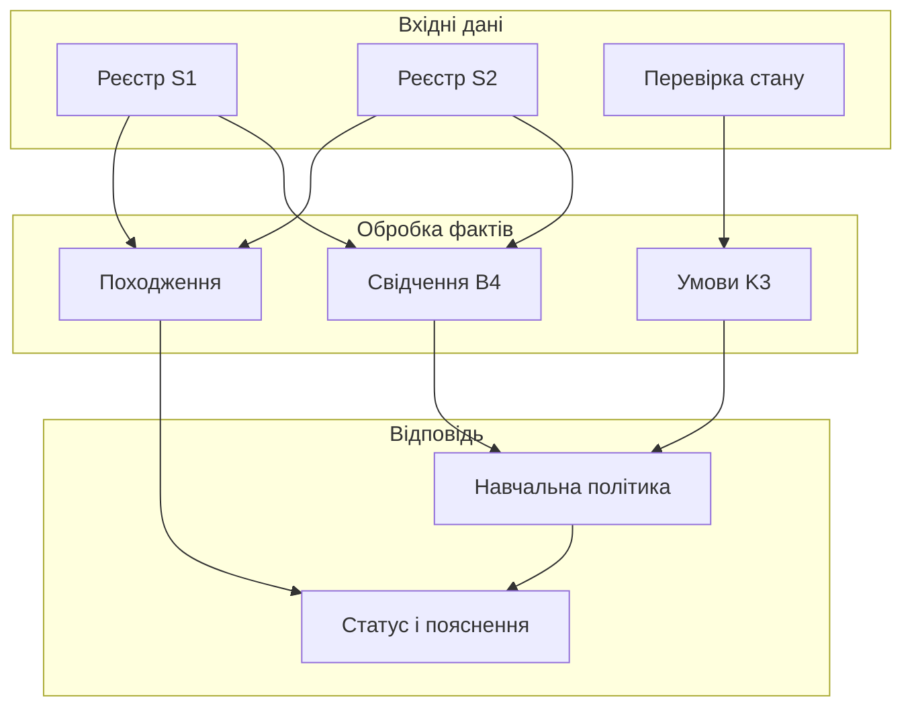
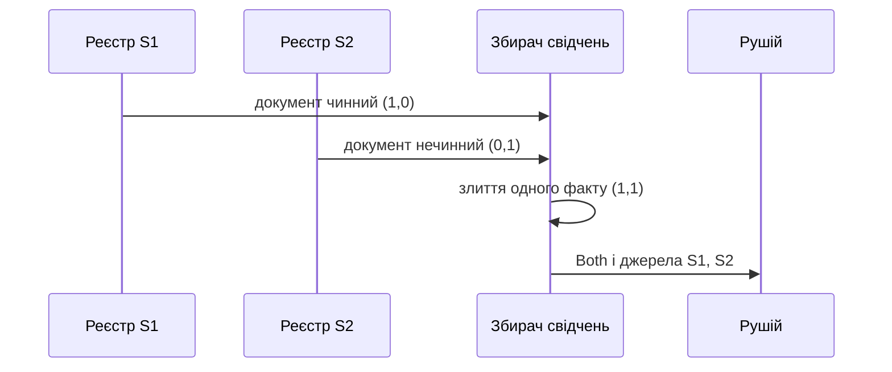
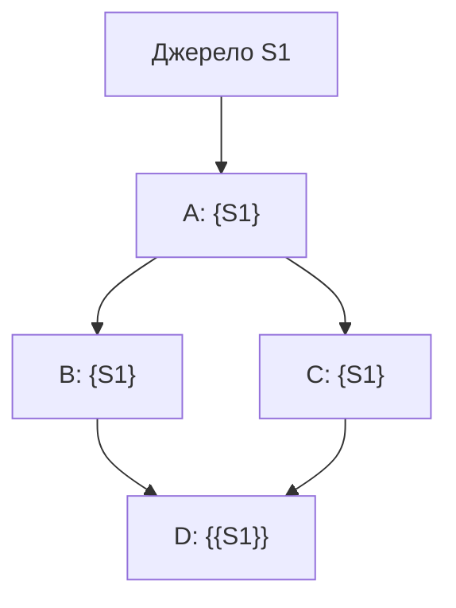
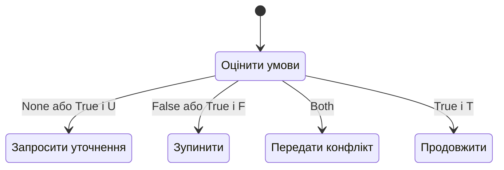

# Глава 3. Неповні дані, суперечності та походження фактів

<a id="глава-3-неповнота-суперечливість-та-походження-фактів-логіка-кліні-k3-двобітова-решітка-белнапа-b4-та-ідемпотентна-алгебра-першоджерел"></a>

> **Підручник:** [Експертні Системи](../README.md) · [Том 1. Основи експертних систем: логіка, продукційні правила, схемотехніка міркувань та класичні машини виведення](README.md)  
> **Навчальний рівень:** Базовий курс (бакалаврат, 2 курс; базові пояснення — з рівня першого курсу)  
> **Обладнання:** звичайний ноутбук або ПК (x86-64 / ARM64) без прискорювачів  
> **Мови:** реалізація — будь-яка мова загального призначення (лістинги — Python); основні спеціалізовані мови курсу — Prolog (SWI-Prolog) і OMG DMN/FEEL  
> **Попередня глава:** [Глава 2. Логічні основи подання знань](ch02-logical-foundations.md)\
> **Наступна глава:** [Глава 4. Продукційні правила й таблиці рішень](ch04-production-rules-and-decision-tables.md)\
> **Автор:** Микола Мартинович Федчик

---

## Анотація

У попередній главі твердження розглядалися як істинні або хибні, але база знань реальної експертної системи часто має третій стан: факт ще не надійшов, вимірювання не пройшло контроль якості або джерела повідомляють несумісні значення. У цій главі розглянуто, як подати такі стани так, щоб рушій не перетворював відсутність даних на доказ хибності, а суперечність — на аварійне припинення всього виведення. Це важливо для систем підтримки клінічних рішень, реєстрів правових фактів і навігаційних систем БпЛА, де пропущене чи суперечливе свідчення має змінювати подальшу дію, а не зникати під час обчислення.

Спочатку введено сильну тризначну логіку Кліні для невизначеності, далі — чотиризначне подання Белнапа, яке розділяє відсутність і конфлікт доказів. Потім розглянуто походження висновків у графі правил: повторне проходження спільного джерела не є новим незалежним свідченням. На завершення побудовано навчальну політику маршрутизації невизначеності, що відрізняє запит додаткових даних від ескалації конфлікту. Ця політика є прикладом проєктного рішення, а не універсальним нормативним шлюзом для медичних, юридичних чи авіаційних систем.

---

<!-- chapter-toc:start -->
## Зміст глави

- [1. Тризначна логіка для неповних даних](#1-тризначна-логіка-для-неповних-даних)
  - [1.1. Логічні значення та операції над ними](#11-логічні-значення-та-операції-над-ними)
  - [1.2. Інформаційний порядок проти порядку істинності та монотонність уточнення знань](#12-інформаційний-порядок-проти-порядку-істинності-та-монотонність-уточнення-знань)
  - [1.3. Побудова предикатів застосовності правила в медицині, юриспруденції та військовій логістиці](#13-побудова-предикатів-застосовності-правила-в-медицині-юриспруденції-та-військовій-логістиці)
- [2. Чотиризначна логіка для суперечливих свідчень](#2-чотиризначна-логіка-для-суперечливих-свідчень)
  - [2.1. Незалежний облік підтвердження та спростування](#21-незалежний-облік-підтвердження-та-спростування)
  - [2.2. Логічне поєднання, злиття та вибір свідчень](#22-логічне-поєднання-злиття-та-вибір-свідчень)
  - [2.3. Невизначеність на межі похибки вимірювання](#23-невизначеність-на-межі-похибки-вимірювання)
- [3. Облік першоджерел у графах зі спільними залежностями](#3-облік-першоджерел-у-графах-зі-спільними-залежностями)
  - [3.1. Помилка повторного підсумовування одного свідчення при розгалуженні й сходженні шляхів у графі](#31-помилка-повторного-підсумовування-одного-свідчення-при-розгалуженні-й-сходженні-шляхів-у-графі)
  - [3.2. Півкільця походження та ідемпотентне об'єднання множин джерел](#32-півкільця-походження-та-ідемпотентне-обєднання-множин-джерел)
  - [3.3. Формати зберігання множин першоджерел](#33-формати-зберігання-множин-першоджерел)
- [4. Безпечна відмова та обробка невизначеності](#4-безпечна-відмова-та-обробка-невизначеності)
  - [4.1. Запит додаткових даних за відсутності свідчень](#41-запит-додаткових-даних-за-відсутності-свідчень)
  - [4.2. Передавання конфлікту на предметний розгляд](#42-передавання-конфлікту-на-предметний-розгляд)
  - [4.3. Покроковий розрахунок юридичного та військово-тактичного шлюзу допуску](#43-покроковий-розрахунок-юридичного-та-військово-тактичного-шлюзу-допуску)
- [5. Практичні завдання та лабораторний практикум](#5-практичні-завдання-та-лабораторний-практикум)
  - [5.1. Контрольні запитання для самоперевірки](#51-контрольні-запитання-для-самоперевірки)
  - [5.2. Розрахункові задачі (трасування вручну)](#52-розрахункові-задачі-трасування-вручну)
  - [5.3. Завдання з програмної реалізації](#53-завдання-з-програмної-реалізації)
  - [5.4. Зв'язок із лабораторною та курсовою роботою курсу](#54-звязок-із-лабораторною-та-курсовою-роботою-курсу)
- [Висновки](#висновки)
- [Глосарій](#глосарій)
- [Скорочення та терміни](#скорочення-та-терміни)
- [Джерела](#джерела)
<!-- chapter-toc:end -->

---

<a id="1-тризначна-сильна-логіка-кліні-k3-для-моделювання-неповноти-даних"></a>

## 1. Тризначна логіка для неповних даних

Логіка Кліні доповнює двозначне подання фактів на межі між базою знань і рушієм: замість примусово вибирати «істина» чи «хиба» система може зберегти «поки невідомо». Якщо інтерпретатор прирівнює відсутнє показання датчика до хибного, правило може не спрацювати саме тоді, коли потрібне уточнення; якщо ж прирівнює його до істинного, може спрацювати непідтверджений висновок. Для кожної перевірки нижче вимірюваним результатом є один із трьох статусів (`TRUE`, `FALSE`, `UNKNOWN`), який рушій передає в механізм правил, не приховуючи невизначеність. Сильну тризначну логіку запропонував Кліні як математичний апарат для частково визначених тверджень [[1]](#src-1).

Наскрізний навчальний приклад глави — перевірка документів і готовності запасної деталі до резервування. Один реєстр може підтверджувати чинність документа, інший — спростовувати її, а окрема перевірка наявності деталі може ще не завершитися. Система має зберегти ці відмінності й показати, які записи підтримують відповідь.

<a id="chapter-3-object-1"></a>

**Схема 3.1. Обробка неповних і суперечливих даних про деталь.**



Схема показує розподіл обов'язків: K3 обчислює умову з відсутніми значеннями, B4 накопичує обидва види свідчень про факт, а походження дозволяє знайти записи для пояснення. Наведені нижче лістинги реалізують ці механізми окремо й поєднують їх у навчальній політиці розділу 4.

<a id="11-носій-значень-false-unknown-true-та-таблиці-істинності-сильних-операцій-minmax"></a>

### 1.1. Логічні значення та операції над ними

Для одного твердження $p$ використаємо множину значень $\{\mathrm{F},\mathrm{U},\mathrm{T}\}$: `F` означає, що твердження спростовано; `T` — підтверджено; `U` — даних поки недостатньо. `U` не є ані слабкою істиною, ані прихованою хибністю: це окремий стан знання. Сильні операції Кліні обчислюються так, що кон'юнкція потребує істинності обох частин, диз'юнкція — хоча б однієї істинної частини, а заперечення змінює `T` на `F` і навпаки, залишаючи `U` невизначеним.

**Тематичний обсяг:** Носій значень {False, Unknown, True} та таблиці істинності сильних операцій min/max

<a id="chapter-3-object-2"></a>

**Таблиця 3.2 — Таблиця істинності сильних операцій Кліні K3.** Результат `U` зберігає потребу в даних і не дозволяє рушію мовчки підмінити невизначеність.

| $p$ | $\neg p$ |
|---|---|
| F | T |
| U | U |
| T | F |

| $p$ | $q$ | $p \land q$ | $p \lor q$ |
|---|---|---|---|
| F | U | F | U |
| U | U | U | U |
| T | U | U | T |
| U | F | F | U |
| U | T | U | T |

У таблиці наведено рядки, де принаймні один операнд невизначений; для повноти реалізації рядки `F/F`, `F/T`, `T/F` і `T/T` обчислюються звичайними двозначними таблицями. Наприклад, якщо датчик температури не передав значення (`U`), то перевірка `температура > 80 °C` також має статус `U`, а не `F`. Проте в умові `температура > 80 °C OR аварійний_вимикач_спрацював`, достовірне `T` другого операнда робить усю диз'юнкцію істинною незалежно від невідомої температури.

У програмі впорядкуємо значення за істинністю як `F < U < T`. За таблицею 3.2 кон'юнкція дорівнює мінімуму, диз'юнкція — максимуму, а заперечення переставляє крайні значення. На вхід надходять лише значення `K3`; сторонній тип відхиляється явно, щоб `None` не перетворився на логічну хибу.

<a id="chapter-3-object-3"></a>

**Лістинг 3.3. Сильні операції K3 (Python 3.14.4).**

<details>
<summary>Показати лістинг 3.3 (22 рядки, Python 3.14.4)</summary>

```python
from enum import IntEnum

class K3(IntEnum):
    F = 0
    U = 1
    T = 2

def require_k3(*values: K3) -> None:
    if any(not isinstance(value, K3) for value in values):
        raise TypeError("очікується значення K3")

def k_not(value: K3) -> K3:
    require_k3(value)
    return K3(2 - value)

def k_and(left: K3, right: K3) -> K3:
    require_k3(left, right)
    return K3(min(left, right))

def k_or(left: K3, right: K3) -> K3:
    require_k3(left, right)
    return K3(max(left, right))
```

</details>

Наступний лістинг продовжує попередній: він перевіряє всі дев'ять пар для кожної бінарної операції, три значення заперечення та помилковий вхід. У прикладі документ підтверджено (`T`), а наявність деталі спочатку невідома (`U`); після уточнення обидві умови стають `T`.

<a id="chapter-3-object-4"></a>

**Лістинг 3.4. Перевірка таблиць істинності та уточнення (Python 3.14.4).**

<details>
<summary>Показати лістинг 3.4 (24 рядки, Python 3.14.4)</summary>

```python
values = (K3.F, K3.U, K3.T)
and_table = (
    (K3.F, K3.F, K3.F),
    (K3.F, K3.U, K3.U),
    (K3.F, K3.U, K3.T),
)
or_table = (
    (K3.F, K3.U, K3.T),
    (K3.U, K3.U, K3.T),
    (K3.T, K3.T, K3.T),
)
for i, left in enumerate(values):
    for j, right in enumerate(values):
        assert k_and(left, right) == and_table[i][j]
        assert k_or(left, right) == or_table[i][j]
assert tuple(k_not(v) for v in values) == (K3.T, K3.U, K3.F)
print("T AND U =", k_and(K3.T, K3.U).name)
print("T AND T =", k_and(K3.T, K3.T).name)
try:
    k_and(K3.T, None)
except TypeError:
    print("Помилковий стан відхилено")
else:
    raise AssertionError("очікувався TypeError")
```

</details>

Очікуваний вивід: `T AND U = U`, `T AND T = T`, `Помилковий стан відхилено`. Отже, перший результат потребує уточнення; лише після отримання другого система може передати підтверджену передумову правилу. Саме це читач може перевірити, змінюючи вхідні значення та звіряючи їх із таблицею.

<a id="chapter-3-object-5"></a>

**Діаграма 3.5. Уточнення невідомого факту.**

```mermaid
stateDiagram-v2
    accTitle: Уточнення стану K3
    accDescr: Невідомий факт після перевірки може отримати підтвердження або спростування; прямий перехід між ними ця модель не задає.
    state "Невідомо U" as Unknown
    state "Підтверджено T" as Confirmed
    state "Спростовано F" as Refuted
    [*] --> Unknown
    Unknown --> Confirmed: отримано підтвердження
    Unknown --> Refuted: отримано спростування
```



Діаграма показує уточнення одного невідомого факту, а не загальну процедуру виправлення записів. Якщо нове джерело суперечить уже наявному, обидва повідомлення потрібно зберегти; для цього в розділі 2 використано B4.

**Що означає результат і як його використати.** Якщо умова продукційного правила має значення `T`, правило може бути активоване; `F` означає, що його передумова не виконується; `U` має переводити запит у стан «потрібні дані» або залишати висновок невизначеним. Саме це запобігає хибному спрацюванню правила через відсутність вимірювання.

### 1.2. Інформаційний порядок проти порядку істинності та монотонність уточнення знань

У K3 важливо не змішувати порядок істинності з кількістю доступної інформації. Для порядку істинності значення розташовуються як $`\mathrm{F} <_t \mathrm{U} <_t \mathrm{T}`$: це зручний спосіб описати «ступінь істинності» в самій тризначній решітці. Для уточнення знань природніша інформаційна впорядкованість: `U` нижче за `F` і `T`, а `F` та `T` між собою непорівнювані. Перехід `U → T` означає, що невідоме твердження підтверджено; `U → F` — що його спростовано. Жоден із цих переходів не можна трактувати як звичайне числове збільшення істинності.

<a id="chapter-3-object-6"></a>

**Формула 3.6 — Інформаційний порядок K3.**

$$
\mathrm{U} \leq_k \mathrm{F}, \qquad
\mathrm{U} \leq_k \mathrm{T}, \qquad
\mathrm{F} \not\leq_k \mathrm{T}, \qquad
\mathrm{T} \not\leq_k \mathrm{F}.
$$

Тут $`\leq_k`$ означає «не містить більше інформації, ніж»: `U` нічого не визначає, тоді як `F` і `T` визначають результат у протилежних напрямах. Для реалізації це означає, що оновлення факту має зберігати різницю між новим свідченням і його відсутністю. Сильні операції K3 узгоджені з таким уточненням: додавання знання замість `U` може зробити результат конкретнішим, але не виправдовує вигадування даних.

**Логічний приклад.** У картці сервісного випадку поле `наявність_витоку` спочатку має `U`. Після огляду воно може стати `T` (витік підтверджено) або `F` (огляд його не виявив). Записати `F` до огляду лише тому, що поле порожнє, означало б змінити семантику реєстру й потенційно дозволити правило, яке передбачає відсутність витоку.

**Що означає результат і як його використати.** Порядок $`\leq_k`$ є критерієм коректного оновлення: нове свідчення повинно уточнювати `U`, а не трактуватися як арифметичне коригування оцінки. Якщо джерела можуть одночасно підтверджувати й спростовувати твердження, K3 вже недостатньо — тоді потрібне роздільне збереження обох видів свідчення, яке вводиться в наступному розділі.

### 1.3. Побудова предикатів застосовності правила в медицині, юриспруденції та військовій логістиці

У правилі слід явно визначити, як невизначеність передумови впливає на застосовність. Нехай для навчального правила «дозволити продовження маршруту» потрібні валідний план (`plan_valid`) і підтверджена доступність каналу зв'язку (`link_available`). У тризначній семантиці:

`IF plan_valid AND link_available THEN route_status = READY`.

Якщо `plan_valid = T`, але `link_available = U`, кон'юнкція дорівнює `U`. Рушій не видає `READY`; система запитує актуальний статус каналу або повертає операторові «не визначено». Цей запис не означає, що `U` є стандартним синтаксисом Prolog чи DMN: це семантична модель, яку конкретна DSL і рушій мають реалізувати явно. Наприклад, у двозначній мові можна кодувати стан окремим типізованим значенням і задати таблицю операцій, а не намагатися передати його через `null` без визначеної поведінки.

У медичному навчальному прикладі невідома алергія не є підтвердженням відсутності алергії; у правовому реєстрі незнайдений документ не доводить, що юридичного факту не було. Предметні наслідки мають визначатися затвердженою політикою домену, а не самим вибором логіки.

**Що означає результат і як його використати.** `UNKNOWN` має бути видимим станом відповіді, а не перетворюватися на `FALSE` у коді адаптера. Перед введенням у виробничу систему необхідно окремо визначити, які поля можуть бути відсутні, які джерела мають право їх уточнювати та що робити, якщо уточнення не надійшло до граничного часу.

<a id="2-чотиризначна-бірешітка-белнапа-b4-та-двобітове-кодування-свідчень"></a>

## 2. Чотиризначна логіка для суперечливих свідчень

K3 описує невизначеність одного твердження, але не розділяє «ніхто не повідомив» і «є взаємосуперечливі повідомлення». Для цього шару потрібна модель, яка зберігає позитивну та негативну підтримку окремо. Белнап запропонував чотиризначну логіку саме для роботи з інформаційними станами без вибуху всієї системи від суперечності [[2]](#src-2). У цьому розділі результатом є пара бітів свідчень для кожного атомарного факту; вона дозволяє рушієві розрізнити відсутність, підтвердження, спростування й конфлікт.

**Тематичний обсяг:** Чотиризначна бірешітка Белнапа B4 та двобітове кодування свідчень

<a id="21-незалежний-облік-позитивної-підтримки-і-негативного-спростування-стани-none-true-false-both"></a>

### 2.1. Незалежний облік підтвердження та спростування

Кодуємо стан твердження $p$ парою $(p^+,p^-)$, де $p^+=1$ означає наявність позитивного свідчення, а $p^-=1$ — негативного. Кожен компонент належить $\{0,1\}$, тож маємо чотири стани.

<a id="chapter-3-object-7"></a>

**Таблиця 3.7 — Чотири стани свідчень у моделі Белнапа.**

| Пара $(p^+,p^-)$ | Назва | Інтерпретація |
|---|---|---|
| (0,0) | `None` | Немає ані підтвердження, ані спростування |
| (1,0) | `True` | Є позитивне свідчення, негативного немає |
| (0,1) | `False` | Є негативне свідчення, позитивного немає |
| (1,1) | `Both` | Є обидва види свідчення; дані суперечливі |

Різниця між `None` і `Both` принципова: перший стан означає прогалину в даних, другий — конфлікт між даними. В одночасному обліку системи немає потреби довільно вибирати «переможне» джерело до того, як застосовано політику довіри чи арбітражу.

**Приклад.** Один реєстр позначає сертифікат чинним (`p^+=1`), інший містить запис про його відкликання (`p^-=1`). Стан дорівнює `Both`, а не «невідомо». Навпаки, якщо обидва реєстри недоступні й локальної копії немає, значення — `None`.

<a id="chapter-3-object-8"></a>

**Діаграма 3.8. Надходження суперечливих свідчень про один факт.**



Часова послідовність повідомлень не визначає переможця: збирач передає рушію обидва біти. У наступному лістингу пара зберігається незмінним об'єктом. Конструктор приймає саме булеві значення; помилкові `0`, `1` або довільний текст не підміняються неявним приведенням.

<a id="chapter-3-object-9"></a>

**Лістинг 3.9. Подання пари свідчень B4 (Python 3.14.4).**

<details>
<summary>Показати лістинг 3.9 (15 рядків, Python 3.14.4)</summary>

```python
from dataclasses import dataclass

@dataclass(frozen=True, slots=True)
class Evidence:
    positive: bool
    negative: bool

    def __post_init__(self) -> None:
        if type(self.positive) is not bool or type(self.negative) is not bool:
            raise TypeError("ознаки свідчень мають бути bool")

NONE = Evidence(False, False)
TRUE = Evidence(True, False)
FALSE = Evidence(False, True)
BOTH = Evidence(True, True)
```

</details>

Вхід — два незалежні біти підтримки; результат — одне з чотирьох значень таблиці 3.7. Константи й тип використовуються у наступних лістингах тієї самої глави.

**Що означає результат і як його використати.** Пара бітів є компактним контрактом між приймачем фактів і рушієм: він не втрачає конфлікт, навіть якщо предметний шар ще не вирішив, як його розв'язувати. Для великої бази такий стан може зберігатися двома бітами логічно; конкретне фізичне пакування залежить від формату даних і не є вимогою семантики.

<a id="22-операційні-вентилі-конюнкції-істинності-truthand-інформаційного-злиття-join-та-пріоритетної-комутації-priority"></a>

### 2.2. Логічне поєднання, злиття та вибір свідчень

Негативне свідчення для заперечення отримують перестановкою компонентів: $\neg(p^+,p^-)=(p^-,p^+)$. Для кон'юнкції потрібна позитивна підтримка обох частин, тоді як негативна підтримка хоча б однієї частини спростовує кон'юнкцію; для диз'юнкції діють дуальні правила. Це задає операції Белнапа над свідченнями:

<a id="chapter-3-object-10"></a>

**Формула 3.10 — Операції заперечення, кон'юнкції, диз'юнкції та злиття свідчень.**

$$
\begin{aligned}
\neg(p^+,p^-) &= (p^-,p^+), \\
(p^+,p^-) \land (q^+,q^-) &= (p^+ \land q^+,\, p^- \lor q^-), \\
(p^+,p^-) \lor (q^+,q^-) &= (p^+ \lor q^+,\, p^- \land q^-), \\
(p^+,p^-) \sqcup_k (q^+,q^-) &= (p^+ \lor q^+,\, p^- \lor q^-).
\end{aligned}
$$

Тут $p^+$ і $q^+$ — позитивні біти, а $p^-$ і $q^-$ — негативні; $\land$ і $\lor$ справа — звичайні булеві операції над бітами. Оператор $`\sqcup_k`$ об'єднує знання: якщо різні джерела надають різні свідчення, обидва зберігаються. Наприклад, `True ⊔ₖ False = Both`; повторне додавання того самого свідчення не змінює стан.

Операції `TruthAnd` і `Join` не можна плутати: `TruthAnd` обчислює логічну умову, а `Join` накопичує інформацію з джерел за операцією $`\sqcup_k`$. Назва `Priority` не є логічною операцією Белнапа: це приклад предметної політики, що може вибрати авторитетніше джерело, але її правило пріоритету треба визначити окремо й аудіювати.

**Логічний розрахунок.** Нехай `permit = (1,0)`, а `revoked = (0,1)`. Якщо висновок чинності сертифіката залежить від `permit AND NOT revoked`, то `NOT revoked = (1,0)`, а кон'юнкція дає `(1,0)`. В іншому випадку два реєстри можуть надати протилежні свідчення саме про один атом `certificate_valid`: `(1,0)` та `(0,1)`. Їхнє злиття дає `Both`. Різні атоми `permit` і `revoked` безпосередньо зливати не можна: зв'язок між ними має задавати окреме предметне правило.

Лістинг реалізує кожний рядок формули 3.10 над типом `Evidence` із лістингу 3.9. Злиття приймає свідчення про той самий факт; логічні операції можуть поєднувати значення різних передумов.

<a id="chapter-3-object-11"></a>

**Лістинг 3.11. Логічні операції та злиття B4 (Python 3.14.4).**

<details>
<summary>Показати лістинг 3.11 (11 рядків, Python 3.14.4)</summary>

```python
def negate(p: Evidence) -> Evidence:
    return Evidence(p.negative, p.positive)

def truth_and(p: Evidence, q: Evidence) -> Evidence:
    return Evidence(p.positive and q.positive, p.negative or q.negative)

def truth_or(p: Evidence, q: Evidence) -> Evidence:
    return Evidence(p.positive or q.positive, p.negative and q.negative)

def join(p: Evidence, q: Evidence) -> Evidence:
    return Evidence(p.positive or q.positive, p.negative or q.negative)
```

</details>

Для перевірки продовжимо лістинги 3.9 і 3.11: переберемо всі 16 пар станів, перевіримо ідемпотентність злиття, подвійне заперечення та закон де Моргана. Окремі твердження звіряють різницю між логічними операціями й накопиченням свідчень.

<a id="chapter-3-object-12"></a>

**Лістинг 3.12. Перевірка станів і операцій B4 (Python 3.14.4).**

<details>
<summary>Показати лістинг 3.12 (20 рядків, Python 3.14.4)</summary>

```python
states = (NONE, TRUE, FALSE, BOTH)
for p in states:
    assert join(p, p) == p
    assert negate(negate(p)) == p
    for q in states:
        assert join(p, q) == join(q, p)
        assert truth_and(p, q) == truth_and(q, p)
        assert negate(truth_and(p, q)) == truth_or(negate(p), negate(q))
assert join(TRUE, FALSE) == BOTH
assert truth_and(TRUE, BOTH) == BOTH
assert truth_and(FALSE, BOTH) == FALSE
assert truth_or(FALSE, BOTH) == BOTH
assert truth_or(TRUE, BOTH) == TRUE
print("S1 і S2:", join(TRUE, FALSE))
try:
    Evidence(1, False)
except TypeError:
    print("Помилкові біти відхилено")
else:
    raise AssertionError("очікувався TypeError")
```

</details>

Очікуваний вивід: `S1 і S2: Evidence(positive=True, negative=True)` і `Помилкові біти відхилено`. Результат зберігає конфлікт для подальшої політики, але сам по собі не встановлює, яке джерело правильне.

**Що означає результат і як його використати.** Злиття придатне для приймання даних від кількох незалежних або частково незалежних реєстрів; кон'юнкція та диз'юнкція — для виведення наслідків. Рушій повинен зберігати походження кожного біта, щоб після `Both` можна було знайти записи, які створили конфлікт.

<a id="23-інтервальний-компаратор-intervalguard-на-межі-похибки-датчика-та-перехід-межового-стану-в-уточнення"></a>

### 2.3. Невизначеність на межі похибки вимірювання

Датчик повертає вимірювання $x$ з відомою обмеженою похибкою $\varepsilon \geq 0$. Для порогової умови $x < \theta$ небезпечно приймати рішення за одним округленим значенням, якщо інтервал похибки перетинає поріг. Інтервальний компаратор зберігає такий випадок як невизначений.

**Тематичний обсяг:** Інтервальний компаратор IntervalGuard на межі похибки датчика та перехід межового стану в уточнення

<a id="chapter-3-object-13"></a>

**Формула 3.13 — Тризначний компаратор вимірювання з обмеженою похибкою.**

$$
\mathrm{Guard}(x,\varepsilon,\theta)=
\begin{cases}
\mathrm{T}, & x+\varepsilon < \theta,\\
\mathrm{F}, & x-\varepsilon \geq \theta,\\
\mathrm{U}, & \text{інакше}.
\end{cases}
$$

Тут $x$ — виміряне значення в одиницях датчика; $\varepsilon$ — доведена верхня межа абсолютної похибки в тих самих одиницях; $\theta$ — поріг, заданий предметною вимогою. Приклад: якщо навчальний поріг становить $90$ одиниць, вимірювання $x=89$ з похибкою $\varepsilon=2$ дає інтервал $[87,91]$, який перетинає поріг, отже результат — `U`. Для $x=85$, $\varepsilon=2$ весь інтервал нижчий за поріг, тому результат — `T`.

У навчальному прикладі перевірка стану деталі використовує поріг `90` умовних одиниць. Лістинг реалізує формулу 3.13 з типом `K3` із лістингу 3.3: скінченність вимірювання та невід'ємність похибки перевіряються до порівняння. Значення і поріг не є рекомендацією для реального обладнання.

<a id="chapter-3-object-14"></a>

**Лістинг 3.14. Порівняння інтервалу з порогом (Python 3.14.4).**

<details>
<summary>Показати лістинг 3.14 (22 рядки, Python 3.14.4)</summary>

```python
from math import isfinite

def guard(x: float, error: float, threshold: float) -> K3:
    values = (x, error, threshold)
    if any(isinstance(v, bool) or not isinstance(v, (int, float)) for v in values):
        raise TypeError("очікуються числові значення")
    if not all(isfinite(v) for v in values):
        raise ValueError("значення мають бути скінченними")
    if error < 0:
        raise ValueError("похибка не може бути від'ємною")
    if x + error < threshold:
        return K3.T
    if x - error >= threshold:
        return K3.F
    return K3.U

cases = ((85, 2, K3.T), (88, 2, K3.U), (89, 2, K3.U),
         (92, 2, K3.F), (90, 0, K3.F))
for x, error, expected in cases:
    result = guard(x, error, 90)
    assert result == expected
    print(f"x={x}, похибка={error}: {result.name}")
```

</details>

Очікувані результати за порядком рядків: `T`, `U`, `U`, `F`, `F`. Зокрема, для $x=88$ верхня межа дорівнює порогу, тому строгого $x<\theta$ для всього інтервалу не доведено; для $x=92$ нижня межа дорівнює порогу, тож результат `F`. Читач може змінити вхід і звірити кожну гілку з формулою.

**Що означає результат і як його використати.** `U` означає, що доступної точності недостатньо для класифікації; система може запросити повторне вимірювання або застосувати затверджений консервативний режим. Межа похибки має походити з калібрування чи специфікації сенсора: якщо її невідомо або вона перевищена, формула не дає підстав для вердикту.

<a id="3-ідемпотентна-алгебра-множин-першоджерел-у-dag-зі-спільними-предками"></a>

## 3. Облік першоджерел у графах зі спільними залежностями

Після того як рушій знайшов висновок, треба пояснити не лише його логічний шлях, а й джерела початкових фактів. У графі виведення два різні шляхи можуть мати спільного предка; підрахунок шляхів як незалежних підтверджень тоді завищує доказову підтримку. Для кожного висновку в цьому розділі обчислюється множина мінімальних наборів першоджерел, які достатні для його виведення. Це спрощене подання походження, споріднене з дослідженнями provenance у базах даних [[3]](#src-3), [[4]](#src-4); воно не оцінює достовірність джерел і не зберігає всі деталі семантики кожної системи.

### 3.1. Помилка повторного підсумовування одного свідчення при розгалуженні й сходженні шляхів у графі

Розгляньмо граф: джерело `S1` підтверджує факт `A`; з `A` виводяться проміжні факти `B` і `C`; правило для висновку `D` має дві альтернативи — `B → D` та `C → D`. У графі є два шляхи до `D`, але обидва спираються на те саме `S1`. Якщо система додає кількість шляхів як «кількість доказів», вона повідомить два підтвердження, хоча незалежним першоджерелом є одне.

<a id="chapter-3-object-15"></a>

**Діаграма 3.15. Два шляхи з одним спільним першоджерелом.**



На діаграмі два ребра входять у висновок `D`, але обидва ведуть до одного початкового запису. Кількість шляхів і кількість різних наборів джерел — різні величини.

<a id="chapter-3-object-16"></a>

**Таблиця 3.16 — Шляхи виведення і мінімальні набори джерел.**

| Вузол | Правило походження | Набір джерел |
|---|---|---|
| `A` | початковий факт | `{S1}` |
| `B` | `A → B` | `{S1}` |
| `C` | `A → C` | `{S1}` |
| `D` | `B → D` або `C → D` | `{{S1}}` |

Запис `{{S1}}` означає сімейство підтримок, що має один елемент — набір `{S1}`. Два альтернативні шляхи з однаковою підтримкою згортаються в одну підтримку. Якщо `C` походить натомість від окремого джерела `S2`, для `D` маємо два мінімальні пояснення: `{{S1},{S2}}`. Це не означає «два голоси за істину»: воно означає два альтернативні набори походження.

**Що означає результат і як його використати.** Множина джерел відповідає на питання «які записи достатні для цього висновку?», але не на питання «наскільки вони надійні?». Для зваженої довіри, часу чинності або кореляції джерел потрібна додаткова модель; множити чи додавати ймовірності без припущень про незалежність не можна.

### 3.2. Півкільця походження та ідемпотентне об'єднання множин джерел

Для збереження альтернативних пояснень подамо provenance як сімейство множин першоджерел. Операція альтернативи об'єднує сімейства; операція спільного використання передумов утворює всі об'єднання пар наборів. Після кожної операції видаляються дублікати й надмножини: якщо набір джерел `S1` уже достатній, то `{S1,S2}` не є мінімальним поясненням того самого висновку.

<a id="chapter-3-object-17"></a>

**Формула 3.17 — Операції альтернативи й спільного виведення для мінімальних підтримок.**

$$
\begin{aligned}
\mathcal{A} \oplus \mathcal{B}
&= \min_{\subseteq}(\mathcal{A} \cup \mathcal{B}),\\
\mathcal{A} \otimes \mathcal{B}
&= \min_{\subseteq}\{a \cup b \mid a \in \mathcal{A},\, b \in \mathcal{B}\}.
\end{aligned}
$$

Тут $\mathcal{A}$ і $\mathcal{B}$ — сімейства скінченних множин джерел; $\oplus$ означає «є альтернативне виведення»; $\otimes$ — «потрібні обидві передумови»; $`\min_{\subseteq}`$ залишає лише включно-мінімальні набори. Для одиничних підтримок `{S1}` і `{S2}` маємо `{S1} ⊗ {S2} = {S1,S2}`, бо для спільного правила потрібні обидва джерела. Якщо ті самі підтримки є альтернативами, `{S1} ⊕ {S1} = {S1}`: повторення не створює нової незалежної підстави.

Мовно-незалежний алгоритм зберігає для кожного вузла DAG його сімейство мінімальних підтримок. У топологічному порядку для початкового факту записується singleton `{source_id}`; для правила з кількома передумовами підтримки перемножуються через $\otimes$; для кількох правил-виробників результати зливаються через $\oplus$. Цикли потребують окремої фікс-точкової обробки й не покриваються простим топологічним проходом.

Для реалізації формули 3.17 окремий набір джерел подамо як `frozenset[str]`, а сімейство наборів — як незмінну множину таких наборів. `minimal` вилучає строгі надмножини, а `alternative` об'єднує пояснення різних правил. Обидві функції повертають сімейство, а не число голосів чи оцінку довіри.

<a id="chapter-3-object-18"></a>

**Лістинг 3.18. Нормалізація та альтернативні підтримки (Python 3.14.4).**

<details>
<summary>Показати лістинг 3.18 (17 рядків, Python 3.14.4)</summary>

```python
from typing import TypeAlias

Support: TypeAlias = frozenset[str]
Family: TypeAlias = frozenset[Support]

def require_limit(limit: int) -> None:
    if type(limit) is not int or limit < 1:
        raise ValueError("ліміт має бути додатним цілим числом")

def minimal(family: Family, limit: int = 64) -> Family:
    require_limit(limit)
    if len(family) > limit:
        raise OverflowError("перевищено ліміт наборів походження")
    return frozenset(s for s in family if not any(t < s for t in family))

def alternative(a: Family, b: Family, limit: int = 64) -> Family:
    return minimal(a | b, limit)
```

</details>

Для правила з двома потрібними передумовами формуються попарні об'єднання їхніх підтримок. Наступний лістинг продовжує попередній і перевіряє ліміт кандидатних пар **до** їх побудови; якщо ліміт перевищено, він повідомляє про це винятком, а не повертає частковий результат як повний.

<a id="chapter-3-object-19"></a>

**Лістинг 3.19. Спільне використання підтримок (Python 3.14.4).**

<details>
<summary>Показати лістинг 3.19 (5 рядків, Python 3.14.4)</summary>

```python
def together(a: Family, b: Family, limit: int = 64) -> Family:
    require_limit(limit)
    if len(a) * len(b) > limit:
        raise OverflowError("перевищено ліміт пар підтримок")
    return minimal(frozenset(x | y for x in a for y in b), limit)
```

</details>

Перевіримо той самий граф: два шляхи зі спільним `S1` дають одну підтримку; окреме `S2` створює альтернативу; спільна передумова потребує обох джерел. Лістинг 3.20 виконується після лістингів 3.18–3.19.

<a id="chapter-3-object-20"></a>

**Лістинг 3.20. Трасування походження й перевірка ліміту (Python 3.14.4).**

<details>
<summary>Показати лістинг 3.20 (21 рядок, Python 3.14.4)</summary>

```python
def show(family: Family) -> list[list[str]]:
    return sorted([sorted(s) for s in family])

s1 = frozenset({frozenset({"S1"})})
s2 = frozenset({frozenset({"S2"})})
same_source = alternative(s1, s1)
alternatives = alternative(s1, s2)
both_sources = together(s1, s2)
assert same_source == s1
assert len(alternatives) == 2
assert both_sources == frozenset({frozenset({"S1", "S2"})})
assert alternative(s1, both_sources) == s1
print("Спільне джерело:", show(same_source))
print("Альтернативи:", show(alternatives))
print("Обидва потрібні:", show(both_sources))
try:
    together(alternatives, alternatives, limit=3)
except OverflowError as error:
    print("EXPLANATION_INCOMPLETE:", error)
else:
    raise AssertionError("очікувався OverflowError")
```

</details>

Очікувані підтримки відповідно: `[['S1']]`, `[['S1'], ['S2']]`, `[['S1', 'S2']]`; останній рядок починається з `EXPLANATION_INCOMPLETE`. Межа `3` відхиляє чотири кандидатні пари ще до їх побудови, навіть якщо деякі з них після нормалізації збіглися б. Це навчальне обмеження кількості наборів, а не гарантія витрат пам'яті чи часу; інтеграційний код має передати неповноту пояснення споживачеві.

**Що означає результат і як його використати.** Результат придатний для аудиторського пояснення та пошуку спільної залежності в графі. У найгіршому разі кількість мінімальних наборів може зростати експоненційно; реалізація повинна мати вимірювану межу пам'яті/часу й при її досягненні повертати явний статус «пояснення обрізано», а не мовчки втрачати джерела.

<a id="33-порівняння-чотирьох-форматів-представлення-першоджерел-у-памяті-cpu-dense-sparse-interned-та-root-trace"></a>

### 3.3. Формати зберігання множин першоджерел

Вибір фізичного подання залежить від розміру універсуму джерел $N$, кількості підтримок $k$, середнього розміру набору $r$ і потреби швидко відповідати на запити аудиту. Для ілюстрації порівняємо чотири стратегії за однакової кількості ідентифікаторів: щільний бітовий вектор (`Dense`), список лише присутніх номерів (`Sparse`), спільне зберігання однакових наборів (`Interned`) і збереження посилань на вузли графа з відновленням джерел під час запиту (`Root-Trace`).

**Тематичний обсяг:** Порівняння чотирьох форматів представлення першоджерел у пам'яті CPU: Dense, Sparse, Interned та Root-Trace

<a id="chapter-3-object-21"></a>

**Таблиця 3.21 — Орієнтовне подання походження для різних профілів запиту.**

| Подання | Основна пам'ять | Коли корисне | Основне обмеження |
|---|---|---|---|
| `Dense` | близько $N/8$ байтів на набір | $N$ невелике або набори щільні; перетин/об'єднання швидкі | ціна зростає з усім універсумом, навіть для рідкісних джерел |
| `Sparse` | пропорційна кількості джерел у наборі | підтримки малі щодо $N$ | операції потребують злиття відсортованих списків або хеш-структур |
| `Interned` | одне збереження для повторюваних наборів плюс посилання | багато вузлів мають ті самі підтримки | потрібні таблиця інтернування та керування життєвим циклом |
| `Root-Trace` | посилання на правила й передумови | походження читають рідко, важливо зберегти граф | відповідь потребує обходу графа; зміни графа ускладнюють відтворення |

**Розрахунок.** Для $N=262\,144$ джерел щільне подання потребує $262\,144/8=32\,768$ байтів, тобто $32$ КіБ на один набір (без метаданих). Для $100\,000$ окремих вузлів це вже близько $3.05$ ГіБ, якщо кожен зберігати окремо. Якщо типовий набір містить лише чотири 32-бітові ідентифікатори, сирий список займає близько $16$ байтів на набір, не враховуючи накладних витрат контейнера. `Interned` може зменшити дублювання, а `Root-Trace` — відкласти матеріалізацію множини, але кожен з них додає вартість запиту або складність реалізації.

**Що означає результат і як його використати.** Це оцінка пам'яті, а не універсальний бенчмарк. Перед вибором структури слід виміряти на реальних розподілах $N$, $k$ і $r$, чи домінує пам'ять, час злиття або затримка пояснення. Якщо межа пам'яті перевищується, система має обмежити деталізацію з явним повідомленням, а не перейти на неперевірене наближення, що видає неповне походження як повне.

<a id="4-політика-безпечної-відмови-fail-closed-gate-та-маршрутизація-невизначеності"></a>

## 4. Безпечна відмова та обробка невизначеності

Значення логіки стає операційно важливим, коли з нього обирається дія. Рушій може правильно обчислити `None` або `Both`, але система все одно небезпечна, якщо перетворить ці стани на звичайне «дозволено/заборонено» без визначеної процедури. Нижче наведено навчальну політику маршрутизації: вона обчислює один із чотирьох виходів — продовжити, зупинити за підтвердженим негативним фактом, запросити уточнення або передати конфлікт на арбітраж. Реальна система повинна додатково визначити тайм-аути, відповідального за рішення та безпечний стан обладнання згідно з вимогами свого домену.

**Тематичний обсяг:** Політика безпечної відмови (Fail-Closed Gate) та маршрутизація невизначеності

<a id="41-відображення-стану-none-у-запит-на-додаткове-збирання-даних-clarification"></a>

### 4.1. Запит додаткових даних за відсутності свідчень

`None` означає, що твердження поки не підтримане жодним із двох видів свідчень. Для системи це не «помилка логіки», а сигнал про прогалину: потрібно запросити вимірювання, документ або інше дозволене джерело. Водночас запит уточнення має бути обмежений часом і кількістю повторів; інакше діалогова система може нескінченно чекати дані й не завершити обробку.

**Приклад.** У навчальній навігаційній системі поле `route_clear` має `None`, бо актуальна телеметрія не надійшла. Система не робить висновок, що маршрут чистий; вона повертає `CLARIFICATION_REQUIRED` і зберігає версію запиту та граничний час. Якщо відповідь не надійшла в межах тайм-ауту, подальша дія визначається окремою політикою безпеки, а не логікою K3 чи B4 самою по собі.

**Що означає результат і як його використати.** Повідомлення про невизначеність повинно назвати відсутнє поле, очікуване джерело та наступну дію. У системі для людини це може бути запит операторові; у сервісному API — структурований статус і код причини. Не слід підставляти значення за замовчуванням, яке змінює семантику рішення.

<a id="42-відображення-стану-both-у-процедуру-нормативного-арбітражу-conflict_escalation"></a>

### 4.2. Передавання конфлікту на предметний розгляд

`Both` означає, що наявні і підтвердження, і спростування. Автоматичне надання переваги останньому запису або джерелу з більшим числом повідомлень не є нейтральним: воно може приховати підроблений, застарілий чи похідний запис. Для навчального прикладу застосуємо `CONFLICT_ESCALATION`: зберегти обидва твердження, призупинити залежний висновок і передати ідентифікатори джерел визначеному арбітрові.

**Тематичний обсяг:** Відображення стану Both у процедуру нормативного арбітражу (CONFLICT_ESCALATION)

<a id="chapter-3-object-22"></a>

**Таблиця 3.22 — Приклад відображення станів свідчень у виходи політики.**

| Стан | Результат обчислення | Навчальна дія |
|---|---|---|
| `None` | свідчень немає | `CLARIFICATION_REQUIRED` |
| `True` | є позитивне свідчення | `CONTINUE`, якщо виконано інші передумови |
| `False` | є негативне свідчення | `STOP` або негативний висновок за предметним правилом |
| `Both` | свідчення конфліктують | `CONFLICT_ESCALATION`; не виводити залежний вердикт |

Це відображення не є універсальною таблицею безпеки: наприклад, `False` для «маршрут вільний» може означати перешкоду, але операційна дія залежить від контексту. У будь-якому домені до розгортання потрібні окремо верифіковані правила для кожного стану, включно з тайм-аутом і неможливістю арбітражу.

Для прикладу з деталлю додамо другу передумову `readiness`: її стан K3 охоплює перевірку наявності та вимірювання. Конфлікт документа має пріоритет ескалації; відсутність свідчень веде до уточнення, а підтверджений документ дозволяє продовжити лише за `readiness = T`.

<a id="chapter-3-object-23"></a>

**Діаграма 3.23. Навчальні переходи політики рішення.**



Діаграма показує всі комбінації на рівні переходів: `None`, `False` і `Both` визначають вихід незалежно від другої передумови, а для `True` перевіряється `readiness`. Перехід `CONTINUE` означає лише навчальний результат цієї перевірки, а не дозвіл на будь-яку реальну дію.

<a id="chapter-3-object-24"></a>

**Лістинг 3.24. Маршрутизація результату перевірки (Python 3.14.4).**

<details>
<summary>Показати лістинг 3.24 (14 рядків, Python 3.14.4)</summary>

```python
def route(evidence: Evidence, readiness: K3) -> str:
    if not isinstance(evidence, Evidence) or not isinstance(readiness, K3):
        raise TypeError("очікуються Evidence і K3")
    if evidence == BOTH:
        return "CONFLICT_ESCALATION"
    if evidence == NONE:
        return "CLARIFICATION_REQUIRED"
    if evidence == FALSE:
        return "STOP"
    if readiness == K3.U:
        return "CLARIFICATION_REQUIRED"
    if readiness == K3.F:
        return "STOP"
    return "CONTINUE"
```

</details>

Вхід функції — пара свідчень із лістингу 3.9 і тризначна готовність із лістингу 3.3; вихід — один із чотирьох статусів таблиці 3.22. Лістинг нижче перевіряє всі 12 комбінацій та використовує компаратор із лістингу 3.14 для підтвердженого навчального прикладу.

<a id="chapter-3-object-25"></a>

**Лістинг 3.25. Перевірка всіх переходів політики (Python 3.14.4).**

<details>
<summary>Показати лістинг 3.25 (23 рядки, Python 3.14.4)</summary>

```python
values = (K3.F, K3.U, K3.T)
expected = {
    NONE: ("CLARIFICATION_REQUIRED",) * 3,
    FALSE: ("STOP",) * 3,
    BOTH: ("CONFLICT_ESCALATION",) * 3,
    TRUE: ("STOP", "CLARIFICATION_REQUIRED", "CONTINUE"),
}
for evidence, outcomes in expected.items():
    for ready, outcome in zip(values, outcomes):
        assert route(evidence, ready) == outcome
ready = k_and(K3.T, guard(85, 2, 90))
assert ready == K3.T
assert route(TRUE, ready) == "CONTINUE"
print("Немає свідчень:", route(NONE, ready))
print("Готовність невідома:", route(TRUE, K3.U))
print("Умови підтверджено:", route(TRUE, ready))
print("Конфлікт реєстрів:", route(join(TRUE, FALSE), ready))
try:
    route(TRUE, None)
except TypeError:
    print("Помилкову готовність відхилено")
else:
    raise AssertionError("очікувався TypeError")
```

</details>

Очікувані статуси: `CLARIFICATION_REQUIRED`, `CLARIFICATION_REQUIRED`, `CONTINUE`, `CONFLICT_ESCALATION`; останній рядок підтверджує відхилення неправильного типу. Отже, один і той самий випадок проходить від неповного факту та суперечливих записів до перевірюваного рішення, а джерела конфлікту залишаються доступними для пояснення.

**Що означає результат і як його використати.** Система повинна реєструвати обидва джерела, час їх надходження, версії даних і правило, яке призвело до ескалації. Арбітраж має завершитися новим підтвердженим фактом або формально зафіксованим нерозв'язаним конфліктом; не можна видаляти одну зі сторін лише для того, щоб отримати двозначний вердикт.

### 4.3. Покроковий розрахунок юридичного та військово-тактичного шлюзу допуску

Розгляньмо навчальну задачу юридичного контролю документа, у якій потрібно перевірити, чи чинна редакція дозволяє певну дію. Джерело `S1` повідомляє, що редакцію підтверджено; реєстр `S2` повідомляє, що її скасовано. Після об'єднання маємо `Both`, тому рушій не видає ні «дозволено», ні «заборонено»: він створює подію конфлікту з посиланнями на `S1` і `S2`, а рішення передається відповідальному фахівцеві. Якщо обидва джерела відсутні, результат `None` веде до запиту документа, а не до такого самого конфліктного процесу.

Той самий принцип застосовний до навчального сценарію БпЛА: неповна телеметрія та суперечливі повідомлення від сенсорів — різні класи ситуацій. У реальній авіаційній системі політику дій визначають системні вимоги, аналіз небезпек і процес сертифікації; наведений приклад не є інструкцією з експлуатації.

**Підсумок прикладу.** `None → CLARIFICATION_REQUIRED`, `Both → CONFLICT_ESCALATION`; у двох випадках автоматичний дозвіл не випускається. Це не твердження, що будь-яка система мусить саме так діяти, а конкретна навчальна політика, яку можна перевірити тестами на кожен стан і кожне граничне оновлення.

## 5. Практичні завдання та лабораторний практикум

Цей розділ закріплює матеріал Глави 3 через теоретичний самоконтроль, ручне трасування алгоритмів та програмну реалізацію на звичайному ноутбуці або ПК без прискорювачів.

### 5.1. Контрольні запитання для самоперевірки

1. *[Базовий рівень]* Сформулюйте інженерну задачу, яку розв'язують методи цієї глави, та поясніть, чому наївний процедурний підхід зазнає невдачі.
2. *[Аналітичний рівень]* Назвіть передумови застосовності та граничні випадки основних математичних моделей і алгоритмів глави.
3. *[Предметно-прикладний рівень]* Поясніть особливості застосування розглянутого апарату в задачах основних доменів глави: навігаційні системи та БпЛА, медицина (`CDSS`) та право (`Law`).

### 5.2. Розрахункові задачі (трасування вручну)

1. Документ має стан `True`, а готовність деталі — `U`. Визначте відповідь політики. Потім додайте негативне свідчення іншого реєстру про той самий документ і поясніть, чому відповідь зміниться.
2. Для порогу `90` умовних одиниць обчисліть результати компаратора за `x = 88`, `92`, `90` і похибки `2`, `2`, `0` відповідно. Поясніть обидва випадки рівності межі порогу.
3. Для альтернативних підтримок `{{S1}, {S1,S2}, {S3}}` знайдіть мінімальне сімейство. Поясніть, чому воно не є оцінкою незалежності джерел.

<a id="53-інженерні-завдання-з-програмування-мовна-незалежність--спеціалізовані-dsl"></a>

### 5.3. Завдання з програмної реалізації

1. Розширте перевірки лістингу 3.12 повними таблицями `truth_and`, `truth_or` і `join` для всіх 16 пар станів. Звірте очікувані значення з формулою 3.10, а не лише з іншою реалізованою функцією.
2. Додайте до лістингу 3.14 тести на від'ємну похибку, нескінченність і нечисловий вхід; кожен випадок має завершуватися явною помилкою.
3. Збережіть свідчення окремо за ідентифікаторами джерел і реалізуйте відкликання одного запису з повторним обчисленням `join`. Перевірте, що вилучення негативного запису може змінити `Both` на `True`, не стираючи позитивного свідчення.

### 5.4. Зв'язок із лабораторною та курсовою роботою курсу

* **Базова лабораторна робота:** Лабораторна робота №1.2 — *Таблиці рішень OMG DMN/FEEL зі станами Кліні та Белнапа: статичний аналізатор повноти й перекриттів (домени: Медицина CDSS, Фінанси, Automotive)* (модуль М1.2 «Неповнота, походження фактів і продукційні правила»).
* **Інтеграція у курсовий проєкт Тома 1:** результати виконання завдання стають окремим верифікованим модулем обраного студентом курсового проєкту (див. [перелік тем Тома 1](README.md)).

---

## Висновки

У главі розділено три питання, які часто помилково зливають в одне: чи істинне твердження, які саме свідчення наявні та звідки вони походять. K3 дає окреме значення `UNKNOWN`; B4 відрізняє відсутність (`None`) від суперечності (`Both`); алгебра мінімальних підтримок запобігає повторному підрахунку одного першоджерела в DAG. Практична політика маршрутизації показала, як ці стани можуть змінювати потік виконання, але не визначає автоматично безпечну дію для кожного предметного домену.

Для перевірки реалізації потрібні щонайменше такі інваріанти: відсутність даних не дорівнює спростуванню; злиття позитивного й негативного свідчень зберігає `Both`; повторне додавання того самого свідчення ідемпотентне; альтернативні шляхи зі спільним джерелом не збільшують кількість незалежних джерел; перевищення ліміту обчислення provenance повертає явний неповний статус. У наступній главі ці стани застосовуються до продукційних правил і таблиць рішень, де кожне правило має мати визначену поведінку для невідомих і конфліктних входів.

## Глосарій

* * **Бірешітка Белнапа (Belnap bilattice)** — алгебра з чотирма станами, що окремо моделює істинність і накопичення інформації.
* **Інформаційний порядок** — відношення, яке впорядковує стани за кількістю відомостей, а не за істинністю.
* **Мінімальна підтримка (minimal support)** — включно-мінімальний набір джерел, достатній для виведення твердження.
* **Походження даних (data provenance)** — інформація про джерела й операції, від яких залежить факт або висновок.
* **Сильна логіка Кліні (Strong Kleene logic)** — тризначна логіка зі значеннями «істина», «хиба» й «невідомо».
* **Суперечність (conflict)** — одночасна наявність позитивного й негативного свідчень щодо твердження.

## Скорочення та терміни

* * `DAG` — орієнтований ациклічний граф (*directed acyclic graph*).
* `K3` — сильна тризначна логіка Кліні.
* `B4` — чотиризначна логіка Белнапа.
* `CDSS` — система підтримки клінічних рішень (*clinical decision support system*).
* `БпЛА` — безпілотний літальний апарат.

## Джерела

1. <a id="src-1"></a>Stephen Cole Kleene. *Introduction to Metamathematics*. D. Van Nostrand, 1952.
2. <a id="src-2"></a>Nuel D. Belnap. [*A Useful Four-Valued Logic*](https://doi.org/10.1007/978-94-010-1161-7_2). In: J. M. Dunn, G. Epstein (ред.). *Modern Uses of Multiple-Valued Logic*. Reidel, 5–37, 1977.
3. <a id="src-3"></a>Peter Buneman, Sanjeev Khanna, Wang-Chiew Tan. [*Why and Where: A Characterization of Data Provenance*](https://doi.org/10.1007/3-540-44503-X_20). In: *Database Theory — ICDT 2001*. Lecture Notes in Computer Science, vol. 1973, 316–330, 2001.
4. <a id="src-4"></a>Todd J. Green, Gregory Karvounarakis, Val Tannen. [*Provenance Semirings*](https://doi.org/10.1145/1265530.1265535). In: *Proceedings of the 26th ACM SIGMOD-SIGACT-SIGART Symposium on Principles of Database Systems (PODS)*, 31–40, 2007.
5. <a id="src-5"></a>Matthew L. Ginsberg. [*Multivalued Logics: A Uniform Approach to Reasoning in Artificial Intelligence*](https://doi.org/10.1016/0743-1066(88)90053-1). *Computer Science*, 4(3), 265–316, 1988.
