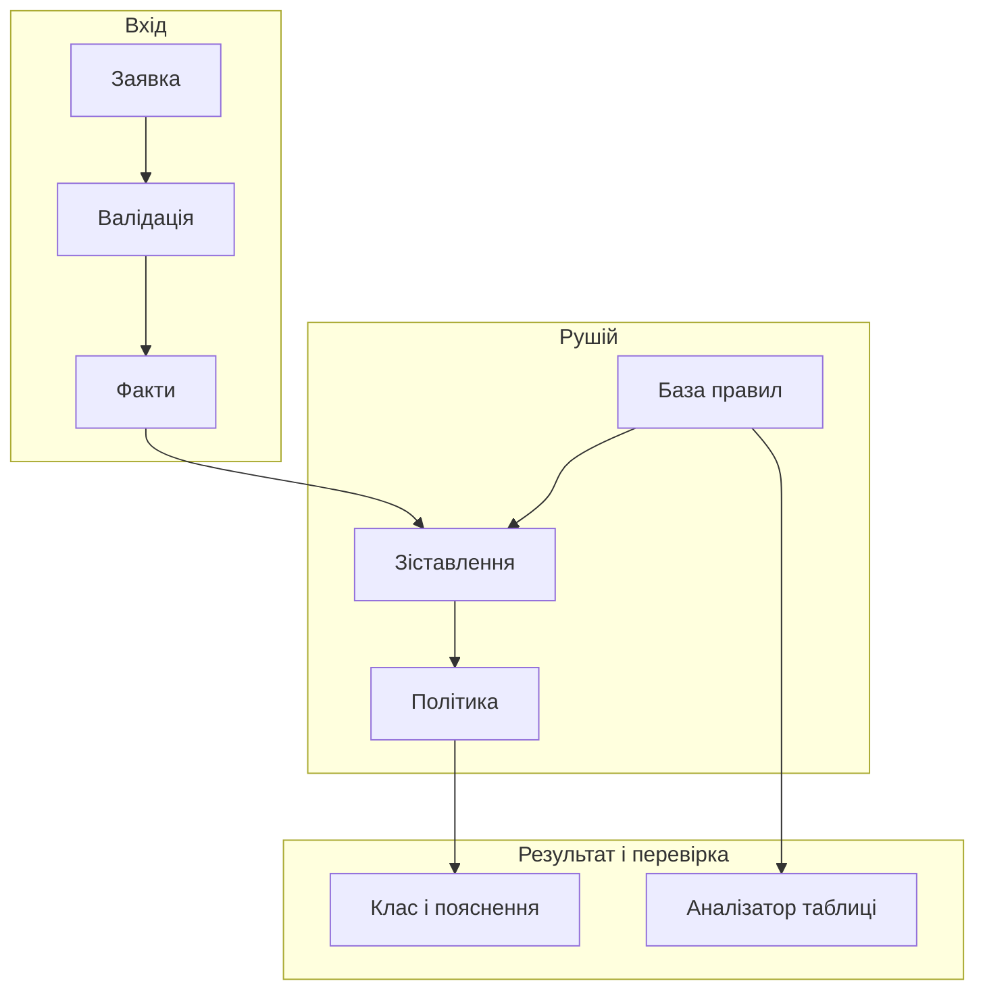
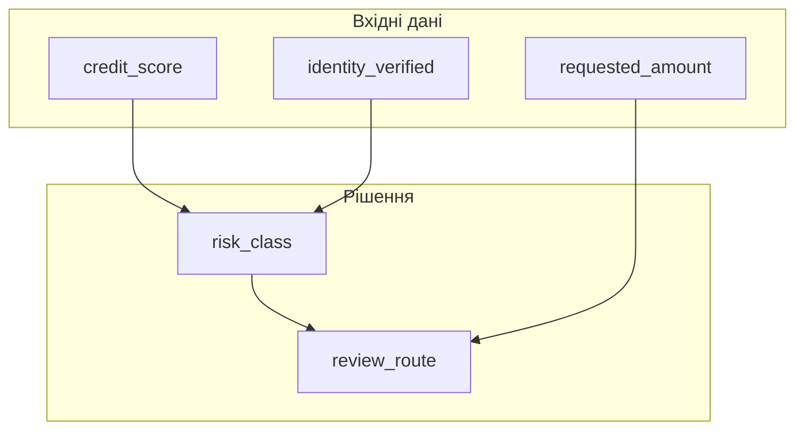
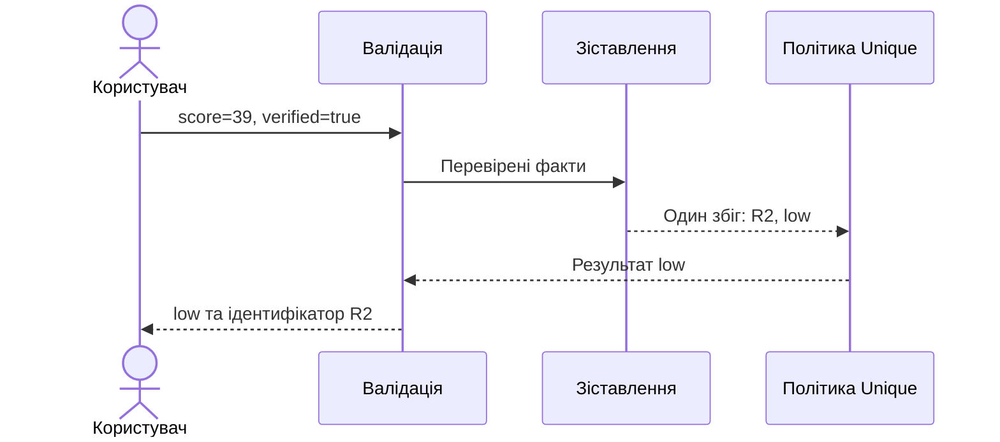
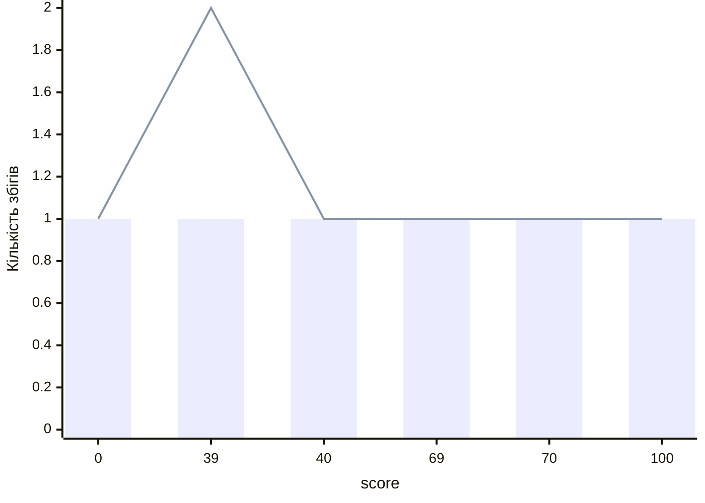

# Глава 4. Продукційні правила й таблиці рішень

<a id="глава-4-моделі-продукційних-правил-і-промисловий-стандарт-таблиць-рішень-omg-dmn--feel"></a>

> **Підручник:** [Експертні Системи](../README.md) · [Том 1. Основи експертних систем: логіка, продукційні правила, схемотехніка міркувань та класичні машини виведення](README.md)  
> **Навчальний рівень:** Базовий курс (бакалаврат, 2 курс; базові пояснення — з рівня першого курсу)  
> **Обладнання:** звичайний ноутбук або ПК (x86-64 / ARM64) без прискорювачів  
> **Мови:** основна реалізація — Python; порівняння рушіїв — CLIPS і DRL з перевіркою на Java; основні спеціалізовані мови курсу — Prolog (SWI-Prolog) і OMG DMN/FEEL\
> **Попередня глава:** [Глава 3. Неповні дані, суперечності та походження фактів](ch03-incomplete-and-conflicting-data.md)\
> **Наступна глава:** [Глава 5. Пряме виведення та організація обчислень](ch05-forward-inference-and-execution.md)\
> **Автор:** Микола Мартинович Федчик

---

## Анотація

У Главі 3 було показано, чому стан «невідомо» не можна ототожнювати з «хибно» і як суперечливі свідчення мають залишатися видимими для рушія. Ця глава переносить ці принципи у продукційні правила й таблиці рішень: тут визначаються умови спрацювання, результат правила, джерело вимоги та поведінка при пропущених чи неоднозначних входах. Якщо бізнес-логіку записано лише в розгалуженому коді, зміна порога може непомітно змінити порядок перевірок; якщо ж таблицю вважати правильною лише тому, що її легко прочитати, прогалини та перекриття залишаться невиявленими.

Спершу розглянуто структуру продукційного правила і засоби CLIPS та Drools, потім — стандарт OMG DMN і мову FEEL, політики спрацювання таблиць та статичну перевірку їхнього покриття. Навчальні приклади показують відмінність між умовами, що взаємно виключаються, і правилами, де порядок є частиною задуму. Це основа для подальшого вивчення прямого виведення та мереж Rete, але сама наявність таблиці DMN або продукційного рушія не є доказом функціональної безпеки чи відповідності стандартам.

---

<!-- chapter-toc:start -->
## Зміст глави

- [1. Архітектура продукційної системи та канонічна структура правила](#1-архітектура-продукційної-системи-та-канонічна-структура-правила)
  - [1.1. Робоча пам'ять фактів, база продукцій, інтерпретатор і паспорт атрибутів правила](#11-робоча-память-фактів-база-продукцій-інтерпретатор-і-паспорт-атрибутів-правила)
  - [1.2. Подання правил у продукційних системах](#12-подання-правил-у-продукційних-системах)
  - [1.3. Побайтова прив'язка правила до нормативного першоджерела (закону, клінічного протоколу, бойового статуту)](#13-побайтова-привязка-правила-до-нормативного-першоджерела-закону-клінічного-протоколу-бойового-статуту)
- [2. Стандартизоване подання рішень і мова умов](#2-стандартизоване-подання-рішень-і-мова-умов)
  - [2.1. Поділ складного рішення на пов'язані таблиці](#21-поділ-складного-рішення-на-повязані-таблиці)
  - [2.2. Типи даних, інтервали та невідомі значення](#22-типи-даних-інтервали-та-невідомі-значення)
  - [2.3. Ергономіка таблиць рішень для лікарів, юристів, фінансистів і офіцерів штабу](#23-ергономіка-таблиць-рішень-для-лікарів-юристів-фінансистів-і-офіцерів-штабу)
- [3. Політики спрацювання таблиць рішень](#3-політики-спрацювання-таблиць-рішень)
  - [3.1. Політики вибору одного результату](#31-політики-вибору-одного-результату)
  - [3.2. Політики збирання та впорядкування кількох результатів](#32-політики-збирання-та-впорядкування-кількох-результатів)
  - [3.3. Маскування перекриттів порядком рядків](#33-маскування-перекриттів-порядком-рядків)
- [4. Статичний аналіз таблиць рішень: повнота покриття, перекриття та затінення правил](#4-статичний-аналіз-таблиць-рішень-повнота-покриття-перекриття-та-затінення-правил)
  - [4.1. Геометрична інтерпретація правил як гіперпрямокутників у просторі ознак](#41-геометрична-інтерпретація-правил-як-гіперпрямокутників-у-просторі-ознак)
  - [4.2. Виявлення прогалин і суперечливих перетинів](#42-виявлення-прогалин-і-суперечливих-перетинів)
  - [4.3. Спрощення та злиття суміжних рядків](#43-спрощення-та-злиття-суміжних-рядків)
- [5. Практичні завдання та лабораторний практикум](#5-практичні-завдання-та-лабораторний-практикум)
  - [5.1. Контрольні запитання для самоперевірки](#51-контрольні-запитання-для-самоперевірки)
  - [5.2. Розрахункові задачі (трасування вручну)](#52-розрахункові-задачі-трасування-вручну)
  - [5.3. Завдання з програмної реалізації](#53-завдання-з-програмної-реалізації)
  - [5.4. Зв'язок із лабораторною та курсовою роботою курсу](#54-звязок-із-лабораторною-та-курсовою-роботою-курсу)
- [Висновки](#висновки)
- [Глосарій](#глосарій)
- [Скорочення та терміни](#скорочення-та-терміни)
- [Джерела](#джерела)
<!-- chapter-toc:end -->

---

## 1. Архітектура продукційної системи та канонічна структура правила

Продукційна база знань зберігає декларативні умови й наслідки, а рушій зіставляє умови з робочою пам'яттю фактів і вирішує, які правила активувати. Для кожного входу інженер має змогу виміряти кількість відповідних правил, однозначність рішення та можливість відтворити його походження. Якщо умову й дію залишити в одному нерозділеному фрагменті коду, зміна знань потребуватиме зміни програми й повторної перевірки всього пов'язаного шляху; якщо ж не визначити порядок чи політику спрацювання, однаковий випадок може отримати різні результати в різних рушіях.

Наскрізний навчальний приклад глави — класифікація заявки за цілим балом `score` від 0 до 100 та ознакою перевірки особи `verified`. Неперевірена особа передається на ручну перевірку; для перевіреної особи визначається один із трьох класів. Ці пороги демонстраційні: вони не є моделлю кредитоспроможності.

<a id="chapter-4-object-1"></a>

**Схема 4.1. Місце правил і перевірки таблиці в експертній системі.**



Схема відокремлює оцінювання конкретної заявки від аналізу всієї таблиці: успішний результат для однієї заявки ще не показує, чи не пропущено інші входи.

### 1.1. Робоча пам'ять фактів, база продукцій, інтерпретатор і паспорт атрибутів правила

Канонічне продукційне правило має умову й наслідок: «якщо факти задовольняють передумову, додати або видати висновок». У робочій пам'яті містяться факти конкретного випадку; база продукцій містить правила; інтерпретатор виконує зіставлення, активацію та передбачені специфікацією дії. Важливо відрізняти **активацію** правила, коли умови стали істинними, від **виконання** (спрацювання) правила, коли рушій обрав його серед інших активованих правил.

<a id="chapter-4-object-2"></a>

**Таблиця 4.2 — Мінімальний паспорт продукційного правила.**

| Поле | Призначення | Приклад |
|---|---|---|
| Ідентифікатор і версія | Однозначно визначають редакцію правила | `R-17`, версія `3` |
| Умова | Предикат над типізованими фактами | `credit_score < 40` |
| Висновок або дія | Результат, який додається чи повертається | `decision = "manual_review"` |
| Джерело | Документ, пункт і редакція вимоги | політика оцінювання, § 2.4 |
| Чинність | Часовий інтервал або умови застосовності | від дати набрання чинності |
| Пояснення | Людиночитне обґрунтування та фактичні значення | «оцінка нижча за поріг» |

Умова правила не повинна змінювати факти непомітно. Якщо виконання має побічні ефекти — наприклад, створює заявку чи надсилає команду, — їх треба відокремлювати від логічного висновку або явно фіксувати як частину контракту. Для прикладу нижче результат `manual_review` є лише навчальним висновком, а не дією над фінансовою заявкою.

У програмі правило містить ідентифікатор, включні межі балу, умову перевірки особи та результат. `None` у полі правила означає «будь-який стан перевірки», але `None` у вхідних даних відхиляється: відсутня відповідь не є ані `True`, ані `False`. Функція повертає всі відповідні правила, не обираючи жодного; політику вибору буде додано в розділі 3.

<a id="chapter-4-object-3"></a>

**Лістинг 4.3. Факти та зіставлення з правилами (Python 3.14.4).**

<details>
<summary>Показати лістинг 4.3 (28 рядків, Python 3.14.4)</summary>

```python
from dataclasses import dataclass

@dataclass(frozen=True)
class Rule:
    id: str
    minimum: int
    maximum: int
    verified: bool | None
    outcome: str

RULES = (
    Rule("R1", 0, 100, False, "manual_review"),
    Rule("R2", 0, 39, True, "low"),
    Rule("R3", 40, 69, True, "medium"),
    Rule("R4", 70, 100, True, "high"),
)

def matching(rules: tuple[Rule, ...], score: int, verified: bool) -> list[Rule]:
    if type(score) is not int or not 0 <= score <= 100:
        raise ValueError("score має бути цілим числом від 0 до 100")
    if type(verified) is not bool:
        raise ValueError("verified має бути булевим значенням")
    return [r for r in rules if r.minimum <= score <= r.maximum
            and (r.verified is None or r.verified == verified)]

assert [(r.id, r.outcome) for r in matching(RULES, 39, True)] == [("R2", "low")]
assert [r.id for r in matching(RULES, 40, True)] == ["R3"]
assert [r.id for r in matching(RULES, 55, False)] == ["R1"]
```

</details>

На вхід `matching` надходять правила, бал і стан перевірки особи; на виході — список збігів у порядку правил. `assert` завершує програму помилкою, якщо очікування не виконано. У цій навчальній реалізації ідентифікатори дозволяють простежити спрацювання; повний паспорт із таблиці 4.2 також потребує версії та джерела.

<a id="chapter-4-object-4"></a>

**Таблиця 4.4 — Трасування зіставлення для перевірених і неперевірених заявок.**

| `score` | `verified` | Збіг | Результат правила |
|---:|:---:|:---:|---|
| 39 | `true` | `R2` | `low` |
| 40 | `true` | `R3` | `medium` |
| 100 | `true` | `R4` | `high` |
| 55 | `false` | `R1` | `manual_review` |

**Що означає результат і як його використати.** Паспорт дозволяє перевірити не тільки істинність умови, а й те, за якою редакцією правила отримано висновок і хто має право її змінювати. У журналі рішення слід фіксувати ідентифікатор правила, його версію, факти, що задовольнили умову, та підсумкову дію рушія.

<a id="12-подання-правил-у-класичних-системах-clips-jess-та-drools-drl"></a>

### 1.2. Подання правил у продукційних системах

Різні продукційні системи мають власний синтаксис і механізми зіставлення, але спільну ідею «умова → наслідок». У CLIPS факт і правило записуються у продукційному стилі; у Drools DRL правило має оголошення, шаблон умови та блок наслідку мовою Java-подібних виразів. Обидва приклади нижче реалізують лише рядок `R2` з лістингу 4.3: вони не замінюють усю таблицю.

У CLIPS спершу оголошено шаблони заявки та висновку. Після завантаження файла правила до рушія подається факт `application` з балом 39 і `verified TRUE`; одне спрацювання додає факт `decision` зі значенням `low`. При 40 балах або `verified FALSE` новий факт не додається.

<a id="chapter-4-object-5"></a>

**Лістинг 4.5. Правило низького балу (CLIPS 6.42).**

<details>
<summary>Показати лістинг 4.5 (7 рядків, CLIPS 6.42)</summary>

```clips
(deftemplate application (slot score) (slot verified))
(deftemplate decision (slot value))
(defrule low-score
  (application (score ?s&:(and (>= ?s 0) (< ?s 40)))
               (verified TRUE))
  =>
  (assert (decision (value low))))
```

</details>

Лістинг перевірено рушієм CLIPS 6.42 через прив'язку `clipspy` 1.0.6 [[2]](#src-2). У самостійному середовищі CLIPS файл завантажують командою `load`, після `reset` додають факт командою `assert` і запускають правила командою `run`; `facts` показує висновок.

У DRL той самий факт має явно оголошені поля, а правило додає результат до списку `decisions`. Файл є ресурсом рушія Drools, а не самостійною Java-програмою.

<a id="chapter-4-object-6"></a>

**Лістинг 4.6. Те саме правило для Drools (DRL Drools 8.44.0.Final).**

<details>
<summary>Показати лістинг 4.6 (14 рядків, DRL Drools 8.44.0.Final)</summary>

```drl
package tutorial
global java.util.List decisions;

declare Application
  score : int
  verified : boolean
end

rule "Low score"
when
  Application(score >= 0, score < 40, verified == true)
then
  decisions.add("low");
end
```

</details>

Для перевірки потрібні Java, Drools 8.44.0.Final і залежності `org.drools:drools-engine:8.44.0.Final` та `org.drools:drools-mvel:8.44.0.Final` [[3]](#src-3). У Maven-проєкті збережіть попередній лістинг як `rules.drl`, а програму нижче — як `src/main/java/VerifyRules.java`. Встановіть властивості `maven.compiler.source` і `maven.compiler.target` у `25` та запустіть `mvn compile exec:java -Dexec.mainClass=VerifyRules -Dexec.args=rules.drl`. Приклад перевірено з Maven 3.9.9, `maven-compiler-plugin` 3.13.0 та `exec-maven-plugin` 3.5.0. Для кожного випадку програма створює окрему сесію, додає факт і перевіряє кількість спрацювань та результат.

<a id="chapter-4-object-7"></a>

**Лістинг 4.7. Перевірка правила Drools (Java 25.0.4.1).**

<details>
<summary>Показати лістинг 4.7 (32 рядки, Java 25.0.4.1)</summary>

```java
import java.nio.file.Files;
import java.nio.file.Path;
import java.util.ArrayList;
import org.kie.api.io.ResourceType;
import org.kie.internal.utils.KieHelper;

public class VerifyRules {
    public static void main(String[] args) throws Exception {
        var base = new KieHelper().addContent(
                Files.readString(Path.of(args[0])), ResourceType.DRL).build();
        var type = base.getFactType("tutorial", "Application");
        int[] scores = {39, 40, 39}, expected = {1, 0, 0};
        boolean[] verified = {true, true, false};
        for (int i = 0; i < scores.length; i++) {
            var session = base.newKieSession();
            try {
                var decisions = new ArrayList<String>();
                session.setGlobal("decisions", decisions);
                var fact = type.newInstance();
                type.set(fact, "score", scores[i]);
                type.set(fact, "verified", verified[i]);
                session.insert(fact);
                int fired = session.fireAllRules();
                if (fired != expected[i] || decisions.size() != expected[i]
                        || (fired == 1 && !decisions.get(0).equals("low"))) {
                    throw new AssertionError(scores[i] + "/" + verified[i]);
                }
                System.out.println(scores[i] + "/" + verified[i] + " -> " + decisions);
            } finally { session.dispose(); }
        }
    }
}
```

</details>

Очікувані результати: `39/true -> [low]`, `40/true -> []`, `39/false -> []`. Перший запис відповідає `R2`, а порожні списки означають лише те, що **це одне** правило не спрацювало; у повній таблиці інші рядки можуть дати результат.

Сам по собі синтаксичний збіг не гарантує однакової поведінки: рушії можуть відрізнятися типізацією, трактуванням `null`, стратегією вибору активованих правил і семантикою наслідків. Jess також належить до продукційних систем, однак у цій главі його не використовуємо як третю практичну DSL: для порівняння достатньо CLIPS і Drools.

**Що означає приклад і як його використати.** Якщо те саме правило переноситься між рушіями, потрібні тести на однакових наборах фактів і перевірка не лише фінального значення, а й кількості спрацювань, порядку, повторного спрацювання та пояснення. Для критичної системи це частина керування конфігурацією бази знань, а не формальна перевірка текстового файлу.

### 1.3. Побайтова прив'язка правила до нормативного першоджерела (закону, клінічного протоколу, бойового статуту)

Правило, що походить із нормативного документа, має бути пов'язане з конкретною редакцією джерела. Мінімальний запис включає назву й видавця документа, номер редакції, дату чинності, точне місце вимоги (пункт, таблицю або абзац), локальний ідентифікатор правила та ідентифікатор збереженої копії. Для цифрового першоджерела можна зберігати криптографічний хеш байтів отриманого файла: він виявляє зміну копії, але сам по собі не доводить автентичність джерела, правильність тлумачення чи відповідність реалізації.

Для кожної зміни порога слід зберігати зв'язок «вимога → формалізоване правило → тестові випадки → результат перевірки». Наприклад, якщо контрольний документ змінює мінімальний поріг із 40 на 42, журнал має показувати, яка редакція вимоги спричинила зміну, які правила і таблиці оновлено, та які значення на межі (39, 40, 41, 42, 43) повторно протестовано. Для клінічних, юридичних і автомобільних прикладів предметні значення тут навчальні; застосовувати їх як реальні настанови без фахового затвердження не можна.

**Що означає результат і як його використати.** Хеш, посилання на пункт і набір перевірок утворюють аудиторський слід, але не замінюють процес керування вимогами, аналіз небезпек або оцінювання відповідності. У проєктах Automotive ці практики мають узгоджуватися з процесами життєвого циклу, зокрема ISO 26262 та ISO/SAE 21434; сама таблиця правил не засвідчує відповідність цим стандартам.

<a id="2-стандарт-omg-dmn-діаграми-вимог-до-рішень-drd-та-мова-виразів-feel"></a>

## 2. Стандартизоване подання рішень і мова умов

Таблиця DMN є не просто форматованою сіткою, а частиною моделі рішення: діаграма вимог до рішень (DRD) показує, які входи та інші рішення потрібні для отримання результату. Такий поділ дає змогу перевірити залежності, перш ніж запускати таблицю. Без нього таблиця може виглядати повною, але спиратися на неузгоджені або неявні вхідні дані. Метою є простежуваний шлях від вхідних даних до рішення та однозначне обчислення FEEL-виразів відповідно до специфікації OMG DMN [[1]](#src-1).

<a id="21-декомпозиція-складного-рішення-на-ієрархічний-граф-таблиць-drd"></a>

### 2.1. Поділ складного рішення на пов'язані таблиці

DRD може містити вхідні дані, рішення, джерела знань і моделі бізнес-знань; спрямовані вимоги показують, які елементи використовує рішення. Для навчального прикладу оцінювання заявки вхідні дані `credit_score` і `identity_verified` ведуть до рішення `risk_class`, а воно разом із `requested_amount` — до рішення `review_route`. Якщо `risk_class` обчислюється в окремій таблиці, зміна класифікації не вимагає дублювати ту саму логіку в усіх таблицях, де визначається маршрут.

У коді цієї глави `score` і `verified` є короткими назвами входів `credit_score` та `identity_verified`. Друге рішення, `review_route`, показує залежність між таблицями, але окрема таблиця маршрутизації тут не реалізується.

<a id="chapter-4-object-8"></a>

**Схема 4.8. Залежності між вхідними даними та рішеннями.**



Стрілки показують, які дані потрібні кожному рішенню; це пояснювальна схема залежностей, а не повна графічна нотація DRD.

<a id="chapter-4-object-9"></a>

**Таблиця 4.9 — Приклад залежностей у моделі рішення.**

| Елемент DRD | Тип | Залежить від |
|---|---|---|
| `credit_score` | Вхідні дані | зовнішній набір заявки |
| `identity_verified` | Вхідні дані | результат перевірки особи |
| `risk_class` | Рішення | `credit_score`, `identity_verified` |
| `requested_amount` | Вхідні дані | зовнішній набір заявки |
| `review_route` | Рішення | `risk_class`, `requested_amount` |

Ця таблиця — текстовий перелік залежностей, не повна графічна нотація DRD. У реальній моделі необхідно також визначити типи даних, відповідальних власників входів і поведінку для відсутніх значень.

**Що означає результат і як його використати.** DRD допомагає локалізувати зміни та знаходити відсутні залежності: якщо рішення використовує неоголошене поле, це помилка моделі; якщо воно залежить від іншого рішення, яке не має визначеного входу, помилка виникає до виконання таблиці.

<a id="22-типізована-семантика-інтервалів-списків-дат-і-тризначної-логіки-у-мові-feel"></a>

### 2.2. Типи даних, інтервали та невідомі значення

FEEL задає типізовані вирази й перевірки, тож порівняння чисел, рядків, дат та інтервалів має визначену семантику. У таблиці рішень комірка вхідного рядка зазвичай є unary test щодо відповідного входу: `< 40`, `[40..69]`, `>= 70` або `-` (будь-яке значення). Межі інтервалу треба вибрати свідомо: для домену цілих балів `[40..69]` не перетинається з `[70..100]`, тоді як неправильне використання включних меж може створити подвійний збіг.

Пропущене значення FEEL `null` не слід плутати з числом 0, порожнім рядком чи булевим `false`. FEEL має визначену поведінку для логічних виразів із `null`, але точну семантику операцій треба брати зі специфікації та перевіряти в обраному сумісному рушії; реалізація на іншій мові не повинна автоматично підміняти її правилами `None` чи `null` цієї мови. Зокрема, `null` вхідного порога не є доказом, що поріг дорівнює нулю.

<a id="chapter-4-object-10"></a>

**Таблиця 4.10 — Типізовані входи та перевірки FEEL у навчальній моделі.**

| Вхід | Тип/одиниця | Приклад перевірки | Важливе обмеження |
|---|---|---|---|
| `credit_score` | ціле число, 0–100 | `[40..69]` | поза діапазоном — помилка валідації, а не клас ризику |
| `identity_verified` | булеве значення | `true` | `null` не дорівнює `false` |
| `effective_date` | дата | `>= date("2026-01-01")` | потрібна узгоджена часова зона для timestamp |
| `requested_amount` | десяткове число у валюті моделі | `> 10000` | валюту й точність округлення задають окремо |

FEEL-дата в прикладі має бути задана синтаксисом, підтриманим специфікацією та конкретним рушієм; запис наведено для пояснення типу перевірки, а не як гарантовано виконуваний фрагмент без контексту.

**Що означає результат і як його використати.** Перед оцінюванням таблиці слід валідувати тип, одиниці, межі та наявність входів. Це відокремлює «вхід недопустимий» від «таблиця не знайшла рішення» і не дозволяє пропущеним даним перетворитися на правдоподібний, але хибний результат.

### 2.3. Ергономіка таблиць рішень для лікарів, юристів, фінансистів і офіцерів штабу

Таблицю мають читати й перевіряти не лише автори рушія, а й фахівці, які відповідають за предметні вимоги. Для цього назви входів мають бути зрозумілими, одиниці — видимими, пороги — супроводжуватися поясненням, а правила — не приховувати винятки в порядку рядків. У медицині навчальна таблиця не повинна імітувати затверджений протокол; у фінансах рішення має показувати, який саме критерій спрацював; в Automotive таблиця потребує простежуваного зв'язку з вимогою та аналізом небезпек.

Практична перевірка читабельності — дати фахівцеві кілька граничних випадків і попросити передбачити результат без запуску рушія. Якщо він не може встановити, що відбувається при граничному значенні, пропущеному вході або двох одночасних умовах, таблицю слід уточнити до інтеграції. Локалізований текст повідомлення не замінює машинний ідентифікатор рішення та структурований код причини.

**Що означає результат і як його використати.** Читабельність є умовою ефективного перегляду, але не доказом коректності. Її доповнюють тести меж, статичний аналіз перекриттів і перевірка відповідності першоджерелу.

<a id="3-політики-спрацювання-таблиць-рішень-hit-policies-та-їхні-інваріанти"></a>

## 3. Політики спрацювання таблиць рішень

Політика спрацювання таблиці визначає, як обробляються нуль, один або кілька рядків, умови яких істинні. Вибір політики впливає на результат не менше, ніж самі умови: помилкова `First` може приховати перекриття, а `Unique` повинна виявити його як порушення очікуваного інваріанта. Практична мета — для кожного входу визначити число збігів і спосіб побудови результату так, щоб неоднозначність була видимою, а не випадково замаскованою.

<a id="chapter-4-object-11"></a>

**Діаграма 4.11. Послідовність оцінювання заявки.**



Для цього входу `Unique` отримує рівно один збіг. Якби збіглися два рядки, той самий виклик політики мав би повідомити про порушення, а не непомітно вибрати перший.

<a id="31-однозначні-політики-unique-u-any-a-priority-p-first-f"></a>

### 3.1. Політики вибору одного результату

Політики `Unique`, `Any`, `Priority` і `First` повертають одне рішення, але висувають різні вимоги до збігів. `Unique` допускає не більше одного відповідного рядка; `Any` допускає кілька лише тоді, коли виходи однакові; `Priority` обирає вихід із найвищим оголошеним пріоритетом; `First` повертає вихід першого відповідного рядка в порядку таблиці.

<a id="chapter-4-object-12"></a>

**Таблиця 4.12 — Відмінність політик одного результату.**

| Політика | Коли є кілька збігів | Що треба перевіряти |
|---|---|---|
| `U` (`Unique`) | Порушення очікування; має бути не більш як один збіг | неперетинність рядків |
| `A` (`Any`) | Допустимо, якщо всі виходи однакові | рівність виходів у кожному перекритті |
| `P` (`Priority`) | Повертається вихід із найвищим заданим пріоритетом | повнота й однозначність шкали пріоритетів |
| `F` (`First`) | Повертається вихід першого збігу за порядком рядків | стабільність порядку та видимість затінених рядків |

Незалежно від політики, нуль збігів потребує визначеної поведінки: помилки, окремого результату «не визначено» або покриття рядком за замовчуванням. Такий рядок не повинен підміняти перевірку повноти.

Наступна функція продовжує лістинг 4.3: вона приймає список результатів `matching` і реалізує навчальні варіанти `Unique`, `Any` та `First`. Для нуля збігів приклад явно обирає помилку; це рішення застосунку, а не твердження про поведінку кожного рушія DMN. `Priority` тут не реалізовано, бо для нього потрібна окремо задана шкала виходів.

<a id="chapter-4-object-13"></a>

**Лістинг 4.13. Вибір за політикою та перевірка перекриття (Python 3.14.4).**

<details>
<summary>Показати лістинг 4.13 (25 рядків, Python 3.14.4)</summary>

```python
def decide(hits: list[Rule], policy: str) -> str:
    if policy not in ("U", "A", "F"):
        raise ValueError("невідома політика")
    if not hits:
        raise ValueError("немає збігів")
    if policy == "U" and len(hits) != 1:
        raise ValueError("Unique: кілька збігів")
    if policy == "A" and len({rule.outcome for rule in hits}) != 1:
        raise ValueError("Any: різні результати")
    return hits[0].outcome

assert decide(matching(RULES, 39, True), "U") == "low"
conflicting = (RULES[0], Rule("R5", 0, 39, None, "low"))
hits = matching(conflicting, 39, False)
assert [rule.id for rule in hits] == ["R1", "R5"]
assert decide(hits, "F") == "manual_review"
assert decide(list(reversed(hits)), "F") == "low"
same = (RULES[0], Rule("R6", 0, 100, None, "manual_review"))
assert decide(matching(same, 39, False), "A") == "manual_review"
try:
    decide(hits, "U")
except ValueError as error:
    assert str(error).startswith("Unique")
else:
    raise AssertionError("Unique не виявила перекриття")
```

</details>

Для заявки `(39, false)` штучно доданий рядок `R5` збігається з `R1`. `First` повертає різні значення після перестановки, тоді як `Unique` сигналізує про два збіги. `Any` дозволяє два збіги лише в окремому тесті з однаковим виходом.

**Що означає результат і як його використати.** У таблиці, де потрібен рівно один клас на всьому допустимому домені, зазвичай перевіряють повноту та `Unique`. `Any` доречна, коли кілька незалежних умов справді можуть дати той самий вихід; `Priority` потрібна лише за явної предметної шкали; `First` — коли порядок є задокументованою частиною правила, а не зручним способом приховати колізію.

<a id="32-множинні-агрегаційні-політики-collect-c-c-c-c-rule-order-r-та-output-order-o"></a>

### 3.2. Політики збирання та впорядкування кількох результатів

Коли таблиця навмисно збирає кілька результатів, потрібні політики `Collect`, `Rule Order` і `Output Order`. `Collect` повертає сукупність виходів або агрегує їх; стандартні варіанти включають перелік без порядку, суму (`C+`), мінімум (`C<`), максимум (`C>`) і кількість (`C#`). `Rule Order` зберігає результати у порядку рядків, що спрацювали; `Output Order` упорядковує їх за заданим порядком вихідних значень. Це різні контракти: порядок рядків не тотожний пріоритету результатів.

**Логічний приклад.** У навчальній моделі витрат на обробку заявки три незалежні правила повертають 12, 8 і 5 гривень. `Collect +` підсумовує суми всіх відповідних правил; `Collect #` рахує кількість відповідних правил; `Rule Order` повертає значення в порядку рядків. Якщо правила насправді є взаємовиключними класами рішення, така агрегація буде помилкою моделювання, навіть якщо рушій виконує її коректно.

Функція нижче приймає вже обчислені результати рядків у порядку таблиці; вона показує три операції, а не реалізує весь стандарт DMN. Для порожнього списку та значень нецілого типу приклад явно повертає помилку.

<a id="chapter-4-object-14"></a>

**Лістинг 4.14. Агрегація навчальних витрат (Python 3.14.4).**

<details>
<summary>Показати лістинг 4.14 (17 рядків, Python 3.14.4)</summary>

```python
def collect(outcomes: list[int], mode: str) -> int | list[int]:
    if not outcomes:
        raise ValueError("немає збігів")
    if any(type(value) is not int for value in outcomes):
        raise ValueError("витрати мають бути цілими числами")
    if mode == "C+":
        return sum(outcomes)
    if mode == "C#":
        return len(outcomes)
    if mode == "R":
        return outcomes.copy()
    raise ValueError("невідома агрегація")

costs = [12, 8, 5]
assert collect(costs, "C+") == 25
assert collect(costs, "C#") == 3
assert collect(costs, "R") == [12, 8, 5]
```

</details>

Отже, для цих трьох збігів сума становить 25 грн, їхня кількість — 3, а впорядкований список — `[12, 8, 5]`. Самі результати не показують, чи є витрати незалежними: це потрібно перевірити за змістом правил.

**Що означає результат і як його використати.** До вибору `Collect` треба визначити, чи результат є множиною, впорядкованим списком або числовою агрегацією, і чи має вихідний тип операцію потрібного виду. Для `C+` сума має сенс лише за сумісних одиниць і відсутності подвійного обліку однієї й тієї самої підстави.

<a id="33-чому-політика-first-f-маскує-логічні-помилки-в-критичних-системах-безпеки"></a>

### 3.3. Маскування перекриттів порядком рядків

`First` чутлива до перестановки рядків: якщо два рядки перекриваються, зміна їхнього порядку може змінити результат, хоча набір умов залишився тим самим. Це може бути навмисним, але без окремого контролю перекриттів таблиця приховує логічну суперечність за текстовою позицією.

У лістингу 4.13 `R1` дає `manual_review` для неперевіреної особи, а доданий `R5` — `low` для балу нижче 40 незалежно від перевірки особи. Для `(39, false)` збігаються обидва рядки. За `First` результатом буде `manual_review`, якщо `R1` стоїть першим, і `low`, якщо першим стоїть `R5`. Статичний аналіз має повідомити про перекриття незалежно від результату рушія.

**Що означає результат і як його використати.** Якщо порядок `First` є предметним пріоритетом, його документують і тестують, зокрема перестановочними тестами. Якщо ж порядок потрібен лише для отримання одного виходу, таблицю краще переробити на взаємовиключні умови або застосувати іншу політику. Для рішень, що впливають на безпеку, `First` не слід використовувати як заміну аналізу конфліктів.

## 4. Статичний аналіз таблиць рішень: повнота покриття, перекриття та затінення правил

Статичний аналіз відповідає на питання про всі допустимі входи, а не лише про кілька тестових прикладів: чи покрито домен, чи можуть збігтися кілька рядків і чи є рядки, які ніколи не спрацьовують. Це важливо, бо тестування скінченної кількості випадків не доводить властивостей таблиці на всьому просторі входів. У цьому розділі розглянуто геометричну модель умов і базові алгоритми, які можна застосувати до дискретних доменів та інтервалів.

### 4.1. Геометрична інтерпретація правил як гіперпрямокутників у просторі ознак

Кожен рядок таблиці задає підмножину допустимого простору входів. Для двох числових ознак умова може бути прямокутником; для більшої кількості ознак — гіперпрямокутником; умови над категоріальними значеннями задають множини категорій. Аналіз таблиці можна звести до перевірки об'єднання таких областей і їхніх попарних перетинів.

<a id="chapter-4-object-15"></a>

**Формула 4.15 — Покриття домену та попарні перетини рядків.**

$$
\bigcup_{i=1}^{n} R_i = D,
\qquad
R_i \cap R_j = \varnothing \quad (i \ne j)
$$

Тут $D$ — повний допустимий домен вхідних значень; $`R_i`$ — підмножина $D$, що задовольняє рядок $i$; $n$ — додатна ціла кількість рядків; $i$ та $j$ — індекси від 1 до $n$. Одиниці залежать від входів; самі операції над множинами безрозмірні. Перша рівність означає повне покриття, друга — взаємну неперетинність. Друга умова потрібна для `Unique`, але не для `Any`, `Priority` чи `First`, де перетини можуть мати визначену семантику.

**Приклад.** Нехай `score` — ціле число від 0 до 100, а `verified` — `true` або `false`. Чотири рядки з лістингу 4.3 задають такі області:

<a id="chapter-4-object-16"></a>

**Таблиця 4.16 — Допустимі області та результати навчальної таблиці.**

| Рядок | `score` | `verified` | Результат |
|---|---|---|---|
| `R1` | 0–100 | `false` | `manual_review` |
| `R2` | 0–39 | `true` | `low` |
| `R3` | 40–69 | `true` | `medium` |
| `R4` | 70–100 | `true` | `high` |

Простір містить $101 \times 2 = 202$ комбінації. За цих меж кожен допустимий вхід покритий рівно одним рядком; наступний лістинг перевірить усі 202 входи. Для великих чи неперервних доменів потрібен символічний аналіз інтервалів, а не перебір кожного значення.

**Що означає результат і як його використати.** Якщо неперетинність і повнота доведено для формалізованого домену, то таблиця має рівно один збіг на кожному допустимому вході. Це твердження не поширюється на некоректні чи відсутні дані, якщо вони не включені до визначення $D$.

<a id="42-алгоритми-виявлення-прогалин-покриття-домену-missing-intervals-та-суперечливих-перетинів-overlaps"></a>

### 4.2. Виявлення прогалин і суперечливих перетинів

Для дискретного домену малих розмірів можна перерахувати всі комбінації та порахувати кількість збігів. Для інтервалів кожен рядок нормалізують до меж із позначенням включності кінців, після чого перевіряють перетини й прогалини в кожній комбінації умов. Для $n$ рядків і $d$ вимірів попарна перевірка потребує до $n(n-1)/2$ пар, а кожна пара — перевірки до $d$ вимірів; це дає простий алгоритм порядку $O(n^2d)$. Оптимізовані структури можуть бути швидшими, але їх не потрібно залучати, поки вимірювання не покаже проблему.

У прикладі з `score` достатньо змінити рядок середнього класу на `[39..69]`, щоб виникло перекриття зі значенням 39 у низькому класі. Якщо замість цього задати `[41..69]`, виникне прогалина для 40. Межі 0 і 100 теж треба перевірити: помилка `< 100` замість `<= 100` залишить вхід 100 непокритим. Для категоріальних ознак аналогічна перевірка з'ясовує, чи всі дозволені категорії згадані або навмисно віднесені до правила за замовчуванням.

Рядок є **затіненим**, якщо його область повністю покривається областями рядків, які мають перевагу за обраною політикою й порядком. Для `First` це може означати, що рядок ніколи не буде першим збігом; для `Unique` це зазвичай прояв помилки або надлишкового правила. Сам факт перекриття не завжди є конфліктом: однакові виходи можуть бути прийнятними для `Any`, а пріоритетні виходи — для `Priority`.

Аналізатор нижче використовує `Rule`, `RULES` і `matching` з лістингу 4.3. Для кожної з 202 комбінацій він записує вхід без збігів або вхід із кількома збігами та їхні ідентифікатори. Окремі тести змінюють межу `R3`, не переписуючи вихідну таблицю.

<a id="chapter-4-object-17"></a>

**Лістинг 4.17. Повний перебір і контрприклади (Python 3.14.4).**

<details>
<summary>Показати лістинг 4.17 (22 рядки, Python 3.14.4)</summary>

```python
from dataclasses import replace

Input = tuple[int, bool]
Overlap = tuple[Input, tuple[str, ...]]

def analyze(rules: tuple[Rule, ...]) -> tuple[list[Input], list[Overlap]]:
    gaps: list[Input] = []
    overlaps: list[Overlap] = []
    for score in range(101):
        for verified in (False, True):
            hits = matching(rules, score, verified)
            if not hits:
                gaps.append((score, verified))
            elif len(hits) > 1:
                overlaps.append(((score, verified), tuple(r.id for r in hits)))
    return gaps, overlaps

assert analyze(RULES) == ([], [])
overlap = RULES[:2] + (replace(RULES[2], minimum=39),) + RULES[3:]
gap = RULES[:2] + (replace(RULES[2], minimum=41),) + RULES[3:]
assert analyze(overlap) == ([], [((39, True), ("R2", "R3"))])
assert analyze(gap) == ([(40, True)], [])
```

</details>

Базова таблиця не має ані прогалин, ані перекриттів у заданому домені. Зміна нижньої межі `R3` на 39 створює один контрприклад: `(39, true)` відповідає `R2` та `R3`. Межа 41 натомість залишає `(40, true)` без рішення. Перебір не аналізує FEEL-вирази довільної форми і не доводить затінення за іншими політиками.

<a id="chapter-4-object-18"></a>

**Графік 4.18. Кількість збігів на межах для перевіреної особи.**



Стовпці показують початкову таблицю, лінія — варіант із межею 39. Графік наочно показує помилку на межі, але перевірка в лістингу охоплює всі 202 входи, а не лише зображені точки.

**Що означає результат і як його використати.** Звіт аналізатора має розрізняти пропущені області, перекриття з різними виходами, допустимі однакові виходи та затінені рядки. Кожне попередження повинно вказувати конкретний контрприклад-вхід, щоб автор таблиці міг відтворити проблему.

<a id="43-автоматична-редукція-та-злиття-суміжних-рядків-таблиці-рішень-на-cpu"></a>

### 4.3. Спрощення та злиття суміжних рядків

Злиття рядків скорочує таблицю лише тоді, коли зберігає той самий результат для кожного допустимого входу й не змінює семантики політики. Два рядки можна об'єднати, якщо вони мають однаковий вихід, відрізняються рівно однією умовою на суміжні неперетинні області, а всі інші умови збігаються. Наприклад, для того самого значення `verified=true` рядки `score [0..19] → low` і `score [20..39] → low` можна замінити на `[0..39] → low` для цілочислового домену.

Перед автоматичною редукцією треба перевірити тип домену й кінці інтервалів: для неперервного значення два інтервали `(0..1)` і `(1..2)` не покривають точку 1, а для цілого значення 0–100 суміжність визначається сусідніми цілими числами. Злиття рядків з різними виходами неприпустиме. Для `First`, `Rule Order` та `Output Order` треба також довести, що не змінюється порядок спрацювання чи видачі результату.

**Алгоритм редукції.** Нормалізувати кожен рядок до типізованих множин/інтервалів; знайти пари з однаковими виходами й однаковими умовами, крім одного виміру; перевірити, що області в цьому вимірі суміжні й не мають прогалини чи перекриття; створити об'єднаний рядок; повторити до фіксованої точки; повторно прогнати аналіз повноти, перетинів і еквівалентності на межах. Для непростих FEEL-виразів, часових залежностей або умов із побічними ефектами таке автоматичне злиття не можна виконувати без повноцінного доказу еквівалентності.

Перевіримо конкретне злиття, використовуючи визначення з лістингу 4.3. Розділимо `R2` на `R2a` і `R2b`, а потім порівняємо списки результатів розділеної й початкової таблиць на всьому домені.

<a id="chapter-4-object-19"></a>

**Лістинг 4.19. Перевірка злиття на скінченному домені (Python 3.14.4).**

<details>
<summary>Показати лістинг 4.19 (10 рядків, Python 3.14.4)</summary>

```python
split = (RULES[0], Rule("R2a", 0, 19, True, "low"),
         Rule("R2b", 20, 39, True, "low"), *RULES[2:])
for score in range(101):
    for verified in (False, True):
        before = [rule.outcome for rule in matching(split, score, verified)]
        after = [rule.outcome for rule in matching(RULES, score, verified)]
        assert before == after

assert matching(split, 19, True)[0].id == "R2a"
assert matching(RULES, 19, True)[0].id == "R2"
```

</details>

У всіх 202 випадках списки виходів однакові, проте ідентифікатор правила для балу 19 змінився з `R2a` на `R2`. Тому перевірка доводить рівність виходів лише для заданих двох таблиць і домену; для збереження пояснень потрібне також відображення старих ідентифікаторів на новий.

**Що означає результат і як його використати.** Скорочення кількості рядків є користю лише після підтвердження еквівалентності. Тому автоматична редукція має створювати запропоновану редакцію й звіт про перетворення, а не непомітно переписувати нормативно затверджену таблицю.

## 5. Практичні завдання та лабораторний практикум

Цей розділ закріплює матеріал Глави 4 через теоретичний самоконтроль, ручне трасування алгоритмів та програмну реалізацію на звичайному ноутбуці або ПК без прискорювачів.

### 5.1. Контрольні запитання для самоперевірки

1. Поясніть різницю між активацією правила й його виконанням у продукційній системі.
2. Коли `Any` дозволяє кілька збігів, а коли така ситуація є порушенням?
3. Чим політики `First` і `Priority` відрізняються, якщо порядок рядків не збігається з предметним пріоритетом?
4. Які докази дають і не дають хеш файла нормативного джерела?
5. Як FEEL-значення `null` відрізняється від `false`, нуля та відсутнього рядка?
6. Які перевірки потрібні перед злиттям суміжних рядків, особливо для відкритих і закритих меж?
7. Чому повнота таблиці щодо допустимого домену не гарантує коректність для невалідних чи відсутніх входів?

### 5.2. Розрахункові задачі (трасування вручну)

1. Для цілої оцінки 0–100 і ознаки `verified ∈ {true,false}` побудуйте чотири рядки з розділу 4.1. Порахуйте для входів `(39,true)`, `(40,true)`, `(100,true)` і `(55,false)` кількість збігів; потім змініть одну межу так, щоб утворити перекриття, і наведіть контрприклад.
2. Для таблиці з `First` задайте два рядки з перекриттям і різними виходами. Покажіть, як перестановка рядків змінює результат, і запропонуйте варіант із `Unique`.
3. Для трьох виходів `12`, `8` і `5` порівняйте результати `Collect +`, `Collect #` та `Rule Order`. Поясніть, які припущення потрібні, щоб сума мала предметний сенс.

<a id="53-інженерні-завдання-з-програмування-мовна-незалежність--спеціалізовані-dsl"></a>

### 5.3. Завдання з програмної реалізації

1. Доповніть аналізатор із лістингу 4.17 класифікацією перекриттів за однаковими та різними виходами. Додайте тести нижньої й верхньої меж, прогалини та обох видів перекриття.
2. Запишіть ту саму таблицю як DMN decision table із `Unique` та визначеними типами входів. Звірте результати рушія з реалізацією з попереднього пункту на всіх 202 комбінаціях прикладу.
3. Додайте до кожного правила ідентифікатор вимоги та версію, сформуйте пояснення для спрацювання й тест, який підтверджує зв'язок між вимогою та виходом.
4. Змініть порядок правил у прикладі `First` і додайте тести, які виявляють зміну результату; окремо перевірте відхилення відсутнього та позадіапазонного входу.

### 5.4. Зв'язок із лабораторною та курсовою роботою курсу

* **Базова лабораторна робота:** Лабораторна робота №1.2 — *Таблиці рішень OMG DMN/FEEL зі станами Кліні та Белнапа: статичний аналізатор повноти й перекриттів (домени: медицина, фінанси, Automotive)* (модуль М1.2 «Неповнота, походження фактів і продукційні правила»). Роботу виконують на навчальних даних; результати не є клінічними чи сертифікаційними рекомендаціями.
* **Інтеграція у курсовий проєкт Тома 1:** результати виконання завдання стають окремим верифікованим модулем обраного студентом курсового проєкту (див. [перелік тем Тома 1](README.md)).

---

## Висновки

Продукційне правило відокремлює умову від висновку, а його паспорт дає змогу відстежити версію та джерело вимоги. DMN доповнює таблицю рішень моделлю залежностей DRD і типізованими виразами FEEL; обрана hit policy визначає, що робити з кількома збігами. Статичний аналіз переводить вимоги повноти й неперетинності у перевірювані властивості простору входів, а злиття рядків допустиме лише за збереження семантичної еквівалентності.

Ключова практична перевірка для `Unique` — кожен допустимий вхід має рівно один збіг; для інших політик — кожен можливий набір збігів дає визначений і задокументований результат. Відсутні чи некоректні входи слід перевіряти окремо, а нормативне походження правила не можна вважати доведеним лише за наявністю посилання чи хешу. Наступна глава переходить від умовних таблиць до прямого виведення: як нові факти породжуються правилами та за яких умов цей процес завершується.

## Глосарій

* **Діаграма вимог до рішень (DRD)** — графічне подання входів, рішень і вимог між ними в DMN.
* **Затінений рядок (hit-policy shadowing)** — рядок, який не може бути обраний через перекривні рядки з вищим пріоритетом або ранішим порядком.
* **Політика спрацювання (hit policy)** — правило, за яким таблиця обробляє один чи кілька рядків, що відповідають входу.
* **Продукційне правило (production rule)** — декларативна конструкція з умовою та висновком або дією.
* **Робоча пам'ять (working memory)** — набір фактів поточного випадку, з яким зіставляються правила.
* **Статичний аналіз таблиці** — перевірка властивостей правил без запуску на одному конкретному вході.

## Скорочення та терміни

* `CLIPS` — мова й середовище продукційних систем (*C Language Integrated Production System*).
* `DRD` — діаграма вимог до рішень (*Decision Requirements Diagram*).
* `DRL` — мова правил Drools (*Drools Rule Language*).
* `FEEL` — мова виразів рішень DMN (*Friendly Enough Expression Language*).
* `DMN` — нотація моделювання рішень (*Decision Model and Notation*).
* `OMG` — консорціум стандартизації Object Management Group.

## Джерела

1. <a id="src-1"></a>Object Management Group. [*Decision Model and Notation (DMN), Version 1.5*](https://www.omg.org/spec/DMN/1.5). OMG, 2024.
2. <a id="src-2"></a>Gary Riley. [*CLIPS Reference Manual, Version 6.4*](https://clipsrules.net/documentation.html). CLIPS, 2021.
3. <a id="src-3"></a>Apache Software Foundation. [*Drools Documentation: Rule Engine*](https://docs.drools.org/latest/drools-docs/drools/rule-engine/index.html). Офіційна документація Drools.
4. <a id="src-4"></a>ISO. *ISO 26262:2018. Road vehicles — Functional safety*, частини 1–12. ISO, 2018.
5. <a id="src-5"></a>ISO, SAE International. *ISO/SAE 21434:2021. Road vehicles — Cybersecurity engineering*. ISO, 2021.
