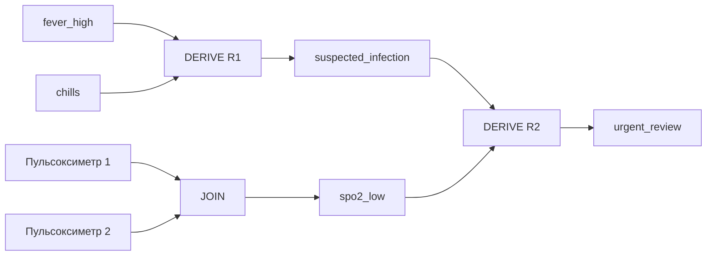

# Глава 5. Пряме виведення (Forward Chaining), оператор безпосередніх наслідків TP та топологічне розшарування ациклічних схем

> **Підручник:** [Експертні Системи](../README.md) · [Том 1. Основи експертних систем: логіка, продукційні правила, схемотехніка міркувань та класичні машини виведення](README.md)  
> **Навчальний рівень:** Базовий курс (бакалаврат, 2 курс; базові пояснення — з рівня першого курсу)  
> **Обладнання:** звичайний ноутбук або ПК (x86-64 / ARM64) без прискорювачів  
> **Мови:** реалізація — будь-яка мова загального призначення (лістинги — Python); основні спеціалізовані мови курсу — Prolog (SWI-Prolog) і OMG DMN/FEEL  
> **Попередня глава:** [Глава 4. Моделі продукційних правил і промисловий стандарт таблиць рішень OMG DMN / FEEL](ch04-production-rules-and-dmn-decision-tables.md)  
> **Наступна глава:** [Глава 6. Високошвидкісні продукційні мережі на CPU: алгоритм Rete, конфліктний набір (Agenda) та сучасна архітектура Phreak](ch06-rete-network-agenda-and-phreak-algorithm.md)  
> **Автор:** Микола Мартинович Федчик

---

## Анотація

У попередній главі таблиці рішень застосовували до одного набору входів; ця глава розглядає інший режим роботи експертної системи — послідовне отримання всіх висновків, що випливають із початкових фактів і правил. Пряме виведення лежить між базою знань і споживачем результатів: воно поширює наслідки, доки не перестануть з'являтися нові факти. Якщо рушій повторно переглядає всю базу після кожного кроку, він витрачає ресурси на вже відомі висновки; якщо ж припиняє раніше за нерухому точку, частина наслідків губиться.

Спершу вводиться оператор безпосередніх наслідків для скінченного Datalog і доводиться завершення ітерацій; далі пояснюються напівнаївне обчислення та стратифіковане заперечення. Після цього розглядається окремий профіль реалізації — авторська схемотехніка експертних систем (СТЕС): подання тверджень і джерел, контракт операторів, топологічний порядок, витрати пошуку та модельна оцінка паралельного виконання. Цей профіль не є фундаментом усіх експертних систем і не замінює ітеративних рушіїв для рекурсивних правил. Результати глави застосовуються до навчальних прикладів ІТ-інфраструктури, сервісного постачання та контролю якості вимірювань; вони не є прогнозом імовірності майбутніх подій і не замінюють предметної перевірки чи вимог функціональної безпеки.

---

## 1. Монотонний оператор безпосередніх наслідків TP та теорема Кнастера — Тарського

Прямий рушій бере поточний набір фактів, шукає правила з виконаними передумовами й додає їхні висновки до робочої пам'яті. Для скінченної бази знань вимірюваним результатом є множина всіх вивідних атомів і кількість раундів, потрібних для її стабілізації. Наївна реалізація, що щоразу повторно обчислює всі правила, правильна для простих позитивних Datalog-програм, але може виконувати багато зайвих зіставлень; відсутність критерію завершення особливо небезпечна для циклічних правил.

### 1.1. Ітераційне застосування оператора безпосередніх наслідків до скінченного ербранівського базису

Нехай $E$ — скінченна множина початкових фактів, а $P$ — скінченна програма позитивного Datalog без функціональних символів. Її ербранівський базис $HB$ — усі ground-атоми, які можна утворити з предикатів програми та її скінченного набору констант. Оператор $`T_P`$ додає ті голови правил, чиї тіла вже істинні:

**Формула 5.1 — Оператор безпосередніх наслідків позитивного Datalog.**

$$
T_P(I) = E \cup
\{\, H\theta \mid (H \leftarrow B_1,\ldots,B_m) \in P,\\
B_1\theta,\ldots,B_m\theta \in I \,\}.
$$

Тут $I \subseteq HB$ — поточний набір відомих ground-атомів; $H$ — голова правила; $`B_j`$ — його тіло; $\theta$ — підстановка змінних ground-термами; $m$ — кількість умов у тілі. Ітерація починається з $`I_0=E`$ і продовжується за $`I_{k+1}=T_P(I_k)`$. Факти, що вже відомі, зберігаються як частина початкової множини $E$; кожен раунд додає нові наслідки.

**Приклад.** Початкові факти `edge(a,b)`, `edge(b,c)`, `edge(c,d)` та правила:

```text
reach(X,Y) :- edge(X,Y).
reach(X,Z) :- reach(X,Y), edge(Y,Z).
```

породжують послідовність:

| Стан ітерації | Нова інформація (початкові `edge` або нові `reach`) |
|---|---|
| $`I_0`$ | початкові ребра `edge` |
| $`I_1`$ | `reach(a,b)`, `reach(b,c)`, `reach(c,d)` |
| $`I_2`$ | `reach(a,c)`, `reach(b,d)` |
| $`I_3`$ | `reach(a,d)` |
| $`I_4`$ | нових фактів немає; досягнуто нерухому точку |

У цій нотації початкові `edge` залишаються в кожному $`I_k`$, хоча таблиця перелічує лише нові `reach`. Зупинка відбувається, коли наступне застосування оператора не додає фактів. Це виведення доводить досяжність у заданому графі, а не фізичний маршрут чи можливість безпечного переміщення.

**Що означає результат і як його використати.** Факт `reach(a,d)` можна використати як передумову іншого правила або повернути як запитаний висновок. У рушії варто зберігати не лише факт, а й правило та підстановку, що його породили, інакше походження висновку буде складніше відтворити.

### 1.2. Доведення монотонності, досягнення найменшої нерухомої точки та оцінка верхньої межі кількості раундів

Порядок $\subseteq$ на множинах фактів утворює повну ґратку $2^{HB}$. Якщо $I \subseteq J$, кожне тіло правила, істинне в $I$, істинне й у $J$; отже, $`T_P(I) \subseteq T_P(J)`$. Це монотонність оператора. Теорема Кнастера—Тарського гарантує, що монотонний оператор на повній ґратці має найменшу нерухому точку [[1]](#src-1). Для скінченного Datalog важливий ще один факт: послідовність, розпочата з $E$, може додавати лише атоми з кінцевого $HB$, тому вона стабілізується за скінченне число раундів. Збіг цієї ітерації з найменшою моделлю позитивної програми є частиною стандартної семантики Datalog [[2]](#src-2).

**Формула 5.2 — Найменша нерухома точка як границя ітерацій.**

$$
I_0=E,\qquad I_{k+1}=T_P(I_k),\qquad
I_0 \subseteq I_1 \subseteq \cdots \subseteq I_n = T_P(I_n).
$$

Тут $n$ — раунд, у якому більше не додається жодного атома. Якщо $|HB|=N$, кожен строгий раунд додає щонайменше один новий атом, тому від $`I_0`$ потрібно не більше $N$ раундів із приростом; після них ще одне обчислення перевіряє стабілізацію. Це груба межа за кількістю ground-атомів, а не оцінка часу в секундах.

Умови межі суттєві. Функціональні символи на кшталт `f(f(X))` можуть породити нескінченний базис; нескінченні домени або генерація нових значень теж руйнують скінченність. Теорема про нерухому точку сама по собі не встановлює малу затримку: час залежить від розміру базису, кількості правил, індексів і вартості зіставлення.

**Що означає результат і як його використати.** Для скінченної позитивної програми рушій може завершити обчислення та повернути повну множину логічних наслідків. Перед використанням цього гарантування треба перевірити обмеження мови й даних; не можна переносити його без доведення на рекурсивні програми з функціями або запереченням.

### 1.3. Наївне та напівнаївне (Semi-Naive Evaluation) обчислення дельти нових фактів

Наївний алгоритм у кожному раунді повторно перевіряє всі ground-правила. Якщо в пізніх раундах з'являється лише кілька нових фактів, більшість зіставлень не може дати нового результату. Напівнаївне обчислення зберігає дельту $`\Delta_k=I_k\setminus I_{k-1}`$ і в наступному раунді розглядає лише ті з'єднання правил, у яких принаймні одна передумова походить із $`\Delta_k`$. Такий підхід є класичним способом уникнути повторної роботи в дедуктивних базах даних [[2]](#src-2).

**Формула 5.3 — Дельта нового раунду.**

$$
\Delta_{k+1}=T_P(I_k)\setminus I_k,\qquad
I_{k+1}=I_k\cup\Delta_{k+1}.
$$

Тут $`I_k`$ — множина фактів на початку раунду; $`\Delta_{k+1}`$ — лише нові наслідки, яких не було в $`I_k`$; $`I_{k+1}`$ — об'єднання старих і нових фактів. Рушій завершує ітерацію, коли $`\Delta_{k+1}`$ порожня.

У прикладі з `reach` після першого раунду дельта містить три прямі ребра; після другого — лише `reach(a,c)` і `reach(b,d)`; після третього — `reach(a,d)`. У напівнаївному варіанті правило транзитивності перевіряється з одним із входів із нової дельти, а вже відомі комбінації не повторюються. Дублікати, що виникають через різні підстановки, відкидаються множинною семантикою Datalog.

**Мовно-незалежний алгоритм:**

```text
I := E
Delta := наслідки правил, отримані з E
I := I ∪ Delta
while Delta не порожня:
    Candidates := наслідки правил, де принаймні одна передумова належить Delta
    Next := Candidates \ I
    I := I ∪ Next
    Delta := Next
return I
```

У реальному рушії правила з кількома рекурсивними передумовами розбивають на варіанти, щоб уникнути повторного врахування тих самих сполучень дельт. Вибір індексів і порядок з'єднань впливають на продуктивність; напівнаївний підхід не дає універсальної оцінки часу без аналізу конкретних правил і даних.

**Що означає результат і як його використати.** Порівняння кількості оброблених ground-зіставлень і тривалості на однаковій базі показує, чи варто застосовувати оптимізацію. Контрольний тест має підтвердити рівність кінцевої множини фактів наївної й напівнаївної реалізацій, а не лише швидший час другої.

## 2. Стратифікація бази правил та коректна обробка заперечення в Datalog

Позитивні правила монотонні: нові факти додаються, але не скасовують старих висновків. Заперечення «не виводиться» залежить від того, чи завершено обчислення відповідного предиката. Якщо рушій застосовує заперечення до ще не обчисленої або змінної бази фактів, тимчасова відсутність може бути помилково прийнята за остаточну хибність. Стратифікація встановлює порядок обчислення предикатів так, щоб заперечні залежності спиралися лише на вже завершені нижчі рівні.

### 2.1. Граф залежностей предикатів і заборона циклів через негативні ребра

Граф залежностей предикатів має вершину для кожного предиката. Для правила з головою $p$ та тілом із предикатом $q$ додається ребро залежності від $p$ до $q$; воно позначається позитивним або негативним відповідно до того, чи $q$ використано як звичайну умову, чи під `not`. Такий напрямок означає «обчислення $p$ потребує результату $q$».

Програма є стратифікованою, якщо можна призначити цілі рівні $\mathrm{stratum}(p)$ так, що для позитивного ребра від голови до залежності рівні не зростають, а для негативного ребра залежність мусить бути строго нижче:

**Формула 5.4 — Умови стратифікації.**

$$
\begin{aligned}
p \leftarrow q &\implies \mathrm{stratum}(p)\geq\mathrm{stratum}(q),\\
p \leftarrow \operatorname{not} q
&\implies \mathrm{stratum}(p)>\mathrm{stratum}(q).
\end{aligned}
$$

Тут $p$ — предикат у голові правила, $q$ — предикат тіла; `not` — заперечення як невдача доведення, а не класичне заперечення факту. Позитивні цикли дозволені, бо їх можна обчислити до нерухомої точки всередині страти. Цикл, що містить негативне ребро, несумісний із наведеними нерівностями й не має такої стратифікації.

**Приклад.** Нехай `approved(X)` — завершений вхідний предикат, а правило `needs_review(X) :- application(X), not approved(X)` використовує його негативно. Можна призначити `stratum(approved)=0`, `stratum(needs_review)=1`: усі записи `approved` спершу фіксуються, після чого обчислюються `needs_review`. Натомість `p :- not q.` і `q :- not p.` утворюють негативний цикл.

**Що означає результат і як його використати.** Якщо алгоритм стратифікації знаходить рівні, їх можна використати як план виконання; якщо не знаходить — програму не можна виконувати за цією семантикою. Відхилення має містити цикл із негативною залежністю, щоб автор бази знань міг виправити правила або свідомо обрати іншу семантику.

### 2.2. Розбиття бази знань на топологічні страти та пошарове обчислення нерухомої точки

Страти можна подати частковим порядком: спершу обчислюються всі залежності нижчого рівня, потім — правила поточного рівня до їхньої позитивної нерухомої точки. Для фіксованих даних попередніх страт позитивні правила поточного рівня обчислюються тим самим оператором $`T_P`$, що й у розділі 1. Значення негативних літералів беруться з уже завершених нижчих страт, тому зникнення факту можна трактувати як невдачу доведення лише після завершення відповідного обчислення.

**Таблиця 5.5 — Приклад пошарового обчислення.**

| Страта | Правила/входи | Результат |
|---|---|---|
| 0 | вхідні факти `application(X)` і `approved(X)` | зафіксовані реєстри поточного запуску |
| 1 | `needs_review(X) :- application(X), not approved(X)` | заявки без факту `approved` у завершеному реєстрі |
| 2 | `review_queue(X) :- needs_review(X), high_impact(X)` | черга перевірки для підмножини заявок |

Цей порядок має сенс лише за контракту, що дані `approved` повні для визначеного запуску. Якщо джерело може надіслати запізніле підтвердження, попередній висновок `needs_review` треба відкликати або перерахувати у новій версії даних; звичайна монотонна ітерація цього не робить.

**Що означає результат і як його використати.** Стратифікація дає порядок обчислення й визначає момент, коли відсутність позитивного факту можна тлумачити як невдачу доведення. У розподіленому чи потоковому середовищі слід також визначити межу повноти даних, версію знімка та процедуру перерахунку після пізніх оновлень.

### 2.3. Детектування нестратифікованих парадоксів типу p <- not p та перехід у добре обґрунтовану семантику (WFS)

Найкоротший приклад нестратифікованого заперечення — `p :- not p`. У семантиці стійких моделей для нього немає стійкої моделі: припущення «`p` хибне» активує правило й породжує `p`, а припущення «`p` істинне» вилучає правило з редукованої програми. Взаємний цикл `p :- not q` і `q :- not p`, навпаки, має дві стійкі моделі — одну з `p`, другу з `q` — і не визначає єдиного результату.

Добре обґрунтована семантика (*well-founded semantics*, WFS) розширює результати станом «невизначено» для атомів, які не можна стабільно класифікувати як істинні або хибні [[3]](#src-3). Для `p :- not p` статус `p` — невизначений; для взаємного циклу кожен із `p` та `q` також не визначається однозначно. WFS не робить такі правила безпечними автоматично: вона повідомляє рушієві про неостаточний висновок замість того, щоб довільно вибрати один.

**Практична дія.** Статичний аналіз спочатку будує граф залежностей і шукає негативні цикли. Якщо їх немає — програма може бути виконана стратифіковано. Якщо є — система або відхиляє програму з конкретним циклом, або запускає рушій, який явно реалізує WFS, і повертає стан `UNKNOWN` там, де семантика його визначає. Підміняти цей стан `FALSE` за замовчуванням не можна.

**Межі висновку.** Наведені приклади описують логічну семантику, а не рекомендацію щодо правил для реєстрів чи безпекових рішень. Відкликання висновків при зміні фактів, часові версії та конфліктні джерела потребують механізмів підтримки істинності, розглянутих в інших главах.

<a id="3-спільне-восьмиоператорне-ядро-ациклічних-схем-міркувань-стес"></a>

## 3. Обчислення правил за ациклічною схемою

Оператор Datalog обчислює наслідки через повторні раунди над множиною фактів; для частини задач залежності можна заздалегідь подати скінченною ациклічною схемою. У першому випадку обсяг роботи залежить від кількості раундів і зіставлень, у другому — від кількості вузлів, ребер і вартості операцій над даними. Випадковий цикл робить одноразовий топологічний прохід неможливим, але не означає, що будь-яке обчислення з циклом незавершуване: позитивний Datalog із розділу 1 є контрприкладом.

Далі назвою СТЕС позначено авторську модель організації такого виконання. Це спеціалізований профіль, а не означення експертної системи й не доказ переваги над усіма іншими рушіями. Для нього вже потрібні поняття правил із Глави 4 та станів і джерел із Глави 3; тому його розглянуто після цих основ.

### 3.1. Подання тверджень та їхніх джерел

Щоб обчислення схеми не втрачало змісту правил, кожне з'єднання має переносити стан конкретного твердження, а не безіменний біт. **Лінія стану** відповідає атому, наприклад `pressure_ok(valve_A)`; **операційний вентиль** обчислює вихід із передумов за визначеним контрактом. Спрощений пакет пов'язує атом зі свідченнями про нього:

**Формула 5.6 — Спрощений пакет стану твердження.**

$$
S(a) = \langle a,\ \beta,\ R \rangle,\qquad
\beta \in \{\texttt{TRUE},\texttt{FALSE},\texttt{UNKNOWN},\texttt{BOTH}\},\qquad R\subseteq\mathcal{S}.
$$

Тут $a$ — атом; $\beta$ — стан свідчень: підтвердження, спростування, відсутність або конфлікт; $\mathcal{S}$ — скінченна множина зареєстрованих джерел; $R$ — підмножина використаних джерел. Це символічні величини без фізичних одиниць. Значення відповідають розрізненням чотиризначної логіки Белнапа з Глави 3 [[5]](#src-5), а не ранжуванню ймовірностей.

**Приклад.** Пакет `pressure_ok(valve_A), TRUE, {M-17, N-4}` означає, що твердження підтримано вимірюванням `M-17` і правилом регламенту `N-4`. У реалізації окремо зберігають джерела підтвердження й спростування, час, одиниці, версію правила та використані передумови. Сама множина назв документів не дозволяє відновити весь доказ.

У навчальній базі тріажу з Глави 1 можна злити два свідчення про низьке насичення крові киснем, а потім застосувати ті самі правила R1 і R2. Усі джерела в прикладі синтетичні; схема не є клінічним протоколом.

**Схема 5.7 — Ациклічне подання двох правил і злиття свідчень.**



Для входів зі станом `TRUE` R1 підтримує `suspected_infection`, а R2 разом із `spo2_low` — `urgent_review`. Якщо потрібна передумова невідома або конфліктна, застосування правила має відповідати оголошеній політиці, а не мовчки перетворювати її на підтвердження. Найдовший шлях цього прикладу проходить через два вентилі; кількість шарів ще не є часом у мікросекундах.

> [!NOTE]
> **Авторська модель ациклічного виконання: три складники**
> 1. У цій монографії автором запропоновано поєднати лінії стану тверджень і оператори в скінченну ациклічну схему; кожен оператор обчислюється після своїх входів.
> 2. Зберігаються джерела, версії та використані обґрунтування, потрібні для пояснення; лише перелік джерел не замінює доведення.
> 3. Логічні операції й алгоритм топологічного впорядкування є відомими складниками; назва їхнього поєднання не встановлює перевіреної наукової новизни чи апаратної гарантії.
> *Інженерний інваріант:* одноразовий прохід застосовний лише після перевірки ациклічності та контрактів операторів.

<a id="31-оператори-input-join-refine-match-derive-status-select-answer"></a>

### 3.2. Операції над фактами та висновками

Контракт операторів визначає, як пакети з підрозділу 3.1 перетворюються на наступні стани й відповідь користувачеві. Це не стандарт OMG, CLIPS або Prolog; реалізатор має визначити типи пакетів, правила помилок і політику станів. Інакше однаково названі вузли двох реалізацій можуть мати різну семантику.

**Таблиця 5.8 — Контракт операторів авторського ядра СТЕС.**

| Оператор | Вхід → вихід | Функція |
|---|---|---|
| `INPUT` | зовнішні записи → типізовані пакети фактів | Перевіряє схему, одиниці, час і походження входу; невалідний запис не стає фактом |
| `JOIN` | пакети одного твердження → злитий пакет | Об'єднує свідчення та provenance за визначеною алгеброю; повтор джерела не рахується вдруге |
| `REFINE` | інтервал/множина значень → уточнений стан | Застосовує допустиме звуження області за явними обмеженнями; порожній перетин повертає конфлікт |
| `MATCH` | пакет і умова → `TRUE`/`FALSE`/`UNKNOWN`/помилка | Перевіряє передумову з урахуванням типу, повноти й свіжості даних |
| `DERIVE` | істинні передумови правила → новий пакет | Створює висновок і переносить до нього походження всіх використаних передумов |
| `STATUS` | свідчення → семантичний стан | Розрізняє підтвердження, спростування, відсутність і конфлікт; не стирає причину |
| `SELECT` | кілька кандидатів → обраний кандидат або неоднозначність | Застосовує оголошену політику пріоритету; без неї не вибирає довільно |
| `ANSWER` | фінальний пакет → вердикт і пояснення | Формує результат, посилання на правила, джерела та статус завершеності |

Порядок цих операторів не є єдиною фіксованою послідовністю для всіх схем: він визначається залежностями графа. Наприклад, `JOIN` може відбуватися до `MATCH`, а `STATUS` — перед `SELECT`. Для `REFINE` потрібен контракт: в цій навчальній моделі перетин непорожніх сумісних обмежень звужує множину допустимих значень; порожній перетин не є «хибним» без додаткового контексту, а повертається як конфлікт даних чи вимог.

**Що означає результат і як його використати.** Таблиця задає інтерфейс між схемою та її виконувальним механізмом. Під час реалізації для кожного оператора треба визначити тип входу/виходу, умови помилки, верхню межу розміру пакета й точку журналювання; лише після цього можна вимірювати затримку та пам'ять.

<a id="32-топологічне-сортування-кана-kahn-та-лінійний-прохід-схеми-за-гарантовану-кількість-операцій-ov--e"></a>

### 3.3. Порядок обчислення та перевірка циклів

Для виконання DAG потрібен порядок, у якому кожен вузол обробляється після всіх його попередників. Алгоритм Кана (Kahn) починає з вершин нульового вхідного степеня, послідовно вилучає їх і зменшує вхідний степінь наступників. Якщо після вичерпання черги залишилися вершини, у графі є цикл; компілятор має відхилити схему або передати її циклічний компонент до окремого ітеративного рушія [[4]](#src-4).

**Формула 5.9 — Часова складність топологічного сортування.**

$$
T_{\mathrm{topo}} = O(V+E)
$$

Тут $V$ — число вершин, $E$ — число ребер залежностей. Кожну вершину додають до черги й вилучають не більш як один раз, а кожне ребро переглядають один раз. Це оцінка обходу графа за умови списків суміжності; вона не включає обчислення самих вентилів, копіювання пакетів або злиття множин джерел.

**Навчальний приклад.** У схемі з п'ятьма вершинами `input_A`, `input_B`, `match_A`, `derive_C`, `answer` та ребрами `input_A → match_A`, `input_B → derive_C`, `match_A → derive_C`, `derive_C → answer` спочатку готові обидва входи. Далі алгоритм може обробити `match_A`, після чого `derive_C` і `answer`. Якщо додати ребро `answer → match_A`, топологічного порядку вже не існуватиме; така схема не може виконуватися одноразово.

**Що означає результат і як його використати.** Успішне сортування дає послідовність виконання і виявляє цикли ще до запуску запиту. Для оцінки всього часу треба додати вартість операторів:

**Формула 5.10 — Обчислювальні витрати проходу з урахуванням операторів.**

$$
T_{\mathrm{run}} \in O\left(V+E+\sum_{v\in V} C(v)\right),
$$

де $C(v)$ — фактична вартість обчислення вузла $v$, включно з розміром його пакетів. Тому твердження «схема працює за $O(V+E)$» коректне лише для обходу графа або за обґрунтованого припущення, що кожен оператор має обмежену сталу вартість.

<a id="33-трикроковий-прямий-прогноз-наслідків-forecast-на-прикладі-логістики-постачання-та-медичного-моніторингу"></a>

### 3.4. Послідовне отримання наслідків у сервісному прикладі

Термін «прямий прогноз» тут означає обчислення логічних наслідків на кілька рівнів наперед, а не статистичне передбачення майбутнього. Кожен наступний крок спирається на попередні висновки; тому результат залежить від повноти й актуальності вхідних фактів та коректності правил. Розгляньмо навчальну модель готовності до сервісного огляду обладнання: система лише формує кандидатуру на перевірку, не запускає обладнання й не віддає оперативні команди.

Початкові факти: `requires(unit7, filterA)`, `stock(filterA, 2)`, `assigned(unit7, siteNorth)`, `window_open(siteNorth)`. Правила:

```text
part_ready(U) :-
    requires(U, P), stock(P, N), N >= 1.

unit_ready(U) :-
    part_ready(U), assigned(U, S), window_open(S).

review_candidate(S) :-
    unit_ready(U), assigned(U, S).
```

**Таблиця 5.11 — Три рівні виведених наслідків у сервісному прикладі.**

| Рівень | Новий висновок | Пояснення |
|---|---|---|
| 1 | `part_ready(unit7)` | Для потрібного `filterA` у запасі є 2 одиниці, тобто не менше 1 |
| 2 | `unit_ready(unit7)` | Є потрібна деталь, місце призначення та відкрите вікно |
| 3 | `review_candidate(siteNorth)` | Вузол можна включити до списку на розгляд |

Цей ланцюжок не є ймовірнісним прогнозом попиту й не доводить, що деталь фізично придатна чи справді лежить на складі. Для таких висновків потрібні окремі перевірені джерела й правила.

У навчальному моніторингу медичних даних подібний механізм може працювати лише з якістю записів: `sample_received` і `device_selftest_passed` породжують `observation_usable`; наявність `observation_usable` та відкритого вікна перегляду породжує `trend_review_candidate`; після підтвердження фахівцем можна сформувати `report_ready`. Такий приклад описує рух запису й потребу в перегляді, а не діагноз, лікування чи клінічний поріг.

**Що означає результат і як його використати.** Кожен рівень можна показати в поясненні як ланцюжок «вхідні факти → застосовані правила → кандидатний висновок». Якщо вхідні факти мають часові мітки, застарілі записи треба відхиляти або позначати окремим статусом до запуску виведення; логічна правильність не компенсує неактуальні дані.

### 3.5. Розгалуження пошуку та витрати обчислень

Вибір між повторними раундами, пошуком від цілі й заздалегідь скомпільованою схемою потребує оцінки роботи, а не лише порівняння назв алгоритмів. Для пошуку з поверненням наївний перебір може відвідати всі альтернативи. Кількість вершин повного дерева з однаковим розгалуженням визначається геометричною прогресією [[7]](#src-7):

**Формула 5.12 — Кількість вершин повного дерева пошуку.**

$$
N(b,d)=\sum_{i=0}^{d}b^i=\frac{b^{d+1}-1}{b-1},\qquad b\ge2,\quad d\ge0.
$$

Тут $b$ — ціла кількість альтернатив кожної підцілі; $d$ — ціла максимальна глибина дерева; $N$ — число його вершин, включно з коренем. Усі три величини безрозмірні. Формула рахує повне дерево, а не всі можливі витрати довільної логічної програми.

**Розрахунок.** За модельної вартості однієї вершини 1 мкс для $b=3$, $d=10$ отримано $N=(177\,147-1)/2=88\,573$ вершини, тобто приблизно 0,09 с. Для $b=4$, $d=12$ маємо $N=(67\,108\,864-1)/3=22\,369\,621$ вершину, тобто приблизно 22,4 с. Це навчальні припущення, не вимірювання рушія.

Якщо отримана оцінка перевищує бюджет відповіді, треба обмежити простір пошуку, повторно використовувати вже отримані відповіді або обрати іншу придатну модель виконання. Табличне обчислення розглянуто в Главі 7. Компіляція в DAG є альтернативою лише коли семантика й розмір задачі це дозволяють: розгортання рекурсії може саме породити велику схему. Ця оцінка не доводить універсальної переваги схем і не оголошує всі циклічні програми незавершуваними.

### 3.6. Оцінювання часу паралельного виконання

Для перевіреної ациклічної схеми можна окремо оцінити загальну роботу й послідовну залежність операторів. Це допомагає визначити, чи достатньо обчислювальних ресурсів у прийнятій моделі. Без урахування залежностей помилково припускають, що додавання ядер прискорює будь-яку частину задачі однаково.

Межа Брента дає достатню верхню оцінку для ідеалізованої моделі жадібного паралельного планування [[6]](#src-6):

**Формула 5.13 — Модельна верхня оцінка часу паралельного виконання.**

$$
T_p\le\frac{T_1}{p}+T_\infty,\qquad
T_1=\sum_{v\in V}c_v,\qquad
T_\infty=\max_{\pi\in\Pi}\sum_{v\in\pi}c_v.
$$

Тут $V$ — скінченна непорожня множина вентилів; $`c_v>0`$ — прийнята тривалість операції $v$ у мікросекундах; $\Pi$ — шляхи залежностей між вентилями; $`p\ge1`$ — ціле число процесорів; $`T_1`$ — сумарна робота; $`T_\infty`$ — тривалість критичного шляху; $`T_p`$ — час виконання на $p$ процесорах. У моделі не враховано конкуренцію за пам'ять, накладні витрати планувальника й синхронізації. Дані вимірювань не стають гарантованими верхніми межами лише через додавання запасу.

**Покроковий приклад.** У схемі 15 шарів по 80 вентилів; кожен вентиль у моделі триває 0,5 мкс. Загальна робота становить $`T_1=1200\cdot0{,}5=600`$ мкс; шлях через усі шари має $`T_\infty=15\cdot0{,}5=7{,}5`$ мкс. Для восьми ядер отримано $`T_8\le600/8+7{,}5=82{,}5`$ мкс.

За бюджету $B=100$ мкс ця верхня оцінка вкладається в модельний бюджет. Для $B=50$ мкс достатня умова за тією самою оцінкою дає $`p\ge600/(50-7{,}5)\approx14{,}1`$, тобто 15 ядер. **Це не доведений мінімум:** пошаровий розклад на 14 ядрах виконує кожен шар шістьма групами по 0,5 мкс і завершується за $15\cdot6\cdot0{,}5=45$ мкс. Якщо $`B<T_\infty`$, бюджет неможливий у цій моделі; рівність не виключена — на 80 ядрах приклад досягає 7,5 мкс.

**Реалізація формули 5.13.** На вхід подаються вентилі, ребра залежностей, вартості й число ядер. Алгоритм Кана з підрозділу 3.3 перевіряє порядок, а проходження шарів обчислює найдовший шлях. Цикл означає непридатність саме цієї DAG-оцінки, а не відсутність будь-якої межі для іншого рушія.

<details>
<summary>Обчислення роботи, критичного шляху та межі паралельного виконання</summary>

```python
from collections import defaultdict


def topo_layers(gates, edges):
    """Алгоритм Кана: шари DAG або None за наявності циклу."""
    indeg = {g: 0 for g in gates}
    succ = defaultdict(list)
    for u, v in edges:
        succ[u].append(v)
        indeg[v] += 1
    layer, layers, seen = [g for g in gates if indeg[g] == 0], [], 0
    while layer:
        layers.append(layer)
        seen += len(layer)
        nxt = []
        for u in layer:
            for v in succ[u]:
                indeg[v] -= 1
                if indeg[v] == 0:
                    nxt.append(v)
        layer = nxt
    return layers if seen == len(gates) else None


def time_bound(gates, edges, cost, p):
    """Формула 5.13: загальна робота, критичний шлях і верхня оцінка."""
    layers = topo_layers(gates, edges)
    if layers is None:
        raise ValueError("цикл у схемі: DAG-оцінка не застосовується")
    preds = defaultdict(list)
    for u, v in edges:
        preds[v].append(u)
    finish = {}
    for layer in layers:
        for v in layer:
            finish[v] = cost[v] + max((finish[u] for u in preds[v]), default=0.0)
    t1, tinf = sum(cost.values()), max(finish.values())
    return t1, tinf, t1 / p + tinf


L, W = 15, 80
gates = [(i, j) for i in range(L) for j in range(W)]
edges = [((i - 1, (j + d) % W), (i, j)) for i in range(1, L) for j in range(W) for d in (0, 1)]
cost = {g: 0.5 for g in gates}
t1, tinf, tp = time_bound(gates, edges, cost, p=8)
print(f"вентилів: {len(gates)}, T1 = {t1:.1f} мкс, Tinf = {tinf:.1f} мкс, T8 <= {tp:.1f} мкс")
print("із циклом:", topo_layers(gates, edges + [((14, 0), (0, 0))]))
```

</details>

Очікуваний результат:

```text
вентилів: 1200, T1 = 600.0 мкс, Tinf = 7.5 мкс, T8 <= 82.5 мкс
із циклом: None
```

Перевірка має охопити також одну вершину, ланцюжок, незалежні вентилі й виклик `time_bound` для циклічного графа з очікуваною помилкою. Числа описують ідеалізовану модель, не реальну затримку комп'ютера. Для систем жорсткого реального часу потрібен окремий аналіз апаратури, операційної системи та верхніх меж операцій; це предмет подальших глав книги.

## 4. Практичні завдання та лабораторний практикум

Цей розділ закріплює матеріал Глави 5 через теоретичний самоконтроль, ручне трасування алгоритмів та програмну реалізацію на звичайному ноутбуці або ПК без прискорювачів.

### 4.1. Контрольні запитання для самоперевірки

1. Що гарантує монотонність $`T_P`$, а що додатково потрібно для скінченного завершення ітерації?
2. Чому верхня межа за $|HB|$ не є оцінкою часу в секундах?
3. Як напівнаївна ітерація використовує дельту й чим її результат має збігатися з наївною реалізацією?
4. Яку нерівність задає негативне ребро в умовах стратифікації? Чому позитивний цикл допустимий, а негативний — ні?
5. Що повертає WFS для `p :- not p`, і чому це не тотожне `FALSE`?
6. Які вісім операторів авторської СТЕС визначають контракт схеми, і чому цей контракт не є стандартом галузі?
7. Що саме має складність $O(V+E)$ в алгоритмі Кана, а які витрати до неї не входять?
8. Чим достатня оцінка числа ядер відрізняється від доведеного мінімуму, і чому бюджет, рівний критичному шляху, не завжди неможливий?

### 4.2. Розрахункові задачі (трасування вручну)

1. Для фактів `edge(a,b)`, `edge(b,c)`, `edge(c,d)` побудуйте всі раунди `reach/2` до нерухомої точки. Порахуйте число нових фактів у кожній дельті й поясніть, чому повторне виведення `reach(a,b)` не створює нового елемента множини.
2. Для правил `needs_review(X) :- application(X), not approved(X)` та `review_queue(X) :- needs_review(X), high_impact(X)` побудуйте граф залежностей, призначте страти й перевірте, що відбувається, якщо додати правило `approved(X) :- not needs_review(X)`.
3. Для графа схеми з ребрами з підрозділу 3.3 виконайте сортування Кана вручну; після додавання ребра `answer → match_A` визначте множину вершин, які залишилися, і поясніть діагностику циклу.
4. Для загальної роботи 900 мкс, критичного шляху 12 мкс і бюджету 100 мкс знайдіть достатню кількість ядер за формулою 5.13. Відповідь — 11 ядер за цією оцінкою; це не доказ мінімальності.

### 4.3. Інженерні завдання з програмування (мовна незалежність + спеціалізовані DSL)

1. Реалізуйте наївне та напівнаївне замикання для скінченної позитивної програми Datalog. Тестами підтвердьте однаковий результат на порожній базі, ланцюжку, циклічному графі та повторюваних правилах.
2. Додайте побудову графа знакових залежностей і перевірку стратифікації. Для нестратифікованої програми повертайте негативний цикл як діагностичний шлях.
3. Реалізуйте топологічне сортування схеми СТЕС, перевірку циклів і трасування provenance для кожного `DERIVE`. Зафіксуйте в тестах, що обчислення не запускає зовнішніх дій — лише формує висновки.

### 4.4. Зв'язок із лабораторною та курсовою роботою курсу

* **Базова лабораторна робота:** Лабораторна робота №1.3 — *Рушій прямого виведення: стратифікований Datalog, ациклічна схема СТЕС і мережа Rete як три рівні реалізації (домени: ІТ-інфраструктура, Енергетика, Податковий комплаєнс)* (модуль М1.3 «Пряме виведення і продукційні мережі»).
* **Інтеграція у курсовий проєкт Тома 1:** результати виконання завдання стають окремим верифікованим модулем обраного студентом курсового проєкту (див. [перелік тем Тома 1](README.md)).

---

## Висновки

Позитивний Datalog обчислює найменшу модель повторним застосуванням монотонного оператора; скінченність ербранівського базису дає завершення, а напівнаївна оцінка зменшує повторні зіставлення. Заперечення як невдача доведення вимагає порядку обчислення, який забезпечує стратифікація; негативні цикли не можна трактувати як звичайні двозначні правила без вибору іншої семантики, наприклад WFS. Авторська СТЕС організує обчислення в DAG, де топологічне сортування виявляє цикли до виконання й задає порядок обчислення операторів.

Три межі важливо пам'ятати: теорема про нерухому точку не гарантує низької затримки; $O(V+E)$ описує лише обхід графа за сталих вартостей вузлів; логічно виведений факт не є доказом актуальності чи достовірності первинного вимірювання. Наступна глава розглядає мережу Rete, яка прискорює зіставлення продукційних правил за рахунок повторного використання проміжних результатів і керування конфліктним набором.

## Глосарій

* **Дельта (delta)** — множина фактів, доданих на поточній ітерації порівняно з попередньою.
* **Ербранівський базис (Herbrand base)** — множина ground-атомів, доступних для інтерпретації програми над її константами.
* **Найменша нерухома точка (least fixed point)** — найменша за включенням множина, яка не змінюється під дією оператора наслідків.
* **Напівнаївне обчислення (semi-naive evaluation)** — обчислення Datalog, яке повторно використовує лише нові факти попереднього раунду.
* **Стратифікація (stratification)** — розподіл предикатів на рівні, що впорядковують позитивні й негативні залежності.
* **Топологічне сортування (topological ordering)** — лінійний порядок вершин DAG, у якому кожен попередник розташований раніше за залежний вузол.
* **Факт ground** — атом без змінних, наприклад `edge(a,b)`.
* **Негативний цикл** — цикл у графі залежностей, що містить хоча б одну залежність через `not`.
* **Пакет стану твердження** — атом, стан свідчень і посилання на їхні джерела з формули 5.6.
* **Операційний вентиль** — оператор схеми, що обчислює вихідні пакети з вхідних за визначеним контрактом.
* **Критичний шлях** — найдовший за сумарною тривалістю ланцюжок залежних операцій.

## Скорочення та терміни

* `DAG` — орієнтований ациклічний граф (*directed acyclic graph*).
* `HB` — ербранівський базис (*Herbrand base*).
* `WFS` — добре обґрунтована семантика (*well-founded semantics*).
* $`T_P`$ — оператор безпосередніх наслідків програми $P$.
* $E$ — множина початкових фактів.
* $`I_k`$ — множина фактів після $k$-ї ітерації.
* $`\Delta_k`$ — нові факти, додані на $k$-му раунді.
* `СТЕС` — авторська схемотехніка експертних систем.

## Джерела

1. <a id="src-1"></a>Alfred Tarski. [*A Lattice-Theoretical Fixpoint Theorem and Its Applications*](https://doi.org/10.2140/pjm.1955.5.285). *Pacific Journal of Mathematics*, 5(2), 285–309, 1955.
2. <a id="src-2"></a>Stefano Ceri, Georg Gottlob, Letizia Tanca. [*What You Always Wanted to Know About Datalog (And Never Dared to Ask)*](https://doi.org/10.1109/69.43410). *IEEE Transactions on Knowledge and Data Engineering*, 1(1), 146–166, 1989.
3. <a id="src-3"></a>Allen Van Gelder, Kenneth A. Ross, John S. Schlipf. [*The Well-Founded Semantics for General Logic Programs*](https://doi.org/10.1145/116825.116838). *Journal of the ACM*, 38(3), 620–650, 1991.
4. <a id="src-4"></a>Arthur B. Kahn. [*Topological Sorting of Large Networks*](https://doi.org/10.1145/368996.369025). *Communications of the ACM*, 5(11), 558–562, 1962.
5. <a id="src-5"></a>Nuel D. Belnap. [*A Useful Four-Valued Logic*](https://doi.org/10.1007/978-94-010-1161-7_2). In: J. M. Dunn, G. Epstein (ред.). *Modern Uses of Multiple-Valued Logic*. Reidel, 5–37, 1977.
6. <a id="src-6"></a>Richard P. Brent. [*The Parallel Evaluation of General Arithmetic Expressions*](https://doi.org/10.1145/321812.321815). *Journal of the ACM*, 21(2), 201–206, 1974.
7. <a id="src-7"></a>Stuart Russell, Peter Norvig. *Artificial Intelligence: A Modern Approach*. 4th ed. Pearson, 2020.
