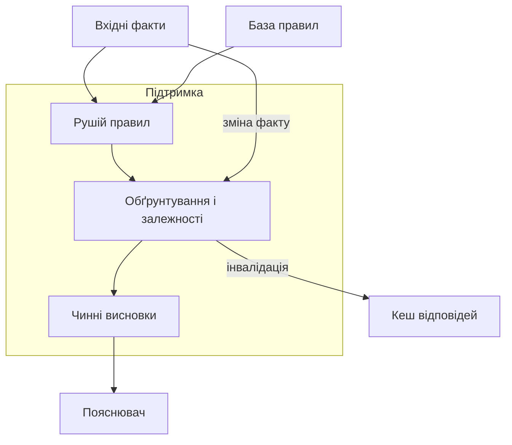
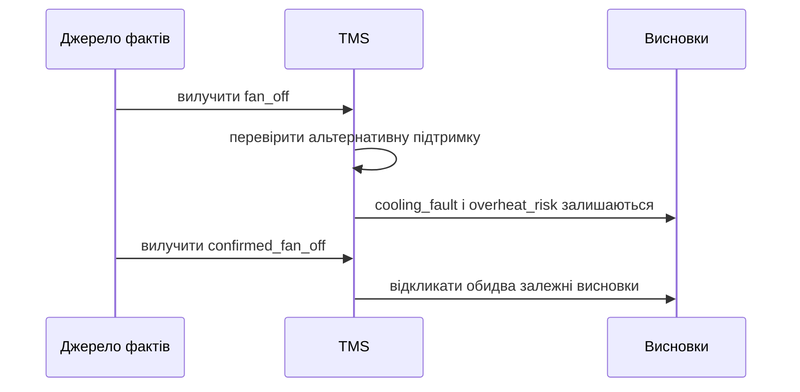
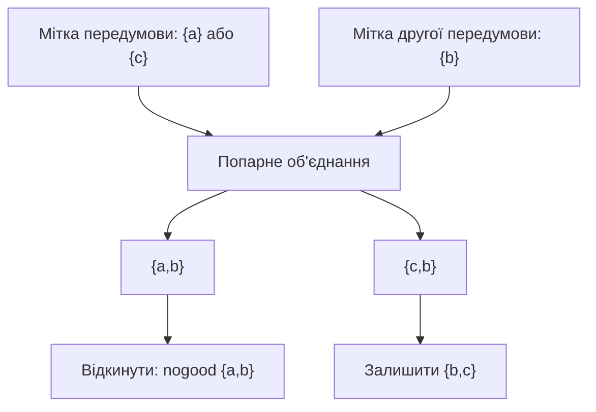
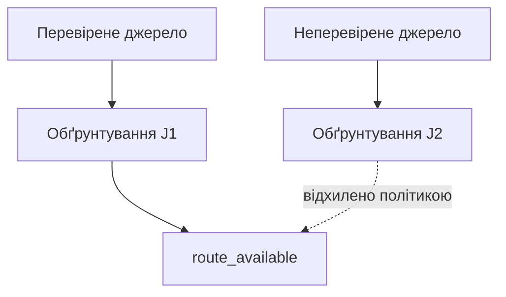
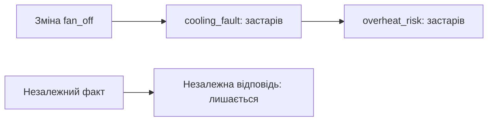

# Глава 8. Підтримка висновків і залежностей

<a id="глава-8-підтримка-істинності-обґрунтувань-jtms--atms-чисті-доведення-cleanproof-та-інкрементальне-кешування"></a>

> **Підручник:** [Експертні Системи](../README.md) · [Том 1. Основи експертних систем: логіка, продукційні правила, схемотехніка міркувань та класичні машини виведення](README.md)  
> **Навчальний рівень:** Базовий курс (бакалаврат, 2 курс; базові пояснення — з рівня першого курсу)  
> **Обладнання:** звичайний ноутбук або ПК (x86-64 / ARM64) без прискорювачів  
> **Мови:** реалізація — будь-яка мова загального призначення (лістинги — Python); основні спеціалізовані мови курсу — Prolog (SWI-Prolog) і OMG DMN/FEEL  
> **Попередня глава:** [Глава 7. Зворотне виведення та консультаційний діалог](ch07-backward-inference-and-dialogue.md)\
> **Наступна глава:** [Глава 9. Обмеження, конфігурування та планування](ch09-constraints-and-planning.md)\
> **Автор:** Микола Мартинович Федчик

---

## Анотація

У попередніх главах розглянуто способи одержання висновків; тепер потрібно з'ясувати, як їх підтримувати, коли змінюються вихідні факти. Система підтримки істинності зберігає залежності між припущеннями, правилами й висновками, щоб відкликання однієї відповіді не залишило в робочій пам'яті застарілий результат. На прикладі JTMS Джона Дойла та ATMS Йохана де Клеєра розрізняються локальна підтримка поточного набору переконань і паралельне збереження альтернативних середовищ припущень. Далі визначаються дві навчальні авторські конструкції: вибір придатного дерева-свідка в графі доведень і точкова інвалідація залежних записів кешу. Ці конструкції не ототожнюються з усталеними алгоритмами TMS, а їхні оцінки складності наведено лише за явно заданих припущень. Приклади стосуються діагностики автомобільного ЕБУ, мікроелектроніки та навігації; вони пояснюють обробку знань, а не замінюють інженерні рішення, медичну оцінку чи сертифікацію.

---

<!-- chapter-toc:start -->
## Зміст глави

- [1. Підтримка поточного набору переконань](#1-підтримка-поточного-набору-переконань)
  - [1.1. Позитивні передумови та відсутні винятки](#11-позитивні-передумови-та-відсутні-винятки)
  - [1.2. Поширення змін після відкликання факту](#12-поширення-змін-після-відкликання-факту)
  - [1.3. Немонотонний відкат інтерактивної діалогової сесії при зміні попередньої відповіді користувача](#13-немонотонний-відкат-інтерактивної-діалогової-сесії-при-зміні-попередньої-відповіді-користувача)
- [2. Підтримка альтернативних наборів припущень](#2-підтримка-альтернативних-наборів-припущень)
  - [2.1. Мінімальні несуперечливі середовища](#21-мінімальні-несуперечливі-середовища)
  - [2.2. Несумісні припущення та порівняння гіпотез](#22-несумісні-припущення-та-порівняння-гіпотез)
  - [2.3. Ресурсні витрати різних моделей підтримки істинності](#23-ресурсні-витрати-різних-моделей-підтримки-істинності)
- [3. Вибір придатного доведення серед альтернатив](#3-вибір-придатного-доведення-серед-альтернатив)
  - [3.1. Проблема забруднення істинної гілки доведення конфліктом із паралельної дублювальної гілки](#31-проблема-забруднення-істинної-гілки-доведення-конфліктом-із-паралельної-дублювальної-гілки)
  - [3.2. Рекурентний критерій придатності вузлів і вибір обґрунтування](#32-рекурентний-критерій-придатності-вузлів-і-вибір-обґрунтування)
  - [3.3. Лінійне відновлення одного дерева-свідка без перебору всіх дерев доведення](#33-лінійне-відновлення-одного-дерева-свідка-без-перебору-всіх-дерев-доведення)
- [4. Інкрементальне кешування з урахуванням заперечень](#4-інкрементальне-кешування-з-урахуванням-заперечень)
  - [4.1. Побудова зворотного конуса залежностей від вузлів заперечення та винятків](#41-побудова-зворотного-конуса-залежностей-від-вузлів-заперечення-та-винятків)
  - [4.2. Локальна інвалідація та повний перерахунок](#42-локальна-інвалідація-та-повний-перерахунок)
- [5. Практичні завдання та лабораторний практикум](#5-практичні-завдання-та-лабораторний-практикум)
  - [5.1. Контрольні запитання для самоперевірки](#51-контрольні-запитання-для-самоперевірки)
  - [5.2. Розрахункові задачі (трасування вручну)](#52-розрахункові-задачі-трасування-вручну)
  - [5.3. Завдання з програмної реалізації](#53-завдання-з-програмної-реалізації)
  - [5.4. Зв'язок із лабораторною та курсовою роботою курсу](#54-звязок-із-лабораторною-та-курсовою-роботою-курсу)
- [Висновки](#висновки)
- [Глосарій](#глосарій)
- [Скорочення та терміни](#скорочення-та-терміни)
- [Джерела](#джерела)
<!-- chapter-toc:end -->

---

<a id="1-системи-підтримки-істинності-на-основі-обґрунтувань-jtms-джона-дойла"></a>

## 1. Підтримка поточного набору переконань

Система підтримки істинності (TMS) доповнює робочу пам'ять рушія виведення записами про те, чому саме прийнято кожне переконання. Без цього зв'язку зміна відповіді оператора або вилучення телеметричного факту може залишити хибно чинний похідний висновок; просте очищення всієї пам'яті, навпаки, змушує повторно обчислювати незалежні гілки. JTMS (Justification-based Truth Maintenance System), запропонована Джоном Дойлом, відстежує підтримки вузлів у поточному наборі переконань і поширює зміни залежностями [[1]](#src-1). Це облік обґрунтувань, а не доказ того, що датчик чи правило предметно правильні.

**Схема 8.1. Підтримка залежностей між фактами та висновками.**



TMS пов'язує висновок із його підтримками; окреме питання — чи є джерела та правила достовірними для предметної задачі.

<a id="11-структура-вузла-обґрунтування-списки-позитивних-передумов-in-list-та-відсутніх-винятків-out-list"></a>

### 1.1. Позитивні передумови та відсутні винятки

У JTMS вузол представляє твердження, а обґрунтування (justification) фіксує залежність твердження від інших вузлів. Класична модель Дойла розрізняє вузли, прийняті до поточного набору переконань (IN), і вузли, що не прийняті (OUT). Для наочного навчального подання обґрунтування можна записати як трійку:

**Тематичний обсяг:** Структура вузла обґрунтування: списки позитивних передумов (IN-List) та відсутніх винятків (OUT-List)

`j = (c, IN(j), OUT(j))`

де `c` — висновок; `IN(j)` — множина необхідних позитивних передумов; `OUT(j)` — множина передумов, які мають бути OUT, тобто відсутні в поточному наборі. Обґрунтування активне тоді й лише тоді, коли всі вузли з `IN(j)` є IN, а всі вузли з `OUT(j)` є OUT. У реалізаціях і літературі назви та представлення списків можуть відрізнятися, тому їхню семантику треба зафіксувати в контракті рушія.

Розгляньмо автономний навчальний приклад діагностики ЕБУ. Твердження `supply_ok` означає, що живлення в нормі, `fan_off` — що вентилятор не обертається, а `cooling_fault` — що є підстава перевірити тракт охолодження. Для правила `cooling_fault ← fan_off AND supply_ok` маємо `IN(j) = {fan_off, supply_ok}`, а `OUT(j) = {}`. Коли обидві передумови IN, `cooling_fault` підтримується цим правилом; якщо оператор виправить відповідь і `fan_off` стане OUT, обґрунтування перестане бути активним. Сам висновок означає лише спрацювання навчального правила: він не встановлює причину фізичної несправності й не є командою на ремонт.

<a id="12-алгоритм-інкрементального-поширення-інвалідації-retraction-propagation-при-скасуванні-факту"></a>

### 1.2. Поширення змін після відкликання факту

Інвалідація починається зі зміни вузла-джерела та проходить за зворотними залежностями до висновків, що спиралися на нього. Якщо висновок має кілька незалежних обґрунтувань, вилучення одного з них не повинно скасувати висновок, поки інше активне. Тому коректний механізм перевіряє всі обґрунтування вузла, а не лише перше, що було знайдене.

**Тематичний обсяг:** Алгоритм інкрементального поширення інвалідації (Retraction Propagation) при скасуванні факту

Мовно-незалежна схема для скінченного графа залежностей:

**Лістинг 8.2. Черга поширення змін підтримок (псевдокод).**

<details><summary>Показати лістинг 8.2 (14 рядків, псевдокод)</summary>

```text
retract(source):
    позначити source як OUT
    додати source до черги змін
    поки черга не порожня:
        x := вилучити вузол з черги
        для кожного вузла c, що має обґрунтування від x:
            previous := стан(c)
            перерахувати активність усіх обґрунтувань c
            якщо хоча б одне обґрунтування c активне:
                позначити c як IN
            інакше:
                позначити c як OUT
            якщо стан(c) відрізняється від previous:
                додати c до черги змін
```

</details>

Черга має запобігати повторному додаванню вузла до завершення його обробки. Повторний перерахунок має обробити не лише перехід IN → OUT: вилучення факту може зробити істинним обґрунтування, яке очікує відсутності цього факту, і спричинити перехід OUT → IN. Для циклічних залежностей одного обходу недостатньо: необхідно визначити семантику циклічних підтримок і умову стабілізації, інакше група висновків може підтримувати сама себе після вилучення єдиного вихідного факту.

У прикладі з ЕБУ нехай `temp_high` — окреме спостереження високої температури, а правило `overheat_risk <- cooling_fault AND temp_high` утворює другий висновок. Початковий ланцюг такий: `fan_off`, `supply_ok` → `cooling_fault`; `cooling_fault`, `temp_high` → `overheat_risk`. Після виправлення `fan_off` перераховуються два залежні висновки; `supply_ok` і `temp_high` залишаються чинними. Отже, з п'яти вихідних і похідних тверджень цього ланцюга повторно оцінюються два похідні, а не вся база знань. Це точний підрахунок для прикладу, не вимірювання швидкодії.

**Діаграма 8.3. Зміна підтримок і двох похідних висновків.**



Щоб перевірити результат інкрементального механізму, потрібен незалежний еталон. Нижче повний перерахунок позитивних правил будує найменшу множину досяжних фактів. Це не реалізація JTMS із `OUT`-списками: приклад задає лише скінченні позитивні правила, де множина фактів монотонно зростає під час одного перерахунку.

**Лістинг 8.4. Повний перерахунок позитивних підтримок (Python 3.14.4).**

<details><summary>Показати лістинг 8.4 (14 рядків, Python 3.14.4)</summary>

```python
def closure(facts, rules):
    known = set(facts)
    while True:
        derived = {result for premises, result in rules if premises <= known}
        if derived <= known:
            return known
        known.update(derived)


rules = [
    ({"fan_off", "supply_ok"}, "cooling_fault"),
    ({"confirmed_fan_off", "supply_ok"}, "cooling_fault"),
    ({"cooling_fault", "temp_high"}, "overheat_risk"),
]
```

</details>

Лістинг продовжується тестом. Вхідні факти містять дві альтернативні підтримки спостереження; результат після кожного вилучення показує, чи залишився хоча б один повний шлях до висновку.

**Лістинг 8.5. Перевірка альтернативних підтримок (Python 3.14.4).**

<details><summary>Показати лістинг 8.5 (10 рядків, Python 3.14.4)</summary>

```python
facts = {"fan_off", "confirmed_fan_off", "supply_ok", "temp_high"}
assert {"cooling_fault", "overheat_risk"} <= closure(facts, rules)
facts.remove("fan_off")
assert {"cooling_fault", "overheat_risk"} <= closure(facts, rules)
facts.remove("confirmed_fan_off")
remaining = closure(facts, rules)
assert "cooling_fault" not in remaining
assert "overheat_risk" not in remaining
assert remaining == {"supply_ok", "temp_high"}
print("дві підтримки -> одна підтримка -> немає підтримок")
```

</details>

Перевірка показує і збереження альтернативи, і відсутність самопідтримуваного висновку після вилучення обох підстав. Для негативних умов та циклів із запереченням потрібні інші семантика й тести.

**Що означає результат і як його використати.** Інженер перевіряє, що після `retract` не залишився висновок із нечинною підтримкою та що незалежні факти не були втрачені. Для цього результат інкрементального оновлення порівнюють із результатом повного перерахунку на тих самих тестових даних.

### 1.3. Немонотонний відкат інтерактивної діалогової сесії при зміні попередньої відповіді користувача

Під час діалогу відповідь на раннє запитання часто визначає, які наступні запитання ставити. Якщо користувач змінює цю відповідь, система мусить відкликати залежні відповіді та висновки, але може зберегти факти, зібрані незалежно від цієї гілки. Явний облік контексту й залежностей дає змогу відрізнити ці випадки [[5]](#src-5).

Наприклад, відповідь `fan_off = yes` зумовлює запит про напругу живлення; окреме запитання про код помилки датчика не залежить від стану вентилятора. Після зміни `fan_off = no` відповідь про напругу треба повторно підтвердити, якщо вона була отримана лише в контексті старої гілки, але незалежний код помилки можна зберегти. Не слід автоматично вважати будь-яку попередню відповідь нечинною: правила повторного підтвердження залежать від джерела даних, часу спостереження та предметної моделі.

Для перевірки реалізації побудуйте орієнтований граф «відповідь → запитання/висновок, що від неї залежить», змініть одну відповідь і порівняйте інвалідаційний набір із множиною її досяжних нащадків. Зайві скасування показують надмірно грубі залежності; пропущений нащадок означає ризик використання застарілого стану.

<a id="2-системи-підтримки-істинності-на-основі-припущень-atms-йохана-де-клеєра"></a>

## 2. Підтримка альтернативних наборів припущень

JTMS зручно відстежує один поточний набір переконань, але пошук діагнозу або плану часто потребує зберігати кілька альтернативних припущень одночасно. ATMS (Assumption-based Truth Maintenance System) де Клеєра представляє підтримки висновків множинами початкових припущень та позначає несумісні комбінації [[2]](#src-2) [[3]](#src-3). Це дає змогу порівнювати гіпотези без повторного запуску всього виведення для кожної комбінації; ціна — потенційно велика кількість різних середовищ, які не зникають від самого факту використання компактного подання.

**Схема 8.6. Відбір сумісних середовищ для кон'юнктивного правила.**



Вилучення `{a,b}` не відкидає альтернативне середовище `{b,c}`; після фільтрації також прибираються надмножини вже знайдених підтримок.

<a id="21-мінімальні-несуперечливі-середовища-припущень-environments-та-решітка-контекстів"></a>

### 2.1. Мінімальні несуперечливі середовища

Припущення — це початкове твердження, яке система тимчасово приймає для аналізу гіпотези. Середовище (environment) — множина таких припущень. Мітка вузла в ATMS містить мінімальні середовища, достатні для одержання цього вузла; середовище є мінімальним, якщо жодна його власна підмножина вже не підтримує той самий висновок.

**Тематичний обсяг:** Мінімальні несуперечливі середовища припущень (Environments) та решітка контекстів

Комбінування підтримок кон'юнктивного правила утворює об'єднання їхніх середовищ, після чого вилучаються супернабори вже наявних мінімальних середовищ:

$$
L(c) = \mathrm{Min}\{E_1 \cup E_2 \mid E_1 \in L(a),\ E_2 \in L(b),\ a \land b \to c,\ \nexists N \in \mathcal{N}: N \subseteq E_1 \cup E_2\}
$$

Тут `L(x)` — множина мінімальних середовищ, що підтримують твердження `x`; `E₁` та `E₂` — середовища для передумов `a` і `b`; `\mathcal{N}` — реєстр nogood; `Min` залишає лише включення-мінімальні множини. Умова з `N` відкидає будь-яку комбінацію, що містить відому несумісну множину. Вхідні мітки можуть бути порожніми лише за окремого узгодженого подання аксіом і припущень. Обчислення обмежено скінченними множинами припущень; розмір мітки все одно може зростати експоненційно.

**Формула 8.7. Обчислення мінімальної мітки кон'юнктивного висновку в ATMS.**

Навчальний приклад: для твердження `road_wet` маємо дві альтернативні підтримки `{{a}, {c}}`, а для `road_dry` — `{{b}}`. Якщо середовище `{a,b}` оголошено несумісним, то гіпотеза `a` разом із `b` не може бути чинною, але підтримка `{c}` для `road_wet` залишається доступною. Порівнюючи кандидати `{a}`, `{b}` і `{c}`, система може виключити несумісну комбінацію `{a,b}`, не втрачаючи незалежного сценарію `c`. Позначення `a`, `b`, `c` є навчальними припущеннями, а не оцінками достовірності датчиків.

Наведена формула обчислює мітку висновку з двох міток передумов. Для міток `{{a},{c}}` і `{{b}}` та заданої несумісності `{a,b}` кандидатами є `{a,b}` і `{b,c}`; після фільтрації лишається `{{b,c}}`. Самі назви передумов не задають додаткової несумісності: усі такі умови мають бути явно внесені до реєстру.

**Лістинг 8.8. Об'єднання та мінімізація міток ATMS (Python 3.14.4).**

<details><summary>Показати лістинг 8.8 (13 рядків, Python 3.14.4)</summary>

```python
def combine_labels(left, right, nogoods):
    candidates = {a | b for a in left for b in right
                  if not any(n <= (a | b) for n in nogoods)}
    return {env for env in candidates
            if not any(other < env for other in candidates)}


left = {frozenset({"a"}), frozenset({"c"})}
right = {frozenset({"b"})}
nogoods = {frozenset({"a", "b"})}
assert combine_labels(left, right, nogoods) == {frozenset({"b", "c"})}
assert combine_labels(left, right, {frozenset()}) == set()
print("сумісна мінімальна підтримка: {b,c}")
```

</details>

Порожня `nogood` у другій перевірці несумісна з будь-яким середовищем і тому дає порожню мітку; це граничний тест, а не звичайний спосіб подання предметних знань.

<a id="22-реєстр-несумісних-комбінацій-припущень-nogood-database-і-одночасне-порівняння-альтернативних-гіпотез"></a>

### 2.2. Несумісні припущення та порівняння гіпотез

Несумісна множина (nogood) — множина припущень, які не можуть одночасно бути істинними в межах заданої моделі. Коли система знаходить nogood, вона може відсіяти будь-яке середовище, що містить її як підмножину. Реєстр nogood — не універсальна база фізичних суперечностей: кожна така множина має походити з явного обмеження, перевіреного правила або заданої предметної умови.

**Тематичний обсяг:** Реєстр несумісних комбінацій припущень (Nogood Database) і одночасне порівняння альтернативних гіпотез

Повернімося до `road_wet` і `road_dry`. Якщо правило діагностики виявило, що джерела `a` та `b` описують взаємовиключні режими для одного й того самого часу та ділянки, реєструється `{a,b}`. Тоді середовище `{a,b,c}` також відкидається, бо містить nogood, але `{c}` не відкидається. Якщо відомо лише, що дані суперечать одне одному, але немає обґрунтованого правила несумісності, оголошувати nogood передчасно: потрібно зберегти конфлікт і передати його на розгляд.

У навчальній реалізації після кожного кроку перевіряються два інваріанти: мітка містить лише мінімальні середовища, а жодна мітка не містить середовища, що включає відому nogood. Тестуйте також випадок, коли нова nogood змушує вилучити раніше збережені мітки та повторно обчислити похідні висновки.

<a id="23-порівняння-витрат-памяті-та-швидкодії-jtms-і-atms-на-багатоядерному-cpu"></a>

### 2.3. Ресурсні витрати різних моделей підтримки істинності

JTMS зосереджується на підтримці поточного стану; ATMS зберігає підтримки для різних допустимих наборів припущень. Тому вибір визначається не кількістю ядер, а тим, чи потрібні альтернативні гіпотези, як часто змінюються факти та скільки середовищ породжують правила. Для однієї послідовності змін JTMS може бути простішою моделлю; для порівняння багатьох сценаріїв ATMS уникає частини повторних обчислень, але розмір міток може домінувати за пам'яттю й часом. Огляд методів побудови систем розв'язання задач наведено у праці Форбуса й де Клеєра [[4]](#src-4).

Не слід приписувати JTMS або ATMS гарантоване прискорення на багатоядерному CPU. Паралельне обчислення міток потребує узгодження спільних структур, а порядок оновлень може впливати на витрати синхронізації. Для коректного порівняння зафіксуйте однакові правила, початкові дані та семантику; виміряйте максимальну кількість середовищ у мітках, пам'ять, час повного запуску й час після локальної зміни. Повідомляйте результати як вимірювання конкретного експерименту, а не властивість класу алгоритмів.

**Що означає результат і як його використати.** Якщо завдання вимагає лише актуального набору висновків, починайте з JTMS. Якщо треба одночасно пояснювати й порівнювати альтернативні набори припущень, обґрунтуйте ATMS і закладіть ліміт ресурсів; досягнення ліміту має повертати явний статус «обчислення неповне», а не непомітно відкидати сценарії.

<a id="3-двопрохідне-виділення-чистих-доведень-cleanproof-у-графах-зі-суперечностями"></a>

## 3. Вибір придатного доведення серед альтернатив

JTMS та ATMS обліковують підтримки, однак інтерфейсу пояснення часто потрібен конкретний ланцюг походження висновку. Якщо один шлях містить позначене як недовірене джерело, а інший — ні, повний перебір усіх дерев доведення може бути дорогим. У цьому розділі назвою `CleanProof` позначено навчальну авторську конструкцію для вибору одного придатного дерева-свідка. Вона не є стандартним алгоритмом, а «чисте» означає лише відповідність оголошеним нижче обмеженням походження; це не синонім істинного, повного чи сертифікованого доведення.

**Схема 8.9. Вибір одного свідка серед двох підтримок.**



Вибір `J1` залишає інформацію про відхилену `J2`; він не доводить саму фізичну доступність маршруту.

### 3.1. Проблема забруднення істинної гілки доведення конфліктом із паралельної дублювальної гілки

Розгляньмо граф, де один висновок `route_available` виведено з перевіреного стану каналу, а також окремо отримано зі звіту, позначеного як недовірений. Наявність другого шляху не робить перший шлях недійсним автоматично; водночас відображати обидва як рівноцінні підстави було б оманливо. Отже, потрібен не пошук «найправдивішої» гілки, а прозоре правило відбору свідка та збереження відомостей про відхилені альтернативи.

Для навчальної моделі вузол може мати кілька обґрунтувань; кожне обґрунтування є AND-з'єднанням передумов, а набір обґрунтувань вузла — OR-вибором. Вхідні факти та ребра мають статус походження, наприклад `accepted`, `unverified` або `invalid`. Статус походження задається політикою системи, а не виводиться з назви вузла. Якщо всі альтернативні підтримки відхилені або обчислення обмежено ресурсом, рушій повинен повернути «свідка не знайдено» чи «результат неповний», а не вигадувати гілку.

### 3.2. Рекурентний критерій придатності вузлів і вибір обґрунтування

Нехай граф є скінченним і ациклічним; `Base(v)` означає прийнятне листкове свідчення, `Valid(v)` — що вузол не заборонений політикою походження, `Prem(j)` — множина передумов обґрунтування `j`. Придатність вузла обчислюється в топологічному порядку:

$$
Clean(v) = Valid(v) \land \left(Base(v) \lor \exists j \in Just(v): \forall u \in Prem(j),\ Clean(u)\right)
$$

`Just(v)` — обґрунтування вузла `v`; `Clean(u)` означає, що передумова має придатну підтримку; `Base(v)` є істинним для дозволеного початкового свідчення; `Valid(v)` є істинним, якщо локальна політика не забороняє вузол. Кон'юнкція передумов у межах одного `j` відповідає AND, а існування хоча б одного придатного `j` — OR. Рівняння задає критерій на скінченному DAG, а не універсальну семантику будь-якого графа доведень.

**Формула 8.10. Критерій придатності вузла для дерева-свідка у скінченному ациклічному графі.**

Для кожного придатного вузла зберігається посилання на одне обране обґрунтування; для відхилених обґрунтувань можна зберегти коротку причину відмови. Обчислення починається з листків, потім проходить до цільового вузла. У графі з циклічними правилами треба окремо визначити найменшу нерухому точку й захист від самопідтримуваних циклів; топологічний алгоритм до такого графа непридатний.

**Що означає результат і як його використати.** Якщо ціль `route_available` має принаймні одне придатне обґрунтування, система може показати його як один свідок і окремо зазначити конфліктні або невикористані альтернативи. Це не доводить, що маршрут справді безпечний: для такого рішення потрібні повнота моделі, валідовані дані, визначені вимоги та окремі процедури перевірки.

### 3.3. Лінійне відновлення одного дерева-свідка без перебору всіх дерев доведення

У скінченному DAG придатність кожного вузла й кожного ребра можна перевірити один раз у топологічному порядку. Якщо `V` — кількість вузлів, `E` — кількість ребер, а `J` — кількість обґрунтувань, вартість такого проходу становить `O(V + E + J)` за умови, що перевірка локальної політики має сталу вартість. Після цього вибрані посилання на обґрунтування дають змогу відновити один шлях до цілі за час, пропорційний розміру цього шляху.

Ця оцінка не означає гарантованої затримки в мікросекундах і не порівнює алгоритм із реалізованим експоненційним перебором на конкретному обладнанні. Експоненційною може бути кількість різних дерев або наборів підтримок; побудова одного свідка не вимагає їх усіх перелічувати, якщо критерій вибору локальний і зафіксовано порядок обробки. Якщо критерій залежить від глобального ранжування всіх доказів або кількість середовищ ATMS необмежено зростає, зазначена межа не охоплює ці витрати.

Мінімальний тест має містити дві альтернативні гілки до цілі, одну позначену недійсною. Алгоритм мусить відновити дозволену гілку, а якщо обидві недійсні — повернути явну відмову. Додайте цикл як негативний тест: реалізація повинна його відхилити або обробити лише за окремо задокументованою семантикою.

<a id="4-інкрементальне-кешування-висновків-із-конусом-заперечень-opposition_cone"></a>

## 4. Інкрементальне кешування з урахуванням заперечень

Кеш може зменшити повторне обчислення незмінених запитів до рушія виведення, але після оновлення факту він стає джерелом помилок, якщо запис не пов'язаний із залежностями. Нижче `OPPOSITION_CONE` — навчальна назва множини всіх кешованих записів, які залежать від зміненого факту або від його заперечення чи винятків. Це авторська модель інвалідації; сама назва не означає усталеного загальноприйнятого алгоритму.

**Тематичний обсяг:** Інкрементальне кешування висновків із конусом заперечень (OPPOSITION_CONE)

### 4.1. Побудова зворотного конуса залежностей від вузлів заперечення та винятків

Кожен кешований висновок має перелік фактів, правил, заперечень і предметних версій, від яких він залежить. Для зміни `x` зворотний обхід починається з усіх записів, що безпосередньо залежать від `x`, і додає записи, які залежать від уже знайдених. Якщо висновок залежить від перевірки «виняток відсутній», залежність від цього негативного тесту також реєструється: поява винятку має інвалідувати той самий запис.

**Схема 8.11. Поширення інвалідації від зміненого факту.**



Незалежна відповідь зберігається лише за умови повного й актуального реєстру залежностей.

Псевдокод пошуку множини інвалідації:

**Лістинг 8.12. Пошук залежних кешованих записів (псевдокод).**

<details><summary>Показати лістинг 8.12 (10 рядків, псевдокод)</summary>

```text
invalidate_cone(changed):
    affected := {changed}
    queue := [changed]
    while queue is not empty:
        x := pop(queue)
        for each cached_result depending on x:
            if cached_result not in affected:
                add cached_result to affected
                push cached_result to queue
    remove or mark stale every cached result in affected
```

</details>

Якщо зв'язок залежності відсутній, пошкоджений або побудований на застарілій версії правил, локальний обхід не є безпечним. У такому випадку система має очистити ширший набір або відхилити кеш і перерахувати запит. Для асинхронних оновлень корисно прив'язувати запис до версій робочої пам'яті й правил та перевіряти їх перед видачею кешованої відповіді.

<a id="42-точкова-інвалідація-кешу-при-локальних-змінах-проти-повного-перерахунку-global_revision-на-широких-конусах"></a>

### 4.2. Локальна інвалідація та повний перерахунок

Точкова інвалідація вигідна лише тоді, коли вартість обходу конуса менша за очищення та відновлення більшої частини кешу. Для прикладу, у графі з 40 кешованими результатами зміна локального факту може торкнутися 3 залежних записів; якщо ж глобальне правило бере участь у 31 результаті, точковий обхід охопить майже весь кеш і може коштувати дорожче за повне скидання. Це підрахунок досяжності у навчальному графі, а не вимір часу.

**Тематичний обсяг:** Точкова інвалідація кешу при локальних змінах проти повного перерахунку (GLOBAL_REVISION) на широких конусах

Поріг переходу до повного очищення має визначатися вимірюванням вартості операцій та вимогами до актуальності, а не довільною універсальною константою. Практична реалізація може обчислити частку `affected / cached` і застосувати обраний поріг, але за будь-якого порога повинна зберігатися семантична гарантія: жоден запис, залежний від зміненого стану, не видається як актуальний. За невідомого масштабу конуса безпечнішим є ширше очищення.

**Що означає результат і як його використати.** Порівняйте точкову інвалідацію з повним перерахунком для випадків локальної зміни, широкої зміни, вилучення факту та появи раніше відсутнього винятку. У кожному випадку порівняйте не лише час, а й точні множини висновків та їхні версії; будь-яка розбіжність означає помилку інвалідації, навіть якщо кеш швидший.

## 5. Практичні завдання та лабораторний практикум

Цей розділ закріплює матеріал Глави 8 через теоретичний самоконтроль, ручне трасування алгоритмів та програмну реалізацію на звичайному ноутбуці або ПК без прискорювачів. Усі приклади є навчальними моделями: їх не можна використовувати як готовий медичний, навігаційний чи автомобільний засіб ухвалення рішень.

### 5.1. Контрольні запитання для самоперевірки

1. Яку проблему вирішує TMS, якщо рушій уже може повторно запустити всі правила?
2. Чим JTMS з поточним набором переконань відрізняється від ATMS із множинами припущень?
3. Чому вилучення однієї підтримки не завжди має переводити похідний вузол у стан OUT?
4. Які умови дозволяють обчислити `Clean` у топологічному порядку, і чому циклічний граф потребує окремої семантики?
5. Що саме означає «чистий» у запропонованій навчальній конструкції `CleanProof`, і яких висновків це слово не дозволяє робити?
6. Чому негативна передумова «виняток відсутній» має бути записана як залежність кешу?
7. У яких випадках повна інвалідація кешу є кращою за точкову?
8. Які перевірки потрібні, щоб показати, що інкрементальний результат еквівалентний повному перерахунку?

### 5.2. Розрахункові задачі (трасування вручну)

1. Побудуйте JTMS-граф для трьох правил діагностики ЕБУ, де два незалежні правила підтримують один висновок. Вилучіть одну передумову й визначте, які вузли лишаються IN.
2. Для ATMS задайте три початкові припущення, дві альтернативні підтримки одного висновку та одну nogood. Запишіть мінімальні мітки до й після додавання nogood.
3. Намалюйте скінченний DAG з двома підтримками цільового вузла; позначте недійсною одну вхідну гілку й відновіть одне придатне дерево-свідок. Потім зробіть недійсними обидві гілки та визначте очікуваний статус.
4. У графі з 40 кешованими результатами позначте зворотні залежності для локального факту, а потім для глобального правила. Обчисліть кількість записів, що мають бути інвалідовані, та поясніть, чому сам підрахунок не дає висновку про час виконання.

<a id="53-інженерні-завдання-з-програмування-мовна-незалежність--спеціалізовані-dsl"></a>

### 5.3. Завдання з програмної реалізації

1. Реалізуйте малу JTMS із кількома незалежними обґрунтуваннями для вузла. Після кожного `assert` і `retract` порівнюйте стан із повним перерахунком та перевіряйте відсутність самопідтримуваних циклів.
2. Реалізуйте мінімальні мітки ATMS та реєстр nogood для скінченної множини припущень. Обмежте розмір мітки; при досягненні межі поверніть явний статус неповного обчислення.
3. Реалізуйте навчальний вибір одного дерева-свідка для скінченного DAG із позначеними джерелами. Додайте негативні тести для циклу, відсутнього свідка та невідомого статусу походження.
4. Реалізуйте кеш із явними прямими й зворотними залежностями. Для локальних і глобальних оновлень порівняйте точкову інвалідацію з повним очищенням за еквівалентністю результатів, пам'яттю та виміряним часом.

### 5.4. Зв'язок із лабораторною та курсовою роботою курсу

* **Базова лабораторна робота:** Лабораторна робота №1.4 — *Інтерактивний діалоговий експерт-консультант зі зворотним виведенням та JTMS-відкатом* (модуль М1.4 «Зворотне виведення і підтримка істинності»). У звіті слід відокремити вимірювання навчального прототипу від вимог до реальної системи. Можливі офлайнові демонстраційні набори: коди несправностей автомобільного ЕБУ, таблиця енергетичних показників або симульовані покази навігаційних датчиків.
* **Інтеграція у курсовий проєкт Тома 1:** модуль підтримки висновків повинен мати контракт `assert`/`retract`, журнал походження, тести на кілька підтримок і незалежний еталонний повний перерахунок (див. [перелік тем Тома 1](README.md)).

---

## Висновки

TMS потрібна тоді, коли зміна факту має коректно змінити вже побудовані висновки. JTMS відстежує підтримки в поточному наборі переконань; ATMS зберігає альтернативні середовища припущень і може відсікати множини, що містять зареєстровану nogood. В обох підходах коректність залежить від повного й точного опису залежностей, а не лише від структури даних.

Запропоновані в цій главі `CleanProof` і `OPPOSITION_CONE` мають статус навчальних авторських моделей. Для `CleanProof` лінійний обхід обґрунтовано лише для скінченного DAG і локального критерію придатності; він не дає сам собою доказу істинності. Точкова інвалідація кешу правильна лише за повного обліку позитивних і негативних залежностей; за невідомої залежності потрібен ширший перерахунок. У практичній системі обидва алгоритми слід перевіряти диференційними тестами проти простішого еталонного обчислення.

Наступна глава розглядає задачі обмежень і планування: там механізми підтримки істинності доповнюються явним пошуком допустимих призначень і поясненням, чому конфігурація несумісна.

## Глосарій

- **Система підтримки істинності (TMS)** — компонент, що зберігає залежності обґрунтувань і оновлює прийняті висновки після зміни даних або припущень.
- **Обґрунтування (justification)** — запис про правило та передумови, за яких підтримується висновок.
- **JTMS** — TMS, яка стежить за станами IN/OUT у поточному наборі переконань.
- **ATMS** — TMS, яка позначає висновки мінімальними множинами початкових припущень.
- **Середовище (environment)** — множина припущень, за яких одержується певний висновок.
- **Несумісна множина (nogood)** — множина припущень, яка не може бути прийнята одночасно в межах заданої моделі.
- **Дерево-свідок** — один відновлений ланцюг підтримок до висновку; його наявність не підтверджує правильність вихідних даних.
- **Інвалідація кешу** — вилучення або позначення застарілими записів, залежних від змінених даних чи правил.

## Скорочення та терміни

- **AND / OR** — кон'юнктивне поєднання передумов одного обґрунтування / вибір між альтернативними обґрунтуваннями.
- **IN / OUT** — прийнятий до поточного набору переконань / не прийнятий у JTMS.
- **DAG** — орієнтований ациклічний граф.
- **ЕБУ (ECU)** — електронний блок керування автомобіля.
- **CDSS** — система підтримки клінічних рішень; приклади цієї глави не є медичними рекомендаціями.

## Джерела

1. <a id="src-1"></a>Doyle, J. [*A Truth Maintenance System*](https://doi.org/10.1016/0004-3702(79)90008-0). *Artificial Intelligence*. 1979. Vol. 12, No. 3. P. 231–272.
2. <a id="src-2"></a>de Kleer, J. [*An assumption-based TMS*](https://doi.org/10.1016/0004-3702(86)90080-9). *Artificial Intelligence*. 1986. Vol. 28, No. 2. P. 127–162.
3. <a id="src-3"></a>de Kleer, J. [*Problem solving with the ATMS*](https://doi.org/10.1016/0004-3702(86)90081-0). *Artificial Intelligence*. 1986. Vol. 28, No. 2. P. 197–224.
4. <a id="src-4"></a>Forbus, K. D., de Kleer, J. [*Building Problem Solvers*](https://mitpress.mit.edu/9780262560759/building-problem-solvers/). MIT Press, 1993.
5. <a id="src-5"></a>McDermott, D. [*Contexts and Data Dependencies: A Synthesis*](https://doi.org/10.1109/TPAMI.1982.4767269). *IEEE Transactions on Pattern Analysis and Machine Intelligence*. 1982. Vol. PAMI-4, No. 3. P. 237–246.
