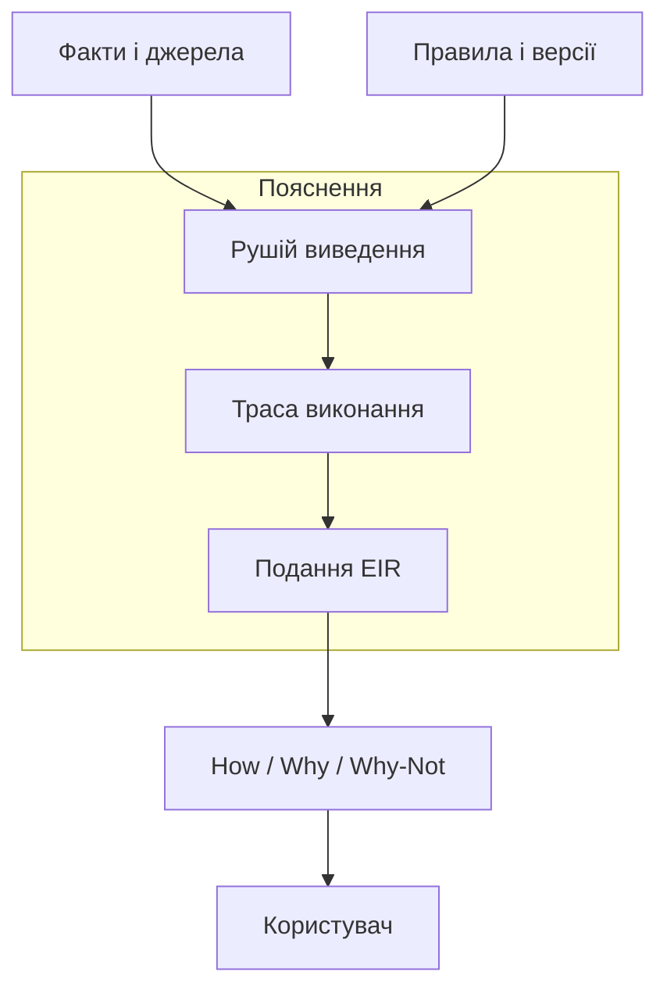
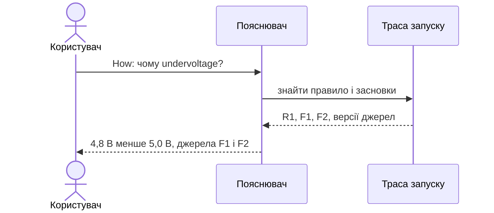
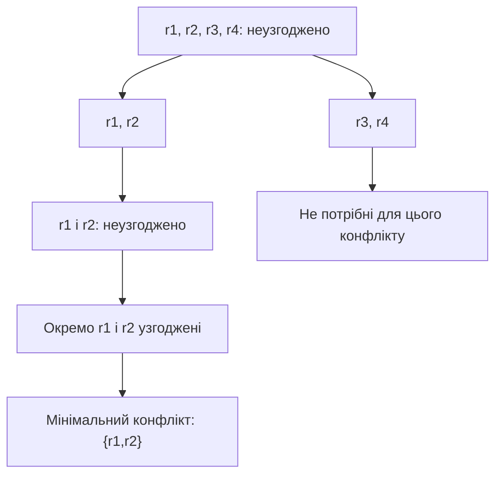
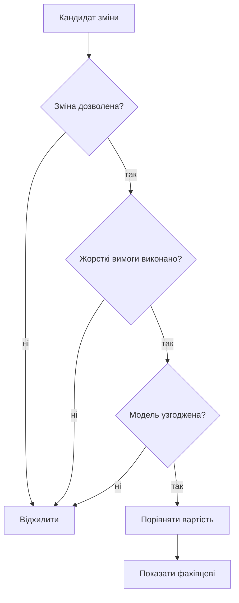

# Глава 10. Пояснення рішень і пошук допустимих змін

<a id="глава-10-підсистема-пояснень-how--why--why-not-ядра-конфліктів-quickxplain-та-зворотний-синтез-безпечних-ремонтів-findrepair"></a>

> **Підручник:** [Експертні Системи](../README.md) · [Том 1. Основи експертних систем: логіка, продукційні правила, схемотехніка міркувань та класичні машини виведення](README.md)  
> **Навчальний рівень:** Базовий курс (бакалаврат, 2 курс; базові пояснення — з рівня першого курсу)  
> **Обладнання:** звичайний ноутбук або ПК (x86-64 / ARM64) без прискорювачів  
> **Мови:** реалізація — будь-яка мова загального призначення (лістинги — Python); основні спеціалізовані мови курсу — Prolog (SWI-Prolog) і OMG DMN/FEEL  
> **Попередня глава:** [Глава 9. Обмеження, конфігурування та планування](ch09-constraints-and-planning.md)\
> **Наступна глава:** [Глава 11. Здобуття знань для експертної системи](../Volume-2/ch11-knowledge-acquisition.md)\
> **Автор:** Микола Мартинович Федчик

---

## Анотація

У главі розглянуто, як пояснювальний модуль пов'язує висновок експертної системи з використаними фактами й правилами, як знаходить суперечливі вимоги та як пропонує обмежені політикою зміни. Без збереження походження засновків відповідь може бути переконливою, але неперевірною; без алгоритмічного пошуку конфлікту користувачеві доводиться вручну переглядати всю специфікацію. QuickXPlain локалізує конфлікт за умови повного оракула узгодженості, а FindRepair ранжує лише дозволені зміни за заданою функцією вартості. Розглянуто окремо технічні засоби, правову застосовність і межі висновків: жоден журнал, пояснення чи обчислений ремонт сам по собі не встановлює відповідності вимогам або безпечності рішення.

---

<!-- chapter-toc:start -->
## Зміст глави

- [1. Архітектура пояснень і подання доведення](#1-архітектура-пояснень-і-подання-доведення)
  - [1.1. Відповідність пояснення фактичному виконанню](#11-відповідність-пояснення-фактичному-виконанню)
  - [1.2. Пояснення висновку, запитання та відхиленої альтернативи](#12-пояснення-висновку-запитання-та-відхиленої-альтернативи)
  - [1.3. Рольова фільтрація чутливих вузлів дерева доведення без порушення логічної зв'язності](#13-рольова-фільтрація-чутливих-вузлів-дерева-доведення-без-порушення-логічної-звязності)
  - [1.4. Регуляторна карта доменів курсу: прозорість, журналювання й людський нагляд](#14-регуляторна-карта-доменів-курсу-прозорість-журналювання-й-людський-нагляд)
  - [1.5. Повідомлення про відсутнє знання без вигаданого джерела](#15-повідомлення-про-відсутнє-знання-без-вигаданого-джерела)
- [2. Пошук мінімального за включенням конфлікту](#2-пошук-мінімального-за-включенням-конфлікту)
  - [2.1. Означення мінімального за включенням конфлікту в монотонній системі обмежень](#21-означення-мінімального-за-включенням-конфлікту-в-монотонній-системі-обмежень)
  - [2.2. Рекурсивний поділ і кількість перевірок узгодженості](#22-рекурсивний-поділ-і-кількість-перевірок-узгодженості)
  - [2.3. Покрокове трасування локалізації конфлікту в несумісній специфікації вимог](#23-покрокове-трасування-локалізації-конфлікту-в-несумісній-специфікації-вимог)
- [3. Контрфактичні пояснення та дозволені зміни](#3-контрфактичні-пояснення-та-дозволені-зміни)
  - [3.1. Задача пошуку мінімальної зміни вхідних параметрів для досягнення дозволеного стану](#31-задача-пошуку-мінімальної-зміни-вхідних-параметрів-для-досягнення-дозволеного-стану)
  - [3.2. Зворотний синтез мінімального покриття перерізів відмов у нормативних схемах із винятками](#32-зворотний-синтез-мінімального-покриття-перерізів-відмов-у-нормативних-схемах-із-винятками)
  - [3.3. Захист незмінних вимог від небезпечного послаблення](#33-захист-незмінних-вимог-від-небезпечного-послаблення)
- [4. Практичні завдання з трасування пояснень і конфліктів](#4-практичні-завдання-з-трасування-пояснень-і-конфліктів)
  - [4.1. Перевірка розуміння трас і правового контексту](#41-перевірка-розуміння-трас-і-правового-контексту)
  - [4.2. Ручне трасування конфлікту та вибір зміни](#42-ручне-трасування-конфлікту-та-вибір-зміни)
  - [4.3. Реалізація перевірюваного прототипу](#43-реалізація-перевірюваного-прототипу)
  - [4.4. Зв'язок із лабораторною та курсовою роботою курсу](#44-звязок-із-лабораторною-та-курсовою-роботою-курсу)
- [Висновки](#висновки)
- [Підсумки Тому 1](#підсумки-тому-1)
- [Глосарій](#глосарій)
- [Скорочення та терміни](#скорочення-та-терміни)
- [Джерела](#джерела)
<!-- chapter-toc:end -->

---

<a id="1-архітектура-пояснювального-модуля-та-внутрішнє-проміжне-подання-доведення-eir"></a>

## 1. Архітектура пояснень і подання доведення

Пояснювальний модуль розташовується між рушієм виведення та користувачем і перетворює внутрішні залежності висновку на перевірювану відповідь. Якщо рушій зберігає лише кінцеве значення, то після оновлення бази знань неможливо встановити, які саме факти й версії правил спричинили попередній вердикт; якщо натомість показувати сирий журнал, користувачеві доводиться самостійно відновлювати логіку. Тому тут розглянуто компактне проміжне подання, що зберігає засновки, висновки та джерела, але не підміняє формальну верифікацію рушія.

**Схема 10.1. Від виконання правила до перевірюваного пояснення.**



Для перевірки пояснення потрібні не лише результат правила, а й ідентифікатори його засновків та версії джерел.

<a id="11-чому-текстова-правдоподібність-не-є-поясненням-інваріант-точної-відповідності-дереву-виконання"></a>

### 1.1. Відповідність пояснення фактичному виконанню

Пояснення має відповідати фактичному виконанню правил, інакше воно перетворюється на правдоподібний переказ, який неможливо перевірити. Тому підсистема пояснень повинна отримувати трасу від механізму виведення: ідентифікатори вхідних фактів, версію застосованого правила, засновки та отриманий висновок. Налагоджувач логічного виконання може показувати цю послідовність крок за кроком, але саме відображення траси не доводить ані її повноти, ані безпомилковості рушія.

**Таблиця 10.2. Навчальна траса одного правила з посиланнями на засновки.**

| Крок | Засновки або правило | Отриманий стан |
|---:|---|---|
| 1 | Факт `F1`: виміряна напруга 4,8 В; джерело `S1`, запис вимірювання 17 | `voltage=4.8 V` |
| 2 | Факт `F2`: нижня межа 5,0 В; джерело `S2`, версія конфігурації 3 | `minimum_voltage=5.0 V` |
| 3 | Правило `R1`: якщо `voltage < minimum_voltage` | `undervoltage=true`, засновки `F1`, `F2` |

Інженер може переглянути трасу вперед і назад, якщо інструмент зберігає попередній стан або точні зміни стану; відтворення вимагає також тієї самої версії правил і вхідних фактів. Без цих умов «крок назад» не гарантує відновлення попереднього обчислення. У прикладі система пояснює висновок назвами фактів і правил, а не довільно згенерованим текстом; у робочій системі кожне джерельне посилання додатково перевіряється на наявність відповідного фрагмента.

<a id="12-три-канонічні-запити-користувача-how-траса-засновків-why-роль-запитання-у-цілі-та-why-not-причина-блокування-альтернативи"></a>

### 1.2. Пояснення висновку, запитання та відхиленої альтернативи

Запити How, Why і Why-Not мають різні цілі, тож один і той самий список правил не є достатньою відповіддю на кожен із них. У How користувач питає, якими засновками та правилами отримано конкретний висновок; у Why — чому рушій перевіряв певну ціль або запитав відсутнє значення; у Why-Not — чому конкретна альтернатива не була виведена. Якщо показати лише успішний шлях, не видно відкинутих умов; якщо згенерувати текст без прив'язки до виконання, пояснення може не відповідати версії бази знань, що породила результат.

Автором запропоновано використовувати для цих запитів внутрішнє подання EIR (Explanation Intermediate Representation) як формат передачі між рушієм і пояснювачем, а не як усталений стандарт. Запис EIR для кожного вузла містить ідентифікатор події виконання, тип вузла (вхідний факт, правило, перевірка умови або висновок), ідентифікатори засновків, версію правила, посилання на джерельний запис і результат перевірки. Для відтворюваності до траси додають ідентифікатор запуску та версії бази фактів і правил; посилання на джерело має вести до конкретного фрагмента, а не лише до назви документа. Саме збереження цих полів не засвідчує, що джерело істинне або рушій коректний.

* **How:** пройти від висновку назад до фактів і правил, які його вивели; показати застосовані умови та джерельні фрагменти.
* **Why:** почати від цілі, яку перевіряв рушій, і показати правило, що потребувало цієї цілі, або конкретний незаданий засновок.
* **Why-Not:** назвати альтернативний висновок і показати невиконану умову, суперечливе обмеження або відсутній факт, який заблокував його виведення. Якщо рушій не зберіг негативні результати перевірок, відповідь обмежується тим, що реально записано; пропуск не можна домислювати як доведену причину.

Наприклад, у трасі з Таблиці 10.2 How для `undervoltage=true` повертає правило `R1` та факти `F1`, `F2`. Why для запиту про причину перевірки мінімальної напруги пояснює, що її вимагало правило `R1`. Why-Not для альтернативного твердження «напруга не нижча за мінімум» може показати невиконану умову `4.8 V ≥ 5.0 V`. Результат можна перевірити, звіривши ідентифікатори джерел і версії в трасі з журналом запуску; якщо відповідного запису немає, інтерфейс має прямо повідомити про обмеження доказу.

**Діаграма 10.3. Перевірка підстав відповіді How.**



Якщо потрібний запис відсутній, пояснювач повідомляє про нестачу траси замість домислювання джерела.

### 1.3. Рольова фільтрація чутливих вузлів дерева доведення без порушення логічної зв'язності

Пояснення може містити персональні, комерційні або захищені технічні дані, тому перед показом траси модуль має перевірити повноваження конкретного запитувача. Просте вилучення заборонених вузлів небезпечне для розуміння: прихований засновок може перетворити видимий висновок на позірно безпідставний, а вилучення зв'язку — створити хибне враження про прямий доказ. Завдання фільтра полягає не в маскуванні тексту будь-якою ціною, а в тому, щоб показати доступну логічну структуру й точно вказати, де відомості приховано.

Для кожного вузла перевіряють дозволи на читання його тексту, джерела та зв'язків. Дозволений вузол відображається зі змістом; заборонений — як узагальнений маркер на кшталт «засновок приховано за правами доступу». Зв'язок від видимого засновку до висновку не можна подавати як прямий, якщо між ними були приховані кроки: слід показати маркер пропуску та число пропущених кроків, коли це саме число не розкриває захищених відомостей. Якщо наявність чи кількість вузлів також чутлива, пояснювач повертає лише загальне повідомлення про обмежену видимість і записує причину пропуску у захищений аудит для уповноваженої перевірки.

У навчальному прикладі роль «оператор» бачить `F1` і `R1`, але не має доступу до змісту `F2`. Відповідь може показати `F1 → [засновок приховано] → R1 → undervoltage=true`, а не цитувати `F2` або вдавати, що `F1` самостійно доводить висновок. Користувач бачить факт обмеження пояснення й може передати запит уповноваженому рецензенту. Фільтр зменшує обсяг розкритих даних, але не є самостійним засобом дотримання закону, керування доступом до першоджерел або захисту від усіх побічних витоків.

### 1.4. Регуляторна карта доменів курсу: прозорість, журналювання й людський нагляд

Регуляторні вимоги залежать від призначення системи, юрисдикції, ролей постачальника й розгортача та фактичного застосування; не можна переносити вимоги одного домену на всі експертні системи. Для зв'язку пояснювального модуля з обов'язками треба розрізняти журналювання подій, інформацію для користувача й реальну можливість людини втрутитися. Нерозрізнення цих функцій породжує хибну впевненість: наявність кнопки «пояснити» чи стану `QUALIFIED` ще не означає, що обов'язок нагляду виконаний.

**Акт ЄС про штучний інтелект.** Статті 12–14 встановлюють вимоги до високоризикових систем, класифікованих за статтею 6 та відповідними додатками, а не до кожного програмного засобу з правилами. Територіальна сфера статті 2 охоплює, зокрема, постачальників, які виводять такі системи на ринок або вводять їх в експлуатацію в ЄС, розгортачів у ЄС, а також визначені випадки, коли постачальник чи розгортач перебуває за межами Союзу, але результат системи використовується в ЄС. Стаття 12 встановлює для високоризикової системи здатність автоматично записувати події для простежуваності; стаття 13 вимагає достатньої прозорості та інструкцій, щоб розгортач міг тлумачити вихід і належно користуватися системою; стаття 14 вимагає належно спроєктованих заходів дієвого нагляду людини. Конкретні обов'язки залежать від ролі й обставин: постачальник відповідає, зокрема, за властивості системи та супровідні інструкції, розгортач — за використання відповідно до інструкцій, призначення наглядачів і належне зберігання журналів, що перебувають під його контролем. У пояснювальній главі наведено інженерні засоби, які можуть бути корисними для такого аналізу, але вони не визначають класифікацію системи й не доводять виконання статей 12–14 [[3]](#src-3).

**Клінічна підтримка рішень у США.** FDA тлумачить, коли окремі функції клінічної підтримки рішень (CDS) можуть підпадати під законодавче виключення з визначення медичного пристрою; отже, не всі CDSS є медичними пристроями і не всі функції CDS виключені з регулювання. Для функції, призначеної підтримувати рішення медичного працівника (HCP), 21 U.S.C. § 360j(o)(1)(E) встановлює сукупність чотирьох умов: функція (1) не призначена для отримання, оброблення чи аналізу медичного зображення, сигналу від пристрою для діагностики in vitro або шаблону чи сигналу від системи отримання сигналів; (2) призначена показувати, аналізувати чи друкувати медичну інформацію про пацієнта або іншу медичну інформацію; (3) призначена підтримувати чи надавати рекомендації HCP щодо профілактики, діагностики або лікування; (4) дає HCP змогу незалежно переглянути підстави рекомендації, щоб він не мав переважно покладатися на неї під час клінічного рішення щодо конкретного пацієнта. Критерій незалежного перегляду оцінюється з урахуванням доступності підстав, зрозумілості логіки та можливості користувача перевірити їх у реальному контексті; наявність текстового пояснення сама по собі його не задовольняє. Настанова FDA є офіційним тлумачним документом агентства, а не універсальним дозволом чи заміною аналізу конкретної функції [[4]](#src-4).

**NIST AI RMF.** Рамка NIST AI RMF 1.0 є добровільним засобом управління ризиками, організованим навколо функцій GOVERN, MAP, MEASURE і MANAGE. Команда може використати їх, щоб визначити відповідальних осіб, описати контекст, перевіряти якість пояснень і планувати моніторинг; застосування рамки не є законом, сертифікацією або доказом відповідності [[5]](#src-5).

Практично це означає: журнал траси може бути одним із технічних доказів для оцінювання простежуваності; зрозуміле пояснення може допомогти користувачеві інтерпретувати результат; передбачений процес передачі справи людині може підтримати організацію нагляду. Проте кожен із цих механізмів треба оцінювати разом із повною системою, документацією, якістю даних, повноваженнями користувачів і відповідними правовими критеріями. Самі по собі EIR, журнал походження, рольовий фільтр, стан уточнення або відмова не встановлюють відповідності акту ЄС, критеріям FDA чи NIST AI RMF.

### 1.5. Повідомлення про відсутнє знання без вигаданого джерела

Коли жоден факт або ланцюжок правил не підтверджує відповідь, система повинна прямо повідомити про нестачу знань, а не створювати посилання на заголовок файла, порожній запис чи умовне зміщення. Таке повідомлення є результатом пошуку — «підтвердження не знайдено за версією бази знань X», — але не доказом предметного твердження. Якщо конкретного джерельного фрагмента немає, інтерфейс не показує цитату; за можливості він називає відсутній факт або уточнення, потрібне для продовження. Це зберігає різницю між «система не знайшла обґрунтування» та «твердження хибне».

**Приклад.** Якщо для перевірки сумісності бракує значення робочої напруги, коректний результат — «Не можу підтвердити сумісність: у версії бази знань `v3` немає значення робочої напруги для компонента `C7`». Неприпустимо додавати до цього речення посилання на початок контейнера знань або подавати відсутність запису як цитату першоджерела. Рівень деталізації повідомлення можна обмежити роллю користувача, але прихований фрагмент не можна замінювати фіктивним доказом.

<a id="2-пошук-мінімального-конфліктного-набору-mus-алгоритмом-quickxplain"></a>

## 2. Пошук мінімального за включенням конфлікту

Коли база правил або специфікація вимог не має жодної допустимої моделі, рушієві недостатньо повернути `UNSAT`: інженерові треба визначити, які саме вимоги разом спричинили суперечність. Перебір усіх підмножин має експоненційну кількість кандидатів і швидко стає непридатним, тоді як QuickXPlain рекурсивно ділить множину обмежень і використовує оракул узгодженості для звуження пошуку. Алгоритм не виправляє модель і не ранжує важливість вимог; він пояснює конфлікт за умови коректного оракула та заданих припущень [[1]](#src-1).

**Схема 10.4. Поділ чотирьох вимог під час пошуку конфлікту.**



Схема показує один можливий результат; за кількох конфліктів порядок вимог може привести до іншого мінімального набору.

### 2.1. Означення мінімального за включенням конфлікту в монотонній системі обмежень

Нехай `B` — набір фонових обмежень, які не дозволено змінювати, а `C` — скінченний набір вимог, серед яких шукають конфлікт. Оракул узгодженості приймає набір обмежень і повертає `true`, якщо існує хоча б одне призначення, що задовольняє всі обмеження, та `false` в іншому разі. Для коректного висновку оракул має бути звуковим і повним щодо визначеної задачі; евристичний перевіряльник, який іноді пропускає суперечності, не дає гарантії мінімальності.

Семантика узгодженості має бути монотонною: якщо набір обмежень не має розв'язку, то додавання нових обмежень не може повернути розв'язок; якщо набір має розв'язок, то його підмножина також має розв'язок. Стандартні формулювання QuickXPlain додатково припускають, що `B` узгоджений, а `B ∪ C` — ні. Якщо вже `B` суперечливий, конфлікт лежить у фонових умовах, які алгоритму заборонено змінювати, і треба спочатку переглянути саму модель фону.

Множина `M ⊆ C` є конфліктом, якщо `B ∪ M` неузгоджений. Вона мінімальна **за включенням** (MUS), якщо кожна її власна підмножина узгоджена з `B`. Це не означає найменшу можливу кількість обмежень: у моделі можуть існувати кілька MUS різного розміру. Наприклад, за `B: 0 V ≤ x ≤ 12 V`, вимоги `r1: x ≥ 8 V` і `r2: x ≤ 6 V` утворюють конфлікт; вилучивши будь-яку одну з них, отримаємо допустиме значення `x`. Отже, `{r1,r2}` мінімальний за включенням, але цей факт не вирішує, яку вимогу слід змінити.

<a id="22-рекурсивне-розділення-quickxplain-і-кількість-перевірок-узгодженості"></a>

### 2.2. Рекурсивний поділ і кількість перевірок узгодженості

QuickXPlain відсікає підмножину, коли встановлює, що вона вже не потрібна для пояснення конфлікту, і рекурсивно досліджує решту. Наївна заміна цього кроку повним перебором підмножин вимагає до `2^n` перевірок; натомість кількість викликів оракула залежить від розміру знайденого конфлікту та способу поділу. Проста лінійна верхня межа для конкретної реалізації може бути значно грубішою за оцінку, яка враховує розмір конфлікту.

Реалізація нижче відтворює схему Junker: спершу перевіряє узгодженість фону і повного набору, а рекурсивна процедура повертає підмножину `C`, що утворює конфлікт відносно `B`. Параметр `delta` допомагає визначити, чи не став уже несумісним контекст, до якого додається чергова частина; послідовність ділиться приблизно навпіл. Ідентифікатори обмежень мають бути унікальними й не повторюватися у фоні.

**Лістинг 10.5. QuickXPlain із перевіркою фону та результату оракула (Python 3.14.4).**

<details><summary>Показати лістинг 10.5 (29 рядків, Python 3.14.4)</summary>

```python
def quickxplain(B, C, consistent):
    C = list(C)
    B = set(B)
    if len(C) != len(set(C)) or B.intersection(C):
        raise ValueError("constraint identifiers must be unique and disjoint")

    def check(constraints):
        result = consistent(constraints)
        if not isinstance(result, bool):
            raise TypeError("oracle must return True or False")
        return result

    if not check(B):
        raise ValueError("background is inconsistent")
    if check(B | set(C)):
        return []

    def qx(base, delta, pending):
        if delta and not check(base):
            return []
        if len(pending) == 1:
            return pending
        mid = len(pending) // 2
        left, right = pending[:mid], pending[mid:]
        d_right = qx(base | set(left), set(left), right)
        d_left = qx(base | set(d_right), set(d_right), left)
        return d_left + d_right

    return qx(B, B, C)
```

</details>

Порожній або узгоджений набір кандидатів повертає порожній список; неузгоджений фон і відповідь оракула, відмінна від `True` або `False`, спричиняють явну помилку. Виняток самого оракула не перетворюється на успішний результат. Лістинг нижче продовжує попередній і задає повний перебір скінченного навчального домену: `x=0…12 V`, `y=0…11 ms`, `z∈{0,1}`.

**Лістинг 10.6. Скінченний оракул і перевірка мінімального конфлікту (Python 3.14.4).**

<details><summary>Показати лістинг 10.6 (22 рядки, Python 3.14.4)</summary>

```python
from itertools import product


def consistent(selected):
    predicates = {
        "r1": lambda x, y, z: x >= 8,
        "r2": lambda x, y, z: x <= 6,
        "r3": lambda x, y, z: y <= 10,
        "r4": lambda x, y, z: z == 1,
    }
    if not selected <= predicates.keys():
        raise ValueError("unknown constraint")
    return any(all(predicates[name](x, y, z) for name in selected)
               for x, y, z in product(range(13), range(12), range(2)))


conflict = quickxplain(set(), ["r1", "r2", "r3", "r4"], consistent)
assert set(conflict) == {"r1", "r2"}
assert not consistent(set(conflict))
assert all(consistent(set(conflict) - {name}) for name in conflict)
assert quickxplain(set(), ["r1", "r3"], consistent) == []
print("мінімальний конфлікт:", sorted(conflict))
```

</details>

Очікувано виводяться `r1` і `r2`: разом вони суперечливі, а після вилучення будь-якої з них залишається допустиме призначення. Для інших доменів і обмежень замінюють оракул; мінімальність залежить від його повноти та монотонності.

У таблиці складності Junker подає оцінку найгіршого випадку `2k log₂(n/k) + 2k` для точного поділу `split(n)=n/2`, де `n` — кількість кандидатних обмежень, а `k` — розмір знайденого конфлікту [[1]](#src-1). Ця оцінка стосується варіанта й способу підрахунку з першоджерела; її не можна без перевірки використовувати як точний ліміт викликів для коду з округленням непарних поділів.

**Формула 10.7. Оцінка найгіршої кількості перевірок для точного поділу навпіл у QuickXPlain.**

$$
N_{\mathrm{checks}} \le 2k \log_2\left(\frac{n}{k}\right) + 2k
$$

Тут `N_checks` — кількість перевірок узгодженості за підрахунком у першоджерелі; `n ≥ 1` — розмір множини кандидатів; `k` — число обмежень у знайденому MUS, `1 ≤ k ≤ n`; логарифм має основу 2. Наведена вище реалізація спочатку окремо перевіряє фон і повний набір, а потім ділить непарну кількість кандидатів із округленням, тому фактичне число її викликів потрібно аналізувати окремо.

Для `n = 16` і `k = 2` права частина формули дорівнює `2·2·log₂(8)+2·2 = 16` перевірок у моделі точного поділу. Контрприклад до перенесення цієї межі на довільні входи лістингу: за непорожнього узгодженого фону, п'яти кандидатів `[0,1,2,3,4]` і єдиного конфліктного обмеження `4` рекурсія робить 7 перевірок, а права частина формули для `n=5`, `k=1` становить приблизно 6,64. Ще дві перевірки виконуються до рекурсії.

Для наведеного коду можна вивести грубішу, але гарантовану межу: кожен рекурсивний виклик робить не більше однієї перевірки, а дерево поділів має не більше `n` листків і `2n−1` вузлів, бо кожен листок відповідає непорожній підмножині кандидатів, що не перетинається з іншими листками. Отже, разом із двома початковими перевірками `N_total ≤ 2n+1` для `n≥1`, де `N_total` — загальна кількість викликів оракула. Для п'яти кандидатів це не більше 11 викликів; у контрприкладі фактично їх 9. Цей ліміт допомагає визначити бюджет викликів оракула, але не гарантує час виконання окремої перевірки.

### 2.3. Покрокове трасування локалізації конфлікту в несумісній специфікації вимог

Розгляньмо чотири вимоги у фіксованому порядку: `r1: x ≥ 8 V`, `r2: x ≤ 6 V`, `r3: y ≤ 10 ms`, `r4: z = 1`, а фон задає `0 V ≤ x ≤ 12 V`, `y ≥ 0 ms`, `z ∈ {0,1}`. Перша пара несумісна, тоді як `r3` і `r4` не обмежують `x`. При поділі `[r1,r2] | [r3,r4]` трасу оракула можна перевірити вручну:

1. `B ∪ {r1,r2,r3,r4}` — неузгоджено; повний набір містить конфлікт.
2. `B ∪ {r1,r2}` — неузгоджено; рекурсивне відсікання показує, що права половина для цього конфлікту не потрібна.
3. `B ∪ {r1}` — узгоджено; із `r1` можна вибрати, наприклад, `x=8 V`.
4. `B ∪ {r2}` — узгоджено; із `r2` можна вибрати `x=6 V`.

Результат — `{r1,r2}`. Дві останні перевірки доводять мінімальність за включенням: кожен одиничний піднабір узгоджений, а повна пара — ні. Тому інженер отримує конкретні дві вимоги для перегляду, а не довільне твердження, що вся специфікація «не працює». При іншому порядку або іншій моделі можливий інший мінімальний конфлікт; QuickXPlain не стверджує, що знайдений MUS єдиний або найменший.

<a id="3-контрфактичні-пояснення-та-зворотний-синтез-дозволених-кандидатів-ремонту-findrepair"></a>

## 3. Контрфактичні пояснення та дозволені зміни

Після локалізації суперечності інженер має вирішити, чи можна змінити певне налаштування, м'яку вимогу або вхідне значення, не порушуючи незмінних обмежень. FindRepair у цій главі означає пошук таких кандидатів у явно дозволеній множині змін; це не загальноприйнятий алгоритм із єдиним стандартним означенням і не автоматична гарантія безпечності. Якщо оптимізатору дозволити змінювати будь-який предикат, він може «усунути» конфлікт вимкненням моніторингу або зняттям захисту. Тому спершу фіксують незмінні умови й повноваження на зміну, а вже потім оптимізують вартість.

**Діаграма 10.8. Перевірки перед пропозицією зміни.**



Навіть найдешевший допустимий кандидат є пропозицією для перевірки, а не автоматичною зміною обладнання.

### 3.1. Задача пошуку мінімальної зміни вхідних параметрів для досягнення дозволеного стану

Ремонт — це зміна лише тих вхідних параметрів або м'яких обмежень, які предметна політика явно дозволяє послабити; жорсткі обмеження залишаються незмінними. Для вимірюваної задачі задають множину допустимих змін `A`, функцію `C(δ)` з обмеженнями після зміни `δ` та вартість `cost(δ)`, виражену за затвердженою політикою в порівнюваних одиницях. Не можна без обґрунтування складати, наприклад, вольти, гроші та ризикові бали як рівнозначні величини.

**Формула 10.9. Пошук ремонту мінімальної вартості за незмінності жорстких обмежень.**

$$
\delta^* = \arg\min_{\delta \in A,\ \mathrm{Consistent}(B \cup C(\delta))}
\mathrm{cost}(\delta)
\quad\text{за умови}\quad
\forall h \in H:\ h(\delta)=\mathrm{true}
$$

Тут `δ` — кандидатна зміна; `A` — затверджений перелік допустимих змін; `B` — незмінний фон; `C(δ)` — м'які вимоги та інші обмеження після зміни; `H` — множина жорстких інваріантів; `cost(δ)` — визначена політикою оцінка, наприклад у балах витрат. Умова узгодженості та перевірка кожного `h` виконуються для всього результату, а не лише для змінюваної вимоги.

У навчальній задачі `x` — задана робоча напруга, мінімальне бажане значення становить `8 V`, а доступне живлення обмежене незмінною умовою `x ≤ 6 V`. Якщо перелік дозволених змін містить тільки зниження бажаної нижньої межі, допустимий кандидат — змінити її з `8 V` на `6 V`, тобто на `2 V`; наприклад, вартість може бути визначена як число вольтів послаблення. Кандидат `5 V` також узгоджений, але коштує більше за цією функцією. Результат означає лише «найменша зміна за обраною моделлю та вартістю»; система має показати його відповідальному фахівцеві, який перевіряє припущення та санкціонує застосування.

Для скінченного переліку дозволених нижніх меж достатньо перебрати ці значення. У наступному лістингу незмінна верхня межа та невід'ємність напруги є жорсткими умовами; змінюється лише бажаний мінімум. `None` означає, що серед дозволених значень рішення немає.

**Лістинг 10.10. Пошук дозволеної нижньої межі напруги (Python 3.14.4).**

<details><summary>Показати лістинг 10.10 (16 рядків, Python 3.14.4)</summary>

```python
from math import isfinite


def find_repair(initial_min, fixed_max, allowed_minima):
    allowed_minima = tuple(allowed_minima)
    if any(not isfinite(v) or v < 0 for v in (initial_min, fixed_max, *allowed_minima)):
        raise ValueError("voltage bounds must be finite and non-negative")
    feasible = [v for v in allowed_minima
                if v <= initial_min and v <= fixed_max]
    return max(feasible) if feasible else None


chosen = find_repair(8, 6, {5, 6, 7, 8})
assert chosen == 6 and 8 - chosen == 2
assert find_repair(8, 6, {7, 8}) is None
print("запропонований мінімум: 6 V; послаблення: 2 V")
```

</details>

Перевірка відсутнього ремонту важлива: якщо `6 V` і нижчі значення не дозволені, змінювати незмінну межу `6 V` чи вимикати захисне правило цей алгоритм не може.

### 3.2. Зворотний синтез мінімального покриття перерізів відмов у нормативних схемах із винятками

Для дискретних обмежень існує зв'язок між конфліктами та множинами вимог, вилучення яких відновлює узгодженість. Нехай уже знайдено всі мінімальні конфлікти в множині `C`, а ремонт може тільки вилучати окремі, заздалегідь дозволені м'які обмеження. Тоді допустима множина вилучень має перетинатися з кожним конфліктом: інакше хоча б один MUS залишиться повністю в моделі й вона буде неузгодженою. Навпаки, якщо вилучення перетинає всі MUS, жоден конфлікт не може залишитися в монотонній моделі. Така множина є hitting set; мінімальна за включенням hitting set відповідає мінімальному набору вилучень, що відновлює узгодженість [[2]](#src-2).

Наприклад, якщо MUS-и дорівнюють `{a,b}` і `{b,c}`, їх перетинає набір `{b}`; також перетинає набір `{a,c}`. Який із них кращий, вирішують лише задані вартості й політика. Зв'язок перестає бути прямим, коли операція ремонту змінює числове значення обмеження, вводить нове правило, діє на не монотонну семантику або коли MUS-и ще не перелічені всі. QuickXPlain знаходить один конфлікт за запуск; повторне знаходження конфліктів і розв'язання задачі hitting set потребують окремих процедур і можуть бути дорогими.

<a id="33-анти-гудхартівський-фільтр-безпеки-заборона-ремонтів-шляхом-вимкнення-контрольних-предикатів-або-зниження-класу-захисту"></a>

### 3.3. Захист незмінних вимог від небезпечного послаблення

Оптимізація за метрикою «найменше змін» може винагородити небезпечне спрощення, якщо до множини кандидатів потрапили самі захисні правила. Нехай монітор температури подає аварійний сигнал за `T > 85 °C`, а виміряне значення становить `90 °C`. Якщо оптимізатору дозволено вимкнути предикат `monitor_enabled`, він може зробити перевірку формально узгодженою без зміни температури; фізична причина перегріву залишиться, а система втратить сповіщення. Це контрприклад до припущення, що мінімальна кількість змін автоматично означає безпечний ремонт.

До запуску пошуку слід сформувати allowlist змінюваних полів. Наприклад, до нього може входити лише користувацький поріг попередження, якщо це дозволяє затверджена політика; `sensor_present`, `monitor_enabled`, апаратний поріг відключення та клас захисту залишаються незмінними hard constraints. Після пошуку окрема перевірка порівнює запропонований diff з allowlist і повторно оцінює всі інваріанти; будь-який невідомий ідентифікатор, збій перевірки чи вичерпання ліміту часу означає відхилення кандидата, а не його застосування. Це технічний бар'єр у межах моделі, а не доказ відповідності стандарту чи повної безпечності.

Навіть дозволений кандидат не застосовується автоматично: відповідальний фахівець перевіряє походження вимог, коректність вартості, наслідки та повноваження на зміну. Якщо жодна дозволена зміна не дає узгодженої моделі, результат — «дозволеного ремонту не знайдено», а не послаблення hard constraints. Межі методу визначаються точністю моделі, повнотою оракула, повнотою allowlist і набором змін, які розробник заздалегідь визнав допустимими.

## 4. Практичні завдання з трасування пояснень і конфліктів

Завдання відтворюють саме ті дані, якими пояснювач і алгоритм конфлікту мають оперувати: версії джерел, результат перевірки обмеження та дозволені зміни. Це дає змогу перевірити не лише отриману відповідь, а й те, чи не було приховано невиконану умову або змінено незмінний захист.

### 4.1. Перевірка розуміння трас і правового контексту

1. Для висновку `undervoltage=true` з Таблиці 10.2 сформулюйте окремі відповіді How, Why і Why-Not. Для кожної вкажіть початковий вузол траси, потрібні записи EIR і межу того, що можна стверджувати.
2. Припустімо, що роль користувача не має доступу до `F2`. Запропонуйте відображення з маркером пропуску, яке не створює враження прямого доказу від `F1`, і поясніть, які відомості не можна розкрити навіть у повідомленні про пропуск.
3. Сформулюйте два припущення, без яких QuickXPlain не може гарантувати мінімальний конфлікт. Поясніть різницю між MUS і конфліктом найменшої потужності.
4. Поясніть, чому кількість викликів оракула залежить від розміру конфлікту й стратегії поділу. Вкажіть, що саме ще треба виміряти, щоб зробити висновок про час роботи.
5. Порівняйте функцію статей 12, 13 і 14 Акта ЄС про ШІ. Чому наявність журналу, пояснення або кнопки ескалації окремо не доводить виконання цих обов'язків?
6. Назвіть сукупні умови FDA для розгляду виключення окремої функції CDS та поясніть роль незалежного перегляду HCP. Чим добровільний NIST AI RMF відрізняється від правової вимоги?

<a id="42-ручне-трасування-quickxplain-і-вибір-ремонту"></a>

### 4.2. Ручне трасування конфлікту та вибір зміни

**Тематичний обсяг:** Ручне трасування QuickXPlain і вибір ремонту

1. Візьміть модель із §2.3. Побудуйте дерево рекурсивних поділів для порядку `r1, r2, r3, r4`, запишіть кожен фактичний виклик оракула та його результат, а потім перевірте мінімальність поверненого набору. Поясніть, як змінився б висновок, якби оракул помилково повернув «узгоджено» для `B ∪ {r1,r2}`.
2. Нехай фон задає `0 V ≤ x ≤ 12 V`; вимога користувача — `x ≥ 8 V`, а доступний блок живлення має межу `x ≤ 6 V`. Дозволено лише змінити вимогу користувача; вартість дорівнює числу вольтів послаблення. Визначте найменший кандидат ремонту, перевірте його на незмінній межі та опишіть, хто має санкціонувати застосування.
3. Для конфліктів `{a,b}` і `{b,c}` знайдіть усі hitting set-и мінімальні за включенням. Поясніть, чому без вартостей не можна обрати економічно кращий, а без дозволів — застосувати будь-який із них.

### 4.3. Реалізація перевірюваного прототипу

1. Реалізуйте оракул для скінченної навчальної моделі та QuickXPlain із поділом навпіл. Перевірте окремо: узгоджену множину; одну конфліктну пару серед нерелевантних обмежень; кілька можливих MUS; неузгоджений фон; неповний або аварійний оракул. Для останнього випадку реалізація має повертати помилку, а не називати отриманий набір мінімальним.
2. Додайте до кожного вузла навчальної траси How/Why/Why-Not ідентифікатори правила, засновків і версії бази знань. Перевірте, що Why-Not не вигадує причину, якщо невиконаний предикат не було записано.
3. Реалізуйте allowlist для ремонту, де змінюється лише ціль користувача, а сенсор, монітор і граничний захист незмінні. Додайте тест, у якому оптимізатор намагається вимкнути монітор; перевірка diff має відхилити цей кандидат до застосування.

### 4.4. Зв'язок із лабораторною та курсовою роботою курсу

* **Базова лабораторна робота:** Лабораторна робота №1.5 — *Конфігуратор у обмеженнях (CSP + AC-3; розширений рівень — модель ASP у clingo) з поясненнями QuickXPlain та пошуком обмежених політикою кандидатів ремонту (домени: Automotive, мікроелектроніка)* (модуль М1.5 «Обмеження, планування і пояснення»).
* **Інтеграція у курсовий проєкт Тома 1:** результати виконання завдання стають окремим навчальним модулем обраного студентом курсового проєкту (див. [перелік тем Тома 1](README.md)). Це не є твердженням про промислову верифікацію або готовність до експлуатації.

---

## Висновки

Пояснення відповідає на запит користувача лише тоді, коли його можна простежити до фактів, правил і версій, що реально брали участь у виведенні. How, Why та Why-Not потребують різних напрямків обходу траси; приховані за роллю засновки мають бути позначені як пропуски, а не перетворені на удаваний доказ. Ці властивості поліпшують перевірюваність, але не гарантують істинності вихідних даних чи правильності рушія.

QuickXPlain за повного оракула та монотонної узгодженості повертає мінімальний за включенням конфлікт, а не обов'язково найменший. Його кількість перевірок залежить від розміру конфлікту й стратегії поділу; оцінка з першоджерела не є твердженням про час роботи конкретної реалізації. FindRepair шукає лише в дозволеній множині змін і мінімізує задану вартість. Allowlist, незмінні обмеження та людське схвалення зменшують ризик хибного «ремонту», але не дають самостійної гарантії безпечності, законності чи сертифікації.

Перед запуском методів інженер має перевірити повноту моделі, походження обмежень, властивості оракула, доступ до джерел і повноваження на зміни. У наступній главі розглянуто, як отримувати й обмежувати знання, з яких такі правила та пояснення формуються.

## Підсумки Тому 1

У першому томі послідовно пройдено шлях від постановки задачі експертної системи до побудови її міркувань і пояснення результату. Розглянуто, як подавати знання логічними й продукційними правилами, працювати з неповними та суперечливими даними, організовувати пряме й зворотне виведення, підтримувати залежні висновки та розв'язувати задачі з обмеженнями. Завершальні глави показали, як перевірити трасу міркування, локалізувати конфлікт і запропонувати лише дозволені зміни.

**Після опрацювання Тому 1 ви маєте розуміти:**

- чим спостереження, факт, знання, правило, гіпотеза й висновок відрізняються в моделі експертної системи та як їхня семантика впливає на рішення;
- коли доречні припущення відкритого або замкненого світу, як представляти неповноту й суперечність та чому походження факту важливе для довіри до висновку;
- як пряме й зворотне виведення, продукційна мережа, консультаційний діалог і підтримка істинності впливають на виконання та оновлення знань;
- як формалізувати конфігурування і планування через змінні, домени, обмеження та цільову функцію, і чим пошук допустимого розв'язку відрізняється від оптимізації;
- чому пояснення, знайдений конфлікт або обчислений ремонт не є автоматичним доказом істинності, безпечності чи нормативної відповідності.

**Самостійно ви маєте вміти:**

- перетворити невелику предметну задачу на модель фактів, правил і запитів та обґрунтувати вибір способу виведення;
- реалізувати й перевірити навчальний прототип, що формує трасу міркування, зберігає залежності висновків і коректно реагує на зміну вхідних фактів;
- змоделювати обмежену задачу конфігурування або планування, перевірити узгодженість її обмежень і пояснити знайдений результат;
- простежити висновок до засновків і версій правил, локалізувати мінімальний за включенням конфлікт та оцінити кандидат на зміну лише в межах заданої політики;
- визначити, які припущення, джерела й обмеження треба зафіксувати, перш ніж використовувати результат поза навчальною моделлю.

Отже, мета Тому 1 — не завчити назви алгоритмів, а навчитися будувати невелике, відтворюване міркування: від явної моделі знань і перевірюваного виконання до пояснення, яке можна зіставити з фактами та правилами.

## Глосарій

- **Оракул узгодженості** — перевіряльник, який повідомляє, чи має заданий набір обмежень розв'язок.
- **Мінімальний конфлікт (MUS)** — неузгоджена підмножина обмежень, кожна власна підмножина якої узгоджена за незмінного фону.
- **Мінімальність за включенням** — неможливість вилучити з набору хоча б один елемент, зберігши його властивість; це не мінімізація кількості елементів.
- **EIR (Explanation Intermediate Representation)** — запропоноване в главі проміжне подання вузлів траси, засновків, версій і посилань на джерела.
- **Походження (provenance)** — запис про те, звідки походить факт і яким правилом чи перетворенням його використано.
- **Ремонт** — дозволена зміна входу або м'якого обмеження, після якої модель стає узгодженою; термін не означає автоматичної безпечності зміни.
- **Hitting set** — множина елементів, що перетинає кожну множину заданої родини; у відповідних умовах це подання набору вилучень для усунення конфліктів.
- **Жорстке обмеження** — інваріант, який не входить до дозволеної множини змін і має залишатися істинним після ремонту.
- **Оракулова перевірка** — один виклик оракула узгодженості; її кількість не тотожна тривалості обчислення.

## Скорочення та терміни

- **CDS** — Clinical Decision Support, підтримка клінічних рішень.
- **EIR** — Explanation Intermediate Representation, проміжне подання пояснення.
- **FDA** — U.S. Food and Drug Administration, Управління з контролю за продуктами й ліками США.
- **HCP** — Health Care Professional, медичний працівник.
- **MUS** — Minimal Unsatisfiable Subset, мінімальна за включенням неузгоджена підмножина.
- **NIST AI RMF** — NIST Artificial Intelligence Risk Management Framework, добровільна рамка управління ризиками ШІ.
- **QuickXPlain** — алгоритм Юнкера для пошуку бажаного конфлікту або послаблення за оракулом узгодженості.
- **UNSAT** — відсутність розв'язку в заданій формальній моделі.

## Джерела

1. <a id="src-1"></a>Junker, U. [*QuickXPlain: Preferred Explanations and Relaxations for Over-Constrained Problems*](https://cdn.aaai.org/AAAI/2004/AAAI04-027.pdf). *Proceedings of the 19th National Conference on Artificial Intelligence (AAAI-04)*, 2004, pp. 167–172.
2. <a id="src-2"></a>Reiter, R. [*A Theory of Diagnosis from First Principles*](https://doi.org/10.1016/0004-3702(87)90062-2). *Artificial Intelligence*, 1987, vol. 32, no. 1, pp. 57–95.
3. <a id="src-3"></a>European Parliament and Council. [Regulation (EU) 2024/1689 (Artificial Intelligence Act)](https://eur-lex.europa.eu/eli/reg/2024/1689/oj/eng), зокрема статті 6 і 12–14 та відповідні положення щодо ролей постачальника й розгортача.
4. <a id="src-4"></a>U.S. Food and Drug Administration. [*Clinical Decision Support Software: Guidance for Industry and Food and Drug Administration Staff*](https://www.fda.gov/regulatory-information/search-fda-guidance-documents/clinical-decision-support-software); U.S. Congress. [21st Century Cures Act, § 3060](https://www.congress.gov/114/plaws/publ255/PLAW-114publ255.htm), codified at 21 U.S.C. § 360j(o)(1)(E).
5. <a id="src-5"></a>NIST. [*Artificial Intelligence Risk Management Framework (AI RMF 1.0)*](https://doi.org/10.6028/NIST.AI.100-1). NIST AI 100-1, 2023.
