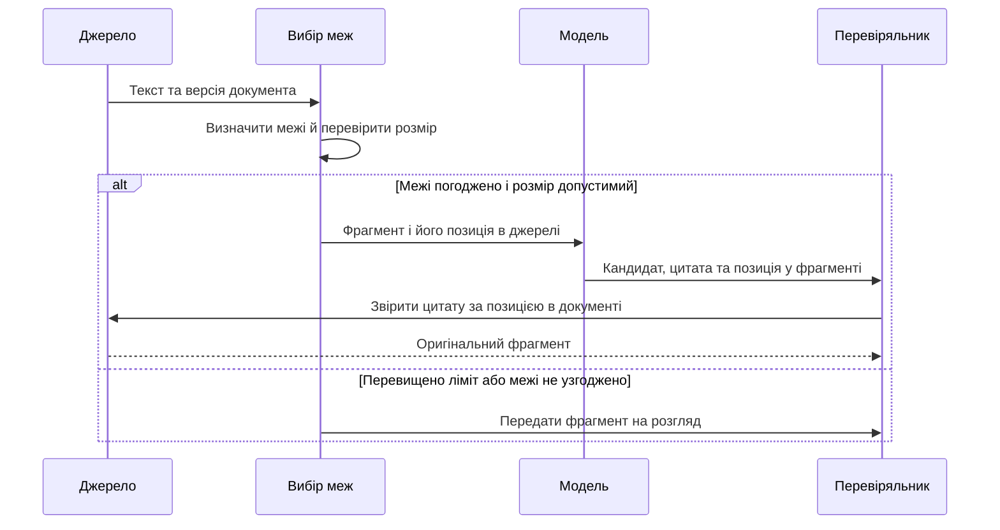

# Глава 13. Мовні моделі в підготовці та перевірці знань

<a id="глава-13-інженерія-знань-за-допомогою-мовних-моделей-видобування-фактів-і-правил-побудова-графа-знань-та-перевірка-видобутого"></a>

> **Підручник:** [Експертні системи](../README.md) · [Том 2](README.md)\
> **Навчальний рівень:** вибірковий курс з інженерії знань, бакалаврський рівень\
> **Попередня глава:** [Глава 12. Моделі подання знань та онтології](ch12-knowledge-representation.md)\
> **Наступна глава:** [Глава 14. Графи знань, трасованість та організаційна пам'ять](ch14-knowledge-graphs-and-traceability.md)\
> **Автор:** Микола Мартинович Федчик

---

## Анотація

Мовні моделі можуть допомогти інженерові знань опрацьовувати великі масиви тексту, але згенерована відповідь не є підтвердженим фактом і не повинна автоматично потрапляти до бази знань експертної системи. У главі розглянуто керований процес: підготовку фрагментів зі збереженням умов і винятків, виділення кандидатів із тексту, перевірку точних посилань на джерело, зіставлення з поняттями онтології, предметне приймання та внесення версійованих тверджень до графа. Метрики якості дають змогу оцінити помилки на контрольованій вибірці, але не доводять безпечності чи загальної придатності системи. Цей підхід зберігає роль мовної моделі як засобу підготовки, а не арбітра істинності.

---

<!-- chapter-toc:start -->
## Зміст глави

- [1. Роль мовної моделі в інженерії знань](#1-роль-мовної-моделі-в-інженерії-знань)
  - [1.1. Підготовка кандидатів знань](#11-підготовка-кандидатів-знань)
  - [1.2. Типові помилки та їхні наслідки](#12-типові-помилки-та-їхні-наслідки)
  - [1.3. Перевірка та приймання результатів](#13-перевірка-та-приймання-результатів)
- [2. Структуроване видобування фактів і правил](#2-структуроване-видобування-фактів-і-правил)
  - [2.1. Підготовка фрагментів джерела](#21-підготовка-фрагментів-джерела)
  - [2.2. Формат результату та посилання на джерело](#22-формат-результату-та-посилання-на-джерело)
  - [2.3. Перетворення текстових вимог на правила](#23-перетворення-текстових-вимог-на-правила)
- [3. Зіставлення та оновлення графа знань](#3-зіставлення-та-оновлення-графа-знань)
  - [3.1. Узгодження назв із поняттями онтології](#31-узгодження-назв-із-поняттями-онтології)
  - [3.2. Походження й оновлення тверджень](#32-походження-й-оновлення-тверджень)
- [4. Перевірка якості та повторюваності](#4-перевірка-якості-та-повторюваності)
  - [4.1. Метрики якості видобування](#41-метрики-якості-видобування)
  - [4.2. Перевірки структури й логічних конфліктів](#42-перевірки-структури-й-логічних-конфліктів)
  - [4.3. Відтворюваність результату](#43-відтворюваність-результату)
- [5. Практичні завдання та лабораторний практикум](#5-практичні-завдання-та-лабораторний-практикум)
  - [5.1. Контрольні запитання](#51-контрольні-запитання)
  - [5.2. Розрахункові та аналітичні задачі](#52-розрахункові-та-аналітичні-задачі)
  - [5.3. Завдання з програмної реалізації](#53-завдання-з-програмної-реалізації)
  - [5.4. Зв'язок із курсовим проєктом](#54-звязок-із-курсовим-проєктом)
- [Висновки](#висновки)
- [Глосарій](#глосарій)
- [Скорочення та терміни](#скорочення-та-терміни)
- [Джерела](#джерела)
<!-- chapter-toc:end -->

<a id="1-мовна-модель-як-помічник-інженера-знань-можливості-типові-відмови-та-межа-відповідальності"></a>
## 1. Роль мовної моделі в інженерії знань

У попередніх главах знання було зібрано від фахівців і подано через формальні структури; під час роботи з великим набором документів вузьким місцем може стати попереднє опрацювання тексту. Мовна модель здатна запропонувати терміни, зв'язки або можливі правила, але помилка на цьому етапі забруднює наступні кроки: онтологія систематизує неправильні поняття, граф зберігає їх як твердження, а механізм виведення застосовує їх послідовно й переконливо. Тому мовну модель слід розміщувати перед формальними перевірками та предметним прийманням, не надаючи їй повноваження змінювати базу знань самостійно.

<a id="11-задачі-підготовки-знань-за-допомогою-мовної-моделі"></a>
<a id="11-задачі-які-мовна-модель-пришвидшує-чернетки-онтологій-видобування-сутностей-і-відношень-переформулювання-норм-у-правила"></a>
### 1.1. Підготовка кандидатів знань

Для інженерії знань модель може допомогти знайти фрагменти, що схожі на визначення, умови, винятки, переліки ознак або описи процедур. Також вона може запропонувати варіанти нормалізації термінів і чернетку структури для подальшого внесення до онтології. Це завдання добору та переформатування тексту, а не встановлення фактичної істинності.

До початку оброблення треба визначити межі корпусу, версії документів, дозволені типи виходу та правила поводження з невизначеністю. Кожний кандидат повинен містити точне посилання на текст, а невідомі поля мають залишатися невідомими, а не заповнюватися правдоподібною здогадкою. Для стандартів, технічної документації чи правових джерел додатково перевіряють, чи дозволяють умови використання передавати текст обраній моделі або зберігати його у зовнішньому сервісі.

<a id="12-типові-відмови-вигадані-факти-й-посилання-інверсія-ролей-втрата-умов-і-винятків-нестабільність-відповіді"></a>
### 1.2. Типові помилки та їхні наслідки

Модель може створити твердження, якого немає у джерелі, приписати вимогу не тому суб'єкту, загубити заперечення або виняток, змішати обов'язкову умову з рекомендацією чи послатися на неіснуюче місце документа. Такі помилки пов'язані не лише з граматикою: вони змінюють умови застосування правила й можуть привести до хибного висновку. Огляд досліджень з генерації природної мови описує вигадані або непідтверджені фрагменти як окремий клас проблем, який потребує оцінювання й пом'якшення [1].

Особливо небезпечні пропуски умов і винятків. Речення «контролер зупиняє вузол, якщо температура перевищила межу, крім режиму калібрування» не можна без втрати змісту скоротити до правила з єдиною умовою перевищення. Так само співпоява двох термінів у фрагменті не доводить, що один є причиною, частиною чи властивістю іншого.

Текст документа також може містити інструкції, адресовані читачеві чи виконавцю. Під час автоматичного опрацювання їх треба розглядати як вміст джерела, а не як команду, що змінює завдання системи. Вихід моделі має залишатися даними для перевірки, а не виконуваною дією чи прямою операцією запису в базу знань.

<a id="13-висування-кандидатів-та-їхнє-предметне-приймання"></a>
<a id="13-розподіл-релевантність-проти-допустимості-в-процесі-набуття-знань-модель-пропонує-правила-й-інженер-знань-приймають"></a>
### 1.3. Перевірка та приймання результатів

Результат видобування проходить кілька незалежних перевірок. Перевірка формату встановлює, чи відповідає відповідь очікуваній схемі; перевірка посилання — чи справді цитований фрагмент є в документі; перевірка онтології — чи відомі типи понять і властивостей; предметний експерт оцінює, чи точно передано зміст. Успіх одного етапу не замінює наступні: валідний JSON може містити вигаданий факт, а точна цитата — бути інтерпретованою неправильно.

<a id="obj-13-1"></a>

**Таблиця 13.1 — Послідовність від тексту до прийнятого знання**

| Етап | Перевірне питання | Результат за невдачі |
|---|---|---|
| Підготовка джерела | Чи відома версія документа й межі його використання? | Не запускати видобування до уточнення джерела |
| Генерація кандидатів | Чи повернув інструмент структурований перелік без самостійних дій? | Відхилити відповідь або повторити оброблення з явною помилкою |
| Перевірка фрагмента | Чи збігаються цитата й позиція з оригіналом? | Позначити посилання як недійсне, не вносити кандидат |
| Формальні перевірки | Чи відповідають типи та поля онтології й схемі? | Відхилити або передати на виправлення |
| Предметне приймання | Чи збережено значення, модальність, умови й винятки? | Повернути на уточнення або відхилити |
| Реєстрація | Чи збережено джерело, версію та рішення перевіряльника? | Не публікувати як прийняте знання |

Таблиця описує навчальний процес контролю якості, а не заяву про сертифіковану процедуру. У критичній області критерії приймання мають походити з конкретних системних вимог і предметного аналізу ризику.

<a id="2-видобування-фактів-і-правил-зі-структурованим-виходом"></a>
## 2. Структуроване видобування фактів і правил

Перш ніж видобувати знання з документа, його треба підготувати так, щоб модель отримала не лише окрему дію, а й умови та винятки, від яких залежить її зміст. Далі кожен запропонований кандидат подають полями з чітко визначеним змістом і звіряють із джерелом. Сам формат не гарантує правильності, однак дає змогу виявити відсутні поля, некоректні типи, порушені посилання та неоднозначні стани до того, як дані потраплять до графа.

### 2.1. Підготовка фрагментів джерела

Великі джерела зазвичай передають мовній моделі частинами: усі документи разом можуть не вміститися в запит, а пошук потрібного місця має повертати перевірний фрагмент. Якщо межа розділить припис та його виняток, кандидат може виглядати правдоподібним, але змінити зміст правила. Тому перед видобуванням інженер визначає межі за структурою документа й предметним змістом: наприклад, залишає разом вимогу, її умову, заперечення, число з одиницею та виняток.

Фрагменти можуть бути різної довжини. Їхні межі визначає людина або програма за доступною структурою — заголовками, абзацами чи розміткою; автоматично запропоновані межі треба перевіряти на навчальних прикладах. Якщо важливий фрагмент завеликий для обраної моделі, його передають на окремий розгляд: можна узгодити менші пов'язані частини або змінити спосіб оброблення, але не можна непомітно відкинути виняток. Фіксований розмір також придатний, коли структура джерела й результати оцінювання це дозволяють; сам по собі вибір змінних меж не доводить переваги чи повноти видобування.

<a id="obj-13-2"></a>

**Схема 13.2 — Від джерела до перевірного кандидата**



На схемі модель не приймає знання до бази: вона повертає лише кандидат, а перевіряльник звіряє його з тією самою версією документа. Якщо модель зазначає позицію відносно фрагмента, до неї додають початок фрагмента в документі; перед звірянням перевіряють, що локальні межі не виходять за його кінець. Збіг цитати ще потребує предметного тлумачення.

Розгляньмо навчальний документ із двох речень: «Перед запуском перевірте вузол, якщо він був від'єднаний; після підтвердження огляду повторна перевірка не потрібна. Запишіть результат перевірки». Між реченнями в текстовому файлі стоїть символ нового рядка. Порівняймо два способи його поділу; позиції наведено в Unicode-кодових точках, початок включено, кінець — ні.

<a id="obj-13-3"></a>

**Таблиця 13.3 — Межі фрагментів у навчальному документі**

| Спосіб | Отримані межі | Що бачить перевіряльник |
|---|---|---|
| Порції по 50 кодових точок | `[0, 50)`, `[50, 100)`, `[100, 146)` | Межі розривають слова «від'єднаний» і «перевірка»; частина винятку опиняється окремо. |
| Попередньо позначені речення | `[0, 116)`, `[117, 146)` | Перше речення містить дію, умову й виняток; символ нового рядка між реченнями не входить до фрагментів. |

У цьому конкретному прикладі другий поділ зберігає потрібні частини разом. Для загального висновку потрібне порівняння способів на розміченому наборі документів, зокрема за пропущеними умовами й винятками.

Наведена нижче функція отримує текст, **уже визначені** межі фрагментів і максимальну довжину в кодових точках. Вона перевіряє порядок, відсутність перекриття та розмір, після чого повертає межі разом із відповідними підрядками. Некоректні або завеликі фрагменти спричиняють помилку; викликальний компонент має повідомити про неї та передати випадок на розгляд, а не обрізати текст.

<a id="obj-13-4"></a>

**Лістинг 13.4 — Підготовка фрагментів із заданими межами (Python 3.14.4)**

<details>
<summary>Показати лістинг 13.4 (23 рядки, Python 3.14.4)</summary>

```python
def make_fragments(source, spans, limit):
    if limit <= 0 or not spans:
        raise ValueError("потрібні додатна межа й позначені фрагменти")
    result = []
    previous_end = 0
    for start, end in spans:
        if not (previous_end <= start < end <= len(source)):
            raise ValueError("некоректні або перекриті межі")
        if end - start > limit:
            raise ValueError("фрагмент перевищує допустиму довжину")
        result.append((start, end, source[start:end]))
        previous_end = end
    return result

source = ("Перед запуском перевірте вузол, якщо він був від'єднаний; "
          "після підтвердження огляду повторна перевірка не потрібна.\n"
          "Запишіть результат перевірки.")
separator = source.index("\n")
parts = make_fragments(source, [(0, separator), (separator + 1, len(source))], 120)
assert [(a, b) for a, b, _ in parts] == [(0, 116), (117, 146)]
assert "якщо" in parts[0][2] and "не потрібна" in parts[0][2]
assert all(source[a:b] == text for a, b, text in parts)
print([(a, b) for a, b, _ in parts])
```

</details>

Програма виводить `[(0, 116), (117, 146)]` і перевіряє, що умова й виняток залишилися в першому фрагменті. Вона не визначає змістові межі самостійно й не перевіряє повноту покриття документа: ці завдання належать підготовці та перевірці розмітки. Обмеження у 120 кодових точок є навчальним; для справжнього запиту окремо враховують токени фрагмента, інструкцій і решти повідомлень. У системі разом із межами зберігають ідентифікатор та незмінну версію джерела.

<a id="21-формат-результату-та-посилання-на-джерело"></a>
<a id="21-схема-виходу-перевірка-сортів-аргументів-і-привязка-кожного-факту-до-фрагмента-першоджерела"></a>
### 2.2. Формат результату та посилання на джерело

Для кожного кандидата корисно зберігати ідентифікатор джерела й редакції, точний фрагмент, його позицію, предметні ролі, тип твердження, умови, винятки та статус перевірки. Позиції фрагмента нижче визначено як нульові індекси Unicode-кодових точок у незмінному тексті документа з напіввідкритим інтервалом: початок входить до фрагмента, кінець — ні. Інші системи можуть рахувати байти або токени; формат має зафіксувати одиницю, інакше посилання не можна надійно відтворити.

<a id="obj-13-5"></a>

**Лістинг 13.5 — Кандидат твердження з точним фрагментом джерела (JSON, RFC 8259)**

<details>
<summary>Показати лістинг 13.5 (21 рядок, JSON, RFC 8259)</summary>

```json
{
  "source": {
    "document_id": "training-note-01",
    "version": "1",
    "location": "paragraph-1",
    "offset_unit": "unicode_code_points"
  },
  "candidates": [
    {
      "actor": null,
      "action": "перевірити",
      "target": "вузол",
      "modality": "instruction",
      "conditions": ["перед запуском"],
      "exceptions": [],
      "quote": "Перед запуском перевірте вузол.",
      "span": {"start": 0, "end": 31},
      "status": "needs_review"
    }
  ]
}
```

</details>

Фрагмент у лістингу — вигаданий навчальний текст, не нормативна вимога й не інженерна рекомендація. `actor: null` означає, що джерело не називає виконавця дії; це поле не можна заповнювати здогадкою. Значення `needs_review` вказує, що кандидат не прийнято. JSON Schema може описати форму JSON-документа та перевірити типи й обов'язкові поля [2], але не підтверджує, що процитований текст має правильне предметне тлумачення.

Після розбору JSON перевіряльник має застосувати щонайменше такі умови: початок і кінець входять до довжини джерела; процитований фрагмент збігається з `source[start:end]`; ідентифікатор та версія документа відомі; тип твердження належить до дозволеного переліку. Якщо документ був конвертований із PDF або зображення, координати мають посилатися на зафіксовану текстову версію після оптичного розпізнавання, а не на текст, який невідомо як змінювався.

Для відтворення цитати у файловому сховищі іноді потрібні саме **байтові** межі. Наприклад, у рядку `АБ` літера `Б` займає інтервал `[1, 2)` у кодових точках, але `[2, 4)` у UTF-8. Перевіряльник спочатку звіряє весь файл із раніше зареєстрованою контрольною сумою, строго декодує його, а потім переводить погоджені текстові межі в байтові. На вході наступної функції — байти UTF-8 без BOM, довірена еталонна сума та інтервал у кодових точках; на виході — байтові межі й відновлена цитата.

<a id="obj-13-byte-span"></a>

**Лістинг 13.6 — Від текстової позиції до байтового фрагмента (Python 3.14.4)**

<details>
<summary>Показати лістинг 13.6 (19 рядків, Python 3.14.4)</summary>

```python
from hashlib import sha256

def byte_span(raw, expected_digest, start, end):
    if sha256(raw).hexdigest() != expected_digest:
        raise ValueError("контрольна сума джерела не збігається")
    text = raw.decode("utf-8", errors="strict")
    if text.startswith("\ufeff"):
        raise ValueError("приклад вимагає UTF-8 без BOM")
    if not (0 <= start < end <= len(text)):
        raise ValueError("межі цитати виходять за джерело")
    left = len(text[:start].encode("utf-8"))
    right = len(text[:end].encode("utf-8"))
    return left, right, raw[left:right].decode("utf-8")

raw = "АБ".encode("utf-8")
reference_digest = sha256(raw).hexdigest()
position = byte_span(raw, reference_digest, 1, 2)
assert position == (2, 4, "Б")
print(*position)
```

</details>

Вивід `2 4 Б` дозволяє звірити обидві системи координат. У прикладі еталонну суму обчислено з контрольованого навчального рядка; під час імпорту її треба брати з довіреного реєстру, а не з того самого неперевіреного надходження. Таке зіставлення діє лише без нормалізації, заміни помилкових символів та інших перетворень тексту. Для PDF зберігають окремо хеш оригіналу, версію отриманого тексту й відображення на сторінку: індекс у результаті OCR не є позицією символу в сирих байтах PDF. Хеш фіксує відповідність байтів еталону, але не авторитетність джерела; зв'язки походження розглянуто в §3.2 та [Главі 14](ch14-knowledge-graphs-and-traceability.md#11-звязки-між-вимогами-знаннями-кодом-і-тестами).

Табличне джерело потребує ще одного кроку: число треба пов'язати з назвою параметра, одиницею та умовою, а не лише знайти в тексті. Для того самого навчального процесу перевірки вузла уявімо сторінку з такою таблицею.

<a id="obj-13-source-table"></a>

**Таблиця 13.7 — Умовний фрагмент інструкції з табличним параметром**

| Операція та умова | Мінімальний інтервал, с |
|---|---:|
| Повторна перевірка вузла, якщо огляд не підтверджено | 30 |

Значення 30 тут вигадане для навчання, не є рекомендацією з обслуговування. Кандидат має містити параметр інтервалу, умову непідтвердженого огляду, число 30 та одиницю секунд, успадковану з заголовка. Якщо одиниця для цієї фізичної величини відсутня або неоднозначна, кількісний кандидат не готують до приймання.

Наступний код отримує **вже розібрані** клітинку та заголовок. Їхні ролі й прямокутники задано вручну: це не парсер PDF і не алгоритм OCR. Координати навчальної сторінки відлічено від лівого верхнього кута в пунктах, де один пункт дорівнює 1/72 дюйма. Функція перевіряє одиницю, спільну сторінку й допустимість числа та повертає числовий кандидат разом із трьома прямокутниками — назви, заголовка та значення.

<a id="obj-13-table-quantity"></a>

**Лістинг 13.8 — Число з одиницею та візуальним посиланням (Python 3.14.4)**

<details>
<summary>Показати лістинг 13.8 (19 рядків, Python 3.14.4)</summary>

```python
from decimal import Decimal

def table_quantity(cell, header):
    if header.get("unit") != "s" or cell["page"] != header["page"]:
        raise ValueError("потрібні одиниця секунд і спільна сторінка")
    value = Decimal(cell["text"])
    if not value.is_finite() or value < 0:
        raise ValueError("інтервал має бути скінченним і невід'ємним")
    return {"parameter": "repeat_check_interval", "value": value,
            "unit": "s", "condition": cell["condition"], "page": cell["page"],
            "boxes": [cell["label_bbox"], header["bbox"], cell["bbox"]]}

header = {"unit": "s", "page": 1, "bbox": (150, 20, 290, 40)}
cell = {"text": "30", "page": 1, "bbox": (150, 50, 290, 70),
        "label_bbox": (20, 50, 140, 70), "condition": "inspection_unconfirmed"}
quantity = table_quantity(cell, header)
assert quantity["value"] == Decimal("30") and quantity["unit"] == "s"
assert len(quantity["boxes"]) == 3
print(f'{quantity["parameter"]}={quantity["value"]} {quantity["unit"]}')
```

</details>

Вивід `repeat_check_interval=30 s` підтверджує перенесення числа й одиниці; координати дозволяють повернутися до місця їхнього прочитання. У реальному записі до них додають ідентифікатор і версію документа, розміри та орієнтацію сторінки, а за потреби — посилання на виноску. Розпізнавання багаторядкових заголовків, об'єднаних клітинок і правильності прямокутників залишається окремою задачею; універсальний геометричний поріг її не розв'язує.

<a id="22-перетворення-текстових-вимог-на-правила"></a>
<a id="22-перетворення-нормативного-тексту-на-правила"></a>
<a id="22-переведення-нормативного-тексту-в-правила-prolog-і-таблиці-dmn-шаблони-вимог-ears-та-контроль-умов-і-винятків"></a>
### 2.3. Перетворення текстових вимог на правила

Перетворення речення на правило вимагає виявити суб'єкта, дію, об'єкт, модальність, передумови, час чинності та винятки. У нормативному реченні треба зберегти, чи це обов'язок, заборона, дозвіл або рекомендація; словесний маркер на кшталт «може» не можна механічно прирівняти до «повинен». У технічній інструкції додатково розрізняють умову спрацьовування, потрібний результат і спосіб перевірки.

Використаймо лише навчальне речення з лістингу 13.5: «Перед запуском перевірте вузол». Чернетка правила може бути подана як: якщо планується запуск і перевірку вузла не підтверджено, система має сформувати запит на підтвердження перевірки. Це вже є **інтерпретацією**, а не дослівним твердженням з речення: у джерелі не сказано, як реагувати на відсутність підтвердження. Отже, таке правило треба позначити як запропоноване доповнення, не як видобутий факт.

Застосовуйте таблицю умов для явної перевірки меж:

1. Який текст безпосередньо підтверджує кожну передумову?
2. Чи збережено суб'єкта дії та адресата вимоги?
3. Що відбувається, коли умова невідома або джерела суперечать одне одному?
4. Які винятки вказано явно, а які лише припускаються?
5. Який висновок не можна зробити без додаткового правила?

Для систем автомобільного домену посилання на стандарт або технічний документ не засвідчує відповідності системи цьому документу. Спочатку треба встановити точне видання, застосовність пункту, контекст вимоги та відповідальну процедуру оцінювання. Для правового тексту додатково важливі юрисдикція, дата чинності, зміни й співвідношення норм; автоматичний перефраз не може замінити правову інтерпретацію.

<a id="3-побудова-й-поповнення-графа-знань-із-видобутого"></a>
## 3. Зіставлення та оновлення графа знань

Після перевірки кандидата потрібно вирішити, чи відповідають його назви вже відомим поняттям, чи утворюють нове поняття, та як додати твердження без втрати джерела. Якщо зіставлення виконати лише за схожістю слів, різні сутності можуть злитися або один об'єкт отримає кілька дублікатних ідентифікаторів. Якщо записати лише підсумкове ребро, подальший інженер не знатиме, звідки воно взялося і хто його прийняв.

<a id="31-узгодження-сутностей-із-поняттями-онтології"></a>
<a id="31-зіставлення-видобутих-сутностей-з-онтологією-глави-12-і-розвязання-тотожності-сутностей-entity-resolution"></a>
### 3.1. Узгодження назв із поняттями онтології

Порівнюйте не лише написання, а й контекст, тип, визначення та відношення кандидата. Наприклад, однакова абревіатура в двох документах може позначати різні поняття, а різні словоформи — те саме поняття. Онтологія з Глави 12 задає типи понять і властивостей, але не обирає автоматично правильну сутність для кожного текстового фрагмента.

<a id="obj-13-6"></a>

**Таблиця 13.9 — Результати зіставлення терміна**

| Кандидат із тексту | Можливий запис у довіднику | Підстава для автоматичного прийняття |
|---|---|---|
| «датчик температури» | термін із тим самим визначенням і типом | точний ідентифікатор або затверджений синонім |
| «датчик» | загальніший клас приладів | не приймати як еквівалент без контекстної перевірки |
| «ДТ» | кілька можливих розшифрувань | автоматично не об'єднувати |

Схожість рядків чи оцінка мовної моделі може допомогти сформувати список кандидатів на зіставлення, але не є доказом тотожності. Якщо система не може однозначно зіставити термін, збережіть початковий текст і позначте його як нерозв'язаний. Для кожного об'єднання сутностей потрібні стабільний ідентифікатор, підстава, час і можливість відкотити рішення.

<a id="32-поповнення-графа-зі-збереженням-походження"></a>
<a id="32-інкрементальне-поповнення-графа-з-обліком-походження-кожного-ребра-prov-o"></a>
### 3.2. Походження й оновлення тверджень

Відомості про походження описують, які сутності, дії та виконавці брали участь у створенні даних. Модель походження W3C PROV-O надає відповідні класи й відношення для обміну відомостями між системами [3]. У навчальному процесі джерельний документ і його фрагмент є сутностями; видобування й перевірка — діями; модельне програмне забезпечення та фахівець — агентами, пов'язаними з цими діями.

<a id="obj-13-7"></a>

**Таблиця 13.10 — Мінімальні відомості про походження твердження**

| Запис | Що фіксується |
|---|---|
| Джерело | ідентифікатор, редакція, позиція фрагмента та за потреби контрольна сума |
| Дія видобування | дата, інструмент і версія схеми кандидата |
| Кандидат | нормалізоване твердження та точна цитата |
| Перевірка | перевіряльник, дата, результат і коментар до змін |
| Прийнятий запис | ідентифікатор твердження, його версія, межі чинності та статус |

Контрольна сума допомагає виявити зміну байтів у зафіксованому файлі, але не доводить автентичність джерела чи правильність його змісту. Якщо джерело оновилося, старе твердження не слід непомітно переписувати: новий кандидат проходить перевірки, а попередня версія зберігається або позначається нечинною за визначеною процедурою. Детальні часові моделі графів розглядаються в наступній главі.

Практично запис твердження і запис його походження краще зберігати як пов'язані, але різні об'єкти. Так можна відобразити кілька джерел для одного твердження, конфлікт між джерелами або окремі рішення різних перевіряльників. Відомості про персональні дані й конфіденційний зміст зберігайте лише відповідно до політики проєкту та дозволів на оброблення.

<a id="4-вимірювання-якості-видобутого-знання"></a>
## 4. Перевірка якості та повторюваності

Навіть ретельно побудований процес може систематично пропускати винятки або помилятися на певному типі документів. Для оцінювання потрібна заздалегідь розмічена вибірка, явні критерії збігу та розділення навчальних і контрольних матеріалів. Окремий успішний приклад доводить лише те, що оброблено цей приклад, а не що модель загалом придатна.

<a id="41-еталонні-вибірки-та-узгодженість-експертної-розмітки"></a>
<a id="41-еталонні-вибірки-точність-повнота-та-узгодженість-із-розміткою-експертів-κ-коена-з-глави-11"></a>
### 4.1. Метрики якості видобування

Для бінарної перевірки кандидатів можна обчислити точність прийнятих кандидатів та повноту знайдених релевантних тверджень. Потрібно спершу визначити одиницю оцінювання: повний факт, пара суб'єкт-відношення-об'єкт, кожне поле окремо або точне виділення фрагмента. Порівнювати можна тільки результати, розмічені за однаковими правилами.

<a id="obj-13-8"></a>

**Рівняння 13.11 — Точність, повнота та гармонійне середнє**

$$
\mathrm{Precision} = \frac{TP}{TP+FP}, \qquad
\mathrm{Recall} = \frac{TP}{TP+FN}, \qquad
F_1 = 2 \cdot \frac{\mathrm{Precision}\cdot\mathrm{Recall}}{\mathrm{Precision}+\mathrm{Recall}}
$$

$TP$ — кількість правильно видобутих і прийнятих одиниць; $FP$ — хибно додані одиниці; $FN$ — релевантні одиниці, які система пропустила. Точність і повнота належать до діапазону від 0 до 1, якщо знаменник ненульовий; коли знаменник дорівнює нулю, метрика не визначена без окремої домовленості. $`F_1`$ — гармонійне середнє двох показників; якщо обидва дорівнюють 0, у практиці оцінювання зазвичай окремо домовляються повертати 0. Ці метрики не враховують неоднакову ціну помилок і не дають гарантії для майбутніх документів.

<a id="obj-13-9"></a>

**Таблиця 13.12 — Навчальний розрахунок за розміченими кандидатами**

| Показник обліку | Кількість |
|---|---:|
| Правильно видобуті твердження ($TP$) | 18 |
| Хибно видобуті твердження ($FP$) | 4 |
| Пропущені твердження ($FN$) | 6 |

Тоді точність дорівнює $18/(18+4)=18/22\approx0{,}818$, повнота — $18/(18+6)=18/24=0{,}75$, а $`F_1=36/(36+4+6)=36/46\approx0{,}783`$. Це арифметика навчального прикладу, не результат вимірювання конкретної моделі. Відповідно, приблизно 18,2% прийнятих нею кандидатів у цій вибірці були хибними, а чверть еталонних одиниць пропущено. У домені, де пропуск винятку небезпечний, високе $`F_1`$ може приховати неприйнятну кількість саме таких помилок; звітуйте про критичні класи окремо.

Для відтворюваної оцінки треба зафіксувати інструкцію розмітки, спосіб розв'язання розбіжностей, розподіл документів між розробленням і тестом та правило зіставлення кандидатів. Розмітка двох незалежних експертів може бути проаналізована методами попередньої глави, але узгодженість експертів не означає, що еталон є безпомилковим.

<a id="42-перевірка-структури-несуперечливості-та-покриття"></a>
### 4.2. Перевірки структури й логічних конфліктів

Автоматичний валідатор може перевірити, що поля присутні, типи даних дозволені, позиція цитати відповідає джерелу, а поняття й відношення відомі онтології. Далі тестують правила на явно заданих сценаріях: необхідні передумови, винятки, невідомі дані, суперечливі записи та граничні значення. Ці перевірки виявляють дефекти представлення; вони не встановлюють істинності джерельного твердження.

Для кожного тесту сформулюйте очікуваний результат до запуску:

1. **Формат:** неприпустима структура відхиляється з назвою поля.
2. **Походження:** неправильна цитата або невідома версія документа не проходить перевірку.
3. **Онтологія:** невідомий тип не зливається мовчки з найближчим відомим класом.
4. **Логіка:** суперечливі правила створюють зафіксований конфлікт, а не довільний вибір.
5. **Приймання:** кандидат без предметного схвалення не має статусу прийнятого знання.

Схема структурованого виходу, обмеження графа, тести правил і предметна експертиза мають різні критерії. Не об'єднуйте їх в один показник «перевірено», якщо неможливо встановити, які саме перевірки були успішними.

Тепер простежимо один кандидат через увесь процес. Із прикладу §2.1 візьмемо окремий навчальний текст: «Після підтвердження огляду повторна перевірка не потрібна». Його структуроване проміжне подання міститиме дію `repeat_check`, умову `inspection_confirmed` та ознаку `required=False`. Тут `False` означає відсутність вимоги повторної перевірки, а не заборону її виконувати. Ролі та ознаку задано вручну для демонстрації; автоматичний мовний аналіз не підмінено словниковою евристикою.

<a id="obj-13-candidate-states"></a>

**Діаграма 13.13 — Від кандидата до прийнятої версії**

```mermaid
stateDiagram-v2
    accTitle: Перевірка та приймання кандидата знання
    accDescr: Структурований кандидат проходить механічні перевірки та предметний перегляд; схвалення стосується лише незмінної версії.
    state "Структурований кандидат" as Draft
    state "Помилка перевірки" as Error
    state "Потребує перегляду" as Review
    state "Прийнята версія" as Accepted
    [*] --> Draft
    Draft --> Error: не збігаються джерело або поля
    Draft --> Review: механічні перевірки пройдено
    Review --> Accepted: фахівець схвалив саме цей запис
    Accepted --> Review: створено зміненого кандидата
```



Останній перехід означає новий перегляд для нової версії; попередній прийнятий запис залишається в історії. Так само треба обробляти потенційно шкідливу зміну зовнішнього джерела: якщо слово «не» зникло, стара згода не поширюється на новий кандидат. Сам факт відмінності ще не встановлює намір автора зміни й не доводить отруєння бази знань.

Функція нижче перевіряє відповідність джерела зареєстрованим байтам і тип погодженої ознаки, потім будує проміжний запис. У ньому збережено текст, позицію, версію та структуроване правило. Окрема функція обчислює ідентифікатор усього запису для прив'язки рішення перевіряльника. На вході — контрольований текст, версія, вручну визначена ознака й еталонна сума; результат — кандидат, а не активне правило.

<a id="obj-13-prepare-rule"></a>

**Лістинг 13.14 — Підготовка структурованого кандидата (Python 3.14.4)**

<details>
<summary>Показати лістинг 13.14 (24 рядки, Python 3.14.4)</summary>

```python
from hashlib import sha256
import json

def prepare_rule(text, version, required, trusted_digest):
    if not version or type(required) is not bool:
        raise ValueError("потрібні версія та логічна ознака required")
    digest = sha256(text.encode("utf-8")).hexdigest()
    if digest != trusted_digest:
        raise ValueError("джерело не відповідає зареєстрованій версії")
    return {"source_id": "training-exception", "version": version,
            "source_sha256": digest, "quote": text,
            "offset_unit": "unicode_code_points", "span": [0, len(text)],
            "rule": {"action": "repeat_check", "condition": "inspection_confirmed",
                     "required": required}}

def rule_id(record):
    payload = json.dumps(record, sort_keys=True, ensure_ascii=False)
    return sha256(payload.encode("utf-8")).hexdigest()

original = "Після підтвердження огляду повторна перевірка не потрібна."
reference = sha256(original.encode("utf-8")).hexdigest()
draft = prepare_rule(original, "1", False, reference)
assert draft["rule"]["required"] is False
assert draft["quote"] == original
```

</details>

У навчальному реєстрі тепер можна зафіксувати рішення перевіряльника щодо ідентифікатора цього кандидата. Наступний лістинг продовжує попередній: отримує запис і окреме схвалення, повертає статус із причиною або копію прийнятої версії. Зміна тексту, версії чи правила змінює ідентифікатор, тому старе схвалення більше не підходить.

<a id="obj-13-approve-rule"></a>

**Лістинг 13.15 — Приймання лише переглянутої версії (Python 3.14.4)**

<details>
<summary>Показати лістинг 13.15 (23 рядки, Python 3.14.4)</summary>

```python
from copy import deepcopy

def publish_rule(record, approval):
    if approval is None:
        return {"status": "needs_review", "reason": "схвалення відсутнє"}
    if not approval["reviewer"]:
        raise ValueError("не зазначено перевіряльника")
    if approval["record_id"] != rule_id(record):
        return {"status": "needs_review", "reason": "кандидат змінено"}
    return {"status": "accepted", "record": deepcopy(record),
            "reviewer": approval["reviewer"]}

pending = publish_rule(draft, None)
approval = {"record_id": rule_id(draft), "reviewer": "expert-01"}
accepted = publish_rule(draft, approval)
changed = original.replace("не потрібна", "потрібна")
new_reference = sha256(changed.encode("utf-8")).hexdigest()
revised = prepare_rule(changed, "2", True, new_reference)
review_again = publish_rule(revised, approval)
assert accepted["record"]["rule"]["required"] is False
assert review_again["reason"] == "кандидат змінено"
assert pending["status"] == review_again["status"] == "needs_review"
print(pending["status"], accepted["status"], review_again["status"])
```

</details>

<a id="obj-13-pipeline-trace"></a>

**Таблиця 13.16 — Трасування приймання навчального правила**

| Вхід | Результат | Наступна дія |
|---|---|---|
| Перевірений кандидат версії 1 без схвалення | `needs_review` | Предметний перегляд |
| Той самий кандидат зі схваленням його ідентифікатора | `accepted` | Зберегти прийняту копію та рішення |
| Нова версія зі зміненим текстом і старим схваленням | `needs_review` | Перегляд різниці та нове рішення |

Програма виводить `needs_review accepted needs_review`. Еталони обох версій у прикладі обчислено з контрольованих текстів; у робочій системі їх реєстрація та права перевіряльника потребують окремих процедур. Поле `reviewer` не є цифровим підписом або автентифікацією, а хеш запису — доказом правильності мовного розбору. Лістинги показують лише зв'язок етапів і заборону автоматичного перенесення схвалення на змінений кандидат; готового промислового компілятора знань тут не заявлено.

<a id="43-відтворюваність-фіксація-моделі-її-версії-підказки-та-записаних-відповідей"></a>
### 4.3. Відтворюваність результату

Мовна модель може змінити відповідь після оновлення версії, параметрів, шаблону запиту чи переданого контексту. Для повторного запуску зберігайте доступні ідентифікатор і версію моделі, налаштування генерації, версію шаблону запиту, контрольну суму корпусу, схему виходу, версії парсера й валідаторів, а також первинний і прийнятий результати. Якщо постачальник не гарантує незмінність моделі за ідентифікатором, повторне виконання не слід називати побітово відтворюваним.

Зберігання повного запиту та відповіді може бути обмежене приватністю, ліцензією або політикою безпеки організації. У такому разі фіксуйте дозволену контрольну суму, ідентифікатори й аудитні метадані, а пропущені матеріали позначайте як недоступні для повторної перевірки. Не створюйте видимість повної відтворюваності, якщо вихідний документ, версія моделі або процедура розмітки не збереглися.

## 5. Практичні завдання та лабораторний практикум

Завдання цього розділу перевіряють, чи вміє студент відрізняти кандидат, який сформувала модель, від факту, який прийняв предметний експерт. Використовуйте навчальні фрагменти, не вставляйте конфіденційні документи у зовнішню модель без дозволу та не подавайте виконання вправи як промислову оцінку.

<a id="51-контрольні-запитання-для-самоперевірки"></a>
### 5.1. Контрольні запитання

1. Чому правильний формат відповіді не доводить, що витягнуте твердження істинне?
2. Які поля потрібні, щоб перевірити, звідки походить кандидат?
3. Чим точне цитування відрізняється від коректного тлумачення цитати?
4. Чому відсутня умова або виняток може змінити зміст правила?
5. Яку інформацію про процес треба зберігати для аудиту й повторного запуску?
6. Чому агрегована метрика не замінює окремий облік критичних помилок?
7. Чому фрагмент із коректними координатами все одно може втратити умову або виняток?

<a id="52-розрахункові-задачі-трасування-вручну"></a>
### 5.2. Розрахункові та аналітичні задачі

1. Для даних таблиці 13.12 перерахуйте точність, повноту та $`F_1`$. Поясніть, що зміниться, якщо один пропуск стане хибним додаванням, а не пропуском.
2. Для фрагмента «Перед запуском перевірте вузол, якщо він був від'єднаний; після підтвердження огляду повторна перевірка не потрібна» випишіть окремо дію, умову й виняток. Позначте всі частини, які не можна відновити без уточнення термінів.
3. Запропонуйте тести для випадку, коли цитата точна, але модель переплутала виконавця та адресата дії.
4. Два документи називають «ДТ» різні прилади. Опишіть, які контекстні поля потрібні перед об'єднанням назв.
5. Для кожного з етапів таблиці 13.1 наведіть приклад помилки, яку цей етап може виявити, і приклад помилки, яку він не здатен довести.
6. Для документа з таблиці 13.3 знайдіть виняток у порціях по 50 кодових точок. Які з них потрібно прочитати разом, щоб відновити його зміст?

<a id="53-інженерні-завдання-з-програмування-мовна-незалежність--спеціалізовані-dsl"></a>
### 5.3. Завдання з програмної реалізації

Реалізуйте невеликий перевіряльник кандидатів знань:

1. Розберіть JSON за визначеною схемою й відхиляйте відсутні поля або неправильні типи.
2. Перевірте, що позиція цитати лежить у межах незмінного джерела та що підрядок точно дорівнює цитаті. У тесті використайте український текст, щоб виявити плутанину між байтовими позиціями та індексами Unicode-кодових точок.
3. Перевірте ідентифікатор і версію джерела за малим навчальним реєстром.
4. Збережіть стан кандидата як «потребує перевірки»; не переводьте його до прийнятого статусу без окремого схвалення.
5. Напишіть тести для коректної цитати, неправильних меж, цитати з помилкою, невідомої версії та некоректного JSON.
6. Доповніть лістинг 13.4 тестами для порожнього списку меж, перекриття та фрагмента, що перевищує ліміт. Зафіксуйте, як програма повідомляє про кожну помилку.
7. Для лістингу 13.6 перевірте змінений файл, недопустимі межі та некоректний UTF-8. Поясніть, чому збіг хешу з невідомим еталоном не встановлює походження документа.
8. Для лістингу 13.8 вилучіть одиницю, змініть сторінку заголовка та задайте нескінченне значення. Перевірте, що кількісний кандидат не утворюється. Додайте випадок із виноскою до таблиці.
9. У лістингах 13.14–13.15 змініть лише структуроване правило, залишивши цитату незмінною. Старе схвалення також має перестати відповідати запису; предметну правильність нового правила треба оцінити окремо.

Реалізація має повертати перевірний перелік помилок із назвою умови, а не підміняти предметне рішення. У звіті вкажіть, які властивості перевіряються механічно, а які залишаються на розгляд експерта.

<a id="54-звязок-із-лабораторною-та-курсовою-роботою-курсу"></a>
### 5.4. Зв'язок із курсовим проєктом

У лабораторній роботі №2.2 студент бере невеликий відкритий або навчальний набір текстів і порівнює видобуті моделью кандидати з розміткою експерта. У результаті подаються опис корпусу й версій, схема кандидата, кілька прикладів помилок, таблиця походження та окремі оцінки точності й повноти. Якщо застосовується модельний сервіс, потрібно зазначити, які дані передавалися й які обмеження відтворення виникли.

Для курсового проєкту в автомобільному, правовому чи ІТ-домені модель не є авторитетом щодо стандарту, закону або інциденту. Застосовність і значення кожного кандидата підтверджуються відповідним джерелом та відповідальною особою. Навчальний експеримент із малою вибіркою не можна подавати як оцінку промислової точності.

## Висновки

Мовна модель може зменшити ручну роботу з текстом, але не встановлює істинність твердження й не замінює фахову інтерпретацію. Підготовка фрагментів має зберігати умови й винятки разом із відповідними приписами. Надійний процес залишає кожне твердження пов'язаним із точною версією джерела, перевіряє структуру та типи незалежно від змісту, зберігає нерозв'язані випадки й вимагає предметного приймання перед внесенням до бази знань. Метрики описують помилки лише на визначеній вибірці та за конкретним правилом розмітки. Походження, версії та результати перевірок забезпечують аудит, але не перетворюють автоматичне видобування на доказ правильності.

## Глосарій

- **Кандидат знання** — структуроване твердження, запропоноване для перевірки, але ще не прийняте до бази знань.
- **Походження даних** — відомості про джерело, перетворення, відповідальних агентів і зв'язки між версіями результату.
- **Точність видобування** — частка правильних одиниць серед усіх видобутих системою одиниць за визначеними правилами оцінювання.
- **Повнота видобування** — частка знайдених системою одиниць серед усіх релевантних одиниць у розміченій вибірці.
- **Предметне приймання** — підтвердження уповноваженим фахівцем, що зміст і межі застосування кандидата передано правильно.
- **Твердження** — формалізований запис про сутність, властивість або відношення, який має визначене джерело й статус.

## Скорочення та терміни

- **JSON** — текстовий формат обміну структурованими даними.
- **PROV-O** — онтологія W3C для подання відомостей про походження даних і процесів.
- **TP** — правильне позитивне зіставлення; **FP** — хибне позитивне зіставлення; **FN** — пропущене позитивне зіставлення.
- **F1** — гармонійне середнє точності й повноти.
- **Схема виходу** — опис допустимих полів, типів і структур результату видобування.

## Джерела

1. Ji, Z., Lee, N., Frieske, R., Yu, T., Su, D., Xu, Y., et al. “Survey of Hallucination in Natural Language Generation.” *ACM Computing Surveys*, 55(12), Article 248, 2023. https://doi.org/10.1145/3571730.
2. JSON Schema. *Draft 2020-12*. https://json-schema.org/draft/2020-12.
3. Lebo, T., Sahoo, S., McGuinness, D. *PROV-O: The PROV Ontology*. W3C Recommendation, 30 April 2013. https://www.w3.org/TR/2013/REC-prov-o-20130430/.
4. National Institute of Standards and Technology. *Artificial Intelligence Risk Management Framework: Generative Artificial Intelligence Profile*. NIST AI 600-1, 2024. https://doi.org/10.6028/NIST.AI.600-1.
