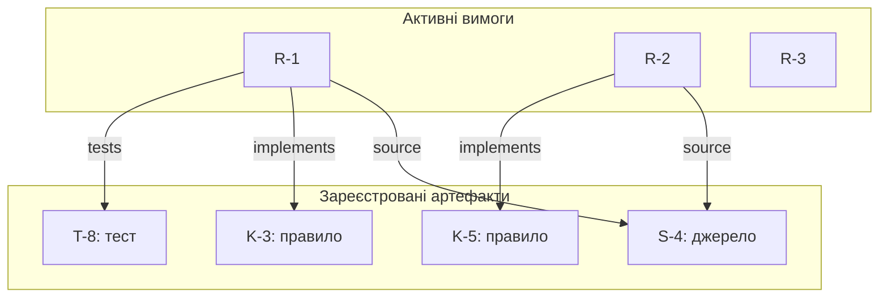

# Глава 14. Графи знань, трасованість та організаційна пам'ять

<a id="глава-14-інженерні-графи-знань-ekg-бітемпоральна-трасованість-інституційна-память-і-паспорти-рішень-аналіз-радіуса-впливу-змін-та-матричне-прискорення-графових-запитів"></a>

> **Підручник:** [Експертні Системи](../README.md) · [Том 2. Програмна інженерія знань: ізольовані корпуси, онтології, невизначеність, модельно-орієнтована діагностика, прогностика та верифікація](README.md)  
> **Навчальний рівень:** Вибірковий курс «Інженерія знань» (бакалаврат, 3–4 курс)  
> **Обладнання:** звичайний ноутбук або ПК; дискретний графічний прискорювач не потрібен для основних прикладів<br>
> **Мови:** приклади — Python 3.14.4 зі стандартною бібліотекою; інші мови — за потреби курсового проєкту
> **Попередня глава:** [Глава 13. Мовні моделі в підготовці та перевірці знань](ch13-language-models-in-knowledge-engineering.md)\
> **Наступна глава:** [Глава 15. Нормативні правила та аргументація](ch15-normative-reasoning-and-argumentation.md)\
> **Автор:** Микола Мартинович Федчик

---

## Анотація

У попередній главі розглянуто, як джерела перетворюються на кандидатів фактів і правил та як перевіряється їхнє походження. Ця глава відповідає на наступне інженерне запитання: як зберегти зв'язок між вимогою, її інтерпретацією, реалізацією, випробуванням і рішенням експертної системи, а потім з'ясувати, що саме треба переглянути після зміни одного з цих елементів. Показано типізоване подання таких зв'язків, розділення часу чинності знання й часу його реєстрації, перевірки структурної повноти та обмежене застосування графових оцінок. Окремо розглянуто записи про рішення, перетворення розбору випадку на регресійний тест і базове матричне подання графа. Приклади з Automotive, мікроелектроніки та ІТ є навчальними; згадування галузевих стандартів не означає відповідності їм.

---

<!-- chapter-toc:start -->
## Зміст глави

- [1. Граф простежуваності та часові версії](#1-граф-простежуваності-та-часові-версії)
  - [1.1. Зв'язки між вимогами, знаннями, кодом і тестами](#11-звязки-між-вимогами-знаннями-кодом-і-тестами)
  - [1.2. Час чинності та час реєстрації](#12-час-чинності-та-час-реєстрації)
  - [1.3. Відтворення рішення за історичним станом знань](#13-відтворення-рішення-за-історичним-станом-знань)
- [2. Перевірка зв'язків і поширення впливу змін](#2-перевірка-звязків-і-поширення-впливу-змін)
  - [2.1. Виявлення неповного трасування](#21-виявлення-неповного-трасування)
  - [2.2. Ранжування можливих зв'язків для перевірки](#22-ранжування-можливих-звязків-для-перевірки)
  - [2.3. Визначення залежностей, яких торкнулася зміна](#23-визначення-залежностей-яких-торкнулася-зміна)
- [3. Збереження обґрунтувань і досвіду](#3-збереження-обґрунтувань-і-досвіду)
  - [3.1. Передавання знань під час зміни фахівців](#31-передавання-знань-під-час-зміни-фахівців)
  - [3.2. Структура запису про рішення](#32-структура-запису-про-рішення)
  - [3.3. Актуальність записів і план перегляду](#33-актуальність-записів-і-план-перегляду)
  - [3.4. Перетворення розбору випадку на тест](#34-перетворення-розбору-випадку-на-тест)
- [4. Матричне подання і швидкодія графових запитів](#4-матричне-подання-і-швидкодія-графових-запитів)
  - [4.1. Розріджене подання графа](#41-розріджене-подання-графа)
  - [4.2. Обчислення досяжності](#42-обчислення-досяжності)
  - [4.3. Вибір між процесором і графічним прискорювачем](#43-вибір-між-процесором-і-графічним-прискорювачем)
- [5. Практичні завдання та лабораторний практикум](#5-практичні-завдання-та-лабораторний-практикум)
  - [5.1. Контрольні запитання](#51-контрольні-запитання)
  - [5.2. Ручне трасування](#52-ручне-трасування)
  - [5.3. Завдання з програмної реалізації](#53-завдання-з-програмної-реалізації)
  - [5.4. Зв'язок із лабораторною та курсовою роботою](#54-звязок-із-лабораторною-та-курсовою-роботою)
- [Висновки](#висновки)
- [Глосарій](#глосарій)
- [Скорочення та терміни](#скорочення-та-терміни)
- [Джерела](#джерела)
<!-- chapter-toc:end -->

---

<a id="1-типізований-мультиграф-трасованості-ekg-та-бітемпоральна-модель-квадруплетів"></a>

## 1. Граф простежуваності та часові версії

У базі знань експертної системи факти й правила не існують ізольовано: для перегляду рішення треба знати, з якого джерела походить факт, якою вимогою він обґрунтований, де використаний і яким тестом перевірений. Якщо ці зв'язки зберігати лише в текстових примітках або пам'яті фахівців, зміна джерела може залишитися непоміченою, а відтворення старого рішення — підмінитися поточним станом знань. Граф простежуваності організує такі зв'язки для запитів і перевірок; сам по собі він не доводить правильності змісту.

<a id="11-вершини-вимог-норм-модулів-і-тестів-та-орієнтовані-ребра-satisfies-verifies-exercises-supersedes"></a>

### 1.1. Зв'язки між вимогами, знаннями, кодом і тестами

Вузлами графа можуть бути джерело, витягнуте з нього твердження, вимога, правило експертної системи, програмний компонент, тест і запис про рішення. Вузол має сталий ідентифікатор, тип, версію та посилання на відповідний артефакт. Ребро має тип і напрямок: наприклад, правило спирається на твердження, модуль реалізує правило, а тест перевіряє модуль. Напрямок задає запит, який можна виконати, а не семантичну гарантію.

**Таблиця 14.1 — Навчальний фрагмент типізованих зв'язків**

| Початковий вузол | Тип зв'язку | Кінцевий вузол | Інженерне значення |
|---|---|---|---|
| Джерело `S-4` | містить твердження | Твердження `C-2` | Вказано місце походження твердження |
| Твердження `C-2` | обґрунтовує | Вимога `R-1` | Збережено підставу вимоги |
| Вимога `R-1` | реалізована в | Правило `K-3` | Знайдено правило, яке має її враховувати |
| Правило `K-3` | виконується компонентом | Модуль `M-2` | Вказано програмний носій правила |
| Модуль `M-2` | перевіряється тестом | Тест `T-8` | Є тест, пов'язаний із реалізацією |

У таблиці наведено навчальні позначення, а не вимоги конкретного стандарту. Для кожного типу вузла й ребра потрібно визначити дозволені початкові та кінцеві типи. Наприклад, зв'язок «перевіряється тестом» не повинен випадково під'єднувати нормативний документ до тесту замість компонента. Такі обмеження можна перевіряти схемою даних або запитами до графа.

Граф може містити кілька різних зв'язків між тією самою парою вузлів, тому його доцільно розглядати як типізований мультиграф. Це дає змогу окремо зафіксувати, що компонент реалізує правило, а тест перевіряє компонент. Об'єднання обох тверджень у безіменне ребро «пов'язаний» приховує інженерний сенс і ускладнює автоматичні перевірки.

Важливо не змішувати наявність ребра з істинністю його твердження. Запис `R-1 реалізована в M-2` показує, що зв'язок внесено до реєстру. Щоб обґрунтувати його, потрібні критерій перевірки, джерело або результат аналізу, дата та відповідальна роль. Це узгоджується із загальною моделлю походження даних W3C PROV, яка описує сутності, діяльності й відповідальних агентів, але не замінює предметної валідації [1].

<a id="12-бітемпоральні-координати-час-чинності-норми-у-світі-t_valid-проти-часу-транзакції-в-реєстрі-t_tx"></a>

### 1.2. Час чинності та час реєстрації

Для історичного аналізу недостатньо знати, коли запис внесли до бази. Треба відрізняти два запитання: **коли твердження вважалося чинним у предметній області** та **коли система його зареєструвала**. Моделі даних із такими двома часовими координатами називають бітемпоральними; подібне розділення розглядається в літературі з часових баз даних [3].

**Таблиця 14.2 — Навчальний приклад виправлення знання заднім числом**

| Версія | Значення | Час чинності | Час реєстрації |
|---|---|---|---|
| `K-17.v1` | Поріг дорівнює 80 умовним одиницям | від 1 січня | від 5 січня до 10 лютого |
| `K-17.v2` | Поріг дорівнює 75 умовним одиницям | від 1 січня | від 10 лютого |

Це штучний приклад із довільними одиницями, а не нормативне значення. Якщо запитати, яке знання було зареєстроване станом на 2 лютого, відповіддю буде версія `K-17.v1`. Якщо запитати, яке значення сьогодні вважається чинним для дати 20 січня, відповіддю буде `K-17.v2`. Перша відповідь відтворює інформаційний стан на той час; друга враховує пізнішу корекцію із вказаним часом чинності.

Практична схема запису може містити `valid_from`, `valid_to`, `recorded_from` і `recorded_to`. Відкритий кінець періоду позначають узгодженим способом, наприклад `NULL` або окремим значенням «не визначено». Запит має явно вказати, яку координату часу застосовано. Інакше користувач не зможе відрізнити історичне знання від актуальної редакції.

Часові поля не є захистом від підміни. Якщо потрібно довести незмінність журналу, потрібні окремі механізми контролю доступу, резервування й аудиту; криптографічні підписи або хеш-ланцюги можуть бути доречними за конкретної моделі загроз, але не випливають автоматично з бітемпоральної схеми.

<a id="13-запобігання-ретроактивному-переписуванню-історичних-судових-медичних-і-штабних-рішень"></a>

### 1.3. Відтворення рішення за історичним станом знань

Коли переглядається старе рішення, треба відновити саме той набір вхідних фактів і правил, який система використала тоді, а не просто виконати поточну версію бази знань. Для цього до запису рішення прив'язують ідентифікатори версій джерел, правил, конфігурації та рушія висновування. Модель походження W3C PROV може допомогти описати, які дані й процеси брали участь у створенні результату [1].

У прикладі з таблиці 14.2 рішення, отримане 2 лютого, мало використовувати `K-17.v1`, якщо саме ця версія була доступною рантайму. Під час повторного запуску з `K-17.v2` можна отримати інший висновок. Це не свідчить автоматично, що перше рішення було хибним або друге правильним: спершу перевіряють вхідні факти, час чинності, правила обчислення та мету повторного аналізу.

Для відтворюваного запуску зафіксуйте щонайменше:

1. ідентифікатори та версії використаних тверджень і правил;
2. вхідні факти й спосіб їх отримання;
3. версію програмного компонента та параметри виконання;
4. час рішення й часову політику вибору знань;
5. отриманий висновок і причини його прийняття або відхилення.

Такий запис полегшує аудит і порівняння версій, але не гарантує повної відтворюваності, якщо зовнішнє джерело недоступне, середовище виконання не зафіксовано або початкові дані були неповними. У системі, що підтримує експертні рішення, історичний запис не повинен непомітно перезаписуватися новішим результатом.

---

<a id="2-графові-інваріанти-повноти-трасування-та-прогноз-відсутніх-звязків"></a>

## 2. Перевірка зв'язків і поширення впливу змін

Граф дає змогу перевірити структуру простежуваності: виявити об'єкти без потрібних зв'язків і знайти залежності від зміненого вузла. Без таких перевірок порожні місця в реєстрі легко сприйняти як відсутність залежності, хоча на практиці це може означати пропущений запис. Водночас формально заповнений граф може містити хибні чи застарілі ребра, тому структурну перевірку треба відокремлювати від предметної оцінки.

<a id="21-формальні-запити-виявлення-сирітських-вимог-orphan-requirements-та-нетрасованих-функцій"></a>

### 2.1. Виявлення неповного трасування

Перш ніж шукати складні закономірності, визначте прості правила повноти: кожна вимога має мати джерело або зафіксовану підставу; вимога, що втілена в програмному компоненті, має бути пов'язана з ним; для вимог, які підлягають тестуванню, має бути посилання на відповідний тест. У конкретному проєкті ці правила уточнюють відповідно до процесу й ризику. Вони не є універсальною формулою для всіх експертних систем.

Алгоритм аудиту для навчального реєстру:

1. вибрати множину активних вимог;
2. для кожної вимоги перевірити наявність ребра до джерела та правила або компонента;
3. там, де тестування є обов'язковим за прийнятою моделлю, перевірити наявність ребра до тесту;
4. вивести окремі списки відсутніх зв'язків і записів, для яких потребує уточнення саме правило застосовності;
5. передати знахідки на предметний перегляд, не позначаючи їх автоматично як дефекти продукту.

Для відтворюваного аудиту побудуємо спрощене представлення: від вимоги ведуть прямі типізовані ребра `source`, `implements`, `tests`. Це окреме представлення для запиту, а не заміна повного ланцюжка походження з §1.1. У цьому прикладі всі три вимоги активні й для кожної обов'язкові всі три типи зв'язків; винятки та часові версії поки не моделюються.

<a id="obj-14-audit-graph"></a>

**Схема 14.3 — Зв'язки, які бачить аудитор навчального реєстру**



Читати схему треба за вихідними ребрами вимог: відсутнє ребро є знахідкою аудиту, а не дозволом автоматично додати його.

**Таблиця 14.4 — Результат структурної перевірки навчального графа**

| Вимога | Джерело | Реалізація | Тест | Структурний результат |
|---|---|---|---|---|
| `R-1` | `S-4` | `K-3` | `T-8` | Усі задані зв'язки наявні |
| `R-2` | `S-4` | `K-5` | — | Не знайдено тестового зв'язку |
| `R-3` | — | — | — | Вимога не має вихідних зв'язків |

У таблиці система може встановити, що для `R-2` немає запису про тест, а для `R-3` — жодного з перелічених зв'язків. Вона не може лише з цього факту встановити, чи вимога непотрібна, чи тест існує поза реєстром, чи правила тестування не застосовуються. Для винятків потрібне явне обґрунтування з власником і строком перегляду.

Функція нижче спочатку класифікує вузли за явно вказаними типами та перевіряє унікальність їхніх ідентифікаторів. Потім вона перевіряє кінці й тип кожного ребра, збирає наявні зв'язки та віднімає їх від обов'язкових. На вході — списки вузлів і трійок `(вимога, зв'язок, артефакт)`; на виході — словник вимог із відсортованими списками пропущених типів. Вимоги без пропусків у звіт не потрапляють. Невідомий вузол або неприпустиме ребро спричиняють помилку, бо аудит пошкодженого реєстру був би недостовірним.

<a id="obj-14-audit-code"></a>

**Лістинг 14.5 — Аудит обов'язкових зв'язків (Python 3.14.4)**

<details>
<summary>Показати лістинг 14.5 (19 рядків, Python 3.14.4)</summary>

```python
def audit_trace(nodes, edges):
    kinds = {}
    for node in nodes:
        key, kind = node["id"], node["type"]
        if key in kinds:
            raise ValueError(f"дубльований ідентифікатор: {key}")
        if kind not in {"requirement", "source", "rule", "test"}:
            raise ValueError(f"невідомий тип вузла: {kind}")
        kinds[key] = kind
    allowed = {"source": "source", "implements": "rule", "tests": "test"}
    found = {key: set() for key, kind in kinds.items() if kind == "requirement"}
    for origin, relation, target in edges:
        if origin not in kinds or target not in kinds:
            raise ValueError("ребро посилається на невідомий вузол")
        if kinds[origin] != "requirement" or allowed.get(relation) != kinds[target]:
            raise ValueError(f"неприпустимий зв'язок: {origin}, {relation}, {target}")
        found[origin].add(relation)
    return {key: sorted(set(allowed) - relations)
            for key, relations in found.items() if set(allowed) - relations}
```

</details>

Наступний лістинг продовжує попередній і задає саме граф зі схеми 14.3. Дані подано явно, тому немає прихованого зіставлення за схожістю назв: `K-3` вважається правилом лише через поле `type`. Перевірки зіставляють звіт із ручним розбором таблиці 14.4.

<a id="obj-14-audit-example"></a>

**Лістинг 14.6 — Відтворення двох знахідок аудиту (Python 3.14.4)**

<details>
<summary>Показати лістинг 14.6 (16 рядків, Python 3.14.4)</summary>

```python
nodes = [
    {"id": "R-1", "type": "requirement"},
    {"id": "R-2", "type": "requirement"},
    {"id": "R-3", "type": "requirement"},
    {"id": "S-4", "type": "source"},
    {"id": "K-3", "type": "rule"},
    {"id": "K-5", "type": "rule"},
    {"id": "T-8", "type": "test"},
]
edges = [("R-1", "source", "S-4"), ("R-1", "implements", "K-3"),
         ("R-1", "tests", "T-8"), ("R-2", "source", "S-4"),
         ("R-2", "implements", "K-5")]
report = audit_trace(nodes, edges)
assert report == {"R-2": ["tests"], "R-3": ["implements", "source", "tests"]}
for requirement, missing in report.items():
    print(requirement, ", ".join(missing))
```

</details>

Вивід містить `R-2 tests` і `R-3 implements, source, tests`. Саме ці дві вимоги передають на перегляд. Повторення вже наявного ребра не змінює результату: тут перевіряється наявність типу зв'язку, а не кількість записів. Зв'язок із невірним тестом також задовольнив би структурну перевірку, тому зміст і версії свідчень перевіряють окремо, як у [Главі 19](ch19-formal-verification-and-testing.md#43-облік-і-застосовність-свідчень-перевірки).

<a id="22-топологічний-індекс-адамік--адара-для-ранжування-підозріло-пропущених-ребер-верифікації"></a>

### 2.2. Ранжування можливих зв'язків для перевірки

Якщо граф великий, фахівцеві можна подати короткий перелік можливих зв'язків, які варто перевірити першими. Один відомий топологічний показник, індекс Адаміка — Адара, надає більшої ваги спільним сусідам із меншою кількістю зв'язків [4]. Його призначення тут — ранжування кандидатів для перегляду, а не автоматичне створення ребер чи підтвердження відповідності.

**Формула 14.7 — Оцінка близькості пари вузлів за спільними сусідами**

$$
s(u,v)=\sum_{z\in\Gamma(u)\cap\Gamma(v)}\frac{1}{\log\lvert\Gamma(z)\rvert}
$$

Тут `u` і `v` — вузли одного порівнюваного типу; `Γ(x)` — множина сусідів вузла `x` у заздалегідь визначеному підграфі; `|Γ(z)|` — кількість таких сусідів. Для відповідності класичному означенню сусідство будують на неорієнтованому проєктуванні вибраних типів ребер; напрямки та типи оригінальних зв'язків усе одно зберігають для подальшої перевірки. Для обчислення потрібно виключити вузли з нульовим або одиничним степенем, які спричинили б невизначений або нульовий знаменник у цьому визначенні, або задати для них окреме правило. Логарифм береться за будь-якою фіксованою основою, більшою за одиницю; зміна основи змінює масштаб оцінки, але не порядок кандидатів.

Наприклад, нехай два компоненти мають спільні сусідні вимоги `R-1` і `R-2`; перша вимога пов'язана з двома компонентами, друга — з чотирма. За натурального логарифма оцінка дорівнює `1/ln(2) + 1/ln(4) ≈ 2,16`. Це лише числова подібність у вибраному графі. Вона не доводить, що компоненти пов'язані, дублюють один одного або реалізують ту саму вимогу.

На практиці оцінку можна застосовувати лише між сумісними типами вузлів і після фіксації того, які типи ребер утворюють множину сусідів. Наприклад, схожість двох компонентів може підказати переглянути їхні залежності, але не створює нормативного зв'язку «перевіряє». Якщо в навчальних даних немає перевіреної розмітки, не слід називати такий список прогнозом із відомою точністю чи повнотою.

<a id="23-оцінювання-радіуса-ураження-blast-radius-при-зміні-законодавчої-норми-або-технічної-вимоги"></a>

### 2.3. Визначення залежностей, яких торкнулася зміна

Після зміни вимоги потрібно визначити, які правила, компоненти й тести можуть залежати від неї. Це задача пошуку досяжних вузлів за дозволеними типами ребер, а не поширення позначки «змінено» по всіх зв'язках без розбору. Напрямок і типи ребер мають бути визначені схемою: шлях до джерела і шлях до тесту мають різні значення.

Нехай `R` — множина вузлів, досяжних від зміненого вузла лише за дозволеними для аналізу ребрами. Тоді перелік на перегляд можна подати як:

**Формула 14.8 — Множина потенційно залежних вузлів**

$$
I(v)=\{u\in V\mid u\text{ досяжний від }v\text{ за дозволеними типами ребер}\}
$$

У цій формулі `v` — змінений вузол, `V` — множина вузлів графа, а `I(v)` — перелік потенційно залежних вузлів. Якщо від `R-1` є шлях `R-1 → K-3 → M-2 → T-8`, алгоритм включить `K-3`, `M-2` і `T-8` до списку перегляду. Результат означає «перевірити вплив», а не «автоматично змінити чи анулювати».

Для побудови цього переліку підходять звичайний пошук у ширину або пошук у глибину; для графа з `|V|` вузлами та `|E|` ребрами їхня асимптотична складність становить `O(|V|+|E|)` за стандартного подання списками суміжності. У реєстрі треба усувати повтори вузлів, фіксувати пройдені ребра й зберігати час і версію графа, на яких виконано аналіз. Інакше перелік неможливо надійно відтворити.

---

<a id="3-інституційна-память-паспорти-рішень-із-фальсифікаторами-та-активні-вивчені-уроки"></a>

## 3. Збереження обґрунтувань і досвіду

Зміна фахівців або повторення інцидентів може призвести до втрати не лише самого правила, а й причин, через які його запровадили та меж, у яких воно працює. Запис обґрунтування допомагає передати цей контекст і пов'язати його з доказами та перевірками. Це організаційна практика, а не властивість графової моделі: наявність полів у базі не гарантує, що їх заповнили точно або вчасно.

<a id="31-феномен-організаційної-амнезії-при-ротації-фахівців-у-медицині-юриспруденції-оборонній-промисловості-та-іт"></a>

### 3.1. Передавання знань під час зміни фахівців

Фахівець може знати, що певний виняток додано після конкретного випадку, але не залишити в документації посилання на випадок, дані чи перевірку. Наступний працівник бачить тоді лише правило й не розуміє, коли його можна змінювати. Структурований запис має зберегти принаймні підставу, версію джерела, власника перегляду та пов'язані тести.

У навчальному проєкті передачу знань можна перевірити практично: інший студент отримує картку рішення без усного пояснення й має визначити, які джерела та версії використано, яке припущення є критичним і що треба змінити, якщо це припущення більше не виконується. Якщо відповідь неможливо відновити з запису, бракує не «інтелектуальної магії», а конкретних даних або зв'язків.

<a id="32-формальний-паспорт-рішення-як-вершина-графа-трасованості-обґрунтування-відкинуті-альтернативи-межі-застосовності-та-умови-фальсифікації"></a>

### 3.2. Структура запису про рішення

Запис про рішення не повинен зводитися до короткого тексту «система вирішила». Для навчального прикладу достатньо зафіксувати:

1. ідентифікатор і час рішення;
2. задачу та вхідні дані з посиланнями на походження;
3. версії правил і джерел, що вплинули на результат;
4. висновок, обґрунтування та суттєві відхилені альтернативи;
5. припущення, межі застосування й умови, за яких висновок потрібно переглянути;
6. результат перевірки або тест, який підтверджує реалізацію правила.

Наприклад, навчальний запис про класифікацію сервісного сигналу може стверджувати: «рекомендовано перевірити журнал компонента `M-2`, оскільки ознаки `F-1` і `F-3` задовольнили правила `K-3.v2`». До нього додаються визначення ознак, версії правил і відомі умови, за яких рекомендація не застосовується. Такий запис дає змогу перевірити аргумент; він не перетворює рекомендацію на факт і не означає, що її дію перевірено в експлуатації.

Необхідно розрізняти: «альтернативу відхилено, бо бракує даних» і «альтернативу спростовано тестом». Перше означає невизначеність, друге — результат конкретної перевірки в заданих умовах. Цей поділ особливо важливий для наступної глави про нормативні правила й аргументацію.

<a id="33-нормований-індекс-актуального-покриття-корпоративної-памяті-в-діапазоні-0-1-із-постійною-часу-старіння-ревізії"></a>

### 3.3. Актуальність записів і план перегляду

Сам факт існування запису не свідчить про його актуальність. Замість довільного числового «індексу зрілості» доцільно для кожного запису зберігати відповідального за перегляд, дату наступної перевірки, залежні джерела та стан: актуальний, очікує перегляду, замінений або невідомий. Ці стани описують управлінський процес і мають бути визначені локальними правилами команди.

Перегляд можна ініціювати, коли змінилися джерело, вимога, вхідні дані, версія компонента чи результат пов'язаного тесту. Автоматичне сповіщення про таку подію зменшує ймовірність пропуску, але остаточне рішення про чинність запису залишається за визначеною роллю. Для вимірювання процесу можна порахувати частку записів із призначеним власником або простроченим переглядом; цей показник характеризує ведення реєстру, а не істинність знань.

<a id="34-перетворення-звіту-про-інцидент-судовий-прецедент-або-розбір-після-дії-after-action-review-на-виконуваний-предикат-запобіжник"></a>

### 3.4. Перетворення розбору випадку на тест

Звіт про інцидент стає корисним для системи знань лише тоді, коли з нього виділено перевірювану умову й очікувану реакцію. Для навчальної вправи достатньо сформулювати:

- **передумови:** версії даних, правил і компонентів, потрібні для відтворення;
- **вхід:** факти, що були наявні у випадку;
- **очікуваний результат:** висновок або відмова від висновку;
- **межі тесту:** які висновки з цього прикладу робити не можна.

Наприклад, після помилкового спрацювання правила студент додає збережений вхід як регресійний тест: стара версія правила відтворює спрацювання, а змінена версія має його уникнути для цього конкретного набору даних. Окремий негативний тест перевіряє, що потрібна ознака відсутня. Два тести не доводять відсутності всіх подібних помилок; вони фіксують конкретний випадок і межі перевірки.

Перетворення випадку на загальне правило потребує окремого схвалення предметного фахівця. Інакше виняткову ситуацію можна надмірно узагальнити, а хибне припущення — закріпити в базі знань.

---

<a id="4-матрично-алгебраїчне-представлення-графів-знань-та-паралельне-замикання-на-gpu"></a>

## 4. Матричне подання і швидкодія графових запитів

Для малих графів список зв'язків найпростіший для читання й налагодження. Коли потрібно багато разів обчислювати досяжність або виконувати пакет однотипних запитів, граф можна подати розрідженою матрицею суміжності. Цей розділ потрібен, щоб студент розумів таке подання й умів виміряти його користь; для звичайної експертної системи спеціалізований прискорювач не є обов'язковою передумовою.

<a id="41-формати-розріджених-матриць-суміжності-csr--csc-та-операції-spmv--spgemm-над-напівкільцями"></a>

### 4.1. Розріджене подання графа

Матриця суміжності має рядок і стовпець для кожного вузла; значення в позиції `(i,j)` показує, чи є ребро від вузла `i` до вузла `j`. Для графа з багатьма відсутніми ребрами більшість значень матриці нульові, тому зберігати всі клітинки марнотратно. Формат CSR зберігає послідовно ненульові значення рядків та їхні номери стовпців, а масив меж рядків показує, де починається й закінчується кожний рядок.

Для трьох ребер `R-1 → K-3`, `K-3 → M-2` і `M-2 → T-8` вузли можна впорядкувати як `[R-1, K-3, M-2, T-8]`. За нумерації з нуля масив меж рядків CSR дорівнює `[0, 1, 2, 3, 3]`, а номери стовпців — `[1, 2, 3]`; значення всіх трьох ребер дорівнюють `1`. Останнє число в масиві меж має дорівнювати кількості збережених ребер, а довжина масиву меж — кількості вузлів плюс один.

Це подання займає пам'ять, пропорційну вузлам і ребрам, а не квадрату кількості вузлів. Однак воно менш наочне за список ребер, а доступ до стовпців може бути незручним без транспонованого подання. Вибір формату залежить від переважного типу запитів; для невеликої навчальної вправи список суміжності часто простіший.

<a id="42-виконання-масових-запитів-досяжності-й-підрахунку-шляхів-розріджені-матриці-на-cpu-та-умова-перенесення-на-gpu"></a>

### 4.2. Обчислення досяжності

Пошук у ширину зазвичай зручний для одного джерела й обчислює досяжність, переглядаючи вузли та ребра. Для пакетних графових операцій їх можна також виразити матричними операціями; GraphBLAS описує стандартні будівельні блоки для такого лінійно-алгебраїчного подання [5][6].

**Формула 14.9 — Добуток булевих матриць для шляхів довжини два**

$$
(A^2)_{ij}=\bigvee_k(A_{ik}\land A_{kj})
$$

`A` — булева матриця суміжності: `Aᵢⱼ` дорівнює істині, якщо є ребро від `i` до `j`; `∧` означає логічне «і», а `∨` — «або». Добуток набуває істинного значення, якщо існує хоча б один проміжний вузол `k`, що з'єднує `i` з `j` двома ребрами. Для графа з попереднього підрозділу шлях `R-1 → K-3 → M-2` показує, що `M-2` досяжний від `R-1` за два кроки.

Для шляхів різної довжини потрібне накопичення результатів і контроль повторного відвідування вузлів; для знаходження лише досяжності пошук у ширину часто простіший і не створює надмірних матричних проміжних результатів. Якщо замість булевих значень рахувати кількість шляхів, кількість може швидко зростати, а цикли створюють нескінченну кількість прогулянок, якщо довжину шляху не обмежено. Тому перед реалізацією треба визначити, чи обчислюється досяжність, кількість простих шляхів або кількість шляхів обмеженої довжини.

<a id="43-критерій-точки-беззбитковості-переносу-графового-запиту-з-cpu-на-gpu-з-урахуванням-витрат-шини-pcie"></a>

### 4.3. Вибір між процесором і графічним прискорювачем

Паралельне обладнання допомагає лише тоді, коли обсяг роботи виправдовує запуск обчислювального ядра, передавання даних і синхронізацію. Рекламна пікова швидкодія не відповідає на запитання, чи прискорить конкретний графовий запит. Для рішення вимірюють повний час обробки однакового набору даних на обох платформах.

**Формула 14.10 — Модель часу пакетної обробки**

$$
T_{\mathrm{CPU}}(N)=N\,t_{\mathrm{CPU}},\qquad
T_{\mathrm{GPU}}(N)=t_{\mathrm{setup}}+t_{\mathrm{transfer}}+N\,t_{\mathrm{GPU}}
$$

`N` — кількість запитів у пакеті; `t_CPU` і `t_GPU` — виміряний час обчислення одного запиту відповідними засобами; `t_setup` — стала затримка запуску графічного обчислення; `t_transfer` — час передавання потрібних даних. У простій моделі всі часи вимірюються в мілісекундах, а параметри мають бути отримані на однаковому навантаженні. Реальні системи можуть додавати вартість копіювання результату, синхронізації та підготовки даних.

Нехай навчальні вимірювання на умовному обладнанні дали `t_CPU = 12 мс`, `t_GPU = 3 мс`, а сумарні сталі витрати запуску й передавання — `16 мс`. Для одного запиту маємо `12 мс` на процесорі проти `19 мс` на графічному прискорювачі. Для двох запитів — `24 мс` проти `22 мс`. Отже, у цій навчальній моделі пакет із двох запитів уже випереджає процесорний варіант, але це не універсальна межа: значення навмисно умовні й не є результатом бенчмарку реального пристрою.

**Дія:** залишити обчислення на процесорі, якщо повний час на ньому менший; переносити пакет на прискорювач лише після вимірювання, яке включає витрати передавання й запуску. Для повторного використання тих самих даних `t_transfer` може бути розподілено між запитами, а тоді модель треба змінити відповідно до фактичної архітектури. Це інженерне порівняння часу, а не доказ правильності графового результату.

---

## 5. Практичні завдання та лабораторний практикум

У практичних завданнях студент створює малий реєстр зв'язків, перевіряє його за явними правилами й досліджує наслідки зміни одного вузла. Результат можна виконати на звичайному ноутбуці; застосування графічного прискорювача не вимагається.

### 5.1. Контрольні запитання

1. Чим відрізняються час чинності твердження й час його реєстрації? Наведіть ситуацію, коли запит за цими координатами поверне різні версії.
2. Чому наявність ребра між вимогою та тестом не доводить, що тест перевіряє саме потрібну властивість?
3. Які вузли треба включити до переліку перегляду після зміни вимоги, і чому перелік не можна трактувати як автоматичний вердикт?
4. Для чого можна застосувати індекс Адаміка — Адара в цій главі, і чого його значення не доводить?
5. Коли список суміжності простіший за розріджену матрицю, а коли пакетні матричні операції можуть бути доречнішими?
6. Які складники часу треба враховувати перед порівнянням процесорної та графічної реалізацій?

### 5.2. Ручне трасування

1. **Перевірка графа.** Побудуйте граф із трьох вимог, двох правил, двох компонентів і двох тестів. Позначте типи ребер, знайдіть вимогу без джерела та вимогу без тестового зв'язку. Окремо випишіть, які висновки не можна зробити лише за структурою графа.
2. **Історичний перегляд.** Додайте виправлену версію одного твердження, що має новий час реєстрації, але попередній час чинності. Поясніть відповідь на запити «що було відомо на дату рішення?» і «що тепер вважається чинним на дату рішення?».
3. **Вплив зміни.** Виберіть одну вимогу, зафіксуйте дозволені типи ребер і вручну виконайте пошук у ширину. Поверніть множину залежних вузлів та перелік ребер, якими до них дійшли.
4. **Перевірка матриці.** За графом із трьох ребер у підрозділі 4.1 побудуйте булеву матрицю суміжності й визначте, які пари вузлів з'єднані шляхом довжини два.
5. **Порівняння швидкодії.** Підставте задані викладачем вимірювання запуску, передавання й обчислення у формулу 14.10 та знайдіть найменший пакет, для якого графічний варіант швидший. Не переносіть отриманий поріг на інше обладнання.

<a id="53-інженерні-завдання-з-програмування-мовна-незалежність--спеціалізовані-dsl"></a>

### 5.3. Завдання з програмної реалізації

Розширте лістинги 14.5–14.6 для читання типізованих вузлів і ребер та виконання одного запиту простежуваності.

1. Перевірте, що кожне ребро з'єднує дозволені типи вузлів.
2. Реалізуйте перевірку заданих вимог щодо наявності джерела, реалізації та тесту; результат подавайте окремо для кожної вимоги.
3. Для заданого зміненого вузла поверніть список досяжних вузлів разом зі шляхами та типами ребер.
4. Додайте тести для порожнього графа, циклу, відсутнього зв'язку, дубльованого ребра та невідомого ідентифікатора.
5. Порівняйте результати програмного пошуку в ширину з ручним трасуванням на прикладі з підрозділу 5.2.
6. Додайте до `R-2` тестове ребро й переконайтеся, що вимога зникає зі звіту. Окремо перевірте невідомий кінець ребра, дубльований ідентифікатор та помилкове під'єднання джерела замість тесту.
7. Передбачте вимогу з явним звільненням від тестування: зберігайте підставу й відповідального та повертайте її окремо від пропущеного тестового зв'язку.

У звіті вкажіть структуру вхідних даних, передумови алгоритму та обмеження результату. Декларативне подання в Prolog або Datalog можна додати як факультативне порівняння, але воно не потрібне для перевірки основного завдання.

### 5.4. Зв'язок із лабораторною та курсовою роботою

У лабораторній роботі студент може побудувати малий версіонований граф для одного вибраного домену — Automotive, мікроелектроніки, енергетичних або ІТ-систем. Мінімальний результат: файл із вузлами та ребрами, правила структурної перевірки, звіт про неповні зв'язки й відтворюваний приклад поширення впливу зміни. У звіті треба позначити приклад як навчальний і не заявляти сертифікації чи промислової перевірки.

Для курсового проєкту граф простежуваності може пов'язати джерела й результати Глав 11–13 з нормативними моделями Глави 15. Обсяг інтеграції визначає тема проєкту; сам факт використання графа не є окремим критерієм якості системи.

---

## Висновки

Граф простежуваності дає змогу пов'язати джерела, твердження, вимоги, правила, компоненти, тести й записи про рішення. Типи вузлів і ребер роблять такі зв'язки придатними до запитів, а дві часові координати дозволяють відрізнити історичне знання від пізнішої корекції. Структурні перевірки знаходять відсутні записи, але не доводять предметної повноти чи правильності. Топологічні оцінки годяться для ранжування ручного перегляду, а не для автоматичного підтвердження. Матричне подання допомагає зрозуміти пакетні графові операції; вибір апаратури має ґрунтуватися на вимірюванні повного часу. У наступній главі ці дані потрібні для аналізу нормативних правил і аргументів, але сам граф не замінює логічного обґрунтування.

## Глосарій

* **Граф простежуваності** — графова модель зв'язків між джерелами, твердженнями, вимогами, правилами, компонентами, тестами й рішеннями.
* **Походження даних** — інформація про джерела, дії та відповідальних учасників, пов'язаних зі створенням даних або результату.
* **Бітемпоральний запис** — запис, що розрізняє час чинності в предметній області та час зберігання або реєстрації в системі.
* **Досяжність** — наявність шляху між двома вузлами за визначеним напрямком і набором типів ребер.
* **Розріджена матриця** — матриця, у якій зберігають лише ненульові значення та індекси їхнього розташування.
* **Регресійний тест** — тест, що зберігає перевірку раніше зафіксованої поведінки після зміни реалізації.

## Скорочення та терміни

* **CPU** — центральний процесор.
* **CSR** — стиснене зберігання матриці за рядками (Compressed Sparse Row).
* **GPU** — графічний процесор, використаний для паралельних обчислень.
* **PROV** — сімейство рекомендацій W3C для подання походження даних.
* **Automotive** — автомобільна галузь.

## Джерела

1. Moreau, L., Missier, P. (eds.). *PROV-DM: The PROV Data Model*. W3C Recommendation, 30 April 2013. [https://www.w3.org/TR/2013/REC-prov-dm-20130430/](https://www.w3.org/TR/2013/REC-prov-dm-20130430/).
2. Cheney, J., Missier, P., Moreau, L., De Nies, T. *Constraints of the PROV Data Model*. W3C Recommendation, 30 April 2013. [https://www.w3.org/TR/2013/REC-prov-constraints-20130430/](https://www.w3.org/TR/2013/REC-prov-constraints-20130430/).
3. Snodgrass, R. T. (ed.). *The TSQL2 Temporal Query Language*. Kluwer Academic Publishers, 1995. [https://doi.org/10.1007/978-1-4615-2289-8](https://doi.org/10.1007/978-1-4615-2289-8).
4. Adamic, L. A., Adar, E. *Friends and neighbors on the Web*. Social Networks, 25(3), 211–230, 2003. [https://doi.org/10.1016/S0378-8733(03)00009-1](https://doi.org/10.1016/S0378-8733(03)00009-1).
5. Mattson, T. G. et al. *GraphBLAS C API: Ideas for future versions of the specification*. 2017 IEEE High Performance Extreme Computing Conference, pp. 1–6. [https://doi.org/10.1109/HPEC.2017.8091095](https://doi.org/10.1109/HPEC.2017.8091095).
6. GraphBLAS Forum. *The GraphBLAS*. [https://graphblas.org/](https://graphblas.org/).
7. ISO 26262:2018. *Road vehicles — Functional safety*. Згадано лише як доменний контекст; відповідність навчального прикладу стандарту не заявляється.
8. ISO/SAE 21434:2021. *Road vehicles — Cybersecurity engineering*. Згадано лише як доменний контекст; відповідність навчального прикладу стандарту не заявляється.
