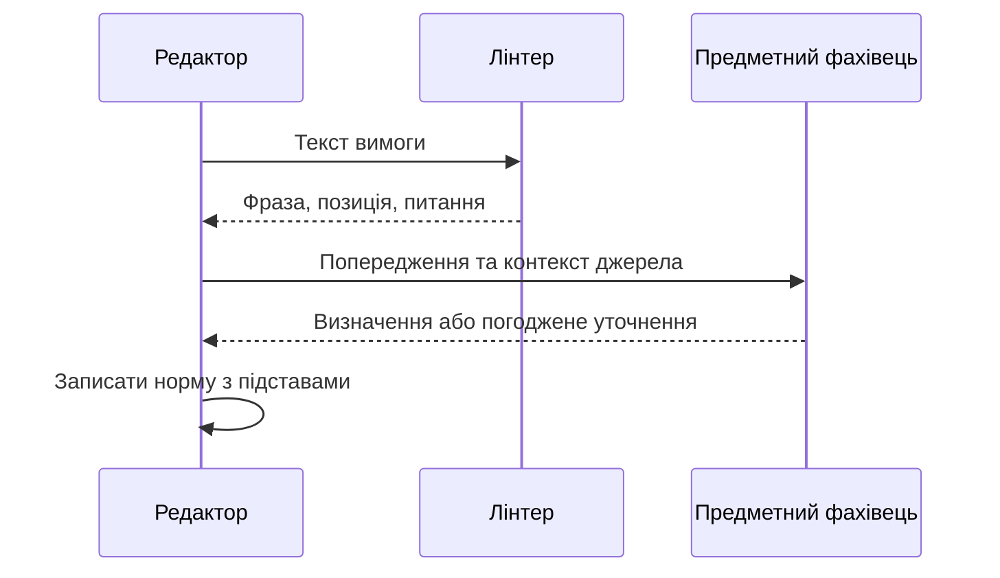
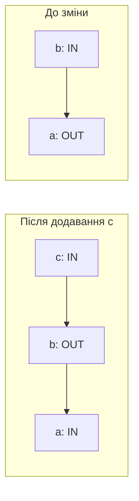

# Глава 15. Нормативні правила та аргументація

<a id="глава-15-деонтична-логіка-норм-must--should--may-нормативні-винятки-lex-specialis-та-формальна-теорія-аргументації-dung-af-aspic"></a>

> **Підручник:** [Експертні Системи](../README.md) · [Том 2. Програмна інженерія знань: ізольовані корпуси, онтології, невизначеність, модельно-орієнтована діагностика, прогностика та верифікація](README.md)  
> **Навчальний рівень:** Вибірковий курс «Інженерія знань» (бакалаврат, 3–4 курс)  
> **Обладнання:** звичайний ноутбук або ПК; додаткове обладнання не потрібне<br>
> **Мови:** приклади — Python 3.14.4 зі стандартною бібліотекою; інші мови — за потреби курсового проєкту
> **Попередня глава:** [Глава 14. Графи знань, трасованість та організаційна пам'ять](ch14-knowledge-graphs-and-traceability.md)\
> **Наступна глава:** [Глава 16. Невизначеність і способи оцінювання висновків](ch16-uncertainty-and-inference.md)\
> **Автор:** Микола Мартинович Федчик

---

## Анотація

У попередній главі було розглянуто, як зберігати зв'язки між джерелами, правилами, рішеннями й тестами. Тут з'ясовується, як подати вимогу або дозвіл, виявити несумісні приписи, врахувати явно задані винятки й пояснити, чому один аргумент переважає над іншим. Розглядаються базові оператори деонтичної логіки, обмеження їхнього застосування, абстрактні рамки аргументації та структуровані аргументи зі спростовними правилами. Наведені стани перевірки й навчальні приклади є моделями для проєктування, а не правовими висновками, загальними нормами права чи підтвердженням відповідності стандартам.

---

<!-- chapter-toc:start -->
## Зміст глави

- [1. Подання обов'язків, заборон і дозволів](#1-подання-обовязків-заборон-і-дозволів)
  - [1.1. Формалізація нормативних висловлювань](#11-формалізація-нормативних-висловлювань)
  - [1.2. Перевірка сумісності приписів](#12-перевірка-сумісності-приписів)
- [2. Винятки та пріоритети правил](#2-винятки-та-пріоритети-правил)
  - [2.1. Явне обґрунтування пріоритету](#21-явне-обґрунтування-пріоритету)
  - [2.2. Стани результату нормативної перевірки](#22-стани-результату-нормативної-перевірки)
- [3. Абстрактні аргументи та їх прийнятність](#3-абстрактні-аргументи-та-їх-прийнятність)
  - [3.1. Аргументи та відношення атаки](#31-аргументи-та-відношення-атаки)
  - [3.2. Захист аргументів і заземлений результат](#32-захист-аргументів-і-заземлений-результат)
  - [3.3. Взаємні атаки та неоднозначність](#33-взаємні-атаки-та-неоднозначність)
- [4. Структуровані аргументи й спростовні правила](#4-структуровані-аргументи-й-спростовні-правила)
  - [4.1. Три способи атакувати аргумент](#41-три-способи-атакувати-аргумент)
  - [4.2. Перевірка аргументу в предметному контексті](#42-перевірка-аргументу-в-предметному-контексті)
- [5. Практичні завдання та лабораторний практикум](#5-практичні-завдання-та-лабораторний-практикум)
  - [5.1. Контрольні запитання](#51-контрольні-запитання)
  - [5.2. Ручне трасування](#52-ручне-трасування)
  - [5.3. Завдання з програмної реалізації](#53-завдання-з-програмної-реалізації)
  - [5.4. Зв'язок із лабораторною та курсовою роботою](#54-звязок-із-лабораторною-та-курсовою-роботою)
- [Висновки](#висновки)
- [Глосарій](#глосарій)
- [Скорочення та терміни](#скорочення-та-терміни)
- [Джерела](#джерела)
<!-- chapter-toc:end -->

---

<a id="1-стандартна-деонтична-логіка-sdl-модальності-rfc-2119-та-умова-нормативної-сумісності"></a>

## 1. Подання обов'язків, заборон і дозволів

Експертна система може виявити факт — наприклад, що перевірку не виконано, — але нормативний висновок потребує додаткової інформації: яка вимога діяла, до кого вона застосовувалася та чи було чинне виключення. Якщо записати приписи звичайними булевими правилами без розрізнення обов'язку, заборони й дозволу, система може помилково трактувати «не заборонено» як «дозволено» або нормативний припис як опис фактичної події. Деонтична логіка дає базову мову для таких розрізнень; вона не визначає сама собою, яке право чи політика чинні в конкретній ситуації.

<a id="11-оператори-обовязку-op-заборони-fp--onot-p-та-дозволу-pp--not-onot-p"></a>

### 1.1. Формалізація нормативних висловлювань

Нехай `p` означає дію або стан справ, а `O(p)` — що `p` є обов'язковим. За поширеним означенням заборона дії — це обов'язок утриматися від неї; слабкий дозвіл означає, що обов'язок утриматися не виводиться.

**Формула 15.1 — Базові нормативні оператори**

$$
F(p)=O(\neg p),\qquad P_w(p)=\neg O(\neg p)
$$

`F(p)` — заборона `p`; `P_w(p)` — слабкий, або негативний, дозвіл `p`; `¬p` — заперечення дії. Індекс `w` нагадує, що це визначення дозволу через відсутність обов'язку утриматися: воно не стверджує наявність окремої позитивної норми, яка дозволяє дію. У деяких нормативних моделях розрізняють також сильний дозвіл, прямо встановлений нормою; його не можна ототожнювати з `P_w`.

Наприклад, якщо `p` означає «оператор запускає тест», то `O(p)` вимагає виконати тест, `F(p)` його забороняє, а `P_w(p)` повідомляє лише, що система не вивела обов'язку його не виконувати. Чи є дія законною або безпечною — поза межами цих символів, доки не задано джерело, юрисдикцію, адресата, час чинності та факти.

Окремо існують ключові слова для специфікацій Інтернет-протоколів. RFC 2119 визначає спеціальне тлумачення термінів `MUST`, `SHOULD`, `MAY` та інших лише в контексті документів, що явно приймають цей словник; RFC 8174 уточнює, що спеціальні значення мають саме написання великими літерами [2][3]. Це не є універсальною шкалою юридичних обов'язків і не задає автоматичного перекладу в оператори `O`, `F` та `P_w`.

**Таблиця 15.2 — Розрізнення нормативних позначень**

| Позначення | Значення у відповідному документі | Чого не слід припускати |
|---|---|---|
| `MUST` | Абсолютна вимога специфікації | Не означає автоматично законодавчий обов'язок для будь-якої особи |
| `MUST NOT` | Абсолютна заборона в межах специфікації | Не визначає санкцію поза її сферою |
| `SHOULD` | Рекомендована дія; відступ можливий за зважених підстав | Не є просто «слабким MUST» у будь-якій нормативній системі |
| `MAY` | Необов'язкова можливість у межах специфікації | Не є дозволом, наданим законом або власником системи |

У реальній базі знань кожне нормативне правило має зберігати текст джерела, ідентифікатор положення, адресата, умову застосування, часові межі, винятки й відповідального за інтерпретацію. Це пов'язує главу з моделлю простежуваності з Глави 14 і дає змогу перевірити, звідки взялося правило.

До формалізації корисно знайти місця, де редактору ще бракує визначень. Наприклад, у вимозі «Перевірку слід виконати достатньо швидко за потреби» не зазначено ні критерію своєчасності, ні події, яка робить перевірку потрібною. Лексичний лінтер може підсвітити ці вирази та поставити питання фахівцю, але не повинен сам вигадувати число секунд або прирівнювати українське «слід» до `MUST`.

<a id="obj-15-lint-sequence"></a>

**Діаграма 15.3 — Уточнення вимоги перед формалізацією**



Функція нижче шукає два відомі вирази без урахування регістру та повертає список попереджень у порядку появи. Вхід — рядок вимоги; результат — знайдена фраза, напіввідкритий інтервал у кодових точках початкового рядка та питання для перегляду. Регулярний вираз зберігає позиції саме в оригіналі й не збігається з частиною довшого слова.

<a id="obj-15-lint-code"></a>

**Лістинг 15.4 — Лексичні сигнали для перегляду вимоги (Python 3.14.4)**

<details>
<summary>Показати лістинг 15.4 (20 рядків, Python 3.14.4)</summary>

```python
import re

def lint_requirement(text):
    phrases = {
        "достатньо швидко": "Який критерій своєчасності та де його визначено?",
        "за потреби": "Яка подія або умова вмикає вимогу?",
    }
    findings = []
    for phrase, question in phrases.items():
        pattern = rf"(?<!\w){re.escape(phrase)}(?!\w)"
        for match in re.finditer(pattern, text, flags=re.IGNORECASE):
            findings.append({"phrase": phrase, "span": match.span(),
                             "question": question})
    return sorted(findings, key=lambda finding: finding["span"])

sample = "Перевірку слід виконати достатньо швидко за потреби."
warnings = lint_requirement(sample)
assert [item["phrase"] for item in warnings] == ["достатньо швидко", "за потреби"]
assert all(sample[a:b] == item["phrase"] for item in warnings for a, b in [item["span"]])
print(len(warnings))
```

</details>

Програма повертає два попередження. Щоб перетворити їх на корисну редакторську дію, треба перевірити також сусідні положення, глосарій та область застосування джерела.

<a id="obj-15-lint-review"></a>

**Таблиця 15.5 — Предметний перегляд лексичних попереджень**

| Фраза | Що потрібно знайти | Рішення після перегляду |
|---|---|---|
| «достатньо швидко» | Визначений критерій часу або завершення події | Послатися на визначення; якщо його немає — погодити уточнення |
| «за потреби» | Умову активації та відповідального за її встановлення | Указати умову або залишити питання відкритим |

Попередження не є доведеною неоднозначністю: термін може бути визначений далі в документі. Відсутність попереджень також не доводить однозначності — словник короткий і не виконує семантичного аналізу. Не кожна норма потребує числа або одиниці SI; відповідний критерій залежить від змісту. Лінтер не встановлює нормативної сили чи пріоритету: підстави порівняння правил розглянуто в §2.1.

<a id="12-серійна-семантика-кріпке-аксіома-d-та-формальне-виявлення-деонтичних-колізій-між-правилами"></a>

### 1.2. Перевірка сумісності приписів

Для перевірки несумісних приписів треба розрізняти нормативний світ і фактичний стан. Обов'язок виконати дію не означає, що дію вже виконано. У простій семантиці Кріпке кожен світ має множину доступних йому «ідеальних» світів; формула `O(p)` істинна в поточному світі, якщо `p` істинне в усіх доступних ідеальних світах.

**Формула 15.6 — Умова істинності обов'язку в моделі Кріпке**

$$
w\models O(p)\quad\Longleftrightarrow\quad
\forall v\,(wRv\Rightarrow v\models p)
$$

`w` — поточний світ або стан оцінювання; `v` — один із нормативно доступних світів; `R` — відношення доступності. Ця модель не означає, що `p` відбулося у фактичному світі. У серійній моделі кожний світ має принаймні один доступний світ; відповідна система містить аксіому `D`, яка виключає ситуацію, коли одночасно виведено обов'язок `p` і обов'язок `¬p`. Серійність — припущення обраної логічної моделі, а не універсальне твердження про кожну систему норм [1].

Для комп'ютерної перевірки приписи часто зводять до скінченної моделі фактів і умов. Наприклад, у навчальному регламенті діє правило «перед запуском виконати перевірку», а для режиму технічного обслуговування задано «не запускати обладнання». Якщо обидва приписи активні, система спершу має перевірити, чи справді їхні вимоги несумісні: виконати перевірку й не запускати обладнання можна одночасно.

**Таблиця 15.7 — Навчальні приклади перевірки сумісності приписів**

| Умова контексту | Активний припис | Дія | Результат аналізу |
|---|---|---|---|
| Звичайний режим | Виконати перевірку перед запуском | Перевірка потрібна | Один застосовний обов'язок |
| Режим обслуговування | Не запускати обладнання | Запуск заборонений | Один застосовний обов'язок утриматися |
| Два точно протилежні приписи активні для тієї самої дії | Запустити і не запускати (`run` та `¬run`) | Несумісні вимоги | Конфлікт у цій формалізації; перевірити джерела й умови застосування |

Таблиця розрізняє сумісні дії та формально протилежні вимоги. Колізію можна оголосити лише після того, як дії, умови й наслідки формалізовано достатньо точно.

Якщо у скінченній пропозиційній моделі кожному припису зіставлено обмеження на дію, задачу сумісності можна подати SAT-розв'язувачу. Наприклад, нехай булева змінна `run` означає «обладнання запущено»; формалізовані умови `run` і `¬run` разом не мають моделі. SAT-перевірка поверне `UNSAT` для цього набору обмежень. Це показує суперечність саме у вибраному кодуванні, але не перевіряє правильність перекладу нормативного тексту, його юрисдикцію чи повноту фактів. Розв'язувач не є «оракулом права».

---

<a id="2-нормативні-вентилі-з-винятками-та-ієрархічні-принципи-права-lex-superior-lex-posterior-lex-specialis"></a>

## 2. Винятки та пріоритети правил

Нормативні джерела можуть задавати загальні приписи, винятки та правила різного рівня. Наївна система, яка вибирає «найспецифічніше» або «найновіше» правило без додаткового контексту, здатна отримати неправомірний результат: правові наслідки залежать від юрисдикції, предмета регулювання, дати чинності та правил тлумачення. Тому в експертній системі потрібно зберігати підстави застосування й зв'язок пріоритетів із конкретною нормативною моделлю, а не зашивати один рейтинг як загальний закон.

<a id="21-лексикографічний-профіль-пріоритету-норми-ранг-органу-видання-модальність-та-специфічність-передумов"></a>

### 2.1. Явне обґрунтування пріоритету

Принципи, відомі як `lex superior`, `lex posterior` і `lex specialis`, відповідно привертають увагу до ієрархії джерел, часу ухвалення та спеціальності предмета регулювання. Їх не можна перетворювати на єдиний універсальний алгоритм із фіксованим порядком застосування: конкретне право може встановлювати винятки, правила набрання чинності, перехідні положення та способи узгодження норм.

У базі знань правило доцільно представляти записом із такими полями:

1. ідентифікатор джерела й конкретного положення;
2. предметна умова та адресат;
3. тип наслідку: обов'язок, заборона, дозвіл або інший визначений тип;
4. час набрання чинності й завершення чинності, якщо відомо;
5. посилання на виняток, перехідне правило або норму, що змінює його дію;
6. явне відношення пріоритету до іншого правила та підстава такого відношення.

**Таблиця 15.8 — Навчальна схема порівняння правил**

| Правило | Сфера дії | Часова умова | Відношення до іншого правила | Результат |
|---|---|---|---|---|
| `N-1` — загальне | Усі планові перевірки | Чинне в заданий період | Базове правило | Застосувати, якщо немає винятку |
| `N-2` — виняток | Лише документоване технічне обслуговування | Чинне в тому самому періоді | Явно відступає від `N-1` у визначеній умові | Застосувати лише за підтвердженої умови |
| `N-3` — нова редакція | Змінила частину `N-1` | Набрала чинності пізніше | Заміна має бути підтверджена джерелом | Не застосовувати до попереднього періоду без підстави |

Це навчальний регламент, а не приклад тлумачення законодавства. Для кожної пари правил система може зберігати відношення «переважає», «не порівнюється» або «потребує експертного рішення». Якщо відношення не задано чи правила конфліктують, безпечніший результат — показати конфлікт і джерела, а не вивести пріоритет з довільної оцінки специфічності.

<a id="22-пять-операційних-станів-нормативної-схеми-з-лінією-винятку-та-верифікація-через-sat-оракул"></a>

### 2.2. Стани результату нормативної перевірки

Для інтерфейсу експертної системи корисно відокремити п'ять типів результату. Це навчальна класифікація статусів, запропонована для прозорої обробки випадків, а не загальноприйнятий нормативний стандарт.

**Таблиця 15.9 — П'ять станів результату перевірки**

| Стан | Значення | Приклад реакції системи |
|---|---|---|
| `COMPLIANT` | За наявними фактами застосовна вимога виконана | Показати правило й докази виконання |
| `VIOLATION` | За наявними фактами застосовна вимога порушена | Показати невиконану вимогу й відсутні або суперечливі докази |
| `CONFLICT` | Активні приписи в обраній моделі вимагають несумісних дій або висновків | Не вибирати припис автоматично; передати на визначений перегляд |
| `UNKNOWN` | Даних недостатньо для встановлення застосовності або виконання | Запросити конкретні відсутні факти |
| `NOT_APPLICABLE` | Умова застосовності правила не виконується | Пояснити перевірену умову й не оцінювати виконання цього правила |

Статуси стосуються оцінювання конкретного правила або набору правил. Вони не є універсальним вердиктом про законність поведінки. Якщо перевіряється дозвіл, треба окремо вказати, чи система шукає прямий дозвіл, чи лише відсутність заборони; ці запити можуть мати різні результати.

Розгляньмо правило «запуск дозволений лише після двох перевірок». Якщо одна перевірка відсутня в журналі, але журнал неповний, результат `UNKNOWN`, а не `VIOLATION`. Якщо надійні дані підтверджують одну перевірку з двох, результат для правила — `VIOLATION`. Якщо правило не застосовується до цього типу обладнання, результат `NOT_APPLICABLE`. Такий поділ дозволяє не перетворювати відсутність доказу на доказ порушення.

SAT-розв'язувач може бути одним із засобів перевірки сумісності скінченного формального подання: якщо активні обмеження не мають розв'язку, повертається `CONFLICT` для цього подання. Потрібно зберігати набір вхідних обмежень і пояснення, які саме з них утворили суперечність. Сам статус `UNSAT` не встановлює, яке правило має перевагу, а відповідь `SAT` не доводить, що модель охопила всі важливі норми.

---

<a id="3-абстрактні-рамки-аргументації-фан-мін-дунга-dung-af-та-семантика-розширень"></a>

## 3. Абстрактні аргументи та їх прийнятність

Після фільтрації за умовами та пріоритетами система може мати кілька аргументів на користь різних висновків. Абстрактна теорія аргументації дає змогу описати, які аргументи атакують один одного, а потім визначити множини, що приймаються за обраною семантикою. Вона не оцінює правдивість початкових фактів, доки ті не представлені та не обґрунтовані окремо.

<a id="31-граф-аргументів-і-атак-a-r-поняття-безконфліктності-та-прийнятності-аргументу"></a>

### 3.1. Аргументи та відношення атаки

Абстрактна рамка аргументації — це пара `AF = (A, R)`, де `A` — скінченна множина аргументів, а `R` — відношення атаки між ними. Якщо `(a,b) ∈ R`, аргумент `a` атакує `b`. На цьому рівні внутрішню структуру аргументу та причину атаки навмисно не розкривають; для цього потрібна структурована модель, яку розглянуто в наступному розділі [4].

Множина аргументів є **безконфліктною**, якщо жоден її елемент не атакує інший елемент цієї множини. Аргумент `a` **захищається** множиною `S`, якщо кожного нападника `a` атакує принаймні один аргумент із `S`. Множина є **допустимою**, якщо вона безконфліктна й захищає кожен свій аргумент.

Припустімо, є аргументи `a`, `b`, `c` та атаки `a → b`, `b → a`, `b → c`. Це може бути навчальною моделлю двох протилежних тлумачень `a` і `b`, де `b` також підважує підставу для `c`. Сама схема не повідомляє, яке тлумачення істинне; вона визначає лише задане відношення атаки.

<a id="32-характеристичний-оператор-захисту-дунга-gammas-та-ітеративне-обчислення-заземленого-розширення-grounded-extension"></a>

### 3.2. Захист аргументів і заземлений результат

Для знаходження аргументів, захищених множиною `S`, використовують характеристичний оператор `Γ`. Застосування оператора починається з порожньої множини та повторюється, доки результат не зміниться.

**Формула 15.10 — Характеристичний оператор**

$$
\Gamma(S)=\{a\in A\mid
\forall b\,((b,a)\in R\Rightarrow
\exists c\in S\,(c,b)\in R)\}
$$

`A` — множина всіх аргументів; `R` — відношення атаки; `S` — поточна множина прийнятих аргументів; `Γ(S)` — аргументи, чиїх усіх нападників атакує `S`. Заземлений результат отримують ітерацією `S₀ = ∅`, `Sₙ₊₁ = Γ(Sₙ)` до фіксованої точки. Для скінченної рамки процес завершується, бо оператор є монотонним і множина аргументів скінченна.

У прикладі з `a`, `b`, `c` кожен аргумент має нападника, а початкова множина порожня й нікого не атакує. Тому `Γ(∅)=∅`, і наступні ітерації також залишаються порожніми. Заземлений результат тут порожній: модель не визначає жодного аргументу як безумовно прийнятного за цією семантикою. Це не означає, що всі аргументи хибні.

Для прикладного рушія потрібна ще й реакція на зміну бази аргументів. Візьмемо простіший граф: аргумент `b` атакує `a` й сам не має нападників. Тоді `b` приймається, а `a` відхиляється. Якщо додати непідважений `c`, який атакує `b`, той самий оператор дасть інший результат: `c` захищає `a`, атакуючи його єдиного нападника. Це не новий вид логічного висновку, а звичайне переобчислення заземленої семантики після зміни графа.

<a id="obj-15-changing-attacks"></a>

**Схема 15.11 — Зміна прийнятності після додавання аргументу**



Стрілки схеми позначають атаки, а не передавання істинності. У початковому графі ітерації прийнятої множини мають вигляд `∅ → {b} → {b}`; у зміненому — `∅ → {c} → {a,c} → {a,c}`. Це трасування безпосередньо відповідає формулі 15.10.

Для коду зручно повернути статус кожного аргументу: `IN` для елементів заземленого результату, `OUT` для атакованих ними аргументів і `UNDEC` для решти. Функція отримує скінченну множину рядкових ідентифікаторів та множину пар атак. Вона будує таблицю нападників, починає з порожньої прийнятої множини й повністю повторює оператор до фіксованої точки. Нападник вважається знешкодженим лише тоді, коли його атакує прийнятий аргумент; прийнятність вимагає знешкодження **всіх** нападників.

<a id="obj-15-grounded-code"></a>

**Лістинг 15.12 — Повне переобчислення заземлених статусів (Python 3.14.4)**

<details>
<summary>Показати лістинг 15.12 (16 рядків, Python 3.14.4)</summary>

```python
def grounded_labels(arguments, attacks):
    arguments, attacks = set(arguments), set(attacks)
    if any(not isinstance(argument, str) for argument in arguments):
        raise ValueError("ідентифікатори аргументів мають бути рядками")
    if any(a not in arguments or b not in arguments for a, b in attacks):
        raise ValueError("атака посилається на невідомий аргумент")
    attackers = {a: {b for b, target in attacks if target == a} for a in arguments}
    accepted = set()
    while True:
        defeated = {b for a, b in attacks if a in accepted}
        defended = {a for a in arguments if attackers[a] <= defeated}
        if defended == accepted:
            return {a: "IN" if a in accepted else
                    "OUT" if a in defeated else "UNDEC"
                    for a in sorted(arguments)}
        accepted = defended
```

</details>

Результат функції — словник статусів для поточного графа, не зміна записаного раніше рішення. Після редагування атак виклик починається заново: інкрементального алгоритму тут немає. Наступний лістинг продовжує попередній і перевіряє схему 15.11, додаткового нападника та цикл.

<a id="obj-15-grounded-tests"></a>

**Лістинг 15.13 — Перевірка наслідків зміни графа (Python 3.14.4)**

<details>
<summary>Показати лістинг 15.13 (16 рядків, Python 3.14.4)</summary>

```python
before = grounded_labels({"a", "b"}, {("b", "a")})
after = grounded_labels({"a", "b", "c"}, {("b", "a"), ("c", "b")})
another_attacker = grounded_labels(
    {"a", "b", "c", "d"}, {("b", "a"), ("c", "b"), ("d", "a")}
)
cycle = grounded_labels({"a", "b"}, {("a", "b"), ("b", "a")})
assert before == {"a": "OUT", "b": "IN"}
assert after == {"a": "IN", "b": "OUT", "c": "IN"}
assert another_attacker == {"a": "OUT", "b": "OUT", "c": "IN", "d": "IN"}
assert cycle == {"a": "UNDEC", "b": "UNDEC"}
assert grounded_labels({"a", "b", "c"}, {("a", "b"), ("b", "a"), ("b", "c")}) == {
    "a": "UNDEC", "b": "UNDEC", "c": "UNDEC"
}
for name, labels in [("до", before), ("після", after),
                     ("ще один нападник", another_attacker), ("цикл", cycle)]:
    print(name, labels)
```

</details>

<a id="obj-15-grounded-trace"></a>

**Таблиця 15.14 — Статуси в перевірених варіантах графа**

| Варіант | `a` | `b` | `c` | `d` |
|---|---|---|---|---|
| Лише `b → a` | `OUT` | `IN` | — | — |
| Додано `c → b` | `IN` | `OUT` | `IN` | — |
| Додано ще й `d → a` | `OUT` | `OUT` | `IN` | `IN` |
| Лише цикл `a ↔ b` | `UNDEC` | `UNDEC` | — | — |

Третій рядок важливий для тесту: відхилення `b` саме по собі не приймає `a`, якщо залишається інший непідважений нападник. Статус `IN` означає прийнятність у заданій рамці, а не фактичну істинність чи юридичну силу. Для структурованих аргументів спочатку треба побудувати відповідне відношення поразки з урахуванням типів атак і прийнятих пріоритетів; ця функція працює лише з уже заданою абстрактною рамкою [4][5].

<a id="33-обробка-взаємних-циклів-атак-та-стабільнихпереважних-розширень"></a>

### 3.3. Взаємні атаки та неоднозначність

Заземлена семантика дає консервативний єдиний результат, але може залишити всі аргументи невизначеними. Інші семантики можуть містити кілька альтернативних розширень. Переважне розширення — максимальна за включенням допустима множина; стабільне розширення — безконфліктна множина, яка атакує кожен аргумент поза нею. Різні семантики відповідають різним вимогам до прийняття позицій і не повинні змішуватися.

**Таблиця 15.15 — Результати для навчальної рамки з трьома аргументами**

| Семантика | Результат у прикладі `a ↔ b`, `b → c` | Інтерпретація |
|---|---|---|
| Заземлена | `∅` | Немає аргументу, прийнятого на всіх етапах фіксованої точки |
| Переважна | `{a,c}` та `{b}` | Є дві максимальні узгоджені позиції |
| Стабільна | `{a,c}` та `{b}` | Кожна з цих позицій атакує всі аргументи поза нею |

Результати можна перевірити вручну. Множина `{a,c}` безконфліктна; вона захищає `a` і `c` від нападника `b`, атакуючи `b` аргументом `a`. Множина `{b}` також безконфліктна, а `b` атакує і `a`, і `c`, тобто кожен аргумент поза нею. Жодну з цих двох множин не можна розширити, не отримавши конфлікту; тому обидві є переважними. Отже, множина стабільних або переважних розширень може містити кілька несумісних позицій; система має показати цю неоднозначність, а не довільно приховати її.

---

<a id="4-структурована-аргументація-aspic-суворі-та-спростовні-правила"></a>

## 4. Структуровані аргументи й спростовні правила

Абстрактний граф показує факт атаки, але не пояснює, чи атаковано вихідне свідчення, висновок правила або саме право застосувати правило. Структурована аргументація зберігає ці відмінності та дає змогу відновити дерево підстав. У моделях родини ASPIC+ правила поділяють на суворі, які в обраній логіці не підлягають спростуванню, і спростовні, що діють за відсутності сильнішого контраргументу [5].

<a id="41-три-типи-атак-підрив-засновку-undermining-спростування-висновку-rebutting-та-підтинання-застосовності-правила-undercutting"></a>

### 4.1. Три способи атакувати аргумент

Розглянемо навчальне правило: «якщо є запис про перевірку та ознака справної калібровки, зазвичай можна рекомендувати перехід до наступного етапу». Слово «зазвичай» позначає спростовне правило, а не безумовний логічний наслідок.

1. **Підрив засновку:** подано контрдоказ проти засновку, що наявний запис є повним і достовірним. Самої відсутності запису недостатньо, щоб спростувати факт виконання перевірки, якщо правило не вимагає саме документованого підтвердження.
2. **Спростування висновку:** інший аргумент підтримує протилежний висновок, наприклад рекомендацію не переходити до наступного етапу. У стандартному ASPIC+ rebutting стосується висновку, отриманого спростовним правилом; деталі залежать від формального визначення протилежності.
3. **Підтинання правила:** аргумент показує, що спростовне правило тут незастосовне, наприклад обладнання перебуває в режимі, для якого це правило не призначене. Така атака спрямована на застосування правила, а не обов'язково заперечує його висновок у всіх випадках.

Тип атаки має бути явним у даних системи. Якщо будь-який контраргумент зберігається лише як ребро без позначення виду атаки, важко пояснити, чи треба перевіряти достовірність джерела, конфлікт висновків або сферу застосовності правила.

<a id="42-практичне-моделювання-судового-спору-медичного-консиліуму-та-перевірки-наказу-на-відповідність-roe"></a>

### 4.2. Перевірка аргументу в предметному контексті

Для кожного аргументу система має зберігати його засновки, правила виведення, джерела, час чинності та статус перевірки. У правовому, медичному чи оборонному застосуванні це лише технічна підтримка аналізу: предметні рішення потребують належного фахового й організаційного контролю, а демонстраційний граф не є правовим висновком, діагнозом або оцінкою законності наказу.

Наприклад, у навчальній перевірці внутрішнього регламенту:

- аргумент `A1` спирається на чинний запис про калібрування та спростовне правило «за справної перевірки рекомендувати наступний етап»;
- аргумент `A2` підриває засновок `A1`, бо аудит виявив, що журнал не є повним підтвердженням саме цієї перевірки;
- аргумент `A3` підтинає правило `A1`, бо інструкція обмежує його застосування штатним режимом, а зафіксовано режим обслуговування.

Перед висновком треба перевірити, чи джерела `A2` та `A3` автентичні, чи їхні часові межі збігаються із подією, та чи пріоритет між ними заданий і обґрунтований. Сам тип атаки не надає аргументу переваги. Для кожної позиції результат має містити шлях від джерела до засновків і застосованих правил; цей шлях можна зв'язати з графом простежуваності з Глави 14.

---

## 5. Практичні завдання та лабораторний практикум

Практикум переводить логічні поняття у невелику перевірювану модель: студент задає кілька умовних норм, будує граф атак і пояснює отриманий статус. Приклади не моделюють реальну юрисдикцію, клінічну практику чи правила застосування сили.

### 5.1. Контрольні запитання

1. Чим відрізняються обов'язок, заборона й слабкий дозвіл? Чому відсутність заборони не завжди є позитивним дозволом?
2. У якому контексті RFC 2119 визначає спеціальне значення ключових слів і що уточнює RFC 8174?
3. Яке припущення стоїть за серійною семантикою деонтичної логіки?
4. Чому два приписи природною мовою можуть виглядати суперечливими, хоча формальна модель показує сумісність?
5. Чому принципи ієрархії, часу й спеціальності не утворюють універсального автоматичного рейтингу норм?
6. Що означають стани `CONFLICT` та `UNKNOWN`, і чому вони не повинні зливатися?
7. Чим заземлена семантика відрізняється від стабільної та переважної?
8. Які три типи атак розрізняє структурована аргументація в розглянутій моделі?

### 5.2. Ручне трасування

1. **Формалізація.** Запишіть окремо обов'язок виконати перевірку, заборону запуску та слабкий дозвіл запуску. Поясніть, які дані потрібні, щоб перетворити їх на прикладні правила.
2. **Виявлення колізії.** Створіть два умовні приписи, активні в одному контексті, і формалізуйте їхні наслідки. Знайдіть, чи справді наслідки несумісні, а не просто пов'язані з різними діями.
3. **Стани перевірки.** Для кожного з п'яти статусів у таблиці 15.9 наведіть власний приклад і вкажіть, яке додаткове свідчення могло б змінити результат.
4. **Рамка аргументації.** Для атак `a ↔ b`, `b → c` вручну перевірте безконфліктність, захист, заземлений результат та два переважні розширення.
5. **Тип атаки.** Для заданого дерева аргументу класифікуйте контрдоказ як підрив засновку, спростування висновку або підтинання правила; обґрунтуйте вибір посиланням на місце атаки.

<a id="53-інженерні-завдання-з-програмування-мовна-незалежність--спеціалізовані-dsl"></a>

### 5.3. Завдання з програмної реалізації

Розширте лістинги 15.12–15.13 до малого рушія абстрактної аргументації для скінченної множини аргументів і атак:

1. перевірте коректність ідентифікаторів та побудуйте таблицю нападників для кожного аргументу;
2. реалізуйте перевірку безконфліктності й захищеності заданої множини;
3. обчисліть заземлений результат ітерацією характеристичного оператора;
4. для графів із не більш ніж шістьма аргументами переберіть усі підмножини та знайдіть допустимі, переважні й стабільні розширення;
5. перевірте програму на рамці з підрозділу 3.3, на порожньому графі, одному непідваженому аргументі та взаємній атаці двох аргументів.
6. вилучіть `c` із другого графа таблиці 15.14 та перевірте повернення до початкових статусів; додайте перевірки самоатаки й невідомого ідентифікатора;
7. розширте лексичний словник лістингу 15.4, перевірте повторні входження та різний регістр; наведіть визначений у глосарії термін, для якого попередження буде хибною тривогою.

У поясненні наведіть фактичний вихід програми для прикладу, логіку кожного тесту та межу перебору. Перебір усіх підмножин має експоненційну складність за кількістю аргументів; тому реалізація призначена для навчальних графів, а не автоматично для великих виробничих наборів.

### 5.4. Зв'язок із лабораторною та курсовою роботою

**Лабораторна робота №2.3:** студент будує абстрактну рамку аргументації з нормативними винятками на умовному регламенті, реалізує обчислення заземленого результату й показує випадок із кількома переважними позиціями. Розширена частина може порівняти структуру ASPIC+ аргументів, але інтегрування кількісного злиття свідчень належить до теми Глави 16 і не є передумовою цієї лабораторної роботи.

Для курсового проєкту можна зв'язати правило з джерелом, версією та результатом тесту через граф Глави 14. У звіті слід окремо позначити навчальне припущення, предметне тлумачення, формальний результат і невирішені питання. Такий поділ не дозволяє сприйняти результат логічного рушія як підтвердження правомірності чи безпеки.

---

## Висновки

Деонтичні оператори дають змогу відрізнити обов'язок, заборону й слабкий дозвіл, але не встановлюють чинного права без джерел і контексту. RFC 2119 і RFC 8174 визначають словник для відповідних специфікацій, а не універсальну юридичну логіку. Колізії треба виявляти у формалізованій моделі, зберігати активні правила й не доручати SAT-розв'язувачу вибір правового пріоритету. П'ять статусів у главі — навчальна схема для розрізнення виконання, порушення, конфлікту, браку даних і незастосовності. Абстрактні семантики аргументації можуть повертати невизначеність або кілька допустимих позицій; структуровані атаки пояснюють, де саме оскаржено аргумент. У наступній главі невизначеність фактів розглядатиметься окремо від нормативного конфлікту та прийнятності аргументів.

## Глосарій

* **Деонтична логіка** — формальна логіка нормативних понять, зокрема обов'язку, заборони й дозволу.
* **Слабкий дозвіл** — висновок, що обов'язок утриматися від дії не встановлено; не обов'язково окремий позитивний дозвіл.
* **Нормативна колізія** — несумісність застосовних приписів у явно заданій моделі та контексті.
* **Абстрактна рамка аргументації** — скінченна множина аргументів разом із відношенням атак.
* **Заземлений результат** — найменша фіксована точка характеристичного оператора рамки аргументації.
* **Переважне розширення** — максимальна за включенням допустима множина аргументів.
* **Стабільне розширення** — безконфліктна множина, що атакує кожен аргумент поза нею.
* **Спростовне правило** — правило, яке застосовується за звичайних умов, але може бути переможене контраргументом або винятком.

## Скорочення та терміни

* **ASPIC+** — формальна система структурованої аргументації з суворими та спростовними правилами.
* **AF** — рамка аргументації (Argumentation Framework).
* **RFC** — документ серії Request for Comments; спеціальні нормативні ключові слова визначені лише за умов, описаних у відповідних RFC.
* **SAT** — задача виконуваності булевих формул.
* **UNSAT** — відсутність призначення істинності, що задовольняє задану булеву формулу.

## Джерела

1. von Wright, G. H. *Deontic Logic*. Mind, 60(237), 1–15, 1951. [https://doi.org/10.1093/mind/LX.237.1](https://doi.org/10.1093/mind/LX.237.1).
2. Bradner, S. *Key words for use in RFCs to Indicate Requirement Levels*. RFC 2119, BCP 14, March 1997. [https://www.rfc-editor.org/rfc/rfc2119](https://www.rfc-editor.org/rfc/rfc2119).
3. Leiba, B. *Ambiguity of Uppercase vs Lowercase in RFC 2119 Key Words*. RFC 8174, BCP 14, May 2017. [https://www.rfc-editor.org/rfc/rfc8174](https://www.rfc-editor.org/rfc/rfc8174).
4. Dung, P. M. *On the acceptability of arguments and its fundamental role in nonmonotonic reasoning, logic programming and n-person games*. Artificial Intelligence, 77(2), 321–357, 1995. [https://doi.org/10.1016/0004-3702(94)00041-X](https://doi.org/10.1016/0004-3702(94)00041-X).
5. Modgil, S., Prakken, H. *A general account of argumentation with preferences*. Artificial Intelligence, 195, 361–397, 2013. [https://doi.org/10.1016/j.artint.2012.10.008](https://doi.org/10.1016/j.artint.2012.10.008).
6. McNamara, P., van der Torre, L. *Deontic Logic*. Stanford Encyclopedia of Philosophy. [https://plato.stanford.edu/entries/logic-deontic/](https://plato.stanford.edu/entries/logic-deontic/).
