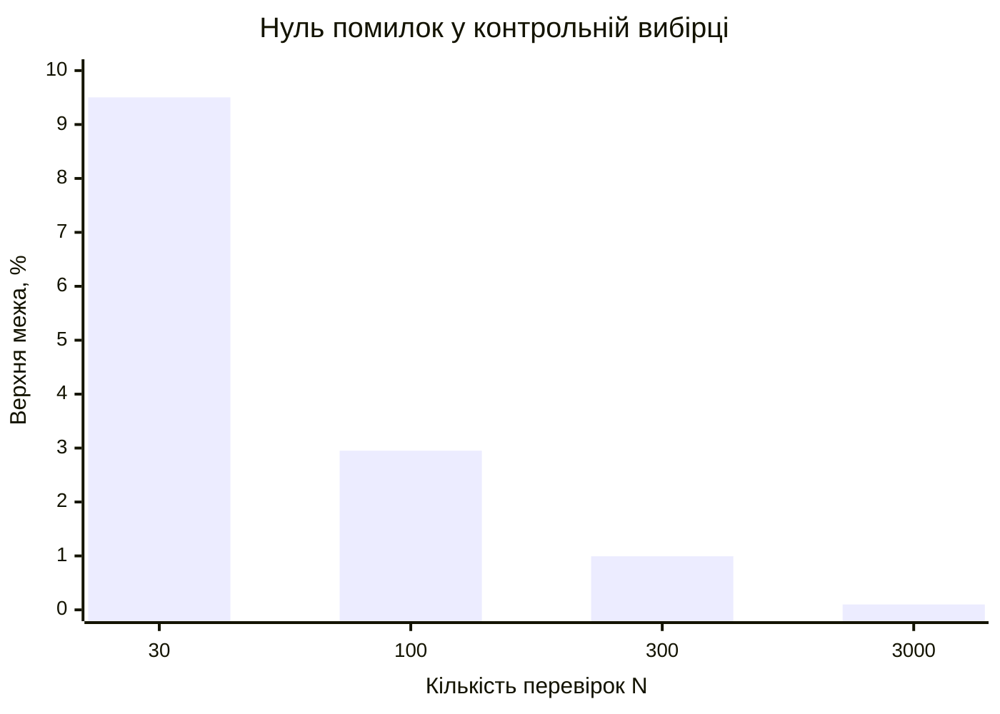

# Глава 19. Формальна перевірка й тестування баз знань

<a id="глава-19-формальна-верифікація-баз-знань-sat--smt-темпоральна-логіка-ltl-та-піраміда-тестування-правил"></a>

> **Підручник:** [Експертні Системи](../README.md) · [Том 2. Програмна інженерія знань: ізольовані корпуси, онтології, невизначеність, модельно-орієнтована діагностика, прогностика та верифікація](README.md)  
> **Навчальний рівень:** Вибірковий курс «Інженерія знань» (бакалаврат, 3–4 курс)  
> **Обладнання:** звичайний ноутбук або ПК; дискретний GPU — необов'язково, лише для лабораторних із виміряною потребою  
> **Мови:** реалізація — будь-яка мова загального призначення (лістинги — Python); спеціалізовані мови — Prolog і DMN/FEEL з базового курсу, OWL 2, RDF/SPARQL, SHACL, Clingo ASP, SMT-LIB v2 (Z3)  
> **Попередня глава:** [Глава 18. Діагностика на основі моделі об'єкта](ch18-model-based-diagnosis.md)\
> **Наступна глава:** [Глава 20. Часові моделі, прогнозування та калібрування](ch20-temporal-models-and-prediction.md)\
> **Автор:** Микола Мартинович Федчик

---

## Анотація

У главі розглянуто, як перевірити формалізовані правила до запуску й як систематично тестувати їхню взаємодію. Спочатку правила подано як логічні обмеження для пошуку суперечностей, недосяжних умов і прогалин; далі перевірено часові властивості послідовностей станів та узгодженість числових перетворень між модулями. Завершальна частина відрізняє формальні перевірки від тестування й мутаційного аналізу та пояснює, як оцінювати свідчення для поточної версії правил. Висновок розв'язувача стосується лише закодованої моделі та її припущень і сам по собі не доводить повноти бази знань, відповідності стандарту чи безпечності реального виробу.

**Тематичний обсяг глави:** перевірка правил як обмежень, властивості часових трас, узгодженість числових інтерфейсів, граничні тести, аналіз мутацій, облік свідчень і статистичні межі контрольного тестування.

<!-- chapter-toc:start -->
## Зміст глави

- [1. Формальна перевірка правил](#1-формальна-перевірка-правил)
  - [1.1. Подання правил як логічних обмежень](#11-подання-правил-як-логічних-обмежень)
  - [1.2. Пошук суперечностей і прогалин](#12-пошук-суперечностей-і-прогалин)
- [2. Перевірка властивостей послідовностей станів](#2-перевірка-властивостей-послідовностей-станів)
  - [2.1. Часові оператори](#21-часові-оператори)
  - [2.2. Безпека й обмежені строки відповіді](#22-безпека-й-обмежені-строки-відповіді)
- [3. Узгодженість числових інтерфейсів](#3-узгодженість-числових-інтерфейсів)
  - [3.1. Перетворення одиниць між модулями](#31-перетворення-одиниць-між-модулями)
  - [3.2. Перевірка замкнених циклів](#32-перевірка-замкнених-циклів)
- [4. Тестування правил і аналіз мутацій](#4-тестування-правил-і-аналіз-мутацій)
  - [4.1. Свідок застосовності кожного правила](#41-свідок-застосовності-кожного-правила)
  - [4.2. Граничні значення й чутливість тестів](#42-граничні-значення-й-чутливість-тестів)
  - [4.3. Облік і застосовність свідчень перевірки](#43-облік-і-застосовність-свідчень-перевірки)
  - [4.4. Статистичні межі та незалежна контрольна вибірка](#44-статистичні-межі-та-незалежна-контрольна-вибірка)
- [5. Практичні завдання та лабораторний практикум](#5-практичні-завдання-та-лабораторний-практикум)
  - [5.1. Контрольні запитання для самоперевірки](#51-контрольні-запитання-для-самоперевірки)
  - [5.2. Розрахункові задачі](#52-розрахункові-задачі)
  - [5.3. Завдання з програмної реалізації](#53-завдання-з-програмної-реалізації)
  - [5.4. Зв'язок із лабораторною та курсовою роботою курсу](#54-звязок-із-лабораторною-та-курсовою-роботою-курсу)
- [Висновки](#висновки)
- [Глосарій](#глосарій)
- [Скорочення та терміни](#скорочення-та-терміни)
- [Джерела](#джерела)
<!-- chapter-toc:end -->

---

<a id="1-статична-верифікація-баз-правил-за-допомогою-розвязувачів-виконуваності-у-теоріях-smt"></a>

## 1. Формальна перевірка правил

У попередніх главах правила розглядалися як засіб отримання висновків, але помилка в порозі, типі змінної чи пріоритеті може залишатися непомітною в кількох ручних прикладах. Формальна перевірка доповнює базу знань і тести розв'язувачем, який шукає модель, де задані умови виконуються, або встановлює, що такої моделі немає в обраній логіці. Наївна перевірка лише «звичних» випадків не знаходить усіх граничних конфігурацій; водночас результат розв'язувача нічого не говорить про правило, яке не було включено до кодування.

SAT-розв'язувач перевіряє виконуваність формул булевої логіки. SMT-розв'язувач узагальнює цю задачу на формули з теоріями, наприклад арифметикою цілих або дійсних чисел, біт-векторами та масивами. Вибір логіки впливає на те, що саме можна подати й які гарантії має конкретний розв'язувач; SMT-LIB задає стандартну мову подання таких задач [1].

<a id="11-кодування-правил-у-smt-lib-v2-лінійна-дійсна-та-цілочисельна-арифметика-неінтерпретовані-функції-масиви"></a>

### 1.1. Подання правил як логічних обмежень

Для перевірки правила відокремлюють його умову від висновку. Нехай $`A_i`$ — умова спрацювання правила, а $`C_i`$ — його висновок. Правило з номером $i$ кодується імплікацією:

<a id="obj-19-1"></a>

**Формула 19.1 — Логічне подання правила**

$$
R_i:\quad A_i\rightarrow C_i.
$$

$`R_i`$ — правило; $`A_i`$ і $`C_i`$ — логічні формули над змінними предметної області. Обмеження домену позначатимемо $\Phi$: воно фіксує припустимі типи та значення, наприклад $0\le T\le100$. Систему перевіряють разом із $\Phi$, а не у вакуумі: пропущене обмеження може створити формальний контрприклад, неможливий у предметній задачі, або приховати реальну помилку.

Розгляньмо температуру $T$ у цілих градусах на діапазоні від 0 до 100 та два правила: за $T\le70$ активувати висновок «нормальний режим», а за $T\ge70$ — «попередження». Якщо специфікація забороняє одночасно активні висновки, значення $T=70$ є потенційним конфліктом. Короткий SMT-LIB фрагмент кодує домен, правила й вимогу взаємного виключення:

<a id="obj-19-2"></a>

**Лістинг 19.2 — Перевірка суперечності за температури 70 (SMT-LIB 2.7)**

<details>
<summary>Показати лістинг 19.2 (12 рядків, SMT-LIB 2.7)</summary>

```smt2
(set-logic QF_LRA)
(declare-const t Real)
(declare-const normal Bool)
(declare-const alert Bool)
(assert (and (<= 0 t) (<= t 100)))
(assert (=> (<= t 70) normal))
(assert (=> (>= t 70) alert))
(assert (not (and normal alert)))
(push)
(assert (= t 70))
(check-sat)
(pop)
```

</details>

Для запиту $T=70$ розв'язувач повертає `unsat`: за наведеними твердженнями обидва висновки мають бути істинними, але їх спільна істинність заборонена. Це локалізує суперечність у формалізації; далі автор правил має визначити, чи треба змінити межу, додати пріоритет, дозволити обидва висновки або уточнити вимогу. Сам статус `unsat` не визначає, який із цих варіантів предметно правильний.

У числовій моделі треба явно вибрати тип: цілі числа, дійсні числа чи біт-вектори. Наприклад, температура як вимір із дробовою частиною не повинна без пояснення округлюватися до цілого. Так само арифметика біт-векторів може переповнюватися за модулем, на відміну від математичної арифметики цілих чисел. Z3 та інші розв'язувачі реалізують формальні процедури для визначених теорій; коректність фізичного масштабу, типів і правил лишається відповідальністю моделі [2].

<a id="12-чотири-формальні-перевірки-внутрішня-суперечність-недосяжні-мертві-правила-прогалини-покриття-gaps-та-надлишковість"></a>

### 1.2. Пошук суперечностей і прогалин

Для кожної перевірки потрібно сформулювати точний запит до розв'язувача. Нехай $\Phi$ — обмеження предметної області, а набір правил має умови $`A_i`$ та висновки $`C_i`$. Недосяжність умови, прогалина між правилами й надлишковість правила — різні властивості; одну не можна виводити з іншої.

<a id="obj-19-3"></a>

**Формула 19.3 — Запити на досяжність, покриття й надлишковість**

$$
\begin{aligned}
\mathrm{Dead}(R_i)&\iff
\mathrm{UNSAT}(\Phi\land A_i),\\
\mathrm{Gap}&\iff
\mathrm{SAT}\!\left(\Phi\land\neg\bigvee_i A_i\right),\\
\mathrm{Redundant}(R_i)&\iff
\mathrm{UNSAT}\!\left(
\Phi\land A_i\land
\bigwedge_{j\ne i}R_j\land\neg C_i
\right).
\end{aligned}
$$

$`\mathrm{SAT}(Q)`$ означає, що запит $Q$ має принаймні одну модель; $`\mathrm{UNSAT}(Q)`$ — що моделей немає. $`\mathrm{Dead}(R_i)`$ вказує, що умова правила недосяжна в заданому домені. $`\mathrm{Gap}`$ означає, що знайдено допустимий стан, який не покриває жодна умова. Правило вважається надлишковим відносно інших правил, якщо за його умови висновок $`C_i`$ уже випливає з решти бази. Тест надлишковості тут передбачає звичайні імплікаційні правила; пріоритети, винятки й побічні ефекти потребують іншого формального подання.

Для виявлення конфлікту двох взаємовиключних висновків шукають модель, у якій істинні обидві умови їхніх правил, а також задано, що висновки не можуть спрацювати разом. Якщо таку модель знайдено, розв'язувач повертає приклад значень для дослідження. Якщо формула несумісна, перекриття в цій моделі не доведено; це не виключає помилки в пропущеному правилі чи неправильній умові області.

Повернімося до температурного прикладу. За домену $0\le T\le100$ запит $T>100$ є недосяжним. Для покриття використаймо дві умови $T<70$ і $T>70$: запит «домен та не менше жодна з умов» є виконуваним і повертає свідка $T=70$. Отже, у першому фрагменті було перекриття правил, а в цьому варіанті — прогалина на межі. Розв'язувач знаходить обидва дефекти, але потребує специфікації, яка визначає бажану поведінку в точці 70.

У SMT-запиті `sat` має супроводжуватися перевіркою знайденої моделі, `unsat` — перевіркою того, що потрібні обмеження справді включено, а `unknown` не можна трактувати як успіх перевірки. Розв'язувач аналізує закодовану формулу, а не природномовну вимогу чи весь програмний продукт.

---

<a id="2-лінійна-темпоральна-логіка-пнуелі-ltl-для-верифікації-багатотактових-протоколів"></a>

## 2. Перевірка властивостей послідовностей станів

Однокрокова перевірка правил не виявляє помилок, залежних від порядку подій: наприклад, система може видати дозволений сигнал, але не перейти у відповідний стан або нескінченно чекати на відповідь. Для таких вимог експертну систему чи протокол подають моделлю переходів між станами, а властивість формулюють над повною часовою трасою. Перевірка дає гарантію лише для тих станів, переходів, часових припущень і справедливості виконання, які внесено до моделі.

<a id="21-темпоральні-оператори-x-next-g-globally-f-finally-u-until-та-w-weak-until"></a>

### 2.1. Часові оператори

Лінійна темпоральна логіка описує властивості послідовності станів. Для траси $`s_0,s_1,\ldots`$ атомарні твердження задають факти про поточний стан, а темпоральні оператори описують, коли вони мають бути істинними:

* `X φ` — $\varphi$ істинне в наступному стані;
* `G φ` — $\varphi$ істинне в кожному стані траси;
* `F φ` — $\varphi$ істинне в деякому майбутньому стані;
* `φ U ψ` — $\varphi$ істинне, доки не настане $\psi$, причому $\psi$ має настати;
* `φ W ψ` — $\varphi$ істинне, доки не настане $\psi$, але $\psi$ може не настати ніколи.

Наприклад, вимогу «після запиту система колись відповість» можна записати як `G(req → F ack)`. Вона не містить конкретного строку. У необмеженій моделі скінченний префікс без відповіді ще не є доказом порушення цієї вимоги: відповідь може надійти пізніше. Це відрізняється від обмеженого строку, де кількість кроків визначено явно.

<a id="22-формалізація-інваріантів-безпеки-safety-g-not-bad-та-обмеженої-живучості-bounded-liveness-із-контрприкладами-трас"></a>

### 2.2. Безпека й обмежені строки відповіді

Властивість безпеки стверджує, що небажаний стан ніколи не настає; властивість живучості — що потрібна подія зрештою відбудеться. Для протоколу видачі рекомендацій прикладом безпеки може бути заборона одночасно видати `ACCEPT` і `REFUSAL`. Прикладом вимоги з часовим обмеженням є обов'язок відповісти не пізніше ніж за два переходи:

<a id="obj-19-4"></a>

**Формула 19.4 — Властивості безпеки й обмеженої відповіді**

$$
\begin{aligned}
\text{Безпека:}\quad &G\,\neg(\mathrm{accept}\land\mathrm{refusal}),\\
\text{Відповідь за два переходи:}\quad
&G\!\left(\mathrm{req}\rightarrow
(\mathrm{ack}\lor X\,\mathrm{ack}\lor X\,X\,\mathrm{ack})\right).
\end{aligned}
$$

$G$ означає «завжди», $X$ — «у наступному стані», $`\mathrm{req}`$ — запит, $`\mathrm{ack}`$ — відповідь; `accept` і `refusal` — взаємовиключні вердикти. Друга вимога перевіряє три можливі позиції відповіді: у стані запиту, через один або через два переходи. Якщо відповідь має з'явитися строго після запиту, формулу слід змінити так, щоб поточний стан не зараховувався.

Контрприклад до обмеженої відповіді має скінченний вигляд: `req` істинне в стані $`s_0`$, а `ack` хибне в $`s_0`$, $`s_1`$ і $`s_2`$. Він показує, де саме порушено строк. Для необмеженої вимоги `G(req → F ack)` порушення в нескінченній трасі потребує безкінечного відкладення відповіді; модель-чекер часто подає такий приклад як скінченний префікс із циклом. Результати залежать від того, чи змодельовано планувальник, справедливість виконання та умови зовнішніх відповідей [3].

Багато модель-чекерів стандартно працюють із нескінченними трасами, тоді як окремі інструменти мають власну семантику скінченних трас. Перед інтерпретацією результату треба з'ясувати, яку семантику та які граничні умови застосовано. Темпоральне твердження, перевірене на обмеженій довжині траси, не стає автоматично доведеним для необмеженого часу.

---

<a id="3-матрично-графова-перевірка-узгодженості-числових-інтерфейсів-та-циклів-перерахунку"></a>

## 3. Узгодженість числових інтерфейсів

Коли кілька модулів обмінюються числовими значеннями, однакова назва поля не гарантує однакової одиниці, шкали чи точки відліку. Помилка перетворення може пройти логічні тести й створити фізично неправдоподібний висновок. Подання перетворень графом дає змогу перевірити, чи узгоджуються різні маршрути передавання даних; простий критерій циклу нижче стосується тільки лінійних масштабних перетворень, а не всіх можливих формул.

<a id="31-блокова-матриця-інцидентності-інтерфейсних-переходів-між-модулями-бази-знань"></a>

### 3.1. Перетворення одиниць між модулями

Подамо кожен типізований числовий інтерфейс як вершину графа, а перетворення значення — як напрямлене ребро з визначеним коефіцієнтом. Для додатного масштабу $k$, перетворення має вигляд $y=kx$. У напрямі зворотного проходження ребра використовується обернений коефіцієнт $1/k$. Це подання допомагає знайти арифметичні помилки, однак воно не перевіряє, чи правильно визначено одиниці вимірювання або фізичну величину.

Для прикладу, $`1\,\mathrm{MW}=1000\,\mathrm{kW}`$ і $`1\,\mathrm{kW}=1000\,\mathrm{W}`$. Повернення з ватів у мегавати має множити на $`10^{-6}`$. Якщо в одному модулі помилково задано множник $`10^{-5}`$, значення після повного обходу зросте вдесятеро. Система може знайти цю неузгодженість порівнянням прямого й зворотного перетворень ще до використання числа в правилі.

<a id="32-інваріант-замкненого-циклу-масштабних-коефіцієнтів-сума-логарифмів-коефіцієнтів-передавання-дорівнює-нулю-та-спектральна-межа-невязки"></a>

### 3.2. Перевірка замкнених циклів

Для циклу $C$ у графі масштабних перетворень обхід кожного ребра в його напрямі додає коефіцієнт $`k_e`$, а проти напряму — обернений коефіцієнт. Повернення до початкової величини має зберегти її значення:

<a id="obj-19-5"></a>

**Формула 19.5 — Інваріант замкненого циклу масштабів**

$$
K_C=\prod_{e\in C} k_e^{\sigma_e},\qquad
r_C=\sum_{e\in C}\sigma_e\ln k_e=\ln K_C,\qquad
K_C=1\iff r_C=0.
$$

$C$ — цикл перетворень; $`k_e>0`$ — коефіцієнт масштабу ребра $e$; $`\sigma_e=1`$, якщо ребро проходять у заданому напрямі, і $-1$ — якщо у зворотному. $`K_C`$ — сукупний множник обходу, а $`r_C`$ — його логарифмічна нев'язка. Усі коефіцієнти безрозмірні, а $`r_C=0`$ означає точне повернення до початкового масштабу.

У прикладі з мегаватами, кіловатами й ватами цикл має добуток $`10^3\cdot10^3\cdot10^{-6}=1`$, тому $`r_C=\ln1=0`$. Якщо останнє перетворення помилково задане як $`10^{-5}`$, маємо $`K_C=10`$ і $`r_C=\ln10\approx2.303`$; система повертає в десять разів завищене значення. У реальному вимірюванні допустима похибка може бути ненульовою, тож поріг для $`|r_C|`$ має походити з точності числових даних і вимог застосування, а не з довільної константи.

Критерій добутку не застосовують напряму до афінних перетворень із ненульовим зсувом, наприклад між шкалами Цельсія й Фаренгейта. Для них треба композиційно перевірити повне перетворення виду $y=ax+b$ та вимагати тотожності всього циклу, а не лише добутку масштабів. Перевірка сумісності одиниць і перетворень не замінює аналізу розмірностей чи незалежної перевірки вимірювального ланцюга.

---

<a id="4-чотирирівнева-піраміда-тестування-баз-знань-ktp-та-мутаційний-аналіз"></a>

## 4. Тестування правил і аналіз мутацій

Формальний доказ властивості для обмеженої моделі й тестування прикладів дають різні свідчення: перше охоплює всі стани, представлені моделлю, а друге перевіряє конкретні реалізації, вхідні дані та інтеграційні шляхи. Якщо правила змінилися, звичайний регресійний набір може залишитися «зеленим», навіть коли його приклади не зачіпають нову межу. Тому корисно поєднувати тести різного масштабу та перевіряти, чи справді вони виявляють контрольовані дефекти.

Наведена далі чотирирівнева схема — навчальний спосіб упорядкувати перевірки, а не окремий стандарт або загальноприйнята сертифікаційна методика:

1. **Окреме правило:** приклади для істинної та хибної умови, очікуваний висновок і граничні значення.
2. **Взаємодія правил:** перекриття умов, пріоритети, винятки та випадки одночасної активації.
3. **Інтеграція:** перетворення одиниць, передавання даних, версії конфігурації та обробка відсутніх значень.
4. **Наскрізні сценарії:** від початкових фактів до пояснення, вердикту чи обґрунтованої відмови; повторне виконання після зміни бази.

<a id="41-захист-від-пастки-порожньої-істинності-vacuous-truth-вимога-позитивного-свідка-активації-кожного-правила"></a>

### 4.1. Свідок застосовності кожного правила

Імплікація $`A_i\rightarrow C_i`$ істинна, якщо умова $`A_i`$ ніколи не виконується. Формально це може бути бездоганним результатом, але для правила, яке мало обробляти реальну ситуацію, такий доказ є малоінформативним. Щоб відрізнити правильне правило від недосяжного, для кожного правила перевіряють дві властивості:

* **Коректність наслідку:** чи є формула $`\Phi\land A_i\land\neg C_i`$ несумісною? Якщо розв'язувач знаходить модель, вона є контрприкладом до правила.
* **Застосовність умови:** чи є формула $`\Phi\land A_i`$ сумісною? Якщо ні, правило не має жодного позитивного свідка в заданому домені.

Для першої властивості `unsat` означає, що в межах кодування не знайдено допустимого порушення правила. Для другої `sat` має повернути приклад, на якому умова справді виконується. Такий приклад треба зберегти як тест; він не доводить, що правило часто або важливо застосовується в реальних даних.

Недосяжне правило може бути помилкою, застарілим фрагментом або навмисною страховою умовою для майбутньої конфігурації. Перш ніж видаляти його, потрібно перевірити джерело вимоги й актуальний домен. Так само правило з позитивним свідком не обов'язково коректне для всіх інших допустимих станів.

<a id="42-аналіз-шести-граничних-точок-діапазону-bva-перевірка-смуги-гістерезису-проти-шуму-та-мутаційний-коефіцієнт-виявлення-дефектів"></a>

### 4.2. Граничні значення й чутливість тестів

Для цілочисельного входу з допустимим діапазоном від 0 до 100 базовий набір граничних тестів може охопити значення на одиницю нижче й вище меж та самі межі. Для правила з переходом за порогом 70 окремо перевіряють 69, 70 і 71: саме тут відмінність між `<`, `<=`, `>` та `>=` змінює поведінку.

<a id="obj-19-6"></a>

**Таблиця 19.6 — Приклади граничних входів**

| Перевірка | Вхідні значення | Що має бути визначено |
|---|---|---|
| Межі домену 0–100, цілі числа | −1, 0, 1, 99, 100, 101 | Відхилення позадіапазонних значень і поведінка на межах |
| Поріг 70 | 69, 70, 71 | Однозначна належність точки 70 до потрібного режиму |
| Гістерезис 68–70 | попередній стан разом із 67, 68, 69, 70, 71 | Правила входу, виходу й утримання стану в смузі |

Гістерезис задає різні пороги входу та виходу, щоб шум біля одного порогу не спричиняв часте перемикання. Наприклад, можна входити в стан попередження за $T\ge70$, виходити за $T\le68$, а в проміжку зберігати попередній стан. Перевіряють як вимірювання всередині смуги, так і переходи через обидва пороги. Такий тест підтверджує лише закодовану логіку; придатність ширини смуги потребує аналізу реального шуму й динаміки системи.

Мутаційний аналіз перевіряє силу тестового набору контрольованими змінами правила: заміною `>=` на `>`, зсувом порогу, вилученням висновку чи інверсією умови. Мутант вважають виявленим, якщо тест розрізняє його результат і результат початкової версії. Еквівалентний мутант, поведінка якого не відрізняється в заданому домені, не можна чесно зараховувати до виявлених або тих, що пережили перевірку, без окремого розгляду.

<a id="obj-19-7"></a>

**Формула 19.7 — Частка виявлених мутацій**

$$
M_{\mathrm{score}}=\frac{K}{N_{\mathrm{non-equiv}}}.
$$

$K$ — кількість виявлених мутантів; $`N_{\mathrm{non-equiv}}`$ — загальна кількість мутантів, визнаних нееквівалентними в межах перевірки. Показник належить від 0 до 1, якщо знаменник додатний. Наприклад, якщо тести виявили 8 із 10 нееквівалентних мутантів, частка дорівнює $0.8$. Два мутанти, що вижили, вказують на прогалини тестів або на потребу переглянути еквівалентність; значення 0.8 не означає, що база правил «правильна на 80%» і не є доказом повноти тестування [4].

---

### 4.3. Облік і застосовність свідчень перевірки

Після формальної перевірки й тестування розробникові потрібно відповісти не лише «який результат отримано?», а й «що саме він підтверджує для поточної версії правил?». Зелений тест може стосуватися старої моделі або іншого набору входів; специфікована вимога може ще не мати реалізації. Без окремого обліку цих обставин легко переплутати наявність запису про перевірку з доказом того, що потрібну властивість перевірено.

Для кожної вимоги або твердження зберігають її ідентифікатор, стан розробки, версію моделі чи реалізації, межі й припущення перевірки, запит або тест, очікуваний і фактичний результати, а також посилання на звіт, свідок або контрприклад. Відсутній артефакт позначають явно. У графі простежуваності з [Глави 14](ch14-knowledge-graphs-and-traceability.md) ці записи можуть бути пов'язані з вимогою, правилом та версією документа; саме ребро не замінює оцінювання змісту свідчення.

Стан розробки й результат перевірки описують різні речі. Правило може бути **специфіковане**, але ще не реалізоване; реалізоване — але ще не перевірене; перевірене для певного набору умов — але не для інших. Контрприклад або невідповідність спростовує конкретне твердження в межах коректно заданої моделі чи тесту, а `unknown` і помилка запуску залишають питання відкритим.

<a id="obj-19-8"></a>

**Діаграма 19.8 — Життєвий цикл запису перевірки**

```mermaid
stateDiagram-v2
    accTitle: Стани запису перевірки
    accDescr: Запис проходить від запланованої перевірки до оцінювання результату; зміна моделі потребує перегляду застосовності.
    state "Не виконано" as Planned
    state "Результат записано" as Recorded
    state "Невизначено" as Inconclusive
    state "Оцінено" as Reviewed
    state "Переглянути застосовність" as Recheck
    [*] --> Planned
    Planned --> Recorded: отримано sat або unsat
    Planned --> Inconclusive: unknown або збій
    Recorded --> Reviewed: оцінити запит і свідчення
    Recorded --> Recheck: змінено модель чи припущення
    Reviewed --> Recheck: змінено модель чи припущення
    Inconclusive --> Planned: повторна перевірка
    Recheck --> Planned: потрібен повторний запуск
    Recheck --> Reviewed: застосовність обґрунтовано
```



Діаграма відокремлює отримання результату від його оцінювання. Після зміни моделі старий запис не переписують: перевіряють, чи вплинула зміна на його застосовність, і за потреби запускають перевірку знову. Якщо достатність старого свідчення обґрунтовано, підставу цього рішення також фіксують.

У таблиці 19.9 наведено **умовні навчальні записи** для температурних правил із підрозділу 1.1, а не результати вимірювань реальної системи. Вони показують, чому однаковий статус розв'язувача може мати різний зміст залежно від запиту.

<a id="obj-19-9"></a>

**Таблиця 19.9 — Приклади обліку свідчень**

| Твердження та стан розробки | Запит і результат | Висновок і наступна дія |
|---|---|---|
| Умова попередження за $T\ge70$ специфікована у моделі `v1`; стан програмної реалізації невідомий. | Лише домен $0\le T\le100$ та умова $T\ge70$: очікувано й отримано `sat`, свідок $T=70$. | Умова застосовна в цій моделі. Окремо треба перевірити наслідок правила й реалізацію. |
| Два правила та взаємне виключення подано в моделі `v1`. | Запит із лістингу 19.2 за $T=70$: очікувано `sat`, отримано `unsat`. | Припущення несумісні в закодованій моделі. Уточнити вимогу або правила і повторити перевірку. |
| Для зміненої моделі `v2` перевірку ще не виконано. | Є старий запис `sat` для `v1`, але вплив змін не оцінено. | Позначити застосовність старого запису як таку, що потребує перегляду; не видавати його за перевірку `v2`. |
| Перевірку запущено, але остаточної відповіді немає. | Розв'язувач повернув `unknown` або запуск завершився помилкою. | Зафіксувати причину й повторити або передати питання на розгляд; успіх чи спростування не встановлено. |

Для першого рядка запит містить лише домен і умову правила, без його висновку та без обмеження взаємного виключення. Тому свідок застосовності не усуває суперечності, показаної в другому рядку. У другому рядку `unsat` суперечить очікуванню, оскільки перевіряється, чи існує допустимий стан за температури 70. Для іншого запиту, наприклад пошуку порушення інваріанта, очікуваним може бути саме `unsat`.

Невеликий компонент може зіставляти очікуваний статус із фактичним, не підміняючи інженерне рішення. На вході — очікувані `sat` або `unsat`, фактичний статус чи його відсутність, версія моделі в записі й поточна версія. Результат — ознака для подальшого розгляду: збіг, розбіжність, невизначеність, відсутність запуску або потреба перевірити застосовність після зміни.

<a id="obj-19-10"></a>

**Лістинг 19.10 — Зіставлення результату з очікуванням (Python 3.14.4)**

<details>
<summary>Показати лістинг 19.10 (20 рядків, Python 3.14.4)</summary>

```python
def compare_result(expected, actual, model_version, current_version):
    if expected not in ("sat", "unsat") or actual not in ("sat", "unsat", "unknown", None):
        raise ValueError("недопустимий результат перевірки")
    if not model_version or not current_version:
        raise ValueError("потрібні версії моделі")
    if actual is None:
        return "НЕ_ВИКОНАНО"
    if model_version != current_version:
        return "ПЕРЕГЛЯНУТИ"
    if actual == "unknown":
        return "НЕВИЗНАЧЕНО"
    return "ОЧІКУВАНИЙ" if actual == expected else "НЕОЧІКУВАНИЙ"

assert compare_result("sat", "sat", "v1", "v1") == "ОЧІКУВАНИЙ"
assert compare_result("sat", "unsat", "v1", "v1") == "НЕОЧІКУВАНИЙ"
assert compare_result("unsat", "unsat", "v1", "v1") == "ОЧІКУВАНИЙ"
assert compare_result("sat", "unknown", "v1", "v1") == "НЕВИЗНАЧЕНО"
assert compare_result("sat", None, "v1", "v1") == "НЕ_ВИКОНАНО"
assert compare_result("sat", "sat", "v1", "v2") == "ПЕРЕГЛЯНУТИ"
print("6 випадків зіставлено")
```

</details>

Збіг статусів у лістингу означає лише збіг із записаним очікуванням. Якщо версія змінилася, функція насамперед повертає `ПЕРЕГЛЯНУТИ`, навіть для попереднього `unknown`; сам фактичний результат при цьому зберігають у записі окремо. Перед використанням висновку потрібно перевірити правильність запиту, припущень та, для `sat`, наявність і зміст потрібного свідка. Результати тестів, формальної перевірки й аналізу реалізації доповнюють одне одного, але не утворюють універсального показника «зрілості» чи автоматичного дозволу на випуск.

### 4.4. Статистичні межі та незалежна контрольна вибірка

Коли експертна система не помилилася на жодному контрольному випадку, розробникові потрібна не декларація «помилок немає», а оцінка того, наскільки великий ризик ще сумісний із таким результатом. Формальна перевірка стосується заданої моделі, тоді як статистичне тестування оцінює поведінку за розподілом випадків. Тридцять прикладів без помилок і три тисячі таких прикладів дають різні свідчення, навіть якщо видимий відсоток успішних відповідей однаковий.

Нехай перевіряється незмінна версія температурних правил, а помилкою заздалегідь визначено розбіжність її вердикту з незалежно погодженою еталонною відповіддю. Для наступного розрахунку випадки мають бути незалежними, однаково розподіленими випробуваннями з двома результатами: помилка або її відсутність. Імовірність помилки стала. Ручні граничні тести з §4.2 корисні для пошуку дефектів, але самі по собі не утворюють випадкової вибірки з експлуатаційного розподілу.

Потрібний результат — **однобічна верхня довірча межа** частки помилок, безрозмірна або виражена у відсотках. Якщо помилок не спостерігали, імовірність такого результату при заданій частці помилок дорівнює добутку ймовірностей успіху. Прирівнявши її до обраного рівня значущості, отримуємо нульовий випадок точної біноміальної межі [5].

<a id="obj-19-zero-error-bound"></a>

**Формула 19.11 — Однобічна верхня межа за нульових помилок**

$$
\Pr(K=0\mid p)=(1-p)^N,\qquad
(1-p_U)^N=\alpha,\qquad
p_U=1-\alpha^{1/N}.
$$

Тут $K$ — кількість помилок у вибірці, ціле число від 0 до $N$; формула межі застосовується саме за $K=0$. $N$ — додатна ціла кількість незалежних перевірок; $p$ — невідома стала ймовірність помилки від 0 до 1; $`\alpha`$ — рівень значущості, строго між 0 і 1; $`p_U`$ — верхня межа для $p$ за довірчого рівня $`1-\alpha`$. Усі величини безрозмірні. Для однобічної довіри 95% беруть $`\alpha=0.05`$.

За $N=30$ спочатку обчислюємо $`0.05^{1/30}\approx0.90496615`$, потім віднімаємо від одиниці: верхня межа становить приблизно 0.09503385, або **9.503385%**. За $N=300$ аналогічно отримуємо **0.993608%**. Якщо до початку випробування задано навчальний критерій «однобічна 95% верхня межа не більше 1%», перший результат недостатній, а другий задовольняє саме цей статистичний критерій.

Довірчий рівень характеризує процедуру: за повторення такого плану випробувань довірча межа покриває сталий параметр щонайменше у 95% випадків. Це не твердження про 95% імовірність абсолютної безпомилковості конкретної системи. Для **двобічного центрального 95% інтервалу** верхній хвіст має рівень 0.025, тому за нульових помилок у формулі беруть 0.025 замість 0.05. Наприклад, при $N=300$ його верхня межа дорівнює **1.222097%**: її не можна називати однобічною 95% межею.

<a id="obj-19-zero-error-chart"></a>

**Графік 19.12 — Як обсяг вибірки змінює однобічну 95% межу**



Стовпці — окремі категорії обсягу вибірки, а не рівновіддалені точки числової осі. Вони показують, чому однакові «100% успіху» не означають однакової сили свідчень. Числа графіка обчислено наступним лістингом.

Функція отримує додатне ціле число перевірок і рівень значущості та повертає верхню межу **лише для нульових помилок**. Реалізація формули 19.11 через `log` та `expm1` зменшує втрату точності при відніманні близьких чисел. Вхідних даних про помилки тут немає: для ненульової кількості помилок потрібен інший біноміальний розрахунок.

<a id="obj-19-zero-error-code"></a>

**Лістинг 19.13 — Обчислення та перевірка нульової біноміальної межі (Python 3.14.4)**

<details>
<summary>Показати лістинг 19.13 (16 рядків, Python 3.14.4)</summary>

```python
from math import expm1, isfinite, log

def zero_error_bound(n, alpha=0.05):
    if type(n) is not int or n <= 0:
        raise ValueError("кількість перевірок має бути додатним цілим числом")
    if not isinstance(alpha, (int, float)) or not isfinite(alpha) or not 0 < alpha < 1:
        raise ValueError("рівень значущості має бути скінченним і між 0 та 1")
    return -expm1(log(alpha) / n)

for n in (30, 100, 300, 3000):
    one_sided = 100 * zero_error_bound(n)
    two_sided = 100 * zero_error_bound(n, 0.025)
    print(f"{n}: one-sided={one_sided:.6f}%; two-sided={two_sided:.6f}%")
assert zero_error_bound(30) > 0.01
assert zero_error_bound(300) < 0.01
assert zero_error_bound(300, 0.025) > 0.01
```

</details>

<a id="obj-19-zero-error-results"></a>

**Таблиця 19.14 — Верхні межі за нульових помилок, відсотки**

| Кількість перевірок | Однобічна 95% межа | Верхня межа двобічного центрального 95% інтервалу |
|---|---:|---:|
| 30 | 9.503385 | 11.570331 |
| 100 | 2.951305 | 3.621669 |
| 300 | 0.993608 | 1.222097 |
| 3000 | 0.099808 | 0.122887 |

Щоб такий розрахунок був застосовним, контрольне тестування треба організувати до перегляду фінальних результатів:

1. Визначити цільовий розподіл, одиницю випадку й критерій помилки. Повторні рядки одного документа або тісно пов'язані вимірювання не стають незалежними перевірками через окремі номери. Відмови й невизначені відповіді обліковують за наперед заданим правилом, а не вилучають після тесту.
2. Зафіксувати версії правил, програми, конфігурації та еталонної розмітки. Наперед обрати обсяг вибірки, довірчий рівень, критерій приймання та момент завершення; довільно зупинятися після «гарного» результату не можна.
3. Відокремити дані розробки й регресійні приклади від фінальної контрольної вибірки. Останню незалежно відбирають із цільового розподілу та не використовують для добору порогів, формулювань правил чи параметрів моделі.
4. Виконати зафіксований план і зберегти всі результати. За наявності хоча б однієї помилки формула 19.11 вже не застосовується; потрібен розрахунок для фактичного числа помилок [5].
5. Після підлаштування системи за фінальними результатами вважати цю вибірку розробницькою. Для нового незалежного підтвердження потрібна нова контрольна вибірка; повторювати пошук «вдалої» вибірки й залишати незмінним рівень довіри некоректно.

Отримана межа стосується лише оголошеної помилки, версії та розподілу. Вона не охоплює невідомі типи помилок, не переноситься автоматично на іншу предметну область і не встановлює відповідності ASIL чи SIL. Навіть 3000 незалежних успішних перевірок залишають ненульову верхню межу, а не доводять відсутність усіх дефектів. Статистичні свідчення доповнюють формальну перевірку й предметний перегляд, не замінюючи їх.

## 5. Практичні завдання та лабораторний практикум

Завдання поєднують логічне кодування, аналіз траси, перевірку перетворень і тестування реалізації. Для кожної знахідки треба зберегти вхід, запит до інструмента, статус розв'язання та межі того, що встановлено; сам скриншот `sat` чи `unsat` без версії моделі й припущень не є відтворюваним доказом.

<a id="51-контрольні-запитання-для-самоперевірки"></a>

### 5.1. Контрольні запитання для самоперевірки

1. Чим відрізняються SAT- і SMT-перевірки? Що саме означає відповідь `unknown`?
2. Як відрізнити суперечність правил від недосяжності умови чи прогалини в покритті?
3. Чому `G(req → F ack)` не задає строку відповіді? Які припущення потрібні для перевірки нескінченних трас?
4. За яких умов добуток коефіцієнтів у циклі має дорівнювати одиниці? Чому цього недостатньо для афінного перетворення температур?
5. Чим позитивний свідок застосовності відрізняється від доказу коректності правила?
6. Чому частка виявлених мутацій не є прямою оцінкою правильності бази знань?
7. Чому стан реалізації правила і результат його перевірки потрібно зберігати окремо?
8. Чим однобічна 95% верхня межа відрізняється від верхньої межі двобічного 95% інтервалу? Чому ручні граничні приклади не замінюють незалежної випадкової вибірки?

<a id="52-розрахункові-задачі-трасування-вручну"></a>

<a id="52-розрахункові-задачі-трасування-вручну"></a>

### 5.2. Розрахункові задачі

1. Для домену $0\le T\le100$ визначте статуси перевірок умови $T>100$ та запиту покриття для правил $T<70$ і $T>70$. Наведіть свідка, якщо запит виконуваний.
2. Змініть правила з прикладу в підрозділі 1.1 так, щоб рівно одне з двох взаємовиключних рішень було активне за всіх цілих $T$ від 0 до 100. Перевірте межу 70.
3. За коефіцієнтами $10^3$, $10^3$ і $`10^{-5}`$ обчисліть сукупний множник циклу та його логарифмічну нев'язку. Поясніть фізичний зміст ненульового результату.
4. Для таблиці 19.6 визначте очікувані результати кожного тесту для правила попередження з порогом 70 та гістерезисом 68–70. Які тести залежать від попереднього стану?
5. Якщо 12 із 15 нееквівалентних мутантів виявлено, обчисліть частку виявлення та сформулюйте висновок, який не перебільшує доказову силу метрики.
6. Для кожного запису таблиці 19.9 назвіть межу висновку. Яких додаткових відомостей бракує, щоб використати результат для зміненої версії моделі?
7. Відтворіть рядки для 30 і 300 перевірок із таблиці 19.14. Зіставте обидва типи меж із наперед заданим порогом 1%; поясніть, які результати задовольняють цей критерій.

<a id="53-інженерні-завдання-з-програмування-мовна-незалежність--спеціалізовані-dsl"></a>

### 5.3. Завдання з програмної реалізації

1. Закодуйте температурні правила з підрозділу 1.1 у SMT-LIB і перевірте конфлікт, недосяжну умову та прогалину. Для кожного запиту збережіть очікуваний статус і, коли він `sat`, модель-свідок.
2. Подайте протокол із запитом, очікуванням і відповіддю як скінченну модель переходів. Перевірте заборону суперечливих вердиктів і строк відповіді; збережіть контрприклад порушення.
3. Побудуйте граф масштабних перетворень для трьох одиниць. Перевірте правильний цикл, потім навмисно змініть один коефіцієнт і переконайтеся, що відхилення виявляється.
4. Створіть тести для одиничного правила, взаємодії правил, граничних значень і наскрізного сценарію. Додайте щонайменше п'ять мутантів і для кожного задокументуйте, який тест його виявляє або чому його визнано еквівалентним.
5. Зіставте формальний результат, тестовий звіт і предметну вимогу. Не зараховуйте `unknown`, пропущені ділянки домену чи перевірки лише на обмеженій довжині траси як успішний доказ повної властивості.
6. Розширте лістинг 19.10 записом запиту, очікуваного результату й посилання на свідок. Додайте тести для невідомого статусу та зміни версії; поясніть, чому збіг статусів не дорівнює прийманню правила.
7. Додайте до лістингу 19.13 негативні тести для нульової й дробової кількості перевірок, недопустимого рівня значущості та `NaN`. Перевірте, що збільшення вибірки знижує межу за незмінної довіри.
8. Складіть план розділення навчальних, регресійних і фінальних контрольних даних для температурних правил. Укажіть одиницю незалежного випадку, критерій помилки й дію після зміни правила за результатами фінального тесту.

<a id="54-звязок-із-лабораторною-та-курсовою-роботою-курсу"></a>

### 5.4. Зв'язок із лабораторною та курсовою роботою курсу

У лабораторній роботі №2.5 формальна перевірка бази правил на Z3 поєднується з мутаційними тестами й перевіркою часових контрактів прогнозувального модуля. Частина про часові властивості має бути зіставлена з матеріалом Глави 20: модель переходів і часові вимоги треба визначити до перевірки, а не виводити з бажаного результату. Лабораторна демонструє окремі методи й не є підтвердженням відповідності стандартам або готовності промислової системи.

У курсовому проєкті студент має подати формальну специфікацію, версію розв'язувача, тести з очікуваними результатами, знайдені контрприклади та відомі прогалини. Інформацію про модуль і лабораторну наведено в [змісті Тому 2](README.md).

---

## Висновки

SAT і SMT допомагають систематично шукати конфлікти, недосяжні умови та прогалини в закодованих правилах. Темпоральна логіка дає змогу формулювати вимоги до порядку подій, а граф перетворень — перевіряти числову узгодженість масштабних циклів. Ці методи доповнюють тести, але кожен має чіткі межі: розв'язувач бачить лише модель, темпоральна перевірка залежить від повноти графа переходів, а тестовий набір охоплює лише перевірені входи й сценарії.

Свідок `sat` є конкретною моделлю для аналізу, `unsat` — результатом щодо заданої формули, а `unknown` не дає висновку про істинність властивості. Мутаційний показник вимірює здатність тестів виявляти обрані зміни, але не є оцінкою загальної правильності бази знань. Для доказової інженерії треба зберігати разом вимогу, кодування, інструмент, припущення, результат і невирішені обмеження. Після зміни правил застосовність попередніх свідчень оцінюють повторно, не стираючи історію перевірок.

Нуль помилок на незалежній контрольній вибірці дозволяє оцінити верхню статистичну межу лише за оголошених передумов. Розмір вибірки, однобічність чи двобічність інтервалу та відсутність підлаштування за фінальними результатами є частиною змісту свідчення, а не деталями оформлення звіту.

## Глосарій

* **Виконуваність** — наявність хоча б одного набору значень, за якого формула істинна.
* **Контрприклад** — модель або траса, що задовольняє умови перевірки й демонструє порушення властивості.
* **Позитивний свідок** — допустимий приклад, у якому умова правила справді виконується.
* **Порожня істинність** — істинність імплікації через те, що її умова ніколи не виконується.
* **Мутація** — контрольована зміна програми чи правила, призначена перевірити, чи виявлять її тести.
* **Еквівалентний мутант** — змінена версія, яка має ту саму спостережувану поведінку в заданій моделі й області входів.
* **Контрольна вибірка** — незалежно відібрані випадки, відокремлені від даних налаштування для оцінювання за зафіксованим планом.
* **Верхня довірча межа** — результат процедури, яка з оголошеним рівнем покриття обмежує невідомий параметр зверху за заданих статистичних припущень.

## Скорочення та терміни

* **LTL** — лінійна темпоральна логіка (*Linear Temporal Logic*).
* **SAT** — задача виконуваності булевої формули (*Boolean Satisfiability*).
* **SMT** — задача виконуваності з теоріями (*Satisfiability Modulo Theories*).
* **SMT-LIB** — стандартний формат опису задач для SMT-розв'язувачів.
* **Z3** — SMT-розв'язувач, розроблений Microsoft Research.

## Джерела

1. Barrett C., Fontaine P., Tinelli C. *The SMT-LIB Standard: Version 2.7*. 2026. [Офіційна сторінка стандарту](https://smt-lib.org/language.shtml).
2. de Moura L., Bjørner N. Z3: An Efficient SMT Solver. In: *Tools and Algorithms for the Construction and Analysis of Systems*. LNCS 4963. Berlin: Springer, 2008. P. 337–340. DOI: [10.1007/978-3-540-78800-3_24](https://doi.org/10.1007/978-3-540-78800-3_24).
3. Baier C., Katoen J.-P. *Principles of Model Checking*. Cambridge, MA: MIT Press, 2008. ISBN 978-0-262-02649-9.
4. Ammann P., Offutt J. *Introduction to Software Testing*. Cambridge: Cambridge University Press, 2008. ISBN 978-0-521-88038-1.
5. NIST/SEMATECH. *e-Handbook of Statistical Methods*. §7.2.4.1, *Confidence intervals*, підрозділ *Exact Intervals for Small Numbers of Failures and/or Small Sample Sizes*. [Точні біноміальні межі](https://www.itl.nist.gov/div898/handbook/prc/section2/prc241.htm).
