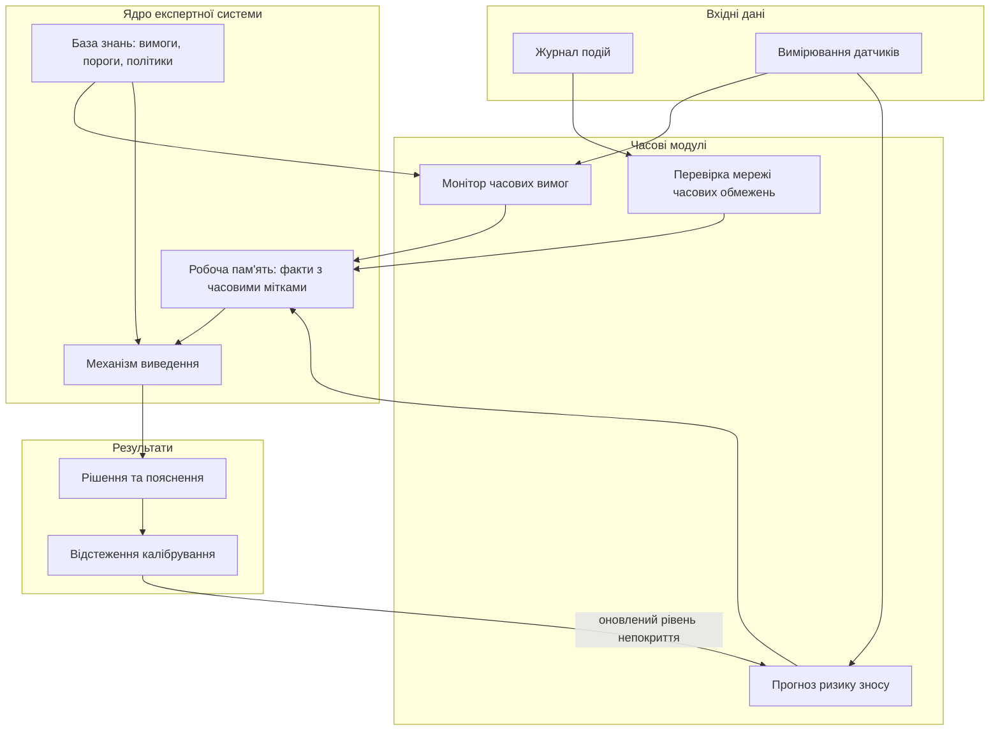
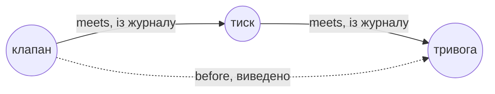
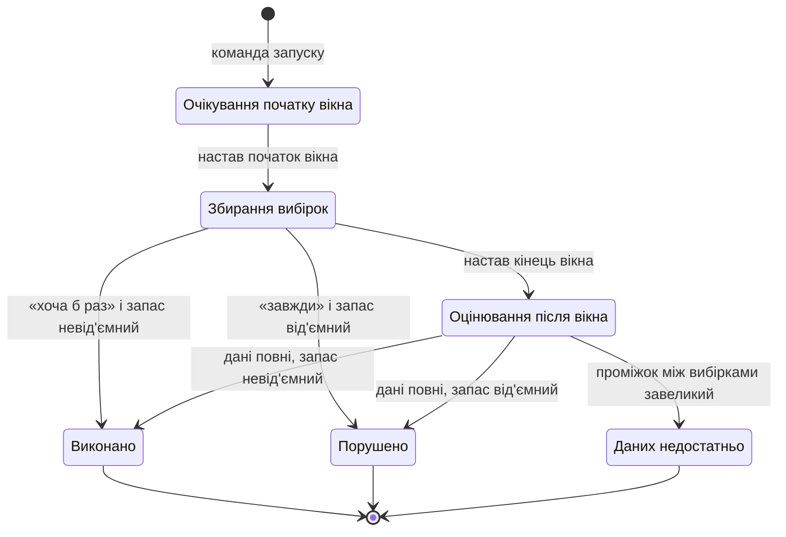
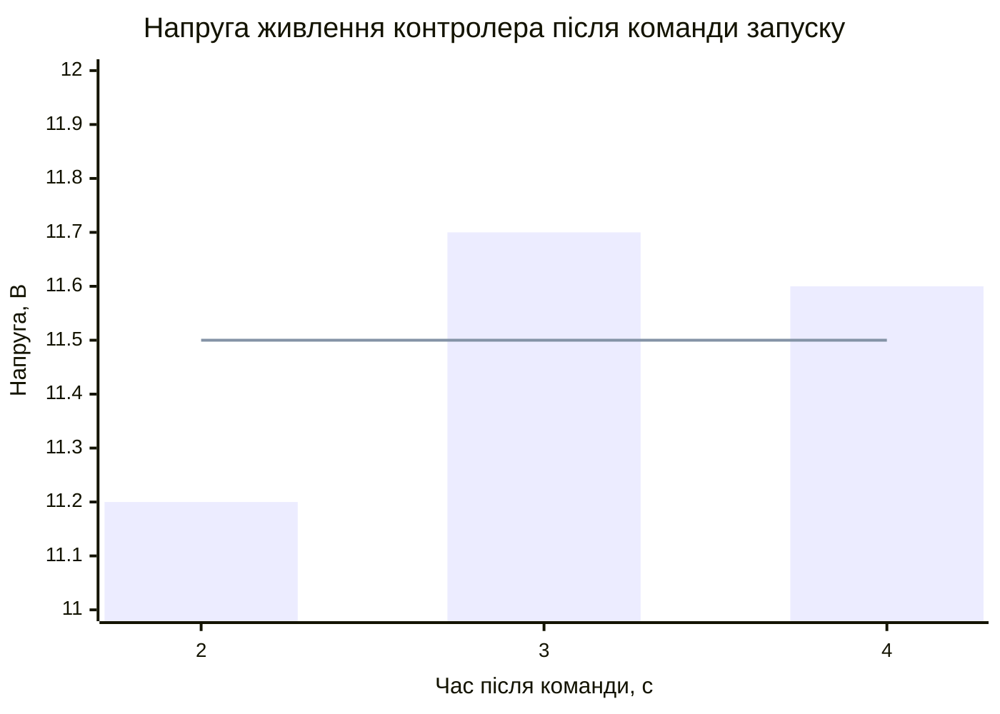
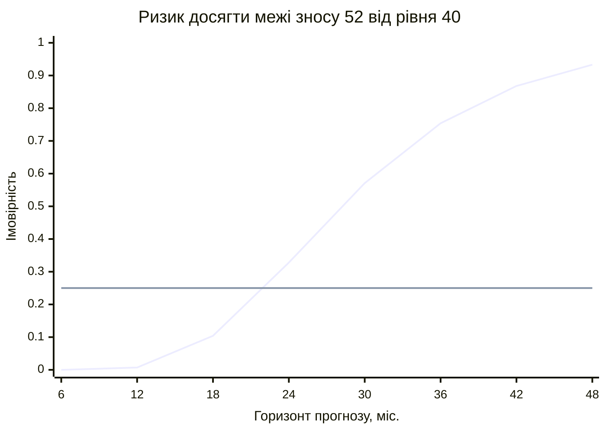
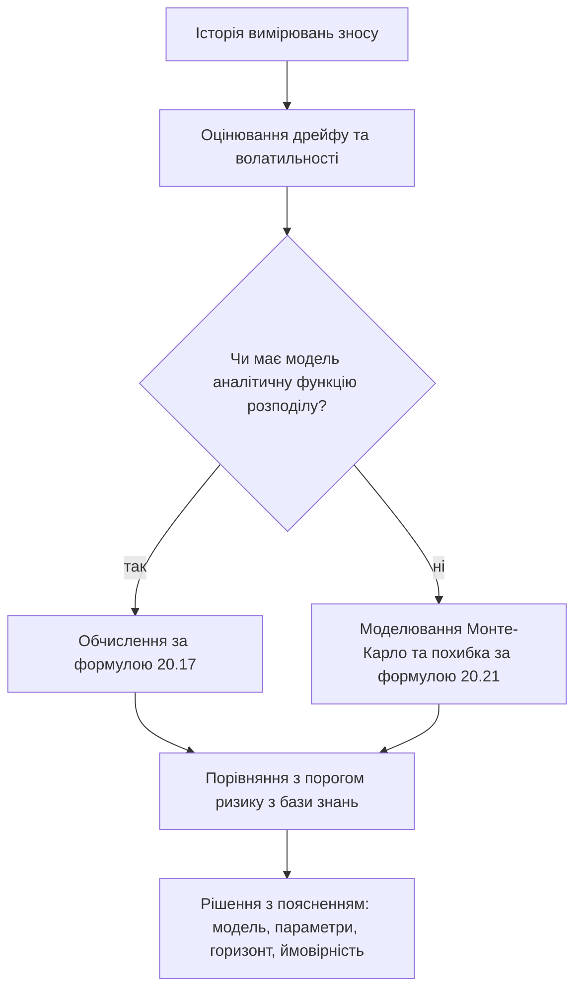
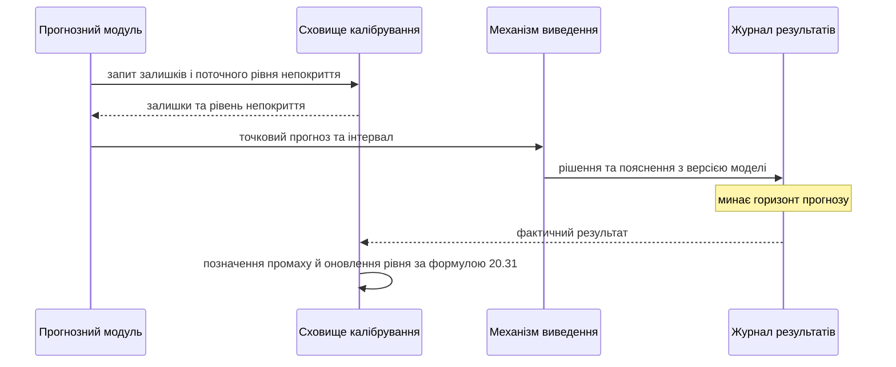
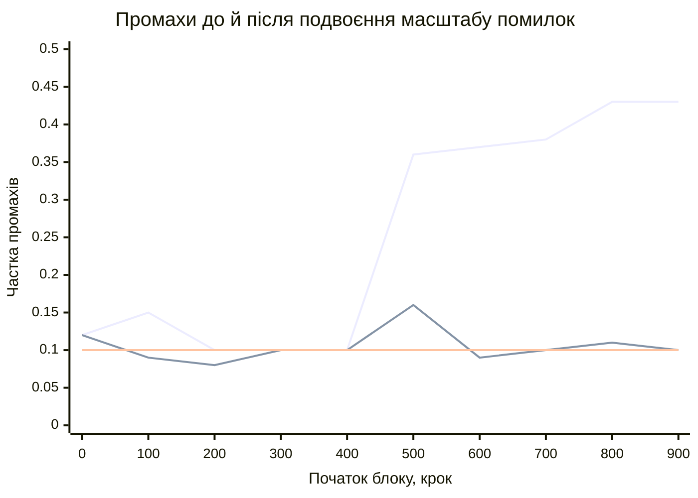

# Глава 20. Часові моделі, прогнозування та калібрування

<a id="глава-20-предиктивні-експертні-системи-інтервальна-алгебра-аллена-сигнальна-логіка-stl-деградація-ресурсу-rul-та-конформне-калібрування-ece--aci"></a>

> **Підручник:** [Експертні Системи](../README.md) · [Том 2. Програмна інженерія знань: ізольовані корпуси, онтології, невизначеність, модельно-орієнтована діагностика, прогностика та верифікація](README.md)\
> **Навчальний рівень:** Вибірковий курс «Інженерія знань» (бакалаврат, 3–4 курс)\
> **Обладнання:** звичайний ноутбук або ПК; дискретний графічний прискорювач — необов'язково, лише за виміряної потреби\
> **Мови:** реалізація — будь-яка мова загального призначення; лістинги — Python 3.14.4, лише стандартна бібліотека (потрібна версія 3.10 або новіша)\
> **Попередня глава:** [Глава 19. Формальна перевірка й тестування баз знань](ch19-formal-verification-and-testing.md)\
> **Наступна глава:** [Глава 21. Архітектура нейро-символьних та ізольованих систем](../Volume-3/ch21-neuro-symbolic-and-isolated-systems.md)\
> **Автор:** Микола Мартинович Федчик

> [!NOTE]
> **Чернетка для порівняння з чинною редакцією**
> 1. Це копія [Глави 20](ch20-temporal-models-and-prediction.md), перероблена за інженерним шаблоном глави; чинна редакція не змінювалася.
> 2. Наявні формули перенесено без змін; після кожної формули йдуть інженерне подання (схема, діаграма або графік), опис алгоритму з вхідними та вихідними даними і короткий робочий лістинг із перевірками.
> 3. Об'єкти глави перенумеровано однією послідовністю, тому номери формул відрізняються від чинної редакції.

---

## Анотація

У попередніх главах розглянуто подання знань, висновування, невизначеність і перевірку правил; ця глава додає часовий вимір до рішень експертної системи. Наскрізним прикладом є експертна система обслуговування насосного агрегату: вона узгоджує події з журналу, перевіряє часові вимоги до сигналів, оцінює ризик досягти межі зносу та стежить, чи справджуються її власні прогнози. Для кожного механізму показано, де він працює в системі, як подати потрібні знання в коді, як виконати висновок і як його перевірити. Розрахункові приклади є навчальними моделями; межі кожного методу підсумовано в кінці відповідного розділу.

<!-- chapter-toc:start -->
## Зміст глави

- [1. Часові відношення та узгодження подій](#1-часові-відношення-та-узгодження-подій)
  - [1.1. Відношення між часовими інтервалами](#11-відношення-між-часовими-інтервалами)
  - [1.2. Перевірка мережі часових обмежень](#12-перевірка-мережі-часових-обмежень)
- [2. Перевірка часових вимог до сигналів](#2-перевірка-часових-вимог-до-сигналів)
  - [2.1. Обмежені в часі вимоги](#21-обмежені-в-часі-вимоги)
  - [2.2. Кількісний запас до порушення](#22-кількісний-запас-до-порушення)
- [3. Моделі зносу та прогноз залишкового ресурсу](#3-моделі-зносу-та-прогноз-залишкового-ресурсу)
  - [3.1. Стохастичні процеси зносу](#31-стохастичні-процеси-зносу)
  - [3.2. Розподіл залишкового ресурсу](#32-розподіл-залишкового-ресурсу)
- [4. Оцінювання надійності прогнозів](#4-оцінювання-надійності-прогнозів)
  - [4.1. Калібрування й невизначеність оцінки](#41-калібрування-й-невизначеність-оцінки)
  - [4.2. Конформні інтервали та адаптивне оновлення](#42-конформні-інтервали-та-адаптивне-оновлення)
- [5. Практичні завдання та лабораторний практикум](#5-практичні-завдання-та-лабораторний-практикум)
  - [5.1. Контрольні запитання для самоперевірки](#51-контрольні-запитання-для-самоперевірки)
  - [5.2. Розрахункові задачі](#52-розрахункові-задачі)
  - [5.3. Завдання з програмної реалізації](#53-завдання-з-програмної-реалізації)
  - [5.4. Зв'язок із лабораторною та курсовою роботою курсу](#54-звязок-із-лабораторною-та-курсовою-роботою-курсу)
- [Висновки](#висновки)
- [Глосарій](#глосарій)
- [Скорочення та терміни](#скорочення-та-терміни)
- [Джерела](#джерела)
<!-- chapter-toc:end -->

---


## 1. Часові відношення та узгодження подій

У базі знань про послідовність подій часто треба встановити не лише факт їх настання, а й те, як саме їхні часові інтервали співвідносяться. Явне подання цих відношень дає рушію змогу виявляти суперечливі сценарії до формування висновку; просте сортування за часом початку втрачає інформацію про перекриття й суміжність, а одна помилкова залежність може змінити порядок дій системи. Для такого аналізу спершу визначимо інтервали та відношення між ними, а потім застосуємо композицію відношень для перевірки мережі обмежень.

Перш ніж розглядати перший механізм, покажемо, де працюють усі чотири механізми глави. Система обслуговування насосного агрегату отримує журнал подій і вимірювання датчиків. Кожен часовий модуль перетворює їх на факти робочої пам'яті з часовими мітками, а правила бази знань вирішують, що робити далі. Схема 20.1 є орієнтиром для всієї глави: розділ 1 описує перевірку мережі обмежень, розділ 2 — монітор вимог, розділ 3 — прогноз ризику, розділ 4 — відстеження калібрування.

<a id="obj-20-1"></a>

**Схема 20.1. Часові модулі експертної системи обслуговування насосного агрегату.**



На схемі видно головне архітектурне рішення глави: часові модулі не ухвалюють дій самостійно. Вони лише додають факти з явним статусом, а дію обирають правила бази знань. Завдяки цьому поріг ризику чи строк вимоги можна змінити у версії бази знань, не змінюючи коду модулів.

<a id="11-тринадцять-базових-взаємовиключних-відношень-між-часовими-інтервалами-before-meets-overlaps-during-starts-finishes-equals"></a>

### 1.1. Відношення між часовими інтервалами

Нехай подія $`A`$ займає інтервал $`[a_s,a_e]`$, а подія $`B`$ — інтервал $`[b_s,b_e]`$, причому початок кожної події передує її завершенню. У предметній моделі слід також визначити, чи можуть дві події мати спільну часову межу: тут інтервали записано замкненими для зручності порівняння кінців, а відношення «суміжні» означає рівність кінця першого інтервалу початку другого. Таблиця 20.2 наводить усі відношення разом з ідентифікаторами, якими вони позначені в коді.

<a id="obj-20-2"></a>

**Таблиця 20.2. Тринадцять взаємовиключних відношень між часовими інтервалами [1].**

| Відношення між подіями | Ідентифікатор у коді | Умова для кінців інтервалів | Тлумачення |
|---|---|---|---|
| Передує | `before` | $`a_e < b_s`$ | Подія $`A`$ завершується до початку $`B`$. |
| Без проміжку передує | `meets` | $`a_e = b_s`$ | Подія $`A`$ закінчується саме тоді, коли починається $`B`$. |
| Перекривається з початком $`B`$ | `overlaps` | $`a_s < b_s < a_e < b_e`$ | Спочатку починається $`A`$, далі $`B`$, і частина їхніх тривалостей збігається. |
| Починається одночасно з $`B`$ | `starts` | $`a_s = b_s < a_e < b_e`$ | Початки збігаються, але $`A`$ завершується раніше. |
| Відбувається всередині $`B`$ | `during` | $`b_s < a_s < a_e < b_e`$ | Інтервал $`A`$ повністю лежить усередині $`B`$. |
| Завершується одночасно з $`B`$ | `finishes` | $`b_s < a_s < a_e = b_e`$ | Початок $`A`$ пізніший, а завершення збігаються. |
| Збігається з $`B`$ | `equals` | $`a_s = b_s,\ a_e = b_e`$ | Події мають однакові початок і кінець. |
| Відбувається після $`B`$ | `after` | $`b_e < a_s`$ | Подія $`A`$ починається після завершення $`B`$. |
| Без проміжку відбувається після $`B`$ | `met_by` | $`b_e = a_s`$ | Подія $`A`$ починається саме тоді, коли закінчується $`B`$. |
| Перекривається із завершенням $`B`$ | `overlapped_by` | $`b_s < a_s < b_e < a_e`$ | Спочатку починається $`B`$, далі $`A`$, і частина їхніх тривалостей збігається. |
| Починається раніше за $`B`$ одночасно | `started_by` | $`a_s = b_s,\ b_e < a_e`$ | Початки збігаються, але $`A`$ завершується пізніше. |
| Містить $`B`$ | `contains` | $`a_s < b_s < b_e < a_e`$ | Інтервал $`B`$ повністю лежить усередині $`A`$. |
| Завершується пізніше за $`B`$ одночасно | `finished_by` | $`a_s < b_s,\ b_e = a_e`$ | $`A`$ починається раніше, а завершення збігаються. |

Взаємовиключність означає, що для двох коректних інтервалів рівно одне відношення з таблиці має описувати їхню пару. Це подання корисне для подій у медичному протоколі, послідовності технічних режимів або часових передумов правила. Воно саме по собі не встановлює причину події: з того, що аварійний сигнал настав після перегріву, не випливає, що перегрів був його єдиною причиною.

Інженер бачить ці відношення на часовій діаграмі журналу. Розгляньмо три події насосного агрегату: клапан відкрито на проміжку від 0 до 2 с, зростання тиску триває від 2 до 3 с, а сигнал тривоги — від 3 до 5 с. Діаграма 20.3 показує, що перша подія суміжна з другою, друга — з третьою; отже, перша подія передує третій.

<a id="obj-20-3"></a>

**Діаграма 20.3. Часова діаграма трьох подій насосного агрегату.**

```mermaid
gantt
    accTitle: Діаграма 20.3. Часова діаграма трьох подій насосного агрегату
    accDescr: Відкриття клапана триває від 0 до 2 с, зростання тиску від 2 до 3 с, сигнал тривоги від 3 до 5 с. Кожна наступна подія починається саме тоді, коли закінчується попередня.
    dateFormat X
    axisFormat %S
    section Клапан
    Відкриття клапана :valve, 0, 2
    section Тиск
    Зростання тиску :pressure, 2, 3
    section Тривога
    Сигнал тривоги :alarm, 3, 5
```



Щоб програма відтворила цей висновок, достатньо порівняти чотири кінці двох інтервалів. Перевірки йдуть від найпростіших випадків, коли інтервали не перетинаються або лише торкаються, до випадків перекриття; такий порядок гарантує, що кожна пара потрапить рівно в один рядок таблиці 20.2. Словник `INVERSE` задає обернене відношення: якщо $`A`$ передує $`B`$, то $`B`$ відбувається після $`A`$.

- **Вхідні дані:** два інтервали у вигляді пар `(початок, кінець)` в одних одиницях часу.
- **Результат:** рядковий ідентифікатор відношення з таблиці 20.2 або виняток `ValueError` для некоректного інтервалу, у якого початок не передує кінцю.

<a id="obj-20-4"></a>

**Лістинг 20.4. Класифікація відношення між двома інтервалами (Python 3.14.4).**

```python
INVERSE = {
    "before": "after", "meets": "met_by", "overlaps": "overlapped_by",
    "starts": "started_by", "during": "contains", "finishes": "finished_by",
    "equals": "equals",
}
INVERSE |= {v: k for k, v in INVERSE.items()}
ALL = frozenset(INVERSE)


def relation(a, b):
    """Відношення інтервалу a = (початок, кінець) до інтервалу b."""
    (a_s, a_e), (b_s, b_e) = a, b
    if not (a_s < a_e and b_s < b_e):
        raise ValueError("початок інтервалу має передувати кінцю")
    if a_e < b_s: return "before"
    if a_e == b_s: return "meets"
    if b_e < a_s: return "after"
    if b_e == a_s: return "met_by"
    if (a_s, a_e) == (b_s, b_e): return "equals"
    if a_s == b_s: return "starts" if a_e < b_e else "started_by"
    if a_e == b_e: return "finishes" if a_s > b_s else "finished_by"
    if b_s < a_s and a_e < b_e: return "during"
    if a_s < b_s and b_e < a_e: return "contains"
    return "overlaps" if a_s < b_s else "overlapped_by"


valve, pressure, alarm = (0, 2), (2, 3), (3, 5)
assert relation(valve, pressure) == "meets"
assert relation(pressure, valve) == "met_by"
assert relation(valve, alarm) == "before"
assert len(ALL) == 13
```

Якщо журнал водночас вказує, що сигнал тривоги закінчився до відкриття клапана, модель містить суперечність, яку треба розв'язати перевіркою джерел часових даних, а не довільним переставлянням подій. Як знайти таку суперечність автоматично, показано в наступному підрозділі.

<a id="12-таблиця-транзитивної-композиції-аллена-та-перевірка-узгодженості-темпоральних-сценаріїв-у-праві-медицині-й-військовому-плануванні"></a>

### 1.2. Перевірка мережі часових обмежень

У мережі часових обмежень кожна вершина відповідає події, а ребро задає дозволену множину відношень між двома подіями. Якщо відомо, що $`A`$ суміжна з $`B`$ та $`B`$ суміжна з $`C`$, то композиція цих двох відношень обмежує можливе відношення між $`A`$ і $`C`$. Для багатьох пар композиція дає не одне відношення, а множину можливих відношень, тому перевірка має зберігати множини, а не передчасно обирати один варіант.

Обчислювальна схема звужує дозволену множину на ребрі $`(A,C)`$ за допомогою посередньої події $`B`$:

<a id="obj-20-5"></a>

**Формула 20.5. Звуження множини відношень через посередню подію.**

$$
R_{AC} \leftarrow R_{AC} \cap (R_{AB} \circ R_{BC})
$$

Тут $`R_{AB}`$ і $`R_{BC}`$ — множини дозволених відношень, $`\circ`$ — композиція відношень, а $`\cap`$ залишає лише ті відношення, що сумісні з обома обмеженнями. Розрахунок повторюють для трійок подій, доки множини перестануть змінюватися або одна з них стане порожньою. Порожня множина свідчить про суперечність у заданій мережі; непорожні множини означають лише, що ця перевірка не виявила суперечності.

З інженерного погляду мережа обмежень — це граф. Схема 20.6 показує граф для журналу насоса: два ребра записано з журналу, а третє виведено за формулою 20.5.

<a id="obj-20-6"></a>

**Схема 20.6. Мережа часових обмежень для трьох подій насосного агрегату.**



Для виведення потрібна таблиця композиції з 169 клітинок, і її не обов'язково вводити вручну. Три інтервали мають не більше шести різних кінців, тому всі якісно різні конфігурації трьох подій можна перебрати на цілочисловій сітці від 0 до 5: для кожної трійки інтервалів функція з лістингу 20.4 дає три відношення, і пара перших двох доповнює клітинку таблиці третім.

- **Вхідні дані:** функція `relation` з лістингу 20.4; код лістингу 20.7 продовжує той самий файл.
- **Результат:** словник `COMPOSE`, що для пари відношень повертає множину можливих відношень між першою і третьою подією.

<a id="obj-20-7"></a>

**Лістинг 20.7. Побудова таблиці композиції перебором (Python 3.14.4).**

```python
from itertools import permutations, product

GRID = [(s, e) for s in range(6) for e in range(6) if s < e]
REL = {(x, y): relation(x, y) for x in GRID for y in GRID}
COMPOSE = {}
for a, b, c in product(GRID, repeat=3):
    COMPOSE.setdefault((REL[a, b], REL[b, c]), set()).add(REL[a, c])

assert len(COMPOSE) == 13 * 13
assert COMPOSE["meets", "meets"] == {"before"}
assert COMPOSE["overlaps", "overlaps"] == {"before", "meets", "overlaps"}
assert len(COMPOSE["during", "contains"]) == 13
```

Остання перевірка показує, що для деяких пар композиція нічого не звужує: якщо $`A`$ всередині $`B`$, а $`B`$ містить $`C`$, то між $`A`$ і $`C`$ можливе будь-яке з 13 відношень.

Тепер формулу 20.5 можна застосувати до мережі. Алгоритм поширення обмежень спочатку дозволяє на кожному ребрі всі 13 відношень, потім звужує ребра, відомі з журналу, і повторює проходи по всіх трійках подій, доки множини змінюються. Порожня множина зупиняє алгоритм і повертає трійку, на якій виник конфлікт.

- **Вхідні дані:** список подій і словник обмежень із журналу, де ключем є впорядкована пара подій, а значенням — множина дозволених відношень.
- **Результат:** звужена мережа, якщо конфлікту не знайдено, або трійка подій, на якій множина стала порожньою.

<a id="obj-20-8"></a>

**Лістинг 20.8. Поширення обмежень у мережі подій (Python 3.14.4).**

```python
def propagate(events, constraints):
    """Повертає (мережа, None) або (None, трійка подій із конфліктом)."""
    net = {pair: set(ALL) for pair in permutations(events, 2)}
    for (x, y), rels in constraints.items():
        net[x, y] &= set(rels)
        net[y, x] &= {INVERSE[r] for r in rels}
    changed = True
    while changed:
        changed = False
        for i, k, j in permutations(events, 3):
            via = set().union(*(COMPOSE[r1, r2] for r1 in net[i, k] for r2 in net[k, j]))
            narrowed = net[i, j] & via
            if not narrowed:
                return None, (i, k, j)
            if narrowed != net[i, j]:
                net[i, j] = narrowed
                net[j, i] = {INVERSE[r] for r in narrowed}
                changed = True
    return net, None


events = ["клапан", "тиск", "тривога"]
log = {("клапан", "тиск"): {"meets"}, ("тиск", "тривога"): {"meets"}}
net, _ = propagate(events, log)
assert net["клапан", "тривога"] == {"before"}
_, conflict = propagate(events, log | {("тривога", "клапан"): {"before"}})
assert conflict == ("клапан", "тиск", "тривога")
```

Таблиця 20.9 показує перший крок для двох журналів. У першому журналі ребро «клапан — тривога» спочатку дозволяє всі 13 відношень, і композиція звужує його до одного. У другому журналі на тому самому кроці перетин стає порожнім, тому функція одразу повертає трійку подій, яку треба показати інженерові як місце суперечності.

<a id="obj-20-9"></a>

**Таблиця 20.9. Трасування поширення обмежень для трійки «клапан, тиск, тривога».**

| Журнал | Відношення «клапан — тиск» | Відношення «тиск — тривога» | Композиція | Ребро «клапан — тривога» до кроку | Після кроку | Підсумок |
|---|---|---|---|---|---|---|
| Узгоджений | `meets` | `meets` | `before` | усі 13 відношень | `before` | другий прохід змін не дає, мережу узгоджено |
| Із записом «тривога передує клапану» | `meets` | `meets` | `before` | `after` | порожня множина | повернуто трійку подій із конфліктом |

У наведеному прикладі композиція двох суміжностей залишає для пари $`(A,C)`$ відношення «передує». На практиці повна таблиця композиції має багато випадків, а перевірка шляхової узгодженості не є повним розв'язувачем для довільних мереж відношень інтервалів. Тому за потреби повної відповіді використовують алгоритм для відповідного класу обмежень або розв'язувач, а припущення про межі часу, точність годинників і пропущені події фіксують окремо.

**Інженерні питання.**

1. **Годинники джерел.** Події з різних контролерів мають різні годинники. Перед класифікацією треба або синхронізувати мітки, або розширити інтервали на відому похибку годинника й зберігати множину можливих відношень замість одного.
2. **Продуктивність.** Таблицю композиції обчислюють один раз під час запуску. Один прохід мережі з $`n`$ подій перебирає $`n(n-1)(n-2)`$ трійок, тому для журналу з тисячами подій перевіряють лише вікно подій, пов'язаних однією ситуацією.
3. **Пояснення.** У звіті про конфлікт показують трійку подій, вихідні записи журналу та їхні джерела, а не лише слово «суперечність».
4. **Тестування.** Корисний властивісний тест: для випадкових пар інтервалів `relation(b, a)` має дорівнювати `INVERSE[relation(a, b)]`.

**Практичний висновок.** Якщо часові мітки клапана й датчика містять невизначеність, зберігайте допустимі інтервали часу або множини відношень, а не округлюйте їх до одного порядку. Мережа допоможе локалізувати несумісність у записах; вона не визначить автоматично, який вимірювач несправний і яка подія була причиною іншої.

<a id="2-сигнальна-темпоральна-логіка-малера--нічковича-stl-та-кількісна-семантика-стійкості"></a>

## 2. Перевірка часових вимог до сигналів

Події з попереднього розділу описують цілі інтервали, але датчик часто подає числовий сигнал, що змінюється в часі. Для такого входу експертна система має перевірити не лише значення в окремий момент, а й умову на заданому часовому відрізку. Поріг, перевірений лише в останній вибірці, може пропустити коротке порушення між вимірюваннями; водночас жодний дискретний монітор не може зробити висновок про неперервну поведінку без припущень про сигнал і спосіб відновлення проміжних значень.

<a id="21-обмежені-в-часі-оператори-g_ab-та-f_ab-над-неперервними-траєкторіями-фізичних-величин"></a>

### 2.1. Обмежені в часі вимоги

Часова вимога задає, що має відбутися і в які строки. Наприклад, після команди запуску насоса напруга живлення його контролера має хоча б раз досягти 11,5 В між другою та четвертою секундами. У сигнальній темпоральній логіці це можна записати як обмежену вимогу «колись у проміжку», а вимогу «весь проміжок має залишатися вище порогу» — як обмежену вимогу «завжди» [2].

Нехай $`x(t)`$ — вимірювана величина, $`c`$ — поріг, а $`[a,b]`$ — проміжок очікування після моменту $`t`$. Кількісні значення для атомарної умови та обмежених часових операторів задаються так:

<a id="obj-20-10"></a>

**Формула 20.10. Кількісне оцінювання обмеженої часової вимоги.**

$$
\begin{aligned}
\rho(x \ge c, x, t) &= x(t)-c,\\
\rho(\mathbf{F}_{[a,b]}\varphi, x, t) &= \max_{\tau \in [a,b]} \rho(\varphi, x, t+\tau),\\
\rho(\mathbf{G}_{[a,b]}\varphi, x, t) &= \min_{\tau \in [a,b]} \rho(\varphi, x, t+\tau).
\end{aligned}
$$

Тут $`x(t)`$ і поріг $`c`$ мають однакові одиниці; $`a`$, $`b`$ та $`\tau`$ вимірюються в одиницях часу, причому $`0 \le a \le b`$; $`\varphi`$ — перевірювана умова; $`\mathbf{F}`$ означає «хоча б один момент», а $`\mathbf{G}`$ — «кожен момент» у заданому проміжку. Додатне значення $`\rho`$ означає запас до порушення, від'ємне — величину виходу за поріг, а нуль — межу. Цей запас має одиниці сигналу для атомарної умови, тож значення для різних фізичних величин не можна без нормалізації порівнювати між собою.

**Навчальний розрахунок.** Нехай напруга вимірюється у вольтах, поріг дорівнює 11,5 В, а перевірка починається після команди в момент $`t=0`$. У вибірках на 2, 3 і 4 с отримано 11,2 В, 11,7 В і 11,6 В. Для вимоги «досягти порога між 2 та 4 с» найбільший запас серед цих вибірок становить $`\max(-0{,}3,\ 0{,}2,\ 0{,}1)=0{,}2`$ В, отже вимогу виконано на спостережених точках. Це не доводить, що між вибірками напруга не падала нижче порога; для такого висновку потрібні частота вимірювань, модель інтерполяції або доведена межа швидкості зміни сигналу.

У програмі монітор вимоги працює як скінченний автомат зі станами, показаними на схемі 20.11. Він чекає на команду, збирає вибірки у вікні й видає один із трьох вердиктів. Третій вердикт, «даних недостатньо», потрібен через те, що відсутність вимірювань не можна трактувати ні як виконання, ні як порушення вимоги.

<a id="obj-20-11"></a>

**Схема 20.11. Стани монітора обмеженої часової вимоги.**



Алгоритм монітора прямо реалізує формулу 20.10 на дискретних вибірках: відбирає вибірки у вікні, обчислює запас кожної, бере максимум для оператора «хоча б раз» або мінімум для оператора «завжди» й окремо перевіряє, чи немає у вікні проміжку, довшого за допустимий. Функція запасу зберігає напрямок умови: для «не нижче порога» це $`x-c`$, для «не вище порога» — $`c-x`$, тож додатне значення завжди означає запас.

- **Вхідні дані:** вибірки `(час, значення)`, оператор `eventually` («хоча б раз») або `always` («завжди»), функція запасу, межі вікна $`a`$ і $`b`$, найбільший допустимий проміжок між вибірками `max_gap` і момент команди `t0`. Оператор, функцію запасу, межі й `max_gap` бере з бази знань, а не задає в коді.
- **Результат:** вердикт із трьох статусів, запас і момент вибірки, яка його визначила, щоб підсистема пояснень могла показати конкретне вимірювання.

<a id="obj-20-12"></a>

**Лістинг 20.12. Монітор обмеженої часової вимоги з трьома вердиктами (Python 3.14.4).**

```python
from dataclasses import dataclass

SATISFIED, VIOLATED, INSUFFICIENT = "ВИКОНАНО", "ПОРУШЕНО", "ДАНИХ НЕДОСТАТНЬО"


@dataclass(frozen=True)
class Verdict:
    status: str
    robustness: float | None
    witness_time: float | None


def check_window(samples, op, margin, a, b, max_gap, t0=0.0):
    window = sorted((t, margin(x)) for t, x in samples if t0 + a <= t <= t0 + b)
    if not window:
        return Verdict(INSUFFICIENT, None, None)
    pick = max if op == "eventually" else min
    witness, rho = pick(window, key=lambda p: p[1])
    points = [t0 + a] + [t for t, _ in window] + [t0 + b]
    complete = all(t2 - t1 <= max_gap for t1, t2 in zip(points, points[1:]))
    decisive = rho >= 0 if op == "eventually" else rho < 0
    if complete or decisive:
        return Verdict(SATISFIED if rho >= 0 else VIOLATED, rho, witness)
    return Verdict(INSUFFICIENT, rho, witness)
```

Онлайн-монітор викликає ту саму функцію після кожної нової вибірки. До кінця вікна статус «даних недостатньо» означає «ще не визначено»; після кінця вікна він стає остаточним. Лістинг 20.13 перевіряє монітор на журналах навчального розрахунку: обидва оператори на повному журналі та оператор «хоча б раз» на журналі з пропущеною вибіркою.

<a id="obj-20-13"></a>

**Лістинг 20.13. Перевірка монітора на трьох журналах (Python 3.14.4).**

```python
from math import isclose

above = lambda volts: volts - 11.5
log = [(2, 11.2), (3, 11.7), (4, 11.6)]
v = check_window(log, "eventually", above, a=2, b=4, max_gap=1.0)
assert v.status == SATISFIED and isclose(v.robustness, 0.2) and v.witness_time == 3
v = check_window(log, "always", above, a=2, b=4, max_gap=1.0)
assert v.status == VIOLATED and isclose(v.robustness, -0.3) and v.witness_time == 2
v = check_window([(2, 11.2), (4, 11.4)], "eventually", above, a=2, b=4, max_gap=1.0)
assert v.status == INSUFFICIENT
```

<a id="22-кількісний-ступінь-робастності-rhophi-x-t-додатний-запас-до-межі-порушення-проти-глибини-виходу-за-допуск"></a>

### 2.2. Кількісний запас до порушення

Логічна відповідь «виконано» не показує, наскільки близько сигнал перебував до межі. Кількісне значення дає змогу порівнювати запас у часі або встановити попереджувальний поріг, але тільки якщо порівнювані величини мають узгоджені одиниці й однаково визначену шкалу. Для атомарної вимоги $`x(t) \ge c`$ запас дорівнює різниці між виміром і порогом: значення $`0{,}2`$ В означає запас 0,2 В, а $`-0{,}3`$ В — вихід за поріг на 0,3 В. На графіку 20.14 запас кожної вибірки — це відстань від стовпчика до лінії порога.

<a id="obj-20-14"></a>

**Графік 20.14. Вибірки напруги у вікні перевірки та поріг 11,5 В.**



Таблиця 20.15 показує, як лістинг 20.12 обробляє журнал навчального розрахунку для обох операторів і для журналу з пропущеною вибіркою.

<a id="obj-20-15"></a>

**Таблиця 20.15. Трасування монітора для порога 11,5 В на вікні від 2 до 4 с.**

| Журнал вибірок | Запаси у вибірках, В | Оператор | Обрана вибірка | Запас, В | Вердикт |
|---|---|---|---|---|---|
| 2 с: 11,2 В; 3 с: 11,7 В; 4 с: 11,6 В | −0,3; 0,2; 0,1 | «хоча б раз» | 3 с | 0,2 | `ВИКОНАНО` |
| те саме | −0,3; 0,2; 0,1 | «завжди» | 2 с | −0,3 | `ПОРУШЕНО` |
| 2 с: 11,2 В; 4 с: 11,4 В | −0,3; −0,1 | «хоча б раз» | 4 с | −0,1 | `ДАНИХ НЕДОСТАТНЬО`: проміжок 2 с більший за допустимий 1 с |

Останній рядок показує, навіщо потрібен третій вердикт: між вибірками на 2 і 4 с напруга могла досягти порога, тож оголосити порушення означало б зробити висновок без даних.

У попередньому прикладі система може видати навчальний результат `ВИКОНАНО`, а також зберегти мінімальний запас для вимоги «завжди вище» або максимальний — для вимоги «хоча б раз вище». Для обмеження перегріву, наприклад, робастність умови $`T(t) \le T_{\max}`$ зручно визначити як $`T_{\max}-T(t)`$, щоб додатне значення завжди позначало запас. Перевага такого звіту — він відрізняє ледве виконану вимогу від тієї, що має значний запас; сам запас не є ймовірністю безвідмовної роботи.

**Інженерні питання.**

1. **Оброблення пропусків.** Правило для пропущених вибірок є частиною вимоги в базі знань, а не деталлю реалізації: параметр `max_gap` має бути погоджений із частотою датчика.
2. **Що зберігати.** Разом із вердиктом зберігають початкові вибірки, одиниці, поріг, межі вікна, версію вимоги та правило оброблення пропусків, щоб вердикт можна було відтворити.
3. **Шум датчика.** Запас, менший за похибку датчика, варто позначати як «на межі» окремим правилом бази знань, а не трактувати як надійне виконання.
4. **Тестування.** Мінімальний набір тестів охоплює номінальний журнал, запас рівно нуль, порожнє вікно, пропуск, довший за `max_gap`, і вибірки поза вікном, які монітор має ігнорувати.

У реальному моніторі результат залежить від точності датчика, затримки, втрати пакетів і вибору часової сітки. Якщо вимога має бути виконана до завершення строку, відсутність достатніх вимірювань повинна мати окремий статус «даних недостатньо», а не перетворюватися на успіх.

<a id="3-стохастичні-процеси-деградації-та-розрахунок-залишкового-корисного-ресурсу-rul-iso-13381-1"></a>

## 3. Моделі зносу та прогноз залишкового ресурсу

Після перевірки поточних і часових вимог інженеру може знадобитися оцінити, коли показник зносу перетне межу, визначену предметною процедурою. У прогностичній частині експертної системи така оцінка допомагає порівнювати сценарії обслуговування, але не замінює вимірювання й затверджені критерії втручання. Наївна екстраполяція останнього приросту як сталої швидкості приховує випадкові коливання та різницю між одиницями; далі розглядаються два різні припущення про розвиток зносу, а не універсальні моделі для всіх механізмів відмови.

<a id="31-моделювання-накопичення-зносу-процес-вінера-з-дрейфом-обернений-гаусівський-розподіл-часу-відмови-та-монотонний-гамма-процес"></a>

### 3.1. Стохастичні процеси зносу

Почнемо з процесу Вінера з дрейфом, який моделює середню тенденцію зносу та випадкові відхилення навколо неї. Нехай поточний рівень зносу дорівнює $`x`$, межа — $`L`$, а $`\Delta=L-x>0`$ — відстань до межі. Стохастичні моделі такого типу використовуються в дослідженнях залишкового ресурсу, але їхні припущення мають відповідати предметним даним [3]. За сталого додатного дрейфу $`\mu`$ і волатильності $`\sigma`$ модель має вигляд:

<a id="obj-20-16"></a>

**Формула 20.16. Процес зносу з випадковими відхиленнями та час першого досягнення межі.**

$$
X(t+s)=x+\mu s+\sigma W_s,\qquad
T=\inf\{s\ge 0:X(t+s)\ge L\}.
$$

Тут $`s`$ — майбутній час, $`W_s`$ — стандартний броунівський рух, $`\mu`$ вимірюється в одиницях зносу за місяць, а $`\sigma`$ — в одиницях зносу на квадратний корінь місяця. Змінна $`T`$ є часом першого досягнення межі та вимірюється в місяцях. Умови моделі: $`x<L`$, $`\mu>0`$, $`\sigma>0`$, сталі параметри й незмінна межа; модель не враховує ремонт, зміну навантаження чи раптову відмову іншого механізму.

За цих припущень час досягнення порогу має обернений гаусівський розподіл із параметрами $`\nu=\Delta/\mu`$ та $`\lambda=\Delta^2/\sigma^2`$. Параметр $`\nu`$ задає середній час у місяцях, а $`\lambda`$ також має одиницю часу. Його функція розподілу дорівнює:

<a id="obj-20-17"></a>

**Формула 20.17. Імовірність досягти межі зносу до горизонту прогнозу.**

$$
P(T \le h)=
\Phi\!\left(\sqrt{\frac{\lambda}{h}}\left(\frac{h}{\nu}-1\right)\right)
+\exp\!\left(\frac{2\lambda}{\nu}\right)
\Phi\!\left(-\sqrt{\frac{\lambda}{h}}\left(\frac{h}{\nu}+1\right)\right).
$$

Тут $`h>0`$ — заданий горизонт прогнозу в місяцях, а $`\Phi`$ — функція розподілу стандартного нормального розподілу. Це рівняння перетворює параметри моделі на ймовірність перетину порогу до визначеного строку, а не на безумовну дату відмови.

Для монотонного накопичення зносу може бути доречний гамма-процес; його використання в моделях деградації та обслуговування розглянуто в огляді van Noortwijk [4]. Його незалежні прирости невід'ємні, а приріст за інтервал $`\Delta t`$ має гамма-розподіл:

<a id="obj-20-18"></a>

**Формула 20.18. Монотонний приріст гамма-процесу.**

$$
X(t+\Delta t)-X(t)\sim
\operatorname{Gamma}\!\left(\alpha\Delta t,\theta\right),\qquad
E[\Delta X]=\alpha\theta\Delta t.
$$

Тут $`\alpha`$ — інтенсивність форми на одиницю часу, $`\theta`$ — масштаб у тих самих одиницях, що й знос, а $`\Delta t`$ — тривалість спостереження. За такої параметризації середнє зростання пропорційне часу, а від'ємний приріст неможливий. Це може бути корисним для накопичувального зносу, але невідповідно для показника, який природно коливається в обидва боки або відновлюється після ремонту.

**Числовий приклад для процесу Вінера.** Припустімо, індекс зносу підшипника насоса зараз становить 40 умовних одиниць, поріг дорівнює 52, середній дрейф — 0,4 одиниці за місяць, а $`\sigma=0{,}8`$ одиниці на квадратний корінь місяця. Тоді відстань до порогу $`\Delta=12`$, середній час досягнення $`\nu=12/0{,}4=30`$ місяців, а параметр форми $`\lambda=12^2/0{,}8^2=225`$ місяців. За наведеною функцією розподілу ймовірність досягти порогу протягом 24 місяців становить приблизно 0,328.

Інженерові зручніше бачити не одне число, а залежність ризику від горизонту планування. Графік 20.19 побудовано за формулою 20.17 для параметрів прикладу; горизонтальна лінія — навчальний поріг ризику 0,25.

<a id="obj-20-19"></a>

**Графік 20.19. Імовірність досягти межі зносу залежно від горизонту прогнозу.**



Якщо в суто навчальній політиці для планування огляду задано поріг ризику 0,25 на горизонті 24 місяців, отримане 0,328 його перевищує, отже приклад веде до планування додаткового огляду. Графік також показує, що на горизонті 18 місяців той самий агрегат лишився б у плановому режимі. Поріг 0,25 тут є умовою задачі, а не галузевою нормою. Для реального рішення треба оцінити параметри на даних об'єкта, перевірити стабільність моделі й окремо визначити наслідки хибного попередження та пропуску відмови.

Програмна реалізація формули 20.17 потребує лише функції розподілу стандартного нормального розподілу, яку виражають через функцію помилок `math.erf`. Рішення про обслуговування винесено в окрему функцію, бо поріг ризику належить до бази знань, а не до моделі зносу.

- **Вхідні дані:** поточний рівень зносу, межа, дрейф, волатильність і горизонт у місяцях; для рішення — поріг ризику з бази знань.
- **Результат:** імовірність досягти межі до горизонту й рішення `ПЛАНУВАТИ_ОГЛЯД` або `ПЛАНОВИЙ_РЕЖИМ`.

<a id="obj-20-20"></a>

**Лістинг 20.20. Імовірність досягти межі зносу та рішення про огляд (Python 3.14.4).**

```python
import math


def phi(z):
    return 0.5 * (1 + math.erf(z / math.sqrt(2)))


def wiener_crossing_prob(level, limit, mu, sigma, horizon):
    """P(T ≤ horizon) за формулою 20.17."""
    if level >= limit:
        return 1.0
    delta = limit - level
    nu, lam = delta / mu, delta**2 / sigma**2
    root = math.sqrt(lam / horizon)
    return (phi(root * (horizon / nu - 1))
            + math.exp(2 * lam / nu) * phi(-root * (horizon / nu + 1)))


def maintenance_decision(p_cross, risk_limit):
    return "ПЛАНУВАТИ_ОГЛЯД" if p_cross > risk_limit else "ПЛАНОВИЙ_РЕЖИМ"


p = wiener_crossing_prob(level=40, limit=52, mu=0.4, sigma=0.8, horizon=24)
assert round(p, 3) == 0.328
assert maintenance_decision(p, risk_limit=0.25) == "ПЛАНУВАТИ_ОГЛЯД"
```

<a id="32-паралельне-моделювання-ансамблю-траєкторій-rul-методом-монте-карло-на-дискретному-gpu"></a>

### 3.2. Розподіл залишкового ресурсу

Залишковий ресурс — не одна точка, а розподіл часу до визначеної події, наприклад досягнення межі зносу. Коли розподіл для конкретної моделі обчислюють моделюванням Монте-Карло, в кожному прогоні генерують траєкторію, фіксують її перший перетин межі й підсумовують частку перетинів до вибраного горизонту.

Нехай $`N`$ незалежних траєкторій згенеровано за тією самою моделлю, а $`I_i`$ дорівнює 1, якщо в $`i`$-й траєкторії поріг перетнуто до горизонту $`h`$, і 0 в іншому разі. Тоді оцінка ймовірності та її стандартна похибка Монте-Карло дорівнюють:

<a id="obj-20-21"></a>

**Формула 20.21. Оцінка ймовірності перетину порогу та похибка симуляції.**

$$
\widehat{p}_h=\frac{1}{N}\sum_{i=1}^{N} I_i,\qquad
\operatorname{SE}(\widehat{p}_h)\approx
\sqrt{\frac{\widehat{p}_h(1-\widehat{p}_h)}{N}}.
$$

Тут $`N`$ — кількість симуляцій, $`\widehat{p}_h`$ — оцінена ймовірність перетину порогу до $`h`$, а $`\operatorname{SE}`$ описує лише випадкову похибку скінченного числа симуляцій. Якщо $`N=10\,000`$ і оцінка близька до 0,328, стандартна похибка становить приблизно 0,0047, тобто 0,47 відсоткового пункту. Це не охоплює невизначеність параметрів, вибору моделі, датчиків чи межі відмови; збільшення $`N`$ зменшує тільки похибку Монте-Карло.

Схема 20.22 показує, як модуль прогнозу ризику зі схеми 20.1 обирає між двома способами обчислення: якщо для моделі є формула, обчислюють її; якщо ні, оцінюють імовірність моделюванням.

<a id="obj-20-22"></a>

**Схема 20.22. Обчислення ризику досягти межі зносу до горизонту.**



Моделювання на часовій сітці має пастку: траєкторія може перетнути межу між двома вузлами й повернутися нижче неї, а простий код цього не помітить і занизить ризик. Для процесу Вінера ймовірність такого прихованого перетину між вузлами зі значеннями $`x_k`$ і $`x_{k+1}`$, що обидва нижчі за межу $`L`$, дорівнює $`\exp\bigl(-2(L-x_k)(L-x_{k+1})/(\sigma^2\Delta t)\bigr)`$ — це відома властивість броунівського мосту.

Алгоритм моделювання для кожної траєкторії робить кроки сітки довжиною $`\Delta t`$: додає дрейф і нормальний випадковий приріст, перевіряє перетин у вузлі, а за ввімкненої поправки ще розігрує прихований перетин між вузлами з наведеною ймовірністю. Код продовжує лістинг 20.20 і порівнює результат із формулою.

- **Вхідні дані:** параметри моделі з лістингу 20.20, крок сітки, кількість траєкторій, зерно генератора й прапорець поправки `bridge`.
- **Результат:** оцінка ймовірності за формулою 20.21 та її стандартна похибка.

<a id="obj-20-23"></a>

**Лістинг 20.23. Моделювання Монте-Карло з поправкою броунівського мосту (Python 3.14.4).**

```python
import random


def simulate_crossing_prob(level, limit, mu, sigma, horizon, dt, n, seed, bridge=True):
    """Оцінка за формулою 20.21 та її стандартна похибка."""
    rng = random.Random(seed)
    hits = 0
    for _ in range(n):
        x = level
        for _ in range(round(horizon / dt)):
            x_next = x + mu * dt + sigma * math.sqrt(dt) * rng.gauss(0, 1)
            p_between = math.exp(-2 * (limit - x) * (limit - x_next) / (sigma**2 * dt))
            if x_next >= limit or (bridge and rng.random() < p_between):
                hits += 1
                break
            x = x_next
    p_hat = hits / n
    return p_hat, math.sqrt(p_hat * (1 - p_hat) / n)


pump = dict(level=40, limit=52, mu=0.4, sigma=0.8, horizon=24, dt=1.0, n=10_000, seed=2026)
p_mc, se = simulate_crossing_prob(**pump)
p_raw, se_raw = simulate_crossing_prob(**pump, bridge=False)
print(f"з поправкою: {p_mc:.3f} ± {se:.4f}; без поправки: {p_raw:.3f} ± {se_raw:.4f}")
assert abs(p_mc - p) < 4 * se
assert p - p_raw > 4 * se_raw
```

Очікуваний вивід:

```text
з поправкою: 0.327 ± 0.0047; без поправки: 0.302 ± 0.0046
```

Таблиця 20.24 порівнює три способи обчислити ту саму ймовірність. Моделювання з поправкою збігається з формулою в межах похибки, а моделювання без поправки на сітці з кроком один місяць занижує ризик майже на 0,03, тобто приблизно на п'ять стандартних похибок. Це систематична помилка методу, і збільшення кількості траєкторій її не усуне.

<a id="obj-20-24"></a>

**Таблиця 20.24. Імовірність досягти межі зносу 52 протягом 24 місяців трьома способами.**

| Спосіб | Крок сітки | Траєкторій | Імовірність | Стандартна похибка | Рішення за порогом 0,25 |
|---|---|---|---|---|---|
| Формула 20.17 | — | — | 0,328 | — | `ПЛАНУВАТИ_ОГЛЯД` |
| Моделювання з поправкою броунівського мосту | 1 місяць | 10 000 | 0,327 | 0,0047 | `ПЛАНУВАТИ_ОГЛЯД` |
| Моделювання без поправки | 1 місяць | 10 000 | 0,302 | 0,0046 | `ПЛАНУВАТИ_ОГЛЯД` |

Для навчального прикладу процес Вінера вже має аналітичну функцію розподілу, тому спершу обчислюється саме вона. Симуляція корисна, коли модель складніша, містить кілька режимів або потребує об'єднання випадкових параметрів; результати слід порівнювати з аналітичним розрахунком на простому контрольному випадку. Починайте з центрального процесора: графічний прискорювач має сенс лише після вимірювання часу для потрібної кількості траєкторій, вартості передавання даних і відтворюваності генератора випадкових чисел.

**Інженерні питання.**

1. **Контрольний випадок.** Кожен симулятор складнішої моделі тестують на випадку, що має формулу, як у лістингу 20.23. Розбіжність більша за кілька стандартних похибок вказує на помилку в коді або в моделі.
2. **Відтворюваність.** Зерно генератора, крок сітки й кількість траєкторій зберігають разом із результатом, щоб прогноз можна було повторити під час розбору рішення.
3. **Продуктивність.** Лістинг 20.23 моделює 10 000 траєкторій по 24 кроки менш ніж за секунду на звичайному процесорі. Прискорювач розглядають лише тоді, коли виміряний час не вкладається в бюджет.
4. **Версіонування.** Межа зносу, горизонт і поріг ризику належать до бази знань і змінюються окремо від коду; у поясненні рішення вказують їхню версію.

У висновку експертної системи варто зберігати не лише середній ресурс, а й обрані квантилі або ймовірність перетину на конкретному горизонті. Рішення залежить від наслідків помилки й затвердженого порогу дії: той самий прогноз може бути прийнятним для планового огляду та неприйнятним для критичного захисного механізму.

<a id="4-статистичне-калібрування-ece-brier-та-адаптивне-конформне-прогнозування-aci"></a>

## 4. Оцінювання надійності прогнозів

Оцінка прогнозу стає корисною для експертної системи лише тоді, коли зрозуміло, чи відповідають заявлені ймовірності частоті подій і наскільки невизначена ця перевірка. Якщо система регулярно видає ймовірність 0,8 для подій, що настають лише в половині випадків, поріг дії, побудований на цих числах, буде хибно налаштований; однак мала вибірка також може створити оманливе враження поганого калібрування. Спершу розглянемо метрики й інтервали для перевірки, а потім — прогнозні інтервали з обмеженнями щодо залежних даних і дрейфу.

<a id="41-очікувана-похибка-калібрування-ece-оцінка-брієра-точні-біноміальні-межі-клоппера--пірсона-та-інтервал-вілсона"></a>

### 4.1. Калібрування й невизначеність оцінки

Нехай система прогнозує подію «порогового зносу буде досягнуто протягом 24 місяців» із ймовірністю $`p_i`$, а результат спостереження $`y_i`$ дорівнює 1, якщо подія настала, і 0 — якщо ні. Для калібрування прогнози групують за близькими ймовірностями й порівнюють середній прогноз із фактичною часткою подій у кожній групі. Очікувана похибка калібрування, або ECE, часто записується так:

<a id="obj-20-25"></a>

**Формула 20.25. Зважена похибка калібрування.**

$$
\operatorname{ECE}=
\sum_{m=1}^{M}\frac{|B_m|}{n}
\left|\operatorname{acc}(B_m)-\operatorname{conf}(B_m)\right|.
$$

Тут $`n`$ — кількість прогнозів, $`M`$ — кількість груп, $`B_m`$ — набір прогнозів у групі $`m`$, $`\operatorname{acc}`$ — емпірична частка подій, а $`\operatorname{conf}`$ — середня прогнозована ймовірність. Усі ймовірності лежать у $`[0,1]`$, а ECE також лежить у цьому діапазоні. Результат залежить від способу розбиття на групи та кількості даних; його не слід трактувати як універсальну чи незміщену оцінку калібрування.

Методи калібрування ймовірностей нейронних класифікаторів та їхню оцінку на тестових даних розглянуто Guo та співавторами [9]; конкретна процедура калібрування має перевірятися на даних, відокремлених від навчальних.

Наприклад, у першій групі 40 випадків із середнім прогнозом 0,20 та часткою подій 0,25, у другій — 60 випадків із середнім прогнозом 0,80 та часткою подій 0,75. Тоді $`\operatorname{ECE}=0{,}4|0{,}25-0{,}20|+0{,}6|0{,}75-0{,}80|=0{,}05`$. Обчислення показує середній розрив у заданих групах, але не повідомляє, чи саме один із прогнозів був добрим для конкретного об'єкта.

Для оцінювання ймовірнісних прогнозів використовують оцінку Брієра, запропоновану як оцінку прогнозу у термінах імовірності [5], — середній квадрат різниці між прогнозом і двійковим результатом:

<a id="obj-20-26"></a>

**Формула 20.26. Оцінка Брієра для двійкової події.**

$$
\operatorname{BS}=\frac{1}{n}\sum_{i=1}^{n}(p_i-y_i)^2.
$$

Тут кожне $`p_i`$ є ймовірністю події, $`y_i\in\{0,1\}`$ — спостереженим результатом, а $`n`$ — кількістю пар прогноз–результат. Менше значення краще для цієї вибірки, однак воно поєднує якість розрізнення й калібрування, тому не замінює окремий аналіз. Для чотирьох прогнозів $`(0{,}2,0{,}7,0{,}8,0{,}9)`$ і результатів $`(0,1,1,0)`$ оцінка дорівнює $`(0{,}04+0{,}09+0{,}04+0{,}81)/4=0{,}245`$.

Для обох метрик система веде журнал пар «прогнозована ймовірність — фактичний результат» для кожного прогнозу, чий горизонт уже минув. Похибку калібрування обчислюють за один прохід: кожну пару відносять до групи за номером рівного за шириною проміжку ймовірностей, потім для кожної групи порівнюють частку подій із середнім прогнозом. Оцінка Брієра — просте середнє квадратів різниць.

- **Вхідні дані:** список прогнозованих імовірностей і список результатів 0 або 1 однакової довжини; для похибки калібрування — кількість груп.
- **Результат:** значення похибки калібрування й оцінки Брієра в діапазоні від 0 до 1.

<a id="obj-20-27"></a>

**Лістинг 20.27. Похибка калібрування та оцінка Брієра (Python 3.14.4).**

```python
import math


def ece(probs, outcomes, bins=10):
    groups = {}
    for p, y in zip(probs, outcomes, strict=True):
        groups.setdefault(min(int(p * bins), bins - 1), []).append((p, y))
    total = 0.0
    for g in groups.values():
        acc = sum(y for _, y in g) / len(g)
        conf = sum(p for p, _ in g) / len(g)
        total += len(g) / len(probs) * abs(acc - conf)
    return total


def brier(probs, outcomes):
    return sum((p - y) ** 2 for p, y in zip(probs, outcomes, strict=True)) / len(probs)


probs = [0.2] * 40 + [0.8] * 60
outcomes = [1] * 10 + [0] * 30 + [1] * 45 + [0] * 15
assert math.isclose(ece(probs, outcomes), 0.05)
assert math.isclose(brier([0.2, 0.7, 0.8, 0.9], [0, 1, 1, 0]), 0.245)
```

Якщо 80 подій зі 100 прогнозовано правильно як такі, що мають настати, частка 0,80 усе одно є оцінкою з вибірковою невизначеністю. Інтервал Вілсона для біноміальної частки $`\hat p=k/n`$ має центр і півширину; його властивості порівнювали з іншими інтервалами для частки Brown, Cai та DasGupta [6]:

<a id="obj-20-28"></a>

**Формула 20.28. Інтервал Вілсона для біноміальної частки.**

$$
\begin{aligned}
C &= \frac{\hat p+z^2/(2n)}{1+z^2/n},\\
H &= \frac{z}{1+z^2/n}
\sqrt{\frac{\hat p(1-\hat p)}{n}+\frac{z^2}{4n^2}},\\
\text{інтервал} &= [C-H,\ C+H].
\end{aligned}
$$

Тут $`k`$ — кількість подій, $`n`$ — кількість спостережень, $`\hat p=k/n`$, $`z`$ — квантиль стандартного нормального розподілу для вибраного рівня довіри, а $`C`$ та $`H`$ — центр і півширина інтервалу. Для $`k=80`$, $`n=100`$ і приблизного 95-відсоткового рівня ($`z=1{,}96`$) отримуємо інтервал близько $`[0{,}711,\ 0{,}867]`$. Отже, спостережені 80% не доводять, що справжня частота дорівнює 80% точно; інтервал описує невизначеність частки за біноміальної моделі, а не гарантує частот майбутньої серії за довільного дрейфу.

Код інтервалу дослівно повторює три рядки формули 20.28; єдиний додатковий випадок — порожня вибірка, для якої частку не визначено.

- **Вхідні дані:** кількість подій $`k`$, кількість спостережень $`n`$ і квантиль $`z`$ (за замовчуванням 1,96 для приблизно 95-відсоткового рівня).
- **Результат:** нижня й верхня межі інтервалу.

<a id="obj-20-29"></a>

**Лістинг 20.29. Інтервал Вілсона для частки подій (Python 3.14.4).**

```python
def wilson(k, n, z=1.96):
    if n == 0:
        raise ValueError("немає спостережень")
    p = k / n
    centre = (p + z * z / (2 * n)) / (1 + z * z / n)
    half = z / (1 + z * z / n) * math.sqrt(p * (1 - p) / n + z * z / (4 * n * n))
    return centre - half, centre + half


low, high = wilson(80, 100)
assert (round(low, 3), round(high, 3)) == (0.711, 0.867)
```

У часових даних розбиття на калібрувальну й тестову частини треба узгодити з порядком спостережень і моментом, коли прогноз фактично доступний. Випадкове перемішування може перенести майбутню інформацію до навчання й завищити оцінки. Разом із ECE варто подавати кількість прикладів у групах, оцінку Брієра та інтервали невизначеності; вибір метрик і горизонту має відповідати події, на яку система реально реагує.

<a id="42-побудова-непараметричних-конформних-прогностичних-інтервалів-вовка-та-онлайн-оновлення-рівня-значущості-гіббса--кандеса-aci-за-дрейфу-середовища"></a>

### 4.2. Конформні інтервали та адаптивне оновлення

Конформний прогноз формує множину або інтервал можливих результатів на основі помилок на окремій калібрувальній вибірці; загальний виклад методу та його передумов наведено Shafer і Vovk [7]. Для регресійного прогнозу простий варіант використовує абсолютні залишки $`s_i=|y_i-\hat y_i|`$. Якщо калібрувальні спостереження та майбутній приклад обмінні за спільним розподілом, квантиль залишків дає скінченновибіркове маргінальне покриття; це не означає однакової точності для кожного об'єкта, класу чи підгрупи.

Нехай калібрувальна вибірка має $`n`$ залишків, відсортованих за зростанням, а $`\alpha`$ — бажана частка непокриття. Порядковий номер потрібного квантиля та інтервал прогнозу можна задати так:

<a id="obj-20-30"></a>

**Формула 20.30. Інтервал розділеного конформного прогнозу.**

$$
k=\left\lceil(n+1)(1-\alpha)\right\rceil,\qquad
\mathcal{C}(x)=
\left[\hat y(x)-s_{(k)},\ \hat y(x)+s_{(k)}\right].
$$

Тут $`s_{(k)}`$ — $`k`$-й за порядком залишок калібрувальної вибірки, $`x`$ — новий вхід, $`\hat y(x)`$ — точковий прогноз, а $`0<\alpha<1`$. Якщо $`k>n`$, скінченного емпіричного квантиля немає й формальна конструкція повертає необмежений інтервал; у коді цей випадок треба обробити явно. За обмінності маргінальне покриття не нижче за $`1-\alpha`$ з відповідною консервативністю через дискретний квантиль.

Для часових рядів залежні спостереження зазвичай не є обмінними: сусідні виміри одного обладнання можуть бути сильно пов'язані, а розподіл змінюватися після ремонту чи сезонного переходу. Тому стандартну гарантію не можна без додаткових припущень переносити на часові траси. Потрібно описати одиницю розбиття, спосіб відбору калібрувальних даних, горизонт прогнозу й характер залежності; за дрейфу слід окремо перевіряти покриття в часі.

Адаптивне конформне прогнозування змінює рівень непокриття за фактичними помилками покриття; алгоритм за зміни розподілу та його довгострокові властивості досліджено Gibbs і Candès [8]. Один варіант оновлення задається рівнянням:

<a id="obj-20-31"></a>

**Формула 20.31. Оновлення рівня непокриття за результатами послідовних прогнозів.**

$$
\alpha_{t+1}=\alpha_t+\gamma(\alpha-e_t),\qquad
e_t=\mathbb{1}\{y_t\notin\mathcal{C}_t\}.
$$

Тут $`\alpha`$ — цільовий довгостроковий рівень непокриття, $`\alpha_t`$ — поточний рівень, $`\gamma>0`$ — швидкість адаптації, а $`e_t`$ дорівнює 1 за промаху та 0 за покритого результату. Якщо $`\alpha=0{,}10`$, $`\gamma=0{,}05`$ і прогноз не накрив результат, то з $`\alpha_t=0{,}10`$ отримуємо $`\alpha_{t+1}=0{,}055`$; нижчий рівень непокриття зазвичай розширює наступний інтервал. Якщо результат накрито, оновлення дає 0,105 і може звузити інтервал. Конкретна процедура побудови інтервалу має відповідати обраному алгоритму адаптації.

Адаптивне оновлення — це цикл зворотного зв'язку між прогнозним модулем і сховищем калібрування, позначений на схемі 20.1 стрілкою «оновлений рівень непокриття». Діаграма послідовності 20.32 показує один оберт цього циклу. Важливо, що оновлення відбувається лише тоді, коли фактичний результат стає відомим, тобто після горизонту прогнозу, а не в момент видачі прогнозу.

<a id="obj-20-32"></a>

**Схема 20.32. Один оберт циклу адаптивного конформного прогнозу.**



Обидві формули реалізуються короткими функціями. Півширина інтервалу — це $`k`$-й за порядком залишок після сортування; стан «залишків замало» повертається як нескінченність, щоб викликач не міг сплутати його з вузьким інтервалом. Оновлення рівня — один рядок формули 20.31.

- **Вхідні дані:** список абсолютних залишків калібрувальної вибірки та поточний рівень непокриття $`\alpha_t`$; для оновлення — цільовий рівень, швидкість адаптації та ознака промаху.
- **Результат:** півширина інтервалу, яку додають до точкового прогнозу й віднімають від нього, та новий рівень $`\alpha_{t+1}`$.

<a id="obj-20-33"></a>

**Лістинг 20.33. Конформний інтервал і адаптивне оновлення рівня непокриття (Python 3.14.4).**

```python
import math


def conformal_halfwidth(residuals, alpha):
    """Півширина інтервалу за формулою 20.30; inf, якщо залишків замало."""
    if alpha <= 0:
        return math.inf
    k = math.ceil((len(residuals) + 1) * (1 - alpha))
    if k > len(residuals):
        return math.inf
    return sorted(residuals)[k - 1] if k >= 1 else 0.0


def aci_update(alpha_t, target, gamma, missed):
    """Оновлення рівня непокриття за формулою 20.31."""
    return alpha_t + gamma * (target - (1 if missed else 0))


residuals = [float(i) for i in range(1, 20)]
assert conformal_halfwidth(residuals, 0.10) == 18.0
assert conformal_halfwidth(residuals[:5], 0.10) == math.inf
assert math.isclose(aci_update(0.10, 0.10, 0.05, missed=True), 0.055)
assert math.isclose(aci_update(0.10, 0.10, 0.05, missed=False), 0.105)
```

Щоб побачити, навіщо потрібне оновлення, лістинг 20.34 відтворює навчальний експеримент. Протягом перших 500 кроків помилки прогнозу мають той самий масштаб, що й у калібрувальній вибірці, а з кроку 500 масштаб подвоюється, тобто модель застаріває. Той самий потік помилок обробляється двічі: з незмінним рівнем непокриття й з адаптивним оновленням.

- **Вхідні дані:** цільовий рівень непокриття, швидкість адаптації, зерно генератора, кількість кроків і крок дрейфу.
- **Результат:** послідовність ознак промаху; з неї обчислюють частку промахів до й після дрейфу та в кожному блоці зі 100 кроків.

<a id="obj-20-34"></a>

**Лістинг 20.34. Експеримент із дрейфом для фіксованого й адаптивного рівнів (Python 3.14.4).**

```python
import random


def run_drift(adaptive, target=0.10, gamma=0.02, seed=7, steps=1000, shift=500):
    """Послідовність промахів; з кроку shift масштаб помилок подвоюється."""
    rng = random.Random(seed)
    calibration = [abs(rng.gauss(0, 1)) for _ in range(200)]
    alpha_t, misses = target, []
    for t in range(steps):
        residual = abs(rng.gauss(0, 1.0 if t < shift else 2.0))
        missed = residual > conformal_halfwidth(calibration, alpha_t)
        misses.append(missed)
        if adaptive:
            alpha_t = aci_update(alpha_t, target, gamma, missed)
    return misses


def rate(misses):
    return sum(misses) / len(misses)


for adaptive in (False, True):
    m = run_drift(adaptive)
    blocks = [rate(m[i:i + 100]) for i in range(0, 1000, 100)]
    print("адаптивний" if adaptive else "фіксований", rate(m[:500]), rate(m[500:]), blocks)
```

Графік 20.35 побудовано за виводом лістингу 20.34. Поки умови не змінилися, обидві лінії тримаються біля цільових 10%. Після дрейфу фіксований рівень пропускає майже 40% результатів, а адаптивний повертається до частки, близької до цільової, вже в другому блоці, бо після кожного промаху розширює інтервал.

<a id="obj-20-35"></a>

**Графік 20.35. Частка промахів інтервалу в блоках по 100 кроків.**



Таблиця 20.36 зводить частки промахів за двома половинами експерименту.

<a id="obj-20-36"></a>

**Таблиця 20.36. Частка промахів інтервалу до й після дрейфу в лістингу 20.34.**

| Варіант | Кроки 0–499 | Кроки 500–999 після подвоєння масштабу помилок |
|---|---|---|
| Фіксований рівень непокриття 0,10 | 0,114 | 0,394 |
| Адаптивне оновлення, швидкість 0,02 | 0,098 | 0,112 |

Результат отримано на синтетичних даних з одним зерном генератора; для п'яти інших зерен частка промахів після дрейфу для фіксованого рівня становила від 0,35 до 0,50, а для адаптивного — від 0,106 до 0,116. Це ілюстрація поведінки алгоритму, а не оцінка якості для реального обладнання.

Адаптивне оновлення спрямоване на контроль довгострокової частоти промахів у визначених умовах алгоритму; воно не гарантує покриття кожного прогнозу, кожного обладнання чи кожної підгрупи. Обмеження $`\alpha_t`$ до наперед заданого діапазону може бути корисним для реалізації, але змінює поведінку й потребує окремого обґрунтування. Якщо прогноз впливає на подальший режим роботи об'єкта, дані після втручання також можуть мати інший розподіл; це треба фіксувати у протоколі оцінювання.

**Інженерні питання.**

1. **Необмежений інтервал.** Якщо $`\alpha_t`$ стає недодатним або калібрувальних залишків замало, лістинг 20.33 повертає нескінченну півширину. Правила бази знань мають обробляти цей стан явно, наприклад як «прогноз неінформативний, потрібен огляд», а не передавати нескінченність далі в обчислення.
2. **Затримка результату.** Для горизонту 24 місяці результат стає відомим через 24 місяці, тому сховище має пам'ятати всі відкриті прогнози й оновлювати рівень у порядку надходження результатів.
3. **Моніторинг.** Частку промахів у ковзному вікні варто виводити на панель обслуговування, як на графіку 20.35: її різке зростання сигналізує про дрейф раніше, ніж про нього повідомлять користувачі.
4. **Тестування.** Окрім прикладів із чисел розділу, потрібні тести на порожню калібрувальну вибірку, $`\alpha_t \le 0`$ та $`\alpha_t \ge 1`$.

**Практичний висновок.** Для кожного прогнозу зберігайте горизонт, модель, калібрувальну вибірку, версію процедури, точковий прогноз, інтервал і фактичний результат після його настання. У керуванні рішенням порівнюйте прогноз із заздалегідь визначеним порогом наслідків, а не трактуйте сам факт побудови інтервалу як дозвіл на автоматичне втручання.

<a id="53-інженерні-завдання-з-програмування-мовна-незалежність--спеціалізовані-dsl"></a>

## 5. Практичні завдання та лабораторний практикум

Завдання цього розділу переводять формули в перевірювані операції: класифікацію інтервалів, обчислення часового запасу, оцінювання ризику до горизонту та перевірку прогнозних інтервалів. Більшість завдань полягає у зміні або розширенні лістингів глави; усі виконуються на звичайному комп'ютері.

### 5.1. Контрольні запитання для самоперевірки

1. Чим часові відношення між подіями відрізняються від перевірки числової вимоги до сигналу?
2. Чому монітор часової вимоги має три вердикти, а не два? Наведіть журнал вибірок, для якого третій вердикт єдино правильний.
3. За яких припущень процес Вінера з дрейфом дає обернений гаусівський розподіл часу до порогу? Які обмеження має це припущення?
4. Чим відрізняються похибка Монте-Карло, систематична похибка часової сітки, невизначеність параметрів моделі та похибка через неправильний вибір моделі?
5. Чому ECE залежить від розбиття на групи, а оцінку Брієра не можна читати як метрику калібрування окремо від розрізнення?
6. Які припущення потрібні для маргінального покриття розділеного конформного прогнозу, і чому залежність у часових даних ускладнює їх застосування?
7. Які дані треба зберігати, щоб відтворити прогноз, його калібрування та подальшу оцінку покриття?

### 5.2. Розрахункові задачі

1. **Класифікація інтервалів.** Для пар інтервалів $`A=[1,4]`$, $`B=[4,6]`$ і $`C=[3,7]`$ визначте відношення між кожною парою. Перевірте, чи узгоджується результат композиції для $`A`$, $`B`$ і $`C`$, а потім звірте відповідь із лістингами 20.4, 20.7 і 20.8.
2. **Часова вимога.** Для сигналу з вибірками 10,8 В, 11,6 В і 11,4 В у моменти 2, 3 і 4 с та порога 11,5 В обчисліть кількісний запас для вимоги «хоча б раз досягти порога». Поясніть, чого висновок не доводить між вибірками.
3. **Залишковий ресурс.** Повторіть числовий приклад для рівня зносу 40, порога 52, дрейфу 0,4 одиниці за місяць і волатильності 0,8 одиниці на квадратний корінь місяця. Обчисліть параметри розподілу часу до порогу та ймовірність перетину за 24 місяці.
4. **Калібрування.** За двома групами прогнозів із частотами, наведеними в підрозділі 4.1, обчисліть ECE. Для вибірки з 80 подіями зі 100 обчисліть інтервал Вілсона й поясніть його значення.
5. **Конформний квантиль.** Для 19 абсолютних залишків і цільового непокриття 0,10 визначте індекс порядкової статистики. Перевірте, що станеться, якщо калібрувальних залишків недостатньо для потрібного індексу.

### 5.3. Завдання з програмної реалізації

1. **Похибка годинників.** Розширте лістинг 20.4 функцією, яка для інтервалів із відомою похибкою годинника $`\pm\varepsilon`$ повертає множину всіх можливих відношень. Перевірте, що за $`\varepsilon=0`$ множина складається з одного відношення.
2. **Властивісні тести.** Для лістингу 20.4 напишіть тест, який на тисячі випадкових пар інтервалів перевіряє обернення відношень і те, що кожна пара отримує рівно одне відношення.
3. **Вимога «не вище порога».** Застосуйте лістинг 20.12 до вимоги «температура підшипника не перевищує 85 °C протягом 10 хв після запуску». Визначте функцію запасу, параметр `max_gap` і чотири тести з розділу 2.2.
4. **Гамма-процес.** Додайте до лістингу 20.23 моделювання гамма-процесу за формулою 20.18 за допомогою `random.gammavariate`. Чому для монотонного процесу поправка між вузлами сітки не потрібна?
5. **Крок сітки.** Для лістингу 20.23 побудуйте таблицю ймовірностей без поправки для кроків 1, 0,5, 0,1 та 0,02 місяця й поясніть, як систематична похибка залежить від кроку.
6. **Ковзне калібрування.** Змініть лістинг 20.34 так, щоб калібрувальна вибірка складалася з останніх 200 залишків, і порівняйте частку промахів після дрейфу з фіксованим і адаптивним варіантами.

### 5.4. Зв'язок із лабораторною та курсовою роботою курсу

У лабораторній роботі №2.5 матеріал часових вимог зіставляється з верифікацією правил із Глави 19: студент визначає сигнал, часовий горизонт, поріг, модель вимірювання та очікуваний результат до запуску тестів. Монітор із лістингу 20.12 і модуль ризику з лістингів 20.20 і 20.23 можна використати як основу прогностичного модуля курсового проєкту, якщо для нього доступні відповідні дані. Навчальна реалізація демонструє розрахунки й межі моделі, але не є доказом готовності виробу чи відповідності стандарту.

---

## Висновки

Часові відношення дають змогу перевірити узгодженість сценаріїв подій, а кількісна семантика сигналів — оцінити, наскільки виміряний стан віддалений від заданого порогу. Стохастичні моделі зносу перетворюють явно задані припущення на розподіл часу до межі; вибір процесу Вінера чи гамма-процесу залежить від механізму та даних. Метрики калібрування й прогнозні інтервали допомагають оцінювати надійність і невизначеність, але їхні гарантії обмежені умовами вибірки та алгоритму.

З погляду програмної інженерії глава показує одну архітектурну закономірність: часові модулі формують факти з явним статусом, зокрема «даних недостатньо» та «прогноз неінформативний», а дію обирають версіоновані правила бази знань. Кожен модуль має контрольний випадок із відомою відповіддю: трійку подій із суперечністю, журнал із пропуском, процес з аналітичною формулою, синтетичний дрейф. Результат прогнозу має зберігатися разом із горизонтом, одиницями, версією моделі та відомими обмеженнями.

## Глосарій

* **Залишковий ресурс** — випадкова тривалість до визначеної події, наприклад перетину порогу зносу.
* **Калібрування** — відповідність прогнозованих імовірностей емпіричним частотам подій у визначеній сукупності.
* **Маргінальне покриття** — частка майбутніх результатів, накритих прогнозною множиною в усій заданій сукупності, а не гарантія для кожного окремого випадку.
* **Поправка броунівського мосту** — урахування ймовірності того, що траєкторія процесу Вінера перетнула межу між двома вузлами часової сітки.
* **Час першого досягнення** — момент, коли траєкторія вперше перетинає задану межу.
* **Похибка Монте-Карло** — невизначеність оцінки, зумовлена скінченною кількістю випадкових прогонів.
* **Робастність часової вимоги** — кількісний запас або порушення умови на заданому часовому проміжку.
* **Часовий інтервал події** — проміжок від її початку до завершення з визначеними правилами оброблення спільних меж.

## Скорочення та терміни

* **ACI** — адаптивне конформне прогнозування (*Adaptive Conformal Inference*).
* **ECE** — очікувана похибка калібрування (*Expected Calibration Error*).
* **RUL** — залишковий корисний ресурс (*Remaining Useful Life*).
* **STL** — сигнальна темпоральна логіка (*Signal Temporal Logic*).
* **Броунівський рух** — неперервний випадковий процес зі стаціонарними незалежними приростами, що мають нормальний розподіл.
* **Обмінність** — властивість спільного розподілу, за якої перестановка порядку спостережень не змінює цей розподіл.

## Джерела

1. Allen J. F. Maintaining Knowledge about Temporal Intervals. *Communications of the ACM*. 1983. Vol. 26, no. 11. P. 832–843. DOI: [10.1145/182.358434](https://doi.org/10.1145/182.358434).
2. Maler O., Nickovic D. Monitoring Temporal Properties of Continuous Signals. In: *Formal Techniques, Modelling and Analysis of Timed and Fault-Tolerant Systems*. LNCS 3253. Berlin: Springer, 2004. P. 152–166. DOI: [10.1007/978-3-540-30206-3_12](https://doi.org/10.1007/978-3-540-30206-3_12).
3. Si X.-S., Wang W., Hu C.-H., Zhou D.-H. Remaining Useful Life Estimation – A Review on the Statistical Data Driven Approaches. *European Journal of Operational Research*. 2011. Vol. 213, no. 1. P. 1–14. DOI: [10.1016/j.ejor.2010.11.018](https://doi.org/10.1016/j.ejor.2010.11.018).
4. van Noortwijk J. M. A Survey of the Application of Gamma Processes in Maintenance. *Reliability Engineering & System Safety*. 2009. Vol. 94, no. 1. P. 2–21. DOI: [10.1016/j.ress.2007.03.019](https://doi.org/10.1016/j.ress.2007.03.019).
5. Brier G. W. Verification of Forecasts Expressed in Terms of Probability. *Monthly Weather Review*. 1950. Vol. 78, no. 1. P. 1–3. DOI: [10.1175/1520-0493(1950)078<0001:VOFEIT>2.0.CO;2](https://doi.org/10.1175/1520-0493(1950)078%3C0001%3AVOFEIT%3E2.0.CO%3B2).
6. Brown L. D., Cai T. T., DasGupta A. Interval Estimation for a Binomial Proportion. *Statistical Science*. 2001. Vol. 16, no. 2. P. 101–133. DOI: [10.1214/ss/1009213286](https://doi.org/10.1214/ss/1009213286).
7. Shafer G., Vovk V. A Tutorial on Conformal Prediction. *Journal of Machine Learning Research*. 2008. Vol. 9. P. 371–421. [Текст статті](https://www.jmlr.org/papers/v9/shafer08a.html).
8. Gibbs I., Candès E. Adaptive Conformal Inference Under Distribution Shift. 2021. [arXiv:2106.00170](https://arxiv.org/abs/2106.00170).
9. Guo C., Pleiss G., Sun Y., Weinberger K. Q. On Calibration of Modern Neural Networks. In: *Proceedings of the 34th International Conference on Machine Learning*. PMLR 70. 2017. P. 1321–1330. [Текст статті](https://proceedings.mlr.press/v70/guo17a.html).
