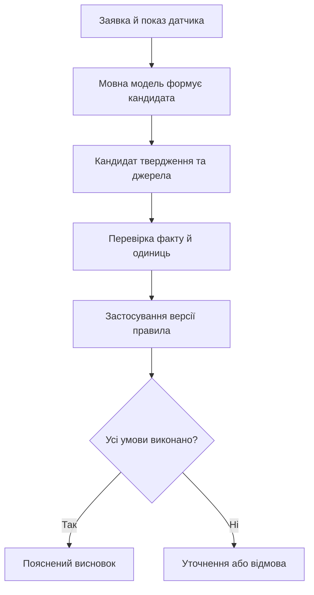
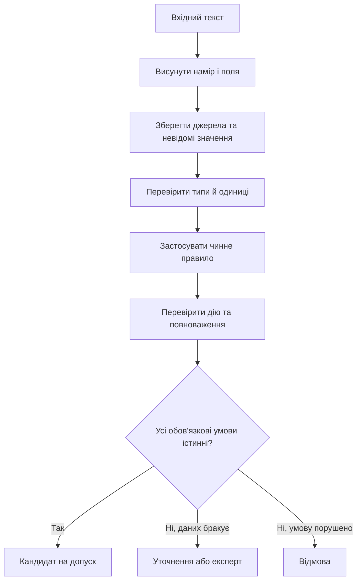
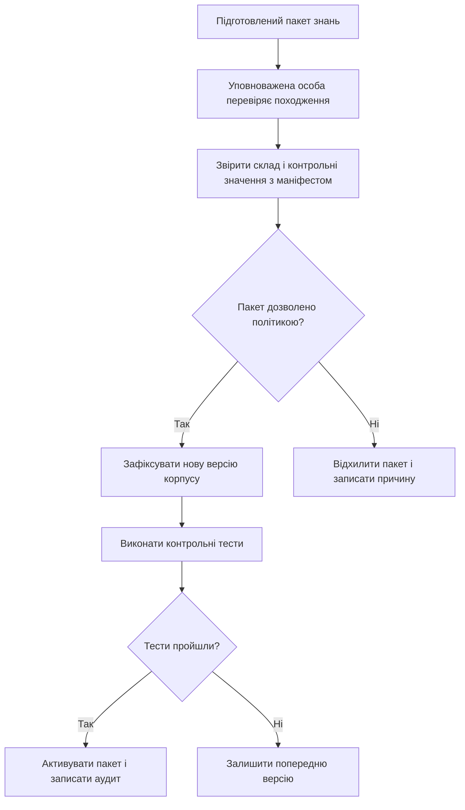
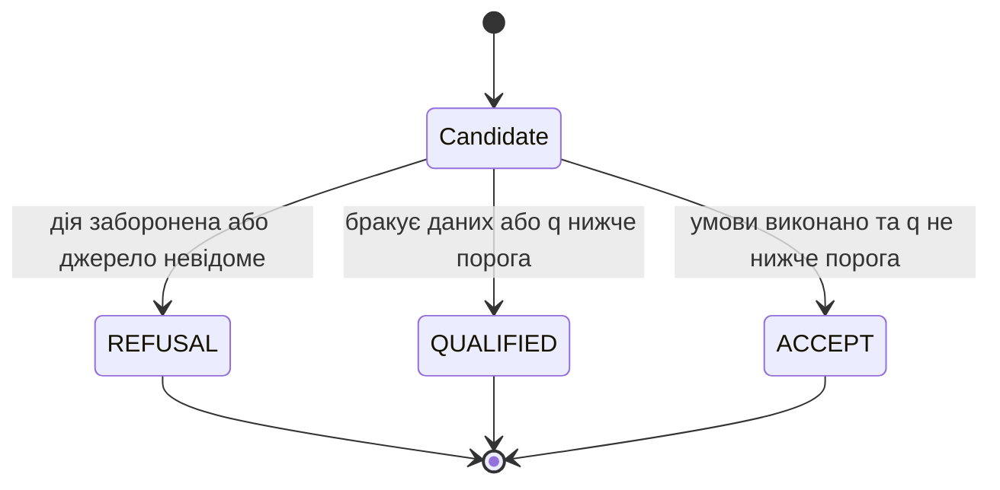

# Глава 21. Архітектура нейро-символьних та ізольованих систем

<a id="глава-21-архітектура-нейро-символьних-та-ізольованих-експертних-систем-двосистемне-мислення-модель-контрольованих-каналів-та-межа-релевантність--допустимість"></a>

> **Підручник:** [Експертні Системи](../README.md) · [Том 3. Нейро-символьні, ізольовані, критичні до безпеки та високопродуктивні експертні системи](README.md)  
> **Навчальний рівень:** Спецкурс і монографічний том (магістратура, наукова робота)  
> **Обладнання:** звичайний ноутбук або ПК; NPU, тензорні прискорювачі та навчальні плати FPGA — як кейси, за наявності в лабораторії  
> **Мови:** реалізація — будь-яка мова загального призначення, для критичних шлюзів — системна мова (Rust, C/C++, Ada/SPARK); спеціалізовані мови — GBNF, Rego/Cedar, Lean 4, Verilog-2005 / SystemVerilog  
> **Попередня глава:** [Глава 20. Часові моделі, прогнозування та калібрування](../Volume-2/ch20-temporal-models-and-prediction.md)\
> **Наступна глава:** [Глава 22. Мовне опрацювання та структуроване видобування знань](ch22-linguistic-processing-and-knowledge-extraction.md)\
> **Автор:** Микола Мартинович Федчик

---

## Анотація

У Томі 3 нейронні моделі розглядаються як засоби опрацювання запитів і побудови кандидатів, а експертна система — як програмний комплекс, що мусить показувати підстави рішення й перевіряти його за явними правилами. Ця глава вводить таке розділення на навчальному прикладі технічного обслуговування: мовна модель може запропонувати дію на підставі тексту заявки, але лише перевірка чинних джерел, правил допуску та повноважень визначає, чи можна перетворити її на висновок. Далі розглянуто, чому генератор і мовний оцінювач можуть поділяти помилку, як описати джерела та контрольовані канали автономної системи, і як поріг селективної класифікації дає змогу передати непевний випадок на перевірку людиною.

Глава завершується маршрутом усього Тому 3 — від видобування знань і перевірки доказів до контрольованих дій, обґрунтування безпеки, апаратного виконання, захищеного обміну та розподіленої узгодженості. На її завершенні читач зможе побудувати малий детермінований шлюз допуску, перевірити його граничні випадки й пояснити, чого саме він підтверджує, а чого не підтверджує. Зміст глав 29–30 у маршруті є програмою навчання, а не описом уже написаного матеріалу.

---

<!-- chapter-toc:start -->
## Зміст глави

- [1. Правдоподібність генерації та перевірність висновку](#1-правдоподібність-генерації-та-перевірність-висновку)
  - [1.1. Авторегресійна максимізація правдоподібності наступного токена проти логічного слідування](#11-авторегресійна-максимізація-правдоподібності-наступного-токена-проти-логічного-слідування)
  - [1.2. Спільні помилки генератора та перевіряльника](#12-спільні-помилки-генератора-та-перевіряльника)
- [2. Розподіл генерації кандидатів і перевірки допустимості](#2-розподіл-генерації-кандидатів-і-перевірки-допустимості)
  - [2.1. Розпізнавання наміру та нормалізація запиту](#21-розпізнавання-наміру-та-нормалізація-запиту)
  - [2.2. Перевірка правил і повноважень перед видачею вердикту](#22-перевірка-правил-і-повноважень-перед-видачею-вердикту)
- [3. Модель ізольованої та корпусно-обмеженої системи](#3-модель-ізольованої-та-корпусно-обмеженої-системи)
  - [3.1. Види ізоляції та межі доступного корпусу](#31-види-ізоляції-та-межі-доступного-корпусу)
  - [3.2. Стан ізольованої системи та контрольовані канали](#32-стан-ізольованої-системи-та-контрольовані-канали)
- [4. Гібридний нейро-символьний вентиль допуску та правило селективної відмови Чоу — Ель-Яніва](#4-гібридний-нейро-символьний-вентиль-допуску-та-правило-селективної-відмови-чоу--ель-яніва)
  - [4.1. Баланс між ризиком хибного допуску та часткою відхилених запитів при комбінуванні автоматного і субсловного каналів](#41-баланс-між-ризиком-хибного-допуску-та-часткою-відхилених-запитів-при-комбінуванні-автоматного-і-субсловного-каналів)
- [5. Практичні завдання та лабораторний практикум](#5-практичні-завдання-та-лабораторний-практикум)
  - [5.1. Контрольні запитання для самоперевірки](#51-контрольні-запитання-для-самоперевірки)
  - [5.2. Розрахункові задачі (трасування вручну)](#52-розрахункові-задачі-трасування-вручну)
  - [5.3. Завдання з програмної реалізації](#53-завдання-з-програмної-реалізації)
  - [5.4. Зв'язок із лабораторною та курсовою роботою курсу](#54-звязок-із-лабораторною-та-курсовою-роботою-курсу)
- [6. Навчальний маршрут Тому 3](#6-навчальний-маршрут-тому-3)
  - [6.1. Послідовність глав і перевірювані результати навчання](#61-послідовність-глав-і-перевірювані-результати-навчання)
- [Висновки](#висновки)
- [Глосарій](#глосарій)
- [Скорочення та терміни](#скорочення-та-терміни)
- [Джерела](#джерела)
<!-- chapter-toc:end -->

---

<a id="1-епістемічний-розрив-генеративних-моделей-та-пастка-llm-як-суддя-llm-as-a-judge-trap"></a>

## 1. Правдоподібність генерації та перевірність висновку

Під час розбору заявки на обслуговування мовна модель може швидко запропонувати правдоподібне пояснення, але експертній системі потрібне інше: відтворюваний висновок із конкретних фактів і чинних правил. Якщо оцінку моделі прийняти за доказ, непідтверджена порада потрапить у базу знань або вплине на подальшу дію. Тому спершу відрізнимо ймовірність тексту від логічного слідування, а далі з'ясуємо, чому друга мовна модель не обов'язково є незалежним перевіряльником.

### 1.1. Авторегресійна максимізація правдоподібності наступного токена проти логічного слідування

Авторегресійна модель обирає наступний токен за умовною ймовірністю з огляду на попередні токени [[1]](#src-1). Це допомагає будувати зв'язний текст, але не означає, що окреме твердження логічно випливає з перевірених фактів. Для заявки припустімо, що датчик зафіксував температуру підшипника 88 °C, а чинне правило вимагає огляду за температури понад 85 °C. Фраза «підшипник слід оглянути» може бути доречним кандидатом; щоб прийняти її як висновок системи, треба встановити джерело показу, версію правила й факт виконання його умови.

**Формула 21.1. Імовірність послідовності токенів у мовній моделі.**

$$
P(y \mid x) = \prod_{t=1}^{T} P(y_t \mid x, y_1, \ldots, y_{t-1})
$$

Тут $x$ — вхідна послідовність токенів; $`y=(y_1,\ldots,y_T)`$ — послідовність відповіді; $T$ — кількість її токенів, ціле число від 1 до граничної довжини моделі; кожний множник — умовна імовірність наступного токена в межах від 0 до 1. Якщо три умовні імовірності в навчальному прикладі дорівнюють 0,8, 0,7 і 0,9, імовірність саме цієї три-токенної послідовності дорівнює 0,504. Це оцінка текстової послідовності за моделлю, а не імовірність істинності твердження чи гарантія його виведення.

Логічна перевірка формулюється окремо: база знань $\mathcal{K}$ тягне твердження $c$, якщо воно істинне в усіх моделях, що задовольняють $\mathcal{K}$. У наведеному прикладі таку перевірку можна подати правилом «якщо температура більша за 85 °C, то потрібен огляд» і фактом вимірювання з часовою позначкою. Результат з'являється лише за умови, що правило застосовне до цього типу підшипника, вимір має придатне походження, а одиниці узгоджено. Отже, оцінка тексту допомагає ранжувати формулювання, тоді як логічний рушій відповідає за вивід за оголошеною базою знань [[5]](#src-5).

**Діаграма 21.2. Межа між генерацією кандидата та висновком експертної системи.**



Схема показує, де саме текстова правдоподібність перестає бути достатньою: між кандидатом і висновком стоять перевірки, результат яких можна повторити на тих самих вхідних даних.

<a id="12-ймовірність-спільного-пропуску-помилки-корельованою-парою-генератор--суддя-та-теорема-про-каскадне-накопичення-похибок"></a>

### 1.2. Спільні помилки генератора та перевіряльника

Повторна перевірка тією самою моделлю не обов'язково знижує ризик: генератор і оцінювач можуть спиратися на однаковий хибний фрагмент заявки, пропускати ту саму одиницю вимірювання або відтворювати спільне зміщення навчальних даних. Дослідження мовних суддів описують, зокрема, позиційне та багатослівне упередження [[2]](#src-2). Тому просте множення двох часток помилок допустиме лише за обґрунтованого припущення про незалежність.

**Формула 21.3. Імовірність спільного пропуску помилки.**

$$
P(G \cap J) = P(G)\,P(J \mid G)
$$

$G$ — подія «генератор пропустив або хибно сформував істотне твердження», $J$ — подія «перевіряльник прийняв це твердження»; обидві імовірності лежать у межах від 0 до 1. Якщо суто для навчального розрахунку покласти $P(G)=0{,}06$ та $P(J)=0{,}04$, припущення незалежності дає спільний ризик $0{,}0024$ (0,24%). Але за спільного джерела припустімо $P(J\mid G)=0{,}5$; тоді ризик становить $0{,}03$ (3%), тобто у 12,5 раза більший. Ці числа ілюстративні, а не вимірювання точності конкретних моделей.

**Дія:** коли залежність помилок невідома, не зараховуйте мовну оцінку як незалежний доказ. Перевірте кандидата іншим за природою механізмом — наприклад, правилом із явними передумовами, обмежувачем одиниць і перевіркою посилань на затверджений корпус. Така перевірка не усуває спільні помилки в самому корпусі чи вимогах; вона робить використані підстави видимими й дає змогу спроєктувати окремі перевірки для них.

<a id="2-двосистемна-нейро-символьна-архітектура-system-1--system-2-та-межа-relevance-vs-eligibility"></a>

## 2. Розподіл генерації кандидатів і перевірки допустимості

Щоб перетворити текстову заявку на придатний вхід експертної системи, потрібно розпізнати намір, але не дозволити цьому кроку непомітно видати дозвіл на дію. Умовно назвемо швидке опрацювання «рівнем сприйняття», а повільнішу перевірку — «нормативним ядром». Це інженерне розділення функцій, а не твердження, що будь-яка конкретна модель відповідає психологічним системам мислення. Воно дає чітку межу між релевантним кандидатом і допустимим рішенням.

<a id="21-рівень-сприйняття-slm--двоенкодер-висування-кандидатів-наміру-та-нормалізація-варіативності-природної-мови"></a>

### 2.1. Розпізнавання наміру та нормалізація запиту

Заявка «після тривалої роботи з'явився гул і нагрів» може бути нормалізована до наміру «потрібна діагностика підшипника», але текстовий класифікатор має позначити результат саме як кандидата. Для подальшої перевірки кандидат зберігає первинний текст, нормалізовані поля, одиниці, ідентифікатори джерел і невизначені поля; система не повинна домислювати відсутнє значення. Наприклад, якщо одиницю температури не вказано, наступний крок запитує уточнення або повертає стан «недостатньо даних».

Під час розробки зафіксуйте допустимі значення полів і перевірте класифікатор на варіантах написання, запереченні та відсутніх значеннях. Кілька фраз «підшипник гріється», «є нагрів опори» і «температура опори зросла» можуть відповідати одному наміру, але «нагріву немає» не можна звести до того самого факту. Результат цього кроку — нормалізований запис, не доказ і не команда.

<a id="22-нормативне-символьне-ядро-виключна-монополія-на-перевірку-умов-одиниць-повноважень-і-видачу-вердикту-accept--refusal"></a>

### 2.2. Перевірка правил і повноважень перед видачею вердикту

Символьний механізм отримує типізований кандидат і перевіряє його за версіонованими правилами. Мінімальний контракт містить чотири речі: дію з дозволеного переліку, посилання на наявні джерела, оцінку з визначеним статусом і достатність даних. Відсутня одиниця, заборонена дія або невідоме джерело не «виправляються» мовною моделлю. Невідомий стан веде до уточнення чи ескалації; порушення жорсткої умови — до відмови.

**Діаграма 21.4. Перевірка кандидата перед рішенням експертної системи.**



Діаграма розрізняє три результати, які часто помилково зливають: допустимий кандидат, брак інформації та порушення правила. Для реальної системи перелік перевірок визначають вимоги домену; для цієї глави вони далі зведені до перевірки типу дії, межі оцінки та належності свідчень локальному корпусу.

<a id="3-математична-модель-повністю-ізольованої-та-корпусно-обмеженої-експертної-системи-air-gapped-es"></a>

## 3. Модель ізольованої та корпусно-обмеженої системи

Коли експертна система працює без постійного доступу до мережі, інженер має знати не лише, що саме ізольовано, а й які знання завантажено та яким каналом дозволено їх оновлювати. Сам напис «автономний режим» не фіксує ані склад корпусу, ані версію правил; після неперевіреного перенесення файла система може непомітно міркувати на застарілих або підмінених даних. Тому задамо малу модель стану, яку можна записати в журналі запуску й перевірити до опрацювання запиту.

<a id="31-класифікація-ізоляції-повітряний-проміжок-air-gap-автономний-периметр-on-premise-та-замкненість-на-корпусі-k0"></a>

### 3.1. Види ізоляції та межі доступного корпусу

Відсутність фізичного мережевого з'єднання («повітряний проміжок») — властивість інфраструктури. Автономне розгортання на власному обладнанні — спосіб розміщення, який сам по собі не виключає мережевий доступ. Замкненість на корпусі — властивість обчислення: кожен факт, що вплинув на висновок, має ідентифіковане джерело з оголошеної версії даних. Це різні характеристики, тому під час аудиту вказують їх окремо.

Нехай навчальна система працює з комплектом інструкцій `K0-v3` і локальними показами `sensor-17`; пакет оновлення дозволений лише після перевірки його маніфесту уповноваженим працівником. Перед запуском оператор має змогти відповісти на запитання «яка версія моделі, корпуса й політики дала цей результат?» за локальним записом, не вдаючись до неперевірюваної пам'яті процесу.

<a id="32-пятикомпонентний-вектор-стану-ізольованої-системи-та-модель-строго-контрольованих-вхіднихвихідних-каналів"></a>

### 3.2. Стан ізольованої системи та контрольовані канали

**Формула 21.5. П'ять складників зафіксованого стану ізольованої системи.**

$$
S = (K_v, C_v, I_v, O_v, A_v)
$$

$S$ — стан конфігурації під час одного запуску; $`K_v`$ — ідентифікатор і версія моделі; $`C_v`$ — версія корпусу та його маніфест; $`I_v`$ — політика дозволеного імпорту; $`O_v`$ — політика дозволеного виводу; $`A_v`$ — локальна послідовність аудиту. Індекс $v$ означає зафіксовану версію відповідного складника, а не числову оцінку. Значення кожного поля має бути явно задане; порожня або неузгоджена версія не дозволяє підтвердити походження висновку.

Для кожного запиту експертна система додає до результату ідентифікатор `C_v`, версію правила й використані джерела. Якщо посилання не належить маніфесту або версію правила не вдалося встановити, обчислення зупиняється з результатом «потрібна перевірка», а не підміняється пошуком у невідомому джерелі. Оновлення через змінний носій — окремий керований процес: перевіряють повноваження постачальника, цілісність пакета, склад і версію, після чого фіксують прийняття або відхилення в журналі.

**Діаграма 21.6. Контрольоване оновлення корпусу автономної експертної системи.**



Для систем на кшталт медичного довідника чи енергетичної діагностики це дає конкретний спосіб відтворення: зберегти п'ять складників стану поруч із висновком і перевірити, що в контрольному запуску вони збігаються. Ізоляція мережі зменшує частину шляхів доступу, але не замінює контроль носіїв, автентичність джерел, керування доступом і тестування змін. Принцип не надавати довіру лише через мережеве розташування також узгоджується з NIST SP 800-207, хоча цей документ не є спеціальним стандартом ізоляції корпусів знань.

## 4. Гібридний нейро-символьний вентиль допуску та правило селективної відмови Чоу — Ель-Яніва

Навіть після перевірки правил може залишитися невизначеність класифікатора: яка з кількох причин найкраще пояснює нагрів? Якщо кожен запит примусово віднести до одного класу, система приховає сумнів за впевненим формулюванням. Селективний класифікатор додає третій вихід — утриматися від автоматичної відповіді — і тим самим обмінює частку автоматично опрацьованих випадків на нижчий ризик помилки серед них. Цей механізм не скасовує попередніх жорстких перевірок допустимості.

### 4.1. Баланс між ризиком хибного допуску та часткою відхилених запитів при комбінуванні автоматного і субсловного каналів

Правило відмови Чоу порівнює очікувані втрати класифікації та утримання від відповіді [[3]](#src-3); дослідження селективної класифікації застосовують аналогічний компроміс між ризиком і покриттям [[4]](#src-4). Нехай класифікатор розподіляє запит між класами причин і повертає найбільшу оцінку $q$. Для прикладу задайте втрату $`C_{\mathrm{mis}}=10`$ умовних штрафних балів за автоматично прийняту помилкову класифікацію, а втрату $`C_{\mathrm{reject}}=2`$ бали за передачу випадку фахівцеві. Поріг прийняття випливає з порівняння очікуваних втрат класифікації та відмови.

**Формула 21.7. Поріг класифікації за заданої ціни помилки й відмови.**

$$
\tau = 1 - \frac{C_{\mathrm{reject}}}{C_{\mathrm{mis}}}
$$

$`C_{\mathrm{mis}}`$ — додатна вартість хибної класифікації; $`C_{\mathrm{reject}}`$ — вартість ручного розгляду, причому в цій моделі $`0 \leq C_{\mathrm{reject}} < C_{\mathrm{mis}}`$; $q$ — оцінка імовірності найбільш імовірного класу в межах від 0 до 1; $\tau$ — поріг, також у межах від 0 до 1. Для заданих витрат $\tau=1-2/10=0{,}8$. Якщо відкалібрована оцінка дорівнює 0,86, класифікатор може передати цей клас на наступні перевірки; за $q=0{,}72$ він повертає `QUALIFIED` для людського розгляду. Значення 0,86 не дозволяє дію автоматично: окремо мають пройти перевірки правил, джерел і повноважень.

Перед застосуванням порога перевірте калібрування класифікатора на окремій вибірці, що відповідає робочому домену. Самооцінка мовної моделі не є автоматично відкаліброваною імовірністю. Якщо ціни помилки різні для різних класів чи запитів, потрібні відповідні ризики для кожної дії, а не один універсальний поріг.

**Діаграма 21.8. Стани шлюзу після перевірки політики й оцінки впевненості.**



Для перевірки межі реалізуйте рішення як чисту функцію: однакові кандидат, перелік дозволених дій, множина джерел і поріг мають давати однаковий вердикт. Порожній список джерел означає недостатність даних; невідоме джерело або заборонена дія — відмову. Функція нижче повертає лише стан перевірки, а не виконує дію.

**Лістинг 21.9. Детерміноване рішення про допуск кандидата (Python 3.14.4).**

<details><summary>Показати лістинг 21.9 (30 рядків, Python 3.14.4)</summary>

```python
from math import isfinite, nan

def decide(candidate: dict[str, object], allowed_actions: set[str], evidence_ids: set[str], tau: float) -> str:
    if not isinstance(candidate, dict): return "REFUSAL"
    confidence = candidate.get("confidence")
    evidence = candidate.get("evidence")
    action = candidate.get("action")
    if type(tau) not in (int, float) or not isfinite(tau) or not 0 <= tau <= 1:
        return "REFUSAL"
    if not isinstance(action, str) or action not in allowed_actions: return "REFUSAL"
    if not isinstance(evidence, list):
        return "REFUSAL"
    if not evidence:
        return "QUALIFIED"
    if any(not isinstance(item, str) for item in evidence):
        return "REFUSAL"
    if not set(evidence).issubset(evidence_ids):
        return "REFUSAL"
    if type(confidence) not in (int, float) or not isfinite(confidence): return "REFUSAL"
    if not 0 <= confidence <= 1: return "REFUSAL"
    return "ACCEPT" if confidence >= tau else "QUALIFIED"

allowed = {"INSPECT"}
corpus = {"sensor-17", "rule-4"}
candidate = {"action": "INSPECT", "confidence": 0.86, "evidence": ["sensor-17", "rule-4"]}
assert decide(candidate, allowed, corpus, 0.8) == "ACCEPT"
assert decide({**candidate, "confidence": 0.72}, allowed, corpus, 0.8) == "QUALIFIED"
assert decide({**candidate, "evidence": ["unknown"]}, allowed, corpus, 0.8) == "REFUSAL"
assert decide({**candidate, "action": "SHUTDOWN"}, allowed, corpus, 0.8) == "REFUSAL"
assert decide({**candidate, "confidence": nan}, allowed, corpus, 0.8) == "REFUSAL"
```

</details>

Лістинг перевіряє дію, тип і межі оцінки, наявність свідчень у локальному корпусі та поріг. П'ять `assert` покривають допуск, низьку впевненість, невідоме джерело, заборонену дію та нечислове значення `NaN`; саме тому числова оцінка не може скасувати нормативну умову. На практиці кожне `REFUSAL` або `QUALIFIED` потрібно супроводити машинозчитуваною причиною та посиланнями, щоб користувач знав, що саме виправити чи перевірити.

## 5. Практичні завдання та лабораторний практикум

Цей розділ перевіряє, чи можна відтворити на папері й у програмі перехід від текстового запиту до допустимого вердикту. Для вправ достатньо Python 3.14.4 і звичайного ноутбука; NPU та інше спеціалізоване обладнання не потрібне.

### 5.1. Контрольні запитання для самоперевірки

1. Чим оцінка текстової послідовності в мовній моделі відрізняється від логічного слідування з бази знань?
2. За яких умов добуток часток помилок генератора й перевіряльника дорівнює їхній спільній частці помилок? Як зміниться розрахунок за спільного джерела помилки?
3. Які відмінності між відсутнім свідченням і свідченням, що порушує правило? Які окремі результати шлюзу мають відповідати цим випадкам?
4. Які саме дані зберігає п'ятикомпонентний запис стану і як він допомагає відтворити рішення автономної системи?
5. Які припущення потрібні для використання порога селективної класифікації? Чому оцінка впевненості генеративної моделі не замінює калібрування на предметних даних?

### 5.2. Розрахункові задачі (трасування вручну)

1. Для двох помилкових подій з ілюстративного прикладу обчисліть спільну ймовірність спершу за незалежності, потім за заданою умовою $P(J\mid G)=0{,}5$. Поясніть, чому другий результат змінює вибір перевірки.
2. Обчисліть поріг для $`C_{\mathrm{mis}}=20`$ балів і $`C_{\mathrm{reject}}=5`$ балів. Визначте вихід класифікатора для $q=0{,}70$ та $q=0{,}80$, якщо жорсткі умови допуску виконано.
3. Змініть тестові дані шлюзу так, щоб окремо отримати `QUALIFIED` через відсутні джерела та `REFUSAL` через заборонену дію. Поясніть, чому ці результати не слід об'єднувати.

<a id="53-інженерні-завдання-з-програмування-мовна-незалежність--спеціалізовані-dsl"></a>

### 5.3. Завдання з програмної реалізації

1. Розширте функцію `decide` перевіркою версії політики й цілісності маніфесту корпусу. Додайте тести для відсутнього поля, некоректного числового значення та посилання на невідому версію.
2. Опишіть у Prolog або Datalog одне правило допуску огляду з явними фактами температури, одиниці, джерела й версії правила. Зіставте висновок декларативної моделі з Python-реалізацією на однакових входах.
3. Складіть невелику перевірну вибірку для оцінювання калібрування класифікатора. Опишіть, які дані мають бути відокремлені від налаштування порога та чому навчального прикладу недостатньо для висновку про якість у робочому домені.

### 5.4. Зв'язок із лабораторною та курсовою роботою курсу

* **Навчальна вправа:** відтворіть на ноутбуці шлюз `decide`, а потім доповніть його перевіркою маніфесту й журналюванням причин кожного вердикту.
* **Місце в навчальному маршруті:** глава задає принцип поділу генерації та перевірки; у Главі 22 його застосовано під час побудови структурованого кандидата знання, у Главі 26 — під час допуску дії, а в Главі 27 — під час обґрунтування коректності моделі та перевірки коду.

## 6. Навчальний маршрут Тому 3

Перш ніж переходити до наступних методів, студентові потрібна карта їхньої ролі в цілій експертній системі. Том 3 заплановано як шлях від мовного введення та перевірки знань до контрольованої дії й розподіленого виконання. Глави 21–28 вже містять навчальний матеріал, а Глави 29–30 залишаються планом: наведені для них результати описують цілі навчання, а не вже викладений або перевірений зміст.

### 6.1. Послідовність глав і перевірювані результати навчання

**Таблиця 21.10. Навчальний маршрут від кандидатів знань до розподіленої експертної системи.**

| Глава | Її місце в маршруті | Перевірний результат навчання |
|---|---|---|
| [21](ch21-neuro-symbolic-and-isolated-systems.md) | Розділення генерації кандидатів, перевірки знань і допуску | Пояснити різницю між правдоподібністю та виводом; реалізувати й протестувати малий шлюз із `ACCEPT`, `QUALIFIED` і `REFUSAL` |
| [22](ch22-linguistic-processing-and-knowledge-extraction.md) | Перетворення тексту на типізовані знання | Витягти твердження з джерел, зберегти заперечення й походження та перевірити структуру результату |
| [23](ch23-knowledge-search-and-evidence.md) | Пошук підстав і перевірка тверджень | Порівняти пошукові стратегії та обґрунтувати, які джерела підтримують або спростовують твердження |
| [24](ch24-knowledge-gaps-and-rule-synthesis.md) | Виявлення невідомого й робота з кандидатами правил | Відрізнити доведений висновок від гіпотези та сформувати кандидата на правило для предметної перевірки |
| [25](ch25-knowledge-updates-and-learning.md) | Кероване оновлення знань і оцінювання змін | Порівняти версії бази знань за визначеними тестами й відхилити зміну, що порушує критерії якості |
| [26](ch26-controlled-actions.md) | Перехід від рекомендації до допустимої дії | Перевірити дію за політикою, ідемпотентністю та умовами ескалації |
| [27](ch27-correctness-and-safety-assurance.md) | Перевірка коректності та підготовка обґрунтування безпеки | Пов'язати вимогу, інваріант, тест чи доказ і чітко окреслити, що ними підтверджено |
| [28](ch28-hardware-acceleration-and-storage.md) | Виконання й зберігання знань на обмежених ресурсах | Оцінити витрати пам'яті та обчислень і вибрати подання, що відповідає робочим обмеженням |
| [29](ch29-secure-knowledge-exchange.md) | Обмін версіями знань між системами | Перевірити походження й сумісність пакета перед імпортом до локальної бази |
| [30](ch30-distributed-expert-systems.md) | Узгодженість, розподілення та автономність вузлів | Пояснити, як вузол обирає джерело знань і що робить під час втрати зв'язку чи розходження версій |

Цей маршрут не вимагає використовувати одну модель, мову чи апаратну платформу в усіх главах. Він пов'язує окремі інженерні рішення спільним запитанням: які факти, правила та перевірки дають підставу для висновку, і як відтворити цей ланцюг після зміни даних або вузла.

---

## Висновки

У цій главі встановлено межу між генерацією й перевіркою: мовна модель може нормалізувати запит і запропонувати кандидата, проте висновок потребує перевірених джерел, застосовного правила та придатних одиниць. Розрахунок спільної ймовірності показав, чому припущення незалежності не можна приймати без підстав. П'ятикомпонентний запис конфігурації дає змогу повторити аналіз на тій самій версії моделі, корпуса, політики й журналу.

На практичному прикладі отримано детерміновану функцію, що пропускає кандидата далі лише за дозволеної дії, відомих джерел і порога оцінки. Три її стани мають різні призначення: `ACCEPT` означає проходження саме цього шлюзу, `QUALIFIED` — потребу в уточненні чи перевірці людиною, а `REFUSAL` — порушення заданої умови. Це не сертифікат безпеки й не команда виконавчому пристрою: межі доказів і додаткових перевірок розглянуто в Главі 27.

Тепер читач може побудувати малий нормалізатор і шлюз, запустити позитивні та негативні тести й указати межі отриманого результату. Наступне запитання — як видобути з природномовного документа типізовані твердження, не загубивши заперечення, одиниці й походження; цьому присвячено Главу 22.

## Глосарій

* **Замкнений корпус** — оголошений набір документів, правил і моделей, з якого система має право отримувати підстави для висновків.
* **Калібрування** — відповідність прогнозованих імовірностей частоті правильних прогнозів на визначеній вибірці.
* **Селективна класифікація** — класифікація, що може утриматися від відповіді, щоб зменшити ризик помилки серед прийнятих випадків.
* **Спільна помилка** — помилка, яку не виявив жоден з етапів генерації та перевірки; її частоту не можна оцінювати множенням двох часток без перевірки незалежності.
* **Шлюз допуску** — перевірка, яка вирішує, чи може кандидат перейти до наступного програмного етапу за визначеними правилами.

## Скорочення та терміни

* **LLM** — велика мовна модель (*Large Language Model*).
* **SLM** — мала мовна модель (*Small Language Model*).
* **NIST** — Національний інститут стандартів і технологій США (*National Institute of Standards and Technology*).
* **`ACCEPT`** — кандидат пройшов перевірки шлюзу, описані в цій главі.
* **`QUALIFIED`** — кандидат потребує уточнення або перевірки людиною.
* **`REFUSAL`** — кандидат не пройшов жорстку перевірку дії, джерела або вхідного значення.

## Джерела

1. <a id="src-1"></a>Vaswani, A. et al. *Attention Is All You Need*. Advances in Neural Information Processing Systems 30, 2017. [arXiv:1706.03762](https://arxiv.org/abs/1706.03762).
2. <a id="src-2"></a>Zheng, L. et al. *Judging LLM-as-a-Judge with MT-Bench and Chatbot Arena*. Advances in Neural Information Processing Systems 36, 2023. [arXiv:2306.05685](https://arxiv.org/abs/2306.05685).
3. <a id="src-3"></a>Chow, C. K. “On Optimum Recognition Error and Reject Tradeoff.” *IEEE Transactions on Information Theory*, 16(1), 41–46, 1970. [doi:10.1109/TIT.1970.1054406](https://doi.org/10.1109/TIT.1970.1054406).
4. <a id="src-4"></a>Geifman, Y., and R. El-Yaniv. “Selective Classification for Deep Neural Networks.” *Advances in Neural Information Processing Systems 30*, 2017. [Proceedings of NeurIPS](https://papers.nips.cc/paper/2017/hash/4a8423d5e91fda00bb7e46540e2b0cf1-Abstract.html).
5. <a id="src-5"></a>Besold, T. R. et al. *Neural-Symbolic Learning and Reasoning: A Survey and Interpretation*. [arXiv:1711.03902](https://arxiv.org/abs/1711.03902), 2017.
6. <a id="src-6"></a>Rose, S. et al. *Zero Trust Architecture*. NIST Special Publication 800-207, 2020. [doi:10.6028/NIST.SP.800-207](https://doi.org/10.6028/NIST.SP.800-207).
