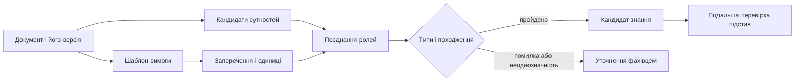
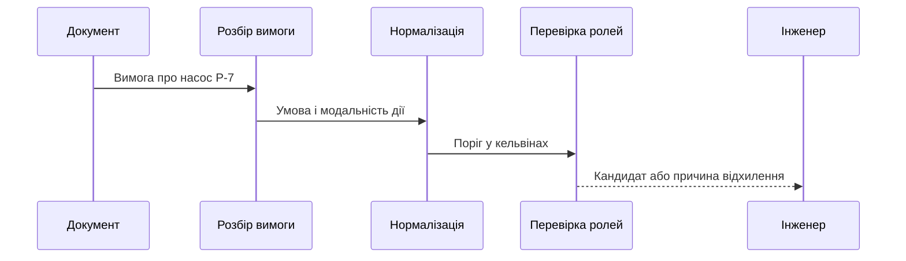
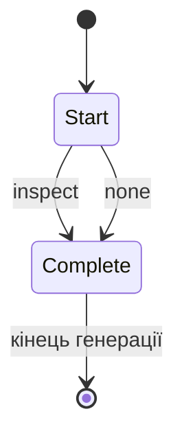
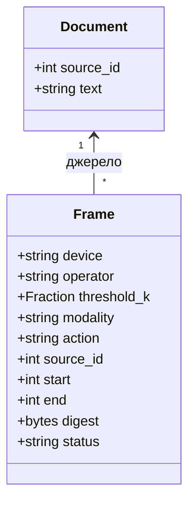

# Глава 22. Мовне опрацювання та структуроване видобування знань

<a id="глава-22-інженерна-лінгвістика-та-zero-shot-видобування-знань-двоенкодерні-архітектури-видобування-сутностей-і-відношень-граматичне-декодування-gbnf-та-валентні-фрейми"></a>

> **Підручник:** [Експертні Системи](../README.md) · [Том 3. Нейро-символьні, ізольовані, критичні до безпеки та високопродуктивні експертні системи](README.md)  
> **Навчальний рівень:** прикладні програмісти та студенти комп'ютерних наук\
> **Обладнання:** звичайний ноутбук або ПК; прискорювачі розглянуто як необов'язковий варіант виконання\
> **Мови:** Python 3.14.4; для пояснення граматики — нотація GBNF\
> **Попередня глава:** [Глава 21. Архітектура нейро-символьних та ізольованих систем](ch21-neuro-symbolic-and-isolated-systems.md)\
> **Наступна глава:** [Глава 23. Пошук знань і перевірка підстав тверджень](ch23-knowledge-search-and-evidence.md)\
> **Автор:** Микола Мартинович Федчик

---

## Анотація

Експертна система може отримувати знання з інструкцій, вимог і звітів, але природномовне речення не стає перевіреним фактом лише тому, що модель розпізнала в ньому назву пристрою й число. У цій главі показано, як виділити кандидата твердження, зберегти його джерело та заперечення, привести одиниці до спільної шкали й перевірити структуру перед передаванням на подальший розгляд. Нейронне видобування, граматично обмежена генерація і типізація допомагають на різних етапах; жоден із них сам по собі не встановлює істинність джерела.

Наскрізний навчальний приклад — вимога про огляд насоса за перевищення температурного порога. Читач реалізує невеликий детермінований розбір, перевірить маскований softmax, збере типізований запис і збереже його в 64 байтах. Код працює без завантаження нейромоделі: він демонструє інтерфейс і перевірки, а не відтворює якість або реалізацію GLiNER.

---

<!-- chapter-toc:start -->
## Зміст глави

- [1. Видобування сутностей і відношень без предметного донавчання](#1-видобування-сутностей-і-відношень-без-предметного-донавчання)
  - [1.1. Обмеження одноенкодерних моделей при великій кількості класів онтології](#11-обмеження-одноенкодерних-моделей-при-великій-кількості-класів-онтології)
  - [1.2. Роздільне кодування тексту та понять онтології](#12-роздільне-кодування-тексту-та-понять-онтології)
  - [1.3. Попереднє кешування онтології та периферійне виконання](#13-попереднє-кешування-онтології-та-периферійне-виконання)
- [2. Шаблони вимог, заперечення та нормалізація значень](#2-шаблони-вимог-заперечення-та-нормалізація-значень)
  - [2.1. Основні шаблони запису вимог](#21-основні-шаблони-запису-вимог)
  - [2.2. Сфера дії заперечення та приведення одиниць](#22-сфера-дії-заперечення-та-приведення-одиниць)
- [3. Граматично обмежена генерація](#3-граматично-обмежена-генерація)
  - [3.1. Перевірка допустимих токенів за граматикою](#31-перевірка-допустимих-токенів-за-граматикою)
  - [3.2. Маскування переходів і збереження зміщень тексту](#32-маскування-переходів-і-збереження-зміщень-тексту)
- [4. Сигнатури предикатів і типізовані структури тверджень](#4-сигнатури-предикатів-і-типізовані-структури-тверджень)
  - [4.1. Перевірка повноти обов'язкових ролей дієслова та входження онтологічних сортів актантів до очікуваних класів](#41-перевірка-повноти-обовязкових-ролей-дієслова-та-входження-онтологічних-сортів-актантів-до-очікуваних-класів)
  - [4.2. Поєднання предикатів з аргументами та машинне пакування](#42-поєднання-предикатів-з-аргументами-та-машинне-пакування)
- [5. Практичні завдання та лабораторний практикум](#5-практичні-завдання-та-лабораторний-практикум)
  - [5.1. Контрольні запитання для самоперевірки](#51-контрольні-запитання-для-самоперевірки)
  - [5.2. Розрахункові задачі (трасування вручну)](#52-розрахункові-задачі-трасування-вручну)
  - [5.3. Завдання з програмної реалізації](#53-завдання-з-програмної-реалізації)
  - [5.4. Зв'язок із лабораторною та курсовою роботою курсу](#54-звязок-із-лабораторною-та-курсовою-роботою-курсу)
- [Висновки](#висновки)
- [Глосарій](#глосарій)
- [Скорочення та терміни](#скорочення-та-терміни)
- [Джерела](#джерела)
<!-- chapter-toc:end -->

---

<a id="1-двоенкодерні-архітектури-видобування-сутностей-та-відношень-без-навчання-zero-shot-ie-на-прикладі-відкритих-моделей-сімейства-gliner"></a>

## 1. Видобування сутностей і відношень без предметного донавчання

Коли база знань формується з документів, системі потрібно знайти згадки об'єктів і пов'язати їх із діями та умовами. Пошук лише за словами `насос` і `185` не показує, який саме насос мається на увазі, чи є число порогом і чи стосується заперечення умови або дії. Помилково з'єднавши ці фрагменти, програма може створити правило, якого автор документа не писав.

Розгляньмо одне навчальне речення: **«Коли температура насоса P-7 перевищує 185 °F, система повинна створити заявку на огляд цього насоса.»** Поріг тут умовний і не є рекомендацією з експлуатації обладнання. Потрібний результат — кандидат із пристроєм `P-7`, порогом, напрямом порівняння, дією, модальністю та посиланням на незмінений текст. Перевірка повноважень джерела й обґрунтованості самої вимоги залишається наступним завданням.

**Діаграма 22.1. Шлях від документа до кандидата знання.**



На діаграмі два шляхи сходяться перед створенням запису: знаходження сутності та розуміння вимоги взаємно доповнюються. Навіть правильна назва пристрою не визначає, якою є дія щодо нього.

### 1.1. Обмеження одноенкодерних моделей при великій кількості класів онтології

Для нового набору документів інженер не завжди має розмічені приклади кожного типу сутності. У такій ситуації *zero-shot* видобування пропонує подати моделі назви потрібних типів, наприклад «пристрій» і «температура», без додаткового навчання на прикладах саме цих типів. Це не означає, що модель взагалі не навчалася: початкове навчання та його дані залишаються визначальними для результату.

У початковій GLiNER двобічний трансформер опрацьовує текст і запропоновані типи та оцінює можливі текстові фрагменти [[1]](#src-1). За спільного кодування зміна набору міток може вимагати повторного опрацювання входу; зі зростанням набору треба вимірювати довжину входу, час і пам'ять конкретної реалізації. Це не доводить, що кожна одноенкодерна модель неодмінно повільніша за кожну двоенкодерну.

Розпізнавання `P-7` як пристрою та `185 °F` як температури ще не встановлює зв'язок між ними. Модель відношень може запропонувати такий зв'язок окремо або спільно із сутностями, але його напрям і прив'язку до документа теж необхідно перевірити. Сімейство GLiNER містить різні варіанти, зокрема моделі для спільного видобування сутностей і відношень [[2]](#src-2).

<a id="12-роздільне-кодування-тексту-та-міток-онтології-в-архітектурах-gliner-bi-gliner-relex-та-gliclass"></a>

### 1.2. Роздільне кодування тексту та понять онтології

Роздільне кодування дає змогу заздалегідь обчислити подання типів і порівнювати їх із поданнями фрагментів тексту. У двоенкодерному варіанті GLiNER для цього використовують окремі представлення тексту й міток [[2]](#src-2). Конкретна функція оцінювання залежить від моделі; далі косинусна близькість є навчальним прикладом, а не твердженням про обов'язкову формулу кожної моделі GLiNER.

Щоб вирішити, яку з двох міток запропонувати для `P-7`, порівняємо напрямки їхніх векторів із вектором фрагмента. Результат — безрозмірний показник близькості:

**Формула 22.2. Косинусна близькість фрагмента і мітки.**

$$
s(\mathbf{u},\mathbf{v})=\frac{\mathbf{u}\cdot\mathbf{v}}{\lVert\mathbf{u}\rVert_2\lVert\mathbf{v}\rVert_2}
$$

$`\mathbf{u},\mathbf{v}\in\mathbb{R}^{d}`$ — ненульові вектори однакової розмірності $d\geq1$; $`\mathbf{u}\cdot\mathbf{v}`$ — сума добутків відповідних компонентів; $`\lVert\cdot\rVert_2`$ — довжина вектора. Показник $s$ належить відрізку $[-1,1]$. Нульовий вектор не має визначеного напрямку, тому порівняння для нього треба відхилити.

Нехай навчальні вектори дорівнюють $`\mathbf{u}=(3,4)`$, $`\mathbf{v}_{\mathrm{пристрій}}=(0,1)`$ і $`\mathbf{v}_{\mathrm{дата}}=(1,0)`$. Довжина першого вектора — 5, довжини обох міток — 1. Отже, близькості становлять відповідно $4/5=0{,}8$ і $3/5=0{,}6$. За **умовно заданого** порога $0{,}75$ першу мітку можна передати далі як кандидата. Число $0{,}8$ тут не є ймовірністю правильності; робочий поріг налаштовують і оцінюють на окремій розміченій вибірці.

Функція отримує два вектори однакової довжини й повертає показник формули 22.2. Непридатні вектори призводять до явної помилки.

**Лістинг 22.3. Обчислення косинусної близькості (Python 3.14.4).**

<details><summary>Показати лістинг 22.3 (20 рядків, Python 3.14.4)</summary>

```python
from math import fsum, hypot, isfinite

def cosine(left: list[float], right: list[float]) -> float:
    if not left or len(left) != len(right):
        raise ValueError("Вектори мають бути непорожніми й однакової довжини")
    if not all(isfinite(x) for x in (*left, *right)):
        raise ValueError("Компоненти мають бути скінченними")
    a, b = hypot(*left), hypot(*right)
    if not isfinite(a) or not isfinite(b) or a == 0 or b == 0:
        raise ValueError("Довжини векторів мають бути скінченними й ненульовими")
    return fsum((x / a) * (y / b) for x, y in zip(left, right))

assert abs(cosine([3, 4], [0, 1]) - 0.8) < 1e-12
assert abs(cosine([3, 4], [1, 0]) - 0.6) < 1e-12
try:
    cosine([0, 0], [1, 0])
except ValueError:
    pass
else:
    raise AssertionError("Нульовий вектор необхідно відхилити")
```

</details>

Після вибору мітки потрібно зберегти не лише її текст, а й точне місце в джерелі. Напіввідкритий інтервал `[start, end)` включає початок і не включає кінець: для наведеної вимоги `P-7` займає позиції `[24, 27)` у рядку Python, а `185 °F` — `[38, 44)`. Це індекси кодових точок Unicode, не байтів UTF-8. Візуальний символ також може складатися з кількох кодових точок [[9]](#src-9).

Наступний лістинг не викликає нейромережу: він імітує вже знайдені згадки, вимагає їхньої однозначності та перевіряє зміщення. Змінну `SOURCE` використовуватимуть наступні лістинги; запускайте їх у спільному сеансі Python у порядку появи.

**Лістинг 22.4. Зв'язування згадок із початковим текстом (Python 3.14.4).**

<details><summary>Показати лістинг 22.4 (19 рядків, Python 3.14.4)</summary>

```python
SOURCE = "Коли температура насоса P-7 перевищує 185 °F, система повинна створити заявку на огляд цього насоса."

def unique_span(text: str, fragment: str) -> tuple[int, int]:
    if not fragment:
        raise ValueError("Порожня згадка")
    start = text.find(fragment)
    if start < 0 or text.find(fragment, start + 1) != -1:
        raise ValueError("Згадка відсутня або неоднозначна")
    return start, start + len(fragment)

device_span = unique_span(SOURCE, "P-7")
temperature_span = unique_span(SOURCE, "185 °F")
assert device_span == (24, 27) and temperature_span == (38, 44)
assert SOURCE[slice(*device_span)] == "P-7"
byte_start = len(SOURCE[:device_span[0]].encode("utf-8"))
byte_end = len(SOURCE[:device_span[1]].encode("utf-8"))
assert (byte_start, byte_end) == (45, 48)
assert SOURCE.encode("utf-8")[byte_start:byte_end].decode("utf-8") == "P-7"
assert len(SOURCE) == 100 and len(SOURCE.encode("utf-8")) == 177
```

</details>

Для того самого `P-7` байтовий інтервал дорівнює `[45, 48)`. Передавати `[24, 27)` як байтові позиції було б помилкою. Нормалізація Unicode, заміна лапок або перекодування можуть змінити зміщення: зберігайте початковий текст і явно позначайте одиницю індексації. Для UTF-16, яким користуються деякі інтерфейси, потрібне окреме перетворення.

<a id="13-попереднє-офлайн-кешування-векторів-доменної-онтології-та-виконання-на-вбудованих-npu-за-мілісекунди"></a>

### 1.3. Попереднє кешування онтології та периферійне виконання

Кешування корисне, коли перелік типів змінюється рідше за документи: вектори міток обчислюють один раз для визначеної версії моделі й повторно використовують. Перед розміщенням кешу на CPU, GPU або NPU інженерові потрібно оцінити, скільки байтів займають самі числа, окремо від пам'яті моделі та службових даних.

**Формула 22.5. Обсяг невпакованого кешу векторів міток.**

$$
M=L\cdot d\cdot b
$$

$L$ — невід'ємна кількість міток; $d\geq1$ — кількість компонентів вектора; $b\geq1$ — кількість байтів на компонент; $M$ — обсяг у байтах. Для 512 міток, 384 компонентів і чотирибайтових чисел $M=512\cdot384\cdot4=786\,432$ байти, тобто $768$ КіБ. За бюджету 1 МіБ для **самих векторів** вони помістяться; висновок про всю програму потребує додати ваги моделі, індекси й робочі буфери.

Ключ кешу має враховувати версію моделі, токенізатора, список міток і спосіб їх подання. Після зміни будь-якого з них старі вектори можуть стати несумісними. Кешування не гарантує потрібної затримки чи якості: їх вимірюють на цільовому обладнанні та предметній вибірці. Можливість повністю автономного виконання також залежить від того, чи доступні локально всі ваги й залежності.

<a id="2-синтаксичні-шаблони-вимог-ears-детектування-сфери-дії-заперечення-та-нормалізація-констант"></a>

## 2. Шаблони вимог, заперечення та нормалізація значень

Знайдені сутності залишаються набором фрагментів, доки програма не розрізнить умову, обов'язок і дію. У вимозі про насос помилка в одному слові `не` змінює зміст, а різні температурні шкали можуть приховати однаковий поріг. Тому перед побудовою правила потрібні розбір структури речення, збереження сфери заперечення та узгодження одиниць.

<a id="21-пять-канонічних-шаблонів-ears-ubiquitous-event-driven-unwanted-state-driven-optional"></a>

### 2.1. Основні шаблони запису вимог

EARS — підхід до впорядкування текстових вимог, у якому мовні маркери допомагають відділити стан, подію та необхідну реакцію [[3]](#src-3). Першоджерело визначає англомовні ключові слова; приклади в таблиці є **навчальною українською адаптацією**, а не офіційним перекладом стандарту. Шаблон дисциплінує запис, але не гарантує, що вимога повна, безпечна чи здійсненна.

**Таблиця 22.6. П'ять поширених видів вимог EARS.**

| Вид і англійський маркер | Яке запитання знімає | Навчальна адаптація |
|---|---|---|
| Постійна (*ubiquitous*), без маркера | Що система робить завжди? | Система повинна зберігати журнал. |
| Залежна від стану (*state-driven*), `while` | Упродовж якого стану діє вимога? | Поки датчик недоступний, система повинна показувати попередження. |
| Подієва (*event-driven*), `when` | На яку подію потрібна реакція? | Коли температура перевищує поріг, система повинна створити заявку. |
| Для необов'язкової функції (*optional*), `where` | Для якої комплектації діє вимога? | Якщо встановлено резервний датчик, система повинна показувати його стан. |
| Для небажаної ситуації (*unwanted*), `if` / `then` | Як реагувати на небажану подію? | Якщо датчик недоступний, то система повинна повідомити оператора. |

Шаблони можуть поєднуватися. У виробничому документі формулювання «коли температура перевищує поріг» ще потребує уточнення: реакція потрібна один раз при переході через поріг чи повторно, поки умова істинна. Демонстраційний код нижче лише розпізнає текст і не реалізує такої часової політики.

**Діаграма 22.7. Розбір та перевірка вимоги.**



Реалізуємо лише вузьку форму «Коли …, система повинна …» та варіант «система не повинна …». У цій контрольованій нотації «не повинна» означає заборону; якщо в документі це формулювання неоднозначне, зміст потрібно уточнити в автора вимоги. На вході — одне речення без змін; на виході — окремі рядки умови, реакції й модальності. Невідомий шаблон не перетворюється на начебто успішний порожній результат.

**Лістинг 22.8. Розбір навчального подієвого шаблону (Python 3.14.4).**

<details><summary>Показати лістинг 22.8 (19 рядків, Python 3.14.4)</summary>

```python
import re

def parse_requirement(text: str) -> dict[str, str]:
    match = re.fullmatch(r"Коли (.+?), система (не )?повинна (.+)\.", text)
    if match is None:
        raise ValueError("Вимога не відповідає підтриманому шаблону")
    trigger, negation, response = match.groups()
    return {"trigger": trigger, "response": response,
            "modality": "prohibition" if negation else "obligation"}

parsed = parse_requirement(SOURCE)
assert parsed["trigger"] == "температура насоса P-7 перевищує 185 °F"
assert parsed["response"] == "створити заявку на огляд цього насоса"
assert parsed["modality"] == "obligation"
negative_action = SOURCE.replace("система повинна", "система не повинна")
assert parse_requirement(negative_action)["modality"] == "prohibition"
negative_trigger = SOURCE.replace("перевищує", "не перевищує")
assert "не перевищує" in parse_requirement(negative_trigger)["trigger"]
assert parse_requirement(negative_trigger)["modality"] == "obligation"
```

</details>

Розбір зберігає текст умови, але сам по собі не доводить, до якого предиката належить кожне заперечення всередині довільного речення. У наступному кроці обробляємо лише явно визначену форму умови; інші конструкції потребують окремого мовного аналізу.

<a id="22-виділення-сфери-дії-операторів-заперечення-у-деревах-universal-dependencies-ud-та-афінне-приведення-одиниць-до-базису-сі"></a>

### 2.2. Сфера дії заперечення та приведення одиниць

Сфера заперечення визначає, яке саме твердження змінюється на протилежне. Для дійсних відомих температур заперечення «перевищує 85 °C» означає «не перевищує 85 °C», але заперечення обов'язку створити заявку змінює модальність дії, а не значення температури.

**Таблиця 22.9. Різні місця заперечення в одній вимозі.**

| Фрагмент умови | Фрагмент реакції | Інтерпретація кандидата |
|---|---|---|
| температура перевищує поріг | система повинна створити заявку | умова `>`; обов'язок |
| температура не перевищує поріг | система повинна створити заявку | умова `≤`; обов'язок |
| температура перевищує поріг | система не повинна створювати заявку | умова `>`; заборона |

За відсутнього показу датчика не можна автоматично вважати істинною ні умову `>`, ні її заперечення `≤`: значення невідоме. Для вільного тексту синтаксичні залежності й ознака `Polarity=Neg` у Universal Dependencies можуть бути підказкою, але однієї морфологічної ознаки недостатньо для безпомилкового визначення сфери заперечення [[4]](#src-4). Навчальна реалізація розпізнає тільки явну фразу `не перевищує`.

Порівнювати числа можна лише після узгодження їхніх одиниць. У прикладі поріг подано у °F, а показ датчика може надходити у °C; приведемо **абсолютну температуру** до кельвінів, базової одиниці SI [[5]](#src-5):

**Формула 22.10. Нормалізація абсолютної температури до кельвінів.**

$$
T_{\mathrm K} =
\begin{cases}
T_{\mathrm C}+273.15, & \text{для значення у °C},\\
(T_{\mathrm F}-32)\dfrac{5}{9}+273.15, & \text{для значення у °F}.
\end{cases}
$$

$`T_{\mathrm C}`$ і $`T_{\mathrm F}`$ — числові значення абсолютної температури відповідно у °C і °F; $`T_{\mathrm K}`$ — числове значення в K. Допустимі лише скінченні значення, що відповідають $`T_{\mathrm K}\geq0`$: нижче абсолютного нуля температура в цій моделі не визначена. Для різниці температур додавання $273{,}15$ не застосовується.

Для порога $185\,^\circ\mathrm F$ отримаємо $(185-32)\cdot5/9=85\,^\circ\mathrm C$, а потім $85+273{,}15=358{,}15\,\mathrm K$. Показ $85\,^\circ\mathrm C$ дорівнює порогу й **не** задовольняє суворого `>`; показ $86\,^\circ\mathrm C$ його задовольняє. Так зберігається відмінність між `>` і `≥`.

Для точного порівняння десяткових значень нижче використано раціональні числа `Fraction`, а не передчасне округлення. Вхід — число рядком і позначення `C` або `F`; результат — абсолютна температура в K.

**Лістинг 22.11. Точне приведення температури (Python 3.14.4).**

<details><summary>Показати лістинг 22.11 (20 рядків, Python 3.14.4)</summary>

```python
from fractions import Fraction

def to_kelvin(number: str, unit: str) -> Fraction:
    if unit not in ("C", "F"):
        raise ValueError("Непідтримувана одиниця температури")
    try:
        value = Fraction(number.replace(",", "."))
    except (ValueError, ZeroDivisionError) as error:
        raise ValueError("Некоректне числове значення") from error
    celsius = value if unit == "C" else (value - 32) * Fraction(5, 9)
    kelvin = celsius + Fraction(27315, 100)
    if kelvin < 0:
        raise ValueError("Температура нижча за абсолютний нуль")
    return kelvin

assert to_kelvin("185", "F") == to_kelvin("85", "C") == Fraction(7163, 20)
assert to_kelvin("86", "C") > to_kelvin("185", "F")
assert not (to_kelvin("85", "C") > to_kelvin("185", "F"))
assert to_kelvin("-273,15", "C") == 0
assert to_kelvin("32.1", "F") * 1000 != int(to_kelvin("32.1", "F") * 1000)
```

</details>

Для непідтримуваного позначення або значення нижче нуля K функція повідомляє про помилку; рішення за такими даними не ухвалюється. Код не враховує похибку датчика: у реальній системі інтервал вимірювання, одиниці та правило для граничних випадків мають бути задані окремо.

<a id="3-граматично-обмежене-декодування-gbnf-та-маскований-softmax"></a>

## 3. Граматично обмежена генерація

Коли модель генерує структурований запис, навіть правильно знайдені значення можуть опинитися в неприпустимому форматі. Граматика обмежує допустиму форму наступних фрагментів, щоб приймач міг розібрати результат. Вона не перевіряє, чи справді в документі міститься згенерована дія: синтаксичний контроль і перевірка підстав виконують різні завдання.

<a id="31-побудова-детермінованого-магазинного-автомата-над-граматикою-gbnf-для-виключення-синтаксично-невалідних-токенів"></a>

### 3.1. Перевірка допустимих токенів за граматикою

Граматика описує множину допустимих послідовностей. Наприклад, запис GBNF `root ::= "inspect" | "none"` дозволяє лише рядок `inspect` або `none` [[7]](#src-7). Це маленький приклад нотації, а не повна схема запису вимоги. У реальній граматиці можна описати поля, роздільники та вкладені структури.

Генератор на кожному кроці враховує поточний префікс і відкидає токени, які не можуть продовжити жоден дозволений результат. Завершення дозволено лише тоді, коли вже отримано повний рядок граматики. На діаграмі цілі слова для наочності показано як окремі кроки; фактичний токенізатор може розбити їх інакше.

**Діаграма 22.12. Стани розбору для двох допустимих результатів.**



Термінали GBNF описуються через кодові точки Unicode, а токен моделі може містити частину або декілька символів. Тому реалізація має перевіряти фактичне декодування токенів і підтримувати проміжний стан, зокрема для незавершених послідовностей байтів. Не всяку граматику можна без додаткових умов вважати детермінованим магазинним автоматом. Теоретичні та експериментальні аспекти граматично обмеженого декодування розглянуто в роботі Geng та співавторів [[6]](#src-6).

<a id="32-маскування-заборонених-переходів-до--infinity-перед-нормуванням-softmax-та-інваріант-збереження-байтових-зміщень-unicode"></a>

### 3.2. Маскування переходів і збереження зміщень тексту

Щоб вибрати наступний токен лише серед граматично допустимих, потрібно перенормувати їхні оцінки. Модель видає *логіти* — скінченні числові оцінки до перетворення на ймовірності; граматичний розбір окремо задає множину дозволених індексів.

**Формула 22.13. Маскований softmax для допустимих токенів.**

$$
p_i =
\begin{cases}
\dfrac{\exp(z_i-z_{\max})}{\sum_{j\in A}\exp(z_j-z_{\max})}, & i\in A,\\
0, & i\notin A,
\end{cases}
\qquad z_{\max}=\max_{j\in A} z_j
$$

$i$ та $j$ — індекси токенів зі скінченного словника; $A$ — непорожня множина допустимих індексів; $`z_i\in\mathbb R`$ — скінченний безрозмірний логіт; $`z_{\max}`$ — найбільший дозволений логіт; $`p_i\in[0,1]`$ — частка після нормування. Віднімання максимуму не змінює часток, але запобігає переповненню експоненти. Якщо $A$ порожня, розподіл не визначений: потрібна явна помилка, а не вибір забороненого токена.

Нехай логіти трьох можливостей `inspect`, `none`, `shutdown` дорівнюють 2, 1 і 9, а граматика дозволяє тільки перші дві. Після віднімання 2 маємо ваги $1$, $e^{-1}$ і $0$. Нормовані значення приблизно дорівнюють $0{,}7311$, $0{,}2689$ і $0$: навіть найбільший початковий логіт не дозволяє згенерувати `shutdown`.

**Лістинг 22.14. Перевірка маскованого розподілу (Python 3.14.4).**

<details><summary>Показати лістинг 22.14 (24 рядки, Python 3.14.4)</summary>

```python
from math import exp, fsum, isfinite

def masked_softmax(logits: list[float], allowed: set[int]) -> list[float]:
    if not logits or not allowed:
        raise ValueError("Потрібні логіти та непорожня множина допустимих токенів")
    if any(type(i) is not int or not 0 <= i < len(logits) for i in allowed):
        raise ValueError("Індекс допустимого токена поза словником")
    if not all(isfinite(z) for z in logits):
        raise ValueError("Логіти мають бути скінченними")
    peak = max(logits[i] for i in allowed)
    weights = [exp(z - peak) if i in allowed else 0.0 for i, z in enumerate(logits)]
    total = fsum(weights)
    return [weight / total for weight in weights]

probabilities = masked_softmax([2.0, 1.0, 9.0], {0, 1})
assert abs(probabilities[0] - 0.7310586) < 1e-6
assert abs(probabilities[1] - 0.2689414) < 1e-6
assert probabilities[2] == 0 and abs(sum(probabilities) - 1) < 1e-12
try:
    masked_softmax([2.0], set())
except ValueError:
    pass
else:
    raise AssertionError("Порожню множину необхідно відхилити")
```

</details>

Лістинг реалізує лише нормування заданої множини $A$: він не є парсером GBNF і не викликає мовну модель. Граматично правильний результат залишається кандидатом. Якщо генератор повертає зміщення, вони мають посилатися на **початковий документ**, а не на згенерований текст; систему координат та версію документа треба передати разом із ними, як у лістингу 22.4.

<a id="4-валентні-сигнатури-предикатів-сортова-узгодженість-актантів-та-реляційний-синтез-фрейму-eir"></a>

## 4. Сигнатури предикатів і типізовані структури тверджень

На останньому етапі окремі фрагменти потрібно поєднати в запис, який інший модуль може перевірити без повторного вгадування їхнього змісту. Якщо поміняти місцями пристрій і температуру або загубити модальність, синтаксично коректний результат описуватиме інше правило. Типізована структура фіксує ролі й походження, але не замінює перевірки самого твердження.

**Діаграма 22.15. Зв'язок кандидата з документом.**



Тут *фрейм* — запис ролей одного твердження, а не сама істина про обладнання. Документ може породити кілька кандидатів; для кожного потрібно зберегти, з якої його версії взято фрагмент.

### 4.1. Перевірка повноти обов'язкових ролей дієслова та входження онтологічних сортів актантів до очікуваних класів

Сигнатура задає кількість і типи аргументів предиката. Для цього прикладу умова має пристрій, відношення порівняння та абсолютний поріг; реакція — дію щодо того самого пристрою й модальність. Вимога «температура перевищує насос» не проходить таку перевірку, бо ролі мають різні типи.

**Таблиця 22.16. Обов'язкові ролі навчального фрейму.**

| Роль | Допустимий тип або значення | Значення для прикладу |
|---|---|---|
| Пристрій | Ідентифікатор виду `P-` і додатне ціле число | `P-7` |
| Порівняння | `gt` або `le` | `gt` |
| Температурний поріг | Точне невід'ємне раціональне число в K | `358,15 K` |
| Модальність | `obligation` або `prohibition` | `obligation` |
| Дія | У цій моделі лише заявка на огляд `inspect` | `inspect` |
| Походження | Ідентифікатор документа, інтервал кодових точок, SHA-256 тексту | `17`, `[0, 100)`, хеш джерела |
| Статус | Кандидат, ще не прийнятий до бази знань | `candidate` |

У цій контрольованій формі слова «цього насоса» посилаються саме на пристрій, названий в умові. Програма не розв'язує загальну задачу встановлення, до якого об'єкта належать займенники. Так само перевірка форми `P-7` не доводить, що такий насос справді існує: для цього потрібні реєстр пристроїв, версія онтології й перевірка належності до потрібного класу.

Наступний лістинг продовжує попередні: він використовує `parse_requirement`, `to_kelvin`, `re` і `Fraction`. Розбір умови навмисно підтримує лише конструкцію з таблиці; відсутній аргумент, невідомий шаблон чи інша дія спричиняють помилку. Хеш пов'язує фрейм із конкретним текстом, але не засвідчує його автора.

**Лістинг 22.17. Побудова типізованого кандидата (Python 3.14.4).**

<details><summary>Показати лістинг 22.17 (29 рядків, Python 3.14.4)</summary>

```python
from dataclasses import dataclass
from hashlib import sha256

@dataclass(frozen=True)
class Frame:
    device: str
    operator: str
    threshold_k: Fraction
    modality: str
    action: str
    source_id: int
    start: int
    end: int
    digest: bytes
    status: str = "candidate"

def build_frame(text: str, source_id: int) -> Frame:
    if type(source_id) is not int or not 0 <= source_id < 2**32:
        raise ValueError("Некоректний ідентифікатор документа")
    requirement = parse_requirement(text)
    pattern = (r"температура насоса (P-[1-9][0-9]*) "
               r"(не )?перевищує (-?[0-9]+(?:[.,][0-9]+)?) °([CF])")
    match = re.fullmatch(pattern, requirement["trigger"])
    if match is None or requirement["response"] != "створити заявку на огляд цього насоса":
        raise ValueError("Умова або дія не відповідає навчальній сигнатурі")
    device, negation, value, unit = match.groups()
    return Frame(device, "le" if negation else "gt", to_kelvin(value, unit),
                 requirement["modality"], "inspect", source_id, 0, len(text),
                 sha256(text.encode("utf-8")).digest())
```

</details>

Для зручності прикладу весь документ складається з одного речення, тому його інтервал — `[0, len(text))`. Для фрагмента довшого документа слід зберігати позиції відносно **повного** документа й хеш саме його визначеної версії. Аналітична перевірка джерела та його повноважень виконується окремо.

Перевіримо умову за відомого показу або повернемо `None`, якщо показу немає. Функція не створює заявку: значення `True` означає тільки виконання температурного порівняння.

**Лістинг 22.18. Перевірка умови та сфери заперечення (Python 3.14.4).**

<details><summary>Показати лістинг 22.18 (30 рядків, Python 3.14.4)</summary>

```python
def evaluate_condition(frame: Frame, measured_k: Fraction | None) -> bool | None:
    if frame.operator not in ("gt", "le") or not isinstance(frame.threshold_k, Fraction):
        raise ValueError("Некоректний оператор або тип порога")
    if frame.threshold_k < 0:
        raise ValueError("Поріг нижчий за абсолютний нуль")
    if measured_k is None:
        return None
    if not isinstance(measured_k, Fraction) or measured_k < 0:
        raise ValueError("Потрібна невід'ємна абсолютна температура в K")
    if frame.operator == "gt":
        return measured_k > frame.threshold_k
    return measured_k <= frame.threshold_k

candidate = build_frame(SOURCE, 17)
assert candidate.device == "P-7" and candidate.status == "candidate" and candidate.threshold_k == Fraction(7163, 20)
assert evaluate_condition(candidate, to_kelvin("86", "C")) is True
assert evaluate_condition(candidate, to_kelvin("85", "C")) is False
assert evaluate_condition(candidate, None) is None
neg_trigger_frame = build_frame(negative_trigger, 18)
neg_action_frame = build_frame(negative_action, 19)
assert neg_trigger_frame.operator == "le"
assert evaluate_condition(neg_trigger_frame, to_kelvin("85", "C")) is True
assert neg_action_frame.operator == "gt"
assert neg_action_frame.modality == "prohibition"
try:
    build_frame(SOURCE.replace("°F", "psi"), 17)
except ValueError:
    pass
else:
    raise AssertionError("Невідому одиницю необхідно відхилити")
```

</details>

**Таблиця 22.19. Трасування температурної умови.**

| Кандидат | Показ | Результат порівняння | Що означає |
|---|---|---|---|
| `gt`, обов'язок | `86 °C` = `359,15 K` | `True` | Показ вищий за `358,15 K`. |
| `gt`, обов'язок | `85 °C` = `358,15 K` | `False` | На самому порозі суворе `>` не виконується. |
| `le`, обов'язок | `85 °C` = `358,15 K` | `True` | Заперечення стосується порівняння, а не дії. |
| `gt`, заборона | `86 °C` | `True` | Умова істинна, але модальність реакції — заборона. |
| `gt` або `le` | показ відсутній | `None` | Стан невідомий; висновок про порівняння не зроблено. |

Результат `True` не є доказом настання події переходу через поріг, дозволом на дію чи доказом справності датчика. Для подієвої обробки потрібні попередній показ, часові правила та окрема політика повторних заявок.

<a id="42-реляційне-зєднання-join-предикатно-аргументного-фрейму-та-пакування-в-512-бітне-машинне-слово-знань-eiw-512"></a>

### 4.2. Поєднання предикатів з аргументами та машинне пакування

У повнішій системі виділені згадки й ролі можна зберігати в окремих таблицях. Реляційне з'єднання має використовувати ідентифікатор **тієї самої** вимоги та версії джерела, а потім перевіряти типи ролей. Самої близькості двох фрагментів у документі недостатньо: поруч можуть стояти вимоги до різних насосів. У навчальному коді ця прив'язка спрощена — один виклик `build_frame` розбирає одне речення і з нього ж отримує всі поля.

Покажемо також з'єднання окремих рядків умови й реакції. Навчальний ключ складається з номера документа, його хешу, меж речення та ідентифікатора пристрою. Функція вимагає рівно одного збігу для заданої умови: відсутність або кілька реакцій не можна замінити довільним вибором. Якщо предметна модель дозволяє декілька реакцій, для них потрібні додаткові ідентифікатори й окремі правила зв'язування.

**Лістинг 22.20. Однозначне з'єднання ролей за джерелом (Python 3.14.4).**

<details><summary>Показати лістинг 22.20 (27 рядків, Python 3.14.4)</summary>

```python
from typing import NamedTuple

class Role(NamedTuple):
    source_id: int
    digest: bytes
    start: int
    end: int
    device: str
    value: str

def join_unique(condition: Role, responses: list[Role]) -> tuple[Role, Role]:
    matches = [response for response in responses if response[:5] == condition[:5]]
    if len(matches) != 1:
        raise ValueError("Немає однозначного збігу ролей")
    return condition, matches[0]

key = (candidate.source_id, candidate.digest, candidate.start, candidate.end, candidate.device)
condition = Role(*key, "gt 358.15 K")
action = Role(*key, "obligation inspect")
other = Role(18, *key[1:], "prohibition inspect")
assert join_unique(condition, [other, action]) == (condition, action)
for alternatives in ([other], [action, action]):
    try:
        join_unique(condition, alternatives)
    except ValueError:
        continue
    raise AssertionError("Неоднозначні або відсутні ролі потрібно відхилити")
```

</details>

Збіг ключа лише показує, що рядки стосуються одного фрагмента і пристрою; він не доводить змістового зв'язку між ними. Функція перевіряє однозначність для однієї умови, а не взаємно однозначне зіставлення всіх рядків. У повній системі типи й семантичний зв'язок перевіряються окремо.

Для обміну фреймом іноді потрібен фіксований розмір. Нижче визначено **навчальний**, а не стандартний чи промисловий формат у 64 байти. Версія 1 підтримує лише дію `inspect` і статус `candidate`, тому вони задані схемою, а не окремими полями. Температуру подано цілим числом мілікельвінів; значення, яке не подається точно, потрібно відхилити або передати в іншому форматі, а не непомітно округлювати.

**Таблиця 22.21. Розклад навчального 64-байтового запису.**

| Поле | Розмір, байтів | Значення |
|---|---:|---|
| Версія | 1 | `1` |
| Порівняння | 1 | `1` — `gt`, `2` — `le` |
| Модальність | 2 | `1` — обов'язок, `2` — заборона |
| Пристрій | 8 | ASCII, доповнення нульовими байтами справа |
| Ідентифікатор джерела | 4 | Беззнакове ціле |
| Поріг | 8 | Знакове ціле число мілікельвінів, у моделі невід'ємне |
| Початок і кінець | 8 | Два беззнакові цілі індекси кодових точок |
| Хеш джерела | 32 | SHA-256 початкового UTF-8 тексту |
| **Разом** | **64** | **512 біт** |

Порядок байтів — від старшого до молодшого (*big-endian*); автоматичне вирівнювання полів вимкнено [[8]](#src-8). Хеш допомагає визначити, що фрагмент посилається на конкретний текст, але не захищає сам запис від підміни й не підтверджує походження. Для автентичності потрібна окрема перевірка підпису або іншого захищеного каналу.

Пакувальник перевіряє межі полів, відповідність джерела й точність перетворення. Наприклад, $358{,}15\,\mathrm K=358\,150\,\mathrm{mK}$ подається точно; значення, отримане з `32.1 °F`, не має цілого числа мілікельвінів.

**Лістинг 22.22. Пакування кандидата без втрати точності (Python 3.14.4).**

<details><summary>Показати лістинг 22.22 (29 рядків, Python 3.14.4)</summary>

```python
from struct import Struct

WIRE = Struct(">BBH8sIqII32s")
OPERATORS = {"gt": 1, "le": 2}
MODALITIES = {"obligation": 1, "prohibition": 2}

def pack_frame(frame: Frame, text: str) -> bytes:
    if frame.status != "candidate" or frame.action != "inspect":
        raise ValueError("Версія 1 підтримує лише кандидата на огляд")
    if frame.operator not in OPERATORS or frame.modality not in MODALITIES:
        raise ValueError("Непідтримуваний оператор або модальність")
    if not re.fullmatch(r"P-[1-9][0-9]*", frame.device) or len(frame.device) > 8:
        raise ValueError("Ідентифікатор пристрою не вміщується у формат")
    if type(frame.source_id) is not int or not 0 <= frame.source_id < 2**32:
        raise ValueError("Ідентифікатор джерела поза діапазоном")
    if type(frame.start) is not int or type(frame.end) is not int:
        raise ValueError("Зміщення мають бути цілими")
    if not 0 <= frame.start < frame.end <= min(len(text), 2**32 - 1):
        raise ValueError("Зміщення поза документом")
    if frame.digest != sha256(text.encode("utf-8")).digest():
        raise ValueError("Текст не відповідає хешу джерела")
    if not isinstance(frame.threshold_k, Fraction):
        raise ValueError("Поріг має бути точним раціональним числом")
    milli = frame.threshold_k * 1000
    if milli.denominator != 1 or not 0 <= milli.numerator < 2**63:
        raise ValueError("Поріг не подається цілим числом мілікельвінів")
    return WIRE.pack(1, OPERATORS[frame.operator], MODALITIES[frame.modality],
                     frame.device.encode("ascii"), frame.source_id,
                     milli.numerator, frame.start, frame.end, frame.digest)
```

</details>

Розпакування має перевіряти версію, коди, правильність доповнення, межі й хеш джерела. Воно відновлює структуру, але не встановлює, що поля справді випливають із тексту.

**Лістинг 22.23. Перевірка та відновлення запису (Python 3.14.4).**

<details><summary>Показати лістинг 22.23 (22 рядки, Python 3.14.4)</summary>

```python
def unpack_frame(data: bytes, text: str) -> Frame:
    if len(data) != WIRE.size:
        raise ValueError("Некоректна довжина запису")
    version, op, mode, raw_device, source_id, milli, start, end, digest = WIRE.unpack(data)
    operators = {value: key for key, value in OPERATORS.items()}
    modalities = {value: key for key, value in MODALITIES.items()}
    if version != 1 or op not in operators or mode not in modalities:
        raise ValueError("Невідома версія, оператор або модальність")
    try:
        device = raw_device.rstrip(b"\0").decode("ascii")
    except UnicodeDecodeError as error:
        raise ValueError("Ідентифікатор пристрою не є ASCII") from error
    if raw_device != device.encode("ascii").ljust(8, b"\0"):
        raise ValueError("Некоректне доповнення ідентифікатора")
    if not re.fullmatch(r"P-[1-9][0-9]*", device):
        raise ValueError("Некоректний ідентифікатор пристрою")
    if milli < 0 or not 0 <= start < end <= len(text):
        raise ValueError("Поріг або зміщення поза діапазоном")
    if digest != sha256(text.encode("utf-8")).digest():
        raise ValueError("Текст не відповідає хешу джерела")
    return Frame(device, operators[op], Fraction(milli, 1000),
                 modalities[mode], "inspect", source_id, start, end, digest)
```

</details>

Наведені перевірки виконують обидві функції та перевіряють не лише успішний шлях. Допоміжна функція тесту вимагає саме `ValueError`; жодне відхилення у виробничому коді не перетворюється на порожній успішний запис.

**Лістинг 22.24. Круговий перехід і помилкові входи (Python 3.14.4).**

<details><summary>Показати лістинг 22.24 (20 рядків, Python 3.14.4)</summary>

```python
from dataclasses import replace

def must_reject(operation) -> None:
    try:
        operation()
    except ValueError:
        return
    raise AssertionError("Очікувалася помилка вхідних даних")

record = pack_frame(candidate, SOURCE)
assert WIRE.size == len(record) == 64
assert unpack_frame(record, SOURCE) == candidate
must_reject(lambda: unpack_frame(record[:-1], SOURCE))
must_reject(lambda: unpack_frame(record, SOURCE + " "))
must_reject(lambda: pack_frame(replace(candidate, threshold_k=to_kelvin("32.1", "F")), SOURCE))
must_reject(lambda: pack_frame(replace(candidate, device="P-1234567"), SOURCE))
must_reject(lambda: pack_frame(replace(candidate, end=1000), SOURCE))
unknown_version = bytes([2]) + record[1:]
must_reject(lambda: unpack_frame(unknown_version, SOURCE))
print("Кандидат відновлено; некоректні записи відхилено")
```

</details>

Очікуваний вивід: `Кандидат відновлено; некоректні записи відхилено`. Тести з `assert` призначено для навчального запуску без оптимізації Python; перевірки вхідних даних самих функцій виконуються через явні винятки. Формат не зберігає всю історію видобування, версію моделі чи оцінку довіри: для них потрібен розширюваний супровідний запис. У наступній главі перевірятиметься, які джерела справді підтримують кандидата.

## 5. Практичні завдання та лабораторний практикум

Ці вправи перевіряють увесь шлях від речення до кандидата й допомагають відрізнити коректну структуру від обґрунтованого висновку. Для програмних завдань достатньо Python і стандартної бібліотеки.

### 5.1. Контрольні запитання для самоперевірки

1. Чим розпізнавання згадок відрізняється від видобування відношення? Чому `zero-shot` не означає відсутності початкового навчання?
2. Як змінюється кандидат, коли `не` стосується умови, а не обов'язку? Чому відсутній показ не є запереченням умови?
3. Що гарантує граматика виходу, а які запитання про зміст і джерело вона залишає відкритими?
4. Чому індекс кодової точки Unicode не можна без перетворення використовувати як байтове зміщення UTF-8?
5. Яку роль відіграє хеш джерела та чому він не замінює підпису запису?

### 5.2. Розрахункові задачі (трасування вручну)

1. Для вектора фрагмента $(0,5)$ обчисліть близькість до міток $(0,1)$ і $(1,0)$. Який результат можна передати далі за навчального порога $0{,}75$ і чому це ще не доказ типу?
2. Переведіть $68\,^\circ\mathrm F$ у °C і K. Порівняйте результат із порогом $20\,^\circ\mathrm C$ за операторами `>` і `≤`.
3. Для логітів 3, 3 і 10 дозвольте лише перші два токени. Знайдіть їхні нормовані частки й поясніть, що станеться за порожньої множини дозволених токенів.
4. Змініть у вимозі заперечення з умови на дію. Випишіть окремо оператор порівняння, модальність і діапазон джерела; не використовуйте відсутній показ як числове значення.

<a id="53-інженерні-завдання-з-програмування-мовна-незалежність--спеціалізовані-dsl"></a>

### 5.3. Завдання з програмної реалізації

1. Розширте `build_frame` другою формою речення з датчиком. Додайте перевірки, що умова й дія стосуються одного пристрою, а дві однакові згадки не поєднуються без визначеного правила.
2. Додайте до пакувальника тести невідомого оператора, неправильної довжини, зміненого документа та температури, яка не подається цілим числом мілікельвінів. Покажіть, які помилки має отримати викликач.
3. Опишіть порівняння `gt` і `le` у Prolog або Datalog; звірте результати для двох відомих показів із Python. Окремо визначте, як у вашій моделі подається відсутній показ.
4. Підготуйте кілька документів із неоднозначними згадками та виміряйте точність і повноту **обраної** моделі видобування на незалежній розмітці. Запишіть її версію, мову документів і критерії оцінювання; не підміняйте вимір результатами навчального парсера.

### 5.4. Зв'язок із лабораторною та курсовою роботою курсу

* **Навчальна вправа:** зберіть лістинги в одному сеансі, виконайте їхні перевірки та додайте власні випадки неоднозначності й невідомих одиниць.
* **Місце в курсі:** цей модуль створює лише кандидатів із посиланнями на джерела. Пошук незалежних підстав і розгляд суперечностей належать до наступної [Глави 23](ch23-knowledge-search-and-evidence.md); формальна перевірка й контроль дій розвиватимуться в наступних главах Тому 3.

---

## Висновки

Від початкової вимоги отримано типізований кандидат із пристроєм `P-7`, порогом `358,15 K`, напрямом порівняння, модальністю, дією та посиланням на текст. Приклад показав, як зберегти різницю між запереченням умови й забороною дії та чому рівність порогу не задовольняє суворого `>`.

Реалізовано й перевірено навчальні функції нормалізації, маскування, побудови та пакування запису; нейромодель і повноцінний граматичний декодер при цьому не запускалися. Граматика, типи, точне число та хеш усувають окремі класи помилок, але не підтверджують істинність вимоги, справність датчика чи дозвіл на дію. Наступне запитання — які підстави підтримують або спростовують кандидата і як їх знайти; воно є предметом Глави 23.

## Глосарій

* **Видобування сутностей** — пошук і класифікація фрагментів тексту як згадок певних типів.
* **Видобування відношень** — визначення зв'язків між згадками з урахуванням їхніх ролей і напрямку.
* **Граматично обмежене декодування** — генерація, під час якої наступні токени обираються з урахуванням заданої граматики.
* **Кандидат знання** — структуроване твердження, що ще потребує перевірки джерел, змісту й правил допуску.
* **Модальність вимоги** — характеристика, яка, зокрема, відрізняє обов'язок виконати дію від її заборони.
* **Сигнатура предиката** — визначення його аргументів і очікуваних типів.
* **Сфера заперечення** — частина висловлювання, значення якої змінює заперечення.
* **Фрейм** — структурований запис предиката, його ролей і супровідних атрибутів.

## Скорочення та терміни

* **EARS** — *Easy Approach to Requirements Syntax*, підхід до структурованого запису вимог.
* **GBNF** — формат граматик *GGML Backus–Naur Form*.
* **NER** — *Named Entity Recognition*, розпізнавання іменованих сутностей.
* **NPU** — *Neural Processing Unit*, спеціалізований прискорювач нейронних обчислень.
* **SHA-256** — алгоритм обчислення 256-бітного криптографічного хешу.
* **SI / СІ** — Міжнародна система одиниць.
* **UD** — *Universal Dependencies*, схема морфологічної та синтаксичної анотації.
* **UTF-8 / UTF-16** — способи кодування тексту Unicode, що використовують різні одиниці представлення.

## Джерела

1. <a id="src-1"></a>Zaratiana, U. et al. “GLiNER: Generalist Model for Named Entity Recognition using Bidirectional Transformer.” *NAACL 2024*. [ACL Anthology](https://aclanthology.org/2024.naacl-long.300/).
2. <a id="src-2"></a>GLiNER contributors. *GLiNER: Models and Implementation*. [Офіційний репозиторій](https://github.com/urchade/GLiNER).
3. <a id="src-3"></a>Mavin, A., Wilkinson, P., Harwood, A., Novak, M. “Easy Approach to Requirements Syntax (EARS).” *IEEE International Requirements Engineering Conference*, 2009. [doi:10.1109/RE.2009.9](https://doi.org/10.1109/RE.2009.9); [опис шаблонів](https://alistairmavin.com/ears/).
4. <a id="src-4"></a>Universal Dependencies. *Polarity: polarity*. [Документація UD](https://universaldependencies.org/u/feat/Polarity.html).
5. <a id="src-5"></a>NIST. *SI Units — Temperature*. [Опис одиниць температури](https://www.nist.gov/pml/owm/si-units-temperature).
6. <a id="src-6"></a>Geng, S. et al. “Grammar-Constrained Decoding for Structured NLP Tasks without Finetuning.” *EMNLP 2023*. [ACL Anthology](https://aclanthology.org/2023.emnlp-main.674/).
7. <a id="src-7"></a>llama.cpp contributors. *GBNF Guide*. [Документація граматик](https://github.com/ggml-org/llama.cpp/blob/master/grammars/README.md).
8. <a id="src-8"></a>Python Software Foundation. *struct — Interpret bytes as packed binary data*. [Документація Python 3.14](https://docs.python.org/3.14/library/struct.html).
9. <a id="src-9"></a>Python Software Foundation. *Unicode HOWTO*. [Документація Python 3.14](https://docs.python.org/3.14/howto/unicode.html).
