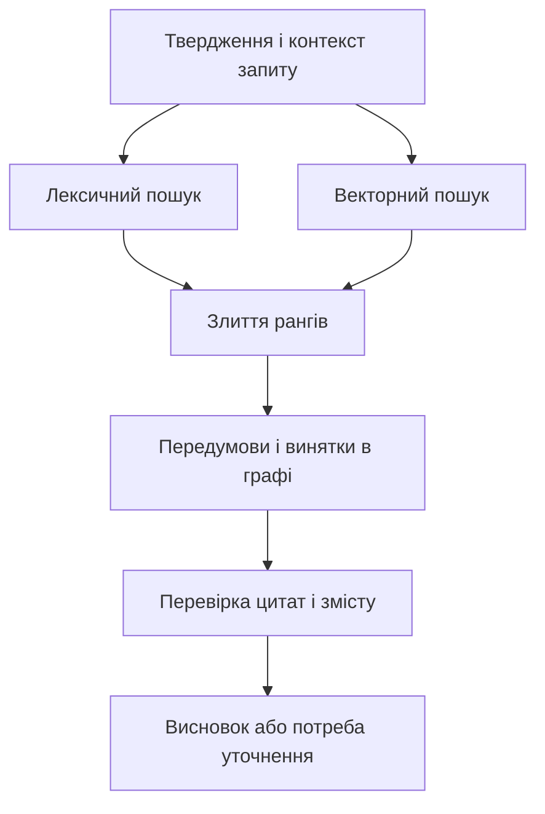
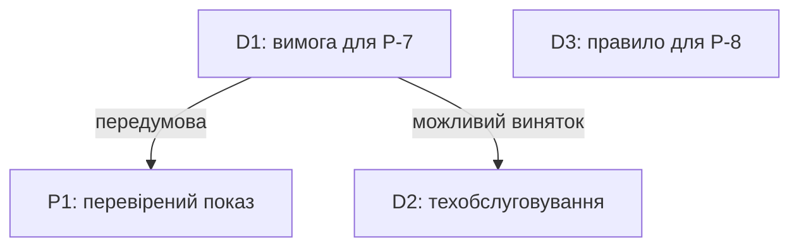
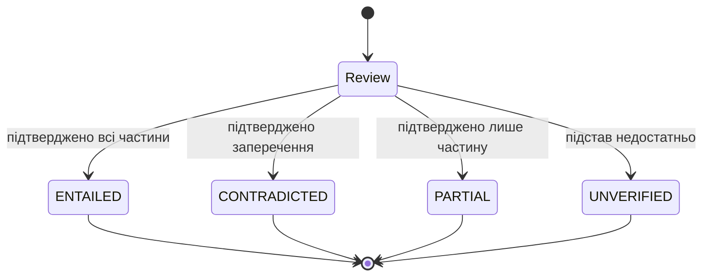
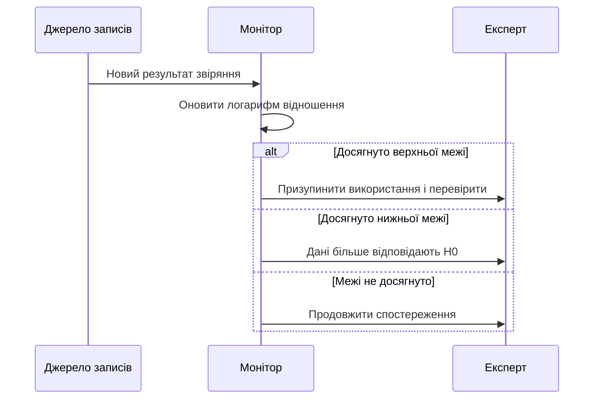

# Глава 23. Пошук знань і перевірка підстав тверджень

<a id="глава-23-гібридний-інформаційно-графовий-пошук-антонімічна-стійкість-та-верифікація-логічного-слідування-з-першоджерела"></a>

> **Підручник:** [Експертні Системи](../README.md) · [Том 3. Нейро-символьні, ізольовані, критичні до безпеки та високопродуктивні експертні системи](README.md)  
> **Навчальний рівень:** прикладні програмісти та студенти комп'ютерних наук\
> **Обладнання:** звичайний ноутбук або ПК\
> **Мова:** Python 3.14.4; приклади використовують стандартну бібліотеку\
> **Попередня глава:** [Глава 22. Мовне опрацювання та структуроване видобування знань](ch22-linguistic-processing-and-knowledge-extraction.md)\
> **Наступна глава:** [Глава 24. Виявлення прогалин і синтез нових правил](ch24-knowledge-gaps-and-rule-synthesis.md)\
> **Автор:** Микола Мартинович Федчик

---

## Анотація

Експертній системі недостатньо сформувати правдоподібне твердження: потрібно знайти джерела, перевірити їхню застосовність і виявити винятки, що змінюють висновок. У цій главі поєднано лексичний, векторний і графовий пошук, оцінювання повноти результатів, перевірку цитат та розгляд суперечливих підстав. Окремо показано, чому статистична оцінка надійності джерела не замінює перевірки змісту.

Наскрізний приклад продовжує вимогу з Глави 22: для насоса `P-7` запропоновано створити заявку на огляд, коли температура перевищує умовний поріг $85\,^\circ\mathrm C$. Додатковий документ описує виняток під час технічного обслуговування. Читач реалізує ранжування, пошук пов'язаних документів і перевірку походження цитати, а також простежить, чому високий ранг документа ще не є доказом допустимості дії.

---

<!-- chapter-toc:start -->
## Зміст глави

- [1. Поєднання лексичного та векторного пошуку](#1-поєднання-лексичного-та-векторного-пошуку)
  - [1.1. Точні ідентифікатори й пороги у векторному пошуку](#11-точні-ідентифікатори-й-пороги-у-векторному-пошуку)
  - [1.2. Злиття ранжованих списків та оцінювання якості](#12-злиття-ранжованих-списків-та-оцінювання-якості)
- [2. Пошук передумов і винятків у графі знань](#2-пошук-передумов-і-винятків-у-графі-знань)
  - [2.1. Пошук обов'язкових передумов і винятків](#21-пошук-обовязкових-передумов-і-винятків)
  - [2.2. Оцінювання ризику пропуску](#22-оцінювання-ризику-пропуску)
- [3. Близькість протилежних тверджень і перевірка підтримки](#3-близькість-протилежних-тверджень-і-перевірка-підтримки)
  - [3.1. Взаємовиключні норми у векторному просторі](#31-взаємовиключні-норми-у-векторному-просторі)
  - [3.2. Стани перевірки твердження за цитатою](#32-стани-перевірки-твердження-за-цитатою)
  - [3.3. Прив'язування твердження до фрагмента джерела](#33-привязування-твердження-до-фрагмента-джерела)
- [4. Перевірка надійності вхідних джерел](#4-перевірка-надійності-вхідних-джерел)
  - [4.1. Злиття оцінок із невідомою взаємною залежністю](#41-злиття-оцінок-із-невідомою-взаємною-залежністю)
  - [4.2. Послідовна перевірка правдоподібності джерела](#42-послідовна-перевірка-правдоподібності-джерела)
- [5. Практичні завдання та лабораторний практикум](#5-практичні-завдання-та-лабораторний-практикум)
  - [5.1. Контрольні запитання для самоперевірки](#51-контрольні-запитання-для-самоперевірки)
  - [5.2. Розрахункові задачі (трасування вручну)](#52-розрахункові-задачі-трасування-вручну)
  - [5.3. Завдання з програмної реалізації](#53-завдання-з-програмної-реалізації)
  - [5.4. Зв'язок із лабораторною та курсовою роботою курсу](#54-звязок-із-лабораторною-та-курсовою-роботою-курсу)
- [Висновки](#висновки)
- [Глосарій](#глосарій)
- [Скорочення та терміни](#скорочення-та-терміни)
- [Джерела](#джерела)
<!-- chapter-toc:end -->

---

<a id="1-багатоканальний-пошук-лексичне-зважування-bm25-щільні-вектори-та-рангове-злиття-rrf"></a>

## 1. Поєднання лексичного та векторного пошуку

Після видобування кандидата з Глави 22 система має знайти документи, які стосуються тієї самої вимоги та її умов. Пошук лише за схожістю речень може поставити вище правило для іншого насоса; пошук лише за точними словами може пропустити виняток, сформульований іншими словами. Тому спочатку збираємо кандидатів кількома способами, а потім окремо перевіряємо їхній зміст.

**Діаграма 23.1. Пошук і перевірка підстав кандидата.**



Для прикладу використаємо чотири **умовні навчальні документи**. Позначення `D1`, `D2`, `D3` і `P1` — локальні ідентифікатори фрагментів; жоден із них не є реальною інструкцією з експлуатації.

**Таблиця 23.2. Навчальний набір для запиту про насос P-7.**

| Фрагмент | Зміст | Роль для запиту |
|---|---|---|
| `D1` | За температури `P-7` понад `185 °F` система повинна створити заявку на огляд цього насоса. | Початкова вимога; `185 °F` дорівнює `85 °C`. |
| `D2` | Під час техобслуговування `P-7` за температури понад `85 °C` система не повинна автоматично створювати заявку на його огляд до завершення робіт. | Можливий виняток для конкретного режиму. |
| `D3` | За температури `P-8` понад `185 °F` система повинна створити заявку на огляд цього насоса. | Схожий текст, але інший пристрій. |
| `P1` | Перед створенням заявки потрібен перевірений показ датчика температури `P-7`. | Передумова, яку слід розглянути разом із вимогою. |

У навчальному наборі `D1`, `D2` і `P1` вважаються релевантними для перевірки правила й умов його застосування; `D3` не стосується конкретного пристрою. Це ручна розмітка прикладу, а не результат вимірювання на виробничому корпусі. Жоден наведений документ сам по собі не підтверджує фактичного показу датчика.

<a id="11-чому-щільні-ембедінги-гублять-точні-номери-статей-кодексів-військові-індекси-виробів-та-числові-пороги"></a>

### 1.1. Точні ідентифікатори й пороги у векторному пошуку

Ідентифікатори `P-7` і `P-8` різняться лише одним символом, хоча позначають різні об'єкти. Векторне представлення може зблизити фрагменти з такими назвами через майже однаковий контекст; лексичний індекс, навпаки, може зберегти ідентифікатор як окремий токен. Це властивості конкретних моделей і токенізаторів, а не твердження, що будь-який векторний пошук завжди помиляється.

Для лексичного ранжування часто використовують BM25: він враховує, як часто термін трапляється в документі, у скількох документах він є та наскільки довгий документ [[1]](#src-1). Один із поширених варіантів для множини різних термінів запиту має вигляд:

**Формула 23.3. Навчальний варіант оцінки BM25.**

$$
\begin{aligned}
\mathrm{IDF}(t) &= \ln\left(1+\frac{N-n_t+0.5}{n_t+0.5}\right),\\
\mathrm{BM25}(q,d) &= \sum_{t\in q}
\mathrm{IDF}(t)\frac{f(t,d)(k_1+1)}
{f(t,d)+k_1(1-b+bL_d/\overline L)}.
\end{aligned}
$$

$q$ — множина різних токенів запиту; $d$ — документ; $N\geq1$ — кількість документів; $`n_t`$ — кількість документів, що містять термін $t$, від 0 до $N$; $`f(t,d)\geq0`$ — кількість входжень терміна; $`L_d>0`$ і $`\overline L>0`$ — довжина документа та середня довжина в токенах. Параметр $`k_1>0`$ керує насиченням частоти, $`0\leq b\leq1`$ — впливом довжини. Оцінка безрозмірна й використовується для впорядкування документів у цьому індексі.

Нехай три документи мають по три токени, а `p-7` трапляється в двох із них по одному разу. За $`k_1=1{,}2`$ і $b=0{,}75$ множник частоти для кожного такого документа дорівнює 1, а $`\mathrm{IDF}=\ln(1+1{,}5/2{,}5)=\ln(1{,}6)\approx0{,}4700`$. Документ лише з `p-8` отримує за запитом `p-7` нуль. Збереження дефіса в токені є умовою цього результату.

Функція отримує вже токенізований корпус. Вона не розпізнає одиниці чи синоніми: це робота окремого нормалізатора.

**Лістинг 23.4. Лексичне ранжування навчального корпусу (Python 3.14.4).**

<details><summary>Показати лістинг 23.4 (29 рядків, Python 3.14.4)</summary>

```python
from collections import Counter
from math import isfinite, log

def bm25(query: list[str], docs: dict[str, list[str]], k1: float = 1.2,
         b: float = 0.75) -> dict[str, float]:
    if not query or not docs or any(not tokens for tokens in docs.values()):
        raise ValueError("Потрібні непорожні запит і документи")
    if not isfinite(k1) or not isfinite(b) or k1 <= 0 or not 0 <= b <= 1:
        raise ValueError("Некоректні параметри BM25")
    if any(not isinstance(t, str) or not t for t in query):
        raise ValueError("Некоректний токен запиту")
    if any(not isinstance(t, str) or not t for tokens in docs.values() for t in tokens):
        raise ValueError("Некоректний токен документа")
    n = len(docs)
    average = sum(len(tokens) for tokens in docs.values()) / n
    terms = set(query)
    frequency = {t: sum(t in tokens for tokens in docs.values()) for t in terms}
    scores = {}
    for doc_id, tokens in docs.items():
        counts = Counter(tokens)
        score = 0.0
        for term in terms:
            f = counts[term]
            if f:
                idf = log(1 + (n - frequency[term] + 0.5) / (frequency[term] + 0.5))
                denominator = f + k1 * (1 - b + b * len(tokens) / average)
                score += idf * f * (k1 + 1) / denominator
        scores[doc_id] = score
    return scores
```

</details>

Наступна перевірка використовує штучні набори токенів, а не видає їх за результати реального індексування документів таблиці 23.2. Лістинги глави, якщо не зазначено інше, запускаються послідовно в одному сеансі Python.

**Лістинг 23.5. Перевірка точного ідентифікатора (Python 3.14.4).**

<details><summary>Показати лістинг 23.5 (7 рядків, Python 3.14.4)</summary>

```python
toy_docs = {"D1": ["p-7", "огляд", "85"],
            "D2": ["p-7", "ремонт", "85"],
            "D3": ["p-8", "огляд", "85"]}
scores = bm25(["p-7"], toy_docs)
assert abs(scores["D1"] - log(1.6)) < 1e-12
assert abs(scores["D2"] - log(1.6)) < 1e-12
assert scores["D3"] == 0.0
```

</details>

Точний збіг допомагає відрізнити `P-7` від `P-8`, але не розв'язує всієї задачі. Документ без явної згадки ідентифікатора може містити загальне правило або використовувати посилання «цей насос»; автоматично відкидати його без аналізу контексту не можна. Для чисел також потрібні порівнянні одиниці та збереження оператора `>` чи `≤`.

<a id="12-непараметричне-обєднання-ранжованих-списків-reciprocal-rank-fusion-rrf-та-метрики-повноти-recallk-і-ndcg"></a>

### 1.2. Злиття ранжованих списків та оцінювання якості

Лексичний і векторний пошук повертають оцінки на різних шкалах; додавати їхні числа без калібрування некоректно. Reciprocal Rank Fusion використовує лише місце документа в кожному списку [[2]](#src-2). Документ, відсутній у списку, не отримує внеску від цього каналу.

**Формула 23.6. Злиття рангів RRF.**

$$
\mathrm{RRF}(d)=\sum_{i:\,d\in L_i}\frac{1}{c+r_i(d)}
$$

$d$ — документ; $`L_i`$ — впорядкований список каналу $i$; $`r_i(d)\geq1`$ — позиція документа в цьому списку; $c>0$ — безрозмірна стала згладжування. Результат — безрозмірна оцінка ранжування, не ймовірність істинності. Один документ має траплятися в кожному окремому списку не більш ніж раз.

Припустімо, лексичний список дорівнює `[D1, D3]`, а векторний — `[D3, D2]`. Це **задані для навчання** ранги: тут не запускаються ані нейромодель, ані індекс із попереднього лістингу. Нехай $c=2$. Тоді `D3` отримує $1/4+1/3=7/12$, `D1` — $1/3$, а `D2` — $1/4$. Високий спільний ранг `D3` показує необхідність перевірки ідентичності пристрою після пошуку.

**Лістинг 23.7. Злиття впорядкованих списків (Python 3.14.4).**

<details><summary>Показати лістинг 23.7 (20 рядків, Python 3.14.4)</summary>

```python
from collections import defaultdict

def rrf(rankings: list[list[str]], c: float) -> list[tuple[str, float]]:
    if not rankings or not isfinite(c) or c <= 0:
        raise ValueError("Потрібні списки та додатна скінченна стала")
    totals: dict[str, float] = defaultdict(float)
    for ranking in rankings:
        if any(not isinstance(doc, str) or not doc for doc in ranking):
            raise ValueError("Некоректний ідентифікатор документа")
        if len(set(ranking)) != len(ranking):
            raise ValueError("Документ повторюється в одному списку")
        for position, doc in enumerate(ranking, 1):
            totals[doc] += 1 / (c + position)
    return sorted(totals.items(), key=lambda pair: (-pair[1], pair[0]))

merged = rrf([["D1", "D3"], ["D3", "D2"]], 2)
assert [doc for doc, _ in merged] == ["D3", "D1", "D2"]
assert abs(merged[0][1] - 7 / 12) < 1e-12
assert abs(merged[1][1] - 1 / 3) < 1e-12
assert abs(merged[2][1] - 1 / 4) < 1e-12
```

</details>

Щоб оцінити не лише перший результат, потрібна незалежна розмітка релевантності. Повнота `Recall@k` показує частку всіх відомих релевантних документів, знайдених серед перших $k$; нормалізований дисконтований приріст `nDCG@k` додатково враховує їхній порядок і ступінь релевантності [[3]](#src-3).

**Формула 23.8. Повнота та якість порядку результатів.**

$$
\mathrm{Recall@k}=\frac{\lvert R\cap T_k\rvert}{\lvert R\rvert},
\qquad
\mathrm{nDCG@k}=
\frac{\sum_{i=1}^{k}(2^{g_i}-1)/\log_2(i+1)}
{\sum_{i=1}^{k}(2^{g_i^*}-1)/\log_2(i+1)}
$$

$k\geq1$ — кількість позицій; $R$ — непорожня множина всіх розмічених релевантних документів; $`T_k`$ — множина отриманих документів на перших $k$ позиціях; $`g_i\geq0`$ — оцінка релевантності документа на позиції $i$; $`g_i^*`$ — оцінка на тій самій позиції в ідеальному порядку. Для відсутніх позицій внесок дорівнює нулю. За цих умов обидві метрики лежать у $[0,1]$; якщо релевантних документів немає, наведені відношення не визначені.

Для рангу `[D3, D1, D2]`, $k=2$ та розмітки `D1`, `D2`, `P1` як релевантних отримано $`\mathrm{Recall@2}=1/3`$. За двійкових оцінок `nDCG@2` дорівнює $`(1/\log_2 3)/(1+1/\log_2 3)\approx0{,}3869`$: перший результат нерелевантний, а один із релевантних стоїть другим. Це навчальний розрахунок, не показник якості системи на нових документах.

**Лістинг 23.9. Метрики для розміченого набору (Python 3.14.4).**

<details><summary>Показати лістинг 23.9 (24 рядки, Python 3.14.4)</summary>

```python
from math import log2

def retrieval_metrics(ranking: list[str], grades: dict[str, int],
                      k: int) -> tuple[float, float]:
    if type(k) is not int or k <= 0 or len(set(ranking)) != len(ranking):
        raise ValueError("Некоректна глибина або повтори у ранжуванні")
    if any(type(g) is not int or not 0 <= g <= 3 for g in grades.values()):
        raise ValueError("Оцінки релевантності мають бути цілими від 0 до 3")
    top = ranking[:k]
    if any(doc not in grades for doc in top):
        raise ValueError("Для результату немає оцінки релевантності")
    relevant = sum(grade > 0 for grade in grades.values())
    if not relevant:
        raise ValueError("Для метрик потрібен хоча б один релевантний документ")
    recall = sum(grades[doc] > 0 for doc in top) / relevant
    gain = lambda values: sum((2**g - 1) / log2(i + 2) for i, g in enumerate(values))
    dcg = gain([grades[doc] for doc in top])
    ideal = gain(sorted(grades.values(), reverse=True)[:k])
    return recall, dcg / ideal

grades = {"D1": 1, "D2": 1, "D3": 0, "P1": 1}
recall, ndcg = retrieval_metrics([doc for doc, _ in merged], grades, 2)
assert abs(recall - 1 / 3) < 1e-12
assert abs(ndcg - 0.3868528072) < 1e-9
```

</details>

Ця функція приймає оцінки від 0 до 3 і вимагає розмітку кожного результату до позиції $k$; нерозмічений документ не вважається автоматично нерелевантним. Множина `grades` має також містити всі релевантні документи вибраного оцінювального набору. Неповна розмітка або підбір порога на тій самій вибірці може зробити висновок надто оптимістичним.

<a id="2-графове-розширення-пулу-кандидатів-за-ребрами-винятків-та-оцінка-ймовірності-пропуску-дефітера"></a>

## 2. Пошук передумов і винятків у графі знань

Навіть коли пошук знайшов основну вимогу, пов'язаний виняток може опинитися нижче межі перших результатів або бути відсутнім у певному індексі. Граф документів допомагає явно записати зв'язки між правилом, його передумовами й винятками. Це окремий крок після ранжування: система не повинна трактувати незнайдений виняток як доказ того, що його не існує.

<a id="21-довантаження-обовязкових-передумов-і-підтинаючих-винятків-defeaters-за-орієнтованими-ребрами-графа-знань"></a>

### 2.1. Пошук обов'язкових передумов і винятків

У нашому наборі правило `D1` пов'язано з передумовою `P1` і можливим винятком `D2`. Виняток, або *дефітер*, може обмежувати застосування висновку за певних обставин. Сам факт наявності ребра не вирішує конфлікт нормативних вимог: його тип, чинність джерел і пріоритет правил мають бути визначені предметною моделлю.

**Діаграма 23.10. Передумова та виняток для знайденої вимоги.**



Для двох перших результатів `[D3, D1]` обхід ребер від `D1` додасть `D2` і `P1`. У розширеному наборі з чотирьох фрагментів є всі три вручну позначені релевантні документи. Це повнота **набору після розширення**, а не `Recall@2`: розмір набору змінився, і результат залежить від правильності самих ребер.

Обхід нижче відвідує кожний вузол не більш ніж один раз, тому завершується і за наявності циклу в скінченному графі. Порожній список ребер означає, що для вузла явно зафіксовано відсутність зв'язків; відсутній вузол чи невідомий тип ребра спричиняє помилку.

**Лістинг 23.11. Розширення набору пов'язаними фрагментами (Python 3.14.4).**

<details><summary>Показати лістинг 23.11 (25 рядків, Python 3.14.4)</summary>

```python
from collections import deque

def expand(seeds: list[str], graph: dict[str, list[tuple[str, str]]],
           known: set[str]) -> set[str]:
    queue = deque(seeds)
    seen: set[str] = set()
    while queue:
        node = queue.popleft()
        if node not in known or node not in graph:
            raise ValueError("Невідомий вузол або відсутній запис його ребер")
        if node in seen:
            continue
        seen.add(node)
        for relation, target in graph[node]:
            if relation not in {"requires", "exception"} or target not in known:
                raise ValueError("Невідомий тип ребра або його ціль")
            queue.append(target)
    return seen

graph = {"D1": [("requires", "P1"), ("exception", "D2")],
         "D2": [], "D3": [], "P1": []}
pool = expand(["D3", "D1"], graph, set(graph))
assert pool == {"D1", "D2", "D3", "P1"}
assert len(pool & {"D1", "D2", "P1"}) == 3
assert expand([], graph, set(graph)) == set()
```

</details>

Ребра цього прикладу задано вручну. У реальній базі потрібні версія графа, перевірка прав доступу до кожного документа, контроль його чинності й процедура виявлення відсутніх зв'язків. Якщо пов'язаний фрагмент недоступний, результат перевірки залишається неповним.

<a id="22-верхня-межа-ймовірності-пропуску-цільового-фрагмента-при-дефектах-індексації"></a>

### 2.2. Оцінювання ризику пропуску

Кілька пошукових каналів корисні лише тоді, коли зрозуміло, які помилки вони можуть поділяти. Нехай один потрібний фрагмент присутній у корпусі, але кожен канал може його не повернути. Якщо підстави пропуску корельовані, множення часток помилок без перевірки незалежності занижує ризик.

**Формула 23.12. Межа спільного пропуску без припущення незалежності.**

$$
P(M_{\mathrm L}\cap M_{\mathrm V})
\leq\min\left(P(M_{\mathrm L}),P(M_{\mathrm V})\right)
$$

$`M_{\mathrm L}`$ — подія пропуску лексичним каналом, $`M_{\mathrm V}`$ — пропуск векторним; $P$ — імовірність на визначеному розподілі запитів і потрібних фрагментів. Усі значення безрозмірні та належать $[0,1]$. Нерівність випливає з того, що спільна подія є частиною кожної з двох подій.

Якщо оцінки окремих часток пропуску дорівнюють $0{,}20$ і $0{,}30$, без додаткових припущень верхня межа спільного пропуску — $0{,}20$. Лише за незалежності цих подій добуток дає $0{,}20\cdot0{,}30=0{,}06$. Наприклад, однаково обрізаний документ або спільна помилка оновлення індексів можуть спричинити залежні пропуски.

Практична дія — перевірити спільні помилки каналів на незалежному розміченому наборі та простежити покриття графових ребер. Наведені числа умовні; вони не є виміряними гарантіями. Відсутність документа в самому корпусі ця оцінка не враховує.

<a id="3-проблема-антонімічного-колапсу-векторних-просторів-та-чотиризначна-верифікація-текстового-слідування-nli"></a>

## 3. Близькість протилежних тверджень і перевірка підтримки

Пошук знаходить тексти на подібну тему, але для висновку потрібно знати, чи підтримує кожна цитата конкретне твердження. Вимоги «створити заявку» і «не створювати заявку» можуть містити однакові назви та числа, хоча за однакових умов їхній зміст протилежний. Тому перевірка має враховувати дію, заперечення, пристрій, режим і час, а не лише відстань між векторами.

<a id="31-чому-взаємовиключні-норми-дозволено-проти-заборонено-гіпотензія-проти-гіпертензії-опиняються-поруч-за-косинусною-близькістю"></a>

### 3.1. Взаємовиключні норми у векторному просторі

Речення з протилежними висновками часто поділяють більшість слів і контекстів. Векторний пошук через це може повернути обидва: для пошуку це корисно, бо суперечний фрагмент також потрібен експертові, але з одного показника близькості не можна визначити напрям підтримки.

Порівнюємо твердження **«під час техобслуговування P-7 за температури понад 85 °C система повинна автоматично створити заявку на огляд»** із цитатами. `D2` за тих самих умов забороняє цю автоматичну дію. `D3` стосується `P-8`, тому схожість тексту не робить його свідченням про `P-7`. Для `D1` у цьому прикладі відсутність згадки про режим і автоматичність залишає ці частини невстановленими; ми не припускаємо автоматично універсальної сфери дії.

Формальний висновок про нормативний пріоритет потребує окремих правил: специфічніша вимога не завжди автоматично скасовує загальну. Якщо документів бракує або вони суперечать один одному, безпечний результат цього етапу — передати питання на розгляд, а не виконати дію.

<a id="32-чотири-операційні-статуси-перевірки-підтримки-твердження-цитатою-entailed-contradicted-partial-unverified"></a>

### 3.2. Стани перевірки твердження за цитатою

Для кожної пари «цитата — твердження» зафіксуємо результат перевірки, а не одну загальну оцінку схожості. Класичні набори задач NLI зазвичай розрізняють логічне слідування, суперечність і нейтральність [[4]](#src-4). Наведені нижче чотири стани — **операційна схема цієї глави**: `PARTIAL` є додатковим станом для частково підтвердженого складеного твердження, а не стандартним четвертим класом кожної NLI-моделі.

**Діаграма 23.13. Результати перевірки однієї цитати.**



**Таблиця 23.14. Значення станів для одного й того самого твердження.**

| Стан | Результат перевірки | Приклад |
|---|---|---|
| `ENTAILED` | Підтверджено всі потрібні частини твердження за заданих умов. | Уявна цитата прямо приписує автоматичну заявку для `P-7` у названому режимі й за названого порога. |
| `CONTRADICTED` | За тих самих умов підтверджено протилежне твердження. | `D2` забороняє саме цю автоматичну заявку під час техобслуговування. |
| `PARTIAL` | Підтверджено належну частину складеного твердження, решта лишається невідомою; підтвердженого заперечення немає. | `D1` описує поріг і заявку, але не уточнює режим та автоматичність. |
| `UNVERIFIED` | Достатньої підтримки або заперечення для цього твердження немає. | `D3` описує інший насос. |

На практиці ці стани може призначати експерт або перевіряльник, чию якість окремо оцінено; вихід нейронної NLI-моделі є лише оцінкою і потребує такої перевірки. Кілька цитат можуть дати одночасно підтримку й заперечення. Це стан `CONFLICT` для **сукупності** свідчень, а не п'ятий результат перевірки окремої цитати.

Функція нижче об'єднує вже призначені стани для одного й того самого твердження, його версії та контексту. Вона не виконує мовного аналізу й не визначає пріоритет джерел.

**Лістинг 23.15. Зведення результатів перевірки цитат (Python 3.14.4).**

<details><summary>Показати лістинг 23.15 (20 рядків, Python 3.14.4)</summary>

```python
def combine_statuses(statuses: list[str]) -> str:
    allowed = {"ENTAILED", "CONTRADICTED", "PARTIAL", "UNVERIFIED"}
    if any(status not in allowed for status in statuses):
        raise ValueError("Невідомий стан перевірки цитати")
    present = set(statuses)
    if {"ENTAILED", "CONTRADICTED"} <= present:
        return "CONFLICT"
    if "CONTRADICTED" in present:
        return "CONTRADICTED"
    if "ENTAILED" in present:
        return "ENTAILED"
    if "PARTIAL" in present:
        return "PARTIAL"
    return "UNVERIFIED"

assert combine_statuses(["PARTIAL", "CONTRADICTED"]) == "CONTRADICTED"
assert combine_statuses(["ENTAILED", "CONTRADICTED"]) == "CONFLICT"
assert combine_statuses(["PARTIAL", "UNVERIFIED"]) == "PARTIAL"
assert combine_statuses([]) == "UNVERIFIED"
assert combine_statuses(["ENTAILED"]) == "ENTAILED"
```

</details>

Для заданих станів `D1` і `D2` результат щодо наведеного твердження — `CONTRADICTED`. Якби інший застосовний документ прямо підтримував ту саму автоматичну дію, сукупність дала б `CONFLICT`. Обидва результати потребують перевірки чинності, повноважень джерел і предметних правил, перш ніж система ухвалить рішення.

<a id="33-криптографічна-привязка-атома-знань-до-байтового-зрізу-документа-за-моделлю-prov-o"></a>

### 3.3. Прив'язування твердження до фрагмента джерела

Висновок має бути відтворюваним: читач повинен бачити конкретну версію документа та точний фрагмент, який перевіряли. Для цього зберігають ідентифікатор документа, його хеш, байтовий інтервал і текст цитати. Якщо змінився хоча б один байт документа, старий інтервал не можна без перевірки переносити на нову версію.

W3C PROV-O описує сутності, дії та агентів і зв'язки походження між ними [[5]](#src-5). У нашій інтерпретації документ і запис висновку є сутностями, перевірка — дією, а інструмент або експерт — агентом. Алгоритм хешування та формат байтових меж визначає застосунок; сам PROV-O не засвідчує автентичності документа.

У тексті `D1` із Глави 22 рядок `P-7` займає позиції `[24, 27)` у кодових точках, але `[45, 48)` у байтах UTF-8. Наступна функція отримує **початкові байти**, напіввідкритий байтовий інтервал, очікувану цитату та хеш цієї версії. Вона перевіряє точний збіг і коректне декодування меж.

**Лістинг 23.16. Перевірка байтової прив'язки цитати (Python 3.14.4).**

<details><summary>Показати лістинг 23.16 (18 рядків, Python 3.14.4)</summary>

```python
from hashlib import sha256

def verify_quote(raw: bytes, start: int, end: int, quote: str, digest: str) -> bool:
    if type(start) is not int or type(end) is not int or not 0 <= start < end <= len(raw):
        raise ValueError("Некоректний байтовий інтервал")
    if sha256(raw).hexdigest() != digest:
        raise ValueError("Хеш документа не збігається")
    try:
        actual = raw[start:end].decode("utf-8")
    except UnicodeDecodeError as error:
        raise ValueError("Межа розриває символ UTF-8") from error
    if actual != quote:
        raise ValueError("Цитата не збігається з байтами джерела")
    return True

source = "Коли температура насоса P-7 перевищує 185 °F, система повинна створити заявку на огляд цього насоса."
raw = source.encode("utf-8")
digest = sha256(raw).hexdigest()
```

</details>

**Лістинг 23.17. Перевірка правильних і пошкоджених посилань (Python 3.14.4).**

<details><summary>Показати лістинг 23.17 (14 рядків, Python 3.14.4)</summary>

```python
def must_reject(operation) -> None:
    try:
        operation()
    except ValueError:
        return
    raise AssertionError("Очікувалася помилка перевірки")

assert verify_quote(raw, 45, 48, "P-7", digest)
assert verify_quote(raw, 0, len(raw), source, digest)
must_reject(lambda: verify_quote(raw, 24, 27, "P-7", digest))
must_reject(lambda: verify_quote(raw, 1, 3, "К", digest))
must_reject(lambda: verify_quote(raw + b" ", 45, 48, "P-7", digest))
must_reject(lambda: verify_quote(raw, 45, 48, "P-8", digest))
print("Цитату звірено з початковою версією документа")
```

</details>

Очікуваний вивід: `Цитату звірено з початковою версією документа`. Цитата `P-7` підтверджує лише наявність цих символів; для перевірки змісту вимоги потрібне достатнє за обсягом речення та його контекст. Хеш має надходити з довіреного маніфесту: якщо зловмисник може змінити і документ, і очікуваний хеш, сама перевірка збігу цього не виявить.

<a id="4-алгоритмічний-скептицизм-у-вхідному-шлюзі-перетин-коваріацій-та-послідовний-критерій-вальда-sprt"></a>

## 4. Перевірка надійності вхідних джерел

Навіть точно відтворена цитата може походити із застарілого, помилкового або підміненого джерела. Перевірка надійності починається з повноважень, версії, підпису й умов застосування; статистика допомагає дослідити окремі ознаки, але не встановлює авторства чи істинності. Розглянемо два різні завдання: об'єднання числових показів датчиків і спостереження за частотою розбіжностей.

<a id="41-злиття-корельованих-оцінок-з-невідомою-взаємною-коваріацією-covariance-intersection"></a>

### 4.1. Злиття оцінок із невідомою взаємною залежністю

Два датчики можуть використовувати спільне живлення або однакове калібрування, тому їхні похибки не обов'язково незалежні. Метод *covariance intersection* поєднує оцінки однієї числової величини, коли взаємна коваріація невідома [[6]](#src-6). Для текстових оцінок «довіра до документа» цей метод сам по собі не визначає ані ймовірності істинності, ані дисперсії; потрібна окрема обґрунтована модель.

Для двох скалярних оцінок температури використаємо таку форму:

**Формула 23.18. Поєднання двох скалярних оцінок.**

$$
P^{-1}=\frac{\omega}{P_1}+\frac{1-\omega}{P_2},
\qquad
\hat{x}=P\left(\frac{\omega\hat{x}_1}{P_1}
+\frac{(1-\omega)\hat{x}_2}{P_2}\right)
$$

$`\hat{x}_1,\hat{x}_2`$ — оцінки однієї температури в °C; $`P_1,P_2>0`$ — обґрунтовані верхні оцінки дисперсії похибки в $`(^\circ\mathrm C)^2`$; $`\omega\in[0,1]`$ — задана безрозмірна вага; $P$ — розрахункова верхня межа дисперсії в тих самих одиницях; $`\hat{x}`$ — поєднана температура. Передбачається, що оцінки незміщені, стосуються того самого моменту й величини, заявлені межі дисперсії придатні для цієї моделі, а вага не залежить від конкретних випадкових похибок.

Для $`\hat{x}_1=85\,^\circ\mathrm C`$, $`\hat{x}_2=86\,^\circ\mathrm C`$, $`P_1=4`$, $`P_2=9`$ і $`\omega=0{,}5`$ маємо $`P=72/13\approx5{,}54\,(^\circ\mathrm C)^2`$ та $`\hat{x}=1109/13\approx85{,}31\,^\circ\mathrm C`$. Умовна оцінка близька до порога $85\,^\circ\mathrm C$, але невизначеність не дає підстав вважати перевищення встановленим. Для рішення потрібне окреме правило інтерпретації похибки.

**Лістинг 23.19. Об'єднання показів за невідомої кореляції (Python 3.14.4).**

<details><summary>Показати лістинг 23.19 (21 рядок, Python 3.14.4)</summary>

```python
def covariance_intersection(x1: float, p1: float, x2: float, p2: float,
                            weight: float) -> tuple[float, float]:
    values = (x1, p1, x2, p2, weight)
    if not all(isfinite(value) for value in values):
        raise ValueError("Параметри мають бути скінченними")
    if p1 <= 0 or p2 <= 0 or not 0 <= weight <= 1:
        raise ValueError("Дисперсії мають бути додатними, вага — від 0 до 1")
    precision = weight / p1 + (1 - weight) / p2
    if not isfinite(precision) or precision <= 0:
        raise ValueError("Неможливо обчислити точність")
    variance = 1 / precision
    estimate = variance * (weight * x1 / p1 + (1 - weight) * x2 / p2)
    if not isfinite(variance) or not isfinite(estimate):
        raise ValueError("Результат поза числовим діапазоном")
    return estimate, variance

estimate, variance = covariance_intersection(85, 4, 86, 9, 0.5)
assert abs(estimate - 1109 / 13) < 1e-12
assert abs(variance - 72 / 13) < 1e-12
assert covariance_intersection(85, 4, 86, 9, 1) == (85, 4)
assert covariance_intersection(85, 4, 86, 9, 0) == (86, 9)
```

</details>

Якби похибки були незалежними й відповідали заявленим дисперсіям, інше поєднання могло б використати цю інформацію; без доказу незалежності така передумова не виправдана. Метод не виправляє систематичного зсуву обох датчиків і не перевіряє справжності показів.

<a id="42-послідовний-критерій-відношення-правдоподібностей-вальда-sprt-для-раннього-відсікання-скомпрометованих-джерел"></a>

### 4.2. Послідовна перевірка правдоподібності джерела

Послідовна перевірка потрібна, коли ознаки надходять поступово і чекати наперед визначеного великого пакета незручно. Наприклад, монітор може отримувати незалежно перевірені результати звіряння окремих записів джерела. Позначимо розбіжність як `True`, а збіг — як `False`; повторне повідомлення про ту саму помилку не є новим незалежним спостереженням.

Розгляньмо дві прості гіпотези: за $`H_0`$ імовірність розбіжності $`p_0`$, за $`H_1`$ — $`p_1>p_0`$. У навчальній моделі спостереження незалежні й мають сталі параметри за кожної гіпотези. Послідовний критерій Вальда порівнює накопичене відношення правдоподібностей із двома межами [[7]](#src-7).

**Діаграма 23.20. Послідовне спостереження за джерелом.**



Щоб уникнути переповнення під час множення багатьох малих чисел, накопичимо логарифм відношення:

**Формула 23.21. Логарифмічний критерій для двійкових спостережень.**

$$
\ell_n=\sum_{i=1}^{n}\left[
x_i\ln\frac{p_1}{p_0}+(1-x_i)\ln\frac{1-p_1}{1-p_0}
\right],
\qquad
A=\ln\frac{1-\beta}{\alpha},\quad
B=\ln\frac{\beta}{1-\alpha}
$$

$`x_i\in\{0,1\}`$ — результат окремого звіряння; $n\geq0$ — кількість уже врахованих спостережень; $`0<p_0<p_1<1`$ — задані частоти розбіжності за $`H_0`$ та $`H_1`$; $`\alpha,\beta\in(0,1)`$ — цільові рівні помилок першого і другого роду, причому $`\alpha+\beta<1`$. Усі величини безрозмірні. Якщо $`\ell_n\geq A`$, приймаємо статистичне рішення на користь $`H_1`$; якщо $`\ell_n\leq B`$ — на користь $`H_0`$; між межами продовжуємо збір.

Для $`p_0=0{,}1`$, $`p_1=0{,}4`$, $`\alpha=0{,}05`$, $`\beta=0{,}10`$ маємо $`A=\ln18\approx2{,}890`$ і $`B=\ln(0{,}1/0{,}95)\approx-2{,}251`$. Кожна розбіжність додає $\ln4$, кожен збіг — $\ln(2/3)$. Три послідовні розбіжності дають приблизно $4{,}159\geq A$: монітор передає джерело на перевірку. Шість послідовних збігів дають приблизно $-2{,}433\leq B$: результат більше відповідає $`H_0`$ у цій моделі.

Межі Вальда тут є стандартним наближенням до цільових рівнів помилок; для дискретних спостережень фактичні рівні залежать від перестрибування меж і потребують окремої перевірки. Відношення правдоподібностей не є апостеріорною ймовірністю компрометації.

**Лістинг 23.22. Навчальна послідовна перевірка (Python 3.14.4).**

<details><summary>Показати лістинг 23.22 (25 рядків, Python 3.14.4)</summary>

```python
from math import log1p

def sprt(observations: list[bool], p0: float, p1: float,
         alpha: float, beta: float) -> tuple[str, int, float]:
    if not all(isfinite(v) for v in (p0, p1, alpha, beta)):
        raise ValueError("Параметри мають бути скінченними")
    if not 0 < p0 < p1 < 1 or not 0 < alpha < 1 or not 0 < beta < 1:
        raise ValueError("Некоректні ймовірності")
    if alpha + beta >= 1 or any(type(value) is not bool for value in observations):
        raise ValueError("Несумісні межі або некоректне спостереження")
    upper = log1p(-beta) - log(alpha)
    lower = log(beta) - log1p(-alpha)
    evidence = 0.0
    for count, mismatch in enumerate(observations, 1):
        evidence += (log(p1) - log(p0) if mismatch
                     else log1p(-p1) - log1p(-p0))
        if evidence >= upper:
            return "H1", count, evidence
        if evidence <= lower:
            return "H0", count, evidence
    return "CONTINUE", len(observations), evidence

assert sprt([True] * 3, 0.1, 0.4, 0.05, 0.1)[:2] == ("H1", 3)
assert sprt([False] * 6, 0.1, 0.4, 0.05, 0.1)[:2] == ("H0", 6)
assert sprt([True], 0.1, 0.4, 0.05, 0.1)[:2] == ("CONTINUE", 1)
```

</details>

Рішення `H1` означає статистичну підставу призупинити використання джерела й розібрати розбіжності, а не доведений факт атаки. Рішення `H0` не засвідчує автентичності; `CONTINUE` не дає підстав автоматично прийняти чутливе рішення. У робочій системі частоти мають бути обґрунтовані даними, залежність подій — досліджена, а максимальний час очікування та політика непевного результату — задані заздалегідь.

## 5. Практичні завдання та лабораторний практикум

Ці вправи перевіряють, чи вміє читач відрізняти знайдений документ від підтвердження твердження й відтворити обчислення на невеликому наборі. Для програмних завдань достатньо Python і стандартної бібліотеки.

### 5.1. Контрольні запитання для самоперевірки

1. Чому `P-8` може отримати високий ранг за запитом про `P-7`? Яку перевірку потрібно виконати після ранжування?
2. Чим відрізняються пропуск винятку в пошуковому індексі та відсутність винятку в корпусі?
3. Коли частково підтверджене твердження стає `CONTRADICTED`, а коли сукупність оцінок дає `CONFLICT`?
4. Що встановлює збіг хешу й байтової цитати та чого він не повідомляє про автора документа?
5. Чому covariance intersection не можна безпосередньо застосувати до довільних чисел «впевненість мовної моделі»?
6. Які припущення потрібні послідовній перевірці й чому її рішення не є доказом компрометації?

### 5.2. Розрахункові задачі (трасування вручну)

1. Обчисліть RRF для списків `[D1, D2]` і `[D2, D3]` за $c=2$. Який документ отримає найвищий ранг?
2. Для ранжування `[D1, D3, D2]` і релевантних `D1`, `D2`, `P1` обчисліть `Recall@2`. Поясніть, що зміниться після додавання `P1` до набору кандидатів.
3. Якщо частки пропусків двох каналів становлять $0{,}1$ і $0{,}4$, порівняйте верхню межу без припущення незалежності з добутком за незалежності.
4. За параметрів послідовного прикладу обчисліть логарифмічний внесок однієї розбіжності та одного збігу. Визначте стан після однієї розбіжності.

<a id="53-інженерні-завдання-з-програмування-мовна-незалежність--спеціалізовані-dsl"></a>

### 5.3. Завдання з програмної реалізації

1. Додайте до `rrf` тести однакових оцінок, повтору документа та порожнього результату окремого каналу. Перевірте, що жоден із них не перетворюється на оцінку істинності.
2. Додайте до графа цикл і посилання на відсутній документ. Перевірте завершення обходу для циклу та явну помилку для відсутньої цілі.
3. Збережіть версію твердження та контекст режиму разом зі статусом цитати. Забороніть об'єднувати стани різних тверджень або різних періодів чинності без окремого правила.
4. Підготуйте розмічену вибірку запитів, включно з винятками та схожими ідентифікаторами. Обчисліть повноту й `nDCG` для кожного каналу та їхнього злиття на незалежному наборі.
5. Опишіть у Prolog або Datalog правило наявності передумови та окремий виняток. Порівняйте результат із графовим обходом, не вважаючи сам обхід доведенням нормативного пріоритету.

### 5.4. Зв'язок із лабораторною та курсовою роботою курсу

* **Навчальна вправа:** виконайте лістинги в одному сеансі та збережіть для кожного результату ідентифікатор, версію документа й причину його включення до набору.
* **Місце в курсі:** ця глава знаходить і оцінює підстави, але не винаходить відсутнього правила. Роботу з такими прогалинами та кандидатами нових правил заплановано продовжити в [Главі 24](ch24-knowledge-gaps-and-rule-synthesis.md).

---

## Висновки

На прикладі вимоги про `P-7` показано, що лексичний і векторний пошук можуть повернути як потрібні документи, так і схожий текст про інший пристрій. Рангове злиття впорядковує кандидатів, граф додає відомі передумови й винятки, а перевірка цитати пов'язує результат із конкретними байтами джерела.

Читач може обчислити BM25, RRF, `Recall@k` і `nDCG@k`, відтворити графовий обхід та перевірити суперечливі стани. Умовні приклади з числовими оцінками й послідовним критерієм показують, які припущення потрібні для статистичних висновків. Реальна нейромодель, виробнича точність пошуку та автентичність джерел у цій главі не вимірювалися.

Якщо після цих перевірок потрібної підстави немає, її не можна замінити правдоподібною відповіддю. У Главі 24 заплановано розглянути, як явно позначати прогалину й працювати з кандидатами нових правил.

## Глосарій

* **Виняток, або дефітер** — відома обставина чи правило, які можуть обмежити застосування висновку.
* **Граф знань** — подання об'єктів і зв'язків між ними у вигляді вузлів та ребер.
* **Лексичний пошук** — пошук за термінами та їхніми входженнями в документи.
* **Векторний пошук** — пошук за близькістю числових представлень запиту й документів.
* **Повнота пошуку** — частка релевантних документів, знайдених за визначених умов оцінювання.
* **Походження** — відомості про джерело, версію та процес отримання результату.
* **Рангове злиття** — об'єднання кількох упорядкованих списків за позиціями їхніх елементів.
* **Текстове слідування** — відношення, за якого зміст джерела підтримує конкретне твердження за заданої інтерпретації.

## Скорочення та терміни

* **BM25** — сімейство функцій лексичного ранжування документів.
* **CI** — *Covariance Intersection*, метод поєднання оцінок за невідомої взаємної коваріації.
* **nDCG** — *normalized Discounted Cumulative Gain*, нормалізована оцінка якості порядку результатів.
* **NLI** — *Natural Language Inference*, задача визначення відношення між текстами.
* **PROV-O** — онтологія W3C для подання походження даних.
* **RRF** — *Reciprocal Rank Fusion*, злиття списків за оберненими рангами.
* **SPRT** — *Sequential Probability Ratio Test*, послідовний критерій відношення правдоподібностей.
* **SHA-256** — алгоритм обчислення 256-бітного криптографічного хешу.

## Джерела

1. <a id="src-1"></a>Robertson, S., Zaragoza, H. “The Probabilistic Relevance Framework: BM25 and Beyond.” *Foundations and Trends in Information Retrieval*, 2009. [doi:10.1561/1500000019](https://doi.org/10.1561/1500000019).
2. <a id="src-2"></a>Cormack, G. V., Clarke, C. L. A., Buettcher, S. “Reciprocal Rank Fusion Outperforms Condorcet and Individual Rank Learning Methods.” *SIGIR*, 2009. [doi:10.1145/1571941.1572114](https://doi.org/10.1145/1571941.1572114).
3. <a id="src-3"></a>Järvelin, K., Kekäläinen, J. “Cumulated Gain-Based Evaluation of IR Techniques.” *ACM Transactions on Information Systems*, 2002. [doi:10.1145/582415.582418](https://doi.org/10.1145/582415.582418).
4. <a id="src-4"></a>Bowman, S. R. et al. “A Large Annotated Corpus for Learning Natural Language Inference.” *EMNLP*, 2015. [ACL Anthology](https://aclanthology.org/D15-1075/).
5. <a id="src-5"></a>Lebo, T., Sahoo, S., McGuinness, D., eds. *PROV-O: The PROV Ontology*. W3C Recommendation, 2013. [W3C](https://www.w3.org/TR/prov-o/).
6. <a id="src-6"></a>Julier, S. J., Uhlmann, J. K. “A Non-Divergent Estimation Algorithm in the Presence of Unknown Correlations.” *American Control Conference*, 1997. [doi:10.1109/ACC.1997.609105](https://doi.org/10.1109/ACC.1997.609105).
7. <a id="src-7"></a>Wald, A. “Sequential Tests of Statistical Hypotheses.” *The Annals of Mathematical Statistics*, 16(2), 117–186, 1945. [doi:10.1214/aoms/1177731118](https://doi.org/10.1214/aoms/1177731118).
