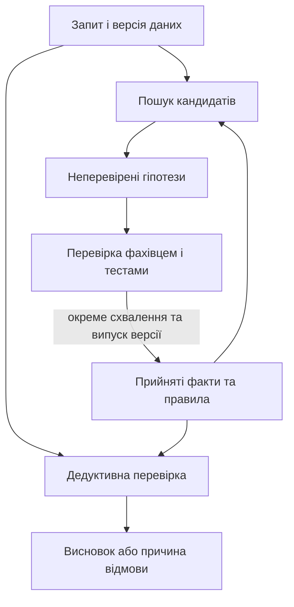
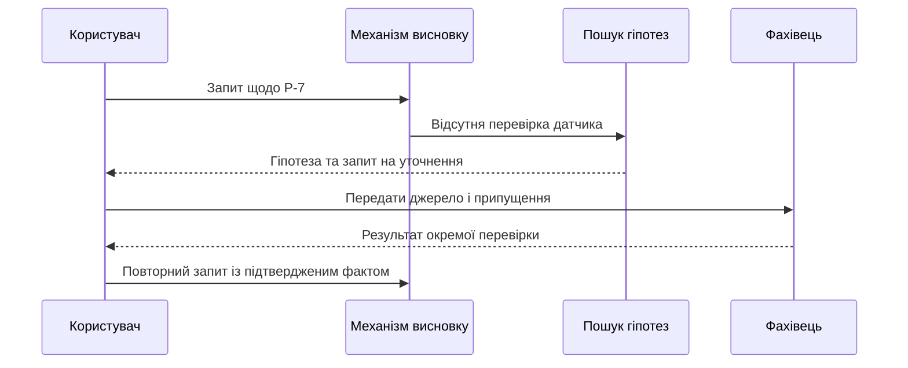
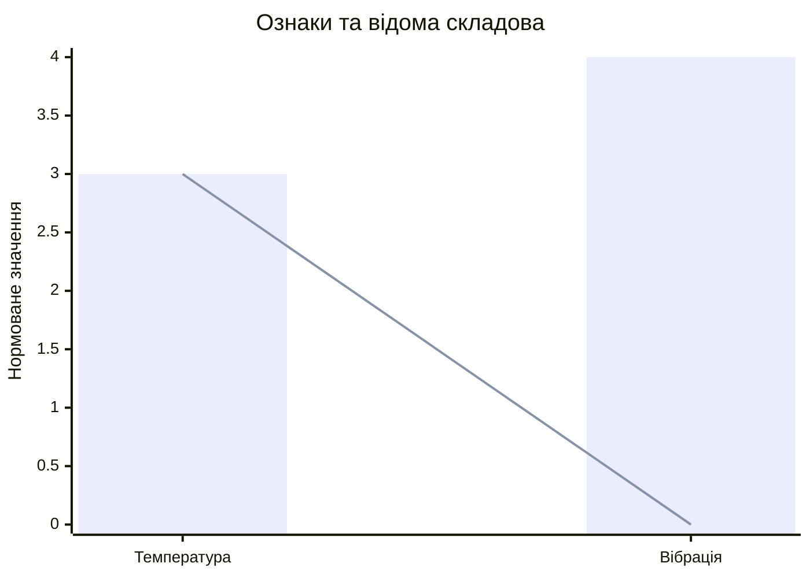
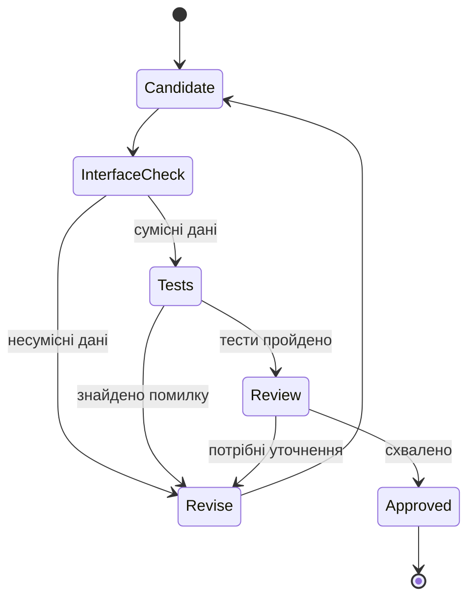

# Глава 24. Виявлення прогалин і синтез нових правил

<a id="глава-24-детермінований-реляційний-аналіз-абдуктивний-пошук-прогалин-числення-епістемічного-боргу-та-синтез-нових-правил"></a>

> **Підручник:** [Експертні Системи](../README.md) · [Том 3. Нейро-символьні, ізольовані, критичні до безпеки та високопродуктивні експертні системи](README.md)  
> **Навчальний рівень:** прикладні програмісти та студенти комп'ютерних наук\
> **Обладнання:** звичайний ноутбук або ПК\
> **Мова:** Python 3.14.4; приклади використовують стандартну бібліотеку\
> **Попередня глава:** [Глава 23. Пошук знань і перевірка підстав тверджень](ch23-knowledge-search-and-evidence.md)\
> **Наступна глава:** [Глава 25. Оновлення знань і безперервне навчання](ch25-knowledge-updates-and-learning.md)\
> **Автор:** Микола Мартинович Федчик

---

## Анотація

Коли експертна система не знаходить усіх передумов рішення, вона має не вигадати відповідь, а показати, чого бракує і як це перевірити. У цій главі розглянуто відокремлення дедуктивних висновків від припущень, пошук кандидатів правил у неповному графі знань, абдукцію та оцінювання витрат на ручне уточнення. Далі показано, як виділити незвичну частину вектора ознак, узгодити ознаки двох предметних областей і перевірити кандидата за інтерфейсними, комбінаторними та розмірними обмеженнями.

Навчальний приклад продовжує історію насоса `P-7` із Глав 22–23: є повідомлення про температуру вище умовного порога $85\,^\circ\mathrm C$, але чинність показу й режим обслуговування потрібно з'ясувати окремо. Читач реалізує невеликі перевірки, простежить їхні результати й сформує пакет кандидата для фахової оцінки. Жоден із прикладів не запускає обладнання та не є перевіркою виробничої безпеки.

---

<!-- chapter-toc:start -->
## Зміст глави

- [1. Дедукція та дорадчі гіпотези](#1-дедукція-та-дорадчі-гіпотези)
  - [1.1. Поділ підтверджених фактів і припущень](#11-поділ-підтверджених-фактів-і-припущень)
  - [1.2. Автоматичне виявлення правил у графах знань](#12-автоматичне-виявлення-правил-у-графах-знань)
- [2. Пошук і пріоритизація прогалин](#2-пошук-і-пріоритизація-прогалин)
  - [2.1. Пошук відсутньої передумови та оцінка прогалин](#21-пошук-відсутньої-передумови-та-оцінка-прогалин)
  - [2.2. Витрати ручного уточнення та пріоритети досліджень](#22-витрати-ручного-уточнення-та-пріоритети-досліджень)
- [3. Перенесення ознак між предметними областями](#3-перенесення-ознак-між-предметними-областями)
  - [3.1. Залишок відносно відомих ознак](#31-залишок-відносно-відомих-ознак)
  - [3.2. Узгодження векторних ознак суміжних предметних областей](#32-узгодження-векторних-ознак-суміжних-предметних-областей)
- [4. Формальний синтез і перевірка сумісності](#4-формальний-синтез-і-перевірка-сумісності)
  - [4.1. Узгодження специфікацій та введення явних гіпотез](#41-узгодження-специфікацій-та-введення-явних-гіпотез)
  - [4.2. Перевірка взаємодій трьох підсистем](#42-перевірка-взаємодій-трьох-підсистем)
  - [4.3. Безрозмірні комплекси для перевірки фізичних гіпотез](#43-безрозмірні-комплекси-для-перевірки-фізичних-гіпотез)
- [5. Практичні завдання та лабораторний практикум](#5-практичні-завдання-та-лабораторний-практикум)
  - [5.1. Контрольні запитання для самоперевірки](#51-контрольні-запитання-для-самоперевірки)
  - [5.2. Розрахункові задачі (трасування вручну)](#52-розрахункові-задачі-трасування-вручну)
  - [5.3. Завдання з програмної реалізації](#53-завдання-з-програмної-реалізації)
  - [5.4. Зв'язок із лабораторною та курсовою роботою курсу](#54-звязок-із-лабораторною-та-курсовою-роботою-курсу)
- [Висновки](#висновки)
- [Глосарій](#глосарій)
- [Скорочення та терміни](#скорочення-та-терміни)
- [Джерела](#джерела)
<!-- chapter-toc:end -->

---

<a id="1-дворежимна-архітектура-експертної-системи-суворий-дедуктивний-канал-проти-ізольованого-дорадчого-каналу"></a>

## 1. Дедукція та дорадчі гіпотези

Після пошуку документів із Глави 23 система може знати, яке правило стосується `P-7`, але не мати підтвердження кожної його передумови. Якщо заповнити прогалину припущенням і непомітно передати його дедуктивному механізму як факт, висновок виглядатиме доведеним, хоча залежатиме від неперевіреної відповіді. Тому розділимо перевірку наявних знань і побудову кандидатів, а результат кожного шляху позначимо окремо.

**Діаграма 24.1. Два шляхи опрацювання знань.**



На діаграмі немає прямого ребра від гіпотези до дедуктивного висновку. Схвалення і випуск версії є окремими операціями; їхній механізм становить тему наступної глави.

<a id="11-структура-відповіді-дворежимної-системи-та-жорсткий-інваріант-ізоляції-недоведених-гіпотез-від-виконавчого-тракту"></a>

### 1.1. Поділ підтверджених фактів і припущень

Для ілюстрації візьмемо навчальну модель вимоги `D1`, передумови `P1` і винятку `D2` з попередньої глави. Припустимо, що фахівець уже затвердив вузьке правило `R1`: **якщо отримано повідомлення про перевищення порога, достовірність показу підтверджено й підтверджено нормальний режим, то є логічна підстава розглянути заявку на огляд**. Це навчальна формалізація, а не автоматичне тлумачення документів чи дозвіл створити заявку.

Повідомлення про $86\,^\circ\mathrm C$ означає, що в записі є таке число; воно саме по собі не підтверджує справність датчика. Для першого запуску прийнято факти `high_report=True` і `normal=True`, а відомостей про `sensor_valid` немає. Гіпотеза `sensor_valid` підказує, що саме перевірити, але не заповнює передумову правила. Відсутній ключ означає **невідомо**, а значення `False` — явно встановлене заперечення.

Лістинг приймає словник уже перевірених у межах прикладу фактів і окрему множину запропонованих гіпотез. Він повертає стан, відповідні передумови та підмножину гіпотез, що допомагають поставити запитання. У навчальній політиці будь-яке підтверджене техобслуговування блокує автоматичний перехід: це суворіше за виняток `D2` і є окремо заданим рішенням, а не висновком із самого документа.

**Лістинг 24.2. Перевірка передумов без використання гіпотез як фактів (Python 3.14.4).**

<details><summary>Показати лістинг 24.2 (27 рядків, Python 3.14.4)</summary>

```python
REQUIRED = {"high_report", "sensor_valid", "normal"}
ALLOWED = REQUIRED | {"maintenance"}

def decide(facts: dict[str, bool], hypotheses: set[str]):
    if (not set(facts) <= ALLOWED or not hypotheses <= ALLOWED
            or any(type(value) is not bool for value in facts.values())):
        raise ValueError("невідомий факт або не булеве значення")
    if facts.get("normal") is True and facts.get("maintenance") is True:
        return "CONFLICT", set(), set()
    if facts.get("maintenance") is True:
        return "BLOCKED", {"maintenance"}, set()
    denied = {name for name in REQUIRED if facts.get(name) is False}
    if denied:
        return "NOT_APPLICABLE", denied, set()
    missing = REQUIRED - facts.keys()
    if missing:
        return "UNVERIFIED", missing, missing & hypotheses
    return "SUPPORTED", set(), set()

facts = {"high_report": True, "normal": True}
assert decide(facts, {"sensor_valid"}) == (
    "UNVERIFIED", {"sensor_valid"}, {"sensor_valid"}
)
assert decide(facts | {"sensor_valid": True}, set())[0] == "SUPPORTED"
assert decide({"high_report": True, "maintenance": True}, set())[0] == "BLOCKED"
assert decide({"normal": True, "maintenance": True}, set())[0] == "CONFLICT"
assert decide(facts | {"sensor_valid": False}, set())[0] == "NOT_APPLICABLE"
```

</details>

**Таблиця 24.3. Трасування навчального правила.**

| Перевірені відомості | Дорадча гіпотеза | Результат |
|---|---|---|
| Є повідомлення про перевищення і підтверджено нормальний режим | Датчик справний | `UNVERIFIED`: справність залишається невідомою |
| До тих самих відомостей додано перевірену справність | Немає | `SUPPORTED`: передумови `R1` виконано |
| Підтверджено техобслуговування | Будь-яка | `BLOCKED`: діє консервативна навчальна політика |
| Одночасно підтверджено нормальний режим і обслуговування | Будь-яка | `CONFLICT`: для цієї моделі стани взаємовиключні |
| Справність датчика перевірено і заперечено | Будь-яка | `NOT_APPLICABLE`: передумова явно не виконана |

`SUPPORTED` описує тільки логічний результат у заданій моделі. До створення заявки ще потрібні перевірки чинності джерел, часу вимірювання, повноважень і політики дії. Типи та окремі аргументи функції демонструють розділення даних, але не захищають виробничу систему від підробленого словника: потрібні контроль доступу, перевірка походження та узгоджений знімок знань.

<a id="12-автоматичний-майнінг-хорнівських-правил-у-графах-знань-за-припущенням-часткової-повноти-pca--алгоритм-amie"></a>

### 1.2. Автоматичне виявлення правил у графах знань

Ручний пошук усіх можливих зв'язків у великому графі дорогий, тому алгоритм може запропонувати шаблони, що повторюються в записах. Наприклад, кандидат `recorded_task(p, t) ← high_report(p) ∧ proposed(p, t)` пов'язує повідомлення про високу температуру й запропоновану задачу з уже зареєстрованою задачею. Символи `p` і `t` позначають насос і тип задачі. Це правило описує зв'язок у даних, а не дозволяє створювати нову заявку.

AMIE шукає кандидати хорнівських правил у графах і оцінює їх, зокрема за припущенням часткової повноти (*partial completeness assumption*, PCA) [[1]](#src-1). Для фіксованого відношення та напряму припустимо: якщо для насоса записано хоча б одну задачу, відповідні записи для цього насоса достатньо повні для оцінювання. Потрібно відрізняти таке припущення від фактичного доведення повноти.

Нехай тіло кандидата породжує множину різних пар насоса і задачі, а голова містить записані пари. Звичайна оцінка ділить кількість збігів на всі передбачені пари; PCA-оцінка залишає в знаменнику лише пари для насосів, які вже мають хоча б один запис головного відношення.

**Формула 24.4. Дві оцінки підтримки кандидата.**

$$
\mathrm{conf}=\frac{|B\cap H|}{|B|},
\qquad
\mathrm{conf}_{\mathrm{PCA}}=
\frac{|B\cap H|}{|\{(p,t)\in B:\exists t'\ (p,t')\in H\}|}.
$$

Тут $B$ — скінченна множина різних пар, отриманих із тіла правила; $H$ — множина записаних пар головного відношення; $p$ — насос, $t$ і $t'$ — типи задач. Чисельник і знаменники вимірюють у парах; оцінки безрозмірні й належать $[0,1]$, якщо відповідний знаменник ненульовий.

Нехай тіло дає чотири пари: `P-7` із задачами `review` і `calibration`, а `P-8` і `P-9` — із `review`. У головному відношенні записано лише `(P-7, review)` і `(P-8, review)`. Тоді підтримка дорівнює двом парам, звичайна оцінка — $2/4=0.5$, а знаменник PCA — три, бо для `P-9` жодної задачі не записано. Отже, PCA-оцінка становить $2/3\approx 0.67$.

Лістинг отримує вже обчислені множини пар, а не реалізує весь пошук AMIE. За порожнього знаменника він повідомляє про неможливість оцінювання замість підміни результату нулем.

**Лістинг 24.5. Оцінювання запропонованого правила (Python 3.14.4).**

<details><summary>Показати лістинг 24.5 (16 рядків, Python 3.14.4)</summary>

```python
def rule_scores(predicted: set[tuple[str, str]], known: set[tuple[str, str]]):
    if not predicted:
        raise ValueError("тіло правила не породило пар")
    subjects = {pump for pump, _ in known}
    scoped = {pair for pair in predicted if pair[0] in subjects}
    if not scoped:
        raise ValueError("знаменник PCA дорівнює нулю")
    support = len(predicted & known)
    return support / len(predicted), support / len(scoped)

predicted = {("P-7", "review"), ("P-7", "calibration"),
             ("P-8", "review"), ("P-9", "review")}
known = {("P-7", "review"), ("P-8", "review")}
standard, pca = rule_scores(predicted, known)
assert standard == 0.5
assert abs(pca - 2 / 3) < 1e-12
```

</details>

За цими значеннями кандидат можна поставити в чергу предметної перевірки разом із прикладами, підтримкою та джерелом графа. Жодна з двох оцінок не є ймовірністю істинності правила: записи можуть бути неповними або упередженими, а припущення PCA — помилковим. Відсутній запис для `P-9` не означає, що задача для нього не існує.

<a id="2-абдуктивне-замикання-за-чарльзом-пірсом-та-кількісне-числення-епістемічного-боргу-підприємства"></a>

## 2. Пошук і пріоритизація прогалин

Стан `UNVERIFIED` корисний лише тоді, коли за ним можна організувати наступну перевірку. Системі потрібно назвати відсутні передумови, відокремити їх від відомих заперечень і пояснити, які можливі причини варто дослідити. Коли таких випадків багато, облік витрат допомагає визначити черговість роботи, але не замінює оцінювання наслідків помилки.

**Діаграма 24.6. Від невідомої передумови до її перевірки.**



Діаграма розрізняє формування запитання й повторний висновок: запропонована відповідь не стає фактом у тому самому виклику.

<a id="21-зворотний-пошук-єдиної-відсутньої-передумови-правила-та-індекс-дефіциту-формалізації-kdi"></a>

### 2.1. Пошук відсутньої передумови та оцінка прогалин

Абдукція — міркування від спостереження до можливого пояснення. На відміну від дедукції, воно не робить запропоновану причину логічним наслідком самого спостереження [[2]](#src-2). Наприклад, повідомлення про високу температуру може бути наслідком перегріву або несправності датчика. Якщо навчальна модель містить по одному правилу від кожної з цих причин до такого повідомлення, обидві причини є можливими поясненнями; одного повідомлення недостатньо, щоб вибрати між ними.

У логічній постановці потрібне припущення, яке разом із фоновими знаннями дає спостереження, не створюючи суперечності:

**Формула 24.7. Умови логічного пояснення.**

$$
R\cup F\cup H\models O,\qquad R\cup F\cup H\not\models\bot.
$$

Тут $R$ — скінченна множина правил моделі, $F$ — фонові факти без самого пояснюваного спостереження, $H$ — множина гіпотетичних фактів, $O$ — спостереження, а $\bot$ позначає суперечність. Символ $\models$ означає логічне слідування; фізичних одиниць ці множини не мають. Для кожної з двох причин вибираємо одноелементну $H$: разом із відповідним навчальним правилом вона дає повідомлення й не суперечить заданим фоновим фактам. Додатковий тест датчика або незалежне вимірювання може розрізнити ці пояснення.

Інша, споріднена задача — зворотний пошук **передумов бажаного висновку**, як у `R1`. Він не пояснює причину спостереження: для `high_report=True` і `normal=True` алгоритм повертає єдину невідому передумову `sensor_valid`. Якщо невідомі і режим, і справність, повертаються обидва запитання; якщо справність явно заперечено, це не прогалина, а невиконана умова.

Для оцінки масштабу черги визначимо локальний навчальний показник дефіциту знань (*knowledge deficit index*, KDI). Він показує частку розглянутих випадків, де бодай одна необхідна передумова невідома:

**Формула 24.8. Невідомі передумови та частка випадків із прогалинами.**

$$
M=B_r\setminus(F^+\cup F^-),\qquad \mathrm{KDI}=\frac{N_{\mathrm{unknown}}}{N}.
$$

Тут $`B_r`$ — множина потрібних передумов правила $r$; $F^+$ і $F^-$ — відповідно множини підтверджених і явно заперечених передумов; $M$ — множина невідомих. $N$ — додатна кількість несуперечливих перевірених випадків, $`N_{\mathrm{unknown}}`$ — кількість випадків із непорожнім $M$, від нуля до $N$. Множини $F^+$ і $F^-$ не перетинаються; суперечності обліковують окремо. Показник безрозмірний, від $0$ до $1$.

У чотирьох випадках із того самого правила нехай невідомі передумови є у двох: в одному бракує лише справності датчика, в другому — справності й режиму. У третьому справність явно заперечено, в четвертому всі передумови підтверджено. Отже, KDI становить $2/4=0.5$; третій випадок не рахують як невідомий.

Функції нижче працюють із **попередньо перевіреними на суперечності** випадками. Вони повертають назви невідомих умов і частку таких випадків; порожня вибірка не має визначеного показника.

**Лістинг 24.9. Пошук невідомих умов і облік випадків (Python 3.14.4).**

<details><summary>Показати лістинг 24.9 (20 рядків, Python 3.14.4)</summary>

```python
def unknown(required: set[str], facts: dict[str, bool]) -> set[str]:
    if any(type(value) is not bool for value in facts.values()):
        raise ValueError("факт повинен мати булеве значення")
    return required - facts.keys()

def gap_rate(required: set[str], cases: list[dict[str, bool]]) -> float:
    if not cases:
        raise ValueError("порожня вибірка випадків")
    return sum(bool(unknown(required, facts)) for facts in cases) / len(cases)

required = {"high_report", "sensor_valid", "normal"}
cases = [
    {"high_report": True, "normal": True},
    {"high_report": True},
    {"high_report": True, "normal": True, "sensor_valid": False},
    {"high_report": True, "normal": True, "sensor_valid": True},
]
assert unknown(required, cases[0]) == {"sensor_valid"}
assert unknown(required, cases[1]) == {"normal", "sensor_valid"}
assert gap_rate(required, cases) == 0.5
```

</details>

Цей KDI — означена тут міра для конкретної вибірки, а не універсальний показник повноти онтології. Невідома поточна справність датчика може бути браком свіжого свідчення, а не відсутністю формалізованого правила; причину треба класифікувати окремо.

<a id="22-облік-епістемічного-боргу-в-добових-операційних-витратах-на-ручну-ескалацію-та-ранжування-rd-за-швидкістю-окупності"></a>

### 2.2. Витрати ручного уточнення та пріоритети досліджень

Черга прогалин може містити як часті прості уточнення, так і рідкісні, але важливі перевірки. У цій главі епістемічним боргом називаємо накопичену потребу уточнити або формалізувати знання; вона може спричиняти повторну ручну роботу. Щоб оцінити частину операційного навантаження, розглянемо умовний облік часу, витраченого на ручну ескалацію. Він не оцінює всього боргу чи ціни аварії й не дозволяє відкладати обов'язкові перевірки лише тому, що вони дорогі.

**Формула 24.10. Добові витрати й проста окупність уточнення.**

$$
C_{\mathrm{day}}=\sum_{i=1}^{m} n_i t_i c_i,
\qquad
T_{\mathrm{payback}}=\frac{C_{\mathrm{change}}}{C_{\mathrm{day}}-C'_{\mathrm{day}}}.
$$

Тут $m$ — кількість неперетинних класів звернень; $`n_i\geq 0`$ — середня кількість випадків класу $i$ за робочий день; $`t_i\geq 0`$ — години ручної роботи на випадок; $`c_i\geq 0`$ — умовні грошові одиниці за годину. $`C_{\mathrm{day}}`$ і $`C'_{\mathrm{day}}`$ — витрати до й після зміни в одиницях за робочий день; $`C_{\mathrm{change}}`$ — одноразові витрати в тих самих грошових одиницях. Окупність $`T_{\mathrm{payback}}`$ має одиницю «робочий день» і визначена лише за додатної денної економії.

Для шести звернень по $0.25$ години та двох по $0.5$ години за ставки $40$ одиниць на годину маємо $60+40=100$ одиниць на день. Якщо перевірена зміна зменшить перший потік до двох звернень, нова сума становитиме $20+40=60$; зміна вартістю $400$ окупиться за $400/40=10$ робочих днів за незмінних умов.

**Лістинг 24.11. Розрахунок навантаження та окупності (Python 3.14.4).**

<details><summary>Показати лістинг 24.11 (25 рядків, Python 3.14.4)</summary>

```python
from math import isfinite

def daily_cost(rows: list[tuple[float, float, float]]) -> float:
    if any(not isfinite(x) or x < 0 for row in rows for x in row):
        raise ValueError("вхідні величини мають бути скінченні й невід'ємні")
    total = sum(count * hours * rate for count, hours, rate in rows)
    if not isfinite(total):
        raise ValueError("переповнення добових витрат")
    return total

def payback(change_cost: float, daily_saving: float) -> float | None:
    if not isfinite(change_cost) or change_cost < 0 or not isfinite(daily_saving):
        raise ValueError("некоректна вартість або економія")
    if daily_saving <= 0:
        return None
    result = change_cost / daily_saving
    if not isfinite(result):
        raise ValueError("переповнення строку окупності")
    return result

before = daily_cost([(6, 0.25, 40), (2, 0.5, 40)])
after = daily_cost([(2, 0.25, 40), (2, 0.5, 40)])
assert (before, after) == (100, 60)
assert payback(400, before - after) == 10
assert payback(400, 0) is None
```

</details>

Для порівняння пропозицій спочатку відсіюють неприпустимі за ризиком і правилами безпеки, а потім оцінюють окупність решти. Наведені суми вигадані; розрахунок не враховує супроводу, вартості помилок і зміни навантаження. Перед реальним рішенням їх потрібно оцінити окремо.

<a id="3-крос-доменне-перенесення-ознак-проєктор-грама--шмідта-та-ортогональне-вирівнювання-прокруста"></a>

## 3. Перенесення ознак між предметними областями

Опис стану насоса може містити не лише логічні факти, а й числові ознаки температури та вібрації. Система порівнює новий опис із відомими режимами, щоб запропонувати випадки для дослідження. Самої великої відстані недостатньо для висновку про несправність: різний масштаб вимірювань або зміна калібрування також змінюють вектор. Спершу узгодимо шкали, а потім відділимо відому складову від залишку.

**Графік 24.12. Навчальний вектор і його проєкція.**



Стовпчики показують вихідні значення $(3,4)$, а лінія — складову $(3,0)$ у відомому напрямі. Різниця між ними залишає другу ознаку для додаткової перевірки.

<a id="31-виділення-ортогонального-залишку-невідомого-режиму-відносно-базису-відомих-станів"></a>

### 3.1. Залишок відносно відомих ознак

Нехай ознаки вже центровано й поділено на зафіксовані ненульові масштаби, наприклад стандартні відхилення навчальної вибірки. Це робить координати безрозмірними й не дає градусам автоматично переважати одиниці вібрації. Масштаби та версію базису потрібно зберегти разом: інакше одна й та сама норма залишку матиме різний зміст у різних запусках.

Для порівняння нового вектора з відомим лінійним підпростором обчислимо його ортогональний залишок і довжину цього залишку:

**Формула 24.13. Залишок після проєкції на відомий підпростір.**

$$
x_{\perp}=x-\sum_{j=1}^{k}(q_j^{\mathsf T}x)q_j,
\qquad \rho=\lVert x_{\perp}\rVert_2.
$$

Тут $`x\in\mathbb R^d`$ — нормований вектор із $d\geq 1$ ознак; $`q_j\in\mathbb R^d`$ — вектори відомого базису, де $`0\leq k\leq d`$. Базис ортонормальний: $`q_i^{\mathsf T}q_j=1`$ для однакових індексів і $0$ для різних. $`q_j^{\mathsf T}x`$ — скалярна координата проєкції; $`x_{\perp}`$ — частина, перпендикулярна всім $`q_j`$; $\rho\geq 0$ — її евклідова норма. Усі ці величини в прикладі безрозмірні.

Для $`x=(3,4)`$ і єдиного $`q_1=(1,0)`$ скалярний добуток дорівнює $3$, проєкція — $(3,0)$, залишок — $(0,4)$, а $\rho=4$. Якщо навчальний поріг сповіщення дорівнює $3$, випадок потрапляє на дослідження, бо $4>3$. Поріг умовний: у застосуванні його встановлюють і перевіряють на відповідних незалежних даних.

Процес Грама — Шмідта будує ортонормальний базис із лінійно незалежних напрямів [[3]](#src-3). На кожному кроці з нового вектора віднімаються проєкції на вже побудовані напрями, після чого залишок нормується. Нульовий або майже нульовий залишок свідчить, що за вибраної числової точності новий напрям не додає незалежної інформації.

**Лістинг 24.14. Побудова ортонормального базису (Python 3.14.4).**

<details><summary>Показати лістинг 24.14 (21 рядок, Python 3.14.4)</summary>

```python
from math import fsum, hypot, isfinite

def orthonormalize(vectors: list[tuple[float, ...]], tolerance: float = 1e-12):
    if not vectors or not vectors[0] or not isfinite(tolerance) or tolerance <= 0:
        raise ValueError("потрібні вектори та додатна точність")
    size = len(vectors[0])
    if any(len(v) != size or any(not isfinite(x) for x in v) for v in vectors):
        raise ValueError("несумісні розміри або нескінченна координата")
    basis = []
    for vector in vectors:
        remaining = list(vector)
        for q in basis:
            coefficient = fsum(a * b for a, b in zip(remaining, q))
            remaining = [a - coefficient * b for a, b in zip(remaining, q)]
        length = hypot(*remaining)
        if not isfinite(length) or length <= tolerance:
            raise ValueError("залежний напрям або переповнення")
        basis.append(tuple(value / length for value in remaining))
    return basis

assert orthonormalize([(2.0, 0.0)]) == [(1.0, 0.0)]
```

</details>

Наступна функція приймає нормований вектор і вже ортонормальний базис. Вона перевіряє розміри, скінченність та ортонормальність із заданим числовим допуском, а потім повертає залишок і його норму. Порожній базис допустимий: відомого підпростору ще немає і весь вектор залишається невідомою складовою.

**Лістинг 24.15. Виділення й вимірювання залишку (Python 3.14.4).**

<details><summary>Показати лістинг 24.15 (26 рядків, Python 3.14.4)</summary>

```python
from math import fsum, hypot, isfinite

def residual(x: tuple[float, ...], basis: list[tuple[float, ...]]):
    if not x or any(not isfinite(value) for value in x):
        raise ValueError("некоректний вектор ознак")
    for i, q in enumerate(basis):
        if len(q) != len(x) or any(not isfinite(value) for value in q):
            raise ValueError("несумісний вектор базису")
        if abs(fsum(value * value for value in q) - 1) > 1e-9:
            raise ValueError("базис не нормований")
        if any(abs(fsum(a * b for a, b in zip(q, prev))) > 1e-9
               for prev in basis[:i]):
            raise ValueError("базис не ортогональний")
    result = list(x)
    for q in basis:
        coefficient = fsum(a * b for a, b in zip(x, q))
        result = [a - coefficient * b for a, b in zip(result, q)]
    magnitude = hypot(*result)
    if not isfinite(magnitude):
        raise ValueError("переповнення норми залишку")
    return tuple(result), magnitude

part, distance = residual((3.0, 4.0), [(1.0, 0.0)])
assert part == (0.0, 4.0)
assert distance == 4.0
assert residual((3.0, 4.0), [])[1] == 5.0
```

</details>

Отриманий сигнал означає розбіжність із **вибраним лінійним підпростором**, а не доведену нову несправність. Якщо новий режим лежить у цьому підпросторі, залишок може бути нульовим. Для погано обумовлених даних варто застосувати чисельно стійке QR- або SVD-розкладання й перевірити чутливість до точності, замість вважати навчальний код достатнім.

<a id="32-каліброване-перенесення-векторів-ознак-між-суміжними-доменами-за-допомогою-svd-розвязку-ортогональної-задачі-прокруста"></a>

### 3.2. Узгодження векторних ознак суміжних предметних областей

Два підприємства можуть описувати подібні стани насоса різними координатами. Без узгодження повороту ознак одна й та сама ситуація виглядатиме різною. Для навчання потрібні **парні приклади**: кожному стану в першому наборі відповідає перевірений опис того самого або заздалегідь узгодженого стану в другому. Відповідність і сумісність шкал не можна встановити лише за геометричною близькістю.

Ортогональна задача Прокруста шукає перетворення з найменшою сумою квадратів помилок між такими парами [[4]](#src-4). Перед розрахунком обидва набори центровано, а їхні координати приведено до порівнянних, зафіксованих шкал.

**Формула 24.16. Ортогональне вирівнювання пар ознак.**

$$
R^*=\mathop{\mathrm{arg\,min}}_{R^{\mathsf T}R=I}\lVert XR-Y\rVert_F^2,
\qquad X^{\mathsf T}Y=U\Sigma V^{\mathsf T},\quad R^*=UV^{\mathsf T}.
$$

Тут $`X,Y\in\mathbb R^{n\times d}`$ — матриці $n\geq 1$ пар центрованих векторів із $d\geq 1$ безрозмірних ознак; відповідні рядки утворюють пари. $R$ — квадратна матриця перетворення, $I$ — одинична матриця, а обмеження $`R^{\mathsf T}R=I`$ зберігає довжини та кути. $`\lVert\cdot\rVert_F^2`$ — сума квадратів усіх елементів матриці помилок; $`U\Sigma V^{\mathsf T}`$ — сингулярний розклад $`X^{\mathsf T}Y`$. У ньому $U$ і $V$ ортогональні, а діагональна матриця $\Sigma$ містить невід'ємні сингулярні числа. За вироджених даних оптимальне перетворення може бути не єдиним.

Візьмемо чотири центровані пари: $(1,0)\to(0,1)$, $(-1,0)\to(0,-1)$, $(0,1)\to(-1,0)$ і $(0,-1)\to(1,0)$. Для векторів-рядків матриця з першим рядком $(0,1)$ і другим $(-1,0)$ повертає кожну пару точно; сума квадратів помилок дорівнює $0$. Оскільки меншим за нуль цей критерій бути не може, у навчальному наборі знайдено оптимум.

Лістинг реалізує не загальне SVD, а окремий двовимірний випадок **лише для поворотів**. Для центрованих пар він накопичує скалярні добутки та орієнтовані попарні добутки, нормує їх і повертає матрицю. За нульової величини накопиченого напряму функція повідомляє, що поворот не визначено однозначно.

**Лістинг 24.17. Навчальне двовимірне вирівнювання поворотом (Python 3.14.4).**

<details><summary>Показати лістинг 24.17 (25 рядків, Python 3.14.4)</summary>

```python
from math import fsum, hypot, isfinite

def rotation_2d(source: list[tuple[float, float]], target: list[tuple[float, float]]):
    if not source or len(source) != len(target):
        raise ValueError("потрібні непорожні парні набори")
    if any(len(p) != 2 or any(not isfinite(v) for v in p) for p in source + target):
        raise ValueError("потрібні скінченні двовимірні вектори")
    for points in (source, target):
        if any(abs(fsum(p[i] for p in points) / len(points)) > 1e-9 for i in (0, 1)):
            raise ValueError("набори необхідно центрувати")
    a = fsum(x[0] * y[0] + x[1] * y[1] for x, y in zip(source, target))
    b = fsum(x[0] * y[1] - x[1] * y[0] for x, y in zip(source, target))
    length = hypot(a, b)
    if not isfinite(length) or length <= 1e-12:
        raise ValueError("напрям повороту не визначено або переповнено")
    return ((a / length, b / length), (-b / length, a / length))

def apply_rotation(point, matrix):
    return (point[0] * matrix[0][0] + point[1] * matrix[1][0],
            point[0] * matrix[0][1] + point[1] * matrix[1][1])

source = [(1, 0), (-1, 0), (0, 1), (0, -1)]
target = [(0, 1), (0, -1), (-1, 0), (1, 0)]
rotation = rotation_2d(source, target)
assert [apply_rotation(point, rotation) for point in source] == target
```

</details>

Загальна ортогональна постановка допускає також відбиття, тоді як наведена функція обмежена поворотами з визначником $+1$. Гарна відповідність навчальних пар не підтверджує перенесення правила: його перевіряють на окремих парах, а значення ознак і предметні обмеження — разом із фахівцем.

<a id="4-механізми-формального-синтезу-уніфікація-інтерфейсів-комбінаторне-3-стороннє-покриття-та-pi-теорема-бакінгема"></a>

## 4. Формальний синтез і перевірка сумісності

Кандидат правила може бути логічно сформульованим і все ж непридатним для підключення до системи: один модуль передає температуру в кельвінах, інший очікує градуси Цельсія, а потрібна комбінація станів ніколи не перевірялася. Перед включенням кандидата до наступної версії розглянемо сумісність даних, покриття взаємодій і розмірну узгодженість фізичного припущення.

**Діаграма 24.18. Перевірка кандидата перед окремим випуском.**



Стан `Approved` на діаграмі означає рішення уповноваженого рецензента щодо кандидата, а не автоматичне встановлення оновлення. Випуск, контроль версій і повернення попередньої версії розглядаються окремо.

<a id="41-перетин-областей-допустимості-при-склеюванні-специфікацій-суміжних-підсистем-та-розширення-сигнатури-компонентом-гіпотезою"></a>

### 4.1. Узгодження специфікацій та введення явних гіпотез

Припустимо, датчик передає **абсолютну температуру** в діапазоні від $273.15\,\mathrm K$ до $373.15\,\mathrm K$, а інтерфейс модуля аналізу приймає від $85\,^\circ\mathrm C$ до $95\,^\circ\mathrm C$ включно. Обидві специфікації стосуються тієї самої величини, але їхні числові межі не можна перетинати до перетворення одиниць.

Після віднімання $273.15$ датчик має діапазон $[0,100]\,^\circ\mathrm C$. Спільна область допустимих для передачі значень визначається перетином:

**Формула 24.19. Перетин сумісних діапазонів.**

$$
D=D_{\mathrm{sensor}}\cap D_{\mathrm{receiver}}
=[0,100]\cap[85,95]=[85,95]\;^\circ\mathrm C.
$$

Тут $`D_{\mathrm{sensor}}`$ — замкнений діапазон датчика після переведення в градуси Цельсія; $`D_{\mathrm{receiver}}`$ — замкнений діапазон приймача в тих самих одиницях; $D$ — їхній перетин. Усі межі є абсолютними температурами, а не різницями температур. Значення $86\,^\circ\mathrm C$ проходить цю перевірку, а $110\,^\circ\mathrm C$ не належить спільному діапазону.

Межу $85\,^\circ\mathrm C$ інтерфейс приймає, але вона **не** задовольняє строгого порівняння «вище $85\,^\circ\mathrm C$» у `D1`. Перевірка діапазону й умова правила — різні операції.

Нижче межі подано точними дробами `Fraction`, щоб перерахунок десяткових температур не залежав від округлення двійкових чисел. Функції вимагають такого типу явно; порожній перетин і неправильно впорядковані межі є помилками узгодження.

**Лістинг 24.20. Переведення одиниць і перевірка інтерфейсу (Python 3.14.4).**

<details><summary>Показати лістинг 24.20 (25 рядків, Python 3.14.4)</summary>

```python
from fractions import Fraction

def celsius(kelvin: Fraction) -> Fraction:
    if not isinstance(kelvin, Fraction):
        raise TypeError("температура має бути точним дробом")
    if kelvin < 0:
        raise ValueError("температура нижча від абсолютного нуля")
    return kelvin - Fraction(27315, 100)

def intersection(a: tuple[Fraction, Fraction], b: tuple[Fraction, Fraction]):
    if any(len(interval) != 2 or any(not isinstance(v, Fraction) for v in interval)
           for interval in (a, b)):
        raise TypeError("кожен діапазон має містити дві дробові межі")
    if a[0] > a[1] or b[0] > b[1]:
        raise ValueError("межі діапазону переплутано")
    lower, upper = max(a[0], b[0]), min(a[1], b[1])
    if lower > upper:
        raise ValueError("спільної області немає")
    return lower, upper

sensor = (celsius(Fraction("273.15")), celsius(Fraction("373.15")))
receiver = (Fraction(85), Fraction(95))
domain = intersection(sensor, receiver)
assert domain == (85, 95)
assert domain[0] <= 86 <= domain[1] and not 85 > 85
```

</details>

Якщо тип величини, одиниця, діапазон або версія схеми невідомі, це окрема гіпотеза в описі кандидата, а не мовчазне припущення адаптера. Перетин діапазонів не підтверджує правильності датчика, свіжості повідомлення чи відповідності правила нормативному джерелу.

<a id="42-виявлення-попарно-сумісних-але-тристоронньо-неперевірених-тріад-підсистем-3-way-interaction-coverage"></a>

### 4.2. Перевірка взаємодій трьох підсистем

Помилка може проявитися лише за одночасної певної комбінації режиму, стану датчика і зв'язку. Попарні тести охоплюють комбінації будь-яких двох чинників, проте не обов'язково всі комбінації трьох [[5]](#src-5). Перевіримо це на скінченному наборі замість припускати, що пройдені попарні тести вже достатні.

Нехай кожен чинник має два значення: режим — нормальний `0` або обслуговування `1`; стан датчика — підтверджений `0` або непідтверджений `1`; зв'язок — доступний `0` або втрачений `1`. У цьому прикладі всі вісім трійок вважаються можливими.

**Таблиця 24.21. Чотири тести з повним попарним покриттям.**

| Тест | Режим | Датчик | Зв'язок |
|---|---:|---:|---:|
| 1 | 0 | 0 | 0 |
| 2 | 0 | 1 | 1 |
| 3 | 1 | 0 | 1 |
| 4 | 1 | 1 | 0 |

У будь-якій парі стовпців присутні всі чотири комбінації `00`, `01`, `10`, `11`. Проте є лише чотири різні трійки з восьми можливих. Для цього конкретного набору трьох двійкових чинників частка перевірених трійок обчислюється так:

**Формула 24.22. Покриття трьох двійкових чинників.**

$$
\mathrm{Cov}_3(T)=\frac{|T|}{2^3}=\frac{4}{8}=0.5.
$$

Тут $T$ — множина **різних** перевірених трійок, $`0\leq|T|\leq 8`$, а $`\mathrm{Cov}_3`$ — безрозмірна частка від $0$ до $1$. Наприклад, трійку `111` — обслуговування, непідтверджений датчик і втрачений зв'язок — ще не перевірено.

Лістинг перелічує різні трійки та обчислює кількість різних значень для кожної пари стовпців. Повторений тест не збільшує покриття.

**Лістинг 24.23. Порівняння попарного і тристороннього покриття (Python 3.14.4).**

<details><summary>Показати лістинг 24.23 (16 рядків, Python 3.14.4)</summary>

```python
from itertools import combinations, product

def coverage(tests: list[tuple[int, int, int]]):
    if any(len(row) != 3 or any(type(v) is not int or v not in (0, 1) for v in row)
           for row in tests):
        raise ValueError("кожен тест має містити три двійкові значення")
    unique = set(tests)
    pairs = tuple(len({(row[i], row[j]) for row in unique})
                  for i, j in combinations(range(3), 2))
    missing = set(product((0, 1), repeat=3)) - unique
    return pairs, len(unique), missing

tests = [(0, 0, 0), (0, 1, 1), (1, 0, 1), (1, 1, 0)]
pairs, triples, missing = coverage(tests)
assert pairs == (4, 4, 4) and triples == 4
assert missing == {(0, 0, 1), (0, 1, 0), (1, 0, 0), (1, 1, 1)}
```

</details>

Додавши всі чотири відсутні трійки, отримаємо повне покриття саме цього простору, але не доказ відсутності інших помилок. У більшій системі для кожної трійки чинників враховують її допустимі значення; неможливі комбінації виключають лише на підставі задокументованих обмежень.

<a id="43-побудова-безрозмірних-комплексів-за-ядром-матриці-розмірностей-сі-pi-теорема-бакінгема-для-перевірки-фізичних-гіпотез"></a>

### 4.3. Безрозмірні комплекси для перевірки фізичних гіпотез

Під час перенесення правила між установками потрібно з'ясувати, чи порівнюються фізично сумірні величини. Розмірний аналіз дозволяє сформувати безрозмірні комбінації змінних; сам по собі він не встановлює закон руху рідини. Розгляньмо число Рейнольдса як приклад потенційної ознаки для подальшої перевірки гіпотези про потік.

Теорема Бакінгема пов'язує кількість незалежних безрозмірних комплексів із кількістю змінних і рангом матриці їхніх розмірностей [[6]](#src-6). Для густини $\rho$, швидкості $v$, характерної довжини $\ell$ і динамічної в'язкості $\mu$ візьмемо базові розмірності маси, довжини й часу. Стовпці матриці нижче відповідають цим чотирьом змінним у зазначеному порядку.

**Формула 24.24. Матриця розмірностей і число Рейнольдса.**

$$
A=
\begin{bmatrix}
1&0&0&1\\
-3&1&1&-1\\
0&-1&0&-1
\end{bmatrix},
\quad
A\begin{bmatrix}1\\1\\1\\-1\end{bmatrix}=0,
\quad
\mathrm{Re}=\frac{\rho v\ell}{\mu}.
$$

У рядках $A$ записано показники степенів маси, довжини та часу. $\rho>0$ вимірюється в $`\mathrm{кг}/\mathrm{м}^3`$, $v\geq 0$ — у $`\mathrm{м}/\mathrm{с}`$, $\ell>0$ — у метрах, $\mu>0$ — у $`\mathrm{кг}/(\mathrm{м}\cdot\mathrm{с})`$. Вектор $(1,1,1,-1)$ задає степені цих змінних; нульовий результат множення означає скорочення всіх трьох базових розмірностей. Матриця має ранг $3$, тому серед чотирьох змінних є $4-3=1$ незалежний безрозмірний комплекс; $\mathrm{Re}\geq 0$ є одним із можливих виборів.

Для навчальних $\rho=1000\,\mathrm{кг}/\mathrm{м}^3$, $v=0.5\,\mathrm{м}/\mathrm{с}$, $\ell=0.02\,\mathrm{м}$ і $\mu=0.001\,\mathrm{кг}/(\mathrm{м}\cdot\mathrm{с})$ отримаємо $\mathrm{Re}=1000\cdot 0.5\cdot 0.02/0.001=10000$. Цю ознаку можна додати до пакета порівняння двох умовних установок, але не використовувати самостійно як доказ однакового режиму.

У реалізації значення подають точними дробами `Fraction`; некоректний тип або фізичний діапазон спричиняє помилку.

**Лістинг 24.25. Перевірка розмірностей і розрахунок ознаки (Python 3.14.4).**

<details><summary>Показати лістинг 24.25 (16 рядків, Python 3.14.4)</summary>

```python
from fractions import Fraction

def reynolds(density: Fraction, speed: Fraction, length: Fraction, viscosity: Fraction):
    if any(not isinstance(x, Fraction) for x in (density, speed, length, viscosity)):
        raise TypeError("величини мають бути точними дробами")
    if density <= 0 or speed < 0 or length <= 0 or viscosity <= 0:
        raise ValueError("фізичні величини поза допустимим діапазоном")
    return density * speed * length / viscosity

dimensions = ((1, 0, 0, 1), (-3, 1, 1, -1), (0, -1, 0, -1))
powers = (1, 1, 1, -1)
assert all(sum(a * b for a, b in zip(row, powers)) == 0 for row in dimensions)
value = reynolds(Fraction(1000), Fraction(1, 2),
                 Fraction(1, 50), Fraction(1, 1000))
assert value == 10000
assert reynolds(Fraction(1000), Fraction(0), Fraction(1), Fraction(1)) == 0
```

</details>

Збіг числа Рейнольдса — лише одна з можливих умов подібності. Геометрію, властивості рідини та інші суттєві безрозмірні параметри потрібно обґрунтувати для конкретного явища. Розмірна правильність кандидата є необхідною перевіркою його запису, але не емпіричним підтвердженням гіпотези.

## 5. Практичні завдання та лабораторний практикум

Практикум повертається до початкового запитання: як діяти, коли для висновку або нового правила бракує підстав. Завдання поєднують ручну перевірку чисел із розширенням коду; у відповідях потрібно називати не лише результат, а й припущення, за яких він отриманий.

### 5.1. Контрольні запитання для самоперевірки

Ці запитання перевіряють не лише назви методів, а й уміння відрізняти результат обчислення від висновку, який він дозволяє зробити.

1. Чим повідомлення про високу температуру відрізняється від підтвердження справності датчика? Чому невідомий факт не дорівнює його запереченню?
2. Чому результат `SUPPORTED` у лістингу 24.2 не є командою створити заявку? Яка локальна політика дає стан `BLOCKED`?
3. Які пари входять до знаменника PCA-оцінки? Коли ця оцінка не визначена і чому вона не є ймовірністю істинності правила?
4. Чим пояснення спостереження відрізняється від пошуку відсутніх передумов бажаного висновку? Чому одне спостереження може мати кілька пояснень?
5. Що вимірює навчальний KDI, а що залишається за його межами? Як трактувати явно хибну передумову?
6. Навіщо нормувати ознаки й перевіряти лінійну незалежність базису? Чи обов'язково нульовий залишок означає відсутність нового режиму?
7. Які пари потрібні для вирівнювання Прокруста? Чим загальне ортогональне перетворення відрізняється від повороту в лістингу?
8. Чому повне попарне покриття не означає повного тристороннього? Чому безрозмірність формули не підтверджує фізичної гіпотези?

### 5.2. Розрахункові задачі (трасування вручну)

У кожній задачі спочатку простежте перетворення даних вручну, а потім звірте відповідь із відповідним лістингом і наведеними нижче результатами.

1. До записаних пар у прикладі PCA додайте `(P-9, calibration)`, не змінюючи передбачень. Обчисліть підтримку та обидві оцінки. Поясніть, чому змінився знаменник.
2. Для правила `R1` залиште `high_report=True` і `sensor_valid=False`, але приберіть відомості про режим. Визначте окремо явно невиконану та невідому передумови. Який стан поверне лістинг 24.2?
3. Для $`x=(3,4)`$ додайте до базису вектор $`q_2=(0,1)`$. Обчисліть проєкцію і залишок. Чому цей результат не виключає новизни стану?
4. Додайте тест `111` до таблиці 24.21. Порахуйте нове тристороннє покриття та назвіть три ще не перевірені трійки.
5. У прикладі числа Рейнольдса подвойте лише швидкість. Обчисліть нове число й назвіть принаймні одну додаткову властивість, яку потрібно врахувати перед перенесенням фізичного висновку.

**Самоперевірка:** 1) підтримка $2$, обидві оцінки $0.5$; 2) справність заперечена, режим невідомий, стан `NOT_APPLICABLE`; 3) проєкція $(3,4)$, залишок $(0,0)$; 4) $5/8$, відсутні `001`, `010`, `100`; 5) $\mathrm{Re}=20000$, додатково можна перевірити геометрію установки.

<a id="53-інженерні-завдання-з-програмування-мовна-незалежність--спеціалізовані-dsl"></a>

### 5.3. Завдання з програмної реалізації

Розширення лістингів дають змогу перевірити ті самі інваріанти на нових входах і побачити, як припущення моделі впливають на програмний результат.

Для початку побудуємо кандидати з обмеженого набору шаблонів: до спільного відношення `proposed(p, t)` додаємо кожну запропоновану умову `condition(p)` і формуємо можливе правило з головою `recorded_task(p, t)`. Функція використовує `rule_scores` із лістингу 24.5; перед запуском виконайте той лістинг у тому самому сеансі. Результат — окрема незмінна структура кандидата з підтримкою, PCA-оцінкою та версією навчального графа, а також причини, через які інші шаблони не вдалося оцінити.

**Лістинг 24.26. Формування та оцінювання кандидатів правил (Python 3.14.4).**

<details><summary>Показати лістинг 24.26 (30 рядків, Python 3.14.4)</summary>

```python
from typing import NamedTuple

class Candidate(NamedTuple):
    condition: str
    support: int
    pca: float
    snapshot: str

def synthesize(conditions: dict[str, set[str]], proposals: set[tuple[str, str]],
               recorded: set[tuple[str, str]], snapshot: str):
    if not conditions or not snapshot.strip() or any(not name.strip() for name in conditions):
        raise ValueError("потрібні назви умов і версія графа")
    known_subjects = {pump for pump, _ in recorded}
    candidates, unscored = [], {}
    for name, subjects in sorted(conditions.items()):
        predicted = {(p, t) for p, t in proposals if p in subjects}
        if not predicted or not any(p in known_subjects for p, _ in predicted):
            unscored[name] = "тіло не породило пар" if not predicted else "PCA не визначено"
            continue
        _, pca = rule_scores(predicted, recorded)
        candidates.append(Candidate(name, len(predicted & recorded), pca, snapshot))
    return candidates, unscored

conditions = {"high_report": {"P-7", "P-8", "P-9"}, "maintenance": {"P-9"}}
proposals = {("P-7", "review"), ("P-7", "calibration"), ("P-8", "review"), ("P-9", "review")}
recorded = {("P-7", "review"), ("P-8", "review")}
candidates, unscored = synthesize(conditions, proposals, recorded, "v1")
assert len(candidates) == 1 and candidates[0].condition == "high_report"
assert candidates[0].support == 2 and abs(candidates[0].pca - 2 / 3) < 1e-12
assert unscored == {"maintenance": "PCA не визначено"}
```

</details>

У навчальному графі для `high_report` отримано того самого кандидата й оцінку $2/3$, що в розділі 1. Для `maintenance` передбачено лише пару насоса `P-9`, а записаних задач для нього немає; причина невизначеної оцінки повертається окремо. Генератор не змінює базу знань і перебирає лише передані умови, тому не є повною реалізацією AMIE.

1. Розширте результат `decide` окремим записом про джерело, час і версію кожного прийнятого факту. Додайте тести для застарілого свідчення, взаємовиключних режимів, явно хибної умови та гіпотези, що збігається з невідомою умовою. Переконайтеся, що додавання гіпотези не змінює дедуктивного стану.
2. Розширте генератор кандидатів умовою з двох відношень і збережіть у результаті ідентифікатори підтвердних записів. Перевірте дублікати, порожнє тіло, нульовий знаменник PCA та додавання нового запису для вже відомого насоса.
3. Побудуйте генератор тестів для трьох двійкових чинників і звірте його вихід із `coverage`. Додайте явне обмеження на неможливу комбінацію та поясніть, як воно змінює знаменник покриття.
4. Запишіть `R1` у декларативній нотації на вибір і порівняйте результати з `decide`. Окремо опишіть, як мова подає невідоме, явне заперечення та суперечність; не ототожнюйте ці стани через припущення замкненого світу.

### 5.4. Зв'язок із лабораторною та курсовою роботою курсу

Пакет кандидата можна використати як самостійний результат лабораторної роботи або пристосувати до предметної області курсового проєкту.

* **Лабораторна робота:** сформуйте пакет кандидата: текст правила, область застосування, версію графа, підтримувальні записи, невідомі передумови, відомі заперечення та результати тестів. Окремо зафіксуйте рішення рецензента; не змінюйте чинну базу під час формування пакета.
* **Курсова робота:** застосуйте ту саму схему до предметної області з [переліку тем Тому 3](README.md). Поясніть вибір джерел, одиниць і критеріїв перевірки; вимірювання або твердження про безпеку наводьте лише з відповідними доказами.

---

## Висновки

Для `P-7` отримано відповідь на початкову проблему: коли справність датчика не підтверджена, система повертає невідому передумову й може запропонувати запит на її перевірку, але не перетворює припущення на факт. Підтверджене обслуговування та суперечливі режими мають окремі стани. PCA-оцінка і локальний KDI допомагають впорядкувати роботу, проте залежать від вибірки та явно сформульованих припущень.

Читач може побудувати ортонормальний базис, обчислити залишок, зіставити двовимірні парні ознаки, перевірити перетин діапазонів і знайти пропущені комбінації тестів. Приклад числа Рейнольдса показує перевірку розмірностей, а не відкриття фізичного закону. Усі числові дані та правила для насоса є навчальними; промислових вимірювань або сертифікації тут не проведено.

Наступне запитання — як після фахової перевірки включити зміну до версії бази знань, порівняти її з попередньою та відхилити регресію. Цю тему розглянуто в [Главі 25](ch25-knowledge-updates-and-learning.md).

## Глосарій

* **Абдукція** — формування можливого пояснення спостереження на основі моделі; пояснення потребує незалежної перевірки.
* **Відоме заперечення** — підтверджене невиконання умови, на відміну від відсутньої інформації про неї.
* **Гіпотеза** — припущення, яке зберігається окремо від прийнятих фактів до перевірки й схвалення.
* **Кандидат правила** — запропонована залежність із зафіксованими даними, умовами та результатами перевірок; ще не чинне правило.
* **Ортогональний залишок** — частина вектора, що не належить заданому лінійному підпростору та перпендикулярна до нього.
* **Покриття взаємодій** — частка перевірених комбінацій обраної кількості чинників у визначеному просторі тестів.
* **Часткова повнота** — припущення про достатню повноту записів для певних об'єктів і відношень, яке потрібно обґрунтувати для даних.

## Скорочення та терміни

* **AMIE** — алгоритм пошуку асоціативних правил у графах знань за неповних даних.
* **KDI** — локальний навчальний показник частки випадків із невідомими передумовами.
* **PCA** — *partial completeness assumption*, припущення часткової повноти; у цій главі не позначає метод головних компонент.
* **SVD** — *singular value decomposition*, сингулярний розклад матриці.
* **Re** — безрозмірне число Рейнольдса.

## Джерела

1. <a id="src-1"></a> Galárraga L., Teflioudi C., Hose K., Suchanek F. **AMIE: Association Rule Mining under Incomplete Evidence in Ontological Knowledge Bases.** WWW, 2013. [DOI: 10.1145/2488388.2488425](https://doi.org/10.1145/2488388.2488425).
2. <a id="src-2"></a> Stanford Encyclopedia of Philosophy. **Abduction.** [Пояснення поняття та меж висновку](https://plato.stanford.edu/entries/abduction/).
3. <a id="src-3"></a> Weisstein E. W. **Gram-Schmidt Orthonormalization.** MathWorld. [Означення та умови методу](https://mathworld.wolfram.com/Gram-SchmidtOrthonormalization.html).
4. <a id="src-4"></a> Schönemann P. H. **A Generalized Solution of the Orthogonal Procrustes Problem.** Psychometrika, 31, 1–10, 1966. [DOI: 10.1007/BF02289451](https://doi.org/10.1007/BF02289451).
5. <a id="src-5"></a> Kuhn R., Kacker R., Lei Y. **Practical Combinatorial Testing.** NIST SP 800-142, 2010. [Публікація NIST](https://csrc.nist.gov/pubs/sp/800/142/final).
6. <a id="src-6"></a> Buckingham E. **On Physically Similar Systems; Illustrations of the Use of Dimensional Equations.** Physical Review, 4, 345–376, 1914. [DOI: 10.1103/PhysRev.4.345](https://doi.org/10.1103/PhysRev.4.345).
