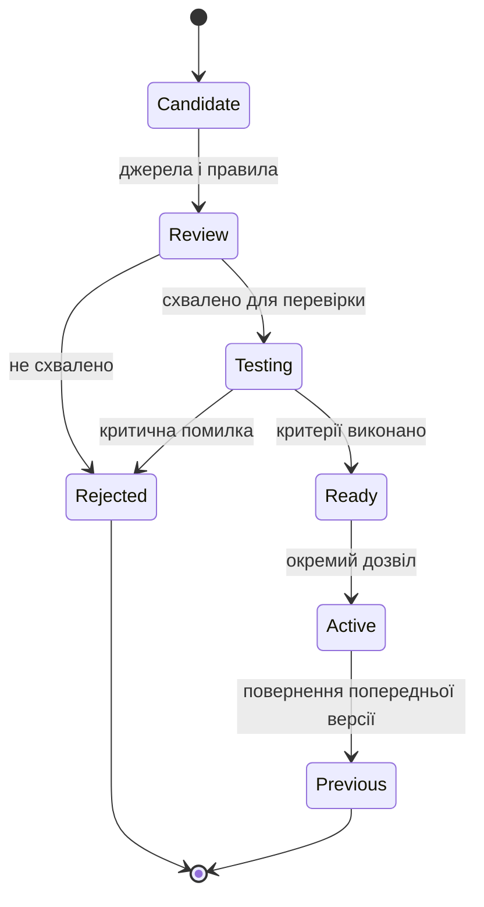
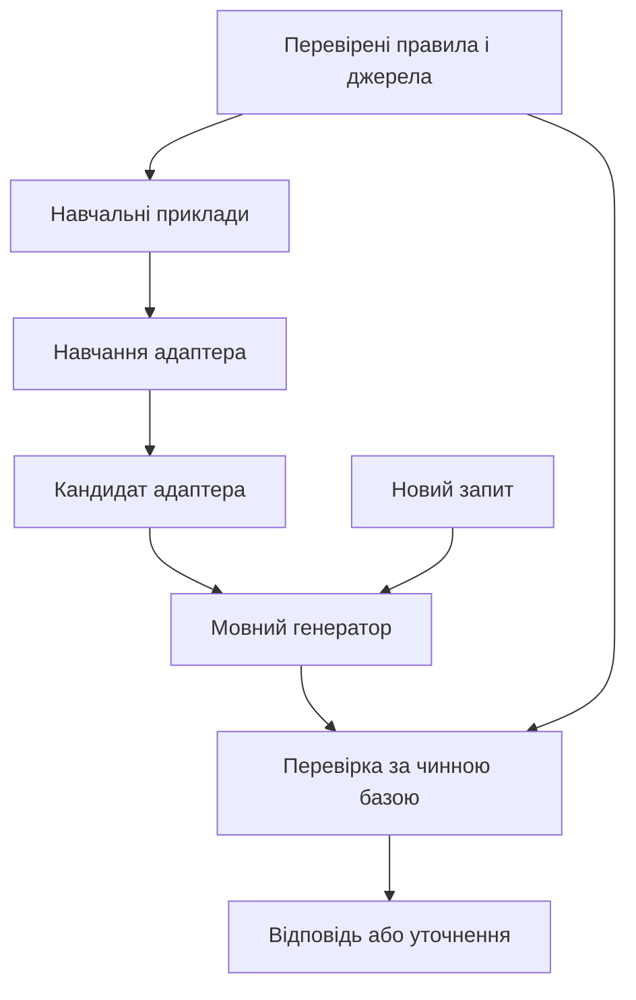
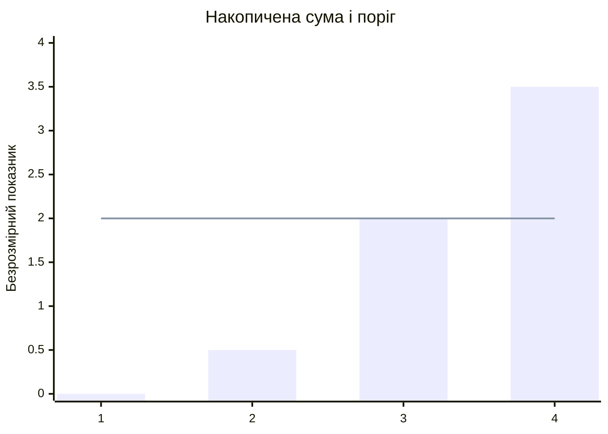
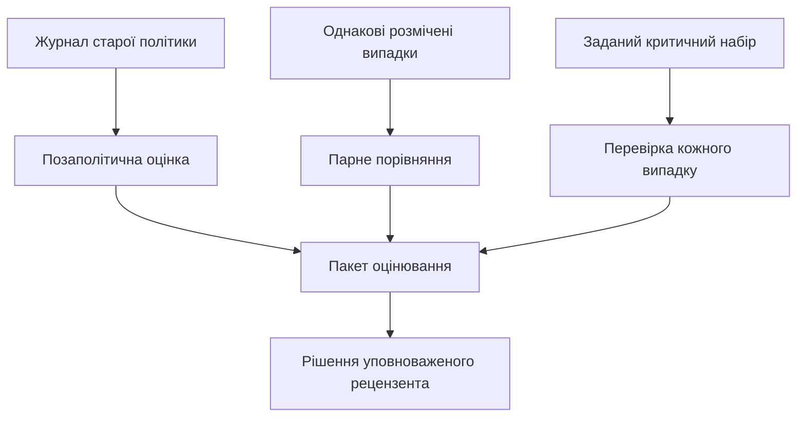

# Глава 25. Оновлення знань і безперервне навчання

<a id="глава-25-еволюція-та-безперервне-навчання-експертних-систем-дистиляція-знань-у-lora--dpo-детектування-дрейфу-та-захист-від-забування"></a>

> **Підручник:** [Експертні Системи](../README.md) · [Том 3. Нейро-символьні, ізольовані, критичні до безпеки та високопродуктивні експертні системи](README.md)  
> **Навчальний рівень:** прикладні програмісти та студенти комп'ютерних наук\
> **Обладнання:** звичайний ноутбук або ПК\
> **Мова:** Python 3.14.4; приклади використовують стандартну бібліотеку\
> **Попередня глава:** [Глава 24. Виявлення прогалин і синтез нових правил](ch24-knowledge-gaps-and-rule-synthesis.md)\
> **Наступна глава:** [Глава 26. Від рекомендації до контрольованої дії](ch26-controlled-actions.md)\
> **Автор:** Микола Мартинович Федчик

---

## Анотація

Експертна система має змінювати знання, коли оновлюються документи, обладнання або умови роботи. Водночас нова версія не повинна непомітно втрачати перевірені правила чи погіршувати рішення на важливих випадках. У цій главі розглянуто знімки знань, відкликання висновків через мінімальні ядра, навчання адаптерів, моніторинг дрейфу та регресійний допуск.

Навчальний приклад продовжує роботу з насосом `P-7`: після виявлення прогалини з Глави 24 підготовлено кандидата оновлення, який потрібно порівняти з чинною версією. Читач зможе відтворити малий перегляд бази, обчислити показники моніторингу й перевірити рішення про допуск. Дані, пороги та оцінки в главі умовні; навчання реальної мовної моделі й виробниче розгортання не проводяться.

---

<!-- chapter-toc:start -->
## Зміст глави

- [1. Версії знань і перегляд переконань](#1-версії-знань-і-перегляд-переконань)
  - [1.1. Паспорт версії та відтворення рішення](#11-паспорт-версії-та-відтворення-рішення)
  - [1.2. Відкликання норми через мінімальні ядра виведення](#12-відкликання-норми-через-мінімальні-ядра-виведення)
- [2. Перенесення символьних правил у мовні адаптери](#2-перенесення-символьних-правил-у-мовні-адаптери)
  - [2.1. Економна адаптація моделі та навчання за перевагами](#21-економна-адаптація-моделі-та-навчання-за-перевагами)
  - [2.2. Штрафування порушень логічних інваріантів](#22-штрафування-порушень-логічних-інваріантів)
  - [2.3. Захист засвоєних знань від катастрофічного забування](#23-захист-засвоєних-знань-від-катастрофічного-забування)
- [3. Моніторинг зміни середовища](#3-моніторинг-зміни-середовища)
  - [3.1. Види дрейфу та порівняння вікон](#31-види-дрейфу-та-порівняння-вікон)
  - [3.2. Накопичення зсуву та рання сигналізація деградації](#32-накопичення-зсуву-та-рання-сигналізація-деградації)
- [4. Оцінювання нової версії та регресійний допуск](#4-оцінювання-нової-версії-та-регресійний-допуск)
  - [4.1. Поправка на зміщення вибірки та її ефективний розмір](#41-поправка-на-зміщення-вибірки-та-її-ефективний-розмір)
  - [4.2. Парне порівняння версій і захист критичних випадків](#42-парне-порівняння-версій-і-захист-критичних-випадків)
- [5. Практичні завдання та лабораторний практикум](#5-практичні-завдання-та-лабораторний-практикум)
  - [5.1. Контрольні запитання для самоперевірки](#51-контрольні-запитання-для-самоперевірки)
  - [5.2. Розрахункові задачі (трасування вручну)](#52-розрахункові-задачі-трасування-вручну)
  - [5.3. Завдання з програмної реалізації](#53-завдання-з-програмної-реалізації)
  - [5.4. Зв'язок із лабораторною та курсовою роботою курсу](#54-звязок-із-лабораторною-та-курсовою-роботою-курсу)
- [Висновки](#висновки)
- [Глосарій](#глосарій)
- [Скорочення та терміни](#скорочення-та-терміни)
- [Джерела](#джерела)
<!-- chapter-toc:end -->

---

<a id="1-версіоновані-знімки-системи-знань-та-формальна-ревізія-переконань-agm-kernel-contraction"></a>

## 1. Версії знань і перегляд переконань

Кандидат правила з Глави 24 не слід записувати поверх чинної бази одразу після формування. Якщо нова норма або перевірений факт змінює висновок щодо `P-7`, інженерові потрібно зберегти попередній стан, пояснити різницю й мати можливість повернутися до нього. Без версій неможливо встановити, яке саме правило, вхід і конфігурація породили минуле рішення.

**Діаграма 25.1. Життєвий цикл навчального оновлення.**



Діаграма розділяє **перевірку кандидата** й **активацію**. У навчальному прикладі `v1` залишається чинною, поки для `v2` не завершено перевірки й не отримано окремого дозволу. Технічний перемикач версій тут не реалізовано.

<a id="11-десятикомпонентний-паспорт-знімка-експертної-системи-для-повної-відтворюваності-рішень"></a>

### 1.1. Паспорт версії та відтворення рішення

Щоб порівняти два висновки для одного повідомлення `P-7`, потрібно знати не тільки номер правила. Результат також залежить від вхідних даних, пошукового індексу, моделі та політики допуску. Зберігатимемо паспорт із десяти груп ідентифікаторів; конкретна система може потребувати докладніших полів.

**Таблиця 25.2. Що зафіксувати для повторного аналізу.**

| № | Група | Приклад вмісту |
|---:|---|---|
| 1 | `knowledge` | версія фактів, правил і прив'язок до джерел |
| 2 | `input` | ідентифікатор та час вхідного повідомлення |
| 3 | `engine` | версія механізму висновку та його конфігурація |
| 4 | `code` | ревізія програми й версії залежностей |
| 5 | `model` | ідентифікатори базової моделі та токенізатора |
| 6 | `adapter` | версія адаптера й параметри декодування |
| 7 | `retrieval` | знімки корпусу та пошукового індексу |
| 8 | `policy` | версія політики, порогів і дозволів |
| 9 | `environment` | виконувальне середовище й обладнання |
| 10 | `execution` | початковий стан генератора й налаштування виконання |

Для перевірки, чи не змінився сам паспорт, обчислимо його хеш після детермінованого серіалізування. Функція приймає рівно десять непорожніх рядкових полів; перестановка полів словника не змінює результат, а зміна ідентифікатора політики змінює вхід для хешування.

**Лістинг 25.3. Ідентифікатор навчального паспорта (Python 3.14.4).**

<details><summary>Показати лістинг 25.3 (20 рядків, Python 3.14.4)</summary>

```python
from hashlib import sha256
from json import dumps

FIELDS = ("knowledge", "input", "engine", "code", "model",
          "adapter", "retrieval", "policy", "environment", "execution")

def manifest_hash(manifest: dict[str, str]) -> str:
    if set(manifest) != set(FIELDS):
        raise ValueError("паспорт має містити всі десять полів")
    if any(not isinstance(value, str) or not value.strip() for value in manifest.values()):
        raise ValueError("поля паспорта мають бути непорожніми рядками")
    encoded = dumps(manifest, sort_keys=True, ensure_ascii=False,
                    separators=(",", ":")).encode("utf-8")
    return sha256(encoded).hexdigest()

values = ("rules-v1", "event-17", "engine-v1", "code-v1", "model-v1",
          "adapter-v1", "index-v1", "policy-v1", "env-v1", "seed-7")
manifest = dict(zip(FIELDS, values))
assert manifest_hash(manifest) == manifest_hash(dict(reversed(list(manifest.items()))))
assert manifest_hash(manifest) != manifest_hash(manifest | {"policy": "policy-v2"})
```

</details>

Хеш дозволяє звірити паспорт із **довіреним** збереженим значенням, але не доводить автора чи повноважень: для цього потрібні автентифікація та, за потреби, цифровий підпис. Рядок `rules-v1` у прикладі — навчальний ідентифікатор, а не хеш реального набору правил. Паспорт сам не зберігає потрібні файли, не гарантує детермінізму апаратних операцій і не захищає конфіденційні дані; для повторення потрібні доступні знімки та контроль зовнішніх залежностей.

<a id="12-скорочення-бази-знань-за-мінімальними-ядрами-виведення-kernel-contraction-при-відкликанні-застарілої-норми"></a>

### 1.2. Відкликання норми через мінімальні ядра виведення

Припустимо, фахівці відкликали два застарілі джерела правила, яке дає висновок `review`. Видалення одного рядка недостатнє, якщо той самий висновок можна отримати іншим шляхом. Водночас видаляти перевірені покази датчика лише заради зникнення висновку неприпустимо: у прикладі змінювати дозволено тільки названі правила.

Теорія перегляду переконань розрізняє додавання твердження, скорочення та ревізію [[1]](#src-1). Для скінченної бази *ядром* висновку називають мінімальний за включенням набір її елементів, достатній для виведення цього висновку. Скорочення за ядрами шукає вилучення, що перетинає кожне ядро [[2]](#src-2). Це не означає, що можна самостійно відкликати чинне нормативне джерело: перелік дозволених змін задає уповноважений фахівець.

**Формула 25.4. Мінімальні ядра скінченної бази.**

$$
\mathcal K_{\varphi}(B)=
\{S\subseteq B:S\models\varphi\ \land\
\forall s\in S,\;S\setminus\{s\}\not\models\varphi\}.
$$

Тут $B$ — скінченна множина прийнятих фактів та ідентифікованих правил; $\varphi$ — висновок, який потрібно відкликати; $S$ — підмножина $B$; $s$ — її окремий елемент. Символ $\models$ означає логічне слідування в зафіксованій монотонній моделі. Ядро дає $\varphi$, але після вилучення будь-якого його елемента більше не дає цього висновку. Множини й твердження не мають фізичних одиниць.

Для навчальної бази візьмемо два незалежні шляхи: `r1` вимагає `high`, `normal`, `valid`; `r2` — `high`, `normal`, `independent`. Позначки `r1` і `r2` тут представляють відповідні імплікації, а `review` означає підставу розглянути заявку, не її фактичне створення. Отже, ядра — `{high, normal, valid, r1}` і `{high, normal, independent, r2}`. Вилучення лише `r1` залишить другий шлях; за умовою обидва правила дозволено відкликати, а факти захищено.

Перший лістинг перебирає підмножини малої бази й залишає лише мінімальні, для яких передана функція підтверджує висновок. Обмеження на 16 елементів явно запобігає випадковому запуску експоненційного перебору на великій базі.

**Лістинг 25.5. Пошук мінімальних ядер у навчальній моделі (Python 3.14.4).**

<details><summary>Показати лістинг 25.5 (23 рядки, Python 3.14.4)</summary>

```python
from itertools import combinations

def minimal_kernels(base: set[str], entails):
    if len(base) > 16:
        raise ValueError("для повного перебору база завелика")
    kernels = []
    for size in range(len(base) + 1):
        for items in combinations(sorted(base), size):
            subset = frozenset(items)
            if entails(subset) and not any(k <= subset for k in kernels):
                kernels.append(subset)
    return kernels

def entails_review(items: frozenset[str]) -> bool:
    return ({"high", "normal", "valid", "r1"} <= items
            or {"high", "normal", "independent", "r2"} <= items)

base = {"high", "normal", "valid", "independent", "r1", "r2"}
kernels = minimal_kernels(base, entails_review)
assert set(kernels) == {
    frozenset({"high", "normal", "valid", "r1"}),
    frozenset({"high", "normal", "independent", "r2"}),
}
```

</details>

Тепер знайдемо всі мінімальні за включенням множини дозволених вилучень, які перетинають кожне ядро. Другий лістинг продовжує попередній: йому потрібні `kernels`, `base` та `entails_review`.

**Лістинг 25.6. Добір дозволених вилучень (Python 3.14.4).**

<details><summary>Показати лістинг 25.6 (21 рядок, Python 3.14.4)</summary>

```python
from itertools import combinations

def minimal_cuts(kernels: list[frozenset[str]], editable: set[str]):
    if len(editable) > 16:
        raise ValueError("для повного перебору забагато дозволених змін")
    if not kernels:
        return [frozenset()]
    if any(not kernel & editable for kernel in kernels):
        raise ValueError("є ядро без дозволених для вилучення елементів")
    cuts = []
    for size in range(len(editable) + 1):
        for items in combinations(sorted(editable), size):
            cut = frozenset(items)
            if all(cut & kernel for kernel in kernels) and not any(c <= cut for c in cuts):
                cuts.append(cut)
    return cuts

cuts = minimal_cuts(kernels, {"r1", "r2"})
assert cuts == [frozenset({"r1", "r2"})]
assert entails_review(base - {"r1"})
assert not entails_review(base - cuts[0])
```

</details>

Результат — пропозиція вилучити саме два дозволені правила зі **створюваного** знімка; старий знімок і факти залишаються доступними. Для цієї скінченної моделі перебрано всі підмножини, тому інших ядер немає. У реальній базі неповний перелік доказів не дає такої гарантії; потрібні повний механізм виведення, перевірка дозволів, тестування залежних висновків і фіксація причин змін.

<a id="2-дистиляція-символьних-правил-у-локальні-мовні-адаптери-sft-lora--qlora-dpo-semantic-loss"></a>

## 2. Перенесення символьних правил у мовні адаптери

Мовний компонент може допомагати формулювати пояснення для оператора або знаходити потрібні документи, але після зміни правил він може продовжувати відтворювати старі відповіді. Перенесення прикладів із перевіреної бази до навчального набору допомагає адаптувати мовну модель до нової задачі. При цьому модель залишається джерелом кандидатів: актуальна база та окремий механізм перевірки визначають допустимий висновок.

**Діаграма 25.7. Навчання адаптера й незалежна перевірка відповіді.**



На діаграмі два використання правил мають різне призначення: вони допомагають підготувати навчальні дані й незалежно перевірити результат. Навіть якісний адаптер не замінює актуального правила чи перевірки повноважень.

<a id="21-низькорангова-матрична-адаптація-lora-бюджет-відеопамяті-qlora-та-пряма-оптимізація-переваг-dpo-на-парах-прийнятих-і-відхилених-міркувань"></a>

### 2.1. Економна адаптація моделі та навчання за перевагами

У навчанні з учителем (*supervised fine-tuning*, SFT) приклад містить вхід і бажану відповідь, підготовлену за перевіреним правилом. Якщо оновлювати всі параметри великої моделі, для кожної предметної області доведеться зберігати й навчати багато ваг. LoRA натомість залишає базову матрицю незмінною та навчає невелике низькорангове доповнення [[3]](#src-3).

Для одного лінійного шару адаптовану матрицю та її дію на вхід запишемо так:

**Формула 25.8. Низькорангове доповнення матриці.**

$$
W'=W_0+\frac{\alpha}{r}BA,\qquad y=W'x.
$$

Тут $`W_0\in\mathbb R^{d_{\mathrm{out}}\times d_{\mathrm{in}}}`$ — фіксована базова матриця; $`A\in\mathbb R^{r\times d_{\mathrm{in}}}`$ і $`B\in\mathbb R^{d_{\mathrm{out}}\times r}`$ — навчувані матриці; $`1\leq r\leq\min(d_{\mathrm{in}},d_{\mathrm{out}})`$ — вибраний ранг; $\alpha>0$ — безрозмірний масштаб. $x$ має $`d_{\mathrm{in}}`$ координат, $y$ — $`d_{\mathrm{out}}`$; у цьому прикладі всі значення безрозмірні. Ранг добутку $BA$ не перевищує $r$.

Для $`W_0=I`$, $`A=(0.5,-0.5)`$, $`B=(1,2)^{\mathsf T}`$, $r=1$, $\alpha=1$ та $`x=(2,1)^{\mathsf T}`$ маємо $`Ax=0.5`$, доповнення $`BAx=(0.5,1)^{\mathsf T}`$ і результат $`y=(2.5,2)^{\mathsf T}`$. Без адаптера було б $(2,1)$. Це лише обчислення одного шару, а не навчання мовної моделі.

Лістинг перевіряє форми матриць і скінченність входу, а потім виконує базове множення та низькорангове доповнення окремо.

**Лістинг 25.9. Прямий прохід одного адаптованого шару (Python 3.14.4).**

<details><summary>Показати лістинг 25.9 (23 рядки, Python 3.14.4)</summary>

```python
from math import isfinite

def lora_forward(x, w, a, b, alpha: float):
    if not x or not w or not a or len(b) != len(w):
        raise ValueError("порожня або несумісна матриця")
    if any(len(row) != len(x) for row in w + a):
        raise ValueError("несумісна кількість вхідних координат")
    if len(a) > min(len(w), len(x)) or any(len(row) != len(a) for row in b):
        raise ValueError("несумісний ранг адаптера")
    if (not isfinite(alpha) or alpha <= 0 or any(not isfinite(v) for v in x)
            or any(not isfinite(v) for matrix in (w, a, b) for row in matrix for v in row)):
        raise ValueError("потрібні скінченні значення і додатний масштаб")
    low = [sum(v * t for v, t in zip(row, x)) for row in a]
    output = [sum(v * t for v, t in zip(row, x))
              + alpha / len(a) * sum(v * t for v, t in zip(extra, low))
              for row, extra in zip(w, b)]
    if any(not isfinite(value) for value in output):
        raise ValueError("переповнення під час множення")
    return output

w = [[1.0, 0.0], [0.0, 1.0]]
a, b = [[0.5, -0.5]], [[1.0], [2.0]]
assert lora_forward([2.0, 1.0], w, a, b, 1.0) == [2.5, 2.0]
```

</details>

Для матриці $4096\times4096$ і $r=8$ адаптер має $8(4096+4096)=65536$ навчуваних параметрів замість $16777216$ у повній матриці. Це порівняння кількості параметрів одного шару, а не загальної пам'яті процесу. QLoRA додатково зберігає заморожені базові ваги у чотирибітному квантизованому поданні й передає градієнти до адаптерів [[4]](#src-4). Навіть ідеальні $7$ млрд ваг по $4$ біти потребують $3.5$ млрд байтів лише для самих ваг; шкали квантування, адаптери, активації та стан оптимізатора потребують додаткової пам'яті.

Інший спосіб підготувати приклади — подати для одного запиту кращу та гіршу відповіді, розмічені за явним критерієм. Пряма оптимізація переваг (*direct preference optimization*, DPO) порівнює їхні відносні логарифмічні ймовірності з еталонною моделлю [[5]](#src-5):

**Формула 25.10. Втрати для однієї пари переваг.**

$$
L_{\mathrm{DPO}}=-\log\sigma\left(
\beta\left[
\log\frac{\pi_{\theta}(y_w\mid x)}{\pi_{\mathrm{ref}}(y_w\mid x)}
-\log\frac{\pi_{\theta}(y_l\mid x)}{\pi_{\mathrm{ref}}(y_l\mid x)}
\right]\right).
$$

Тут $x$ — запит; $`y_w`$ і $`y_l`$ — різні бажана та небажана відповіді; $`\pi_{\theta}`$ — поточний розподіл моделі, $`\pi_{\mathrm{ref}}`$ — зафіксований еталонний розподіл; усі чотири ймовірності у формулі додатні й не перевищують $1$. $\beta>0$ — коефіцієнт масштабу, $`\sigma(z)=1/(1+e^{-z})`$ — сигмоїда. Втрати безрозмірні й невід'ємні.

Нехай поточна модель надає відповідям імовірності $0.6$ і $0.2$, а еталонна — по $0.4$; за $\beta=1$ аргумент сигмоїди дорівнює $\log(1.5)-\log(0.5)=\log 3$. Тоді $\sigma(\log 3)=0.75$, а втрати становлять приблизно $0.288$. Розмітка «краща» вимагає власного обґрунтування: наприклад, відповідь про `P-7` не повинна пропускати підтверджений виняток обслуговування.

**Лістинг 25.11. Втрати DPO для навчальної пари (Python 3.14.4).**

<details><summary>Показати лістинг 25.11 (16 рядків, Python 3.14.4)</summary>

```python
from math import exp, isclose, isfinite, log, log1p

def dpo_loss(win: float, lose: float, ref_win: float, ref_lose: float, beta: float):
    probabilities = (win, lose, ref_win, ref_lose)
    if any(not isfinite(p) or not 0 < p <= 1 for p in probabilities):
        raise ValueError("ймовірності мають бути в межах від нуля до одиниці")
    if win + lose > 1 or ref_win + ref_lose > 1:
        raise ValueError("імовірності різних відповідей несумісні")
    if not isfinite(beta) or beta <= 0:
        raise ValueError("коефіцієнт має бути додатним")
    score = beta * (log(win) - log(ref_win) - log(lose) + log(ref_lose))
    if not isfinite(score):
        raise ValueError("переповнення оцінки")
    return log1p(exp(-abs(score))) + max(0.0, -score)

assert isclose(dpo_loss(0.6, 0.2, 0.4, 0.4, 1), -log(0.75))
```

</details>

Лістинг обчислює функцію втрат, але не оптимізує параметри. У реальній мовній моделі використовують логарифмічні ймовірності послідовностей, щоб уникнути втрати точності для дуже малих чисел. SFT і DPO можуть змінювати поведінку генератора, але ні самі приклади, ні мала функція втрат не доводять виконання кожного правила.

<a id="22-апостеріорна-регуляризація-гіббса-та-семантична-функція-втрат-semantic-loss-для-штрафування-порушень-булевих-інваріантів"></a>

### 2.2. Штрафування порушень логічних інваріантів

Коли приклад містить обслуговування `P-7`, небажано навчати генератор пропонувати автоматичну дію в цьому самому стані. Однією з можливостей є штраф, що збільшується, коли розподіл моделі надає більшу масу забороненим комбінаціям. Семантична функція втрат пов'язує логічне обмеження з імовірнісним навчанням [[6]](#src-6).

Візьмемо навчальний інваріант $\varphi$: «якщо триває обслуговування, автоматичної дії немає». Нехай модель задає **спільний** розподіл чотирьох комбінацій двох булевих змінних; незалежність змінних не припускається.

**Формула 25.12. Штраф імовірнісної маси, що порушує інваріант.**

$$
\varphi=(M\Rightarrow\neg A),\qquad
L_{\mathrm{sem}}=-\log P_{\theta}(\varphi\mid x)
=-\log(1-P_{\theta}(M=1,A=1\mid x)).
$$

Тут $M\in\{0,1\}$ означає відсутність або наявність обслуговування, $A\in\{0,1\}$ — відсутність або наявність запропонованої автоматичної дії, $x$ — запит. $`P_{\theta}`$ — заданий розподіл моделі, усі його ймовірності належать $[0,1]$ і сумуються до $1$. Дозволені комбінації — `00`, `01`, `10`; заборонена — `11`. Втрати безрозмірні: від $0$ до $+\infty$, причому нульова маса дозволених комбінацій дає $+\infty$.

Для ймовірностей `00: 0.1`, `01: 0.1`, `10: 0.4`, `11: 0.4` дозволена маса становить $0.6$, а штраф $-\log(0.6)\approx0.511$. Якщо модель зменшить масу `11`, штраф зменшиться, але ненульова маса цього стану залишиться можливою.

Лістинг перевіряє, що задано саме чотири значення й коректний розподіл, після чого обчислює штраф для цього конкретного інваріанта. Відхилення суми від одиниці до $10^{-12}$ допускається через округлення; у такому разі маси діляться на їхню суму. Поблизу нуля дозволену масу обчислено безпосередньо, щоб не втратити її через віднімання близьких чисел.

**Лістинг 25.13. Семантичні втрати для двох булевих змінних (Python 3.14.4).**

<details><summary>Показати лістинг 25.13 (20 рядків, Python 3.14.4)</summary>

```python
from math import fsum, inf, isclose, isfinite, log, log1p

def semantic_loss(joint: dict[tuple[int, int], float]) -> float:
    expected = {(m, a) for m in (0, 1) for a in (0, 1)}
    if set(joint) != expected:
        raise ValueError("потрібні всі чотири комбінації")
    if any(not isfinite(p) or not 0 <= p <= 1 for p in joint.values()):
        raise ValueError("некоректна ймовірність")
    total = fsum(joint.values())
    if not isclose(total, 1, rel_tol=0, abs_tol=1e-12):
        raise ValueError("розподіл не нормований")
    valid = fsum(p for state, p in joint.items() if state != (1, 1))
    if valid == 0:
        return inf
    forbidden = joint[(1, 1)] / total
    return -log1p(-forbidden) if forbidden < 0.5 else -log(valid / total)

distribution = {(0, 0): 0.1, (0, 1): 0.1, (1, 0): 0.4, (1, 1): 0.4}
assert isclose(semantic_loss(distribution), -log(0.6))
assert semantic_loss({(0, 0): 0, (0, 1): 0, (1, 0): 0, (1, 1): 1}) == inf
```

</details>

Тут застосовано ідею семантичного штрафу до явно заданого спільного розподілу; спосіб його отримання залежить від моделі. Апостеріорна регуляризація — споріднений, але окремий підхід, у якому обмеження накладають на розподіл прихованих змінних під час навчання [[7]](#src-7). Жоден із цих навчальних засобів не замінює жорсткої перевірки за чинною політикою під час виконання.

<a id="23-запобігання-катастрофічному-забуванню-попередніх-доменів-через-пружне-закріплення-ваг-ewc"></a>

### 2.3. Захист засвоєних знань від катастрофічного забування

Після навчання на нових випадках `P-7` модель може гірше відповідати на старі, хоча загальна оцінка нового набору покращиться. Таку деградацію попередніх навичок називають катастрофічним забуванням. Для її виявлення потрібні окремі, не використані в навчанні тести старих і нових випадків, зокрема критичних винятків.

Один зі способів зменшити зміщення важливих для старої задачі параметрів — пружне закріплення ваг (*elastic weight consolidation*, EWC) [[8]](#src-8). У спрощеному діагональному варіанті додають штраф:

**Формула 25.14. Навчальні втрати з пружним закріпленням.**

$$
L_{\mathrm{EWC}}(\theta)=L_{\mathrm{new}}(\theta)
+\frac{\lambda}{2}\sum_{i=1}^{n}F_i(\theta_i-\theta_i^*)^2.
$$

Тут $`\theta_i`$ — поточне значення $i$-го з $n\geq1$ навчуваних параметрів; $`\theta_i^*`$ — збережене значення після попередньої задачі; $`F_i\geq0`$ — оцінка діагонального елемента інформації Фішера для старої задачі; $\lambda\geq0$ — вага штрафу. У цьому прикладі параметри та втрати безрозмірні. Велике $`F_i`$ робить те саме відхилення відповідного параметра дорожчим; нульове не додає штрафу.

Нехай $`\theta^*=(1,2)`$, $\theta=(1.1,1.8)$, $`F=(10,1)`$, $\lambda=2$ і $`L_{\mathrm{new}}=0.2`$. Квадрати відхилень дорівнюють $0.01$ і $0.04$; штраф становить $1(10\cdot0.01+1\cdot0.04)=0.14$, а загальні втрати — $0.34$.

**Лістинг 25.15. Обчислення штрафу EWC (Python 3.14.4).**

<details><summary>Показати лістинг 25.15 (19 рядків, Python 3.14.4)</summary>

```python
from math import fsum, isclose, isfinite

def ewc_loss(new_loss: float, current: list[float], previous: list[float],
             fisher: list[float], strength: float) -> float:
    if not current or len(current) != len(previous) or len(current) != len(fisher):
        raise ValueError("потрібні однакові непорожні вектори")
    values = [new_loss, strength, *current, *previous, *fisher]
    if any(not isfinite(v) for v in values):
        raise ValueError("величини мають бути скінченними")
    if new_loss < 0 or strength < 0 or any(value < 0 for value in fisher):
        raise ValueError("втрати, вага та оцінки Фішера мають бути невід'ємні")
    penalty = strength / 2 * fsum(f * (x - old) ** 2
                                  for x, old, f in zip(current, previous, fisher))
    result = new_loss + penalty
    if not isfinite(result):
        raise ValueError("переповнення функції втрат")
    return result

assert isclose(ewc_loss(0.2, [1.1, 1.8], [1, 2], [10, 1], 2), 0.34)
```

</details>

Штраф залежить від якості оцінок $`F_i`$ і вибору $\lambda$; він не гарантує збереження кожної відповіді. Інший практичний засіб — повторювати дозволені приклади старих задач під час навчання, не змішуючи їх із відкладеним тестовим набором. Рішення про нову версію все одно приймають за перевірками, а не за величиною штрафу.

<a id="3-онлайн-моніторинг-дрейфу-середовища-двовибіркова-межа-гофдінга-adwin-та-кумулятивні-суми-cusum"></a>

## 3. Моніторинг зміни середовища

Навіть без зміни коду характер запитів і робота обладнання можуть поступово змінитися. Якщо система не спостерігає за цими змінами, оцінка якості, отримана перед випуском, застаріває; якщо ж перенавчати модель після кожного випадкового коливання, стабільність погіршиться. Монітор має передати інженерові сигнал і контекст для перевірки, а не самостійно змінювати базу знань.

**Графік 25.16. Накопичення навчального сигналу.**



Стовпчики побудовано за обчисленням із лістингу 25.20; лінія — умовний поріг $2$. Третє значення дорівнює порогу, а четверте його перевищує.

<a id="31-розрізнення-дрейфу-вхідних-запитів-дрейфу-розподілу-класів-та-дрейфу-умовного-закону-предметної-області"></a>

### 3.1. Види дрейфу та порівняння вікон

Для пояснення різних сигналів позначимо вхідні ознаки запиту через $X$, а перевірену відповідь або клас — через $Y$. Може змінитися розподіл входів $P(X)$, частота класів $P(Y)$ або умовний розподіл $`P(Y\mid X)`$ на входах, для яких є дані. Ці зміни можуть відбуватися одночасно: наприклад, частіше надходять заявки про `P-7`, але це ще не доводить зміни правильного правила для тієї самої ситуації. Для оцінювання $Y$ потрібні підтверджені мітки, які іноді надходять із затримкою.

Щоб порівняти середні частки позначених випадків у двох **заздалегідь вибраних** неперекривних вікнах, скористаємося двовибірковою межею, отриманою з нерівності Гофдінга [[9]](#src-9):

**Формула 25.17. Межа для двох фіксованих вікон.**

$$
\Delta=\lvert\bar x_0-\bar x_1\rvert,\qquad
\varepsilon=\sqrt{\frac{1}{2}
\left(\frac{1}{n_0}+\frac{1}{n_1}\right)\ln\frac{2}{\delta}}.
$$

Тут $`n_0,n_1\geq1`$ — кількості незалежних спостережень у вікнах; кожне спостереження належить $[0,1]$. $`\bar x_0`$ і $`\bar x_1`$ — їхні середні; $`0<\delta<1`$ — вибраний рівень для двосторонньої межі. $\Delta$ і $\varepsilon$ безрозмірні. За однакових очікуваних середніх і фіксованого поділу ймовірність перевищення цієї межі не більша за $\delta$ за зазначених припущень.

Нехай у кожному вікні по $100$ двійкових спостережень, середні дорівнюють $0.1$ і $0.4$, а $\delta=0.05$. Тоді $\Delta=0.3$, $\varepsilon\approx0.192$ і $0.3>0.192$: у навчальному прикладі формується сигнал на перевірку. Значення нижче сконструйовані, а не виміряні; незалежність потрібна для зазначеної імовірнісної інтерпретації та не встановлюється самим лістингом.

**Лістинг 25.18. Порівняння двох фіксованих вікон (Python 3.14.4).**

<details><summary>Показати лістинг 25.18 (17 рядків, Python 3.14.4)</summary>

```python
from math import fsum, isclose, isfinite, log, sqrt

def compare_windows(left: list[float], right: list[float], delta: float):
    if not left or not right or not isfinite(delta) or not 0 < delta < 1:
        raise ValueError("потрібні непорожні вікна і допустима delta")
    if any(not isfinite(x) or not 0 <= x <= 1 for x in left + right):
        raise ValueError("спостереження мають належати [0, 1]")
    difference = abs(fsum(left) / len(left) - fsum(right) / len(right))
    threshold = sqrt(0.5 * (1 / len(left) + 1 / len(right)) * (log(2) - log(delta)))
    return difference, threshold, difference > threshold

left = [0.0] * 90 + [1.0] * 10
right = [0.0] * 60 + [1.0] * 40
difference, threshold, alert = compare_windows(left, right, 0.05)
assert isclose(difference, 0.3)
assert isclose(threshold, 0.19206455826398416)
assert alert
```

</details>

ADWIN використовує адаптивне вікно й перевіряє можливі розбиття потоку [[10]](#src-10). Наведена функція показує лише одну перевірку фіксованого поділу, а не реалізує ADWIN. Багаторазовий пошук розбиття чи повторні перевірки потребують відповідної корекції: наведене $\delta$ не є автоматично загальною частотою хибних сигналів за весь період.

<a id="32-стандартизований-односторонній-контроль-накопиченого-зсуву-cusum-для-ранньої-сигналізації-деградації-правил"></a>

### 3.2. Накопичення зсуву та рання сигналізація деградації

Окреме перевищення середнього може бути невеликим, зате повторюватися протягом кількох інтервалів. Одностороння кумулятивна сума (*CUSUM*) накопичує такі відхилення та скидає накопичення до нуля, коли зміна зникає [[11]](#src-11). Для прикладу спостерігатимемо частку помилок серед перевірених людиною відповідей за кожен інтервал.

**Формула 25.19. Одностороння стандартизована кумулятивна сума.**

$$
z_t=\frac{x_t-\mu_0}{\sigma_0},\qquad
S_t=\max(0,S_{t-1}+z_t-k),\qquad S_0=0.
$$

Тут $t=1,2,\ldots$ — номер інтервалу, $`x_t\in[0,1]`$ — частка перевірених відповідей із помилкою; $`\mu_0\in[0,1]`$ і $`\sigma_0>0`$ — відповідно середнє та додатне стандартне відхилення базового режиму в тих самих одиницях частки. $`z_t`$, $`S_t`$ і $`k\geq0`$ безрозмірні; $k$ задає, наскільки малі відхилення не накопичуються. Сигнал у цьому прикладі видається за $`S_t>h`$, де $h>0$ — безрозмірний поріг.

За $`\mu_0=0.1`$, $`\sigma_0=0.1`$, $k=0.5$, $h=2$ та послідовності $0.1,0.2,0.3,0.3$ стандартизовані значення дорівнюють $0,1,2,2$. Кроки накопичення: $`S_1=0`$, $`S_2=0.5`$, $`S_3=2`$, $`S_4=3.5`$. За строгого порівняння сигнал надходить на четвертому, а не на третьому інтервалі.

Щоб точно перевірити рівність порогу в навчальному трасуванні, лістинг приймає раціональні числа `Fraction`. Він повертає всі значення суми та номери інтервалів, де поріг перевищено.

**Лістинг 25.20. Кумулятивна сума з точним порівнянням порога (Python 3.14.4).**

<details><summary>Показати лістинг 25.20 (24 рядки, Python 3.14.4)</summary>

```python
from fractions import Fraction

def cusum(rates: list[Fraction], baseline: Fraction, spread: Fraction,
          allowance: Fraction, threshold: Fraction):
    values = [*rates, baseline, spread, allowance, threshold]
    if any(not isinstance(value, Fraction) for value in values):
        raise TypeError("потрібні точні дроби Fraction")
    if (not rates or not 0 <= baseline <= 1 or spread <= 0 or allowance < 0
            or threshold <= 0 or any(not 0 <= rate <= 1 for rate in rates)):
        raise ValueError("параметри монітора поза допустимим діапазоном")
    state = Fraction(0)
    states, alerts = [], []
    for index, rate in enumerate(rates, start=1):
        state = max(Fraction(0), state + (rate - baseline) / spread - allowance)
        states.append(state)
        if state > threshold:
            alerts.append(index)
    return states, alerts

F = Fraction
states, alerts = cusum([F("0.1"), F("0.2"), F("0.3"), F("0.3")],
                       F("0.1"), F("0.1"), F("0.5"), F(2))
assert states == [F(0), F("0.5"), F(2), F("3.5")]
assert alerts == [4]
```

</details>

Параметри прикладу не калібровано під задану частоту хибних сигналів. Практичний монітор додатково визначає джерело та затримку міток, залежність сусідніх інтервалів, правило повторних сповіщень і порядок перевірки сигналу. Зміна частки помилок не визначає її причини й сама не схвалює нову версію.

<a id="4-позаполітичне-оцінювання-нових-версій-ips-ess-та-парний-регресійний-шлюз-просування-mcnemar--bootstrap"></a>

## 4. Оцінювання нової версії та регресійний допуск

Перед активацією `v2` потрібно відповісти на два різні запитання: що можна оцінити за старим журналом і чи не погіршилася нова версія на однакових перевірених випадках. Журнал відображає рішення старої політики, тому його середню винагороду не можна просто приписати новій. А відсутність статистично значущої різниці не доводить, що критичних регресій немає.

**Діаграма 25.21. Підстави для окремого рішення про випуск.**



На діаграмі статистична оцінка не обходить критичний набір. Висновок про придатність до розгляду ще не запускає оновлення.

<a id="41-корекція-зміщення-вибірки-за-допомогою-обернених-схильностей-inverse-propensity-scoring-та-ефективна-вибірка-кіша-ess"></a>

### 4.1. Поправка на зміщення вибірки та її ефективний розмір

Припустимо, попередня політика вибирала для навчальних запитів `P-7` один із двох варіантів — ручну перевірку або звичайну відповідь — із відомими ймовірностями. Нова політика частіше пропонує ручну перевірку. Оцінювання за оберненими схильностями (*inverse propensity scoring*, IPS) надає більшої ваги записам, які нова політика обрала б частіше [[12]](#src-12).

Для кожного запису потрібні контекст, фактично обраний варіант, його зареєстрована ймовірність і спостережена винагорода. Разом з оцінкою обчислимо ефективний розмір за концентрацією ваг:

**Формула 25.22. Позаполітична оцінка та ефективний розмір.**

$$
w_i=\frac{\pi(a_i\mid x_i)}{\mu(a_i\mid x_i)},\qquad
\widehat V_{\mathrm{IPS}}=\frac1N\sum_{i=1}^{N}w_i r_i,\qquad
N_{\mathrm{eff}}=\frac{(\sum_{i=1}^{N}w_i)^2}{\sum_{i=1}^{N}w_i^2}.
$$

Тут $N\geq1$ — кількість записів; $`x_i`$ — контекст, $`a_i`$ — фактично обраний варіант, $`r_i\in[0,1]`$ — його спостережена винагорода. $`\mu(a_i\mid x_i)\in(0,1]`$ — зареєстрована ймовірність старої політики, $`\pi(a_i\mid x_i)\in[0,1]`$ — ймовірність того самого варіанта за новою політикою. Вага $`w_i\geq0`$ та оцінка безрозмірні. $`N_{\mathrm{eff}}`$ визначено, якщо хоча б одна вага додатна; для невід'ємних ваг він лежить від $1$ до $N$.

Дані таблиці — штучні, а не журнал реальної експертної системи. Обидві дії старої політики мають імовірність $0.5$; нова в цьому прикладі завжди вибирає ручну перевірку.

**Таблиця 25.23. Зважування чотирьох записів.**

| Запис | Обраний раніше варіант | Винагорода | Імовірність нової політики для цього варіанта | Вага |
|---:|---|---:|---:|---:|
| 1 | ручна перевірка | 1 | 1 | 2 |
| 2 | ручна перевірка | 0 | 1 | 2 |
| 3 | звичайна відповідь | 1 | 0 | 0 |
| 4 | звичайна відповідь | 0 | 0 | 0 |

Зважена сума винагород дорівнює $2$, тому IPS-оцінка становить $2/4=0.5$. Сума ваг — $4$, сума квадратів — $8$, отже $`N_{\mathrm{eff}}=16/8=2`$: хоча записів чотири, оцінку тут визначають лише два з них.

Лістинг приймає трійки `(винагорода, стара_ймовірність, нова_ймовірність)` для фактично обраних варіантів. Для стійкості обчислень ефективного розміру ваги масштабуються найбільшою вагою; для IPS зважені винагороди масштабуються найбільшою з них. Так велика вага з нульовою винагородою не знецінює меншу ненульову винагороду. Нульова сумарна вага не дозволяє обчислити ефективний розмір і повертається як помилка, а не як підстава для допуску.

**Лістинг 25.24. IPS-оцінка та ефективний розмір вибірки (Python 3.14.4).**

<details><summary>Показати лістинг 25.24 (28 рядків, Python 3.14.4)</summary>

```python
from math import fsum, isfinite

def ips_ess(rows: list[tuple[float, float, float]]):
    if not rows:
        raise ValueError("журнал порожній")
    weights = []
    for reward, behavior, target in rows:
        if (any(not isfinite(v) for v in (reward, behavior, target))
                or not 0 <= reward <= 1 or not 0 < behavior <= 1 or not 0 <= target <= 1):
            raise ValueError("некоректна винагорода або ймовірність")
        weight = target / behavior
        if not isfinite(weight):
            raise ValueError("переповнення ваги")
        weights.append(weight)
    maximum = max(weights)
    if maximum == 0:
        raise ValueError("немає записів із додатною вагою")
    scaled = [weight / maximum for weight in weights]
    effective = fsum(scaled) ** 2 / fsum(weight ** 2 for weight in scaled)
    weighted = [weight * row[0] for weight, row in zip(weights, rows)]
    largest = max(weighted)
    estimate = 0.0 if largest == 0 else largest * (fsum(v / largest for v in weighted) / len(rows))
    if not isfinite(estimate):
        raise ValueError("переповнення оцінки")
    return estimate, effective

rows = [(1, 0.5, 1), (0, 0.5, 1), (1, 0.5, 0), (0, 0.5, 0)]
assert ips_ess(rows) == (0.5, 2.0)
```

</details>

Для інтерпретації оцінки потрібне *перекриття*: у кожному релевантному контексті стара політика повинна мати додатну ймовірність для кожного варіанта, який може вибрати нова. Код бачить схильності лише **фактично обраних** варіантів і сам не перевіряє це для незафіксованих дій. Потрібні також правильний журнал імовірностей, придатні спостережені винагороди та відповідність контекстів. На скінченній вибірці IPS може перевищувати $1$, а ефективний розмір за вагами не враховує автоматично часової залежності чи інших джерел зміщення.

<a id="42-точний-біноміальний-тест-мак-немара-на-розбіжних-парах-і-блокування-випуску-за-наявності-хоча-б-однієї-регресії-на-золотому-ядрі-безпеки"></a>

### 4.2. Парне порівняння версій і захист критичних випадків

Для прямого порівняння запускаємо `v1` і `v2` на тих самих розмічених випадках та звіряємо кожну відповідь з однаковим еталоном. Пара вважається розбіжною, якщо лише одна версія відповіла правильно. Тест Мак-Немара використовує кількості таких пар, не вважаючи два результати одного випадку незалежними [[13]](#src-13).

Нехай $b$ — кількість випадків, де стара версія правильна, а нова помиляється; $c$ — кількість випадків із протилежним результатом. Для незалежних пар і нульової гіпотези однакових граничних часток правильних відповідей точне двостороннє значення визначається біноміальним хвостом:

**Формула 25.25. Точний двосторонній тест для розбіжних пар.**

$$
n=b+c,\qquad
p=\min\left(1,\;2\sum_{j=0}^{\min(b,c)}
\binom{n}{j}2^{-n}\right).
$$

Тут $b,c$ — невід'ємні цілі кількості випадків, $n$ — кількість розбіжних пар, $j$ — індекс суми, а $p\in[0,1]$ — безрозмірне значення тесту. За $n=0$ нижче прийнято умовне $p=1$: розбіжних пар немає, але це не доводить рівності версій на всіх можливих входах.

У навчальному наборі з восьми випадків маємо $b=1$ і $c=5$, а ще дві пари збігаються. Отже, $n=6$ і $`p=2(1+6)/64=7/32\approx0.219`$. За рівня $0.05$ тест не відхиляє нульову гіпотезу. Це не є доказом еквівалентності, а помилка на одному критичному випадку залишається важливою незалежно від $p$.

**Лістинг 25.26. Точний тест Мак-Немара (Python 3.14.4).**

<details><summary>Показати лістинг 25.26 (19 рядків, Python 3.14.4)</summary>

```python
from fractions import Fraction
from math import comb

def mcnemar_exact(old: list[bool], new: list[bool]):
    if not old or len(old) != len(new):
        raise ValueError("потрібні однакові непорожні парні вибірки")
    if any(type(value) is not bool for value in old + new):
        raise ValueError("правильність кожної відповіді має бути булевою")
    b = sum(before and not after for before, after in zip(old, new))
    c = sum(not before and after for before, after in zip(old, new))
    n = b + c
    if n == 0:
        return b, c, Fraction(1)
    tail = sum(comb(n, j) for j in range(min(b, c) + 1))
    return b, c, min(Fraction(1), Fraction(2 * tail, 2 ** n))

old = [True] + [False] * 5 + [True, False]
new = [False] + [True] * 5 + [True, False]
assert mcnemar_exact(old, new) == (1, 5, Fraction(7, 32))
```

</details>

Крім тесту, інженерові потрібна оцінка **величини** різниці: частка правильних відповідей `v2` мінус частка для `v1`. Парний бутстреп багаторазово вибирає з поверненням цілі випадки разом з обома результатами й обчислює різницю для кожної вибірки [[14]](#src-14). Порушувати пару та вибирати результати версій незалежно не можна.

Наступний лістинг продовжує попередній і використовує його `old` і `new`. Для простоти наведено процентильний інтервал за $2000$ повторних вибірок і фіксованого початкового стану генератора.

**Лістинг 25.27. Парний бутстреп різниці правильних відповідей (Python 3.14.4).**

<details><summary>Показати лістинг 25.27 (21 рядок, Python 3.14.4)</summary>

```python
from math import isfinite
from random import Random

def paired_bootstrap(old: list[bool], new: list[bool], samples: int = 2000,
                     alpha: float = 0.05, seed: int = 7):
    if not old or len(old) != len(new):
        raise ValueError("потрібні однакові непорожні пари")
    if any(type(value) is not bool for value in old + new):
        raise ValueError("результати мають бути булевими")
    if type(samples) is not int or samples < 1 or not isfinite(alpha) or not 0 < alpha < 1:
        raise ValueError("некоректні параметри бутстрепу")
    differences = [int(after) - int(before) for before, after in zip(old, new)]
    random = Random(seed)
    estimates = sorted(sum(random.choice(differences) for _ in differences) / len(differences)
                       for _ in range(samples))
    lower = estimates[int(samples * alpha / 2)]
    upper = estimates[min(samples - 1, int(samples * (1 - alpha / 2)))]
    return sum(differences) / len(differences), lower, upper

estimate, lower, upper = paired_bootstrap(old, new)
assert (estimate, lower, upper) == (0.5, 0.0, 0.875)
```

</details>

На цих восьми штучних випадках різниця становить $0.5$, а отриманий інтервал — від $0$ до $0.875$. Вибірка занадто мала для висновку про виробничу якість; зокрема, бутстреп не створює рідкісних помилок, яких у ній немає. Для залежних випадків, наприклад послідовних записів одного обладнання, потрібен метод повторної вибірки, що зберігає відповідну залежність.

Перед оцінюванням задають непогіршувальну межу: наприклад, нижня межа інтервалу різниці має бути не нижча за $-0.05$, тобто допустиме погіршення — не більше п'яти відсоткових пунктів за цим критерієм. Окремо задають повний перелік критичних випадків. У навчальній політиці **будь-яка помилка нової версії** на них блокує її, навіть якщо стара версія теж помилялася; це суворіше за заборону лише нових регресій.

Лістинг приймає словники правильності за однаковими ідентифікаторами та заздалегідь задану множину критичних випадків. `BLOCK` означає критичну помилку, `HOLD` — брак підстав, `REVIEW` — виконання лише наведених умов для подальшого розгляду.

**Лістинг 25.28. Навчальний шлюз регресійного допуску (Python 3.14.4).**

<details><summary>Показати лістинг 25.28 (25 рядків, Python 3.14.4)</summary>

```python
from math import isfinite

def release_gate(old: dict[str, bool], new: dict[str, bool], critical: set[str],
                 lower: float, margin: float, min_cases: int):
    if not old or old.keys() != new.keys():
        raise ValueError("версії мають бути перевірені на тих самих випадках")
    if any(type(value) is not bool for value in [*old.values(), *new.values()]):
        raise ValueError("очікуються булеві результати")
    if (not isfinite(lower) or not -1 <= lower <= 1 or not isfinite(margin)
            or not 0 <= margin <= 1 or type(min_cases) is not int or min_cases < 1):
        raise ValueError("некоректні критерії допуску")
    if not critical or not critical <= new.keys():
        return "HOLD", "критичний набір не задано або виконано не повністю"
    if any(not new[case] for case in critical):
        return "BLOCK", "помилка на критичному випадку"
    if len(old) < min_cases:
        return "HOLD", "замало парних випадків"
    if lower < -margin:
        return "HOLD", "нижня межа не відповідає критерію"
    return "REVIEW", "навчальні критерії виконано"

before = {"critical": True, "other": False}
after = {"critical": False, "other": True}
assert release_gate(before, after, {"critical"}, 0, 0.05, 100)[0] == "BLOCK"
assert release_gate(before, before, {"critical"}, 0, 0.05, 100)[0] == "HOLD"
```

</details>

Шлюз не перевіряє самостійно, як отримано мітки, нижню межу чи перелік критичних випадків. Для реального допуску їх потрібно прив'язати до затвердженої версії набору, перевірити репрезентативність, незалежність або структуру залежностей, кількість випадків і заздалегідь встановлені критерії. Після `REVIEW` потрібне окреме рішення; відсутність виявлених регресій не є доказом безпеки всієї системи.

Для зв'язку результату перевірки з переходом версій змоделюємо незмінні знімки й запис рецензента. Перехід приймає лише той кандидат, для якого зазначено поточний знімок, стан `REVIEW` та окреме навчальне схвалення. Повернення також перевіряє, яку версію вважають поточною.

**Лістинг 25.29. Навчальний перехід і повернення версії (Python 3.14.4).**

<details><summary>Показати лістинг 25.29 (30 рядків, Python 3.14.4)</summary>

```python
from typing import NamedTuple

class Snapshot(NamedTuple):
    version: str
    rules: frozenset[str]

class Review(NamedTuple):
    baseline: Snapshot
    candidate: Snapshot
    verdict: str
    approved: bool

def promote(active: Snapshot, candidate: Snapshot, review: Review) -> Snapshot:
    if active.version == candidate.version:
        raise ValueError("версії мають бути різними")
    if review.baseline != active or review.candidate != candidate:
        raise ValueError("висновок рецензента стосується інших знімків")
    if review.verdict != "REVIEW" or review.approved is not True:
        raise PermissionError("немає окремого схвалення переходу")
    return candidate

def rollback(active: Snapshot, expected: Snapshot, previous: Snapshot, approved: bool):
    if active != expected or approved is not True:
        raise PermissionError("не збігається версія або немає дозволу")
    return previous

v1 = Snapshot("v1", frozenset({"r1", "r2", "retained"}))
v2 = Snapshot("v2", v1.rules - {"r1", "r2"})
active = promote(v1, v2, Review(v1, v2, "REVIEW", True))
assert active == v2 and rollback(active, v2, v1, True) == v1
```

</details>

Значення схвалення тут задано вручну лише для демонстрації: воно не підтверджує особу рецензента. Функції не зберігають даних і не забезпечують атомарності за паралельних запитів. У робочій системі потрібні автентифікований запис рішення, незмінне сховище версій і транзакційне перемикання з перевіркою очікуваної активної версії.

## 5. Практичні завдання та лабораторний практикум

Практикум допомагає простежити зміну від кандидата до рішення про його подальший розгляд. У кожній вправі потрібно назвати вхідну версію, припущення та межу висновку, а не лише отримати число.

### 5.1. Контрольні запитання для самоперевірки

Запитання перевіряють, чи читач може відокремити оновлення знань, поведінку моделі та рішення про випуск.

1. Які складники потрібні для повторного аналізу рішення? Чому хеш паспорта сам по собі не підтверджує його автора?
2. Чим мінімальне ядро висновку відрізняється від множини дозволених вилучень? Чому видалення одного правила може не відкликати висновок?
3. Які матриці LoRA навчаються, а яка залишається фіксованою? Що додатково врахувати при оцінюванні пам'яті QLoRA?
4. Які відповіді утворюють пару DPO? Чому мала функція втрат або семантичний штраф не замінюють перевірки чинного правила?
5. Що штрафує EWC і як окремий тестовий набір допомагає виявити забування?
6. Чим відрізняються зміни $P(X)$, $P(Y)$ і $`P(Y\mid X)`$? Чому фіксована межа для двох вікон не є повною реалізацією ADWIN?
7. Що накопичує CUSUM і які припущення потрібні для вибору його порога?
8. Яких даних бракуватиме IPS, якщо нова політика обирає дію, яку стара ніколи не вибирала? Що вимірює ефективний розмір за вагами?
9. Чому $p>0.05$ у тесті Мак-Немара не доводить еквівалентності? Для чого окремо перевіряти критичний набір?

### 5.2. Розрахункові задачі (трасування вручну)

Спочатку виконайте кожен розрахунок вручну, а потім звірте результат із лістингом і короткими відповідями нижче.

1. Для ядер із розділу 1 дозвольте вилучати лише `r1`. Чи існує допустима множина вилучень, що відкликає `review`? Яке ядро заважає?
2. У прикладі LoRA замініть вхід на $`x=(1,1)^{\mathsf T}`$, не змінюючи матриць. Обчисліть $Ax$ і результат шару.
3. У DPO-прикладі задайте обом відповідям імовірність $0.4$ як у поточній, так і в еталонній моделі. Обчисліть втрати для $\beta=1$.
4. Для двох вікон по $100$ спостережень залиште $\delta=0.05$, але змініть друге середнє на $0.2$. Чи перевищить різниця попередню межу?
5. До послідовності CUSUM додайте п'яте значення $0.1$. Обчисліть накопичену суму й перевірте строгий поріг.
6. Для тесту Мак-Немара візьміть $b=0$ і $c=4$. Обчисліть точне двостороннє значення та поясніть, чи можна з нього виснувати безпеку нової версії.

**Самоперевірка:** 1) ні, друге ядро не містить `r1`; 2) $`Ax=0`$, результат $(1,1)$; 3) $\log2\approx0.693$; 4) ні, $0.1<0.192$; 5) сума дорівнює $3$ і перевищує $2$; 6) $p=0.125$, висновок про безпеку з цього не випливає.

<a id="53-інженерні-завдання-з-програмування-мовна-незалежність--спеціалізовані-dsl"></a>

### 5.3. Завдання з програмної реалізації

Розширення навчальних лістингів дозволяє перевірити не лише формули, а й поведінку системи за втрати даних або суперечливого стану.

1. Розширте паспорт ідентифікаторами джерел і хешами файлів. Перевірте відсутність поля, зміну одного байта й неповний знімок; поясніть, де окремо перевіряються підпис і доступність артефактів.
2. Побудуйте третій шлях виведення `review`, знайдіть його ядро та повторіть добір дозволених вилучень. Перевірте, що порожнє ядро або ядро без дозволених змін не проходить непомітно.
3. Додайте до `compare_windows` перевірку зафіксованого набору розбиттів із заздалегідь заданою поправкою на множинні перевірки. Окремо опишіть припущення та не називайте реалізацію ADWIN без відповідної перевірки.
4. З'єднайте `mcnemar_exact`, `paired_bootstrap` і `release_gate` через ідентифікатори випадків та версії еталонних міток. Додайте тести для відсутнього критичного випадку, помилки на ньому, малого розміру вибірки та недостатньої нижньої межі.
5. Підготуйте навчальний набір старих і нових прикладів для адаптера, а відкладені перевірки зберігайте окремо. Навчання реальної моделі є додатковим завданням: у звіті вкажіть модель, ресурси, параметри та отримані вимірювання, якщо його виконано.

### 5.4. Зв'язок із лабораторною та курсовою роботою курсу

У лабораторній роботі результатом має бути відтворюваний пакет зміни, а не лише нове правило чи числова оцінка.

* **Лабораторна робота:** сформуйте паспорти старої та кандидатної версій, збережіть причину перегляду й ядра висновку, виконайте парні тести та запишіть стан `BLOCK`, `HOLD` або `REVIEW` із підставою.
* **Курсова робота:** застосуйте ту саму процедуру до теми з [переліку Тому 3](README.md), окремо визначивши джерела, набір критичних випадків, політику змін і спосіб повернення попередньої версії.

---

## Висновки

Для оновлення `P-7` спочатку збережено ідентифікатори вихідного стану, а відкликання висновку розглянуто через усі його мінімальні ядра в малій моделі. Адаптер може навчатися на перевірених прикладах, проте чинна база й незалежна перевірка залишаються джерелом допустимих висновків.

Читач може обчислити низькорангове доповнення, навчальні втрати, сигнал зміни середнього та CUSUM, позаполітичну оцінку й парне порівняння. Критичний випадок перевіряється окремо від узагальненої статистики. Приклади не підтверджують промислової якості моделі, гарантії безпеки чи коректності повного процесу розгортання.

Наступне запитання — які додаткові умови дозволяють перейти від перевіреного висновку до контрольованої дії. Йому заплановано присвятити [Главу 26](ch26-controlled-actions.md).

## Глосарій

* **Адаптер** — додаткові навчувані параметри, які змінюють поведінку базової моделі без обов'язкового оновлення всіх її ваг.
* **Ефективний розмір за вагами** — показник концентрації невід'ємних ваг; не замінює аналізу залежності чи репрезентативності.
* **Критичний набір** — заздалегідь визначені випадки, порушення очікуваного результату на яких має окремі наслідки для допуску.
* **Мінімальне ядро** — мінімальна за включенням підмножина бази, достатня для заданого висновку.
* **Парне порівняння** — оцінювання двох версій на тих самих випадках із відомою відповідністю результатів.
* **Позаполітичне оцінювання** — оцінювання цільової політики за даними, зібраними іншою політикою, за визначених припущень.
* **Семантичні втрати** — навчальний штраф, пов'язаний з імовірнісною масою результатів, що задовольняють логічне обмеження.
* **Знімок знань** — зафіксований набір фактів, правил та пов'язаних версій для аналізу або відтворення.

## Скорочення та терміни

* **ADWIN** — *adaptive windowing*, метод адаптивного аналізу вікна потоку.
* **CUSUM** — *cumulative sum*, кумулятивна сума відхилень.
* **DPO** — *direct preference optimization*, пряма оптимізація переваг.
* **ESS** — *effective sample size*, ефективний розмір вибірки.
* **EWC** — *elastic weight consolidation*, пружне закріплення ваг.
* **IPS** — *inverse propensity scoring*, оцінювання за оберненими схильностями.
* **LoRA** — *low-rank adaptation*, низькорангова адаптація.
* **QLoRA** — навчання низькорангових адаптерів через заморожену квантизовану модель.
* **SFT** — *supervised fine-tuning*, донавчання з учителем.

## Джерела

1. <a id="src-1"></a> Alchourrón C. E., Gärdenfors P., Makinson D. **On the Logic of Theory Change: Partial Meet Contraction and Revision Functions.** Journal of Symbolic Logic, 1985. [DOI: 10.2307/2274239](https://doi.org/10.2307/2274239).
2. <a id="src-2"></a> Hansson S. O. **Kernel Contraction.** Journal of Symbolic Logic, 59, 845–859, 1994. [DOI: 10.2307/2275912](https://doi.org/10.2307/2275912).
3. <a id="src-3"></a> Hu E. J. та ін. **LoRA: Low-Rank Adaptation of Large Language Models.** [arXiv:2106.09685](https://arxiv.org/abs/2106.09685).
4. <a id="src-4"></a> Dettmers T. та ін. **QLoRA: Efficient Finetuning of Quantized LLMs.** [arXiv:2305.14314](https://arxiv.org/abs/2305.14314).
5. <a id="src-5"></a> Rafailov R. та ін. **Direct Preference Optimization: Your Language Model is Secretly a Reward Model.** [arXiv:2305.18290](https://arxiv.org/abs/2305.18290).
6. <a id="src-6"></a> Xu J. та ін. **A Semantic Loss Function for Deep Learning with Symbolic Knowledge.** [arXiv:1711.11157](https://arxiv.org/abs/1711.11157).
7. <a id="src-7"></a> Ganchev K., Graça J., Gillenwater J., Taskar B. **Posterior Regularization for Structured Latent Variable Models.** Journal of Machine Learning Research, 2010. [Текст публікації](https://www.jmlr.org/papers/v11/ganchev10a.html).
8. <a id="src-8"></a> Kirkpatrick J. та ін. **Overcoming Catastrophic Forgetting in Neural Networks.** [arXiv:1612.00796](https://arxiv.org/abs/1612.00796).
9. <a id="src-9"></a> Hoeffding W. **Probability Inequalities for Sums of Bounded Random Variables.** Journal of the American Statistical Association, 1963. [DOI: 10.1080/01621459.1963.10500830](https://doi.org/10.1080/01621459.1963.10500830).
10. <a id="src-10"></a> Bifet A., Gavaldà R. **Learning from Time-Changing Data with Adaptive Windowing.** SIAM International Conference on Data Mining, 2007. [DOI: 10.1137/1.9781611972771.42](https://doi.org/10.1137/1.9781611972771.42).
11. <a id="src-11"></a> Page E. S. **Continuous Inspection Schemes.** Biometrika, 41, 100–115, 1954. [DOI: 10.1093/biomet/41.1-2.100](https://doi.org/10.1093/biomet/41.1-2.100).
12. <a id="src-12"></a> Bottou L. та ін. **Counterfactual Reasoning and Learning Systems: The Example of Computational Advertising.** Journal of Machine Learning Research, 2013. [Текст публікації](https://www.jmlr.org/papers/v14/bottou13a.html).
13. <a id="src-13"></a> McNemar Q. **Note on the Sampling Error of the Difference Between Correlated Proportions or Percentages.** Psychometrika, 1947. [DOI: 10.1007/BF02295996](https://doi.org/10.1007/BF02295996).
14. <a id="src-14"></a> Efron B. **Bootstrap Methods: Another Look at the Jackknife.** The Annals of Statistics, 1979. [DOI: 10.1214/aos/1176344552](https://doi.org/10.1214/aos/1176344552).
