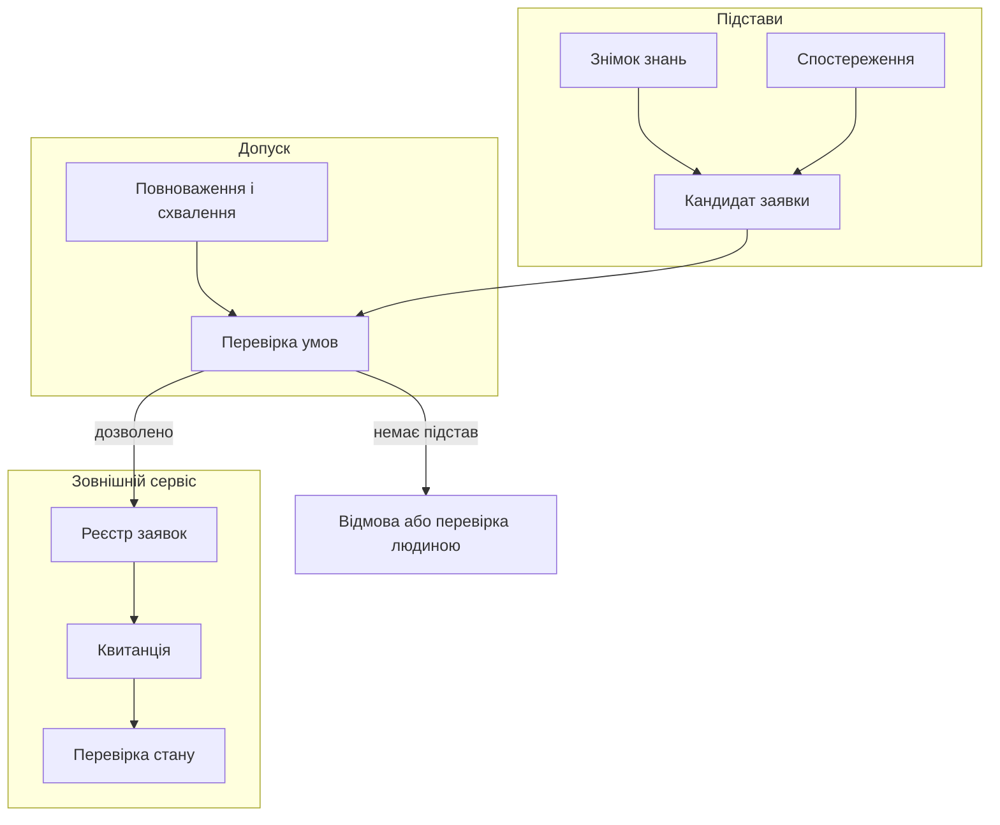
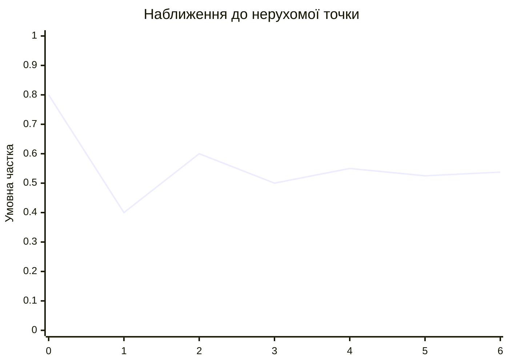
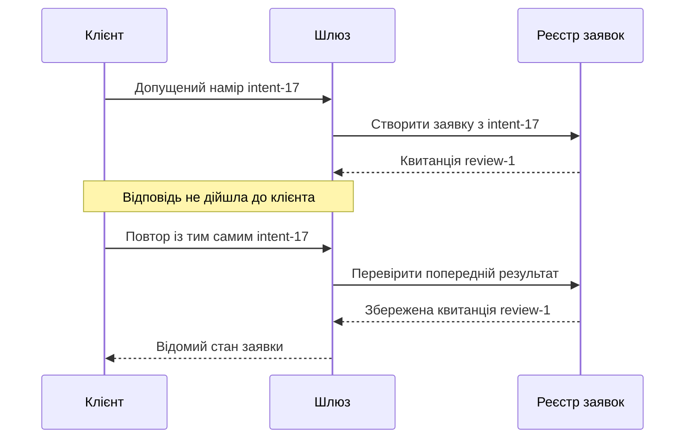
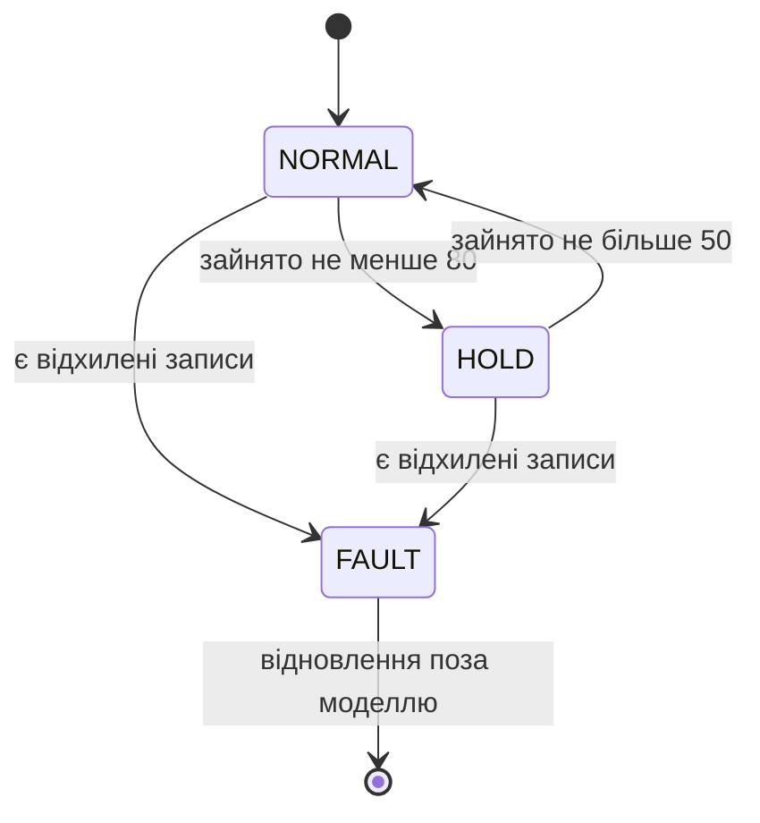
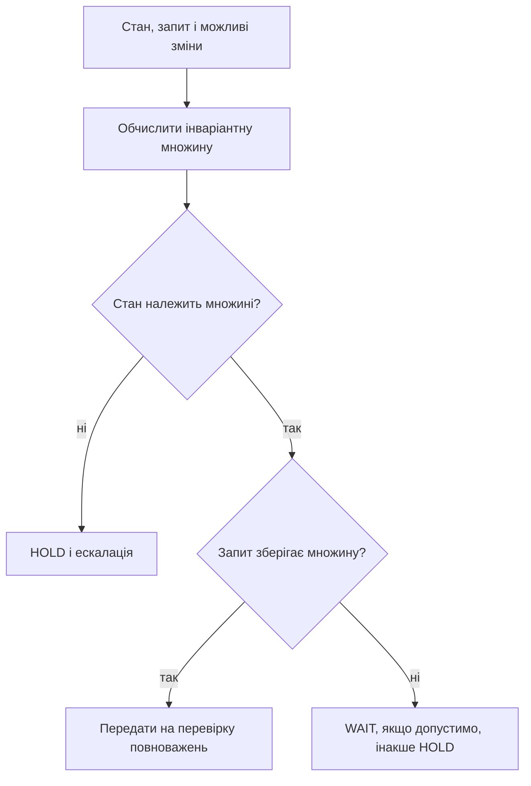

# Глава 26. Від рекомендації до контрольованої дії

<a id="глава-26-від-прогнозу-й-рекомендації-до-безпечної-дії-перформативна-стійкість-транзакційні-саги-реактивні-черги-jtms-та-кіберфізичні-щити"></a>

> **Підручник:** [Експертні Системи](../README.md) · [Том 3. Нейро-символьні, ізольовані, критичні до безпеки та високопродуктивні експертні системи](README.md)  
> **Навчальний рівень:** прикладні програмісти та студенти комп'ютерних наук\
> **Обладнання:** звичайний ноутбук або ПК\
> **Мова:** Python 3.14.4; приклади використовують стандартну бібліотеку\
> **Попередня глава:** [Глава 25. Оновлення знань і безперервне навчання](ch25-knowledge-updates-and-learning.md)\
> **Наступна глава:** [Глава 27. Доведення коректності та обґрунтування безпеки](ch27-correctness-and-safety-assurance.md)\
> **Автор:** Микола Мартинович Федчик

---

## Анотація

Експертна система може обґрунтувати рекомендацію, але це ще не дає їй права змінювати зовнішній світ. Перед виконанням потрібно перевірити повноваження, актуальність фактів і правил, а після відправлення — відрізнити квитанцію від підтвердженого результату. Помилка на будь-якому з цих етапів здатна перетворити правильний висновок на некоректну дію.

На прикладі заявки на перевірку обладнання `P-7` у главі розглянуто шлюз допуску, вплив рекомендації на майбутні дані, повторне надсилання, фільтрацію спостережень, навантаження робочої пам'яті та обмеження допустимих команд. Читач зможе виконати й змінити навчальні програми, простежити відмови та пояснити межі їхніх гарантій. Приклад створює лише умовний запис про перевірку; він не керує реальним обладнанням.

---

<!-- chapter-toc:start -->
## Зміст глави

- [1. Рівні автономності та допустимість дій](#1-рівні-автономності-та-допустимість-дій)
  - [1.1. Схвалення, повноваження та підтверджений результат](#11-схвалення-повноваження-та-підтверджений-результат)
  - [1.2. Зв'язування дозволу з даними та версією](#12-звязування-дозволу-з-даними-та-версією)
- [2. Вплив прогнозу на майбутні дані](#2-вплив-прогнозу-на-майбутні-дані)
  - [2.1. Прогноз і реакція на нього](#21-прогноз-і-реакція-на-нього)
  - [2.2. Збіжність навчальної моделі](#22-збіжність-навчальної-моделі)
- [3. Повторні запити та оцінювання спостережень](#3-повторні-запити-та-оцінювання-спостережень)
  - [3.1. Ідемпотентність і компенсація](#31-ідемпотентність-і-компенсація)
  - [3.2. Фільтрація похідних і перевірка стійкості оцінки](#32-фільтрація-похідних-і-перевірка-стійкості-оцінки)
- [4. Стійкість робочої пам'яті та обмеження виконавчих дій](#4-стійкість-робочої-памяті-та-обмеження-виконавчих-дій)
  - [4.1. Навантаження робочої пам'яті та насичення черги](#41-навантаження-робочої-памяті-та-насичення-черги)
  - [4.2. Вибір команди в межах інваріантної множини безпеки](#42-вибір-команди-в-межах-інваріантної-множини-безпеки)
- [5. Практичні завдання та лабораторний практикум](#5-практичні-завдання-та-лабораторний-практикум)
  - [5.1. Контрольні запитання для самоперевірки](#51-контрольні-запитання-для-самоперевірки)
  - [5.2. Розрахункові задачі (трасування вручну)](#52-розрахункові-задачі-трасування-вручну)
  - [5.3. Завдання з програмної реалізації](#53-завдання-з-програмної-реалізації)
  - [5.4. Зв'язок із лабораторною та курсовою роботою курсу](#54-звязок-із-лабораторною-та-курсовою-роботою-курсу)
- [Висновки](#висновки)
- [Глосарій](#глосарій)
- [Скорочення та терміни](#скорочення-та-терміни)
- [Джерела](#джерела)
<!-- chapter-toc:end -->

---

<a id="1-пятирівнева-шкала-автономності-дій-a0a4-та-доказовий-оракул-допустимих-дій-actionable-oracle"></a>

## 1. Рівні автономності та допустимість дій

Після перевірки знань експертна система може запропонувати відкрити заявку на огляд `P-7`. Заявка змінює стан іншого сервісу, тому одного висновку «температура висока» недостатньо: потрібні чинні дані, дозвіл на конкретну дію й спосіб установити її результат. Наївна передача тексту рекомендації виконавцю не розрізняє ці підстави та може повторити дію після втрати відповіді.

У навчальній політиці заявку дозволено надіслати, якщо температура становить не менше $80\,^\circ\mathrm C$, обслуговування не триває, спостереження не старіше $30$ с, а уповноважений оператор схвалив відкриття. Поріг і часові межі умовні; вони не є вимогами до справжнього насоса.

<a id="obj-26-1"></a>

**Діаграма 26.1. Від кандидата до перевірки результату.**



На діаграмі рішення про допуск і підтвердження результату розділено: успіх першого кроку не означає, що заявку вже створено. Для обговорення меж автоматизації використаємо власну **навчальну**, а не нормативну шкалу.

<a id="obj-26-2"></a>

**Таблиця 26.2. Приклад рівнів автономності дії.**

| Рівень | Що робить система | Хто визначає межі |
|---|---|---|
| A0 | Показує факти без пропозиції дії | Людина |
| A1 | Пропонує заявку, але не надсилає її | Людина |
| A2 | Надсилає конкретну заявку після окремого схвалення | Людина та чинна політика |
| A3 | Надсилає визначений клас заявок без повторного схвалення кожної | Заздалегідь затверджена політика |
| A4 | Обирає з обмеженого набору дій за затвердженими правилами | Політика, повноваження й нагляд |

Вищий рівень не дає права обходити заборони чи розширювати власні повноваження. Далі реалізовано лише спрощений варіант A2.

<a id="11-формальна-різниця-між-схваленням-approval-мандатом-повноважень-authorization-квитанцією-receipt-та-верифікованим-наслідком-verifiedoutcome"></a>

### 1.1. Схвалення, повноваження та підтверджений результат

Оператор може схвалити заявку, але його схвалення саме по собі не встановлює, чи має він повноваження для цього обладнання. Так само підтвердження приймання запиту не показує, чи заявка існує у потрібному стані. Тому розрізняють чотири записи: **схвалення** конкретної пропозиції, **повноваження** суб'єкта, **квитанцію** про приймання та **підтверджений результат** за даними відповідного сервісу.

Шлюз приймає рішення за сукупністю умов. Такий спосіб враховує атрибути суб'єкта, об'єкта, операції та середовища; загальний підхід до керування доступом за атрибутами описано NIST [[1]](#src-1).

<a id="obj-26-3"></a>

**Формула 26.3. Навчальні умови допуску заявки.**

$$
\mathrm{Permit}=V_{\mathrm{auth}}\land V_{\mathrm{scope}}\land
V_{\mathrm{version}}\land(0\leq t-t_{\mathrm{obs}}\leq\Delta)
\land(t<t_{\mathrm{exp}})\land C_{\mathrm{policy}}\land H.
$$

Тут $`V_{\mathrm{auth}}`$ означає успішну перевірку автентичності та особи запитувача; $`V_{\mathrm{scope}}`$ — відповідність ролі, операції та об'єкта виданим повноваженням; $`V_{\mathrm{version}}`$ — збіг версії кандидата з чинною. $t$, $`t_{\mathrm{obs}}`$ і $`t_{\mathrm{exp}}`$ — невід'ємні значення часу перевірки, отримання спостереження та закінчення дозволу в секундах однієї шкали; $\Delta=30$ с — найбільший допустимий вік. $`C_{\mathrm{policy}}`$ — виконання предметного правила, $H$ — окреме схвалення. Усі логічні величини мають значення істина або хиба.

Наприклад, за $t=110$ с, $`t_{\mathrm{obs}}=100`$ с і $`t_{\mathrm{exp}}=130`$ с вік дорівнює $10$ с, а дозвіл ще чинний. Якщо температура $84\,^\circ\mathrm C$, обслуговування не триває та решта перевірок успішна, результат — `PERMIT`. За $t=130$ с дозвіл уже прострочений: верхню межу визначено як строгу.

Спершу опишемо незмінні дані. Ідентифікатор наміру залишається однаковим для повторів **однієї** заявки; нова заявка отримує інший ідентифікатор.

- **Вхідні дані:** кандидат заявки, спостереження та дозвіл оператора.
- **Результат:** три типізовані записи для подальшої перевірки.

<a id="obj-26-4"></a>

**Лістинг 26.4. Дані кандидата, спостереження й дозволу (Python 3.14.4).**

<details><summary>Показати лістинг 26.4 (29 рядків, Python 3.14.4)</summary>

```python
from dataclasses import dataclass

@dataclass(frozen=True)
class Proposal:
    intent: str
    action: str
    target: str
    knowledge: str

@dataclass(frozen=True)
class Observation:
    captured: int
    temperature: int
    maintenance: bool

@dataclass(frozen=True)
class Mandate:
    actor: str
    role: str
    action: str
    target: str
    knowledge: str
    expires: int
    approved: bool

p = Proposal("intent-17", "open_review", "P-7", "kb-26")
o = Observation(100, 84, False)
m = Mandate("operator-1", "operator", "open_review", "P-7", "kb-26", 130, True)
assert p.target == m.target and o.temperature == 84
```

</details>

Наступний лістинг продовжує попередній. Прапорець `verified` передає результат **окремої** перевірки автентичності запису, а `requester` вважається ідентифікатором уже автентифікованого запитувача. Функція лише порівнює цей рядок із дозволом: самостійно вона не встановлює особу. Результат містить стан і причину, а не виконує зовнішньої операції.

- **Вхідні дані:** записи з лістингу 26.4, особа запитувача, активна версія, поточний час і результат перевірки.
- **Результат:** `PERMIT`, `HOLD` або `BLOCK` із поясненням.

<a id="obj-26-5"></a>

**Лістинг 26.5. Перевірка умов перед надсиланням (Python 3.14.4).**

<details><summary>Показати лістинг 26.5 (30 рядків, Python 3.14.4)</summary>

```python
def decide(p: Proposal, o: Observation, m: Mandate, requester: str,
           active: str, now: int, verified: bool):
    labels = (p.intent, p.action, p.target, p.knowledge, m.actor, m.role,
              m.action, m.target, m.knowledge, requester, active)
    if any(type(x) is not str or not x.strip() for x in labels):
        raise ValueError("потрібні непорожні ідентифікатори")
    if (any(type(x) is not int or x < 0 for x in (o.captured, m.expires, now))
            or type(o.temperature) is not int or not -100 <= o.temperature <= 300
            or type(o.maintenance) is not bool or type(m.approved) is not bool
            or type(verified) is not bool):
        raise ValueError("некоректний час, показ або логічне значення")
    if not verified or m.actor != requester or m.role != "operator":
        return "BLOCK", "не підтверджено особу або роль"
    if (p.action != "open_review" or m.action != p.action
            or m.target != p.target or m.knowledge != p.knowledge):
        return "BLOCK", "дозвіл не відповідає заявці"
    if p.knowledge != active:
        return "HOLD", "версія знань змінилася"
    if now >= m.expires:
        return "BLOCK", "термін дозволу минув"
    if not 0 <= now - o.captured <= 30:
        return "HOLD", "спостереження застаріле або з майбутнього"
    if o.maintenance or o.temperature < 80:
        return "BLOCK", "предметне правило не виконано"
    if not m.approved:
        return "HOLD", "потрібне схвалення"
    return "PERMIT", "умови навчальної політики виконано"

assert decide(p, o, m, "operator-1", "kb-26", 110, True)[0] == "PERMIT"
assert decide(p, o, m, "operator-1", "kb-26", 130, True)[0] == "BLOCK"
```

</details>

`HOLD` означає, що потрібні нові дані або рішення людини; `BLOCK` — що заявка не проходить задану перевірку. Зміна активної версії приводить до повторного розгляду, а не до автоматичного застосування старого дозволу. Перед справжнім виконанням стан і строк потрібно перевірити ще раз, щоб зміна між перевіркою та надсиланням не залишилася непоміченою.

<a id="12-криптографічне-звязування-мандата-дії-з-поточним-знімком-бази-знань-та-вікном-свіжості-спостережень"></a>

### 1.2. Зв'язування дозволу з даними та версією

Якщо між видачею дозволу й перевіркою змінити об'єкт, час спостереження або версію знань, схвалення вже стосується іншого запиту. Криптографічний код автентифікації повідомлення HMAC дозволяє двом сторонам зі спільним секретним ключем виявити таку зміну [[2]](#src-2). Це не цифровий підпис: кожен власник спільного ключа може створити код, тому він не забезпечує неспростовності авторства.

Нижче код охоплює всі поля трьох записів із лістингу 26.4. Сортування полів і фіксовані роздільники роблять серіалізацію повторюваною для цього Python-прикладу; це не реалізація RFC 8785. Для міжмовного обміну потрібно окремо погодити й перевірити канонічний формат; RFC 8785 описує один із таких форматів для JSON [[3]](#src-3).

- **Вхідні дані:** кандидат, спостереження, дозвіл і спільний ключ.
- **Результат:** HMAC-SHA-256; змінений запис не збігається з початковим кодом.

<a id="obj-26-6"></a>

**Лістинг 26.6. Перевірка цілісності навчального дозволу (Python 3.14.4).**

<details><summary>Показати лістинг 26.6 (20 рядків, Python 3.14.4)</summary>

```python
from dataclasses import asdict, replace
from hmac import compare_digest, digest
from json import dumps

def tag(p: Proposal, o: Observation, m: Mandate, key: bytes) -> bytes:
    if type(key) is not bytes or len(key) < 32:
        raise ValueError("потрібен ключ щонайменше 32 байти")
    payload = {"proposal": asdict(p), "observation": asdict(o), "mandate": asdict(m)}
    data = dumps(payload, sort_keys=True, ensure_ascii=False,
                 separators=(",", ":")).encode("utf-8")
    return digest(key, data, "sha256")

key = bytes(range(32))
authentication_code = tag(p, o, m, key)
verified = compare_digest(authentication_code, tag(p, o, m, key))
assert decide(p, o, m, "operator-1", "kb-26", 110, verified)[0] == "PERMIT"
changed = replace(o, maintenance=True)
verified_changed = compare_digest(authentication_code, tag(p, changed, m, key))
assert not verified_changed
assert decide(p, changed, m, "operator-1", "kb-26", 110, verified_changed)[0] == "BLOCK"
```

</details>

Ключ у лістингу загальновідомий і придатний лише для тесту. У робочій системі потрібні захищене створення й обіг ключів, перевірка довіреного джерела спостереження, анулювання повноважень і захист від повторного використання дозволу. HMAC підтверджує повідомлення від власника ключа, але не доводить справності датчика або правильності правила.

<a id="2-перформативне-прогнозування-та-рефлексивна-рівновага-у-циклах-превентивного-керування"></a>

## 2. Вплив прогнозу на майбутні дані

Коли система рекомендує огляд `P-7`, людина може перевірити обладнання раніше й усунути причину майбутньої несправності. Наступні дані тоді збираються вже після втручання: порівнювати їх із прогнозом так, наче нічого не змінилося, неправильно. Потрібно відстежувати і прогноз, і дію, і результат, а також розуміти, за яких припущень повторне навчання збігається.

<a id="21-феномен-саморуйнівного-та-самосправджуваного-прогнозу-у-фінансах-медицині-енергетиці-та-бойовому-управлінні"></a>

### 2.1. Прогноз і реакція на нього

Якщо високий прогноз ризику спричиняє перевірку, яка зменшує частоту несправностей, прогноз може не справдитися саме через вжиту дію. Інша реакція здатна посилити початковий ефект. Такий вплив прогнозу на розподіл майбутніх результатів називають **перформативним** [[4]](#src-4).

Відсутність несправності після огляду сама по собі не показує, чи була рекомендація потрібною: невідомо, що сталося б без огляду. Для дослідження впливу необхідні доречний план порівняння, журнал дій і облік інших змін. Параметри наступної моделі задано лише для навчального розрахунку, а не оцінено за реальними спостереженнями.

<a id="22-умова-стискаючого-відображення-та-пошук-перформативно-стійкої-точки-рівноваги-при-виборі-превентивної-дії"></a>

### 2.2. Збіжність навчальної моделі

Припустимо, що після прогнозу $p$ та відповідної реакції нова умовна частка випадків задається функцією $T(p)$. Читачеві потрібно знайти значення, яке не змінюється після повторного застосування цього правила, і знати, наскільки далеко від нього зупинена ітерація.

<a id="obj-26-7"></a>

**Формула 26.7. Ітерація та межа похибки для стискаючого відображення.**

$$
T(p)=0.8-0.5p,\qquad p_{t+1}=T(p_t),\qquad
\lvert p_t-p^*\rvert\leq\frac{c}{1-c}\lvert p_t-p_{t-1}\rvert.
$$

Тут $`p_t\in[0,1]`$ — безрозмірна умовна частка на кроці $`t=0,1,\ldots`$; $`p^*`$ — точка, для якої $`T(p^*)=p^*`$; $c=0.5$ — коефіцієнт стискання. Для будь-яких $p,q\in[0,1]$ маємо $`|T(p)-T(q)|=c|p-q|`$, а $T$ відображає цей інтервал у $[0.3,0.8]$. Отже, у цій моделі існує єдина нерухома точка $`p^*=0.8/1.5=8/15\approx0.5333`$. Межа справа застосовується для $t\geq1$.

Починаючи з $`p_0=0.8`$, отримаємо $0.4$, $0.6$, $0.5$, $0.55$, $0.525$ і $0.5375$. Остання зміна дорівнює $0.0125$; оскільки $`c/(1-c)=1`$, це також верхня межа відстані до точки моделі.

Функція нижче використовує точні дроби й зупиняється лише після досягнення заданої межі. Якщо за відведену кількість кроків її не досягнуто, помилка повідомляється явно.

- **Вхідні дані:** початкова частка, допустима похибка та межа кроків.
- **Результат:** послідовність значень і верхня межа похибки в моделі.

<a id="obj-26-8"></a>

**Лістинг 26.8. Пошук нерухомої точки (Python 3.14.4).**

<details><summary>Показати лістинг 26.8 (21 рядок, Python 3.14.4)</summary>

```python
from fractions import Fraction

def forecast_path(start: Fraction, tolerance: Fraction, limit: int):
    if not isinstance(start, Fraction) or not isinstance(tolerance, Fraction):
        raise TypeError("потрібні точні дроби Fraction")
    if not 0 <= start <= 1 or tolerance <= 0 or type(limit) is not int or limit < 1:
        raise ValueError("некоректний початок, похибка або кількість кроків")
    path = [start]
    for _ in range(limit):
        following = Fraction(4, 5) - path[-1] / 2
        bound = abs(following - path[-1])
        path.append(following)
        if bound <= tolerance:
            return path, bound
    raise RuntimeError("межі похибки не досягнуто")

F = Fraction
path, bound = forecast_path(F(4, 5), F(1, 50), 20)
assert path[-1] == F(43, 80) and bound == F(1, 80)
threshold = F(27, 50)
assert path[-1] - bound < threshold <= path[-1] + bound
```

</details>

<a id="obj-26-9"></a>

**Графік 26.9. Послідовні значення навчальної моделі.**



Числа графіка взято з послідовності лістингу. Якщо умовний поріг передавання на ручну перевірку дорівнює $0.54$, інтервал від $0.525$ до $0.55$ його перетинає. З одного цього наближення рішення щодо порога не визначене: можна продовжити ітерації або передати випадок на розгляд. У цьому прикладі точне значення $8/15$ відоме й лежить нижче порога; перевірка інтервалу корисна, коли точного розв'язку наперед немає.

Ця межа описує лише похибку обчислення **в заданій моделі**, а не статистичний довірчий інтервал і не помилку моделі відносно обладнання. Справжній вплив дії може бути нелінійним, затриманим або невідомим; сама збіжність не надає дозволу на дію.

<a id="3-транзакційна-ідемпотентність-компенсаційні-саги-та-кібернетична-фільтрація-телеметрії"></a>

## 3. Повторні запити та оцінювання спостережень

Після допуску шлюз передає заявку іншому сервісу, але відповідь може загубитися. Одночасно нові покази датчика потребують оцінювання: різниця між двома вимірами часто містить шум. Тому окремо розглянемо повторення запиту та оцінку зміни показу, не плутаючи жоден із цих механізмів із підтвердженням виконаного огляду.

<a id="obj-26-10"></a>

**Діаграма 26.10. Повтор після втрати квитанції.**



Повтор не повинен отримувати новий ідентифікатор: інакше сервіс може сприйняти його як іншу заявку. Якщо стан невідомий, потрібне звіряння з реєстром, а не припущення, що запит точно не виконано.

<a id="31-канонічні-ключі-ідемпотентності-для-захисту-від-повторного-виконання-команди-при-втраті-квитанції"></a>

### 3.1. Ідемпотентність і компенсація

Операція ідемпотентна за заданим ефектом, якщо її повторення не змінює цей ефект після першого застосування. У семантиці HTTP це не забороняє, наприклад, записувати кожне звернення до журналу [[5]](#src-5). Створення заявки методом `POST` не стає ідемпотентним автоматично: таку поведінку має забезпечити сервіс.

Для кожного нового наміру клієнт створює окремий ключ і зберігає його для повторів. Сервіс зв'язує ключ із відбитком змісту: той самий ключ із тим самим змістом повертає відомий результат, а з іншим — помилку. Один лише хеш змісту непридатний як ключ наміру: дві окремі, але однакові за текстом заявки могли бути справді потрібними.

Наступний реєстр моделює лише пам'ять одного процесу. Перша відповідь містить ознаку створення, повторна — ту саму квитанцію без нового запису.

- **Вхідні дані:** ідентифікатор наміру й непорожній словник рядкових полів заявки.
- **Результат:** квитанція та ознака створення; зміна змісту для наявного ключа є помилкою.

<a id="obj-26-11"></a>

**Лістинг 26.11. Навчальний реєстр ідемпотентних запитів (Python 3.14.4).**

<details><summary>Показати лістинг 26.11 (29 рядків, Python 3.14.4)</summary>

```python
from hashlib import sha256
from json import dumps

class Registry:
    def __init__(self):
        self.records = {}

    def submit(self, intent: str, body: dict[str, str]):
        if (type(intent) is not str or not intent.strip() or not body
                or any(type(k) is not str or not k.strip() or type(v) is not str
                       or not v.strip() for k, v in body.items())):
            raise ValueError("потрібні непорожні ідентифікатор і поля")
        raw = dumps(body, sort_keys=True, ensure_ascii=False,
                    separators=(",", ":")).encode("utf-8")
        fingerprint = sha256(raw).digest()
        if intent in self.records:
            previous, receipt = self.records[intent]
            if previous != fingerprint:
                raise ValueError("ключ уже використано для іншої заявки")
            return receipt, False
        receipt = f"review-{len(self.records) + 1}"
        self.records[intent] = (fingerprint, receipt)
        return receipt, True

registry = Registry()
body = {"action": "open_review", "target": "P-7", "version": "kb-26"}
assert registry.submit("intent-17", body) == ("review-1", True)
assert registry.submit("intent-17", body) == ("review-1", False)
assert registry.submit("intent-18", body) == ("review-2", True)
```

</details>

<a id="obj-26-12"></a>

**Таблиця 26.12. Що встановлює кожен запис.**

| Стан | Відомо | Наступна перевірка |
|---|---|---|
| Допущено | Шлюз перевірив умови в певний момент | Чи запит надіслано з тим самим змістом |
| Результат невідомий | Час очікування минув | Запитати стан за тим самим ключем |
| Квитанцію отримано | Сервіс повідомив про приймання | Звірити ідентифікатор і стан заявки |
| Стан заявки підтверджено | Авторитетний реєстр показує потрібний запис | Окремо з'ясувати результат самого огляду |

Реальній реалізації потрібні стійке сховище, атомарне зв'язування ключа зі зміною стану в цільовому сервісі та обробка паралельних запитів. Якщо зовнішня дія не входить до спільної транзакції, один реєстр не доводить її одноразового виконання. Після втрати зв'язку зберігається стан «невідомо» до звіряння; доступ до читання стану також потребує перевірки повноважень.

Коли процес складається з кількох локальних транзакцій, **сага** задає порядок кроків і компенсацій [[6]](#src-6). Наприклад, якщо резервування часу завершилося, а створення заявки достовірно відхилено, можна скасувати резервування. За невідомого результату спершу потрібне звіряння: компенсація не є універсальним скасуванням уже здійсненого фізичного наслідку.

<a id="32-оцінювання-похідних-за-альфа-бета-фільтром-умови-стійкості-шура--джурі-в-арифметиці-q1616-та-процес-орнштейна--уленбека"></a>

### 3.2. Фільтрація похідних і перевірка стійкості оцінки

Два сусідні покази температури можуть відрізнятися через шум, а не через справжню зміну стану. Альфа-бета фільтр підтримує оцінку значення та швидкості його зміни: спочатку прогнозує їх, а потім коригує за новим показом. Він є простим прикладом рекурсивного оцінювання стану; загальну постановку лінійної фільтрації розглянуто в роботі Калмана [[7]](#src-7).

<a id="obj-26-13"></a>

**Формула 26.13. Один крок альфа-бета фільтра.**

$$
\hat x_t^-=\hat x_{t-1}+\Delta t\,\hat v_{t-1},\quad
r_t=z_t-\hat x_t^-,\quad
\hat x_t=\hat x_t^-+\alpha r_t,\quad
\hat v_t=\hat v_{t-1}+\frac{\beta}{\Delta t}r_t.
$$

Тут $`z_t`$ і $`\hat x_t`$ — виміряна та оцінена температури у градусах Цельсія; $`\hat x_t^-`$ — прогноз до отримання нового показу; $`r_t`$ — похибка прогнозу в тих самих одиницях. $`\hat v_t`$ — оцінена швидкість зміни у $`^\circ\mathrm C/\mathrm s`$, $\Delta t>0$ — інтервал між показами в секундах. Коефіцієнти $\alpha$ і $\beta$ безрозмірні; їхні умови для наведеної лінійної моделі наведено нижче.

Для $`\hat x_0=70\,^\circ\mathrm C`$, $`\hat v_0=0`$, $\Delta t=2$ с, $\alpha=0.5$, $\beta=0.25$ і $`z_1=74\,^\circ\mathrm C`$ прогноз дорівнює $70$, залишок — $4$, нові оцінки — $72\,^\circ\mathrm C$ і $`0.5\,^\circ\mathrm C/\mathrm s`$. За наступного показу $`z_2=75\,^\circ\mathrm C`$ вони становлять відповідно $74$ і $`0.75\,^\circ\mathrm C/\mathrm s`$.

- **Вхідні дані:** попередні оцінки, показ, інтервал і коефіцієнти у вигляді точних дробів.
- **Результат:** скориговані значення температури та швидкості.

<a id="obj-26-14"></a>

**Лістинг 26.14. Крок фільтра для двох спостережень (Python 3.14.4).**

<details><summary>Показати лістинг 26.14 (17 рядків, Python 3.14.4)</summary>

```python
from fractions import Fraction

def alpha_beta(x: Fraction, v: Fraction, z: Fraction, dt: Fraction,
               alpha: Fraction, beta: Fraction):
    if any(not isinstance(value, Fraction) for value in (x, v, z, dt, alpha, beta)):
        raise TypeError("потрібні точні дроби Fraction")
    if dt <= 0 or not 0 < alpha < 2 or not 0 < beta < 4 - 2 * alpha:
        raise ValueError("некоректні інтервал або коефіцієнти")
    predicted = x + dt * v
    residual = z - predicted
    return predicted + alpha * residual, v + beta * residual / dt

F = Fraction
x, v = alpha_beta(F(70), F(0), F(74), F(2), F(1, 2), F(1, 4))
assert (x, v) == (F(72), F(1, 2))
x, v = alpha_beta(x, v, F(75), F(2), F(1, 2), F(1, 4))
assert (x, v) == (F(74), F(3, 4))
```

</details>

За постійного інтервалу та моделі сталої швидкості однорідна помилка оцінки має характеристичний многочлен із наведеними нижче умовами розташування коренів усередині одиничного кола.

<a id="obj-26-15"></a>

**Формула 26.15. Умови стійкості лінійної помилки фільтра.**

$$
\lambda^2-(2-\alpha-\beta)\lambda+(1-\alpha)=0,\qquad
0<\alpha<2,\quad 0<\beta<4-2\alpha.
$$

Тут $\lambda$ — корінь характеристичного многочлена, $\alpha$ і $\beta$ — коефіцієнти формули 26.13. Для $\alpha=0.5$ і $\beta=0.25$ обидві нерівності виконані; модуль кожного комплексного кореня дорівнює $`\sqrt{0.5}\approx0.707<1`$. Це означає згасання однорідної помилки в зазначеній моделі, а не безпомилковість реального датчика.

У знаковому 32-бітному поданні Q16.16 одиниці відповідає масштаб $`S=2^{16}`$, а коефіцієнти зберігаються як цілі $A$ і $B$. Округлення може змінити виконання строгої нерівності. Лістинг перевіряє саме закодовані коефіцієнти; Python `round` тут застосовує округлення до найближчого парного цілого на половині.

- **Вхідні дані:** точні значення $\alpha$ та $\beta$.
- **Результат:** ознака виконання нерівностей після квантування або явна помилка переповнення.

<a id="obj-26-16"></a>

**Лістинг 26.16. Перевірка квантизованих коефіцієнтів (Python 3.14.4).**

<details><summary>Показати лістинг 26.16 (13 рядків, Python 3.14.4)</summary>

```python
def stable_q16(alpha: Fraction, beta: Fraction) -> bool:
    if not isinstance(alpha, Fraction) or not isinstance(beta, Fraction):
        raise TypeError("потрібні точні дроби Fraction")
    scale = 1 << 16
    a, b = round(alpha * scale), round(beta * scale)
    if any(not -(1 << 31) <= value < (1 << 31) for value in (a, b)):
        raise OverflowError("коефіцієнт не вміщується у Q16.16")
    return 0 < a < 2 * scale and 0 < b < 4 * scale - 2 * a

assert stable_q16(F(1, 2), F(1, 4))
near_boundary = F(3) - F(1, 1_000_000)
assert 0 < near_boundary < 4 - 2 * F(1, 2)
assert not stable_q16(F(1, 2), near_boundary)
```

</details>

У другому випадку $\beta$ до округлення менше $3$, але закодоване значення дорівнює $3$ і лежить на недопустимій межі. Перевірка коефіцієнтів не охоплює переповнення проміжних обчислень, похибку самого фільтра чи ефекти округлення стану.

Якщо похибка вимірювання зберігається між сусідніми показами, незалежний білий шум може бути невдалою моделлю. Один із можливих описів — процес Орнштейна — Уленбека [[8]](#src-8):

<a id="obj-26-17"></a>

**Формула 26.17. Умовне середнє корельованої похибки.**

$$
dE_t=-\theta(E_t-\mu)\,dt+\sigma\,dW_t,\qquad
\mathbb E[E_{t+h}\mid E_t]=\mu+(E_t-\mu)e^{-\theta h}.
$$

Тут $`E_t`$ — похибка у $`^\circ\mathrm C`$, $\mu$ — її середній рівень у тих самих одиницях, $\theta>0$ — швидкість повернення в $`\mathrm s^{-1}`$, $\sigma\geq0$ — масштаб шуму в $`^\circ\mathrm C/\sqrt{\mathrm s}`$, $`W_t`$ — вінерівський процес, $h\geq0$ — час у секундах. За $`E_t=4\,^\circ\mathrm C`$, $\mu=0$, $`\theta=\ln2\,\mathrm s^{-1}`$ і $h=1$ с умовне середнє дорівнює $`2\,^\circ\mathrm C`$. Це очікування за моделлю, а не прогноз точного наступного показу; параметри потрібно оцінити та перевірити за даними.

<a id="4-стійкість-реактивної-робочої-памяті-jtms-та-синтез-виконавчих-щитів-безпеки-shield-synthesis-gr1"></a>

## 4. Стійкість робочої пам'яті та обмеження виконавчих дій

Шлюз приймає рішення за фактами, які можуть змінюватися швидше, ніж система встигає їх обробити. Якщо старий факт залишається активним після відкликання підстави або черга переповнюється без повідомлення, правильність окремого правила вже не захищає результат. Потрібно відстежувати підстави, вимірювати навантаження й обмежувати дію з урахуванням можливих переходів.

<a id="obj-26-18"></a>

**Діаграма 26.18. Режими навчального спостерігача черги.**



Два пороги запобігають частому перемиканню, коли зайнятість коливається біля одного значення. `HOLD` лише сигналізує про потребу обмежити нові заявки: механізм приймання має окремо забезпечити це обмеження. Після `FAULT` повернення до роботи потребує розбору втрат і не виконується автоматично.

<a id="41-баланс-активних-фактів-робочої-памяті-двопороговий-тригер-шмітта-час-до-насичення-черги-та-квадратична-функція-ляпунова"></a>

### 4.1. Навантаження робочої пам'яті та насичення черги

Припустимо, висновок `review` підтримується або показом `alarm` разом зі станом `normal`, або незалежним запитом людини `manual_request`. Після відкликання `alarm` висновок має залишитися, якщо друга підстава чинна. Системи підтримки обґрунтувань зберігають зв'язок висновків із їхніми підставами, щоб реагувати на такі зміни [[9]](#src-9).

Для малого прикладу достатньо повторно обчислити найменшу множину фактів за додатними правилами. Це не повна інкрементальна реалізація JTMS: тут немає заперечення, розв'язання суперечностей та окремого реєстру всіх обґрунтувань.

- **Вхідні дані:** множина активних фактів і пари «передумови — висновок».
- **Результат:** усі досяжні факти; циклічні правила без початкової підстави не створюють фактів.

<a id="obj-26-19"></a>

**Лістинг 26.19. Повторне виведення після зміни підстав (Python 3.14.4).**

<details><summary>Показати лістинг 26.19 (17 рядків, Python 3.14.4)</summary>

```python
def derive(base: set[str], rules: list[tuple[frozenset[str], str]]) -> set[str]:
    known = set(base)
    while True:
        inferred = {result for premises, result in rules if premises <= known}
        updated = known | inferred
        if updated == known:
            return known
        known = updated

rules = [(frozenset({"alarm", "normal"}), "review"),
         (frozenset({"manual_request"}), "review"),
         (frozenset({"review"}), "notify")]
assert "notify" in derive({"alarm", "normal", "manual_request"}, rules)
assert "notify" in derive({"normal", "manual_request"}, rules)
assert "review" not in derive({"normal"}, rules)
cycle = [(frozenset({"review"}), "notify"), (frozenset({"notify"}), "review")]
assert derive(set(), cycle) == set()
```

</details>

Тепер оцінимо обсяг черги оновлень. За інтервал спочатку обробляється $`d_t`$ записів із наявних, а потім надходить $`a_t`$ нових. Якщо місця бракує, кількість відхилених записів потрібно повернути явно.

<a id="obj-26-20"></a>

**Формула 26.20. Баланс черги та час до її заповнення.**

$$
s_t=q_t-d_t+a_t,\quad q_{t+1}=\min(C,s_t),\quad
\ell_{t+1}=\max(0,s_t-C),\quad
T_{\mathrm{fill}}=\frac{C-q_0}{\lambda-\mu}.
$$

Тут $C>0$ — місткість черги в записах; $`q_t\in\{0,\ldots,C\}`$ — зайнятість на початку інтервалу; $`0\leq d_t\leq q_t`$ і $`a_t\geq0`$ — цілі кількості оброблених і нових записів; $`s_t`$ — потреба в місцях до обмеження місткістю, $`\ell_{t+1}`$ — кількість відхилених записів. Останній вираз є **неперервним наближенням** для сталих інтенсивностей $`\lambda>\mu\geq0`$ у записах за хвилину; $`T_{\mathrm{fill}}`$ вимірюється у хвилинах.

Наприклад, за $C=100$, $`q_0=40`$, $`\lambda=30`$ і $\mu=20$ черга за незмінних умов заповниться приблизно за $(100-40)/(30-20)=6$ хв. Порогове значення $80$ буде досягнуте приблизно через $4$ хв; зміна інтенсивностей після сигналу змінить і цей прогноз.

Код реалізує дискретний баланс, два пороги й збереження стану несправності. Відхилені записи не зникають із результату: викликаючий компонент повинен забезпечити їх повторне отримання або ескалацію.

- **Вхідні дані:** зайнятість, надходження, фактично оброблені записи й поточний режим.
- **Результат:** нова зайнятість, кількість відхилених записів і новий режим.

<a id="obj-26-21"></a>

**Лістинг 26.21. Баланс і пороги черги (Python 3.14.4).**

<details><summary>Показати лістинг 26.21 (22 рядки, Python 3.14.4)</summary>

```python
def queue_step(q: int, arrivals: int, serviced: int, mode: str):
    if (any(type(x) is not int or x < 0 for x in (q, arrivals, serviced))
            or q > 100 or serviced > q or mode not in {"NORMAL", "HOLD", "FAULT"}):
        raise ValueError("некоректний стан черги")
    demand = q - serviced + arrivals
    rejected = max(0, demand - 100)
    new_q = min(100, demand)
    if rejected:
        next_mode = "FAULT"
    elif mode == "NORMAL" and new_q >= 80:
        next_mode = "HOLD"
    elif mode == "HOLD" and new_q <= 50:
        next_mode = "NORMAL"
    else:
        next_mode = mode
    return new_q, rejected, next_mode

assert queue_step(70, 20, 5, "NORMAL") == (85, 0, "HOLD")
assert queue_step(85, 0, 15, "HOLD") == (70, 0, "HOLD")
assert queue_step(70, 0, 20, "HOLD") == (50, 0, "NORMAL")
assert queue_step(99, 3, 0, "NORMAL") == (100, 2, "FAULT")
assert queue_step(100, 0, 50, "FAULT") == (50, 0, "FAULT")
```

</details>

Для іншого погляду на навантаження використаємо неперервну модель із бажаною зайнятістю $`q_*`$. Якщо швидкість обслуговування можна змінювати так, щоб $`\dot q=-k(q-q_*)`$, відхилення має зменшуватися.

<a id="obj-26-22"></a>

**Формула 26.22. Навчальна функція відхилення черги.**

$$
V(q)=\frac12(q-q_*)^2,\qquad
\dot V=(q-q_*)\dot q=-k(q-q_*)^2\leq0.
$$

Тут $q$ і $`q_*`$ — поточна та бажана зайнятість у записах, $k>0$ — коефіцієнт у $`\mathrm{хв}^{-1}`$; $V$ має одиницю «запис у квадраті», а $`\dot V`$ — «запис у квадраті за хвилину». За $q=80$, $`q_*=40`$ і $`k=0.1\,\mathrm{хв}^{-1}`$ маємо $V=800$ та $`\dot V=-160`$. Для припливу $20$ записів за хвилину така модель вимагає обслуговування $24$ записів за хвилину.

Висновок діє за припущення, що таку швидкість можна забезпечити і приплив відомий. Він не доводить стійкості дискретної черги з лістингу, черги з випадковими затримками чи наявності достатніх ресурсів.

<a id="42-проєкція-запропонованої-команди-на-керовано-інваріантну-множину-безпеки-у-двогравцевих-іграх-gr1"></a>

### 4.2. Вибір команди в межах інваріантної множини безпеки

Навіть дозволена користувачеві команда може бути несумісною з поточним станом. Захисний механізм перед виконавцем перевіряє можливі наслідки та може відхилити або замінити запропоновану команду. Такий принцип застосовують у синтезі виконавчих щитів [[10]](#src-10).

Розглянемо скінченну модель: $s$ — кількість одночасних заявок для `P-7`; допустимі стани $`S=\{0,1\}`$. Команда `WAIT` додає $0$ заявок, `OPEN` — $1$; незалежний зовнішній запис може додати $w$. Якщо інший сервіс також здатний створювати записи, перевірити лише найближчий крок недостатньо: треба знати, чи можна залишатися в допустимих станах і надалі.

<a id="obj-26-23"></a>

**Формула 26.23. Пошук керовано-інваріантної множини.**

$$
W_0=S,\qquad
W_{k+1}=\{s\in W_k:\exists a\in A\ \forall w\in D,\ F(s,a,w)\in W_k\}.
$$

Тут $A=\{\mathrm{WAIT},\mathrm{OPEN}\}$ — команди, $D$ — непорожня множина можливих зовнішніх змін, $`F(s,a,w)=s+\delta(a)+w`$ — перехід, де $`\delta(\mathrm{WAIT})=0`$ і $`\delta(\mathrm{OPEN})=1`$. $`W_k`$ — множина станів після $k$ відсікань. Усі значення дискретні й безрозмірні. Для скінченного $S$ послідовність вкладених множин зупиняється; нерухома множина містить стани, з яких можна обирати команди, що зберігають її за всіх врахованих змін.

За $`D=\{0\}`$ обидва стани залишаються у множині: у стані $0$ допустимі обидві команди, у стані $1$ — лише `WAIT`. За $`D=\{0,1\}`$ перший крок залишає тільки $0$, а другий вилучає і його: повторні зовнішні додавання можуть порушити межу незалежно від вибору. Отже, потрібна додаткова гарантія щодо зовнішнього сервісу, а не лише локальний шлюз.

Лістинг виконує повний перебір двох станів і двох команд. Він явно відхиляє порожній набір змін, за якого перевірка «для всіх» була б беззмістовною.

- **Вхідні дані:** можливі зовнішні зміни $0$ і/або $1$.
- **Результат:** найбільша керовано-інваріантна множина в цій моделі.

<a id="obj-26-24"></a>

**Лістинг 26.24. Відсікання нестійких станів (Python 3.14.4).**

<details><summary>Показати лістинг 26.24 (14 рядків, Python 3.14.4)</summary>

```python
def winning_states(disturbances: set[int]) -> set[int]:
    if not disturbances or any(type(w) is not int or w not in (0, 1) for w in disturbances):
        raise ValueError("потрібні допустимі зовнішні зміни")
    winning = {0, 1}
    while True:
        following = {s for s in winning
                     if any(all(s + delta + w in winning for w in disturbances)
                            for delta in (0, 1))}
        if following == winning:
            return winning
        winning = following

assert winning_states({0}) == {0, 1}
assert winning_states({0, 1}) == set()
```

</details>

Наступна функція продовжує лістинг 26.24: вона сама повторно обчислює множину для переданих припущень і не приймає довільну множину від клієнта.

- **Вхідні дані:** поточний стан, запропонована команда та можливі зовнішні зміни.
- **Результат:** допустима команда або `HOLD` із потребою втручання.

<a id="obj-26-25"></a>

**Лістинг 26.25. Вибір команди в навчальній моделі (Python 3.14.4).**

<details><summary>Показати лістинг 26.25 (16 рядків, Python 3.14.4)</summary>

```python
def choose(state: int, requested: str, disturbances: set[int]) -> str:
    if type(state) is not int or state < 0 or requested not in {"WAIT", "OPEN"}:
        raise ValueError("некоректний стан або команда")
    winning = winning_states(disturbances)
    if state not in winning:
        return "HOLD"
    deltas = {"WAIT": 0, "OPEN": 1}
    safe = {name for name, delta in deltas.items()
            if all(state + delta + w in winning for w in disturbances)}
    if requested in safe:
        return requested
    return "WAIT" if "WAIT" in safe else "HOLD"

assert choose(0, "OPEN", {0}) == "OPEN"
assert choose(1, "OPEN", {0}) == "WAIT"
assert choose(0, "OPEN", {0, 1}) == "HOLD"
```

</details>

<a id="obj-26-26"></a>

**Діаграма 26.26. Рішення за множиною допустимих станів.**



Цей перебір доводить лише властивість заданої скінченної моделі за повного спостереження та врахованих переходів. `HOLD` означає відсутність команди й повідомлення про проблему, а не гарантію, що зовнішній світ сам залишиться безпечним. Синтез GR(1) розглядає багатші припущення та гарантії реактивної системи, зокрема властивості прогресу [[11]](#src-11); наведений код не є його реалізацією.

Об'єднаємо навчальні компоненти: перевіримо код автентичності, умови допуску та модель обмеження, а потім створимо запис у реєстрі. Лістинг продовжує попередні приклади: початковий стан $0$ і відсутність зовнішніх змін задано як припущення, а не отримано з реального сервісу.

- **Вхідні дані:** записи й код автентичності з розділу 1, моделі `Registry` і `choose` із розділів 3 та 4.
- **Результат:** одна навчальна квитанція; повтор того самого наміру не створює другого запису.

<a id="obj-26-27"></a>

**Лістинг 26.27. Перехід від перевіреного кандидата до заявки (Python 3.14.4).**

<details><summary>Показати лістинг 26.27 (13 рядків, Python 3.14.4)</summary>

```python
from hmac import compare_digest

verified = compare_digest(authentication_code, tag(p, o, m, key))
verdict, reason = decide(p, o, m, "operator-1", "kb-26", 110, verified)
action = choose(0, "OPEN", {0})
if verdict != "PERMIT" or action != "OPEN":
    raise RuntimeError(f"заявку не дозволено: {verdict}, {action}, {reason}")
store = Registry()
request = {"action": p.action, "target": p.target, "version": p.knowledge}
first = store.submit(p.intent, request)
repeat = store.submit(p.intent, request)
assert first == ("review-1", True)
assert repeat == ("review-1", False)
```

</details>

Другий виклик лише повертає збережену квитанцію в межах навчального процесу. У робочій системі читання результату потребує власної авторизації, а перевірка стану, допуск і запис не повинні розходитися через паралельні зміни. Квитанцію після надсилання ще потрібно звірити із зовнішнім реєстром.

## 5. Практичні завдання та лабораторний практикум

Практикум допомагає пройти шлях від кандидата заявки до перевірки її стану. У відповідях називайте не лише результат, а й припущення: яку версію знань використано, що саме підтверджено та які дані ще потрібні.

### 5.1. Контрольні запитання для самоперевірки

1. Чим рекомендація відрізняється від схвалення, повноваження, квитанції та підтвердженого стану заявки?
2. Чому правильний HMAC не встановлює справності датчика і не замінює автентифікації запитувача?
3. Як перевірка активної версії та часу захищає від використання застарілого дозволу? Що може змінитися після перевірки?
4. Чому після запобіжного огляду спостережувана частота несправностей може відрізнятися від частоти без такого огляду?
5. Що означає межа похибки в ітерації з розділу 2 і чому вона не є статистичним довірчим інтервалом?
6. Чому повторний запит повинен мати той самий ідентифікатор наміру? Що робити, якщо результат першого надсилання невідомий?
7. Що означає стійкість лінійної помилки альфа-бета фільтра та чому квантування коефіцієнтів потребує повторної перевірки?
8. Як альтернативні підстави впливають на відкликання висновку? Чому два пороги черги не усувають переповнення?
9. Які припущення про зовнішні зміни потрібні для інваріантної множини? Чому `HOLD` не гарантує безпечного стану середовища?

### 5.2. Розрахункові задачі (трасування вручну)

1. У прикладі допуску залиште спостереження з часу $100$ с і дозвіл до $130$ с. Порівняйте результати за $t=129$ с та $t=130$ с; інші умови виконано.
2. Для інтервалу наближення від $0.525$ до $0.55$ візьміть поріг $0.60$. Чи весь інтервал нижчий за поріг? Чи свідчить це про точність моделі для реального обладнання?
3. Продовжте фільтрацію з $`\hat x_2=74`$, $`\hat v_2=0.75`$, $\Delta t=2$ с, $\alpha=0.5$ і $\beta=0.25$ для показу $`z_3=76`$. Знайдіть прогноз, залишок і нові оцінки.
4. За місткості $100$ записів, початкової зайнятості $60$ і сталих інтенсивностей $30$ та $20$ записів за хвилину оцініть час до заповнення і до порога $80$.
5. Простежте множини $`W_0`$, $`W_1`$ та $`W_2`$ для зовнішніх змін $`D=\{0,1\}`$. Чому одноразово допустиме очікування не дає гарантії на необмежену кількість кроків?

**Самоперевірка:** 1) `PERMIT` і `BLOCK` відповідно; 2) так, але це не оцінка похибки реальної моделі; 3) прогноз $75.5$, залишок $0.5$, оцінки $75.75\,^\circ\mathrm C$ і $`0.8125\,^\circ\mathrm C/\mathrm s`$; 4) $4$ хв і $2$ хв; 5) $`\{0,1\}`$, $`\{0\}`$, порожня множина.

<a id="53-інженерні-завдання-з-програмування-мовна-незалежність--спеціалізовані-dsl"></a>

### 5.3. Завдання з програмної реалізації

1. З'єднайте `tag`, `decide` і `Registry` в одному тестовому сценарії. Перевірте зміну підписаного поля, іншу активну версію, межу часу, повтор із тим самим ключем і повтор із зміненим змістом.
2. Додайте до реєстру окремий стан невідомого результату й операцію читання за ідентифікатором наміру. Опишіть, які операції мають бути атомарними в справжньому сховищі.
3. Подайте до `alpha_beta` третій показ із попередньої задачі. Перевірте нульовий інтервал, недопустимі коефіцієнти та округлення біля межі Q16.16.
4. Розширте `derive` додатковою незалежною підставою й перевірте її відкликання. Окремо перевірте цикл правил без вихідного факту.
5. Подайте до `queue_step` послідовність до порога, переповнення та зменшення черги. Переконайтеся, що `FAULT` не скидається сам, і визначте, хто отримує повідомлення про відхилені записи.
6. Розширте модель `winning_states` додатковою командою або станом. Перерахуйте результат вручну й програмно для двох різних множин зовнішніх змін; опишіть припущення, за яких команду можна передати до шлюзу.

### 5.4. Зв'язок із лабораторною та курсовою роботою курсу

* **Лабораторна робота:** побудуйте журнал кандидата, дозволу, квитанції та перевіреного стану заявки. Додайте тести для застарілих даних, втраченої відповіді й порушення обмеження кількості заявок.
* **Курсова робота:** застосуйте ці розмежування до теми з [переліку Тому 3](README.md). Окремо зазначте, які властивості перевірено тестами, які залежать від зовнішнього сервісу та які потребують людського рішення.

---

## Висновки

Щоб відкрити заявку на перевірку `P-7`, у навчальному прикладі розділено висновок, повноваження, схвалення, надсилання та перевірку стану. Читач може перевірити свіжість даних і версію правил, виявити зміну автентифікованого запису та простежити повтор запиту за тим самим наміром.

Далі показано, як сама рекомендація може змінювати майбутні дані, як оцінити показ і навантаження черги та як відсіяти стани, у яких модель не гарантує збереження обмеження. Усі числові приклади й політики умовні. Жоден окремий лістинг не підтверджує працездатності зовнішнього сервісу чи безпеки реального обладнання.

Наступне запитання — як зв'язати ці вимоги, тести та формальні твердження в перевірюване обґрунтування. Йому присвячено заплановану [Главу 27](ch27-correctness-and-safety-assurance.md).

## Глосарій

* **Автентифікація** — встановлення або перевірка заявленої особи чи походження повідомлення відповідним механізмом.
* **Ідемпотентність** — властивість повторної операції зберігати визначений ефект першого застосування.
* **Інваріантна множина** — множина станів, яку за зазначених припущень можна зберігати вибором допустимих команд.
* **Квитанція** — повідомлення сервісу про приймання чи стан запиту; її зміст визначається протоколом.
* **Компенсація** — окрема дія для усунення частини наслідків попереднього кроку; не завжди повертає початковий стан.
* **Перформативний прогноз** — прогноз, використання якого може впливати на майбутні результати або їхній розподіл.
* **Повноваження** — визначена політикою можливість суб'єкта виконати конкретну операцію над об'єктом за встановлених умов.
* **Підстава висновку** — факт або сукупність фактів і правил, від яких залежить виведення.
* **Свіжість спостереження** — придатність даних за їхнім віком і прийнятою часовою межею.
* **Щит виконання** — механізм перевірки та, за визначеною політикою, обмеження запропонованих команд.

## Скорочення та терміни

* **GR(1)** — *generalized reactivity of rank 1*, клас специфікацій для синтезу реактивних систем.
* **HMAC** — *hash-based message authentication code*, код автентифікації повідомлення на основі хеш-функції та спільного ключа.
* **JTMS** — *justification-based truth maintenance system*, система підтримки переконань за обґрунтуваннями.
* **Q16.16** — знакове 32-бітне подання з фіксованою крапкою та $16$ дробовими бітами.
* **SHA-256** — хеш-функція з 256-бітним результатом.

## Джерела

1. <a id="src-1"></a> Hu V. та ін. **Guide to Attribute Based Access Control (ABAC) Definition and Considerations.** NIST SP 800-162, 2014, з оновленнями. [NIST](https://csrc.nist.gov/pubs/sp/800/162/upd2/final).
2. <a id="src-2"></a> Krawczyk H., Bellare M., Canetti R. **HMAC: Keyed-Hashing for Message Authentication.** RFC 2104, 1997. [RFC Editor](https://www.rfc-editor.org/rfc/rfc2104).
3. <a id="src-3"></a> Rundgren A., Jordan B., Erdtman S. **JSON Canonicalization Scheme.** RFC 8785, 2020. [RFC Editor](https://www.rfc-editor.org/rfc/rfc8785).
4. <a id="src-4"></a> Perdomo J., Zrnic T., Mendler-Dünner C., Hardt M. **Performative Prediction.** ICML, PMLR 119, 7599–7609, 2020. [PMLR](https://proceedings.mlr.press/v119/perdomo20a.html).
5. <a id="src-5"></a> Fielding R., Nottingham M., Reschke J. **HTTP Semantics.** RFC 9110, розділ 9.2.2, 2022. [RFC Editor](https://www.rfc-editor.org/rfc/rfc9110.html#section-9.2.2).
6. <a id="src-6"></a> Garcia-Molina H., Salem K. **Sagas.** ACM SIGMOD, 249–259, 1987. [DOI: 10.1145/38713.38742](https://doi.org/10.1145/38713.38742).
7. <a id="src-7"></a> Kalman R. E. **A New Approach to Linear Filtering and Prediction Problems.** Journal of Basic Engineering, 82(1), 35–45, 1960. [DOI: 10.1115/1.3662552](https://doi.org/10.1115/1.3662552).
8. <a id="src-8"></a> Uhlenbeck G. E., Ornstein L. S. **On the Theory of the Brownian Motion.** Physical Review, 36, 823–841, 1930. [DOI: 10.1103/PhysRev.36.823](https://doi.org/10.1103/PhysRev.36.823).
9. <a id="src-9"></a> Doyle J. **A Truth Maintenance System.** Artificial Intelligence, 12(3), 231–272, 1979. [DOI: 10.1016/0004-3702(79)90008-0](https://doi.org/10.1016/0004-3702%2879%2990008-0).
10. <a id="src-10"></a> Könighofer B., Könighofer R., Wang C. **Shield Synthesis: Runtime Enforcement for Reactive Systems.** [arXiv:1501.02573](https://arxiv.org/abs/1501.02573).
11. <a id="src-11"></a> Piterman N., Pnueli A., Sa'ar Y. **Synthesis of Reactive(1) Designs.** [DOI: 10.1007/11609773_24](https://doi.org/10.1007/11609773_24).
