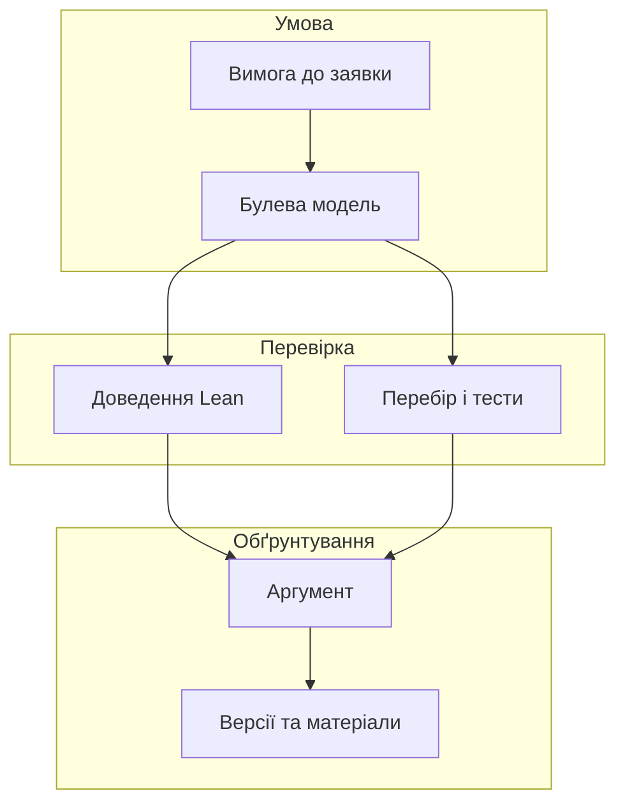
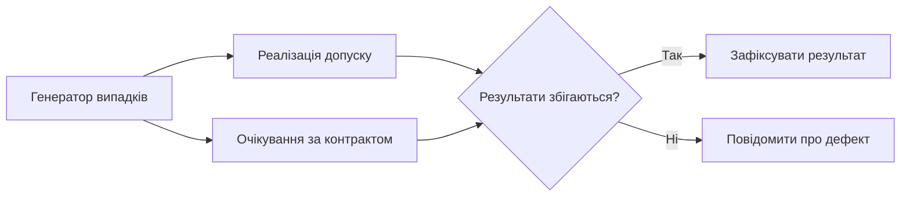
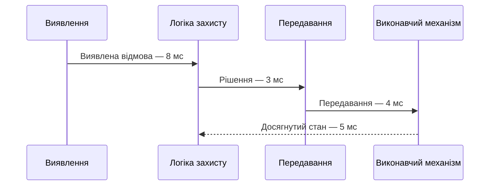
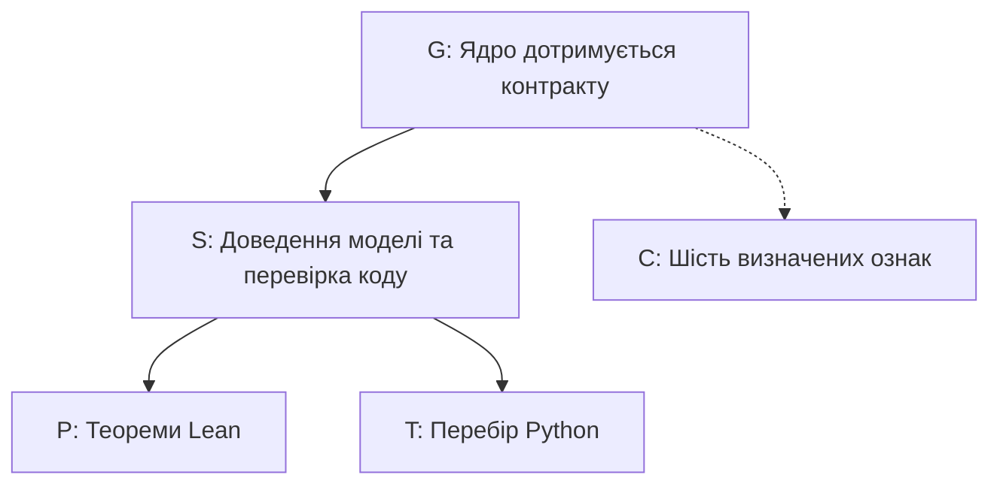

# Глава 27. Доведення коректності та обґрунтування безпеки

<a id="глава-27-формально-верифікований-шлюз-допуску-в-lean-4-випробування-інжекцією-помилок-та-автоматизований-синтез-safety-case-gsn"></a>

> **Підручник:** [Експертні Системи](../README.md) · [Том 3. Нейро-символьні, ізольовані, критичні до безпеки та високопродуктивні експертні системи](README.md)  
> **Навчальний рівень:** прикладні програмісти та студенти комп'ютерних наук\
> **Обладнання:** звичайний ноутбук або ПК\
> **Мови:** Python 3.14.4 зі стандартною бібліотекою; Lean 4.19.0\
> **Попередня глава:** [Глава 26. Від рекомендації до контрольованої дії](ch26-controlled-actions.md)\
> **Наступна глава:** [Глава 28. Апаратне прискорення та подання знань у пам'яті](ch28-hardware-acceleration-and-storage.md)\
> **Автор:** Микола Мартинович Федчик

---

## Анотація

Правило експертної системи та код, що його виконує, потребують різних перевірок. Доведення може встановити властивість формальної моделі, тест — виявити розбіжність у конкретній реалізації, а аргументація безпеки має пов'язати ці результати з вимогами та припущеннями. Жоден окремий результат не підтверджує автоматично безпеку всього обладнання.

На прикладі допуску заявки для `P-7` у главі побудовано булеву модель і машинно перевірено її властивості в Lean, виконано перебір і навчальні випробування з помилками, розглянуто часові бюджети й відмінність функціональної безпеки від кібербезпеки. Наприкінці читач побудує невеликий граф аргументації та перевірить включення матеріалу до дерева хешів. Дані й межі в прикладах умовні; сертифікація реальної системи не проводиться.

---

<!-- chapter-toc:start -->
## Зміст глави

- [1. Контракт допуску дії та механізоване доведення](#1-контракт-допуску-дії-та-механізоване-доведення)
  - [1.1. Специфікація ядра та релевантність вхідних фактів](#11-специфікація-ядра-та-релевантність-вхідних-фактів)
  - [1.2. Машинна перевірка коректності та умов дозволу](#12-машинна-перевірка-коректності-та-умов-дозволу)
- [2. Вичерпні перевірки та внесення помилок](#2-вичерпні-перевірки-та-внесення-помилок)
  - [2.1. Класи помилок і перевірка стійкості шлюзу](#21-класи-помилок-і-перевірка-стійкості-шлюзу)
  - [2.2. Порівняння варіантів і межі випробувань](#22-порівняння-варіантів-і-межі-випробувань)
- [3. Узгодження функціональної безпеки та кібербезпеки](#3-узгодження-функціональної-безпеки-та-кібербезпеки)
  - [3.1. Часові бюджети реакції та фізичні обмеження](#31-часові-бюджети-реакції-та-фізичні-обмеження)
  - [3.2. Покриття апаратних відмов та оцінка здійсненності атаки](#32-покриття-апаратних-відмов-та-оцінка-здійсненності-атаки)
- [4. Аргументація безпеки та цілісність доказових матеріалів](#4-аргументація-безпеки-та-цілісність-доказових-матеріалів)
  - [4.1. Цілі, стратегії, контексти та свідчення](#41-цілі-стратегії-контексти-та-свідчення)
  - [4.2. Криптографічне дерево артефактів випробувань](#42-криптографічне-дерево-артефактів-випробувань)
- [5. Практичні завдання та лабораторний практикум](#5-практичні-завдання-та-лабораторний-практикум)
  - [5.1. Контрольні запитання для самоперевірки](#51-контрольні-запитання-для-самоперевірки)
  - [5.2. Розрахункові задачі (трасування вручну)](#52-розрахункові-задачі-трасування-вручну)
  - [5.3. Завдання з програмної реалізації](#53-завдання-з-програмної-реалізації)
  - [5.4. Зв'язок із лабораторною та курсовою роботою курсу](#54-звязок-із-лабораторною-та-курсовою-роботою-курсу)
- [Висновки](#висновки)
- [Глосарій](#глосарій)
- [Скорочення та терміни](#скорочення-та-терміни)
- [Джерела](#джерела)
<!-- chapter-toc:end -->

---

<a id="1-шестискладовий-контракт-шлюзу-безпечного-допуску-дії-та-механізоване-доведення-в-lean-4"></a>

## 1. Контракт допуску дії та механізоване доведення

У [Главі 26](ch26-controlled-actions.md) шлюз дозволяв надіслати заявку на огляд `P-7` лише після перевірки правил, часу й повноважень. Тепер потрібно сформулювати, що саме можна довести про цей вибір. Якщо змішати логічну умову, отримання показів і фактичне надсилання в одну нероздільну операцію, помилку складно локалізувати, а твердження про правильність — перевірити.

Побудуємо мале ядро, що отримує вже визначені логічні ознаки. Окремо перевіримо, як із часу та показу отримати дві з них. Межа між цими кроками важлива: доведення властивості ядра саме по собі не встановлює достовірності датчика, підпису чи годинника.

<a id="obj-27-1"></a>

**Діаграма 27.1. Від вимоги до перевірюваного свідчення.**



Стрілки показують залежність свідчень від моделі й версій, а не автоматичне підтвердження всієї системи. Для прикладу розрізнятимемо шість логічних умов.

<a id="obj-27-2"></a>

**Таблиця 27.2. Умови навчального контракту.**

| Ознака | Значення «істина» у прикладі | Що лишається поза ядром |
|---|---|---|
| `auth` | Повідомлення та особу запитувача перевірено | Ключі, автентифікація і джерело показу |
| `scope` | Роль, операція та обладнання відповідають дозволу | Чинність повноважень і їх анулювання |
| `version` | Версія кандидата збігається з активною | Атомарність читання й оновлення версії |
| `time` | Спостереження свіже, строк дозволу не минув | Довірений час і затримки між перевіркою та дією |
| `policy` | Температура, стан обслуговування та заборони дозволяють заявку | Правильність предметних правил і показів |
| `approval` | Заявку окремо схвалено для навчального режиму A2 | Перевірка справжності й змісту схвалення |

Невідоме або некоректне значення не можна непомітно перетворити на `True`: адаптер має повідомити про помилку й не передавати такий випадок як дозволений.

<a id="11-формальна-специфікація-ядра-допуску-та-область-релевантних-атомів-relevantatom-для-імунітету-до-телеметричного-спаму"></a>

### 1.1. Специфікація ядра та релевантність вхідних фактів

Контракт має відповісти на запитання: за яких наборів уже перевірених ознак ядро видає дозвіл? Для навчального режиму всі шість умов потрібні одночасно.

<a id="obj-27-3"></a>

**Формула 27.3. Булева умова допуску.**

```math
\mathrm{allow}(a,s,v,f,p,h)=a\land s\land v\land f\land p\land h.
```

Тут $`a,s,v,f,p,h\in\{\mathrm{false},\mathrm{true}\}`$ відповідають ознакам `auth`, `scope`, `version`, `time`, `policy`, `approval` із таблиці 27.2. Це безрозмірні логічні значення. Наприклад, шість істин дають дозвіл; якщо лише $f$ хибне через прострочення, кон'юнкція хибна і заявка не проходить ядро.

Функція нижче перевіряє тип і кількість ознак до обчислення. Вона не розрізняє причини відмови: їх має зберегти компонент, який сформував ознаки.

- **Вхідні дані:** рівно шість булевих значень у порядку таблиці.
- **Результат:** `True` лише для набору з шести істин.

<a id="obj-27-4"></a>

**Лістинг 27.4. Булеве ядро допуску (Python 3.14.4).**

<details><summary>Показати лістинг 27.4 (7 рядків, Python 3.14.4)</summary>

```python
def allow(facts: tuple[bool, ...]) -> bool:
    if len(facts) != 6 or any(type(value) is not bool for value in facts):
        raise ValueError("потрібні шість відомих булевих ознак")
    return all(facts)

assert allow((True, True, True, True, True, True))
assert not allow((True, True, True, False, True, True))
```

</details>

Для часу й предметного правила покажемо окремий адаптер. Задана тут ознака `denied` представляє явну заборону, яка в цій навчальній політиці має перевагу над позитивним правилом; це додаткове припущення, а не універсальний спосіб розв'язання конфліктів.

- **Вхідні дані:** три невід'ємні значення часу в секундах, температура в градусах Цельсія та два булеві стани.
- **Результат:** ознаки `time` і `policy`; некоректний тип або показ повертає явну помилку.

<a id="obj-27-5"></a>

**Лістинг 27.5. Формування часової та предметної ознак (Python 3.14.4).**

<details><summary>Показати лістинг 27.5 (14 рядків, Python 3.14.4)</summary>

```python
def input_checks(now: int, observed: int, expires: int, temperature: int,
                 maintenance: bool, denied: bool) -> tuple[bool, bool]:
    if any(type(x) is not int or x < 0 for x in (now, observed, expires)):
        raise ValueError("потрібні невід'ємні значення часу")
    if (type(temperature) is not int or not -100 <= temperature <= 300
            or type(maintenance) is not bool or type(denied) is not bool):
        raise ValueError("некоректний показ або логічний стан")
    time_ok = 0 <= now - observed <= 30 and now < expires
    policy_ok = temperature >= 80 and not maintenance and not denied
    return time_ok, policy_ok

assert input_checks(110, 100, 130, 84, False, False) == (True, True)
assert input_checks(130, 100, 130, 84, False, False) == (False, True)
assert input_checks(110, 100, 130, 84, False, True) == (True, False)
```

</details>

За $110$ с показ із часу $100$ с має вік $10$ с і дозвіл до $130$ с ще чинний. За $130$ с строк уже минув. Усі три позначки часу задано в одній шкалі; адаптер не підміняє цими обчисленнями перевірку справжнього годинника чи походження показу.

<a id="12-машинне-доведення-теорем-коректності-soundness-та-необхідної-й-достатньої-умови-дозволу-allow_iff_p-у-lean-4-без-аксіоматичних-прогалин"></a>

### 1.2. Машинна перевірка коректності та умов дозволу

Перебір прикладів допомагає знайти помилку, але формальне твердження має чітко назвати всі допустимі входи. Lean перевіряє побудований доказ своїм ядром [[1]](#src-1). У цій скінченній моделі можна розглянути кожне з $2^6=64$ поєднань ознак і довести еквівалентність результату та формули 27.3.

Перший лістинг визначає записи й доводить `gate_iff`. Поле `extra` означає додаткові метадані, які не входять до шести ознак; його вплив перевіримо окремо.

- **Вхідні дані:** довільний запис `Facts` із шістьма булевими полями.
- **Результат:** теорема про необхідність і достатність усіх шести умов.

<a id="obj-27-6"></a>

**Лістинг 27.6. Еквівалентність результату й контракту (Lean 4.19.0).**

<details><summary>Показати лістинг 27.6 (22 рядки, Lean 4.19.0)</summary>

```lean
structure Facts where
  auth : Bool
  scope : Bool
  version : Bool
  time : Bool
  policy : Bool
  approval : Bool
  extra : Nat

def gate (f : Facts) : Bool :=
  f.auth && f.scope && f.version && f.time && f.policy && f.approval

theorem gate_iff (f : Facts) :
    gate f = true ↔
      f.auth = true ∧ f.scope = true ∧ f.version = true ∧
      f.time = true ∧ f.policy = true ∧ f.approval = true := by
  cases f with
  | mk a s v t p h n =>
    cases a <;> cases s <;> cases v <;> cases t <;>
      cases p <;> cases h <;> dsimp [gate] <;> decide

#print axioms gate_iff
```

</details>

Команда `cases` розбиває кожну булеву ознаку на два випадки, `dsimp` розкриває визначення, а `decide` завершує перевірку конкретних випадків. Вивід `gate_iff does not depend on any axioms` підтверджує відсутність аксіоматичних залежностей у цій теоремі для наведеного файлу.

Другий лістинг продовжує перший у тому самому файлі. Він виводить із еквівалентності дві необхідні умови та перевіряє, що зміна лише `extra` не змінює результату моделі.

- **Вхідні дані:** визначення й теорема з лістингу 27.6.
- **Результат:** два додаткові твердження і `false` для прикладу без схвалення.

<a id="obj-27-7"></a>

**Лістинг 27.7. Наслідок дозволу й незалежність від метаданих (Lean 4.19.0).**

<details><summary>Показати лістинг 27.7 (12 рядків, Lean 4.19.0)</summary>

```lean
theorem gate_sound (f : Facts) (h : gate f = true) :
    f.time = true ∧ f.policy = true := by
  have hAll := (gate_iff f).mp h
  exact ⟨hAll.2.2.2.1, hAll.2.2.2.2.1⟩

theorem extra_irrelevant (f : Facts) (n : Nat) :
    gate { f with extra := n } = gate f := by
  rfl

#eval gate ⟨true, true, true, true, true, false, 42⟩
#print axioms gate_sound
#print axioms extra_irrelevant
```

</details>

Lean виводить `false` і повідомляє, що обидві теореми не залежать від аксіом. Твердження про `extra` стосується лише незмінності результату **цієї чистої функції** за незмінних шести ознак: воно не доводить захисту реального сервісу від перевантаження. Також не доведено автоматичної відповідності Python-коду, зовнішніх перевірок або виконаної дії моделі Lean.

<a id="2-методологія-атестації-шлюзу-вичерпним-перебором-та-інжекцією-помилок-fault-injection"></a>

## 2. Вичерпні перевірки та внесення помилок

Доведення з розділу 1 стосується визначення в Lean, тоді як розгорнута система містить інший код, адаптери й зовнішні залежності. Тому перевіримо Python-реалізацію на всіх входах її скінченного контракту, а потім окремо розглянемо відмови, які не представлені шістьма булевими ознаками. Це навчальне випробування, а не стендовий вимір реального обладнання.

<a id="obj-27-8"></a>

**Діаграма 27.8. Перевірка реалізації на згенерованих випадках.**



Для булевого ядра повний простір малий: $64$ набори. Для годинника, мережі, сховища та фізичного процесу можливих станів значно більше; там потрібні окремі моделі, вибір сценаріїв і випробування на цільовій системі.

<a id="21-перевірка-стійкості-до-одинадцяти-класів-інжектованих-помилок-розрив-інтервалу-підробка-сертифіката-застарілий-час-спам-колізія-норм"></a>

### 2.1. Класи помилок і перевірка стійкості шлюзу

У цій моделі повний перебір сильніший за випадкову вибірку: кожен із $64$ входів перевірено відносно умови «всі шість істинні». Це не доводить коректності компонентів, які підготували вхідні значення.

- **Вхідні дані:** функція `allow` з лістингу 27.4.
- **Результат:** рівно один дозволений набір; кожна інша комбінація відхиляється.

<a id="obj-27-9"></a>

**Лістинг 27.9. Повний перебір булевих входів (Python 3.14.4).**

<details><summary>Показати лістинг 27.9 (7 рядків, Python 3.14.4)</summary>

```python
from itertools import product

cases = list(product((False, True), repeat=6))
allowed = [case for case in cases if allow(case)]
assert len(cases) == 64
assert allowed == [(True, True, True, True, True, True)]
assert all(allow(case) == (case == (True,) * 6) for case in cases)
```

</details>

Під час інжекції відмов до входу або залежності навмисно вносять порушення й порівнюють відповідь з очікуваною. У таблиці наведено план навчальної кампанії, а не твердження, що всі зазначені впливи вже випробувано на промисловій системі.

<a id="obj-27-10"></a>

**Таблиця 27.10. Одинадцять класів відмов і місце їх перевірки.**

| № | Випадок | Очікувана реакція | Покриття прикладу |
|---|---|---|---|
| 1 | Немає підтвердженої автентичності | Без дозволу | `auth = False` |
| 2 | Недостатні повноваження | Без дозволу | `scope = False` |
| 3 | Застаріла версія | Без дозволу | `version = False` |
| 4 | Показ застарілий або датований майбутнім | Без дозволу | `time` в адаптері |
| 5 | Минув строк дозволу | Без дозволу | `time` в адаптері |
| 6 | Температура нижча за поріг | Без дозволу | `policy` в адаптері |
| 7 | Обладнання на обслуговуванні | Без дозволу | `policy` в адаптері |
| 8 | Є явна заборона | Без дозволу | `policy` в адаптері |
| 9 | Немає схвалення | Без дозволу | `approval = False` |
| 10 | Повторено ключ заявки | Не запускати повторну дію | Окрема перевірка стану |
| 11 | Стан зовнішнього сховища невідомий | Не вважати відсутність запису доведеною | Окрема перевірка стану |

Перші дев'ять класів можна подати відповідними значеннями ознак, хоча повний перебір сам не перевіряє походження цих значень. Останні два не зводяться до формули 27.3. Перевіримо мінімальне правило повтору: при невідомому стані зупинити обробку, а наявний ключ із іншим відбитком вважати конфліктом.

- **Вхідні дані:** підтверджений стан запису, наявний відбиток і відбиток нового запиту; відбитки мають по 32 байти.
- **Результат:** `NEW`, `KNOWN`, `CONFLICT` або `HOLD`; `NEW` означає лише відсутність запису, а не дозвіл на дію.

<a id="obj-27-11"></a>

**Лістинг 27.11. Перевірка стану повторної заявки (Python 3.14.4).**

<details><summary>Показати лістинг 27.11 (20 рядків, Python 3.14.4)</summary>

```python
from hmac import compare_digest

def repeat_status(state: str, previous: bytes | None, incoming: bytes) -> str:
    if type(incoming) is not bytes or len(incoming) != 32:
        raise ValueError("потрібен 32-байтовий відбиток нового запиту")
    if state in {"ABSENT", "UNKNOWN"}:
        if previous is not None:
            raise ValueError("суперечливий стан запису")
        return "NEW" if state == "ABSENT" else "HOLD"
    if state == "FOUND":
        if type(previous) is not bytes or len(previous) != 32:
            raise ValueError("потрібен 32-байтовий збережений відбиток")
        return "KNOWN" if compare_digest(previous, incoming) else "CONFLICT"
    raise ValueError("невідомий стан сховища")

digest = bytes([1]) * 32
assert repeat_status("ABSENT", None, digest) == "NEW"
assert repeat_status("UNKNOWN", None, digest) == "HOLD"
assert repeat_status("FOUND", digest, digest) == "KNOWN"
assert repeat_status("FOUND", bytes(32), digest) == "CONFLICT"
```

</details>

`ABSENT` допустимий лише після достовірного читання сховища; тайм-аут або помилка зв'язку мають давати `UNKNOWN`. Сам лістинг не реалізує атомарне резервування ключа: без транзакції два паралельні запити можуть одночасно побачити `ABSENT`. Повторне використання результату також потребує перевірки повноважень, як у Главі 26.

<a id="22-поفرівняльний-аналіз-чотирьох-архітектурних-варіантів-шлюзу-та-статистична-оцінка-за-правилом-поппера"></a>

### 2.2. Порівняння варіантів і межі випробувань

Щоб побачити, як пропуск перевірки змінює поведінку, порівняємо чотири **навчальні варіанти логічного ядра** на тих самих $64$ наборах. Це не вимірювання швидкодії та не порівняння повних архітектур.

- **Вхідні дані:** `allow` і `cases` з попередніх лістингів.
- **Результат:** кількість дозволів і кількість дозволів, що суперечать формулі 27.3.

<a id="obj-27-12"></a>

**Лістинг 27.12. Порівняння чотирьох умов допуску (Python 3.14.4).**

<details><summary>Показати лістинг 27.12 (15 рядків, Python 3.14.4)</summary>

```python
totals = [0, 0, 0, 0]
unsafe = [0, 0, 0, 0]
for case in cases:
    auth, scope, version, time, policy, approval = case
    outputs = (
        allow(case),
        all(case[:5]),
        (auth or scope) and all(case[2:]),
        policy,
    )
    for i, decision in enumerate(outputs):
        totals[i] += decision
        unsafe[i] += decision and case != (True,) * 6
assert totals == [1, 2, 3, 32]
assert unsafe == [0, 1, 2, 31]
```

</details>

<a id="obj-27-13"></a>

**Таблиця 27.13. Результати повного перебору.**

| Варіант | Дозволів із 64 | Дозволів усупереч контракту |
|---|---:|---:|
| Усі шість умов | 1 | 0 |
| Без схвалення | 2 | 1 |
| `auth OR scope` замість обох умов | 3 | 2 |
| Тільки предметна політика | 32 | 31 |

Наприклад, у варіанті `auth OR scope` дозвіл можливий і без автентичності, і без повноваження — за умови, що друга з цих двох ознак та решта чотири істинні. Повний перебір доводить цей результат лише для заданих функцій і входів.

Коли простір неможливо перебрати, нуль виявлених відмов не означає нульової ймовірності відмови. Для $n$ незалежних випробувань з однаковою невідомою ймовірністю відмови $p$ і за відсутності відмов верхня одностороння межа рівня довіри $1-\alpha$ визначається через імовірність спостерігати нуль відмов [[2]](#src-2).

<a id="obj-27-14"></a>

**Формула 27.14. Верхня межа після нуля відмов.**

```math
(1-p_{\max})^n=\alpha,\qquad
p_{\max}=1-\alpha^{1/n}.
```

Тут $`n\in\{1,2,\ldots\}`$ — кількість випробувань, $\alpha\in(0,1)$ — доповнення рівня довіри, а $p$ і $`p_{\max}`$ — безрозмірні ймовірності з діапазону $[0,1]$. За $n=300$ і $\alpha=0.05$ отримаємо $`p_{\max}\approx0.009936`$, або близько $`0.994\%`$ на випробування; наближення «правило трьох» дає $3/300=0.01$.

- **Вхідні дані:** кількість незалежних випробувань і $\alpha$.
- **Результат:** точна межа для нуля відмов; `expm1` зменшує втрату точності при малому результаті.

<a id="obj-27-15"></a>

**Лістинг 27.15. Обчислення верхньої межі (Python 3.14.4).**

<details><summary>Показати лістинг 27.15 (8 рядків, Python 3.14.4)</summary>

```python
from math import expm1, isfinite, log

def zero_failure_upper(n: int, alpha: float = 0.05) -> float:
    if type(n) is not int or n < 1 or not isfinite(alpha) or not 0 < alpha < 1:
        raise ValueError("потрібні n >= 1 та 0 < alpha < 1")
    return -expm1(log(alpha) / n)

assert abs(zero_failure_upper(300) - 0.009936081944457711) < 1e-12
```

</details>

Якщо справжнє $p$ перевищує знайдену межу, імовірність отримати нуль відмов за цих припущень менша за $0.05$. Це частотна довірча межа, а не твердження про $`95\%`$ апостеріорної ймовірності та не гарантія для змінного середовища. Залежні випробування, повторення однакового сценарію або невиявлені відмови порушують основу такого висновку.

<a id="3-спільна-інженерія-функціональної-безпеки-та-кібербезпеки-iso-26262--isosae-21434--stanag"></a>

## 3. Узгодження функціональної безпеки та кібербезпеки

Правильний логічний вердикт може надійти запізно або ґрунтуватися на зловмисно змінених даних. Тому поряд із перевіркою правила потрібні часовий аналіз, оцінка відмов і аналіз загроз. У автомобільній галузі ці питання пов'язують, зокрема, із сімейством ISO 26262 [[8]](#src-8) та стандартом ISO/SAE 21434 [[9]](#src-9); конкретні вимоги й підтвердження відповідності визначаються для відповідного продукту та його життєвого циклу.

Функціональна безпека розглядає небезпеки через несправну поведінку системи; кібербезпека — також можливість навмисного впливу на її активи та функції. Причини різні, але наслідок може бути спільним: наприклад, експертна система отримає недостовірний показ [[7]](#src-7). Наведені нижче числа умовні; вимірів на промисловому обладнанні не виконано.

<a id="31-узгодження-часових-бюджетів-реакції-на-відмову-ftti--fdti--frti-та-кібератаку-arti-з-фізичною-кінематикою-зупинки"></a>

### 3.1. Часові бюджети реакції та фізичні обмеження

Затримка стає суттєвою, якщо захисний механізм має завершити реакцію до настання небезпечного стану. Для прикладу розглянемо окремий автоматичний захист обладнання, а не заявку на огляд `P-7`: його сигналізація, передавання та виконавчий механізм мають власні часові межі.

<a id="obj-27-16"></a>

**Діаграма 27.16. Етапи навчального бюджету реакції.**



Для послідовних етапів оцінимо тривалість від початку відмови до досягнення захисного стану. Рішення придатне за моделлю лише тоді, коли ця тривалість **строго менша** за встановлений для сценарію граничний час.

<a id="obj-27-17"></a>

**Формула 27.17. Умовний часовий бюджет.**

```math
T_{\mathrm{reaction}}=
T_{\mathrm{detect}}+T_{\mathrm{decide}}+
T_{\mathrm{send}}+T_{\mathrm{effect}}
<T_{\mathrm{limit}}.
```

Усі значення подано в мілісекундах: $`T_{\mathrm{detect}}`$ — затримка виявлення, $`T_{\mathrm{decide}}`$ — час ухвалення рішення, $`T_{\mathrm{send}}`$ — передавання команди, $`T_{\mathrm{effect}}`$ — час до захисного стану, $`T_{\mathrm{reaction}}`$ — їх сума, а $`T_{\mathrm{limit}}`$ — допустима межа. Складові невід'ємні, межа додатна. Для $8+3+4+5=20$ мс і межі $50$ мс умовний запас становить $30$ мс.

У термінах аналізу несправностей інтервал до небезпечного наслідку часто позначають FTTI, а інтервали виявлення та реакції — FDTI і FRTI. Не слід прирівнювати допустимий FTTI до фактичної суми: саме сума затримок повинна вкластися в допустимий час. Точні визначення та критерій приймання беруть із застосовного стандарту й аналізу конкретної системи.

- **Вхідні дані:** чотири тривалості та додатна межа в мілісекундах.
- **Результат:** сума, запас і булевий висновок для заданих значень.

<a id="obj-27-18"></a>

**Лістинг 27.18. Перевірка часового бюджету (Python 3.14.4).**

<details><summary>Показати лістинг 27.18 (12 рядків, Python 3.14.4)</summary>

```python
def time_budget(limit: int, durations: dict[str, int]) -> tuple[int, int, bool]:
    required = {"detect", "decide", "send", "effect"}
    if (type(limit) is not int or limit <= 0 or set(durations) != required
            or any(type(v) is not int or v < 0 for v in durations.values())):
        raise ValueError("потрібні чотири тривалості й додатна межа в мс")
    total = sum(durations.values())
    margin = limit - total
    return total, margin, margin > 0

times = {"detect": 8, "decide": 3, "send": 4, "effect": 5}
assert time_budget(50, times) == (20, 30, True)
assert time_budget(20, times) == (20, 0, False)
```

</details>

Сума середніх або кількох виміряних затримок не є гарантованою верхньою межею. Для інженерного висновку потрібні обґрунтовані верхні межі всіх етапів, включно з плануванням задач, чергами, годинниками та фізичною реакцією; для виявлення навмисного впливу може взагалі не бути доведеної межі. Якщо $`T_{\mathrm{reaction}}\ge T_{\mathrm{limit}}`$, задана схема не задовольняє цю навчальну умову й потребує перегляду.

<a id="32-метрики-апаратного-покриття-одиночних-і-прихованих-відмов-spfm-lfm-та-оцінка-здійсненності-атаки-tara"></a>

### 3.2. Покриття апаратних відмов та оцінка здійсненності атаки

Для однієї функції треба розглядати як ненавмисні несправності, так і навмисне порушення доступності чи цілісності. Приклади нижче не вичерпують аналізу: для реального продукту потрібні активи, можливі наслідки, середовище, засоби захисту та обґрунтовані сценарії загроз [[3]](#src-3).

<a id="obj-27-19"></a>

**Таблиця 27.19. Дві причини недостовірного або недоступного показу.**

| Сценарій | Запитання функціональної безпеки | Запитання кібербезпеки |
|---|---|---|
| Показ став недостовірним | Чи виявить діагностика несправність датчика? | Чи можна перевірити походження й цілісність повідомлення? |
| Показ не надходить | Який стан обирається після тайм-ауту? | Чи зберігається доступність за навмисного навантаження? |
| Стан змінився після перевірки | Чи встигає захист за фізичним процесом? | Чи захищено оновлення дозволів і версій? |

У навчальному випробуванні можна порівняти частку виявлених внесених відмов із часткою, зваженою на **припущені** інтенсивності типів відмов. Друге число показує, чому однакова кількість тестів для різних класів не обов'язково відображає їхню частоту в експлуатації.

<a id="obj-27-20"></a>

**Формула 27.20. Навчальні оцінки виявлення відмов.**

```math
\hat d_i=\frac{d_i}{n_i},\qquad
D_{\mathrm{test}}=\frac{\sum_i d_i}{\sum_i n_i},\qquad
D_{\lambda}=\frac{\sum_i\lambda_i\hat d_i}{\sum_i\lambda_i}.
```

Тут $i=1,\ldots,k$ — тип відмови, $k\ge1$; $`n_i`$ — додатна кількість його навчальних внесень, $`d_i`$ — кількість виявлених серед них, $`0\le d_i\le n_i`$. Частки $`\hat d_i`$, $`D_{\mathrm{test}}`$ і $`D_{\lambda}`$ безрозмірні. $`\lambda_i\ge0`$ — припущена інтенсивність відповідного типу відмов у годину, причому сума інтенсивностей додатна.

Для типу 1 задано $`n_1=100`$, $`d_1=99`$, $`\lambda_1=10^{-7}`$ на годину; для типу 2 — $`n_2=10`$, $`d_2=5`$, $`\lambda_2=9\cdot10^{-7}`$ на годину. Отже, $`\hat d_1=0.99`$, $`\hat d_2=0.5`$, $`D_{\mathrm{test}}=104/110\approx0.945`$, а $`D_{\lambda}=0.549`$. За цих припущень доцільно дослідити виявлення другого типу, а не покладатися лише на загальну частку тестів.

- **Вхідні дані:** кількості внесень і виявлень та припущені інтенсивності в діапазоні від $0$ до $1$ на годину.
- **Результат:** обидві частки з формули 27.20; нульова сума інтенсивностей є помилкою.

<a id="obj-27-21"></a>

**Лістинг 27.21. Порівняння двох оцінок (Python 3.14.4).**

<details><summary>Показати лістинг 27.21 (18 рядків, Python 3.14.4)</summary>

```python
def detection_coverage(modes: list[tuple[int, int, float]]) -> tuple[float, float]:
    if not modes:
        raise ValueError("потрібен хоча б один тип відмови")
    for trials, detected, rate in modes:
        if (type(trials) is not int or trials <= 0
                or type(detected) is not int or not 0 <= detected <= trials
                or type(rate) not in (int, float) or not 0 <= rate <= 1):
            raise ValueError("некоректні дані типу відмови")
    total_rate = sum(rate for _, _, rate in modes)
    if total_rate == 0:
        raise ValueError("сума інтенсивностей має бути додатною")
    by_test = sum(d for _, d, _ in modes) / sum(n for n, _, _ in modes)
    weighted = sum(rate * d / n for n, d, rate in modes) / total_rate
    return by_test, weighted

observed, weighted = detection_coverage([(100, 99, 1e-7), (10, 5, 9e-7)])
assert abs(observed - 104 / 110) < 1e-12
assert abs(weighted - 0.549) < 1e-12
```

</details>

Це не розрахунок SPFM або LFM: стандартизовані метрики потребують класифікації відмов, відповідних інтенсивностей і додаткових умов. Тут інтенсивності задано для навчання, а частки виявлення мають невизначеність через скінченні вибірки. Оцінка здійсненності атаки так само потребує окремого аналізу можливостей порушника й заходів захисту; її не отримати з одного показника виявлення відмов.

<a id="4-автоматизований-синтез-сертифікаційної-справи-безпеки-за-нотацією-gsn-та-криптографічні-дерева-меркла"></a>

## 4. Аргументація безпеки та цілісність доказових матеріалів

Набір успішних тестів ще не пояснює, яке саме твердження вони підтримують і які припущення залишилися неперевіреними. Для цього будують аргументацію: ціль пов'язують зі стратегією, контекстом і конкретними свідченнями. Окремо потрібно виявляти зміну матеріалів, на які посилається аргумент.

Далі перевіримо лише структуру невеликого графа у стилі GSN, а не повноту сертифікаційної справи. Дерево Меркла допоможе перевірити включення байтового запису до конкретного набору, але не встановить достовірності чи авторства його змісту.

<a id="41-вузли-цілей-goal-стратегій-strategy-контекстів-context-та-свідчень-solution-у-графі-gsn"></a>

### 4.1. Цілі, стратегії, контексти та свідчення

Аргументація має допомогти відповісти на запитання «чому цій властивості можна довіряти?». У нотації GSN використовують цілі, стратегії, контексти та свідчення [[4]](#src-4). Наведена діаграма лише ілюструє їхній зв'язок: це не повний запис GSN і не твердження про сертифікацію.

<a id="obj-27-22"></a>

**Діаграма 27.22. Навчальний граф аргументації у стилі GSN.**



Контекст `C` обмежує значення цілі: йдеться лише про задані ознаки. Лістинг нижче перевіряє орієнтований граф підтримки `G → S → P, T`: кожне посилання існує, циклів немає, а досяжні листки названо свідченнями. Контекст на діаграмі зберігається окремо й не є ребром підтримки у вхідному графі.

- **Вхідні дані:** словник «вузол → вузли підтримки», множина імен свідчень і коренева ціль.
- **Результат:** множина досяжних листків або явна помилка структури.

<a id="obj-27-23"></a>

**Лістинг 27.23. Перевірка структури навчального графа (Python 3.14.4).**

<details><summary>Показати лістинг 27.23 (26 рядків, Python 3.14.4)</summary>

```python
from graphlib import CycleError, TopologicalSorter

def check_graph(links: dict[str, list[str]], evidence: set[str], root: str) -> set[str]:
    if root not in links or not evidence <= links.keys():
        raise ValueError("невідома ціль або свідчення")
    if any(child not in links for children in links.values() for child in children):
        raise ValueError("посилання на відсутній вузол")
    if any(links[item] for item in evidence):
        raise ValueError("свідчення має бути листком")
    try:
        tuple(TopologicalSorter(links).static_order())
    except CycleError as error:
        raise ValueError("цикл аргументації") from error
    reachable, pending = set(), [root]
    while pending:
        node = pending.pop()
        if node not in reachable:
            reachable.add(node)
            pending.extend(links[node])
    leaves = {node for node in reachable if not links[node]}
    if not leaves or not leaves <= evidence:
        raise ValueError("досяжний листок не є свідченням")
    return leaves

links = {"G": ["S"], "S": ["P", "T"], "P": [], "T": []}
assert check_graph(links, {"P", "T"}, "G") == {"P", "T"}
```

</details>

Відсутній вузол або цикл спричиняє помилку; досягнення листка не перевіряє існування файлу, достовірності даних, відповідності коду моделі чи достатності аргументу. Для застосування потрібно зв'язати `P` і `T` з конкретними версіями матеріалів, умовами виконання й результатами, а також окремо обґрунтувати зв'язок між Lean і Python.

<a id="42-побудова-канонічного-бінарного-дерева-меркла-rfc-6962-над-артефактами-випробувань-для-миттєвого-аудиту-цілісності"></a>

### 4.2. Криптографічне дерево артефактів випробувань

Після випробування перевіряльник може отримати один матеріал із великого набору. Передавати весь набір для кожної перевірки незручно; дерево Меркла дає змогу перевірити шлях від листка до заздалегідь довіреного кореня. Нижче реалізовано спосіб обчислення дерева з RFC 6962 [[5]](#src-5); цей RFC замінено RFC 9162 [[6]](#src-6). Приклад не є повною реалізацією протоколу Certificate Transparency.

<a id="obj-27-24"></a>

**Формула 27.24. Дерево хешів для впорядкованих записів.**

```math
\begin{aligned}
\mathrm{MTH}(\varnothing)&=H(\varepsilon),
\\ \mathrm{MTH}([d])&=H(\texttt{0x00}\mathbin{\|}d),
\\ \mathrm{MTH}(D[0:n])&=
H\!\left(\texttt{0x01}\mathbin{\|}
\mathrm{MTH}(D[0:k])\mathbin{\|}
\mathrm{MTH}(D[k:n])\right),\quad n\ge2.
\end{aligned}
```

Тут $D$ — впорядкована послідовність байтових записів, $n$ — її невід'ємна кількість, $d$ — один запис, $\varepsilon$ — порожня послідовність байтів, $H$ — SHA-256 із результатом 32 байти, а $`\mathbin{\|}`$ — конкатенація байтів. Префікси `0x00` і `0x01` — по одному байту для листка й внутрішнього вузла. Для $n\ge2$ значення $k$ — найбільший степінь двійки, **строго менший** за $n$.

Наприклад, для трьох записів $k=2$: спершу об'єднуються хеші перших двох листків, потім отриманий вузол об'єднується з хешем третього. Останній листок не дублюється. Порядок записів і точні байти мають значення; правила кодування матеріалів слід установити до побудови дерева.

- **Вхідні дані:** список байтових записів у визначеному порядку.
- **Результат:** 32-байтовий корінь, включно з визначеним результатом для порожнього списку.

<a id="obj-27-25"></a>

**Лістинг 27.25. Обчислення кореня дерева (Python 3.14.4).**

<details><summary>Показати лістинг 27.25 (12 рядків, Python 3.14.4)</summary>

```python
from hashlib import sha256

def mth(items: list[bytes]) -> bytes:
    if any(type(item) is not bytes for item in items):
        raise TypeError("очікуються байтові записи")
    n = len(items)
    if n == 0:
        return sha256(b"").digest()
    if n == 1:
        return sha256(b"\x00" + items[0]).digest()
    k = 1 << ((n - 1).bit_length() - 1)
    return sha256(b"\x01" + mth(items[:k]) + mth(items[k:])).digest()
```

</details>

Для перевірки окремого листка потрібні хеші його сусідніх піддерев від листка до кореня. Позначення `L` означає сусіда ліворуч від поточного хешу, `R` — праворуч.

- **Вхідні дані:** ті самі записи та індекс листка від `0` до `len(items) - 1`.
- **Результат:** впорядкований список пар «бік, хеш»; для єдиного листка шлях порожній.

<a id="obj-27-26"></a>

**Лістинг 27.26. Побудова шляху включення (Python 3.14.4).**

<details><summary>Показати лістинг 27.26 (11 рядків, Python 3.14.4)</summary>

```python
def audit_path(items: list[bytes], index: int) -> list[tuple[str, bytes]]:
    if any(type(item) is not bytes for item in items):
        raise TypeError("очікуються байтові записи")
    if type(index) is not int or not 0 <= index < len(items):
        raise ValueError("індекс поза деревом")
    if len(items) == 1:
        return []
    k = 1 << ((len(items) - 1).bit_length() - 1)
    if index < k:
        return audit_path(items[:k], index) + [("R", mth(items[k:]))]
    return audit_path(items[k:], index - k) + [("L", mth(items[:k]))]
```

</details>

Перевіряльник обчислює очікувані боки за заявленими розміром та індексом, відхиляє зайві або відсутні вузли та порівнює відновлений корінь. Обмеження розміру $2^{32}$ тут є навчальним обмеженням цього коду, а не вимогою RFC.

- **Вхідні дані:** запис, індекс, розмір, шлях і довірений 32-байтовий корінь.
- **Результат:** `True` для шляху, який відновлює корінь із відповідними напрямками; неправильний шлях дає `False`.

<a id="obj-27-27"></a>

**Лістинг 27.27. Перевірка шляху включення (Python 3.14.4).**

<details><summary>Показати лістинг 27.27 (30 рядків, Python 3.14.4)</summary>

```python
from hmac import compare_digest

def _directions(size: int, index: int) -> list[str]:
    if size == 1:
        return []
    k = 1 << ((size - 1).bit_length() - 1)
    if index < k:
        return _directions(k, index) + ["R"]
    return _directions(size - k, index - k) + ["L"]

def verify_inclusion(item: bytes, index: int, size: int,
                     path: list[tuple[str, bytes]], root: bytes) -> bool:
    if type(item) is not bytes or type(root) is not bytes or len(root) != 32:
        raise ValueError("потрібні байтовий запис і 32-байтовий корінь")
    if (type(index) is not int or type(size) is not int
            or not 1 <= size <= 2**32 or not 0 <= index < size):
        raise ValueError("некоректний розмір або індекс")
    directions = _directions(size, index)
    if type(path) is not list or len(path) != len(directions):
        return False
    current = sha256(b"\x00" + item).digest()
    for pair, expected in zip(path, directions):
        if type(pair) is not tuple or len(pair) != 2:
            return False
        side, sibling = pair
        if side != expected or type(sibling) is not bytes or len(sibling) != 32:
            return False
        data = sibling + current if side == "L" else current + sibling
        current = sha256(b"\x01" + data).digest()
    return compare_digest(current, root)
```

</details>

Лістинги 27.25–27.27 виконуються в одному файлі. Перевіримо три записи, підміну другого й обрізання його шляху. Остання перевірка навмисно демонструє важливе обмеження: для цього шляху заявлені розміри `3` і `4` дають однакові напрямки.

- **Вхідні дані:** три навчальні байтові записи.
- **Результат:** коректний шлях прийнято, підміну та неповний шлях відхилено; недостовірний розмір сам по собі не виявлено.

<a id="obj-27-28"></a>

**Лістинг 27.28. Перевірки включення та межі свідчення (Python 3.14.4).**

<details><summary>Показати лістинг 27.28 (9 рядків, Python 3.14.4)</summary>

```python
records = [b"proof:v1", b"tests:v1", b"trace:v1"]
root = mth(records)
assert root.hex() == "0db2965bd2414c89f65215147c351bdf27e8f1f4cc5ddb0df7f2f5b7183d84b4"
path = audit_path(records, 1)
assert [side for side, _ in path] == ["L", "R"]
assert verify_inclusion(records[1], 1, 3, path, root)
assert not verify_inclusion(b"tests:v2", 1, 3, path, root)
assert not verify_inclusion(records[1], 1, 3, path[:-1], root)
assert verify_inclusion(records[1], 1, 4, path, root)
```

</details>

Останнє `True` не означає, що четвертий запис існує: перевіряльник бачить лише хеш сусіднього піддерева. Тому корінь **разом із розміром та ідентифікацією набору** потрібно отримати із захищеного довіреного джерела, наприклад із перевіреного підписаного запису. Хеш не доводить авторства, правильності тесту чи істинності його результату. Навчальна рекурсивна реалізація також не призначена для необмежених обсягів даних.

## 5. Практичні завдання та лабораторний практикум

Завдання допомагають відрізнити доведення моделі від тесту реалізації та цілісності матеріалу. Для них достатньо звичайного ПК; результати слід подавати разом із вхідними даними, умовами та поясненням того, чого перевірка не встановлює.

### 5.1. Контрольні запитання для самоперевірки

1. Які шість ознак потрібні для `allow` і чому невідомий стан не можна ототожнити з дозволом?
2. Що встановлює `gate_iff` і чому з неї без додаткового зв'язку не випливає правильність Python-коду?
3. Чим нуль відмов у повному переборі булевих входів відрізняється від нуля відмов у випадковій вибірці?
4. Чому правильний вердикт і цілісний файл ще не гарантують своєчасної та безпечної реакції обладнання?
5. Для чого в аргументації потрібні контекст і конкретна версія свідчення?
6. Чому довіряти потрібно парі «корінь, розмір дерева», а не лише результату `verify_inclusion`?

### 5.2. Розрахункові задачі (трасування вручну)

1. **Час і дозвіл.** За `now = 131`, `observed = 100`, `expires = 130`, температури $`85\,^\circ\mathrm{C}`$ і відсутності обслуговування та заборони визначте обидві ознаки адаптера й вердикт за істинності інших чотирьох ознак. *Орієнтир:* `(False, True)` і відмова.
2. **Нуль відмов.** Для $100$ незалежних випробувань без відмов і $\alpha=0.05$ обчисліть формулу 27.14 та порівняйте її з $3/100$. *Орієнтир:* приблизно $0.0295$ і $0.03$ відповідно.
3. **Дерево з трьох записів.** Для індексу `2` визначте розбиття дерева й напрямок єдиного сусіднього хешу. *Орієнтир:* $k=2$, сусід розташований ліворуч; сам хеш покриває перші два записи.
4. **Часова межа.** Для тих самих чотирьох етапів, що в лістингу 27.18, покладіть межу рівною $20$ мс. Чи виконано умову? *Орієнтир:* ні, оскільки тут потрібна строга нерівність.

<a id="53-інженерні-завдання-з-програмування-мовна-незалежність--спеціалізовані-dsl"></a>

### 5.3. Завдання з програмної реалізації

1. Доповніть тести адаптера випадками віку показу $30$ і $31$ с, майбутнього показу, температур $79$ і $`80\,^\circ\mathrm{C}`$ та некоректних типів. Запишіть очікуваний результат до запуску й перевірте, що помилкові типи спричиняють виняток.
2. Виконайте лістинги Lean разом, а Python-ядро — на всіх $64$ входах. Поясніть, які результати збігаються і чому таке порівняння не є доведенням відповідності двох програм у реальному середовищі.
3. Для дерев із одним, трьома та п'ятьма записами перевірте кожний листок; змініть запис, бік сусіда й довжину шляху. Окремо повторіть приклад зі зміненим розміром і поясніть потребу в автентифікованій парі «корінь, розмір».
4. Побудуйте граф із циклом, із посиланням на відсутній вузол та з не позначеним свідченням листком. Переконайтеся, що кожен випадок повертає явну помилку; опишіть одну змістову помилку аргументації, яку цей перевіряльник не виявить.

### 5.4. Зв'язок із лабораторною та курсовою роботою курсу

У лабораторній роботі №3.5 або в узгодженому з викладачем завданні використайте одну властивість власної моделі: сформулюйте її, наведіть доказ чи контрприклад і зіставте з результатами тестів коду. У звіті зазначте версію інструменту, вхідні дані та межі перевірки.

Для курсової роботи можна додати граф вимог і свідчень до обраного проєкту з [переліку тем Тому 3](README.md), не називаючи його сертифікаційною справою без відповідного оцінювання.

---

## Висновки

1. Шестискладовий контракт задає одну дозволену комбінацію з $64$. Lean перевірив еквівалентність для формальної моделі, а повний перебір — поведінку наведеної Python-функції на цьому просторі.
2. Свіжість, заборона, повторна заявка та недоступне сховище потребують окремих перевірок навколо ядра. Доведення кон'юнкції не замінює автентифікації, транзакцій або роботи з помилками.
3. Умовний часовий бюджет і навчальні оцінки виявлення допомагають порівнювати рішення, але не підтверджують відповідності стандарту чи безпеки реального пристрою.
4. Граф пов'язує ціль зі свідченнями, а дерево Меркла допомагає перевірити байти та шлях. Зміст свідчення, походження кореня й розмір дерева потребують окремої довіри та перевірки.

У [Главі 28](ch28-hardware-acceleration-and-storage.md) розглянуто апаратне прискорення та подання знань у пам'яті.

## Глосарій

- **Булевий контракт** — умова над логічними ознаками, що визначає допустимий результат.
- **Механізоване доведення** — доказ у формальній системі, який перевіряє програмне ядро доведення.
- **Інжекція відмов** — навмисне внесення порушення для спостереження реакції системи.
- **Часовий бюджет** — розподіл допустимої тривалості між етапами виявлення та реакції.
- **Аргументація безпеки** — пов'язаний набір тверджень, міркувань, припущень і свідчень щодо безпеки визначеної системи.
- **Дерево Меркла** — структура хешів, у якій корінь залежить від упорядкованого набору записів.
- **Шлях включення** — хеші сусідніх піддерев, достатні для перевірки листка відносно заданого кореня та заявленої структури.

## Скорочення та терміни

- **FTTI** — *Fault Tolerant Time Interval*, допустимий інтервал від виникнення відмови до можливого небезпечного наслідку.
- **FDTI** — *Fault Detection Time Interval*, інтервал виявлення відмови.
- **FRTI** — *Fault Reaction Time Interval*, інтервал реакції після виявлення.
- **GSN** — *Goal Structuring Notation*, нотація структурування аргументації.
- **SPFM / LFM** — *Single Point Fault Metric / Latent Fault Metric*, метрики одиночних і прихованих відмов; у цій главі їх не розраховано.
- **SHA-256** — криптографічна хеш-функція з 256-бітовим результатом.

## Джерела

<a id="src-1"></a>

1. The Lean Community. [*Theorem Proving in Lean 4*](https://lean-lang.org/theorem_proving_in_lean4/). Офіційний посібник; наведений код перевірено окремо в Lean 4.19.0.

<a id="src-2"></a>

2. Hanley J. A., Lippman-Hand A. [*If Nothing Goes Wrong, Is Everything All Right? Interpreting Zero Numerators*](https://doi.org/10.1001/jama.1983.03330370053031). JAMA, 1983.

<a id="src-3"></a>

3. NIST. [*Developing Cyber-Resilient Systems: A Systems Security Engineering Approach*, SP 800-160 Vol. 2 Rev. 1](https://csrc.nist.gov/pubs/sp/800/160/v2/r1/final).

<a id="src-4"></a>

4. Goal Structuring Notation Working Group. [*GSN Community Standard*](https://scsc.uk/gsn).

<a id="src-5"></a>

5. Laurie B., Langley A., Kasper E. [*Certificate Transparency*, RFC 6962](https://www.rfc-editor.org/rfc/rfc6962), 2013.

<a id="src-6"></a>

6. Laurie B. та ін. [*Certificate Transparency Version 2.0*, RFC 9162](https://www.rfc-editor.org/rfc/rfc9162), 2021.

<a id="src-7"></a>

7. Avizienis A., Laprie J.-C., Randell B., Landwehr C. [*Basic Concepts and Taxonomy of Dependable and Secure Computing*](https://doi.org/10.1109/TDSC.2004.2). IEEE Transactions on Dependable and Secure Computing, 2004.

<a id="src-8"></a>

8. ISO. *ISO 26262-1:2018. Road vehicles — Functional safety — Vocabulary*. [Каталог BSI](https://doi.org/10.3403/30320026).

<a id="src-9"></a>

9. ISO, SAE International. [*ISO/SAE 21434:2021. Road vehicles — Cybersecurity engineering*](https://doi.org/10.4271/iso/sae21434).
