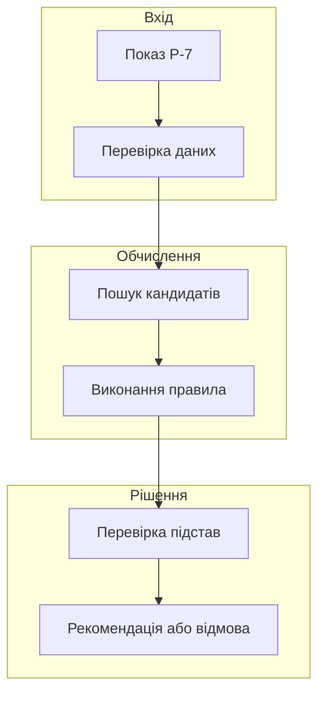
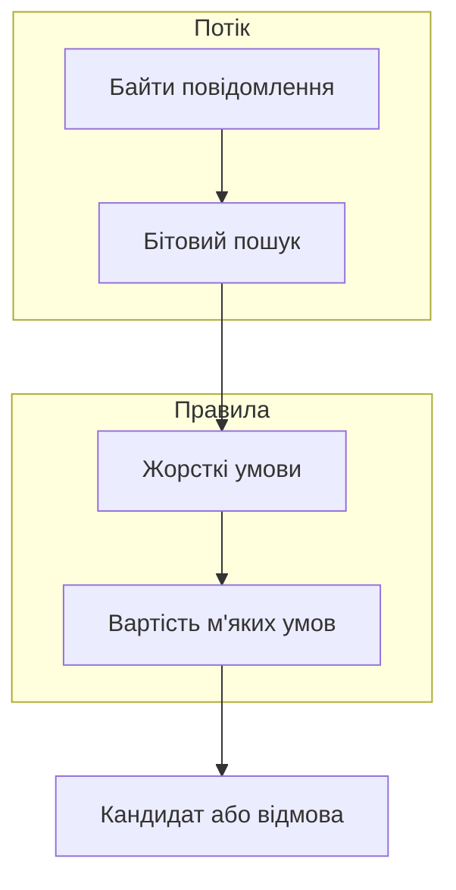
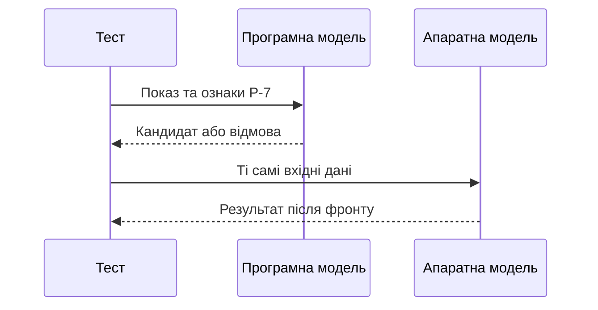
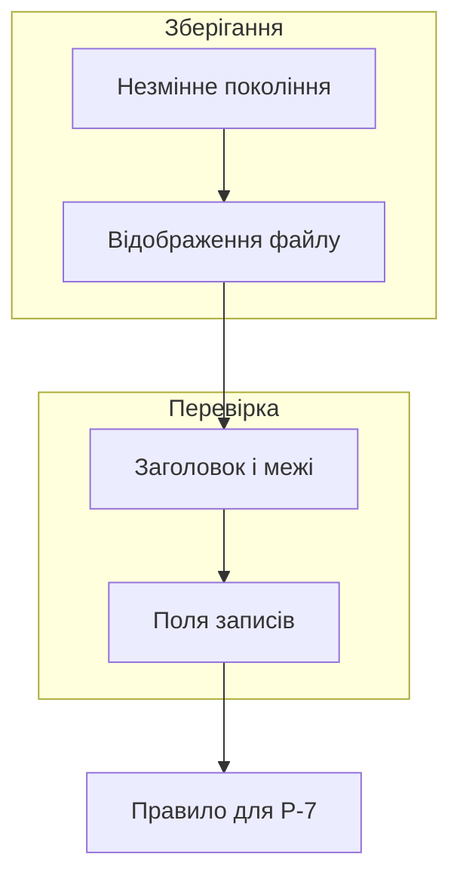
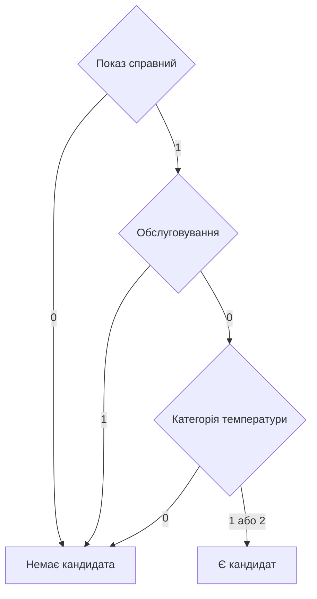

# Глава 28. Апаратне прискорення та подання знань у пам'яті

<a id="глава-28-апаратні-прискорювачі-ші-та-логіки-npu-тензорні-прискорювачі-fpga-безцикловий-асемблер-epu-wpmaxsat-однотактові-компаратори-та-бінарні-пакети-zero-copy-mmap"></a>

> **Підручник:** [Експертні Системи](../README.md) · [Том 3. Нейро-символьні, ізольовані, критичні до безпеки та високопродуктивні експертні системи](README.md)  
> **Навчальний рівень:** прикладні програмісти та студенти комп'ютерних наук\
> **Обладнання:** звичайний ноутбук або ПК; прискорювач і плата FPGA не потрібні для виконання прикладів\
> **Мови:** Python 3.14.4, Go 1.27.1, Verilog-2005 і SystemVerilog (Icarus Verilog 12.0)\
> **Попередня глава:** [Глава 27. Доведення коректності та обґрунтування безпеки](ch27-correctness-and-safety-assurance.md)\
> **Наступна глава:** [Глава 29. Захищений обмін знаннями між системами](ch29-secure-knowledge-exchange.md)\
> **Автор:** Микола Мартинович Федчик

---

## Анотація

Експертна система може мати правильне правило й усе ж не встигнути його застосувати: дані надходять швидше, ніж їх обробляє процесор, або база знань не вміщується в доступну пам'ять. Перенесення обчислень на прискорювач не розв'язує цих проблем автоматично: треба врахувати передавання даних, точність подання та перевірку результату.

На прикладі рекомендації огляду обладнання `P-7` у главі розглянуто вибір виконавця, бітовий пошук, узгодження правил, безциклову програму й апаратний компаратор. Читач перевірить реалізації на Python, Go та Verilog, а також прочитає бінарні записи через відображення файлу в пам'ять. Числа для продуктивності та енергії є навчальними припущеннями, а симуляція не є сертифікацією обладнання.

---

<!-- chapter-toc:start -->
## Зміст глави

- [1. Продуктивність, енергоспоживання та вибір виконавця](#1-продуктивність-енергоспоживання-та-вибір-виконавця)
  - [1.1. Інтенсивність обчислень і пропускна здатність пам'яті](#11-інтенсивність-обчислень-і-пропускна-здатність-памяті)
  - [1.2. Периферійне виконання квантованих моделей](#12-периферійне-виконання-квантованих-моделей)
  - [1.3. Енергія на перевірений результат](#13-енергія-на-перевірений-результат)
- [2. Прискорення фільтрації та логічного виведення](#2-прискорення-фільтрації-та-логічного-виведення)
  - [2.1. Бітово-паралельна фільтрація потоків](#21-бітово-паралельна-фільтрація-потоків)
  - [2.2. Послаблення м'яких правил зі збереженням жорстких вимог](#22-послаблення-мяких-правил-зі-збереженням-жорстких-вимог)
- [3. Компіляція схем для спеціалізованого виконання](#3-компіляція-схем-для-спеціалізованого-виконання)
  - [3.1. Інструкції з обмеженими переходами та оцінка часу](#31-інструкції-з-обмеженими-переходами-та-оцінка-часу)
  - [3.2. Апаратна реалізація перевірки допусків](#32-апаратна-реалізація-перевірки-допусків)
- [4. Бінарне подання знань і перевірка контрактів](#4-бінарне-подання-знань-і-перевірка-контрактів)
  - [4.1. Вирівнювання пакетів та оновлення поколінь](#41-вирівнювання-пакетів-та-оновлення-поколінь)
  - [4.2. Фільтрування предикатів і перевірка сертифікатів](#42-фільтрування-предикатів-і-перевірка-сертифікатів)
- [5. Практичні завдання та лабораторний практикум](#5-практичні-завдання-та-лабораторний-практикум)
  - [5.1. Контрольні запитання для самоперевірки](#51-контрольні-запитання-для-самоперевірки)
  - [5.2. Розрахункові задачі (трасування вручну)](#52-розрахункові-задачі-трасування-вручну)
  - [5.3. Завдання з програмної реалізації](#53-завдання-з-програмної-реалізації)
  - [5.4. Зв'язок із лабораторною та курсовою роботою курсу](#54-звязок-із-лабораторною-та-курсовою-роботою-курсу)
- [Висновки](#висновки)
- [Глосарій](#глосарій)
- [Скорочення та терміни](#скорочення-та-терміни)
- [Джерела](#джерела)
<!-- chapter-toc:end -->

---

<a id="1-модель-продуктивності-roofline-енергетичний-бюджет-периферійних-npu-та-поріг-делегування-обчислень"></a>

## 1. Продуктивність, енергоспоживання та вибір виконавця

Експертна система отримує показ температури `P-7`, шукає пов'язані записи та формує **кандидата на рекомендацію огляду**. Кандидат ще не є командою обладнанню: його мають перевірити правила, актуальність даних і повноваження з [Глав 26](ch26-controlled-actions.md) та [27](ch27-correctness-and-safety-assurance.md). Прискорювати можна пошук і перевірку предикатів, але не можна пропускати ці наступні етапи.

Для прикладу правило утворює кандидата тоді, коли показ справний, температура не менша за $80$ °C і обладнання не перебуває на обслуговуванні. Поріг умовний; одиниця та ознаки мають надійти від перевіреного джерела. Далі одна й та сама умова з'явиться в програмі, апаратному модулі та двійковому записі.

<a id="obj-28-1"></a>

**Діаграма 28.1. Місце прискорення в експертній системі.**



Стрілка від правила до перевірки показує важливу межу: швидший результат залишається кандидатом, доки не пройдено потрібні перевірки.

<a id="11-обчислювальна-інтенсивність-операцій-flopbyte-та-межа-пропускної-здатності-памяті-при-декодуванні-моделей"></a>

### 1.1. Інтенсивність обчислень і пропускна здатність пам'яті

Перед вибором пристрою потрібно з'ясувати, чи обчислення очікує на арифметичні операції, чи на дані з пам'яті. Для цього модель Roofline [[1]](#src-1) зіставляє кількість операцій із кількістю переданих байтів. Вона дає **верхню межу** продуктивності для вибраного рівня пам'яті, а не вимірювання конкретного застосунку.

<a id="obj-28-2"></a>

**Формула 28.2. Інтенсивність і модельна межа продуктивності.**

```math
I=\frac{F}{Q},\qquad P\leq \min(P_{\mathrm{peak}},\,B I).
```

Тут $F$ — додатна кількість операцій із рухомою комою, FLOP; $Q$ — додатний обсяг даних, переданих через обрану межу пам'яті, у байтах; $I$ — інтенсивність у FLOP/байт. $B$ — додатна пропускна здатність цієї межі в байтах/с, $P$ — продуктивність у FLOP/с, а $`P_{\mathrm{peak}}`$ — пікова продуктивність у тих самих одиницях для відповідного типу операцій.

Нехай обробка порції потребує $`2\,000\,000`$ FLOP і передавання $`4\,000\,000`$ байтів, а умовний пристрій має $B=2$ ГБ/с та пік $8$ GFLOP/с. Тоді $I=0{,}5$ FLOP/байт, межа за пам'яттю дорівнює $1$ GFLOP/с, а ідеалізована нижня межа тривалості — $2$ мс. Тут ГБ означає $10^9$ байтів. Подвоєння лише арифметичного піка не змінить цієї оцінки; зменшення передавання або повторне використання даних може змінити її.

На практиці $Q$ і $B$ залежать від обраного рівня пам'яті, розміру порції та способу доступу. Затримки, конкуренція за шину, формат даних і невикористані обчислювальні блоки можуть збільшити реальний час. Тому наступний крок — виміряти повний шлях, а не підставити паспортний пік як фактичну швидкість.

<a id="12-виконання-квантованих-локальних-моделей-та-двоенкодерів-на-вбудованих-npu-підтримка-операторів-квантування-та-вимірювання-енергії"></a>

### 1.2. Периферійне виконання квантованих моделей

Нейронний прискорювач може допомогти знайти тексти, подібні до повідомлення про `P-7`. Проте підготовка порції, передавання та запуск мають власну вартість. Розглянемо навчальну модель для $n$ однотипних запитів, де ці витрати вже включено до часу.

<a id="obj-28-3"></a>

**Формула 28.3. Порівняння часу процесора й прискорювача.**

```math
T_{\mathrm{CPU}}(n)=0.9n,\qquad T_{\mathrm{NPU}}(n)=3+0.2n.
```

$n$ — натуральна кількість запитів у порції; обидва часи задано в мілісекундах. Для чотирьох запитів отримуємо $3{,}6$ мс на CPU проти $3{,}8$ мс на NPU. Для п'яти — $4{,}5$ мс проти $4{,}0$ мс. За цих припущень прискорювач виграє за $n\geq5$: нерівність $3+0{,}2n\lt0{,}9n$ еквівалентна $n\gt30/7$.

Функція порівнює час у десятих частках мілісекунди за допомогою цілих чисел. Вхід — додатний розмір порції; результат — назва виконавця. У разі однакового часу обрано CPU.

<a id="obj-28-4"></a>

**Лістинг 28.4. Поріг делегування (Python 3.14.4).**

<details><summary>Показати лістинг 28.4 (8 рядків, Python 3.14.4)</summary>

```python
def choose_executor(n):
    if type(n) is not int or n < 1:
        raise ValueError("batch size must be a positive integer")
    return "NPU" if 30 + 2 * n < 9 * n else "CPU"

assert choose_executor(4) == "CPU"
assert choose_executor(5) == "NPU"
print(choose_executor(4), choose_executor(5))
```
</details>

Вивід — `CPU NPU`. У реальній системі коефіцієнти слід виміряти для підтримуваних операторів і розмірів порцій; черга, енергоспоживання та однакова якість результатів тут ще не враховані.

Для зменшення обсягу даних модель можуть подати цілими числами. У найпростішому симетричному квантуванні `int8` нуль подається нулем, а дійсне значення округлюється з масштабом [[2]](#src-2):

<a id="obj-28-5"></a>

**Формула 28.5. Навчальне симетричне квантування.**

```math
q=\min(127,\max(-128,\mathrm{round}(x/s))),\qquad \widehat{x}=sq.
```

$x$ — скінченне дійсне число в одиницях ознаки; $s\gt0$ — скінченний масштаб у тих самих одиницях на крок; $q$ — ціле число від $-128$ до $127$; $`\widehat{x}`$ — відновлене наближення. У прикладі округлення рівновіддалених значень відбувається до парного цілого. За відсутності насичення похибка в ідеальній дійсній арифметиці не перевищує половини кроку; на межі діапазону це обмеження більше не діє.

Вхід наступної функції — значення й масштаб; результат — пара з цілого коду та відновленого числа.

<a id="obj-28-6"></a>

**Лістинг 28.6. Округлення та насичення (Python 3.14.4).**

<details><summary>Показати лістинг 28.6 (15 рядків, Python 3.14.4)</summary>

```python
from math import isfinite

def quantize(x, scale):
    if not isfinite(x) or not isfinite(scale) or scale <= 0:
        raise ValueError("finite value and positive finite scale required")
    ratio = x / scale
    q = 127 if ratio >= 127 else -128 if ratio <= -128 else round(ratio)
    restored = q * scale
    if not isfinite(restored):
        raise OverflowError("restored value is not finite")
    return q, restored

assert quantize(0.85, 0.01) == (85, 0.85)
assert quantize(1.40, 0.01) == (127, 1.27)
print(quantize(1.40, 0.01))
```
</details>

Для $x=1{,}40$ і $s=0{,}01$ потрібне ціле значення $140$ виходить за межу `int8`; після насичення маємо $127$ і $1{,}27$. Тому перед заміною моделі потрібно порівняти якість пошуку на незалежній вибірці, включно з пропущеними потрібними документами. Саме підтримка формату не доводить, що NPU виконує всі оператори, а зміна числового формату не зберігає автоматично порядок результатів.

<a id="13-розрахунок-енергії-на-один-верифікований-висновок-у-батарейних-та-бортових-системах"></a>

### 1.3. Енергія на перевірений результат

У пристрої з обмеженим живленням швидший варіант може витратити більше енергії на запуск або повернути менше придатних висновків. Для порівняння виміряємо енергію всього визначеного тракту — від отримання порції до завершення перевірки — і поділимо її на кількість результатів, що пройшли однакові критерії.

<a id="obj-28-7"></a>

**Формула 28.7. Енергія на один перевірений результат.**

```math
E_{\mathrm{result}}=\frac{\int_{t_0}^{t_1}P(t)\,dt}{N_{\mathrm{verified}}}.
```

$P(t)\geq0$ — виміряна потужність у ватах у момент $t$; $`t_0`$ і $`t_1`$ — початок і кінець вимірювання в секундах, причому $`t_1\gt t_0`$; інтеграл — енергія в джоулях. $`N_{\mathrm{verified}}\geq1`$ — ціла кількість результатів, що пройшли визначену перевірку; $`E_{\mathrm{result}}`$ вимірюється в джоулях на результат. За нуля результатів цей показник не визначений: слід повідомити про відсутність придатного результату, а не ділити на нуль.

Наприклад, $100$ Дж на $20$ перевірених результатів дає $5$ Дж/результат; $80$ Дж на $10$ результатів — $8$ Дж/результат. Порівняння має сенс лише за однакових вхідних даних, меж вимірювання та критеріїв якості й повноти: зменшення знаменника через пропущені випадки не можна приховати усередненням. Для живленого від мережі прискорювача потрібно врахувати і його енергію, і енергію процесора, що забезпечує передавання та перевірку.

<a id="2-прискорення-логічного-виведення-бітові-автомати-ebpfxdp-та-розвязувачі-weighted-partial-maxsat"></a>

## 2. Прискорення фільтрації та логічного виведення

Потік повідомлень від `P-7` може містити багато записів, не пов'язаних з оглядом. Якщо запускати повний пошук і перевірку правил для кожного байта, час витрачатиметься навіть на очевидно нерелевантні дані. Перший етап має дешево відібрати кандидатів, а другий — розрізнити обов'язкові вимоги й переваги, які дозволено послабити.

<a id="obj-28-8"></a>

**Діаграма 28.8. Від потоку до узгодженого кандидата.**



Фільтр на схемі не замінює правила: знайдена послідовність байтів лише вказує, які дані варто розглянути далі.

<a id="21-бітово-паралельні-фільтри-глушкова-shift-and-для-попереднього-відсікання-мережевих-і-сенсорних-потоків"></a>

### 2.1. Бітово-паралельна фільтрація потоків

Нехай повідомлення про `P-7` містить умовну байтову сигнатуру `ABA`. Потрібно знайти всі її входження, зокрема ті, що перекриваються. Для короткого шаблону алгоритм Shift-And зберігає можливі збіги в одному машинному слові: біт позиції шаблону дорівнює одиниці, якщо відповідний префікс щойно закінчився на поточному байті.

<a id="obj-28-9"></a>

**Формула 28.9. Оновлення стану бітового автомата.**

```math
R_t=\bigl((R_{t-1}\ll 1)\mathbin{\lor}1\bigr)\mathbin{\&}M[c_t].
```

$`R_t`$ — слово стану після $t$-го байта, початкове $`R_0=0`$; $`c_t`$ — поточний байт від $0$ до $255$; $`M[c_t]`$ — маска позицій, у яких шаблон має цей байт. Зсув $`\ll1`$, побітові АБО та І працюють над беззнаковим словом. Довжина шаблону $m$ у наведеній реалізації — від $1$ до $64$ байтів; збіг закінчується там, де біт $m-1$ стану дорівнює одиниці. Номери байтів тексту далі починаються з нуля.

Для `ABA` молодший біт відповідає першій позиції: `M[A] = 101`, `M[B] = 010` у двійковому записі. Функція отримує байтовий текст і шаблон та повертає індекси **кінців** входжень або явну помилку розміру шаблону. Вона не трактує байти як окремі символи Unicode; правила побітових операцій визначено в специфікації Go [[11]](#src-11).

<a id="obj-28-10"></a>

**Лістинг 28.10. Бітовий пошук із перекриттям (Go 1.27.1).**

<details><summary>Показати лістинг 28.10 (30 рядків, Go 1.27.1)</summary>

```go
package main

import (
    "fmt"
)

func Find(text, pattern []byte) ([]int, error) {
    if len(pattern) == 0 || len(pattern) > 64 {
        return nil, fmt.Errorf("pattern length must be 1..64 bytes")
    }
    var masks [256]uint64
    for i, b := range pattern { masks[b] |= 1 << uint(i) }
    state, goal := uint64(0), uint64(1) << uint(len(pattern)-1)
    ends := make([]int, 0)
    for i, b := range text {
        state = ((state << 1) | 1) & masks[b]
        if state & goal != 0 { ends = append(ends, i) }
    }
    return ends, nil
}

func main() {
    ends, err := Find([]byte("ABABA"), []byte("ABA"))
    if err != nil || len(ends) != 2 || ends[0] != 2 || ends[1] != 4 { panic("overlap") }
    fmt.Println(ends)
    long := make([]byte, 64)
    ends, err = Find(long, long)
    if err != nil || len(ends) != 1 || ends[0] != 63 { panic("64 bits") }
    if _, err = Find(nil, nil); err == nil { panic("empty pattern accepted") }
}
```
</details>

Програма виводить `[2 4]` та окремо перевіряє шаблон із $64$ байтів. Стан після кожного кроку пояснює, чому другий збіг не загублено.

<a id="obj-28-11"></a>

**Таблиця 28.11. Трасування `ABA` у `ABABA`.**

| Індекс | Байт | Стан після І | Є завершений збіг |
|---:|:---:|:---:|:---:|
| 0 | A | `001` | Ні |
| 1 | B | `010` | Ні |
| 2 | A | `101` | Так |
| 3 | B | `010` | Ні |
| 4 | A | `101` | Так |

Таблиця масок займає $256$ слів, а час проходу лінійний за довжиною тексту після побудови масок. Список збігів додатково займає пам'ять пропорційно їх кількості. У потоковій реалізації стан слід зберігати між порціями одного повідомлення та скидати на його межі.

XDP застосовується до вхідних мережевих пакетів, а не до довільного сенсорного потоку [[3]](#src-3). Перенесення такого автомата в eBPF потребує перевірки меж пакета та окремого проєктування стану для повідомлень, розбитих між пакетами. Перевірювач ядра контролює допустимість операцій і доступів до пам'яті [[4]](#src-4), але не встановлює правильності предметної сигнатури. Наведений Go-код не завантажує програму в ядро.

<a id="22-зважена-релаксація-конфліктних-мяких-правил-wpmaxsat-за-непорушності-жорстких-інваріантів-безпеки"></a>

### 2.2. Послаблення м'яких правил зі збереженням жорстких вимог

Після відбору кандидатів можуть суперечити дві законні переваги: якнайшвидше створити заявку на огляд і не створювати зайвих заявок. Їх можна зважити, але заборону створення заявки без повноваження або під час обслуговування не можна купити великою вагою. Weighted Partial MaxSAT відокремлює **жорсткі** логічні умови від **м'яких** і мінімізує сумарну вагу порушених м'яких умов [[5]](#src-5).

<a id="obj-28-12"></a>

**Формула 28.12. Оптимізація за непорушних умов.**

```math
\min_{\mathbf a\in\{0,1\}^{n}}\sum_{i=1}^{m}w_i(1-C_i(\mathbf a)),
\qquad H_j(\mathbf a)=1\quad(j=1,\ldots,h).
```

$`\mathbf a`$ — набір із $n\geq1$ булевих змінних; $`C_i`$ і $`H_j`$ — відповідно м'які та жорсткі диз'юнкції літералів, кожна зі значенням $0$ або $1$; $m,h\geq0$ — кількості умов. $`w_i`$ — додатна ціла вага без фізичної одиниці. Якщо жодне присвоювання не задовольняє всі $`H_j`$, задача має результат `UNSAT`, а не «найменш небезпечне» порушення.

Позначимо через `A` наявність повноваження, через `M` обслуговування, а через `R` створення заявки. Для перевірених фактів `A = true`, `M = false` жорсткі умови такі: `A`, `не M`, `не R або A`, `не R або не M`. М'які переваги `R` і `не R` мають ваги $5$ та $2$. За `R = true` порушено лише другу перевагу, вартість $2$; за `R = false` — першу, вартість $5$. Тому оптимум — створити кандидата заявки. За відсутності повноваження жорстка умова забороняє `R`, навіть коли це коштує $5$.

Для перевірки прикладу достатньо повного перебору. Кожен літерал подано ненульовим цілим числом: `3` означає третю змінну, `-3` — її заперечення. Вхід — кількість змінних і списки умов; результат — вартість та присвоювання. Для однакових вартостей обирається лексикографічно менше присвоювання.

<a id="obj-28-13"></a>

**Лістинг 28.13. Перебір допустимих присвоювань (Python 3.14.4).**

<details><summary>Показати лістинг 28.13 (24 рядки, Python 3.14.4)</summary>

```python
from itertools import product

def solve(n, hard, soft):
    if type(n) is not int or not 1 <= n <= 12:
        raise ValueError("variable count must be 1..12")
    if any(type(w) is not int or w <= 0 for _, w in soft):
        raise ValueError("weights must be positive integers")
    clauses = list(hard) + [clause for clause, _ in soft]
    if any(type(lit) is not int or not 1 <= abs(lit) <= n
           for clause in clauses for lit in clause):
        raise ValueError("literal outside the variable range")
    def holds(clause, assignment):
        return any(assignment[abs(lit) - 1] == (lit > 0) for lit in clause)
    best = None
    for assignment in product((False, True), repeat=n):
        if not all(holds(clause, assignment) for clause in hard):
            continue
        cost = sum(w for clause, w in soft if not holds(clause, assignment))
        candidate = (cost, assignment)
        if best is None or candidate < best:
            best = candidate
    if best is None:
        raise ValueError("UNSAT: incompatible hard clauses")
    return best
```
</details>

Наступний лістинг продовжує попередній: змінні мають порядок `A`, `M`, `R`. Він перевіряє оптимум, відсутність повноваження та несумісні жорсткі умови.

<a id="obj-28-14"></a>

**Лістинг 28.14. Три перевірки розв'язку (Python 3.14.4).**

<details><summary>Показати лістинг 28.14 (12 рядків, Python 3.14.4)</summary>

```python
hard = [(1,), (-2,), (-3, 1), (-3, -2)]
soft = [((3,), 5), ((-3,), 2)]
assert solve(3, hard, soft) == (2, (True, False, True))
without_authority = [(-1,), (-2,), (-3, 1), (-3, -2)]
assert solve(3, without_authority, soft) == (5, (False, False, False))
try:
    solve(1, [(1,), (-1,)], [])
except ValueError as error:
    assert "UNSAT" in str(error)
else:
    raise AssertionError("hard conflict was not detected")
print(solve(3, hard, soft))
```
</details>

Вивід — `(2, (True, False, True))`. Порожня жорстка диз'юнкція також несумісна, а порожня м'яка завжди додає свою вагу. Перебір зростає як $2^n$ і тут навмисно обмежений $12$ змінними; для великих задач потрібен спеціалізований розв'язувач і незалежна перевірка його відповіді. Ваги є політичним або предметним вибором, а не мірою істинності чи автоматичним доказом безпеки.

<a id="3-компіляція-ациклічних-схем-міркувань-у-безцикловий-асемблер-epu-та-синтез-на-пліс-fpga"></a>

## 3. Компіляція схем для спеціалізованого виконання

Коли предикат перевіряється часто, його можна подати не лише як функцію загального призначення, а й як невелику програму для спеціалізованого виконавця або як цифрову схему. Для `P-7` обидва варіанти мають відповідати одній умові: справний показ, щонайменше $80$ °C та відсутність обслуговування. Різні реалізації потрібно порівнювати на однакових входах, інакше прискорювач може швидко повертати інший результат.

<a id="obj-28-15"></a>

**Діаграма 28.15. Одна умова у двох реалізаціях.**



Тест зіставляє значення предиката, але не доводить, що джерело показу достовірне чи що схему вже розміщено на фізичній платі.

<a id="31-набір-регістрових-інструкцій-epu-з-переходами-виключно-вперед-forward-only-jumps-гарантією-wcet-та-липкими-прапорцями-порушень"></a>

### 3.1. Інструкції з обмеженими переходами та оцінка часу

Навчальний виконавець правил перевіряє показ послідовно. Інструкція може перейти лише на більший номер, а остання інструкція обов'язково завершує програму. Отже, жоден номер не відвідується вдруге: для програми з $L$ інструкцій можна оцінити кількість кроків без перебору всіх входів.

<a id="obj-28-16"></a>

**Формула 28.16. Межа кроків і умовний час виконання.**

```math
N_{\mathrm{steps}}\leq L,\qquad T_{\mathrm{model}}\leq\frac{LC}{f}.
```

$L\geq1$ — ціла кількість інструкцій перевіреної програми; $`N_{\mathrm{steps}}`$ — кількість виконаних інструкцій; $C\geq1$ — припущена верхня кількість тактів на інструкцію, включно з її доступами; $f\gt0$ — частота в герцах; $`T_{\mathrm{model}}`$ — час у секундах. Друга нерівність діє лише за заданої межі $C$ та без додаткових затримок; вона не включає завантаження й попередню перевірку програми.

За $L=5$, $C=2$ такти та $f=100$ МГц отримуємо не більше $10$ тактів, тобто $100$ нс у моделі. Ці числа не є виміряним часом Python-коду. Для реальної оцінки найгіршого часу потрібні характеристики конкретного процесора, пам'яті, переривань і конкурентних запитів.

Програма нижче використовує переходи `INVALID`, `LT`, `MAINT` і завершення `YES` або `NO`. Перш ніж виконувати її, інтерпретатор перевіряє **всі** переходи, навіть недосяжні для конкретного входу. Вхід — список трійок `(операція, аргумент, ціль)`, ціла температура від $0$ до $511$ °C і дві булеві ознаки. Вихід — кандидат і кількість виконаних інструкцій.

<a id="obj-28-17"></a>

**Лістинг 28.17. Перевірка та виконання безциклової програми (Python 3.14.4).**

<details><summary>Показати лістинг 28.17 (30 рядків, Python 3.14.4)</summary>

```python
def execute(code, temperature, valid, maintenance):
    if type(temperature) is not int or not 0 <= temperature <= 511:
        raise ValueError("temperature must be an integer in 0..511")
    if type(valid) is not bool or type(maintenance) is not bool:
        raise ValueError("flags must be Boolean")
    if not code or code[-1][0] not in ("YES", "NO"): raise ValueError("missing decision")
    for pc, (op, arg, target) in enumerate(code):
        if op in ("INVALID", "LT", "MAINT"):
            if type(target) is not int or not pc < target < len(code):
                raise ValueError("jump must lead forward within the program")
            if op == "LT" and (type(arg) is not int or not 0 <= arg <= 511):
                raise ValueError("invalid threshold")
        elif op not in ("YES", "NO"):
            raise ValueError("unknown instruction")
    pc = steps = 0
    while True:
        op, arg, target = code[pc]
        steps += 1
        if op == "YES": return True, steps
        if op == "NO": return False, steps
        jump = ((op == "INVALID" and not valid)
                or (op == "LT" and temperature < arg)
                or (op == "MAINT" and maintenance))
        pc = target if jump else pc + 1

program = [("INVALID", 0, 4), ("LT", 80, 4), ("MAINT", 0, 4),
           ("YES", 0, 0), ("NO", 0, 0)]
assert execute(program, 80, True, False) == (True, 4)
assert execute(program, 79, True, False) == (False, 3)
print(execute(program, 80, True, False))
```
</details>

Вивід — `(True, 4)`. Числа біля `INVALID`, `MAINT` і завершень є заповнювачами однакового формату інструкції; аргумент порівняння використовується лише в `LT`. Ось чотири характерні шляхи, де інструкції нумеруються з нуля.

<a id="obj-28-18"></a>

**Таблиця 28.18. Маршрути програми перевірки показу.**

| Температура, °C | Показ справний | Обслуговування | Номери інструкцій | Кандидат |
|---:|:---:|:---:|:---|:---:|
| 80 | Так | Ні | `0 → 1 → 2 → 3` | Так |
| 79 | Так | Ні | `0 → 1 → 4` | Ні |
| 80 | Так | Так | `0 → 1 → 2 → 4` | Ні |
| 80 | Ні | Ні | `0 → 4` | Ні |

Для першого рядка виконано чотири інструкції; за умовних $2$ тактів на кожну це $80$ нс, менше за межу $100$ нс. Таке обмеження кількості кроків корисне під час проєктування виконавця, але не замінює аналізу його апаратних затримок.

<a id="32-синтез-однотактового-апаратного-компаратора-допусків-на-деревах-збереження-переносу-csa64-у-verilog-для-навчальної-плати-fpga"></a>

### 3.2. Апаратна реалізація перевірки допусків

Цифрова схема може перевіряти той самий предикат паралельно: компаратор зіставляє температуру з порогом, а логічні елементи поєднують результат з ознаками. Регістр видає результат після активного фронту тактового сигналу. Синхронний `reset` примусово встановлює нуль на такому фронті; до першого скидання початкове значення регістра не припускається.

Вхід модуля — беззнакова дев'ятибітна температура та сигнали `valid`, `maintenance`, `reset` і `clk`. Вихід `candidate` означає лише проходження локального предиката. Перевірка походження, віку показу та повноважень залишається за іншими компонентами.

<a id="obj-28-19"></a>

**Лістинг 28.19. Зареєстрований предикат (Verilog-2005, Icarus Verilog 12.0).**

<details><summary>Показати лістинг 28.19 (10 рядків, Verilog-2005, Icarus Verilog 12.0)</summary>

```verilog
module rule (
    input wire clk, reset, valid, maintenance,
    input wire [8:0] temperature,
    output reg candidate
);
    always @(posedge clk) begin
        if (reset) candidate <= 1'b0;
        else candidate <= valid && !maintenance && temperature >= 9'd80;
    end
endmodule
```
</details>

Наступний тестовий стенд використовує модуль із попереднього лістингу й перевіряє всі $512\cdot2\cdot2=2048$ сполучень температури та двох ознак. Затримка `#1` дає змогу спостерігати результат після неблокувального присвоювання в симуляції.

<a id="obj-28-20"></a>

**Лістинг 28.20. Повний перебір входів компаратора (SystemVerilog, Icarus Verilog 12.0).**

<details><summary>Показати лістинг 28.20 (28 рядків, SystemVerilog, Icarus Verilog 12.0)</summary>

```systemverilog
`timescale 1ns/1ps
module test;
    reg clk = 0, reset = 1, valid = 0, maintenance = 0;
    reg [8:0] temperature = 0;
    wire candidate;
    rule dut(clk, reset, valid, maintenance, temperature, candidate);
    always #5 clk = ~clk;
    task check;
        input [8:0] t;
        input v, m, expected;
        begin
            @(negedge clk); temperature = t; valid = v; maintenance = m;
            @(posedge clk); #1;
            if (candidate !== expected) $fatal(1, "mismatch at %0d", t);
        end
    endtask
    integer t, v, m;
    initial begin
        @(posedge clk); #1;
        if (candidate !== 0) $fatal(1, "reset failed");
        @(negedge clk); reset = 0;
        for (t = 0; t < 512; t = t + 1)
            for (v = 0; v < 2; v = v + 1)
                for (m = 0; m < 2; m = m + 1)
                    check(t, v, m, (v != 0) && (m == 0) && t >= 80);
        $display("PASS 2048"); $finish;
    end
endmodule
```
</details>

Збережіть модуль у `rule.v`, а стенд у `test.sv`; команди `iverilog -g2012 -s test -o sim rule.v test.sv` і `vvp sim` мають вивести `PASS 2048` [[12]](#src-12). Симулятор також може повідомити час завершення. Команда синтезу Yosys для навчального відображення на сімейство Xilinx 7 — `yosys -p 'read_verilog rule.v; synth_xilinx -family xc7 -top rule; stat'` [[6]](#src-6). Вона не виконує розміщення, трасування чи вимірювання фізичної плати. Зокрема, фронт у симуляції та наведені затримки стенда не доводять досягнення заданої частоти після розміщення схеми.

<a id="4-бінарні-контейнери-знань-нульового-копіювання-zero-copy-mmap-каскадні-таблиці-mdd-та-сертифікати-контрактів"></a>

## 4. Бінарне подання знань і перевірка контрактів

Правило, яке перевіряли програма й схема, треба зберегти разом із його порогом і посиланням на джерело. Текстовий формат зручний для редагування, але багаторазовий розбір великих баз може споживати помітну частину часу та пам'яті. Бінарний формат дає змогу звертатися до окремого запису за зміщенням, якщо його структура й межі заздалегідь перевірені.

<a id="obj-28-21"></a>

**Діаграма 28.21. Читання перевіреного покоління знань.**



Перевірка структури на схемі запобігає використанню некоректного запису, але сама по собі не встановлює, хто його створив або чи правильний предметний поріг.

<a id="41-структура-вирівняного-по-64-байти-бінарного-пакета-kp-відображення-через-mmap-та-безблокувальне-оновлення-поколінь-rcu"></a>

### 4.1. Вирівнювання пакетів та оновлення поколінь

Спроєктуємо невеликий навчальний пакет із заголовком і записами сталої довжини. Усі багатобайтові цілі числа мають порядок байтів little-endian. Перший запис починається зі зміщення $64$ байти від початку файлу; це властивість формату, а не припущення про розмір рядка кешу конкретної машини.

<a id="obj-28-22"></a>

**Таблиця 28.22. Навчальний двійковий формат.**

| Область | Поля | Розмір |
|---|---|---:|
| Заголовок | Сигнатура `EXK1`, версія та розмір запису | 4 + 2 + 2 байти |
| Заголовок | Кількість записів, номер покоління, довжина даних | 4 + 8 + 8 байтів |
| Заголовок | Зарезервовані нульові байти | 36 байтів |
| Кожен запис | Ідентифікатор, поріг, потрібні та заборонені ознаки, посилання на джерело | 4 + 2 + 1 + 1 + 8 байтів |

Заголовок займає $64$ байти, кожен запис — $16$ байтів. Поріг подано знаковим цілим у градусах Цельсія, але формат правила обмежує значення діапазоном $0\ldots511$. У байтах ознак біт `1` означає справність показу, біт `2` — обслуговування; інші біти в цьому прикладі заборонено. Числовий ідентифікатор джерела є посиланням, а не самим доказом походження.

Перевірювач отримує об'єкт із байтовим буфером та повертає номер покоління й кількість записів. Він відхиляє невідому версію, невідповідні довжини, неприпустимі поля, дубльовані ідентифікатори й надто велику кількість записів. Позначення `Struct` задає точний порядок і розмір полів, незалежний від вирівнювання структур мови C [[7]](#src-7).

<a id="obj-28-23"></a>

**Лістинг 28.23. Перевірка заголовка й записів (Python 3.14.4).**

<details><summary>Показати лістинг 28.23 (23 рядки, Python 3.14.4)</summary>

```python
from struct import Struct

HEADER = Struct("<4sHHIQQ36s")
RECORD = Struct("<IhBBQ")

def validate(mapped):
    if len(mapped) < HEADER.size:
        raise ValueError("short header")
    magic, version, size, count, generation, length, reserved = HEADER.unpack_from(mapped)
    if (magic != b"EXK1" or version != 1 or size != RECORD.size
            or count > 1_000_000 or generation == 0 or reserved != bytes(36)
            or length != count * size or len(mapped) != HEADER.size + length):
        raise ValueError("invalid header or length")
    seen = set()
    for i in range(count):
        rule_id, threshold, required, forbidden, source = RECORD.unpack_from(
            mapped, HEADER.size + i * size)
        if (rule_id == 0 or rule_id in seen or source == 0
                or not 0 <= threshold <= 511 or required & forbidden
                or (required | forbidden) & ~3):
            raise ValueError("invalid record")
        seen.add(rule_id)
    return generation, count
```
</details>

Наступний лістинг продовжує попередній: створює тимчасовий файл із двома правилами, відображає його лише для читання й перевіряє перший запис. Прапорці `1` і `2` відповідають справності та обслуговуванню; для `P-7` потрібен перший прапорець і заборонений другий.

<a id="obj-28-24"></a>

**Лістинг 28.24. Створення та читання відображеного пакета (Python 3.14.4).**

<details><summary>Показати лістинг 28.24 (26 рядків, Python 3.14.4)</summary>

```python
from mmap import mmap, ACCESS_READ
from tempfile import TemporaryFile

records = [(7, 80, 1, 2, 1001), (8, 90, 1, 2, 1002)]
payload = b"".join(RECORD.pack(*record) for record in records)
header = HEADER.pack(b"EXK1", 1, RECORD.size, len(records), 3,
                     len(payload), bytes(36))
with TemporaryFile() as file:
    file.write(header + payload)
    file.flush()
    with mmap(file.fileno(), 0, access=ACCESS_READ) as mapped:
        generation, count = validate(mapped)
        first = RECORD.unpack_from(mapped, HEADER.size)
        _, threshold, required, forbidden, _ = first
        flags = 1
        assert 80 >= threshold and flags & required == required
        assert flags & forbidden == 0
        print(generation, count, threshold)
damaged = bytearray(header + payload)
damaged[0] = 0
try:
    validate(damaged)
except ValueError as error:
    assert "header" in str(error)
else:
    raise AssertionError("damaged header was accepted")
```
</details>

Вивід — `3 2 80`. Розмір файлу становить $64+2\cdot16=96$ байтів. При `flags = 1` і температурі $80$ °C обидві перевірки ознак та порога збігаються з правилом попереднього розділу.

`mmap` відображає файл у віртуальний адресний простір [[8]](#src-8). Це дає змогу не створювати окрему копію **всього** файла перед доступом, однак сторінки можуть завантажуватися з носія під час звернення, а `unpack_from` створює об'єкти Python. Множина для виявлення дублікатів у лістингу 28.23 додатково займає пам'ять пропорційно кількості записів. Термін «без копіювання» не означає відсутності файлового введення-виведення чи будь-якого копіювання на всьому шляху.

Для оновлення створюють і перевіряють новий незмінний файл, після чого атомарно замінюють ім'я активного покоління на тій самій файловій системі. Читач із відкритим старим файлом продовжує використовувати його, а новий читач відкриває нове покоління. Старий файл не можна обрізати чи змінювати, поки він відображений: доступ до сторінки за новим кінцем файла в Linux може спричинити `SIGBUS`. Збереження після збою живлення потребує окремого протоколу синхронізації файла й каталогу; координоване звільнення старих поколінь — окремого механізму, наприклад підрахунку читачів або належної реалізації RCU [[9]](#src-9). Сама атомарна заміна імені не реалізує RCU.

<a id="42-фільтри-блума-для-миттєвого-відсікання-відсутніх-предикатів-каскадна-факторизація-багатовимірних-таблиць-допусків-та-лінійна-перевірка-сертифікатів-prepostsafewcet"></a>

### 4.2. Фільтрування предикатів і перевірка сертифікатів

Якщо більшість запитів стосується відсутніх предикатів, перед точним пошуком можна використати фільтр Блума [[10]](#src-10). Під час вставлення він встановлює кілька бітів для кожного ключа. Нуль хоча б в одному потрібному біті означає відсутність ключа; всі одиниці означають лише **можливу** присутність і потребують точного пошуку.

<a id="obj-28-25"></a>

**Формула 28.25. Наближена ймовірність хибнопозитивної відповіді.**

```math
p_{\mathrm{fp}}\approx\left(1-e^{-kn/m}\right)^k.
```

$m\gt0$ — кількість бітів фільтра, $k\gt0$ — ціла кількість позицій для ключа, $n\geq0$ — ціла кількість вставлених ключів; $`p_{\mathrm{fp}}`$ — безрозмірна ймовірність від $0$ до $1$. Це наближення для рівномірних, незалежних хешів, а не гарантія для довільних даних. За $m=64$, $k=3$ і $n=10$ отримуємо приблизно $0{,}0524$, або $5{,}24$% хибнопозитивних відповідей у цій моделі. Оцінку використовують для вибору розміру й перевіряють на робочих даних.

Фільтр не має хибнонегативних відповідей лише тоді, коли потрібні ключі справді вставлено, біти не пошкоджено й для пошуку використано ті самі параметри та кодування. Зокрема, фільтр від старого покоління не можна застосовувати до нового без узгодженої заміни.

Наведена реалізація бере три похідні від SHA-256 позиції у слові з $64$ бітів. Вхід — байтовий ключ; вихід `True` означає «можливо є», а не точний збіг. Три вставлені нижче ключі — окремий приклад, не десять ключів попереднього розрахунку.

<a id="obj-28-26"></a>

**Лістинг 28.26. Фільтр і приклад хибнопозитивної відповіді (Python 3.14.4).**

<details><summary>Показати лістинг 28.26 (30 рядків, Python 3.14.4)</summary>

```python
from hashlib import sha256

def positions(key):
    if type(key) is not bytes:
        raise ValueError("key must be bytes")
    return [int.from_bytes(sha256(bytes([i]) + key).digest()[:8], "big") % 64
            for i in range(3)]

def check_bits(bits):
    if type(bits) is not int or not 0 <= bits < 1 << 64:
        raise ValueError("filter must be a 64-bit unsigned integer")

def insert(bits, key):
    check_bits(bits)
    for position in positions(key):
        bits |= 1 << position
    return bits

def maybe(bits, key):
    check_bits(bits)
    return all(bits & (1 << position) for position in positions(key))

keys = [b"temp", b"valid", b"maintenance"]
bits = 0
for key in keys: bits = insert(bits, key)
assert all(maybe(bits, key) for key in keys)
other = next(f"other-{i}".encode() for i in range(10_000)
             if maybe(bits, f"other-{i}".encode()))
assert other not in keys
print(other)
```
</details>

Для цих ключів програма виводить `b'other-731'`: фільтр відповідає «можливо є», хоча точний список його не містить. На практиці таку відповідь потрібно передати точному індексу; фільтр не може дозволити заявку.

Інший спосіб зменшити повторну роботу — подати таблицю правил як багатозначну діаграму рішень. Для порога $80$ °C розділимо температуру на категорії: `0` — $0\ldots79$, `1` — $80\ldots119$, `2` — $120\ldots511$. Категорії `1` і `2` ведуть до одного результату, тому спільну гілку можна використати повторно.

<a id="obj-28-27"></a>

**Діаграма 28.27. Факторизація таблиці предиката.**



У коді вузол містить таблицю переходів за значенням відповідної ознаки. Усі вхідні значення перевіряються до обходу, навіть якщо деяку гілку цього разу не відвідано. Перебір зіставляє результат діаграми з вихідним предикатом для всіх $2048$ сполучень із тесту апаратної схеми.

<a id="obj-28-28"></a>

**Лістинг 28.28. Обхід діаграми та порівняння з предикатом (Python 3.14.4).**

<details><summary>Показати лістинг 28.28 (27 рядків, Python 3.14.4)</summary>

```python
EDGES = {
    "valid": {0: "deny", 1: "maintenance"},
    "maintenance": {0: "temperature", 1: "deny"},
    "temperature": {0: "deny", 1: "candidate", 2: "candidate"},
}

def evaluate(values):
    if set(values) != set(EDGES) or any(
        type(values[key]) is not int or values[key] not in edges
        for key, edges in EDGES.items()
    ):
        raise ValueError("invalid decision variables")
    node = "valid"
    for _ in range(len(EDGES)):
        if node in ("deny", "candidate"): break
        node = EDGES[node][values[node]]
    if node not in ("deny", "candidate"):
        raise ValueError("cyclic or incomplete decision graph")
    return node == "candidate"

for t in range(512):
    for v in (0, 1):
        for m in (0, 1):
            bucket = 0 if t < 80 else 1 if t < 120 else 2
            assert evaluate({"valid": v, "maintenance": m, "temperature": bucket}) == (
                bool(v) and not bool(m) and t >= 80)
print("PASS 2048")
```
</details>

Вивід — `PASS 2048`. Діаграма компактна для цієї функції, але факторизація довільної таблиці не гарантує зменшення розміру. Зміна порога чи значень ознак потребує повторної побудови й перевірки.

Нарешті, разом із пакетом можна передати опис контракту: передумови входу, очікуваний результат, інваріанти та підстави часової оцінки. Перевірювач має зв'язати ці твердження з конкретними байтами програми, специфікацією, припущеннями про середовище й належними доказами. Хеш допомагає перевірити лише збіг байтів із **довіреним** значенням.

Наступний лістинг продовжує приклад із `header` і `payload` у лістингу 28.24. Для демонстрації довірене значення обчислено з вихідних байтів; у застосуванні воно має надійти через автентифікований маніфест, а не з того самого неперевіреного файла.

<a id="obj-28-29"></a>

**Лістинг 28.29. Зіставлення байтів із довіреним хешем (Python 3.14.4).**

<details><summary>Показати лістинг 28.29 (13 рядків, Python 3.14.4)</summary>

```python
from hashlib import sha256
from hmac import compare_digest

def matches_digest(data, expected):
    if type(expected) is not bytes or len(expected) != 32:
        raise ValueError("expected digest must contain 32 bytes")
    return compare_digest(sha256(data).digest(), expected)

packet = header + payload
trusted = sha256(packet).digest()
assert matches_digest(packet, trusted)
assert not matches_digest(packet[:-1] + bytes([packet[-1] ^ 1]), trusted)
print("hash checks passed")
```
</details>

Вивід — `hash checks passed`. Збіг хешу не доводить ні авторства, ні правильності правила, ні часової межі. Для цих тверджень потрібні відповідно перевірений підпис, предметна та формальна перевірка, а також дані про конкретну платформу.

## 5. Практичні завдання та лабораторний практикум

Завдання допомагають перевірити не лише швидкодію окремого методу, а й відповідність результатів між реалізаціями. Для них достатньо комп'ютера з Python і Go; для апаратного прикладу потрібен також симулятор Icarus Verilog. Фізичний прискорювач або плата не є передумовою.

### 5.1. Контрольні запитання для самоперевірки

1. Чому збільшення арифметичної продуктивності не обов'язково прискорить задачу, обмежену пам'яттю? Які дані слід виміряти для моделі Roofline?
2. Чим відрізняються знайдений фільтром кандидат, оптимальний розв'язок м'яких умов і дозволена дія? Що робити, якщо жорсткі умови несумісні?
3. За яких припущень кількість інструкцій дає часову межу? Чому результат симуляції Verilog не підтверджує частоти фізичної схеми?
4. Чому позитивна відповідь фільтра Блума потребує точного пошуку? Які наслідки застосування фільтра старого покоління до нової бази?
5. Що перевіряє збіг хешу з довіреним значенням і які питання залишаються відкритими?

### 5.2. Розрахункові задачі (трасування вручну)

1. Обчисліть інтенсивність і модельну межу для $`4\,000\,000`$ FLOP, $`8\,000\,000`$ байтів, $B=4$ ГБ/с та піка $3$ GFLOP/с. Яка ідеалізована нижня межа часу?
2. Протрасуйте Shift-And для `BAB` у `BABAB`: запишіть маски й стан після кожного байта. Звірте кінцеві індекси з Go-програмою.
3. У прикладі MaxSAT замініть факт `не M` на `M`. Яке значення `R` допускають жорсткі умови та якою буде вартість м'яких?

<a id="53-інженерні-завдання-з-програмування-мовна-незалежність--спеціалізовані-dsl"></a>

### 5.3. Завдання з програмної реалізації

1. Переробіть Go-пошук для приймання порцій одного повідомлення. Перевірте збіг, поділений між порціями, скидання стану між повідомленнями, довжини шаблону $1$, $64$ і $65$ байтів.
2. Додайте до перевірок бінарного пакета тести на скорочений заголовок, дубльований ідентифікатор, невідомий біт і невідповідну довжину. Переконайтеся, що кожна помилка відхиляється до використання запису.
3. Змініть поріг у програмі, діаграмі рішень та Verilog-модулі на $90$ °C. Повторіть повний перебір і поясніть, чому зміна лише одного подання є помилкою.
4. Змоделюйте два покоління бази з різними ключами й покажіть, як старий фільтр Блума може хибно відкинути новий ключ. Потім пов'язуйте фільтр із номером покоління та перевірте відмову при розбіжності.

### 5.4. Зв'язок із лабораторною та курсовою роботою курсу

* **Навчальна вправа:** збережіть правило `P-7` у пакеті, перевірте його й порівняйте програмний результат з результатом апаратної симуляції для всіх допустимих входів.
* **Курсова робота:** додайте до обраного проєкту протокол вимірювання часу, якості та енергії; зафіксуйте версії даних, межі вимірювання й підстави для вибору виконавця. Перелік напрямів наведено в [описі Тому 3](README.md).

---

## Висновки

1. Модель Roofline і поріг делегування допомагають визначити, що обмежує час, але рішення про пристрій потребує вимірювання повного шляху та перевірки якості результатів.
2. Shift-And знаходить перекриття байтових шаблонів; позитивний результат є кандидатом, а не підтвердженням предметного факту. У MaxSAT м'які переваги оптимізуються лише серед присвоювань, що задовольняють усі жорсткі умови.
3. Переходи лише вперед обмежують кількість кроків моделі. Програмний інтерпретатор, діаграму рішень і симульований апаратний предикат можна зіставити на всьому скінченному просторі входів; це не замінює аналізу фізичного пристрою.
4. Фіксований двійковий формат потребує перевірки полів, довжин і незмінності відображеного файла. Фільтр Блума відсікає гарантовано відсутні ключі лише за своїх передумов, а хеш зіставляє байти з довіреним значенням.

Далі потрібно передати перевірене покоління іншій системі й зберегти його походження та сумісність. Захищений обмін знаннями заплановано розглянути в [Главі 29](ch29-secure-knowledge-exchange.md).

## Глосарій

- **Обчислювальна інтенсивність** — кількість операцій на байт даних, переданих через визначену межу пам'яті.
- **Квантування** — перетворення значень до обмеженого дискретного числового подання за заданим масштабом і правилами округлення.
- **Жорстка умова** — логічна вимога, яку має задовольняти кожен допустимий розв'язок.
- **М'яка умова** — перевага, порушення якої враховується в цільовій функції.
- **Відображення файла в пам'ять** — зв'язування ділянки віртуального адресного простору з вмістом файла.
- **Фільтр Блума** — ймовірнісна структура для відсікання відсутніх ключів із можливими хибнопозитивними відповідями.
- **Багатозначна діаграма рішень** — граф, у вузлах якого вибір наступної гілки залежить від значення дискретної змінної.

## Скорочення та терміни

- **CPU** — центральний процесор.
- **NPU** — спеціалізований прискорювач нейронних обчислень.
- **FLOP** — операція з рухомою комою; **FLOP/с** — кількість таких операцій за секунду.
- **FPGA / ПЛІС** — програмована користувачем логічна інтегральна схема.
- **eBPF** — механізм перевірюваних програм у Linux; **XDP** — точка обробки вхідних мережевих пакетів.
- **MaxSAT** — задача задоволення максимальної сукупності логічних умов; **WPMaxSAT** — її зважений варіант із жорсткими й м'якими умовами.
- **RCU** — механізм синхронізації читання та оновлення (*read-copy-update*).
- **WCET** — найгірший час виконання за визначених умов.

## Джерела

1. <a id="src-1"></a> Williams S., Waterman A., Patterson D. *Roofline: An Insightful Visual Performance Model for Multicore Architectures*. Communications of the ACM, 2009. [DOI: 10.1145/1498765.1498785](https://doi.org/10.1145/1498765.1498785).
2. <a id="src-2"></a> ONNX Runtime. [Quantize ONNX Models](https://onnxruntime.ai/docs/performance/model-optimizations/quantization.html).
3. <a id="src-3"></a> eBPF Docs. [XDP program type](https://docs.ebpf.io/linux/program-type/BPF_PROG_TYPE_XDP/).
4. <a id="src-4"></a> Linux Kernel Documentation. [eBPF verifier](https://docs.kernel.org/bpf/verifier.html).
5. <a id="src-5"></a> MaxSAT Evaluation 2024. [Rules and correctness of solver results](https://maxsat-evaluations.github.io/2024/contents/contents_rules.html).
6. <a id="src-6"></a> Yosys Documentation. [Synthesis in detail](https://yosyshq.readthedocs.io/projects/yosys/en/latest/using_yosys/synthesis/index.html).
7. <a id="src-7"></a> Python Documentation. [`struct` — Interpret bytes as packed binary data](https://docs.python.org/3.14/library/struct.html).
8. <a id="src-8"></a> Linux manual pages. [`mmap(2)`](https://man7.org/linux/man-pages/man2/mmap.2.html).
9. <a id="src-9"></a> Linux Kernel Documentation. [What is RCU?](https://docs.kernel.org/RCU/whatisRCU.html).
10. <a id="src-10"></a> Bloom B. H. *Space/Time Trade-offs in Hash Coding with Allowable Errors*. Communications of the ACM, 1970. [DOI: 10.1145/362686.362692](https://doi.org/10.1145/362686.362692).
11. <a id="src-11"></a> Go. [The Go Programming Language Specification](https://go.dev/ref/spec).
12. <a id="src-12"></a> Icarus Verilog. [Command Line Flags](https://steveicarus.github.io/iverilog/usage/command_line_flags.html).
