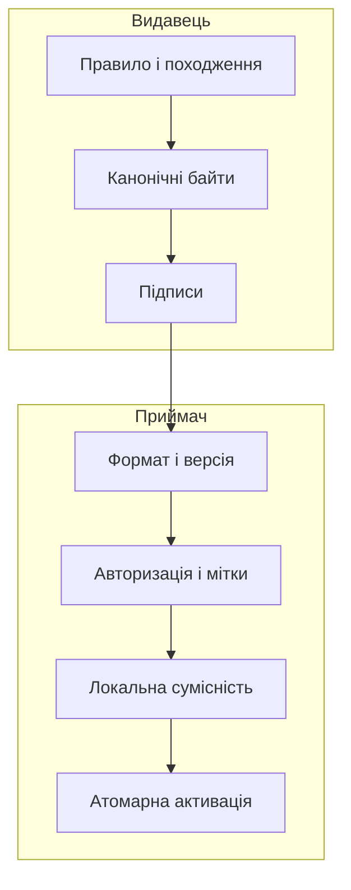
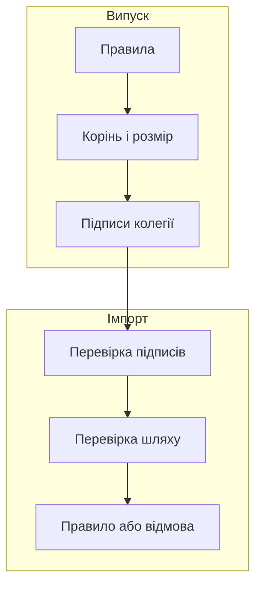

# Глава 29. Захищений обмін знаннями між системами

<a id="глава-29-міжсистемний-обмін-знаннями-криптографічні-дельта-пакети-для-ізольованих-мереж-та-мандатний-захист-потоків"></a>

> **Підручник:** [Експертні Системи](../README.md) · [Том 3. Нейро-символьні, ізольовані, критичні до безпеки та високопродуктивні експертні системи](README.md)  
> **Навчальний рівень:** прикладні програмісти та студенти комп'ютерних наук\
> **Обладнання:** звичайний ноутбук або ПК\
> **Мови:** Python 3.14.4 і Go 1.27.1\
> **Попередня глава:** [Глава 28. Апаратне прискорення та подання знань у пам'яті](ch28-hardware-acceleration-and-storage.md)\
> **Наступна глава:** [Глава 30. Розподілені експертні системи та узгодженість даних](ch30-distributed-expert-systems.md)\
> **Автор:** Микола Мартинович Федчик

---

## Анотація

У [Главі 28](ch28-hardware-acceleration-and-storage.md) підготовлений пакет знань було перевірено локально. Тепер потрібно передати його іншій організації чи автономному вузлу так, щоб приймач міг перевірити формат, походження, повноваження підписантів і стан відкликань, не довіряючи самому носію. Наївне копіювання файлу може непомітно змінити правило, послабити локальну вимогу або повернути відкликану версію.

На прикладі правила огляду `P-7` побудовано обмежене проміжне подання, перевірку сумісності з локальною теорією, модель міток доступу, квитанцію включення та послідовне застосування оновлень. Підписи перевіряються засобами стандартної бібліотеки Go; інші приклади є виконуваними моделями протоколу. Криптографічна цілісність не засвідчує правильності предметного правила: його зміст і наслідки оцінюються окремо.

---

<!-- chapter-toc:start -->
## Зміст глави

- [1. Формат і сумісність наборів знань](#1-формат-і-сумісність-наборів-знань)
  - [1.1. Канонічне подання правила та його походження](#11-канонічне-подання-правила-та-його-походження)
  - [1.2. Перевірка впливу імпорту на локальні висновки](#12-перевірка-впливу-імпорту-на-локальні-висновки)
- [2. Мітки доступу та конфіденційність висновків](#2-мітки-доступу-та-конфіденційність-висновків)
  - [2.1. Рівні конфіденційності та категорії доступу](#21-рівні-конфіденційності-та-категорії-доступу)
  - [2.2. Успадкування мітки висновком](#22-успадкування-мітки-висновком)
- [3. Квитанції цілісності та погодження випуску](#3-квитанції-цілісності-та-погодження-випуску)
  - [3.1. Перевірка включення висновку без розкриття сусідніх даних](#31-перевірка-включення-висновку-без-розкриття-сусідніх-даних)
  - [3.2. Порогове погодження випуску пакета знань](#32-порогове-погодження-випуску-пакета-знань)
- [4. Доставка підписаних оновлень в ізольовані мережі](#4-доставка-підписаних-оновлень-в-ізольовані-мережі)
  - [4.1. Атомарне застосування оновлень і відкликань](#41-атомарне-застосування-оновлень-і-відкликань)
- [5. Практичні завдання та лабораторний практикум](#5-практичні-завдання-та-лабораторний-практикум)
  - [5.1. Контрольні запитання для самоперевірки](#51-контрольні-запитання-для-самоперевірки)
  - [5.2. Розрахункові задачі (трасування вручну)](#52-розрахункові-задачі-трасування-вручну)
  - [5.3. Завдання з програмної реалізації](#53-завдання-з-програмної-реалізації)
  - [5.4. Зв'язок із лабораторною та курсовою роботою курсу](#54-звязок-із-лабораторною-та-курсовою-роботою-курсу)
- [Висновки](#висновки)
- [Глосарій](#глосарій)
- [Скорочення та терміни](#скорочення-та-терміни)
- [Джерела](#джерела)
<!-- chapter-toc:end -->

---

<a id="1-канонічне-проміжне-представлення-для-обміну-знаннями-oeir-та-консервативність-імпорту"></a>

## 1. Формат і сумісність наборів знань

Обмін починається не з копіювання правила, а з визначення того, які саме байти і значення має зрозуміти приймач. У системі `P-7` видавець формує версію правила, його одиниці, межі дії, походження й залежності; шлюз імпорту перевіряє це подання до внесення у локальну базу. Якщо мовні рушії по-різному трактують одиниці, замовчування або порядок полів, та сама підписана послідовність може спричинити різні висновки.

Для навчального прикладу обмін обмежено правилом виду «справний вимірювач `P-7` і температура не нижче порога означають потребу в огляді». Не обмінюються виконуваним кодом, довільними запитами чи схемами, що автоматично розширюють словник приймача.

<a id="11-серіалізація-правил-одиниць-вимірювання-інтервалів-та-доказів-походження-між-гетерогенними-рушіями"></a>

### 1.1. Канонічне подання правила та його походження

Щоб підпис видавця можна було перевірити в іншій мові програмування, сторонам потрібні ті самі байти для того самого логічного запису. JSON Canonicalization Scheme визначає канонічне подання обмеженої підмножини JSON, включно з порядком ключів і серіалізацією примітивів [[1]](#src-1). Канонізація відповідає лише на запитання «які байти підписано», а не «чи означають слова сторін те саме».

Для демонстрації зафіксуємо правило із п'ятьма полями: ідентифікатором, походженням, порогом, кодом одиниці та версією. Ідентифікатор і джерело обмежені ASCII-словами, поріг — цілим числом від $0$ до $511$, а одиниця — кодом UCUM `Cel` [[2]](#src-2). Таке вузьке підмножинне кодування дає однакові байти, не намагаючись відтворити весь стандарт JCS у навчальному коді. Для складніших схем доцільне узгоджене типізоване подання, наприклад CBOR із детермінованою серіалізацією [[3]](#src-3).

Вхід — об'єкт із точно визначеними полями; вихід — канонічний рядок байтів або помилка. Декодер повторно серіалізує отримане значення і відхиляє байти, які не відповідають канонічному вигляду. Отже, пробіли, переставлені ключі й зайві поля не отримують окремих підписів для того самого запису.

<a id="obj-29-1"></a>

**Діаграма 29.1. Шлях від пакета видавця до локального правила.**



На кожному кроці перевіряється окрема властивість; успішна перевірка підпису не замінює сумісності правила з локальною політикою.

<a id="obj-29-2"></a>

**Лістинг 29.2. Обмежена канонічна серіалізація (Python 3.14.4).**

<details><summary>Показати лістинг 29.2 (32 рядки, Python 3.14.4)</summary>

```python
import json
import re

FIELDS = {"id", "source", "threshold", "unit", "version"}

def canonical(rule):
    if type(rule) is not dict or set(rule) != FIELDS:
        raise ValueError("unexpected rule schema")
    if not re.fullmatch(r"[A-Za-z0-9._-]{1,32}", rule["id"]):
        raise ValueError("invalid rule id")
    if not re.fullmatch(r"[A-Za-z0-9._:-]{1,64}", rule["source"]):
        raise ValueError("invalid source")
    if type(rule["threshold"]) is not int or not 0 <= rule["threshold"] <= 511:
        raise ValueError("threshold outside the supported range")
    if rule["unit"] != "Cel" or type(rule["version"]) is not int or rule["version"] < 1:
        raise ValueError("unsupported unit or version")
    return json.dumps(rule, sort_keys=True, separators=(",", ":")).encode("ascii")

def decode(raw):
    if type(raw) is not bytes: raise ValueError("input must be bytes")
    rule = json.loads(raw)
    if canonical(rule) != raw: raise ValueError("noncanonical bytes")
    return rule

rule = {"id": "P-7", "source": "sensor:west", "threshold": 80, "unit": "Cel", "version": 1}
encoded = canonical(rule)
assert encoded == b'{"id":"P-7","source":"sensor:west","threshold":80,"unit":"Cel","version":1}'
assert decode(encoded) == rule
try: decode(encoded + b" ")
except ValueError: pass
else: raise AssertionError("noncanonical JSON accepted")
print("PASS: canonical bytes round-trip; whitespace variant rejected")
```
</details>

У виробничому декодері також обмежують розмір пакета, відхиляють дубльовані JSON-ключі під час розбору й задають політику для невідомих полів. Підпис маніфесту з'єднає саме ці байти з ідентифікатором покоління; поля походження повинні відповідати перевірюваному реєстру видавця, а не довільному тексту.

<a id="12-збереження-захищених-аксіом-під-час-імпорту"></a>

### 1.2. Перевірка впливу імпорту на локальні висновки

Перевірка байтів і видавця ще не відповідає на запитання, чи не звужує новий пакет попередні локальні можливості. У логіці для цього розглядають консервативне розширення: імпортовані правила можуть вводити нові поняття, але не повинні додавати наслідків у старому словнику. Для обмеженої булевої моделі це можна точно перевірити порівнянням множин моделей:

<a id="obj-29-3"></a>

**Формула 29.3. Критерій консервативності для обмеженої пропозиційної моделі.**

```math
\mathrm{Proj}_{V}\!\left(\mathrm{Mod}(T_0\cup T_1)\right)
=\mathrm{Mod}(T_0).
```

Тут $`V`$ — множина локальних булевих змінних; $`T_0`$ — локальна теорія; $`T_1`$ — імпортована теорія над $`V`$ і, можливо, новими змінними; $`\mathrm{Mod}(T)`$ — множина присвоювань, що задовольняють умови $`T`$; $`\mathrm{Proj}_V`$ відкидає нові змінні. Рівність означає, що кожен локальний стан до імпорту залишається можливим після нього й навпаки. Це сильніше за звичайну вимогу «не змінювати локальні аксіоми»: додавання правила може не перезаписати файл, але вилучити частину моделей через логічний наслідок.

Для двох локальних змінних `valid` і `review` нехай $`T_0`$ містить лише умову `review → valid`. Імпорт додає нову змінну `source_ok` і правило `review → source_ok`. Усі локальні присвоювання, які раніше були допустимі, лишаються можливими: при `review = true` можна вибрати `source_ok = true`, а при `review = false` імпортоване правило істинне автоматично. Якщо ж імпорт додасть `review = false`, то локальний стан `valid = true, review = true` буде вилучено, і критерій не виконається.

У реалізації диз'юнкцію літералів задають списком цілих чисел: додатне число позначає змінну, від'ємне — її заперечення. Наприклад, `(-2, 1)` означає `¬review ∨ valid`. Номер змінної має бути ненульовим і не перевищувати кількість змінних; порожня клауза допустима й завжди хибна. Перебір проєктує допустимі повні присвоювання на перші $v$ змінних і порівнює множини. Вхід — невід'ємні цілі числа локальних і нових змінних та списки клауз; вихід — булева відповідь або помилка для некоректного входу.

<a id="obj-29-4"></a>

**Лістинг 29.4. Перевірка проєкції скінченної моделі (Python 3.14.4).**

<details><summary>Показати лістинг 29.4 (28 рядків, Python 3.14.4)</summary>

```python
from itertools import product

def models(n, clauses):
    if type(n) is not int or n < 0 or type(clauses) not in (list, tuple):
        raise ValueError("invalid variable count or clauses")
    if any(type(clause) not in (list, tuple)
           or any(type(lit) is not int or lit == 0 or abs(lit) > n for lit in clause)
           for clause in clauses):
        raise ValueError("literal must be a nonzero variable index in range")
    for state in product((False, True), repeat=n):
        if all(any(state[abs(lit) - 1] == (lit > 0) for lit in clause)
               for clause in clauses):
            yield state

def conservative(v, new, local, imported):
    if (type(new) is not int or new < 0
            or type(local) not in (list, tuple) or type(imported) not in (list, tuple)):
        raise ValueError("invalid imported theory")
    before = {m[:v] for m in models(v, local)}
    after = {m[:v] for m in models(v + new, list(local) + list(imported))}
    return before == after

base = [(-2, 1)]
safe = [(-2, 3)]
breaking = [(-2,)]
assert conservative(2, 1, base, safe)
assert not conservative(2, 0, base, breaking)
print("PASS: extension preserved local models; restriction rejected")
```
</details>

Вивід — `PASS: extension preserved local models; restriction rejected`. Кількість перевірених станів зростає як $2^{v+n}$, тому повний перебір доречний лише для малих прикладів. Загальна консервативність імпорту OWL або іншої виразної логіки потребує методу, який відповідає її семантиці; цей код її не встановлює [[4]](#src-4).

## 2. Мітки доступу та конфіденційність висновків

Після перевірки сумісності приймач має вирішити, чи взагалі дозволено конкретному читачеві бачити пакет і висновки, виведені з нього. Самої ролі «інженер» або мережевого каналу недостатньо: одна база може містити загальнодоступні правила та правила, обмежені окремим проєктом. Щоб похідний висновок не розкрив обмежену передумову, його мітка повинна враховувати мітки всіх використаних підстав. Цей підхід ґрунтується на решітковій моделі потоків інформації Дороті Деннінг [[5]](#src-5).

<a id="21-добуткова-решітка-рівнів-таємності-та-відомчих-категорій-допуску-compartments"></a>

### 2.1. Рівні конфіденційності та категорії доступу

Подамо рівень доступу числом `0..3`, а категорії проєктів — множиною назв. Вищий рівень означає не менші вимоги до читача; категорії не впорядковано між собою. Для читання потрібен рівень не нижчий за рівень даних і наявність у читача всіх потрібних категорій. Наприклад, рівень `2` з категорією `A` та рівень `1` з категорією `B` не порівнюються: один читач має вищий рівень, інший — потрібний проєктний допуск.

Якщо висновок спирається на кілька посилок, його рівень — максимум їхніх рівнів, а категорії — об'єднання їхніх категорій. Це найменша мітка, що не нижча за жодну з передумов.

<a id="obj-29-5"></a>

**Формула 29.5. Об'єднання міток передумов.**

```math
\ell_{\mathrm{out}}=
\left(\max_i s_i,\ \bigcup_i C_i\right).
```

$`s_i`$ — цілий рівень доступу передумови $i$ від $0$ до $3$; $`C_i`$ — скінченна множина категорій з допустимого переліку; $`\ell_{\mathrm{out}}`$ — пара з рівня та множини категорій для висновку. Для порожньої множини передумов правило не виводить факт. Наприклад, посилки `(1, {A})` і `(2, {B})` утворюють `(2, {A, B})`; читач із `(2, {A})` не може прочитати висновок, бо бракує `B`.

Функція нижче обчислює об'єднання міток і перевіряє право читання. Вхід — мітка читача та список міток даних; результат — мітка похідного висновку й булевий дозвіл для кожної ролі.

<a id="obj-29-6"></a>

**Лістинг 29.6. Обчислення об'єднання та перевірка читача (Python 3.14.4).**

<details><summary>Показати лістинг 29.6 (22 рядки, Python 3.14.4)</summary>

```python
from dataclasses import dataclass

@dataclass(frozen=True)
class Label:
    level: int
    compartments: frozenset[str]

def check(label):
    if type(label.level) is not int or not 0 <= label.level <= 3:
        raise ValueError("level must be an integer in 0..3")
    if type(label.compartments) is not frozenset or not label.compartments <= {"A", "B"}:
        raise ValueError("unknown compartment")

def join(labels):
    if not labels: raise ValueError("a conclusion needs premises")
    for label in labels: check(label)
    return Label(max(x.level for x in labels),
                 frozenset().union(*(x.compartments for x in labels)))

def may_read(reader, data):
    check(reader); check(data)
    return reader.level >= data.level and data.compartments <= reader.compartments
```
</details>

Мітка описує доступ лише в цій навчальній моделі: реальна політика має визначити категорії, суб'єктів і дозволені операції явно. Сам факт читання не надає права експорту, змінення чи повторної публікації.

Непрямий витік можливий і тоді, коли сам висновок здається нешкідливим. Якщо правило виводить `maintenance_due = false` лише за відсутності секретного факту несправності, публікація результату може розкрити цей факт через заперечення. Тому позначається не лише текст правила, а й усі дані та керівні умови, від яких залежав вибір гілки.

<a id="22-інваріант-успадкування-мітки-конфіденційності-похідним-висновком-найменша-верхня-межа-join-та-захист-від-непрямого-витоку-таємних-правил"></a>

### 2.2. Успадкування мітки висновком

Для висновку, отриманого з набору фактів, застосовується об'єднання їхніх міток із формули 29.5. Якщо правило використовує умову або розгалуження, здатне розкрити секретність факту, ця залежність теж входить до мітки. Дозвіл на нижчий рівень потребує окремої авторизованої процедури з визначеною метою, перевіркою вихідного повідомлення та аудитом; просте переприсвоєння мітки є небезпечним зниженням рівня.

Перевірка прикладу задає два факти: температура `P-7` має мітку `(1, {A})`, а стан вузла — `(2, {B})`. Висновок про потребу в огляді отримує `(2, {A, B})`. Читач із `(2, {A})` відмовляється, читач із `(3, {A, B})` отримує дозвіл. Код використовує функції з лістингу 29.6.

<a id="obj-29-7"></a>

**Лістинг 29.7. Перевірка похідної мітки (Python 3.14.4).**

<details><summary>Показати лістинг 29.7 (6 рядків, Python 3.14.4)</summary>

```python
facts = [Label(1, frozenset({"A"})), Label(2, frozenset({"B"}))]
result = join(facts)
assert result == Label(2, frozenset({"A", "B"}))
assert not may_read(Label(2, frozenset({"A"})), result)
assert may_read(Label(3, frozenset({"A", "B"})), result)
print(result)
```
</details>

Вивід показує рівень `2` і категорії `A`, `B`. Такий облік працює лише коли база правил передає повний граф залежностей; пропущена передумова чи прихована гілка руйнує гарантію. Криптографічні підписи не усувають помилок маркування.

<a id="3-криптографічні-квитанції-доведення-дерева-включення-меркла-та-порогові-підписи-шаміра-k-n"></a>

## 3. Квитанції цілісності та погодження випуску

Одержувачеві пакета може знадобитися перевірити одне правило, не завантажуючи й не розкриваючи решту бази. Видавець також має показати, що саме погодила потрібна кількість уповноважених осіб. Дерево хешів дає коротку квитанцію включення, а окремі цифрові підписи — перевірку голосів конкретних ключів; ці два докази відповідають на різні запитання.

<a id="obj-29-8"></a>

**Діаграма 29.8. Пакет із підписаним коренем та вибірковим доказом.**



Для перевірки шляху довіреним має бути маніфест цілком, включно з розміром і номером покоління; сам підрахунок хешу не засвідчує, хто його опублікував.

<a id="31-верифікація-окремого-висновку-за-допомогою-логарифмічного-шляху-меркла-без-розкриття-закритих-сусідніх-гілок-бази-знань"></a>

### 3.1. Перевірка включення висновку без розкриття сусідніх даних

Для трьох правил сформуємо бінарне дерево з префіксами домену: байт `0` додається до листка, байт `1` — до внутрішнього вузла. Такий поділ не дає сплутати хеш самого запису з хешем пари вузлів; формат і алгоритм включення описані у специфікації Certificate Transparency [[6]](#src-6). Перевіряльник одержує запис, індекс, розмір дерева, шлях сусідніх хешів і підписаний корінь.

Якщо дерево має $n\geq1$ листків, повний шлях містить не більше $`\lceil\log_2 n\rceil`$ хешів. Для трьох записів і другого листка шлях має два хеші: брат першого листка зліва та корінь правої гілки справа. Верифікатор послідовно відтворює корінь з урахуванням боку кожного сусіда.

<a id="obj-29-9"></a>

**Формула 29.9. Розділення доменів листка й вузла.**

```math
h_{\mathrm{leaf}}=H(0x00\mathbin{\|}d),\qquad
h_{\mathrm{node}}=H(0x01\mathbin{\|}h_{\mathrm{left}}\mathbin{\|}h_{\mathrm{right}}).
```

$d$ — канонічні байти одного запису; $H$ — SHA-256 із виходом 32 байти; $`\mathbin{\|}`$ — конкатенація байтів; $`h_{\mathrm{left}}`$ і $`h_{\mathrm{right}}`$ — хеші дочірніх вузлів. Префікси `0x00` і `0x01` — одно-байтові сталі. У формулі порядок дітей значущий. SHA-256 сам по собі не приховує низькоентропійні значення: сусідній хеш інколи можна перебрати словником.

Наступні функції будують дерево RFC 6962/9162 для непорожнього списку, створюють шлях і перевіряють його точну довжину, індекс та напрямки. Вхід — впорядковані байтові записи; результат — корінь і рішення про включення.

<a id="obj-29-10"></a>

**Лістинг 29.10. Побудова кореня та шляху включення (Python 3.14.4).**

<details><summary>Показати лістинг 29.10 (19 рядків, Python 3.14.4)</summary>

```python
from hashlib import sha256
from hmac import compare_digest

def digest_leaf(item): return sha256(b"\x00" + item).digest()
def digest_node(left, right): return sha256(b"\x01" + left + right).digest()

def root(items):
    if not items: raise ValueError("tree must not be empty")
    if len(items) == 1: return digest_leaf(items[0])
    k = 1 << ((len(items) - 1).bit_length() - 1)
    return digest_node(root(items[:k]), root(items[k:]))

def path(items, index):
    if not items or type(index) is not int or not 0 <= index < len(items):
        raise ValueError("invalid tree index")
    if len(items) == 1: return []
    k = 1 << ((len(items) - 1).bit_length() - 1)
    if index < k: return path(items[:k], index) + [("R", root(items[k:]))]
    return path(items[k:], index - k) + [("L", root(items[:k]))]
```
</details>

Перевірка відтворює очікувані напрямки зі заявлених індексу й розміру, відхиляє зайві або відсутні вузли та порівнює корінь у сталому часі.

<a id="obj-29-11"></a>

**Лістинг 29.11. Перевірка шляху та підміни запису (Python 3.14.4).**

<details><summary>Показати лістинг 29.11 (27 рядків, Python 3.14.4)</summary>

```python
def directions(size, index):
    if size == 1: return []
    k = 1 << ((size - 1).bit_length() - 1)
    return (directions(k, index) + ["R"] if index < k
            else directions(size - k, index - k) + ["L"])

def verify(item, index, size, proof, expected):
    if (type(item) is not bytes or type(index) is not int or type(size) is not int or size < 1
            or not 0 <= index < size or type(expected) is not bytes
            or len(expected) != 32): return False
    sides = directions(size, index)
    if type(proof) is not list or len(proof) != len(sides): return False
    current = digest_leaf(item)
    for entry, wanted in zip(proof, sides):
        if type(entry) not in (tuple, list) or len(entry) != 2: return False
        side, sibling = entry
        if side != wanted or type(sibling) is not bytes or len(sibling) != 32:
            return False
        current = digest_node(sibling, current) if side == "L" else digest_node(current, sibling)
    return compare_digest(current, expected)

facts = [b"P-7:valid", b"P-7:threshold=80", b"P-7:unit=Cel"]
tree = root(facts); proof = path(facts, 1)
assert [side for side, _ in proof] == ["L", "R"]
assert verify(facts[1], 1, 3, proof, tree)
assert not verify(b"P-7:threshold=90", 1, 3, proof, tree)
print("PASS: inclusion verified; modified rule rejected")
```
</details>

Вивід — `PASS: inclusion verified; modified rule rejected`. Перевірка доводить включення запису в набір, що відповідає довіреному кореню, але не те, що інші правила правильні, що набір повний або що сам корінь автентичний. Квитанція також не приховує сам переданий запис та не є криптографічним доказом його предметної істинності.

<a id="32-порогова-криптографічна-авторизація-випуску-критичних-пакетів-знань-колегією-експертів-за-схемою-поліноміальної-інтерполяції-лагранжа--шаміра"></a>

### 3.2. Порогове погодження випуску пакета знань

Корінь дерева треба пов'язати з епохою, версією схеми та політикою приймача: підпис випадкового хешу не дозволяє вирішити, чи це дозволений випуск. Для навчальної моделі колегія з трьох ключів погоджує один і той самий канонічний маніфест; потрібні два різні підписанти. Одержувач перевіряє кожен підпис Ed25519 окремо, а не відновлює спільний секрет.

Це кворум окремих підписів, а не пороговий підпис Шаміра. Схеми порогового підпису, зокрема FROST, мають окремий протокол між учасниками й власні вимоги до nonce та ключів [[7]](#src-7). У прикладі ключі детерміновано створено лише для повторюваного тесту; у виробничому коді їх генерують і зберігають у захищеному середовищі за вимогами RFC 8032 [[8]](#src-8).

Вхід — маніфест, таблиця довірених відкритих ключів і перелік схвалень; результат — `true` лише за достатньої кількості різних відомих підписантів із дійсними підписами.

<a id="obj-29-12"></a>

**Лістинг 29.12. Перевірка кворуму підписів Ed25519 (Go 1.27.1).**

<details><summary>Показати лістинг 29.12 (37 рядків, Go 1.27.1)</summary>

```go
package main

import (
    "crypto/ed25519"
    "crypto/sha256"
    "fmt"
)

type Approval struct { ID string; Signature []byte }

func accepts(message []byte, keys map[string]ed25519.PublicKey,
    approvals []Approval, threshold int) bool {
    if threshold < 1 || threshold > len(keys) { return false }
    seen, valid := map[string]bool{}, 0
    for _, approval := range approvals {
        key, known := keys[approval.ID]
        if !known || seen[approval.ID] ||
            !ed25519.Verify(key, message, approval.Signature) { return false }
        seen[approval.ID] = true
        valid++
    }
    return valid >= threshold
}

func main() {
    message := []byte(`{"epoch":4,"root":"sample-root","size":3}`)
    keys, signatures := map[string]ed25519.PublicKey{}, []Approval{}
    for _, id := range []string{"A", "B", "C"} {
        seed := sha256.Sum256([]byte("test-only:" + id))
        private := ed25519.NewKeyFromSeed(seed[:])
        keys[id] = private.Public().(ed25519.PublicKey)
        if id != "C" { signatures = append(signatures, Approval{id, ed25519.Sign(private, message)}) }
    }
    if !accepts(message, keys, signatures, 2) { panic("quorum rejected") }
    if accepts(append(message, 'x'), keys, signatures, 2) { panic("tampering accepted") }
    fmt.Println("PASS: 2 distinct approvals; tampering rejected")
}
```
</details>

Два з трьох схвалень достатні лише за фіксованої політики цього прикладу. Для прийняття пакета потрібно також перевірити ідентичність ключів, призначення підписантів, чинність і відкликання ключів, версію схеми та мітку інформації. Не слід прирівнювати кількість підписів до незалежності експертних оцінок, якщо ключі чи процеси контролює одна сторона.

<a id="4-протоколи-доставки-підписаних-дельта-пакетів-знань-в-ізольовані-мережі-air-gap-data-diode"></a>

## 4. Доставка підписаних оновлень в ізольовані мережі

У віддаленому об'єкті немає постійного з'єднання з видавцем, але локальні правила все одно треба оновлювати й відкликати. Якщо скопіювати файли поверх чинної бази, збій посеред операції може залишити приймач із сумішшю старих і нових правил. Тому шлюз переносить пакет у staging-сховище, перевіряє підписи, версію та сумісність, а потім перемикає активне покоління однією локальною операцією.

Передавач тут односторонній: зовнішня мережа не отримує підтвердження, чи прийняв пакет локальний вузол. Приймач веде власний журнал із номером останньої епохи та результатом перевірки; повторно доставлений ідентичний пакет можна розпізнати, але відхилений пакет потребує окремого узгодженого процесу виправлення.

<a id="41-атомарне-накладання-дельт-і-списків-відкликання-tombstones--crl-через-односторонній-шлюз-без-зовнішнього-зворотного-каналу"></a>

### 4.1. Атомарне застосування оновлень і відкликань

Дельта описує епоху, очікуваний хеш попереднього покоління, нові записи й tombstones відкликаних записів. Для автоматичного застосування потрібен і точний перехід `e → e+1`, і збіг хешу батьківського покоління. Перевірка лише зростання номера не завадить встановити іншу гілку, а перевірка лише батьківського хешу не зупинить повтор старого покоління.

<a id="obj-29-13"></a>

**Формула 29.13. Умова послідовного переходу поколінь.**

```math
e_{\mathrm{next}}=e_{\mathrm{current}}+1,\qquad
H_{\mathrm{parent}}=H_{\mathrm{current}}.
```

$`e_{\mathrm{current}}`$ — невід'ємний номер активної епохи; $`e_{\mathrm{next}}`$ — номер наступної епохи; $`H_{\mathrm{current}}`$ — довірений ідентифікатор чинного пакета, а $`H_{\mathrm{parent}}`$ — його значення, записане в дельті. Хеші порівнюють як повні байтові значення однакової довжини. Ця умова відхиляє пропуск і повернення назад у лінійному ланцюгу; відновлення після пропущених дельт потребує узгодженого повного знімка бази.

Функція нижче застосовує вже перевірену дельту до копії активного словника правил. Вона не мутує поточний стан: помилка перевірки не лишає частково застосованих змін. Виробничий викликач має перевірити підпис маніфесту й хеш бінарного пакета до цієї операції.

<a id="obj-29-14"></a>

**Лістинг 29.14. Послідовне застосування дельти (Python 3.14.4).**

<details><summary>Показати лістинг 29.14 (24 рядки, Python 3.14.4)</summary>

```python
def apply_delta(state, delta):
    if delta["epoch"] == state["epoch"] and delta["digest"] == state["digest"]:
        return state
    if (delta["epoch"] != state["epoch"] + 1
            or delta["previous"] != state["digest"]):
        raise ValueError("stale, skipped, or forked generation")
    updates, revoked = delta["updates"], set(delta["revoked"])
    if set(updates) & revoked or not revoked <= set(state["rules"]):
        raise ValueError("conflicting update or unknown revocation")
    if any(type(value) is not int or not 0 <= value <= 511
           for value in updates.values()):
        raise ValueError("invalid threshold")
    rules = dict(state["rules"])
    for rule_id in revoked: del rules[rule_id]
    rules.update(updates)
    return {"epoch": delta["epoch"], "digest": delta["digest"], "rules": rules}

current = {"epoch": 4, "digest": "e4", "rules": {"P-7": 80, "P-8": 90}}
delta = {"epoch": 5, "previous": "e4", "digest": "e5",
         "updates": {"P-7": 85}, "revoked": ["P-8"]}
next_state = apply_delta(current, delta)
assert next_state["rules"] == {"P-7": 85} and current["rules"]["P-7"] == 80
assert apply_delta(next_state, {**delta, "epoch": 5}) == next_state
print(next_state)
```
</details>

Ідентичний повтор епохи повертає поточний стан без змін. Будь-яка інша дельта з тією самою епохою має бути відхилена, а не прийнята як повтор; додаткові перевірки на це належать до лабораторних вправ. Пакети реального обміну мають містити унікальний ідентифікатор, розмір, схему, список відкликань і підписаний хеш вмісту. Маніфести оновлення програмних компонентів у TUF демонструють окремі механізми строку чинності, версій і захисту від rollback; це орієнтир щодо структури метаданих, а не специфікація пакета знань [[9]](#src-9) [[10]](#src-10).

**Атомарне встановлення на приймачі:**

1. Скопіювати пакет у новий тимчасовий файл на тій самій файловій системі, що й сховище поколінь.
2. Перевірити повноту, канонічний формат, хеш, підписи, мітки, номер епохи, батьківський хеш і допустимість кожного правила.
3. Побудувати повний новий файл знімка й перевірити його до активації; відкликання записати як tombstone у маніфесті та застосувати до нового покоління.
4. Синхронізувати файл, після чого атомарно замінити локальне посилання на активне покоління й синхронізувати каталог за вимогами платформи.
5. Не змінювати старий файл, поки його читають процеси з [Глави 28](ch28-hardware-acceleration-and-storage.md); видалити його лише після безпечного завершення читачів.

Якщо живлення зникне до перемикання посилання, активним залишається старе покоління; після успішного атомарного перемикання новий читач бачить нове. Властивості збереження після збою залежать від файлової системи й послідовності синхронізації. Відкликання не стирає копії, які інша система вже отримала; для офлайн-вузлів потрібна політика строку чинності, максимально допустимого відставання та повторного введення в експлуатацію.

## 5. Практичні завдання та лабораторний практикум

Завдання відтворюють повний шлях пакета `P-7`: від однакового подання на видавці й приймачі до обмеження доступу, перевірки квитанції та безпечної активації. Для вправ достатньо Python і Go на звичайному комп'ютері; секретні ключі зберігають лише у тестовому середовищі.

### 5.1. Контрольні запитання для самоперевірки

1. Чому однаковий підпис на різних байтових серіалізаціях не доводить однаковий зміст? Як обмеження схеми спрощують канонізацію?
2. Що перевіряє рівність проєкції моделей і чому вона не замінює предметної перевірки правила?
3. Чому читачеві потрібні і достатній рівень, і всі категорії мітки?
4. Які поля має містити довірений маніфест для інтерпретації шляху Меркла?
5. Чим кворум окремих підписів відрізняється від порогового підпису з поділеним ключем?
6. Які стани залишаються після переривання живлення до й після атомарної активації покоління?

### 5.2. Розрахункові задачі (трасування вручну)

1. Для правила `P-7` зафіксуйте канонічні байти й обчисліть SHA-256. Змініть лише порядок ключів і пробіли: що має прийняти декодер і які байти повинен підписати видавець?
2. Для локальних правил `review → valid` і `alarm → valid` побудуйте безпечне розширення новою змінною та розширення, яке змінює проєкцію моделей. Перелічіть вилучені локальні присвоювання.
3. Обчисліть об'єднання міток `(1, {A})`, `(2, {B})`, `(0, {})` і визначте, хто може прочитати висновок: читач `(2, {A})`, `(2, {A, B})`, `(3, {B})`.
4. Побудуйте шлях для першого й останнього записів дерева з п'яти листків; перевірте кожен шлях і змінену версію листка.
5. Для трьох ключів із порогом два перевірте прийняття двох дійсних підписів, відмову одного підпису, дублікат підписанта та відкликання одного ключа.

<a id="53-інженерні-завдання-з-програмування-мовна-незалежність--спеціалізовані-dsl"></a>

### 5.3. Завдання з програмної реалізації

1. Розширте `decode`: відхиляйте дубльовані JSON-ключі, зайві поля, Unicode в ASCII-ідентифікаторі, нецілі та граничні пороги; перевірте канонічне представлення тестами.
2. Змініть мітки на три категорії. Перевірте замкненість операції `join`, верхню межу й монотонність для всіх допустимих пар міток.
3. Розширте перевірку дерева до п'яти записів та випадків помилкового розміру, індексу, напрямку й довжини хешу. Підпишіть маніфест і перевірте його до прийняття шляху.
4. Додайте до `apply_delta` явне відхилення будь-якого іншого пакета зі старою епохою, конфлікту update/revoke та невідомого tombstone. Протестуйте, що помилка не мутує поточний стан.
5. Опишіть протокол ручного перенесення, включно з журналом приймача, втратою пакета, простроченням ключа та відновленням через повний знімок без зворотного мережевого каналу.

### 5.4. Зв'язок із лабораторною та курсовою роботою курсу

* **Навчальна вправа:** підготуйте пакет правил із двома дельтами, перевірте підписи й відкликання та змоделюйте переривання до і після активації.
* **Курсова робота:** додайте перевірюваний маніфест обміну знаннями з версією схеми, походженням, мітками доступу й журналом приймача; зафіксуйте політику оновлення та відкликання. Перелік напрямів наведено в [описі Тому 3](README.md).

---

## Висновки

1. Канонічне подання встановлює байти, які підписуються; типи, одиниці, семантика й походження потребують узгодженого контракту.
2. Консервативна перевірка порівнює можливі локальні моделі до та після імпорту. Похідний висновок отримує об'єднану мітку всіх використаних даних і гілок.
3. Шлях Меркла підтверджує включення запису лише відносно довіреного маніфесту; кворум Ed25519 перевіряє окремі підписи, але сам по собі не доводить незалежність або предметну правильність погодження.
4. Дельта застосовується лише до очікуваного покоління, а новий знімок активується після повної перевірки. Одностороння доставка не гарантує, що віддалений вузол отримав пакет або вчасно застосував відкликання.

У [Главі 30](ch30-distributed-expert-systems.md) розглядатимуться узгодження реплік і поведінка розподіленої експертної системи за втрати зв'язку.

## Глосарій

- **Канонічна серіалізація** — єдине байтове подання типізованого значення за визначеними правилами кодування.
- **Консервативне розширення** — додавання нових понять без зміни множини наслідків у попередньому словнику.
- **Мітка доступу** — рівень і набір категорій, потрібні для читання даних.
- **Об'єднання міток** — найменша мітка, що не нижча за всі мітки використаних передумов.
- **Шлях включення** — послідовність сусідніх хешів, що дає змогу перевірити належність листка до кореня дерева.
- **Tombstone** — запис про відкликання або вилучення об'єкта, потрібний для передавання зміни.
- **Епоха** — монотонний номер покоління пакета знань.

## Скорочення та терміни

- **CBOR** — компактне двійкове подання об'єктів.
- **JCS** — схема канонізації JSON.
- **UCUM** — уніфіковані коди одиниць вимірювання.
- **SHA-256** — хеш-функція з результатом 256 бітів.
- **Ed25519** — схема цифрового підпису на кривій Edwards.
- **FROST** — гнучкий раундово-оптимізований протокол порогового підпису Шнорра.
- **TUF** — фреймворк безпечного оновлення програмного забезпечення.

## Джерела

1. <a id="src-1"></a> Rundgren A., Jordan B., Erdtman S. [RFC 8785: JSON Canonicalization Scheme (JCS)](https://www.rfc-editor.org/rfc/rfc8785), 2020.
2. <a id="src-2"></a> Regenstrief Institute. [Unified Code for Units of Measure (UCUM)](https://ucum.org/ucum).
3. <a id="src-3"></a> Bormann C., Hoffman P. [RFC 8949: Concise Binary Object Representation (CBOR)](https://www.rfc-editor.org/rfc/rfc8949), 2020.
4. <a id="src-4"></a> W3C. [OWL 2 Web Ontology Language: Structural Specification and Functional-Style Syntax, Second Edition](https://www.w3.org/TR/owl2-syntax/), 2012.
5. <a id="src-5"></a> Denning D. E. [A lattice model of secure information flow](https://doi.org/10.1145/360051.360056). *Communications of the ACM*, 19(5), 1976.
6. <a id="src-6"></a> Laurie B., Langley A., Kasper E. [RFC 9162: Certificate Transparency Version 2.0](https://www.rfc-editor.org/rfc/rfc9162), 2021.
7. <a id="src-7"></a> Komlo C., Goldberg I. [RFC 9591: The Flexible Round-Optimized Schnorr Threshold (FROST) Protocol](https://www.rfc-editor.org/rfc/rfc9591), 2024.
8. <a id="src-8"></a> Josefsson S., Liusvaara I. [RFC 8032: Edwards-Curve Digital Signature Algorithm (EdDSA)](https://www.rfc-editor.org/rfc/rfc8032), 2017.
9. <a id="src-9"></a> TUF. [The Update Framework Specification](https://theupdateframework.github.io/specification/latest/).
10. <a id="src-10"></a> Moran B. et al. [RFC 9124: A Manifest Information Model for Firmware Updates in Internet of Things (IoT) Devices](https://www.rfc-editor.org/rfc/rfc9124), 2022.
