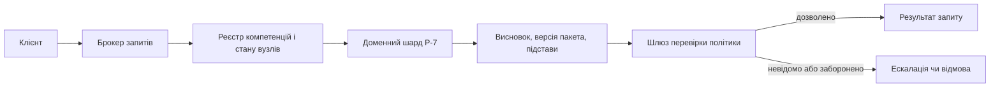
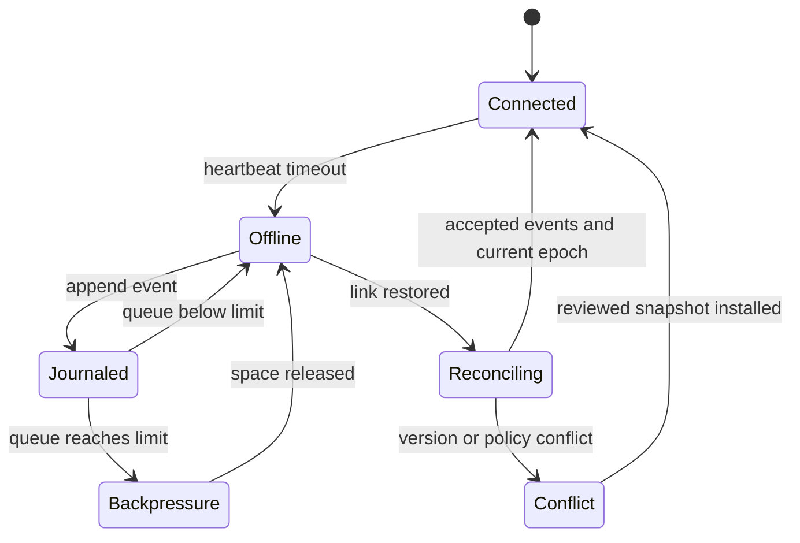
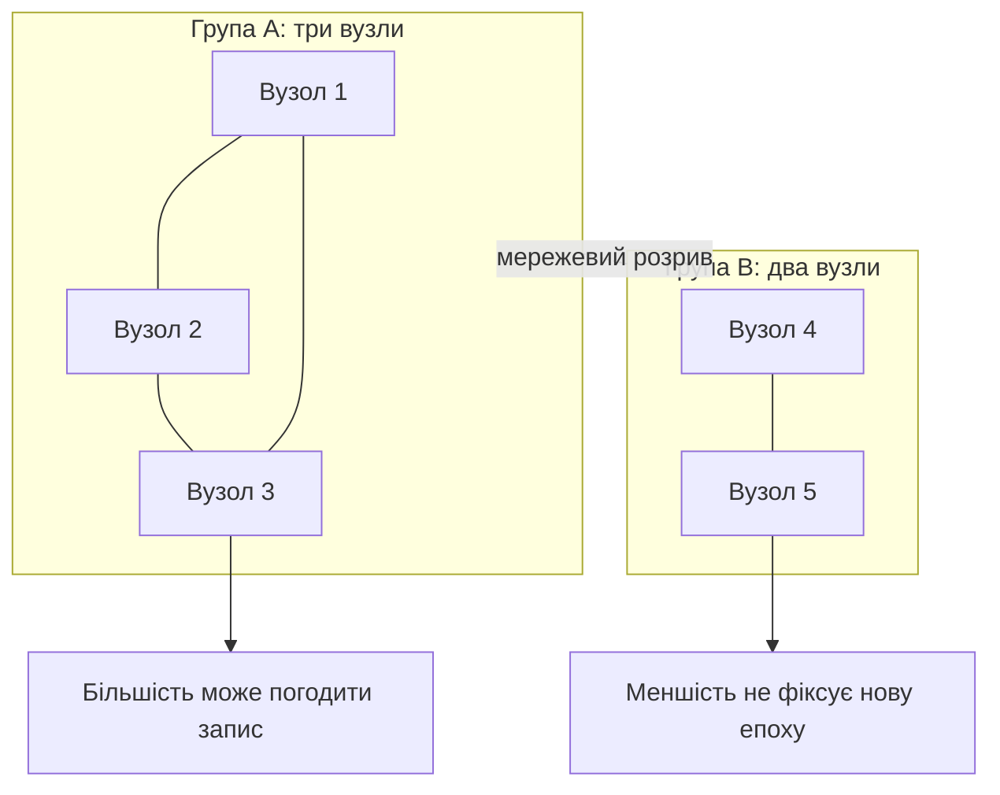

# Глава 30. Розподілені експертні системи та узгодженість даних

<a id="глава-30-розподілені-кластерні-архітектури-експертних-систем-soa-шардінг-графів-знань-рандеву-маршрутизація-та-кворумна-консистентність"></a>

> **Підручник:** [Експертні Системи](../README.md) · [Том 3. Нейро-символьні, ізольовані, критичні до безпеки та високопродуктивні експертні системи](README.md)  
> **Навчальний рівень:** прикладні програмісти та студенти комп'ютерних наук\
> **Обладнання:** звичайний ноутбук або ПК; приклади не потребують кластера\
> **Мова лістингів:** Python 3.14.4\
> **Попередня глава:** [Глава 29. Захищений обмін знаннями між системами](ch29-secure-knowledge-exchange.md)\
> **Наступна глава:** [Зміст підручника](../README.md)\
> **Автор:** Микола Мартинович Федчик

---

## Анотація

У попередніх главах пакет знань перевірявся на окремому вузлі, його зміни передавалися підписаними пакетами, а обчислювальні витрати оцінювалися з огляду на доступні ресурси. У кластері до цих задач додається координація: вузол має знати, де зберігається потрібне правило, наскільки свіжа копія фактів і чи має він право зафіксувати спільну зміну. Якщо доступність мережі сплутати з узгодженістю, дві частини кластера можуть одночасно видати суперечливі рішення або виконати одну дію двічі.

На прикладі запиту огляду обладнання `P-7` побудовано маршрутизацію до доменного шарда, перевірку строку придатності спостереження, локальне журналювання під час розриву мережі та мінімальну модель перетину кворумів. Навчальні лістинги відтворюються на одному комп'ютері. Вони показують алгоритмічні умови й не є повною реалізацією консенсусу або готовою розподіленою системою.

---

<!-- chapter-toc:start -->
## Зміст глави

- [1. Архітектура експертної системи та маршрутизація до доменних шардів](#1-архітектура-експертної-системи-та-маршрутизація-до-доменних-шардів)
  - [1.1. Запит, паспорт сервісу та межі відповідальності](#11-запит-паспорт-сервісу-та-межі-відповідальності)
  - [1.2. Детерміноване розміщення шарда](#12-детерміноване-розміщення-шарда)
- [2. Свіжість даних і допустимість висновку](#2-свіжість-даних-і-допустимість-висновку)
  - [2.1. Строк придатності спостережень](#21-строк-придатності-спостережень)
- [3. Автономна робота та відновлення зв'язку](#3-автономна-робота-та-відновлення-звязку)
  - [3.1. Місткість локального журналу й черги](#31-місткість-локального-журналу-й-черги)
- [4. Кворуми та межі узгодженості](#4-кворуми-та-межі-узгодженості)
  - [4.1. Перетин кворумів](#41-перетин-кворумів)
- [5. Практичні завдання та лабораторний практикум](#5-практичні-завдання-та-лабораторний-практикум)
  - [5.1. Контрольні запитання для самоперевірки](#51-контрольні-запитання-для-самоперевірки)
  - [5.2. Розрахункові задачі](#52-розрахункові-задачі)
  - [5.3. Завдання з програмної реалізації](#53-завдання-з-програмної-реалізації)
  - [5.4. Зв'язок із лабораторною та курсовою роботою](#54-звязок-із-лабораторною-та-курсовою-роботою)
- [Висновки](#висновки)
- [Підсумки Тому 3](#підсумки-тому-3)
- [Глосарій](#глосарій)
- [Скорочення та терміни](#скорочення-та-терміни)
- [Джерела](#джерела)
<!-- chapter-toc:end -->

---

## 1. Архітектура експертної системи та маршрутизація до доменних шардів

Коли база знань і потік спостережень перестають уміщатися на одному вузлі, систему розділяють на доменні сервіси, але запит усе одно має пройти цілісний шлях від джерела даних до поясненого висновку. Якщо розподілити записи випадково, потрібні передумови опиняться на різних вузлах; якщо ж усі правила дублювати всюди, оновлення й перевірка їхніх версій стануть некерованими. Для `P-7` спершу визначимо власника знань і вимоги до відповіді, а потім відділимо маршрутизацію від самого міркування.

### 1.1. Запит, паспорт сервісу та межі відповідальності

Експертний кластер доцільно розглядати як набір вузлів із явними обов'язками, а не як один «розумний» сервер. Клієнт передає типізований запит; брокер перевіряє його схему й обирає сервіс за предметною компетенцією; сервіс повертає висновок разом із версією пакета знань, використаними фактами та причинами відмови; окремий шлюз застосовує політику дії. Такий поділ не дозволяє помилково прийняти успішну мережеву відповідь за достатню підставу для команди.

<a id="obj-30-1"></a>

**Діаграма 30.1. Від маршрутизації запиту до перевірки рішення.**



Для маршрутизації кожен сервіс публікує **паспорт**: підтримувані предметні ключі, ідентифікатори й версію схеми, ідентифікатор пакета знань, його епоху, ознаку доступності та допустимий тип запитів. Брокер перевіряє паспорт до передавання запиту; сервіс повторно перевіряє вхідний контракт. Відповідь містить той самий ідентифікатор запиту, версію пакета, часові мітки спостережень і перелік застосованих правил. Це продовжує принципи цілісності та походження з [Глави 29](ch29-secure-knowledge-exchange.md).

Поділ за доменами часто зрозуміліший за механічне розрізання графа знань: вузол технічного обслуговування володіє правилами огляду, а вузол постачання — запасами й строками доставки. Якщо правило `P-7` залежить від факту з іншого домену, запит оголошує цю залежність і отримує версію обох наборів; локальна копія лише частини передумов не має виглядати як повний контекст. Відповідальний сервіс може повернути `QUALIFIED`, якщо необхідна залежність недоступна.

### 1.2. Детерміноване розміщення шарда

Якщо запит до певного об'єкта має стабільно потрапляти до власника його знань, вузли можна ранжувати функцією хешу. Рандеву-хешування, також відоме як вибір за найбільшою випадковою вагою, обирає вузол із найвищим балом для ключа об'єкта [[1]](#src-30-1). На відміну від звичайного `hash(key) mod N`, така схема зазвичай переміщує лише ключі, для яких доданий або вилучений вузол змінює переможця; це властивість розміщення, а не консистентність копій даних [[2]](#src-30-2).

Для кожного запиту потрібно визначити вимірюваний результат: який вузол отримає ключ `plant-7:maintenance` за заданого набору кандидатів. Ранжування задається так:

<a id="obj-30-2"></a>

**Формула 30.2. Вибір вузла з найвищим балом для ключа.**

$$
n^*=\underset{n\in N}{\mathrm{argmax}}\ H(k\parallel 0x00\parallel n).
$$

$N$ — непорожня множина ідентифікаторів доступних кандидатів; $k$ — байтове кодування ключа шарда; $n$ — байтове кодування ідентифікатора вузла; $H$ — SHA-256; $0x00$ розмежовує ключ і вузол, а $\parallel$ означає конкатенацію байтів; $`n^*`$ — власник із найбільшим хеш-балом. Для навчального прикладу кандидатами є `node-a`, `node-b` і `node-c`. Бал `node-b` для ключа `plant-7:maintenance` починається з `ef09…`, тому він більший за `c09a…` і `b01d…`; брокер обирає `node-b`. На практиці обидві сторони мають однаково кодувати ключі й версіонувати склад кандидатів, інакше отримають різних власників.

Функція нижче реалізує саме це ранжування. Вхід — байтовий ключ і список унікальних непорожніх назв; результат — один вузол або явна помилка. Тест одночасно фіксує очікуваного власника й перевіряє, що вилучення переможця передає ключ наступному за балом вузлу.

<a id="obj-30-3"></a>

**Лістинг 30.3. Вибір власника шарда за хеш-балом (Python 3.14.4).**

<details><summary>Показати лістинг 30.3 (17 рядків, Python 3.14.4)</summary>

```python
from hashlib import sha256

def owner(key, nodes):
    if type(key) is not bytes or not key:
        raise ValueError("key must be nonempty bytes")
    if (type(nodes) not in (list, tuple) or not nodes
            or any(type(n) is not str or not n or "\x00" in n for n in nodes)
            or len(set(nodes)) != len(nodes)):
        raise ValueError("nodes must be unique nonempty identifiers")
    return max(nodes, key=lambda n: (
        sha256(key + b"\x00" + n.encode("utf-8")).digest(), n))

nodes = ["node-a", "node-b", "node-c"]
key = b"plant-7:maintenance"
assert owner(key, nodes) == "node-b"
assert owner(key, ["node-a", "node-c"]) == "node-a"
print("owner=node-b; after node-b loss, owner=node-a")
```
</details>

Вивід — `owner=node-b; after node-b loss, owner=node-c`. Це лише детермінований вибір місця. Він не копіює пакет на резервний вузол, не підтверджує його актуальність і не розв'язує залежностей правила. Тому брокер перевіряє репліку й епоху окремо, а під час втрати власника або достатньо свіжої копії повертає контрольовану ескалацію замість довільного маршруту.

## 2. Свіжість даних і допустимість висновку

Після вибору сервісу критичне запитання — чи ще описують факти поточний стан обладнання. Репліка може бути доступною, але містити старе спостереження; сам факт відповіді не робить його свіжим. Для прикладу `P-7` відокремимо версію відносно незмінного правила від віку вимірювання температури: пакет правил має свою епоху, а сенсорний факт — власний час отримання.

### 2.1. Строк придатності спостережень

Свіжість зручно перевіряти за часом, який минув від приймання даних на вузлі. Такий відлік спирається на монотонний годинник одного процесу й не вимагає порівнювати настінний час двох машин. Вік факту на момент оброблення дорівнює віку, зафіксованому під час приймання, плюс локальний час очікування:

<a id="obj-30-4"></a>

**Формула 30.4. Вік спостереження на вузлі-виконавці.**

$$
A_{\mathrm{now}}=A_{\mathrm{ingress}}+
\left(t_{\mathrm{now}}^{\mathrm{mono}}-t_{\mathrm{ingress}}^{\mathrm{mono}}\right).
$$

$`A_{\mathrm{ingress}}`$ — оцінений вік вимірювання під час приймання, у мілісекундах; $`t_{\mathrm{ingress}}^{\mathrm{mono}}`$ і $`t_{\mathrm{now}}^{\mathrm{mono}}`$ — покази того самого монотонного годинника; $`A_{\mathrm{now}}`$ — вік на момент оцінювання. Для навчального запиту вік при прийманні становив $5000$ мс, а оброблення тривало ще $3000$ мс, отже вік дорівнює $8000$ мс. Якщо політика дозволяє рекомендацію за віку не більш як $10000$ мс, перевірку свіжості пройдено; це не замінює решту шлюзів.

Якщо джерело не надає довіреної оцінки віку, вузол не може вивести її з власного монотонного часу. Таке спостереження позначають невідомим або перевіряють через авторитетний сервіс часу з визначеною похибкою. Перевірка також вимагає узгодженої одиниці: не можна порівнювати секунди з мілісекундами лише тому, що обидва значення є числами.

У коді нижче свіжий факт проходить лише етап перевірки віку. Прострочений факт для рекомендаційного запиту дає `QUALIFIED`, а для запиту на контрольовану дію — `REFUSAL`; обидва стани передаються наступному компоненту, не перетворюючись на виконану дію.

<a id="obj-30-5"></a>

**Лістинг 30.5. Перевірка віку факту та виду запиту (Python 3.14.4).**

<details><summary>Показати лістинг 30.5 (15 рядків, Python 3.14.4)</summary>

```python
def freshness(age_at_ingress_ms, elapsed_ms, limit_ms, request_kind):
    values = (age_at_ingress_ms, elapsed_ms, limit_ms)
    if any(type(x) is not int or x < 0 for x in values):
        raise ValueError("ages and limit must be nonnegative milliseconds")
    if type(request_kind) is not str or request_kind not in {"advisory", "action"} or limit_ms == 0:
        raise ValueError("unsupported request kind or freshness limit")
    age = age_at_ingress_ms + elapsed_ms
    if age <= limit_ms:
        return "PROCEED"
    return "QUALIFIED" if request_kind == "advisory" else "REFUSAL"

assert freshness(5_000, 3_000, 10_000, "advisory") == "PROCEED"
assert freshness(9_000, 2_000, 10_000, "advisory") == "QUALIFIED"
assert freshness(9_000, 2_000, 10_000, "action") == "REFUSAL"
print("PASS: fresh fact proceeds; stale advisory escalates; stale action refuses")
```
</details>

Результат — `PASS: fresh fact proceeds; stale advisory escalates; stale action refuses`. Для промислової політики межу віку встановлює предметна вимога, а в оцінку включають затримку сенсора, транспортування, черги та виконання. Свіжий факт не означає правильного правила, а коректна репліка знань не підтверджує достовірність сенсора.

## 3. Автономна робота та відновлення зв'язку

Периферійний вузол може тимчасово втратити канал до кластера, але продовжувати приймати локальні вимірювання. Якщо він не журналює події до підтвердження запису, перезапуск може безслідно стерти зміни; якщо ж необмежено накопичує дані, заповнений диск зупинить і сам експертний сервіс. Тому автономна робота починається з обмеження дозволених операцій і кількісного бюджету локального журналу.

Під час розриву вузол може обчислювати рекомендацію за локальною підписаною версією знань, якщо факти свіжі й політика явно дозволяє автономний режим. Запис дії, що змінює спільний стан, не можна вважати завершеним лише тому, що він доданий у локальну чергу. Вузол повертає статус очікування, ескалацію чи відмову відповідно до контракту; після відновлення зв'язку передає журнал разом із унікальними ідентифікаторами подій та базовою епохою.

<a id="obj-30-6"></a>

**Діаграма 30.6. Локальний журнал між втратою та відновленням зв'язку.**



Локальний write-ahead log (WAL) гарантує порядок запису лише в межах відповідного сховища та його моделі збоїв. Наприклад, WAL у SQLite є механізмом транзакційної роботи однієї бази; його файл не є мережею реплікації й не слід розміщувати спільно для кількох машин на мережевій файловій системі [[5]](#src-30-5). Під час синхронізації журналу повторні події мають бути ідемпотентними за своїм ідентифікатором; конфліктні зміни правил потребують перевірки походження й версій, описаних у попередній главі, а не автоматичного вибору «останнього запису».

### 3.1. Місткість локального журналу й черги

Інженерові потрібно визначити, скільки часу вузол може приймати події без зв'язку та чи встигне він надолужити відставання після відновлення каналу. Нехай доступний бюджет черги становить $8$ МіБ, середній запис із метаданими — $1$ КіБ, а вузол приймає $4$ записи за секунду. Це дає $8192$ записів і приблизно $2048$ с автономного накопичення, тобто $34$ хвилини $8$ секунд. Якщо після відновлення канал передає $12$ записів за секунду, а вузол продовжує створювати $4$, чиста швидкість спорожнення дорівнює $8$ записів за секунду; повна черга спорожниться за $1024$ с.

<a id="obj-30-7"></a>

**Формула 30.7. Час до заповнення та час спорожнення черги.**

$$
T_{\mathrm{fill}}=
\frac{\left\lfloor C/b\right\rfloor}{\lambda},
\qquad
T_{\mathrm{drain}}=
\frac{Q_0}{\mu-\lambda},\quad \mu>\lambda.
$$

$C$ — байтовий бюджет журналу після резервування місця для системи; $b$ — середній або консервативний розмір одного запису в байтах; $\lambda$ — швидкість надходження подій у записах за секунду; $`Q_0`$ — кількість накопичених записів; $\mu$ — швидкість передавання після відновлення, також у записах за секунду. У прикладі $C=8\cdot1024^2$ байтів, $b=1024$ байти, $\lambda=4$ записів/с і $\mu=12$ записів/с; отже, $`T_{\mathrm{fill}}`$ дорівнює $2048$ с, а за повної черги $`T_{\mathrm{drain}}`$ дорівнює $8192/(12-4)=1024$ с. Якщо $\mu\leq\lambda$, черга не спорожнюється, і система повинна зменшити приймання, збільшити пропускну здатність або відхиляти надлишкові події.

Лістинг обчислює ці оцінки з цілих чисел і явно повертає відсутність скінченного часу спорожнення, коли канал не має додаткової пропускної здатності. Він не враховує стиснення, нерівномірність розмірів записів чи пікові сплески; під час проєктування бюджет уточнюють трасами вимірювань і запасом на метадані.

<a id="obj-30-8"></a>

**Лістинг 30.8. Оцінка автономного бюджету подій (Python 3.14.4).**

<details><summary>Показати лістинг 30.8 (17 рядків, Python 3.14.4)</summary>

```python
def queue_plan(capacity_bytes, record_bytes, arrival_per_s, drain_per_s):
    values = (capacity_bytes, record_bytes, arrival_per_s, drain_per_s)
    if any(type(x) is not int for x in values):
        raise ValueError("sizes and rates must be integers")
    if capacity_bytes < 1 or record_bytes < 1 or arrival_per_s < 1 or drain_per_s < 0:
        raise ValueError("invalid capacity or rate")
    events = capacity_bytes // record_bytes
    if events == 0:
        raise ValueError("budget cannot hold one record")
    fill_s = events // arrival_per_s
    drain_s = None if drain_per_s <= arrival_per_s else events // (drain_per_s - arrival_per_s)
    return events, fill_s, drain_s

plan = queue_plan(8 * 1024**2, 1024, 4, 12)
assert plan == (8192, 2048, 1024)
assert queue_plan(8 * 1024**2, 1024, 4, 4)[2] is None
print("PASS: 8192 records; fill=2048 s; drain=1024 s")
```
</details>

Значення `None` означає, що черга не має скінченного часу спорожнення за заданої швидкості надходження. Досягнення ліміту має спричинити явний back-pressure: зменшення частоти збору, відхилення подій із повідомленням або перехід до локального аварійного режиму, визначеного предметною політикою. Мовчазне видалення найстаріших записів руйнує повноту доказової траси.

## 4. Кворуми та межі узгодженості

Коли кілька вузлів можуть змінювати спільні правила, розрив мережі створює вибір між продовженням роботи кожної частини та відмовою від суперечливих записів. Для класу вебсервісів із мережевим розділенням формулювання CAP уточнює, що неможливо водночас гарантувати лінеаризовану узгодженість і відповідь кожному запиту під час такого розділення [[3]](#src-30-3). Для експертної системи це означає, що доступний локальний вузол може повернути позначений результат зі свіжої копії, але не повинен удавати, що погодив спільну зміну без потрібної координації.

Припустімо, база правил має п'ять реплік із фіксованим складом. Якщо мережа розділила їх на групи з двох і трьох вузлів, лише група з трьох може зібрати більшість для протоколу консенсусу з таким розміром групи; менша група зберігає локальні спостереження, але не затверджує нову спільну епоху. Алгоритм Raft забезпечує вибори лідера та узгоджений журнал за заданої моделі відмов вузлів, але його гарантії не випливають лише з формули про перетин множин [[4]](#src-30-4).

<a id="obj-30-9"></a>

**Діаграма 30.9. Поведінка кластера з п'яти реплік під час розділення.**



### 4.1. Перетин кворумів

Для навчальної перевірки можна визначити, чи обов'язково будь-який кворум читання перетнеться з будь-яким кворумом запису. Якщо в множині з $N$ учасників розмір першої групи $`q_r`$, а другої $`q_w`$, найменший можливий перетин дорівнює $`\max(0,q_r+q_w-N)`$. Щоб перетин був непорожнім, сума розмірів кворумів має строго перевищувати $N$.

<a id="obj-30-10"></a>

**Формула 30.10. Нижня межа перетину двох кворумів.**

$$
\lvert Q_r\cap Q_w\rvert\geq
\max(0,q_r+q_w-N).
$$

$`Q_r`$ і $`Q_w`$ — довільні підмножини учасників для читання та запису; $`q_r=\lvert Q_r\rvert`$ і $`q_w=\lvert Q_w\rvert`$ — їхні розміри; $N$ — загальна кількість учасників. За $N=5$ та $`q_r=q_w=3`$ нижня межа дорівнює $1$, тож множини обов'язково мають спільного учасника. Для двох груп по два вузли межа дорівнює $0$: вони можуть бути неперетинними й незалежно прийняти різні значення.

Наведена умова — комбінаторна властивість за незмінного складу учасників. Вона не задає порядок конкурентних записів, не забезпечує вибір лідера, не перевіряє індекс зафіксованого журналу й не доводить лінеаризованість. У Raft кворумом є більшість голосів у протоколі виборів і підтвердження журналу; зміна складу кластера потребує окремого узгодженого механізму. Наведена перевірка нижче показує лише арифметичну умову та граничні приклади.

<a id="obj-30-11"></a>

**Лістинг 30.11. Перевірка умови перетину кворумів (Python 3.14.4).**

<details><summary>Показати лістинг 30.11 (12 рядків, Python 3.14.4)</summary>

```python
def overlap_bound(total, read_quorum, write_quorum):
    values = (total, read_quorum, write_quorum)
    if any(type(x) is not int for x in values):
        raise ValueError("quorum sizes must be integers")
    if total < 1 or any(q < 1 or q > total for q in values[1:]):
        raise ValueError("quorum size outside membership")
    return max(0, read_quorum + write_quorum - total)

assert overlap_bound(5, 3, 3) == 1
assert overlap_bound(5, 2, 2) == 0
assert overlap_bound(5, 3, 3) >= 1
print("PASS: 3-of-5 quorums intersect; 2-of-5 may be disjoint")
```
</details>

Вивід — `PASS: 3-of-5 quorums intersect; 2-of-5 may be disjoint`. Для п'яти реплік більшість дорівнює трьом; за припущенням crash-stop вона може продовжити протокол, коли не більше двох вузлів недоступні. Це твердження про доступність кворуму, а не про витримування довільного компрометування вузлів чи помилкових підписів.

У розподіленій експертній системі потрібну поведінку задають для кожного класу запиту, а не одним прапорцем «кластер доступний». У таблиці наведено навчальний вибір для системи `P-7`; остаточна політика залежить від предметної вимоги та окремої перевірки безпеки.

<a id="obj-30-12"></a>

**Таблиця 30.12. Рішення під час втрати частини кластера.**

| Запит | Необхідна підстава | Поведінка за мережевого розділення |
|---|---|---|
| Пояснити висновок за незмінним пакетом і локальними свіжими фактами | Підписана версія знань, повна траса, вік фактів у межах політики | Повернути результат із явною версією та статусом автономного обчислення |
| Зробити висновок, що залежить від недоступного доменного шарда | Відповіді всіх необхідних сервісів і сумісні версії пакетів | Повернути `QUALIFIED` або відмовити; не трактувати відсутній факт як заперечний |
| Зафіксувати нову спільну версію правила | Погодження кворуму за протоколом консенсусу | Меншість не фіксує запис; повертає статус очікування |
| Передати команду, що змінює фізичний або фінансовий стан | Актуальна підстава, повноваження та підтвердження окремого шлюзу дії | Не виконувати лише на підставі доступності локальної репліки |

Архітектурний інваріант простий: **недоступність залежності є окремим станом, а не доказом того, що залежності немає**. Для додавання до кластеру нової репліки застосовують контрольоване членство й перенос погодженого стану; довільно змінити список вузлів у кожному брокері — означає змінити саме визначення кворуму. Якщо потрібно підтримати активні автономні записи, система має заздалегідь задати семантику злиття, ідентифікатори подій, контроль конфліктів і політику ескалації. Для правил, що визначають право на дію, автоматичне «останній запис перемагає» без доменного обґрунтування неприйнятне.

## 5. Практичні завдання та лабораторний практикум

Завдання поєднують чотири частини одного запиту: вибір власника знань, перевірку придатності факту, збереження події без каналу та рішення про спільний запис. У лабораторній роботі використовуйте синтетичні вузли й тестові дані; не під'єднуйте навчальний код до реального обладнання, платіжної системи або виробничого кластера.

### 5.1. Контрольні запитання для самоперевірки

1. Які поля паспорта сервісу потрібні, щоб брокер відрізнив компетентність вузла від його мережевої доступності?
2. Чому рандеву-хешування визначає власника ключа, але не гарантує наявність свіжої репліки?
3. Як відрізнити відсутній факт від факту зі значенням «ні», коли потрібний шард не відповідає?
4. Які годинники дозволено використовувати у формулі віку спостереження та чому не можна віднімати покази монотонних годинників різних машин?
5. За яких значень швидкостей черга після відновлення каналу не зменшується?
6. Які додаткові властивості має протокол консенсусу, крім непорожнього перетину кворумів?
7. Чому локальний запис у WAL не є підтвердженням, що подію зафіксував кластер?

### 5.2. Розрахункові задачі

1. Для ключа `plant-7:maintenance` обчисліть власника серед чотирьох вузлів. Вилучіть переможця й повторіть розрахунок; відокремте зміну власника від реплікації даних.
2. Датчик надійшов із початковим віком `4200 ms`; вузол витратив `5100 ms` на чергу. Перевірте межі `8000 ms` і `10000 ms` та обґрунтуйте результат окремо для запиту-рекомендації й запиту на дію.
3. Вузол має бюджет журналу `16 MiB`, розмір запису `2 KiB`, генерує `3` події/с, а канал після відновлення передає `9` подій/с. Обчисліть час до заповнення і спорожнення повної черги; назвіть щонайменше два джерела запасу місткості.
4. Для семи реплік порівняйте перетин кворумів `4/4`, `3/3` та `5/3`. Поясніть, які пари гарантують перетин і чому цього ще недостатньо для доказу лінеаризованості.
5. Розділіть кластер із п'яти вузлів на множини `{1,2}` і `{3,4,5}`. Визначте, яка група може погодити запис за більшістю, і який стан має повертати периферійний вузол у меншій групі.

### 5.3. Завдання з програмної реалізації

1. Змоделюйте брокер запитів, який перевіряє схему запиту, паспорт компетенцій, стан здоров'я й епоху пакета до маршрутизації.
2. Розширте HRW-тест до сотень ключів і одного доданого вузла. Виміряйте частку ключів, що перемістилася, та порівняйте її з розподілом через `hash(key) mod N`.
3. Реалізуйте дедуплікацію завершених операцій за парою `(tenant_id, request_id)`. Той самий ідентифікатор із тим самим вмістом має повернути попередній результат; повторне використання ідентифікатора для іншого вмісту — помилку. Поясніть, чому перевірка й фіксація результату мають бути атомарними відносно побічної дії.
4. Додайте до планувальника журналу пікову швидкість надходжень, змінний розмір події, резерв диска та попередження до досягнення ліміту.
5. Побудуйте модель розділення мережі на дві групи. Перевірте, що лише група з більшістю може запропонувати запис у журналі, а результати меншини мають позначати епоху та автономний статус.
6. Сформуйте набір тестів для повторної доставки, застарілого спостереження, відсутньої залежності, конфлікту двох версій і зміни складу кластера.

### 5.4. Зв'язок із лабораторною та курсовою роботою

* **Лабораторна робота №3.6:** зберіть симуляцію трьох доменних сервісів із двома репліками знань на кожен домен; реалізуйте маршрутизацію, перевірку епохи, локальний журнал і поведінку за розділення мережі. Кластер можна моделювати в одному процесі.
* **Курсова робота:** додайте до системи з попередніх глав чіткий контракт між сервісами: ідентифікатор запиту, версію пакета, походження фактів, строки свіжості, дозволені офлайн-операції та умову фіксації спільних змін. Перелік напрямів наведено в [описі Тому 3](README.md).

---

## Висновки

Розподілена експертна система має узгодити не лише доступ до обчислень, а й ідентичність пакета знань, повноту залежностей, вік фактів і право на спільну зміну. Рандеву-хешування допомагає визначити власника ключа з обмеженим переміщенням під час зміни складу кандидатів; паспорт сервісу й епоха окремо підтверджують компетентність і версію. Вік локального факту оцінюється монотонним часом вузла, а розмір журналу — через бюджет байтів і швидкість подій. Перетин кворумів дає лише необхідну комбінаційну властивість; порядок записів має забезпечити протокол консенсусу з визначеною моделлю відмов.

Під час розриву зв'язку периферійний вузол може обчислювати дозволені локальні рекомендації й зберігати події у скінченному журналі, але недоступну залежність не можна трактувати як відсутній факт, а локальний запис — як погоджену зміну кластера. Після вивчення глави читач може маршрутизувати запит, обчислити бюджет автономної черги, встановити межу свіжості й пояснити, коли кворум має право просувати спільний стан. Це інженерні складові системи, а не автоматичне підтвердження її безпечності, доступності чи предметної правильності.

## Підсумки Тому 3

Том 3 пройшов шлях від генерації кандидатів знань до їх перевірки, оновлення та застосування у ресурсно обмежених і розподілених системах. У попередніх главах розглянуто видобування й пошук доказів, роботу з прогалинами та змінами, контрольовані дії, формальне обґрунтування, апаратне подання і захищений обмін. Ця глава завершує послідовність розглядом того, як зберігати версії, підстави та межі рішень, коли обчислення розподілені між вузлами.

**Після опрацювання Тому 3 ви маєте розуміти:**

- чому результат генеративного чи пошукового компонента є кандидатом, доки його не зіставлено з типізованими фактами, джерелами та правилами;
- як походження, версія знань, час спостереження, права доступу й умови допуску впливають на висновок і наступну дію;
- що підтверджують тести, формальні моделі, криптографічні квитанції, апаратні вимірювання та кворуми, а які твердження залишаються поза їхніми межами;
- чому продуктивність, автономність і доступність не можна оцінювати окремо від свіжості даних, збереження доказової траси та поведінки за відмови.

**Самостійно ви маєте вміти:**

- побудувати малий програмний конвеєр експертної системи з визначеними входами, поданням знань, рушієм, перевірками та поясненням результату;
- перевірити зміни бази знань на контрольних прикладах, зберегти походження й версії та не змішувати гіпотези з підтвердженими фактами;
- пов'язати рекомендацію з вимогами, тестами чи формальними свідченнями й установити, який саме висновок підтверджено;
- оцінити затримку, пам'ять, вік фактів, місткість журналу та доступність кворуму на заданих числових прикладах;
- визначити безпечну відповідь системи за застарілих даних, недоступної залежності, конфліктних пакетів або втрати мережі та чітко окреслити межі автономного режиму.

Самостійний результат навчання — відтворюваний модуль експертної системи, у якому інженер може простежити, звідки надійшли дані, яка версія знань їх обробила, якими перевірками пройшов висновок і за яких умов система зупиняється або ескалує запит. Виконання вправ не є підтвердженням готовності до виробничої експлуатації чи відповідності стандартам: для цього потрібні предметні вимоги, аналіз небезпек і незалежні докази.

## Глосарій

- **Доменний шард** — частина сервісу або знань, відповідальна за визначену групу предметних ключів.
- **Епоха пакета** — номер версії знань, який дає змогу виявити відставання чи несумісність копій.
- **Кворум** — мінімально визначена множина учасників, потрібна протоколу для конкретного рішення.
- **Монотонний годинник** — джерело локального часу, що не повертається назад через коригування календарного годинника.
- **Паспорт сервісу** — опис компетенцій, схеми, версії знань і стану вузла, потрібний для маршрутизації.
- **Рандеву-хешування** — детерміноване ранжування вузлів для ключа за хеш-балом.
- **Розділення мережі** — відмова зв'язку, через яку частини кластера не можуть обмінюватися повідомленнями.
- **Write-ahead log (WAL)** — журнал попереднього запису, який підтримує відновлення локального сховища відповідно до його моделі транзакцій.

## Скорочення та терміни

- **CAP** — обмеження одночасного забезпечення лінеаризованої узгодженості й доступності під час мережевого розділення.
- **HRW** — Highest Random Weight, вибір вузла з найбільшим хеш-балом.
- **WAL** — Write-Ahead Log, журнал попереднього запису.
- **Raft** — протокол консенсусу з вибором лідера та реплікованим журналом.
- **Fail-Closed** — режим, у якому невиконання необхідної перевірки не дає дозволу на захищену дію.

## Джерела

1. <a id="src-30-1"></a> Thaler D. G., Ravishankar C. V. [Using name-based mappings to increase hit rates](https://doi.org/10.1109/90.663936). *IEEE/ACM Transactions on Networking*, 6(1), 1–14, 1998.
2. <a id="src-30-2"></a> Karger D. et al. [Consistent hashing and random trees](https://doi.org/10.1145/258533.258660). У: *Proceedings of the Twenty-Ninth Annual ACM Symposium on Theory of Computing (STOC '97)*, 654–663, 1997.
3. <a id="src-30-3"></a> Gilbert S., Lynch N. [Brewer's conjecture and the feasibility of consistent, available, partition-tolerant web services](https://doi.org/10.1145/564585.564601). *ACM SIGACT News*, 33(2), 51–59, 2002.
4. <a id="src-30-4"></a> Ongaro D., Ousterhout J. [In Search of an Understandable Consensus Algorithm](https://www.usenix.org/conference/atc14/technical-sessions/presentation/ongaro). *2014 USENIX Annual Technical Conference*, 305–319, 2014.
5. <a id="src-30-5"></a> SQLite. [Write-Ahead Logging](https://www.sqlite.org/wal.html). Офіційна документація.
