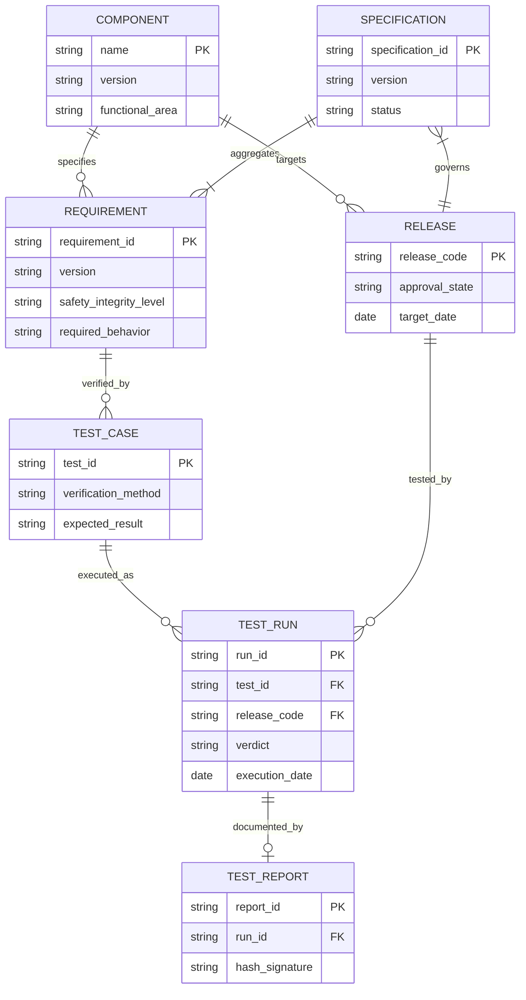
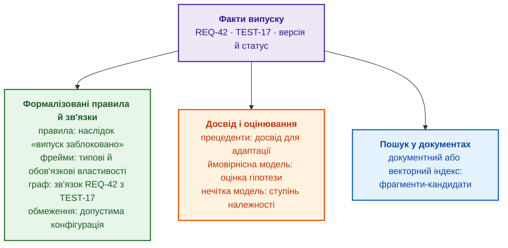
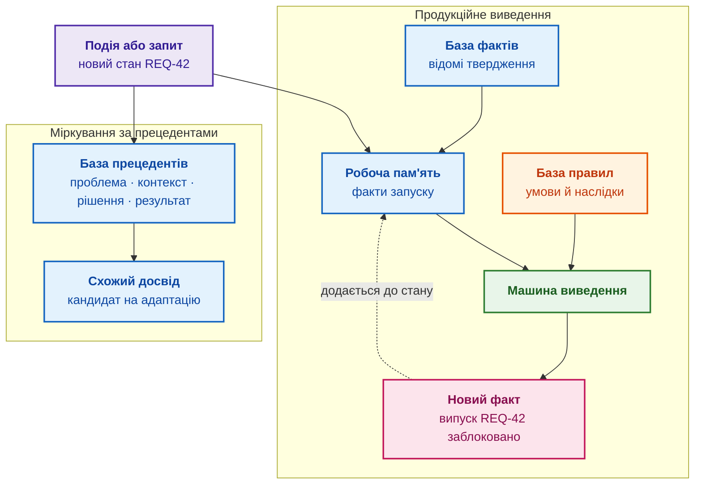
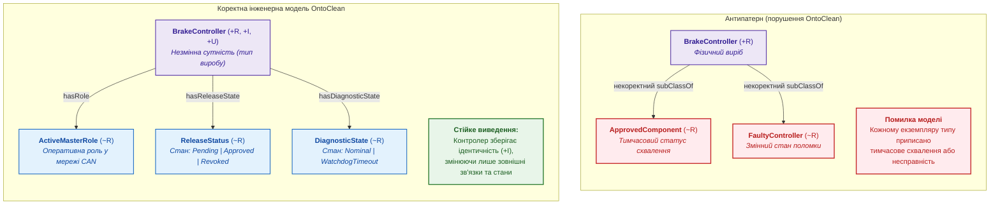
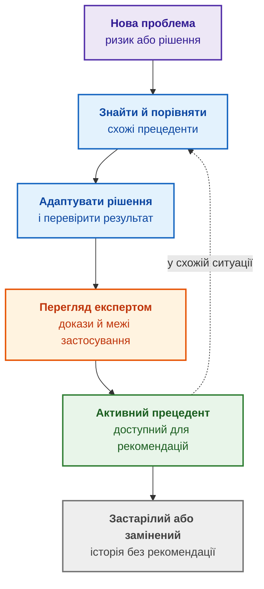
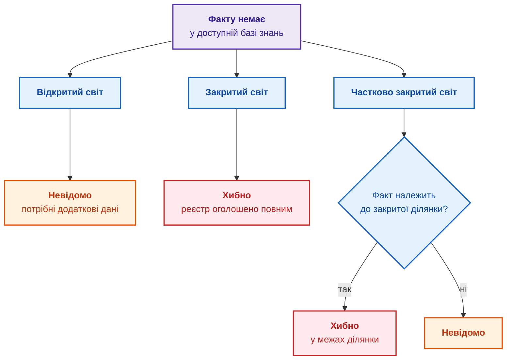
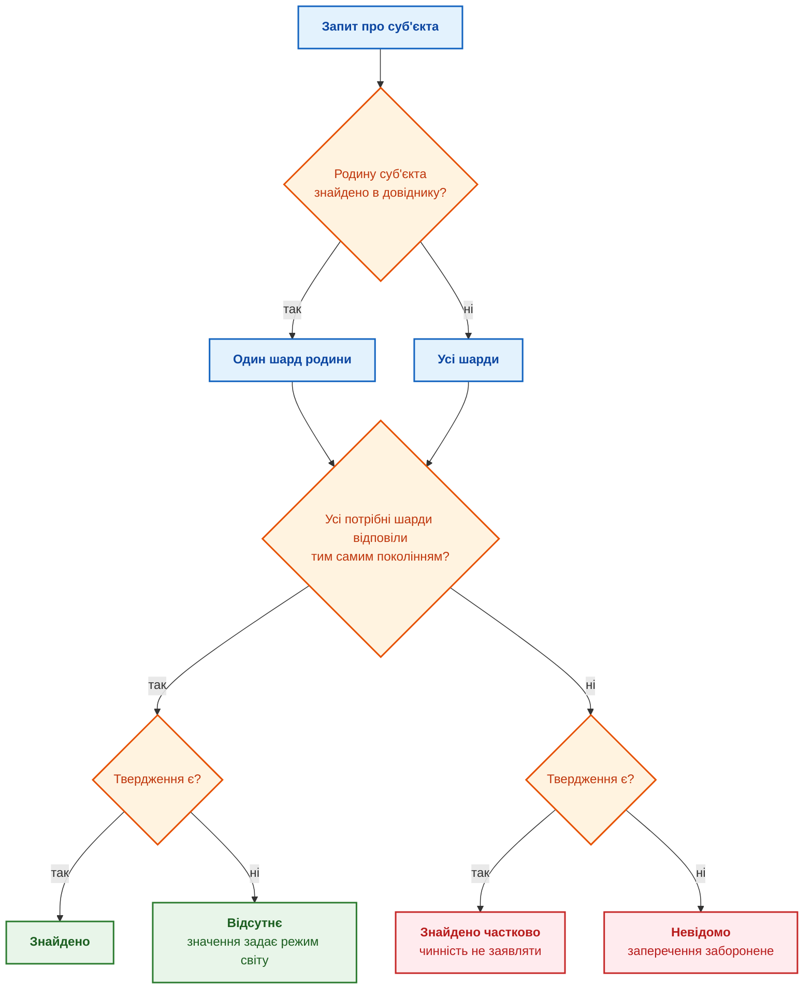

# Глава 7. Типологія баз знань: правила, онтології, прецеденти та вектори

> **Книга:** [Архітектура доказових експертних систем](README.md) · [Частина II: Математичні моделі, представлення та збереження знань](part-02-knowledge-models.md)  
> **Попередня глава:** [Глава 6. Прикладна математика експертних систем: правила, ймовірності, графи та причинність](ch06-applied-mathematics-for-expert-systems.md)  
> **Наступна глава:** [Глава 8. Інженерні артефакти як дані експертної системи](ch08-engineering-artifacts-as-data.md)  
> **Зміст книги:** [README.md](README.md)  
> **Автор:** [Микола Мартинович Федчик](about-the-author.md)  
> **Попередня підготовка:** різниця між джерелом, фактом, правилом і висновком із глав 1–6. Нові типи подання пояснюються через одну вимогу й застосовний до неї тест.  
> **Очікувані результати:** відрізняти базу знань від бази даних і сховища документів; для кожного типу бази знань (правила, фрейми, онтології, прецеденти, обмеження, ймовірнісні й нечіткі моделі, документні й векторні індекси) називати, що тип зберігає, який результат повертає й чого результат не доводить; обирати тип бази знань за потрібним результатом, а не за назвою продукту; явно задавати, що означає відсутній факт; задавати запитання до компетентності онтології й перевіряти ієрархію понять методом OntoClean; розрізняти фрагментацію, шардування й групування бази знань за ознаками, обирати ключ розбиття за залежностями виведення й не читати мовчання шарда як відсутність факту.  

## Анотація

База знань експертної системи має зберігати саме ті відомості, які потрібні для її задач. Глава пояснює, чим відрізняються правила, описи об'єктів, онтології, прецеденти, обмеження та ймовірнісні моделі, а також яку роль відіграють документні й векторні індекси. Порівняння спирається на одну навчальну вимогу REQ-42 і тест TEST-17: для кожного подання читач з'ясовує, що збережено, що обчислено й чого результат ще не доводить.

Після вибору подання розглянуто неповні дані та розподіл бази між вузлами. Відсутній запис не має перетворюватися на відсутність факту лише через спосіб пошуку або розміщення. Назва сховища не гарантує правильності знань: потрібні визначені операції, версії, підстави й межі результату. Так глава пов'язує математичні методи попередньої глави з наступним перетворенням інженерних артефактів на дані.

Команда каже: «нам потрібна база знань для штучного інтелекту (ШІ)», і під базою знань часто мають на увазі вікі, сховище документів або векторний індекс. Тоді на запитання «чи можна випускати контролер гальм BrakeController 3.2?» інформаційна система повертає абзац зі звіту, схожий на відповідь, і користувач не може зрозуміти, чи перед ним знайдений фрагмент, виведене правилом твердження чи перевірений факт. Продукційний рушій повертає спрацьоване правило, онтологічний рушій повертає клас або суперечність, база прецедентів повертає схожий досвід, розв'язувач обмежень повертає допустиму конфігурацію, а векторний індекс лише добирає схожі фрагменти. Якщо інтерфейс називає всі ці результати однаково «відповіддю ШІ», помилка кожного результату стає невидимою. Згідно з *принципом типізації результату (принцип Федчика)*, інтерфейс експертної системи зобов'язаний строго дискримінувати категорію поверненого результату (`FOUND` — знайдено, `INFERRED` — виведено, `VALIDATED` — перевірено, `FEASIBLE` — допустима конфігурація, `ESTIMATED` — статистична оцінка), категорично запобігаючи їх маскуванню під недиференційовану «відповідь ШІ».

Мета глави: показати, що універсальної бази знань не існує, і навчити обирати тип бази знань за потрібним результатом. Для кожного типу глава називає, що тип зберігає, як отримує результат, чого результат не доводить і де тип доречний у дослідженнях і розробці (*Research and Development*, R&D). Усі типи розглянуто на одному наскрізному прикладі: критична вимога REQ-42 до контролера гальм і тест TEST-17, який має вимогу підтвердити. Математику методів пояснила [Глава 6](ch06-applied-mathematics-for-expert-systems.md), а як інженерні артефакти стають даними й зв'язуються в граф, розповідають [Глава 8](ch08-engineering-artifacts-as-data.md) і [Глава 9](ch09-engineering-knowledge-graph-traceability.md).

## 1. Типові інженерні збої: наслідки невідповідності типу знань цільовому запитанню

Типові збої допоможуть зрозуміти, навіщо розрізняти подання знань ще до вибору продукту. У цьому розділі розглянуто сім навчальних ситуацій, у яких потрібний результат підміняється іншим або втрачає частину підстав. Це не виміряна частота всіх промислових відмов; таблиця є картою проблем, які далі розбираються на REQ-42.

<a id="obj-7-1"></a>
**Таблиця 7.1. Типові підміни результату в експертній системі**

| Проблема | Що бачить користувач | Технічна причина | Шлях виправлення |
|---|---|---|---|
| Пошук замість виведення | на запитання «чи порушено правило?» інформаційна система повертає схожий абзац | векторний пошук підмінює перевірку правила чи обмеження | типізований результат: знайдено, виведено, перевірено, оцінено |
| Хибне тлумачення відсутності | відсутнє в графі ребро до тесту трактують як «тесту немає» | до графа з відкритим світом застосовано припущення закритого світу | оголосити межі повноти й перевіряти повноту окремим правилом |
| Розбіжність версій | правило перевіряє факти іншої базової версії | правила, граф та індекс оновлюються не одночасно | маніфест випуску знань і запити до узгодженого знімка |
| Хибні зв'язки від мовної моделі | у графі з'являється переконливий, але хибний зв'язок | вилучення зв'язків без схеми, фрагмента-джерела й перегляду | обмежене вилучення, перевірка схеми, перевірка джерела, карантин |
| Витік через висновок | користувач не бачить секретного джерела, але бачить висновок із джерела | права доступу застосовано лише до сирих фактів | поширення міток доступу на висновки, пояснення й кеші |
| Вибух виведення | машина виведення не встигає за вимогами до часу відповіді | надмірна виразність мови, замкнені ланцюжки правил, повне обчислення всіх наслідків | обмежений профіль мови, інкрементальне виведення або доведення під час запиту |
| Розрізане виведення | відповідь про чинність норми змінюється залежно від того, який вузол відповів | пов'язані редакції або тести лежать на різних вузлах, мовчання вузла прочитано як «факту немає» | ключ розбиття за родиною документів, «невідомо» замість «хибно» за мовчання шарда |

Кожен рядок таблиці зводиться до *інженерного принципу доказової відповідності механізму знань (принцип Федчика)*: для кожного способу подання знань система зобов'язана явно декларувати четвірку специфікації $`\langle \text{Semantics}, \text{Algorithm}, \text{ProofStatus}, \text{SafeFallback} \rangle`$, де статус результату чітко розмежовує емпіричний пошук, дедуктивне доведення, ймовірнісну оцінку та допустиму конфігурацію, гарантуючи детерміновану безпечну реакцію на невизначеність. Решта глави застосовує цей принцип до кожного типу бази знань, починаючи з різниці між базою знань і базою даних.

## 2. Демаркація понять: база даних, сховище документів та база знань

База даних відповідає на запитання «що збережено?» і повертає записи, які відповідають запиту. База знань (*knowledge base*) додає семантику предметної області, а там, де потрібно, ще й механізм отримання нових висновків із наявних фактів. Не кожна база знань має власну машину виведення: онтологія може лише задавати спільну мову й типи, а пошук чи правила працюватимуть в іншому компоненті.

Реляційна база даних може зберігати вимоги, тести, дефекти й ризики, і запит мовою структурованих запитів (*Structured Query Language*, SQL) знайде вимоги без тестів, якщо програміст явно задасть умову. Продукційна база знань може містити доменне правило «критичну вимогу не можна закривати без доказу верифікації» і застосовувати правило до кожного нового факту. Відмінність не у форматі файла чи назві сервера, а в тому, де зберігається значення правила і хто виконує виведення. Згідно з *чотирикомпонентною моделлю практичної бази знань Федчика*, доказова база знань визначається формальним кортежем:

<a id="obj-7-2"></a>
**Формула (7.2). Чотири складники навчального профілю бази знань**

```math
\mathcal{KB} = \langle \mathcal{KR}, \mathcal{IE}, \mathcal{VC}, \mathcal{PR} \rangle
```

де:
- $`\mathcal{KR}`$ (*knowledge representation*) є моделлю подання знань: факти, правила, фрейми, графи, прецеденти, обмеження або розподіли ймовірностей;
- $`\mathcal{IE}`$ позначає операції отримання результату: запит, застосування правила, оцінювання моделі чи пошук кандидата. Власний рушій виведення є одним із варіантів, не обов'язковою частиною кожного сховища;
- $`\mathcal{VC}`$ (*validity context*) є контекстом просторово-часової, версійної та нормативної чинності: для якого продукту, стандарту, версії, замовника чи проміжку часу діє знання;
- $`\mathcal{PR}`$ (*provenance & ownership*) є невідкличним ланцюжком походження та повноважень: звідки взялося твердження, хто його верифікував і підписав, та хто має право змінити або відкликати запис.

Критерій тут стосується явно заданого змісту й операцій, не суворої межі між серверами або форматами. Реляційна база може виконувати запити, обмеження й рекурсивні обчислення; документ може містити складну модель; онтологія може зберігатися без окремого ризонера. Для REQ-42 потрібно встановити, що означають статуси й зв'язки та який компонент перевіряє потрібну умову. Сам кортеж вище є специфікацією ролей у навчальному профілі, не доказом, що збережені відомості істинні.

### 2.1. Критерії перетворення структурованого набору файлів на базу знань

Перетворення набору файлів на керовану базу починається з питань до записів. Для REQ-42 потрібно знати редакцію, виріб, тест і значення статусу, а не лише шлях до файла. Для цього навчального профілю визначено п'ять груп відомостей. Це практичний перелік для задачі REQ-42, не універсальна теорема «тоді й лише тоді» про всі бази знань:

- **одиниці знання:** вимога, компонент, тест, дефект, правило, прецедент або звіт;
- **значення полів і термінів:** чим статус «затверджено» відрізняється від «застаріло», а зв'язок «перевіряє» від простого згадування в тексті;
- **ідентифікатори, версії та межі чинності:** який запис є REQ-42 версії 1.2, для якого виробу й часу запис діє;
- **зв'язки між одиницями:** REQ-42 перевіряє тест TEST-17, тест породив звіт, правило використовує статус звіту;
- **спосіб обробки:** пошук, запит до графа, перевірка обмеження, застосування правила або зіставлення прецедентів.

Файли можуть лишатися основним місцем зберігання. Базою знань файли робить не сервер і не формат YAML (*YAML Ain't Markup Language*), а узгоджена модель понять, зв'язків, чинності й операцій. Папка з текстами без таких домовленостей є джерелом матеріалів для майбутньої бази знань, а не базою знань у строгому сенсі.

### 2.2. Корпоративна вікі: межі придатності та архітектура RAG

В організаційному сенсі корпоративна вікі, наприклад Confluence, стає базою знань, коли команда систематично зберігає у вікі інструкції, рішення, поняття предметної області, досвід інцидентів і посилання на першоджерела, а кожна сторінка має власника, статус і дату перегляду. Для керування знаннями в компанії такого рівня часто досить. Проте вікі без власників, статусів, стабільних посилань і правил оновлення є радше архівом документів: пошук знайде згадки, але не відповість, яке правило чинне для версії 3.2 чи який тест перевіряє вимогу, без ручного тлумачення текстів. Вікі добре зберігає пояснення й контекст, але не замінює граф простежуваності, рушій правил чи реєстр вимог там, де потрібні автоматичні перевірки й відтворюване виведення.

Над вікі часто будують генерацію з пошуком (*Retrieval-Augmented Generation*, RAG): застосунок розбиває сторінки на фрагменти, індексує фрагменти, добирає релевантні фрагменти до запиту, а мовна модель формує відповідь. Вікі лишається основним сховищем, а генерація з пошуком є шаром пошуку й пояснення над вікі. Таблиця порівнює генерацію з пошуком із повнотекстовим пошуком.

<a id="obj-7-3"></a>
**Таблиця 7.3. Пошук і генерація відповіді над вікі**

| Потреба користувача | Повнотекстовий пошук | Генерація з пошуком над вікі |
|---|---|---|
| Запит іншими словами | шукає точні слова, форми слів або заздалегідь задані синоніми | може знайти фрагмент за близьким змістом |
| Відповідь із кількох сторінок | повертає перелік сторінок | поєднує знайдені фрагменти у стислу відповідь із посиланнями |
| Пояснення терміна в контексті | потребує відкрити кілька сторінок самостійно | пояснює термін з урахуванням контексту проєкту |
| Уточнення в діалозі | кожен запит формулюють окремо | враховує попереднє запитання й просить уточнення |

За запитом «чому для REQ-42 потрібна незалежна верифікація?» генерація з пошуком може дібрати фрагмент вимоги, сторінку з політикою безпеки й опис тесту TEST-17 і пояснити зв'язок між ними. Але генерація з пошуком не доводить, що знайдений текст чинний, не встановлює формального зв'язку REQ-42 з TEST-17 і не перевіряє правила. *Інженерний інваріант нееквівалентності цитування та верифікації (інваріант Федчика):* наявність текстового фрагмента у сховищі документів чи пошуковому індексі $`(\exists d \in \mathcal{D}: \text{Contains}(d, \phi))`$ не є еквівалентною формальній верифікованості вимоги $`(\text{Verified}(\phi))`$, тобто $`\text{Retrieved}(d, \phi) \not\implies \text{Verified}(\phi)`$. Відповідь «у вікі написано» має виключно евристичний пошуковий статус і не замінює сертифікаційного доведення, тому будь-яка відповідь RAG зобов'язана супроводжуватися точними посиланнями на верифіковані ревізії джерел.

### 2.3. Семантична типізація запитів інженера до бази знань

Користувач не працює з базою знань одним універсальним запитом: формулювання залежить від потрібного результату. Одна тема REQ-42 породжує різні коректні запити.

<a id="obj-7-4"></a>
**Таблиця 7.4. Вибір механізму за потрібним результатом запиту**

| Запит користувача | Подання знань або механізм | Коректний результат |
|---|---|---|
| «Яка чинна версія REQ-42?» | реєстр вимог або база даних | запис вимоги та версія |
| «Який тест перевіряє REQ-42?» | семантичний граф | зв'язок REQ-42 з TEST-17 і шлях простежуваності |
| «Чи порушено правило для вимоги ASIL D без незалежного тесту?» | продукційні правила | спрацьоване правило й виведений наслідок |
| «Які конфігурації тесту задовольняють умову незалежності?» | база обмежень | набір допустимих конфігурацій |
| «Чи траплявся подібний дефект?» | база прецедентів | схожий прецедент і умови, за яких рішення спрацювало |
| «Наскільки правдоподібна гіпотеза про відмову сторожового таймера?» | байєсівська модель | умовна ймовірність за моделлю й спостереженнями |
| «Де у звітах згадано REQ-42?» | документний або векторний індекс | фрагменти-кандидати з джерелом і статусом |

Формальний запит має визначену мову, схему даних і семантику виконання: запит прямо називає сутності, зв'язки, умови й форму відповіді. Наприклад, запит мовою SPARQL (*SPARQL Protocol and RDF Query Language*) до графа може означати «поверни всі тести, пов'язані зв'язком «перевіряє» з REQ-42, разом із результатом і звітом».

<details>
<summary>Приклад запиту SPARQL: тести, що перевіряють REQ-42</summary>

Змінні починаються зі знака питання. Властивість `ex:verifies` пов'язує визначення тесту з вимогою, а `ex:ofTest`, `ex:release`, `ex:result` і `ex:hasReport` описують окремий запуск. Запит шукає схвалений запуск саме для випуску 3.2.

```sparql
PREFIX ex: <https://example.org/rd/>

SELECT ?test ?result ?report
WHERE {
    ?test ex:verifies ex:REQ-42 .
    ?run ex:ofTest ?test ;
      ex:release ex:Release3_2 ;
      ex:result ?result ;
      ex:hasReport ?report ;
      ex:status ex:Approved .
}
```

</details>

За незмінних даних, версії графа й прав доступу формальний запит дає відтворюваний результат. Формальна мова не робить відповідь правильною: мова лише фіксує, що саме й за якою процедурою перевірено.

Неформальний запит користувач формулює природною мовою: «чим підтверджено REQ-42?». Мовна модель може розпізнати намір, уточнити неоднозначність і перетворити фразу на один чи кілька формальних запитів, але відповідь мовної моделі не є результатом запиту до бази знань, якщо мовна модель не передала запит механізму виведення й не повернула перевірений результат із джерелами. Згідно з *п'ятиетапним протоколом детермінованої взаємодії SLM з базою знань (протокол Федчика)*, надійна взаємодія мовної моделі зі сховищем знань реалізується за суворим регламентом:

1. мовна модель визначає намір і за потреби просить уточнити терміни, версію чи межі пошуку;
2. служба авторизації звужує доступні дані й дозволені операції;
3. мовна модель формує структурований запит, а застосунок перевіряє синтаксис, типи й межі виконання запиту;
4. механізм виведення виконує запит до реєстру, графа, правил, обмежень, прецедентів чи індексу;
5. мовна модель пояснює результат, не змінюючи змісту результату: називає тип результату, джерела, версії й невизначеності.

За авторським підходом виконаний формальний запит є перевірним способом отримати дані з визначеного знімка, не «джерелом істини» про світ. Для REQ-42 потрібно перевірити чинний зв'язок, потрібний випуск і належний звіт; текст «TEST-17 verifies REQ-42» цього не замінює. Якщо запит лише повернув записи, саме так називається результат; зміст і достатність джерел оцінюються окремо.

### 2.4. Розподілена база знань життєвого циклу: вимоги, вихідний код, тести та дефекти

Вимоги є знанням про те, що має робити виріб, за яких умов і як буде підтверджено виконання. База знань про вимоги зберігає не лише текст, а й рівень, функціональну область, версію, статус, власника, джерело, залежності, ризики, тести й докази. Зміна змісту вимоги породжує нову версію, а не непомітне редагування затвердженого твердження. Код є виконуваною специфікацією поведінки, тест поєднує декларативне очікування («за спрацювання сторожового таймера контролер переходить у безпечний стан за 100 мс») і процедуру перевірки, а звіт безперервної інтеграції (*Continuous Integration*, CI) є доказом, що конкретна версія коду пройшла чи не пройшла конкретний тест у конкретному середовищі.

<a id="obj-7-5"></a>
**Таблиця 7.5. Артефакти й збереження знань життєвого циклу**

| Артефакт | Яке знання містить | Де зберігається | Що лишається після завершення проєкту |
|---|---|---|---|
| Вимога й специфікація вимог | ціль, обмеження, версія, простежуваність | репозиторій вимог або контрольований документ | базова версія вимог, історія змін і підстави для супроводу |
| Код і конфігурація | виконувана поведінка, інтерфейси, схеми | репозиторій Git у GitLab чи GitHub | змога відтворити версію й повторно використати компонент |
| Тест | очікувана поведінка й процедура перевірки | репозиторій тестів або система керування тестуванням | регресійний набір і пояснення меж поведінки |
| Звіт тесту, журнал, артефакт CI | доказ запуску тесту для версії й середовища | GitLab CI, GitHub Actions, сховище артефактів | підтвердження версії випуску для аудиту й розбору інцидентів |
| Задача, дефект, ризик, запис архітектурного рішення | план, відповідальність, контекст і прийняте рішення | Jira, GitLab Issues, GitHub Issues, репозиторій записів рішень | причини рішень, уроки й невиконані зобов'язання |

Разом ці артефакти можуть утворити розподілену базу знань про проєкт, якщо елементи мають типи, версії, зв'язки, статуси й власників. Один варіант інтеграції має три рівні:
- **Рівень 1 (Конвенції зв'язування):** стабільні уніфіковані ідентифікатори (URI/UUID) артефактів (REQ-42, TEST-17, номер задачі в Jira, Git commit hash, URI артефакту CI);
- **Рівень 2 (Пошуковий індекс метаданих):** уніфіковане індексування метаданих і повнотекстових описів для швидкого вилучення контексту;
- **Рівень 3 (Інтеграційний семантичний граф):** шар матеріалізованих проєкцій знань, який зчитує дані через API, зіставляє ідентифікатори, зберігає типи, відношення транзитивності, версії та походження, виконуючи наскрізні верифікаційні запити (наприклад, «які критичні вимоги базової версії не мають затвердженого результату тесту?»). Інтеграційний шар не стає ще одним місцем ручного редагування: основним фактом лишається запис в інструменті-джерелі, а шар оновлює проєкцію факту. Невеликій команді варто спершу узгодити ідентифікатори й типи посилань, потім додати пошук, а інтеграційний шар будувати лише для повторюваних наскрізних перевірок.

Підсумок розділу: база знань відрізняється від бази даних і сховища документів не форматом, а наявністю узгодженої семантики, контексту чинності, походження й механізму отримання результату. Відкриті бази знань показують, наскільки різними бувають такі механізми.

## 3. Референтні відкриті бази знань інженерного призначення

База знань не обов'язково належить закритій корпоративній експертній системі. Відкриті проєкти дозволяють переглянути записи, завантажити дані або виконати запит.

<a id="obj-7-6"></a>
**Таблиця 7.6. Приклади відкритих баз і подань знань**

| Проєкт | Структура знань | Що можна побачити |
|---|---|---|
| [Wikidata](https://www.wikidata.org/wiki/Wikidata:Introduction) | спільна багатомовна база тверджень і граф знань | сутності `Q…`, властивості `P…`, значення, уточнення й джерела; структуровані дані опубліковано за ліцензією CC0 |
| [ConceptNet](https://conceptnet.io/) | відкрита багатомовна семантична мережа | зв'язки `IsA`, `PartOf`, `UsedFor` між поняттями, ваги й походження тверджень |
| [Gene Ontology](https://geneontology.org/docs/ontology-documentation/) | формальна предметна онтологія | класи біологічних процесів і функцій, відношення `is_a`, `part_of`, стабільні ідентифікатори `GO:…` |
| [OpenFisca](https://openfisca.org/en/) | відкриті виконувані моделі законодавчих правил | формули податків і соціальних виплат, параметри за датами, тести |
| [Bayesian Network Repository](https://www.bnlearn.com/bnrepository/) | колекція ймовірнісних моделей | мережі ASIA, ALARM, CHILD із таблицями умовних ймовірностей |
| [AI Incident Database](https://incidentdatabase.ai/) | відкритий корпус випадків | реальні інциденти з ШІ, звіти й класифікації; база не є готовим рушієм прецедентів, але є базою досвіду |

Вступ до Wikidata показує твердження `Q42 → P69 → Q691283`: Дуглас Адамс навчався в коледжі St John's. У Gene Ontology термін `GO:0019319` має двох батьків, бо біосинтез гексоз одночасно є обміном гексоз і біосинтезом моносахаридів. Добірка навмисно неоднорідна: Wikidata зберігає твердження з джерелами, Gene Ontology визначає класи, OpenFisca виконує правила, а мережі з bnlearn обчислюють ймовірності. *Принцип функціональної неоднорідності концепту «база знань» (принцип Федчика):* поняття «база знань» не позначає єдиного монолітного формату чи уніфікованого механізму; воно об'єднує принципово відмінні математичні парадигми (твердження, онтологічні таксономії, виконувані правила, байєсівські мережі, прецеденти), кожна з яких має суворо окреслені межі обчислювальної спроможності. Щоб порівняти типи на інженерному запитанні, потрібен спільний сценарій.

## 4. Наскрізний інженерний прецедент: верифікація випуску BrakeController 3.2

Проєктна команда готує випуск R2026.3 контролера гальм BrakeController версії 3.2. Перед випуском кожна критична вимога має реалізацію, метод верифікації й затверджений доказ виконання. Вигадана системна вимога REQ-42 описує поведінку контролера, коли внутрішній сторожовий таймер (*watchdog*) перестає отримувати очікуваний сигнал; вимогу класифіковано за найвищим рівнем повноти безпеки автомобільних систем (*Automotive Safety Integrity Level*, ASIL) D. Усі ідентифікатори й значення в сценарії навчальні.

<details>
<summary>Приклад даних YAML: запис вимоги REQ-42 і специфікація вимог</summary>

Запис вимоги задано у форматі YAML, а специфікація вимог збирає погоджені версії вимог для випуску.

```yaml
requirement_id: REQ-42
requirement_version: "1.2"
requirement_level: system
functional_area: safety
title: "Перехід BrakeController у безпечний стан за відмови watchdog"
component: BrakeController
component_version: "3.2"
safety_integrity_level: ASIL-D
trigger: "watchdog_timeout"
required_behavior: "перейти в безпечний стан не пізніше ніж за 100 ms"
verification_method: "незалежний стендовий тест"
verification_test: TEST-17
release_condition: "потрібен затверджений результат independent verification"
```

```yaml
specification_id: BrakeController-SyRS
specification_version: "3.2"
applies_to: BrakeController
release: R2026.3
requirements:
  - id: REQ-42
    version: "1.2"
    role: "безпека: перехід у безпечний стан за watchdog_timeout"
  - id: REQ-43
    version: "2.0"
    role: "інтерфейс: передавання статусу відмови на CAN"
status: approved
```

</details>

Запис YAML не є базою знань: запис є структурованим джерелом, з якого різні бази знань беруть факти. Для REQ-42 основним місцем зв'язків є семантичний граф, а решту функцій виконують інші подання знань.

Реляційно-сутнісну структуру інженерних артефактів та зв'язків верифікації випуску представлено у вигляді діаграми сутностей і зв'язків.

<a id="obj-7-7"></a>
**Схема 7.7. Вимога, тест, запуск, звіт і випуск**



<a id="obj-7-8"></a>
**Таблиця 7.8. Ролі подань у перевірці REQ-42**

| Потреба навколо REQ-42 | База знань або індекс | Що зберігає |
|---|---|---|
| простежити, який тест перевіряє вимогу | семантичний граф або онтологія | вимогу, компонент, тест, звіт і зв'язки |
| задати обов'язкові поля критичної вимоги | фреймова база | рівень ASIL, метод верифікації, доказ, стан випуску |
| заблокувати випуск без незалежного тесту | продукційна база правил | факти про статус тесту й правило політики випуску |
| знайти звіт TEST-17 у документації | документний або векторний індекс | фрагменти звіту, метадані й вектори |

У навчальному сценарії порівняно дві контрольні точки одного процесу:
- **До тестування:** є вимога й план, але немає схваленого результату потрібного запуску. Локальне правило не дозволяє позитивного допуску; це не доказ дефекту контролера.
- **Після тестування:** TEST-17 має запуск RUN-17-32 для версії 3.2 та звіт REPORT-17-32 із результатом успіху й потрібним погодженням. Цей пункт перевірки пройдено, але сам звіт не закриває автоматично всі ризики або всі інші вимоги випуску.

Схема далі показує, як різні механізми використовують ті самі вхідні факти. Обхід графа допомагає знайти залежності, але не замінює перевірки змісту кожного доказу.

<a id="obj-7-9"></a>
**Схема 7.9. Формальні результати, оцінки й кандидати на доказ**



Фіолетовий блок є вхідними фактами. Зелений блок дає формальні результати: наслідок, клас, зв'язок, допустиму конфігурацію. Помаранчевий блок дає досвід і оцінки, які потребують перевірки. Синій блок дає лише кандидатів на доказ. Жоден механізм не замінює інших, тож наступний розділ зводить відмінності в одну таблицю.

## 5. Порівняльна таксономія типів баз знань

Онтологія, продукційні правила, база прецедентів і векторний пошук не виключають одне одного, і одна експертна система часто використовує всі чотири. Розрізняти типи потрібно тому, що помилка кожного результату має інший характер.

<a id="obj-7-10"></a>
**Таблиця 7.10. Порівняння восьми типів подання й пошуку**

| Тип бази знань або індексу | Що зберігає | Що повертає механізм | Чого результат не доводить |
|---|---|---|---|
| продукційні правила | факти й правила «якщо, то» | наслідок і ланцюжок спрацьованих правил | що правила повні й актуальні |
| фрейми | типові об'єкти, слоти, значення за замовчуванням, винятки | успадковані або заповнені властивості | що значення підтверджене для конкретного об'єкта |
| онтологія й семантичний граф | класи, відношення, аксіоми, обмеження | клас, новий зв'язок або суперечність | що відсутній факт хибний |
| база прецедентів | минулі проблеми, контекст, рішення, наслідки | схожий прецедент і кандидат на адаптацію | що старе рішення придатне без перевірки |
| база обмежень | змінні, домени, дозволені комбінації | один або кілька допустимих варіантів | що знайдений варіант найкращий |
| ймовірнісна модель | залежності, спостереження, ймовірності | оновлена ймовірність гіпотези | що гіпотезу доведено |
| нечітка модель | функції належності, нечіткі правила | ступінь належності або керівна оцінка | статистичну ймовірність події |
| документний або векторний індекс | тексти, фрагменти, метадані, вектори | кандидати за словами або схожістю | чинність, істинність чи право використання |

*Закон збереження епістемічних меж парадигми знань (закон Федчика):* жоден механізм подання знань не здатен вивести факт або гарантувати інваріант, що виходить за межі його власної формальної моделі; зокрема, статистична ймовірність не доводить причинності, векторна близькість не доводить істинності, а відсутність спростування у відкритому світі (OWA) не гарантує повноти системи.

*Інженерний принцип демаркації пошуку матеріалу та логічного виведення (принцип Федчика):* векторний або повнотекстовий пошук постачає виключно сирий матеріал (фрагменти-кандидати), тоді як доведення, класифікація, синтез конфігурації та апостеріорна верифікація здійснюються виключно детермінованими символьними та ймовірнісними рушіями. Інтерфейс доказової експертної системи має позначати, який механізм дав кожну частину відповіді. Далі кожен тип розглянуто окремо.

## 6. База правил, база фактів та динамічна робоча пам'ять

У класичній продукційній експертній системі базу знань ділять на базу правил і базу фактів. База правил містить відносно сталі доменні залежності: умови, наслідки, пріоритети й межі чинності. База фактів містить твердження про конкретні об'єкти: клас вимоги, результат тесту, стан компонента. Робоча пам'ять (*working memory*) містить факти поточного сеансу виведення; у простій продукційній експертній системі робочу пам'ять називають базою фактів, а в розподіленій архітектурі постійне сховище фактів і тимчасову робочу пам'ять розрізняють. Машина виведення зіставляє факти з умовами правил і додає висновки до робочої пам'яті. Схема показує продукційне виведення поруч із міркуванням за прецедентами.

<a id="obj-7-11"></a>
**Схема 7.11. Правила, робоча пам'ять і прецеденти**



Фіолетовий блок є подією, сині блоки є пам'яттю фактів і прецедентів, помаранчевий блок є правилами, зелений блок є машиною виведення, рожевий блок є виведеним фактом. Пунктирна стрілка показує, що новий факт стає вхідним для наступних правил. На першій контрольній точці поділ виглядає так, як у прикладі нижче.

<details>
<summary>Приклад: база правил, база фактів і робоча пам'ять на першій контрольній точці</summary>

```text
постійна база правил:
  R-17: якщо asil(X, D) і verification_status(X, missing),
        то release_blocked(X)

постійна база фактів:
  requirement(REQ-42)
  asil(REQ-42, D)

робоча пам'ять цього запуску:
  verification_status(REQ-42, missing)

після спрацювання R-17:
  release_blocked(REQ-42)
```

</details>

Правило R-17 застосовне до багатьох вимог, а факт «статус верифікації REQ-42: відсутній» описує стан до TEST-17 і після затвердження звіту має змінитися. *Інженерне правило контекстуалізації виведеного факту (правило Федчика):* будь-який виведений факт у робочій пам'яті продукційної системи зобов'язаний містити ідентифікатор активної сесії, часову мітку знімка, версію набору правил та вектор вхідних передумов, унеможливлюючи ізольоване безконтекстне використання проміжних висновків (як у випадку факту блокування REQ-42). Факти можуть зберігатися в сховищі RDF (*Resource Description Framework*), графі знань, логічній базі чи цифровому двійнику, але поділ на правила й робочу пам'ять найвиразніший саме в продукційній архітектурі.

### 6.1. Неприпустимість агрегації суперечливих фактів голосуванням більшості

Коли база фактів зростає до мільйонів тверджень із корпусів стандартів, виникає спокуса «очистити» базу, лишивши для кожного твердження лише значення, яке підтримує більшість джерел. Автором наведено *контрприклад до агрегації нормативних знань голосуванням більшості*: якщо алгоритм рахує документи як рівноправні голоси без статусу й версій, тридцять застарілих редакцій можуть переважити одну чинну редакцію, яка скасувала правило. Це демонструє конкретний дефект агрегації за кількістю, а не доводить, що кожен алгоритм більшості або кожне його застосування неминуче спричиняє сертифікаційну відмову. Серед можливих ризиків такого згортання:
1. **Втрата часової чинності:** застарілі копії можуть переважити чинну редакцію (порушення імперативу *Lex Posterior*).
2. **Втрата меж документа:** злиття редакцій ускладнює ретроспективний аудит запитання «як було за стандартом 1981 року?».
3. **Втрата контекстних винятків і модальностей:** профільні розширення можуть послаблювати MUST до SHOULD для спеціальних інженерних умов.
4. **Змішування юрисдикцій:** локальні норми можуть бути поглинуті загальним корпусом через спільні терміни.

Безпечніше агрегувати без втрат:

<a id="obj-7-12"></a>
**Формула (7.12). Збереження твердження разом із цитатними підставами**

```math
\mathrm{Assertion}(S,R,V;C)\ \leftarrow\ \big[\,\mathrm{Citation}(D_1,\mathrm{span}_1,h_1),\ \dots,\ \mathrm{Citation}(D_k,\mathrm{span}_k,h_k)\,\big]
```

Позначення в записі:

- $`\mathrm{Assertion}(S,R,V;C)`$ є твердженням «суб'єкт $S$ має відношення $R$ зі значенням $V$ у контексті $C$»; $S$ має стабільний ідентифікатор із простором імен і версією, а схема $R$ задає тип $V$ та умови взаємовиключності значень;
- $C$ є записом контексту чинності з моделі §2: виріб і базова версія, юрисдикція, нормативний профіль і модальність, інтервал чинності з явними відкритими чи замкненими межами; невідомі межі не підміняють порожнім інтервалом;
- $\leftarrow$ означає, що твердження пов'язане з наведеними джерелами, а квадратні дужки містять перелік його підтверджень;
- $`D_i`$ є документом-джерелом із версією, $`\mathrm{span}_i`$ є точними координатами фрагмента в документі, а $`h_i`$ є хешем цього фрагмента;
- $k$ є кількістю джерел, що підтримують твердження, а індекс $i$ позначає окреме джерело.

Однакові типізовані трійки $(S,R,V)$ групуються в один запис з усіма цитатами лише за однакового контексту $C$; збіг короткого імені REQ-42 у різних виробах чи базових версіях не означає тотожності записів. Різні значення $`V_1,V_2,\dots`$ зберігаються всі. Машина виведення під час запиту зіставляє контексти, лінію змін і юрисдикцію. Суперечність фіксують лише для порівнюваних тверджень зі спільною ділянкою чинності та значеннями, взаємовиключними за схемою $R$: два різні тести, які перевіряють одну вимогу, самі по собі не конфліктують. Послідовні редакції з неперетинними інтервалами також не створюють одночасного конфлікту; невідомі межі означають невизначеність порівняння, а не доведену сумісність. За підтвердженої суперечності результатом є попередження, а не мовчазний вибір більшості.

> [!NOTE]
> **Чотири вимоги до контекстно-збережувальної агрегації фактів**
> 1. Збереження часової чинності: захист чинних норм від поглинання застарілими редакціями стандарту, скасованими пізнішим актом (принцип *Lex Posterior*).
> 2. Збереження меж документа: забезпечення точної ретроспективи на запитання щодо історичних версій норм.
> 3. Збереження винятків і модальностей: фіксація контекстних послаблень (MUST $\to$ SHOULD) для спеціальних інженерних профілів без узагальнення.
> 4. Збереження юрисдикцій та явні цитати: агрегація тверджень $`\mathrm{Assertion}(S,R,V;C) \leftarrow [\mathrm{Citation}(D_i, \mathrm{span}_i, h_i)]`$ зі збереженням контексту $C$, точних байтових координат та криптографічних хешів $`h_i`$.
> *Інженерний інваріант безпеки:* При виявленні взаємовиключних за схемою відношення тверджень у спільній області чинності система повертає типізоване попередження про суперечність (`CONTRADICTION`), а не мовчазний вибір більшості.

### 6.2. Семантичне розмежування поточної бази фактів та бази прецедентів

База фактів зберігає окремі твердження про стан, а база прецедентів зберігає цілісний епізод: проблему, контекст, рішення, результат і межі перенесення досвіду.

<a id="obj-7-13"></a>
**Таблиця 7.13. Окремий факт і завершений прецедент**

| Ознака | База фактів | База прецедентів |
|---|---|---|
| одиниця знання | окреме твердження | завершена цілісна ситуація |
| приклад | «REQ-42 має рівень ASIL D» | CASE-0081: попередній випуск із вимогою ASIL D без незалежного тесту |
| використання | перевірка умов правил і логічні запити | пошук схожого досвіду й адаптація рішення |
| зміна в часі | факт швидко оновлюється або втрачає чинність | прецедент зберігається як історичний досвід |
| результат | новий факт або висновок | схожий прецедент і кандидат на рішення |

Один прецедент містить багато фактів, але набір фактів ще не є прецедентом. Запис стає прецедентом завдяки проблемі, застосованому рішенню й відомому результату, які дозволяють порівняти нову ситуацію з минулою.

Підсумок розділу: база правил, база фактів і робоча пам'ять розділяють сталі правила, стан об'єктів і стан запуску, а безвтратна агрегація зберігає всі значення з джерелами до моменту запиту. Далі розглянуто сам продукційний механізм.

## 7. Продукційні бази знань: правила прямого та зворотного виведення

Продукційна база знань зберігає факти й правила у формі «якщо умова істинна, додай висновок або виконай дію». Правило R-17 разом із фактами про REQ-42 утворює мінімальний приклад: результатом є не слово «заблоковано», а ланцюжок, який аудитор може перевірити, від REQ-42 і рівня ASIL D через статус верифікації й правило R-17 до виведеного факту. Пряме й зворотне виведення, оператор кроку виведення й найменшу нерухому точку пояснила [Глава 6](ch06-applied-mathematics-for-expert-systems.md), а алгоритм Rete Чарльза Форджі, що швидко зіставляє тисячі правил із фактами, описано там само [[1]](#src-1).

Формула кроку виведення з Глави 6 описує монотонне виведення: новий факт не забирає старого наслідку. Винятки, заперечення, пріоритети й відкликання роблять виведення немонотонним, і тоді семантику обирають явно: стратифіковане заперечення, правила з винятками або семантику стабільних моделей, яку запропонували Майкл Гельфонд і Володимир Ліфшиц [[2]](#src-2). Порядок правил у файлі не повинен непомітно ставати доменною політикою. *Інженерний інваріант відтворюваного запису доведення (інваріант Федчика):* будь-яке виведення в продукційній системі зобов'язане формувати криптографічно підписаний об'єкт доведення (Proof Object) у складі кортежу $`\langle \mathrm{RuleID}, \theta, \mathrm{Premises}, \mathrm{RulebaseVersion}, t_{\mathrm{snapshot}} \rangle`$, де $\theta$ є вектором уніфікації змінних. Тоді пояснення є не стохастичним текстом, який мовна модель згенерувала після події, а детермінованим записом реального кроку виведення.

Основний ризик продукційної бази знань полягає не в машині виведення, а в неповноті й конфліктах правил. Якщо винятки накопичуються без пріоритетів, область чинності не задано, а старі правила не відкликано, рушій послідовно виконає неправильну політику. Тому кожне правило має власника, версію, пріоритет, умови чинності й тестові приклади. *Принцип епістемічної неповноти продукційного рушія (принцип Федчика):* виведений наслідок доводить лише дедуктивну сумісність із наявними правилами й фактами; відсутність спрацювання блокуючого правила не є доказом безпеки або повноти бази знань, якщо простір правил не верифіковано формальними методами на вичерпність.

## 8. Фреймові моделі знань: об'єкти з ролями, слотами та значеннями за замовчуванням

Фреймова база знань описує типові об'єкти фреймами, тобто структурами зі слотами. Слот (*slot*) є властивістю або роллю: компонент має власника, інтерфейс, клас безпеки, постачальника, версію, ризики й докази. Фрейм може задавати типове значення слота й правило успадкування, а конкретний об'єкт успадковує структуру фрейму й заповнює слоти власними значеннями.

<details>
<summary>Приклад фрейму YAML: критичний компонент і екземпляр BrakeController</summary>

```yaml
frame:
  name: SafetyCriticalComponent
  slots:
    asil: { required: true }
    verification_method: { default: independent }
    verification_evidence: { required: true }
    release_state: { default: blocked }

instance:
  name: BrakeController
  is_a: SafetyCriticalComponent
  slots:
    asil: D
    verification_method: independent
    verification_evidence: REPORT-17-32
```

</details>

Екземпляр явно задає метод незалежної верифікації й посилання на звіт REPORT-17-32; типовий стан випуску береться з фрейму. Окремі вкладені об'єкти `frame` та `instance` не перезаписують поля один одного. Жодне заповнення слота не перевіряє, чи звіт справжній, застосовний до випуску й погоджений. Значення в простій однобатьківській моделі обчислюють так:

<a id="obj-7-14"></a>
**Формула (7.14). Значення слота в однобатьківській фреймовій моделі**

```math
v(x,s)=
\begin{cases}
v_{\text{явне}}(x,s), & \text{якщо значення задано для } x,\\
v(\mathrm{parent}(x),s), & \text{якщо дозволено успадкування},\\
\bot, & \text{інакше: значення невідоме}.
\end{cases}
```

У цьому виразі:

- $x$ є об'єктом, а $s$ є його слотом;
- $`v_{\text{явне}}(x,s)`$ є значенням, заданим для самого об'єкта;
- $`\mathrm{parent}(x)`$ є батьківським фреймом, а $`v(\mathrm{parent}(x),s)`$ є значенням того самого слота у фреймі;
- $\bot$ означає «значення невідоме»;
- умови в фігурних дужках визначають, який із трьох випадків застосувати: явне значення, дозволене успадкування або невідоме значення.

Для невідомого слота явно перевіряється, чи є батьківський фрейм і чи дозволене успадкування. Ланцюжок має завершуватися й не містити циклів; для кількох батьків потрібна окрема політика конфліктів. Наприклад, явний метод `independent` береться з екземпляра, типовий `blocked` зі схеми, а відсутній і неуспадкований слот дає невідомість. Успадкований статус не є результатом нового тесту.

*Інженерне правило обов'язкового повернення режиму отримання значення слота (правило Федчика):* будь-яке зчитування властивості фрейму повертає типізовану пару $`\langle v(x,s), \mathrm{Mode} \rangle`$, де режим явно маркує джерело значення (`DIRECT` — явне, `INHERITED` — успадковане, `PROCEDURAL` — обчислене демоном, `DEFAULT` — значення за замовчуванням, `UNKNOWN` — невідоме). Інакше інтерфейс покаже дефолтний стан «заблоковано» так само, як емпірично виміряний стан конкретного випуску.

*Принцип розрізнення дефолтного очікування та підтвердженого факту (принцип Федчика):* значення за замовчуванням у фреймовій структурі є евристичним апріорним очікуванням і категорично позбавлене доказової сили сертифікаційного свідчення до моменту явного заміщення емпіричним або дедуктивно перевіреним значенням; для довгих доказових ланцюжків фрейми комбінують із продукційними правилами або онтологічним графом.

## 9. Семантичні мережі та формальні онтології: класи, властивості та ієрархії

Семантична мережа подає знання як сутності й зв'язки: вимогу перевіряє тест, дефект впливає на компонент, компонент належить до підсистеми. Онтологія (*ontology*) додає формальні класи, властивості, аксіоми й обмеження значень. Для інженерної експертної системи граф є природною формою, бо дослідження й розробка живуть у зв'язках від вимоги через рішення, код і тест до дефекту, ризику й доказу. Онтологічний рушій виведення (*reasoner*) класифікує сутності, виводить нові відношення й перевіряє несуперечність. Мовою дескрипційної логіки (*description logic*) дві різні аксіоми мають вигляд:

<a id="obj-7-15"></a>
**Формула (7.15). Підклас вимог і екзистенційне обмеження тесту**

```math
\mathrm{SafetyRequirement}\sqsubseteq\textsf{Requirement},\qquad \textsf{SafetyRequirement}\sqsubseteq\exists\,\textsf{verifiedBy}.\textsf{VerificationTest}
```

Прочитаймо аксіоми по черзі:

- $`\textsf{SafetyRequirement}`$ є класом вимог безпеки, а $`\textsf{Requirement}`$ є класом вимог;
- $\sqsubseteq$ означає «є підкласом», а кома між аксіомами розділяє два твердження;
- $`\exists\,\textsf{verifiedBy}.\textsf{VerificationTest}`$ означає клас об'єктів, які мають хоча б один зв'язок `verifiedBy` з об'єктом класу $`\textsf{VerificationTest}`$;
- $\exists$ означає «існує хоча б один», а крапка задає зв'язок, яким досягають об'єкт указаного класу.

Перша аксіома стверджує, що кожна вимога безпеки є вимогою. Друга стверджує, що для кожної вимоги безпеки існує якийсь тест. У семантиці мови онтологій OWL (*Web Ontology Language*) онтологія лишається несуперечливою й без іменованого тесту: модель може містити неіменованого «свідка». Тому відсутність трійки «REQ-42 verifiedBy TEST-17» сама не є помилкою. Якщо контрольна точка випуску вимагає наявного в графі зв'язку, потрібна окрема умова мовою обмежень форми SHACL (*Shapes Constraint Language*) [[3]](#src-3).

<details>
<summary>Приклад Turtle: форма SHACL для вимоги безпеки й трійки графа на другій контрольній точці</summary>

Форма вимагає для кожної вимоги безпеки хоча б одного зв'язку verifiedBy з тестом у конкретному знімку графа. Трійки описують стан після TEST-17.

```turtle
@prefix ex: <https://example.org/rd/> .
@prefix sh: <http://www.w3.org/ns/shacl#> .

ex:SafetyRequirementShape
  a sh:NodeShape ;
  sh:targetClass ex:SafetyRequirement ;
  sh:property [
    sh:path ex:verifiedBy ;
    sh:minCount 1 ;
    sh:class ex:VerificationTest
  ] .
```

```turtle
@prefix ex: <https://example.org/rd/> .
@prefix rdfs: <http://www.w3.org/2000/01/rdf-schema#> .

ex:REQ-42  a                 ex:SafetyRequirement ;
           ex:appliesTo      ex:BrakeController ;
           ex:verifiedBy    ex:TEST-17 .

ex:TEST-17 a                 ex:VerificationTest ;
           ex:verifies       ex:REQ-42 .

ex:RUN-17-32 a               ex:TestRun ;
           ex:ofTest         ex:TEST-17 ;
           ex:release        ex:Release3_2 ;
           ex:result         ex:Passed ;
           ex:hasReport      ex:REPORT-17-32 ;
           ex:status         ex:Approved .

ex:SafetyRequirement
           rdfs:subClassOf   ex:Requirement .
```

</details>

З трійки `rdfs:subClassOf` онтологічний рушій виведе, що REQ-42 є також вимогою загалом. Обидва напрями зв'язку з TEST-17 записано явно; без аксіоми оберненої властивості валідатор не зобов'язаний отримати `verifiedBy` із `verifies`. Форма перевіряє лише наявність і клас пов'язаного тесту, не успішність запуску. Запит SPARQL вище окремо знаходить схвалений запуск і звіт для 3.2. Якщо змінити його випуск на 3.1, результат запиту для 3.2 буде порожнім навіть за незмінної форми SHACL.

*Принцип триєдиного розділення семантичних обов'язків (принцип Федчика):* архітектура експертної системи зобов'язана суворо розмежовувати три технологічні ролі:
1. **OWL Reasoner** відповідає виключно за дедуктивне виведення та несуперечність відкритого світу (OWA);
2. **SHACL Validator** відповідає за структурну валідацію форми та повноту обов'язкових ребер над матеріалізованим замкненим знімком графа (CWA);
3. **SPARQL Engine** відповідає за детерміновану екстракцію даних без прихованих побічних ефектів виведення.

Категорично заборонено покладати валідацію обов'язкової наявності зв'язків на онтологічний рушій OWL через семантику неіменованого свідка. Треба чітко зафіксувати, чи бачить SHACL лише матеріалізовані вхідні трійки, чи й дедуктивно виведені: інакше та сама форма дасть розбіжні вердикти в різних середовищах виконання. Навчальний статус `Approved` не перевіряє підпис і не враховує оперативне відкликання звіту; ці перевірки належать до процедури допуску.

Повна виразність OWL 2 не завжди є добрим вибором для промислової експертної системи. Профілі OWL 2 обмежують мову заради передбачуваного виведення: EL для великих ієрархій класів, QL для запитів до великих реляційних даних через онтологію, RL для реалізації правилами [[4]](#src-4), [[5]](#src-5). Профіль обирають за потрібними висновками й бюджетом часу, а автоматична перевірка відхиляє аксіоми поза погодженим профілем. Станом на вересень 2026 року стабільною основою лишаються рекомендації Консорціуму Всесвітньої павутини (*World Wide Web Consortium*, W3C) RDF 1.1 [[6]](#src-6), SPARQL 1.1 [[7]](#src-7) і SHACL 2017 [[3]](#src-3); специфікація RDF 1.2 Concepts має статус кандидата в рекомендації [[8]](#src-8), а SPARQL 1.2 і SHACL 1.2 опубліковано як робочі чернетки [[9]](#src-9), [[10]](#src-10), тому нові можливості версій 1.2 використовують лише з явною фіксацією версії.

Більшість онтологічних рушіїв виведення й сховищ RDF працює в припущенні відкритого світу: незаписаний і не виведений зв'язок лишається невідомим, а не хибним. Онтології корисні для спільної мови, класифікації й простежуваності, але потребують власника термінів, версій і правил сумісності.

### 9.1. Запитання до компетентності онтології (Competency Questions)

Несуперечлива онтологія може не містити відношень, потрібних для рішення про випуск BrakeController 3.2. Тому до створення класів інженер знань записує **запитання до компетентності онтології** (*competency questions*): конкретні запитання, на які майбутня модель має дозволяти відповідати. Наталія Ной і Дебора Макгіннесс пропонують такі запитання для визначення меж і потрібного змісту онтології [[11]](#src-11). Компетентність тут означає можливості моделі, а не кваліфікацію людини.

Для прикладу з REQ-42 достатньо почати з трьох запитань. Таблиця перетворює запитання на вимоги до понять і на перевірювані результати.

<a id="obj-7-16"></a>
**Таблиця 7.16. Запитання до компетентності та їхні тестові випадки**

| Запитання | Що має бути в моделі | Навчальний випадок і очікуваний результат |
|---|---|---|
| Які тести перевіряють REQ-42? | вимога, тест і зв'язок перевірки | граф містить зв'язок TEST-17 з REQ-42; відповідь називає TEST-17 |
| Який результат отримано для випуску 3.2? | окремий запуск тесту, випуск і вердикт | TEST-17 має успішний запуск для 3.1, але запуску для 3.2 немає; відповідь не переносить успіх 3.1 на 3.2 |
| На чому ґрунтується твердження про успішний запуск? | звіт запуску, ідентифікатор джерела й походження | твердження посилається на конкретний звіт; відсутність звіту дає позначку нестачі свідчень |

Другий рядок виявляє помилку, яку проста ієрархія класів не помітить. Якщо вердикт зберігати як одну властивість TEST-17, різні запуски тесту перезаписуватимуть результати один одного. Потрібна окрема сутність запуску, зв'язана з тестом і випуском. Запитання до компетентності обґрунтовує зміну моделі через потрібну відповідь, а не через бажання додати ще один клас.

Згідно з *п'ятикомпонентним паспортом запитання до компетентності онтології (модель Федчика)*, кожне CQ формалізується через обов'язковий кортеж:

<a id="obj-7-17"></a>
**Формула (7.17). Паспорт перевірюваного запитання до онтології**

```math
\mathrm{CQ} = \langle \mathrm{ID}, \mathrm{Scope}, \mathrm{Intent}, \mathrm{GraphFixture}, \mathrm{ExpectedAssertion} \rangle
```

Тут $`\mathrm{ID}`$ є сталим ідентифікатором запитання, $`\mathrm{Scope}`$ його областю й версією, $`\mathrm{Intent}`$ описом потрібної відповіді, $`\mathrm{GraphFixture}`$ фіксованим тестовим графом, а $`\mathrm{ExpectedAssertion}`$ очікуваним результатом. Це поля запису, не числові оцінки. Для REQ-42 один позитивний знімок містить схвалений запуск для 3.2; окремий негативний має успіх лише для 3.1. Другий не повинен підтверджувати 3.2. Запитання перетворюється на SPARQL-запит або SHACL-тест залежно від того, що саме треба перевірити. Сама наявність зв'язку тесту з вимогою не доводить достатності перевірки для сертифікації.

Перевірка підтверджує лише заявлені можливості моделі на заданих випадках, а не повноту знань про всі можливі вироби. У [Главі 23](ch23-knowledge-base-verification.md) такі випадки входять до регресійної перевірки, а [Глава 15](ch15-knowledge-extraction-and-kb-construction.md) показує практичне збирання онтології. Перед збиранням треба перевірити ще одну властивість: чи самі поняття описують потрібні об'єкти, а не випадкові ролі й стани.

### 9.2. Формальна валідація таксономій за методологією OntoClean

OntoClean потрібний для перевірки, чи ієрархія відповідає задуму моделі. Якщо всі `BrakeController` оголосити підкласом `ApprovedComponent`, кожному контролеру приписується схвалення, хоча воно може стосуватися лише певного випуску. Сам такий запис може бути несуперечливим у OWL; помилка полягає у невідповідності потрібному змісту. Відкликання схвалення не змушує фізичний пристрій зникнути: потрібно змінити відповідний запис і переглянути залежні висновки. Далі для ілюстрації припускається, що обраний тип пристрою в цій моделі ригідний, а схвалення антиригідне.

Метод **OntoClean**, розроблений Ніколою Гуаріно та Крістофером Велті, призначений для аудиту таксономічних дерев за метафізичними мета-властивостями понять [[12]](#src-12). У межах цього підходу розглядаються чотири властивості: ригідність, тотожність, єдність і залежність. Антиригідність є значенням мета-властивості ригідності, а не окремою п'ятою властивістю.

1. **Ригідність та антиригідність ($+R$, $\sim R$):** ригідне поняття суттєве для кожного екземпляра в усіх релевантних станах, де той існує; антиригідне поняття є змінною фазою або роллю, яку екземпляр може втратити, не припиняючи існування. Формально для антиригідного $P$ виконується $\forall x \ (P(x) \to \Diamond \neg P(x))$. Статус $`\textsf{ApprovedRelease}`$, роль $`\textsf{ActiveMaster}`$ або стан $`\textsf{FaultyNode}`$ можуть бути антиригідними; назва фізичного виробу сама не доводить, що тип контролера ригідний.
2. **Критерій тотожності ($+I$, $+O$):** $+I$ означає, що поняття несе критерій тотожності, а $+O$ — що воно постачає власний критерій. Його можна успадковувати. Серійний номер або UUID ідентифікує запис, але сам не визначає, які зміни зберігають тотожність реального об'єкта.
3. **Критерій єдності ($+U$, $-U$):** визначає, чи є екземпляри поняття цілісними одиницями. Апаратний блок ECU може мати просторову й схемотехнічну єдність ($+U$), тоді як набір розрізнених лог-файлів може бути простою сукупністю ($-U$).
4. **Залежність ($+D$, $-D$):** характеризує, чи потребує існування екземпляра поняття зовнішнього об'єкта. Наприклад, роль постачальника передбачає відношення до договору або компонента; саме ім'я ролі цього відношення не гарантує.

Головне формальне правило таксономії OntoClean забороняє антиригідним поняттям бути надкласами ригідних:

<a id="obj-7-18"></a>
**Формула (7.18). Обмеження включення ригідного типу за OntoClean**

```math
\sim R \not\sqsupseteq +R \qquad (\text{ригідний тип } +R \text{ не може успадковуватися від ролі чи стану } \sim R)
```

Якщо це правило порушено, база знань припускається критичної помилки: стверджує, що фізичний виріб не здатний існувати без своєї поточної адміністративної ролі чи тимчасового збою.

<a id="obj-7-19"></a>
**Схема 7.19. Тип пристрою й тимчасові ролі та стани**



Таблиця зводить практичні критерії перевірки інженерних моделей за методом OntoClean.

<a id="obj-7-20"></a>
**Таблиця 7.20. Практичні питання аудиту понять за OntoClean**

| Властивість | Позначення | Перевірка інженером знань | Що є типовою помилкою в R&D |
|---|---|---|---|
| Ригідність | $+R$ vs $\sim R$ | Чи може об'єкт втратити ознаку й залишитися тим самим виробом? | Клас «Схвалений компонент» або «Зламаний датчик» призначено батьківським класом фізичного датчика. |
| Тотожність | $+I$, $+O$ | Чи несе поняття критерій тотожності й чи постачає його саме? | Ідентифікатор вимоги помилково використовують як ідентифікатор її окремого запуску. |
| Цілісність | $+U$ vs $-U$ | Що саме зв'язує складові частини в неподільний комплекс? | Архітектурна модель змішує фізично розпаяний блок ECU ($+U$) і папку з розрізненими PDF-звітами ($-U$). |
| Залежність | $+D$ vs $-D$ | Чи потребує існування поняття наявності іншого зовнішнього об'єкта? | Роль «Постачальник модуля» описано без наявності зв'язку з реальним договором або компонентом. |

**Авторське практичне правило:** запитати, чи може той самий об'єкт втратити ознаку. Якщо так, потрібно явно моделювати її зміну й час чинності. Це не забороняє класів на кшталт `ApprovedController`, який може бути підкласом `Controller`. Некоректним у наведеній моделі є зворотне включення всіх контролерів у тимчасово схвалені. Відношення `hasState` або `hasRole` часто робить часову зміну явнішою, але не є єдиною можливою формою подання.

> [!NOTE]
> **Чотири критерії OntoClean для аналізу інженерних таксономій**
> 1. Ригідність ($+R$) оцінюється за суттєвістю належності в заданій моделі, не за автоматичним припущенням про фізичне знищення носія.
> 2. Антиригідність ($\sim R$): фазові стани та оперативні ролі ($\forall x (P(x) \to \Diamond \neg P(x))$), що можуть змінюватися без втрати ідентичності об'єкта (сертифікаційний статус, помилка, роль Master).
> 3. Непорушне правило заборони антиригідного надкласу: $\sim R \not\sqsupseteq +R$; заборона моделювання ролей чи станів як суперкласів фізичних виробів.
> 4. Реляційне моделювання динаміки: відокремлення незмінного носія тотожності ($+I$) від змінних атрибутів через явні відношення (`hasState`, `hasRole`, `certifiedBy`) замість спадкування `rdfs:subClassOf`.
> *Інженерний інваріант:* Метавластивості потрібно явно задати й перевірити; звичайний OWL-ризонер не виконує OntoClean автоматично. Статус перевірки й знайдене порушення зберігаються як окремий результат аудиту моделі.

У навчальному випадку схвалення конкретного випуску не є вродженою властивістю фізичного екземпляра SN-8823. Після відкликання погодження змінюється запис стану, а не автоматично ідентичність пристрою. Аудит має зберегти визначення класів, обрані метавластивості й позитивний та негативний приклади. Запитання до компетентності перевіряють потрібні можливості, OntoClean виявляє певні помилки категоризації, а логічний рушій наслідки аксіом; жодна з цих процедур сама не гарантує повної семантичної правильності. Далі розглянемо інше подання: конкретні минулі випадки, які можна поєднувати з онтологією.

## 10. Бази прецедентів (CBR): накопичення та вилучення інженерного досвіду

База прецедентів лежить в основі міркування за прецедентами (*case-based reasoning*, CBR) і зберігає минулі ситуації: контекст, проблему, рішення, результат, межі застосування й урок. На відміну від продукційної бази, база прецедентів не вимагає перетворювати кожен досвід на загальне правило. Прецедентом у дослідженнях і розробці буває старий дефект, зауваження аудитора, обхідне рішення постачальника чи затримка випробувань.

<details>
<summary>Приклад прецеденту YAML: CASE-0081</summary>

```yaml
case_id: CASE-0081
problem: "ASIL-D вимога не мала незалежного тесту перед релізом"
context:
  component: BrakeController
  supplier: Supplier-A
  phase: system-verification
solution:
  - "заблокувати контрольну точку"
  - "додати незалежний тест TEST-17"
outcome: "дефект знайдено до інтеграції"
applicable_when:
  asil: D
  verification_model: independent
not_applicable_when:
  - "затверджено еквівалентний доказ"
```

</details>

Під час роботи з новою вимогою модуль міркування за прецедентами знайде CASE-0081 за класом безпеки, фазою й моделлю верифікації й поверне рішення разом з умовами застосування, але не виконає рішення без адаптації. Чотири кроки роботи з прецедентами (знайти, використати, переглянути, зберегти) описали Агнар Аамодт і Енрік Пласа [[13]](#src-13), а зважену схожість за ознаками пояснила [Глава 6](ch06-applied-mathematics-for-expert-systems.md). Для інженерних прецедентів до зваженої схожості додають жорстку умову застосовності:

<a id="obj-7-21"></a>
**Формула (7.21). Схожість прецеденту після перевірки застосовності**

```math
\mathrm{sim}(q,c)=g(q,c)\cdot\frac{\sum_{j=1}^{m}w_j\,\mathrm{sim}_j(q_j,c_j)}{\sum_{j=1}^{m}w_j},\qquad g(q,c)\in\{0,1\}
```

Складники оцінки:

- $q$ є новим випадком, а $c$ є прецедентом;
- $m\ge1$ є кількістю ознак, $j$ є індексом ознаки, а $`w_j\ge0`$ є її скінченною вагою; сума ваг має бути додатною;
- $`\mathrm{sim}_j(q_j,c_j)\in[0,1]`$ є скінченною локальною схожістю для кожної ознаки з додатною вагою; точний збіг, відстань температур і косинусна схожість потребують явно заданого способу приведення до цієї шкали;
- $`g(q,c)\in\{0,1\}`$ є умовою застосовності: 1 дозволяє порівняння, а 0 його забороняє;
- сума зважених локальних схожостей ділиться на суму ваг, а множення на $g$ може обнулити весь результат.

Формулу обчислюють лише за визначених операндів і ненульового знаменника. Зокрема, косинусна схожість має діапазон $[-1,1]$, а відстань у градусах не є безрозмірною схожістю: спосіб нормування задає профіль порівняння, його не вгадує рушій. За $g=0$ прецедент відсіюють до обчислення суми; множення на нуль не виправляє ділення на нуль чи невизначеного значення. Невідома застосовність, відсутня потрібна ознака, від'ємна вага, нульова сума ваг або оцінка поза шкалою дають невизначений результат (`UNKNOWN`) без автоматичного запозичення; їх не підміняють нульовою схожістю чи підтвердженою несумісністю.

**Керування рантаймом та інженерні пороги CBR:**
Нижче наведено суто навчальний профіль з межами 0,60 і 0,85, а не підтверджені універсальні пороги безпечності:
- **Автоматична адаптація:** якщо $`\mathrm{sim}(q, c) \ge \tau_{\mathrm{reuse}} = 0{,}85`$ та $g(q, c) = 1$, рушій автоматично генерує кандидатний план верифікації; план потребує перевірки й затвердження перед застосуванням;
- **Кваліфікована ескалація (`QUALIFIED_ANALOGY`):** якщо $`0{,}60 \le \mathrm{sim}(q, c) < 0{,}85`$ та $g(q,c)=1$, прецедент пропонується інженеру як основа з явним зазначенням компонентів, що потребують адаптації;
- **Блокування аналогії (`REJECT`):** якщо $`\mathrm{sim}(q, c) < 0{,}60`$ за визначеної оцінки або $g(q, c) = 0$, алгоритм блокує запозичення саме цього прецеденту; це не доводить відсутності інших придатних рішень.

**Числовий приклад розрахунку:**
Система зіставляє нову вимогу $q$ (безпека контролера живлення) з прецедентом $c$. Ознаки: клас ASIL ($`w_1 = 0{,}4`$, точний збіг $`\mathrm{sim}_1 = 1{,}0`$), діапазон напруг ($`w_2 = 0{,}3`$, подібність $`\mathrm{sim}_2 = 0{,}8`$) та шинний протокол ($`w_3 = 0{,}3`$, частковий збіг $`\mathrm{sim}_3 = 0{,}5`$). Умова застосовності виконана: $g(q, c) = 1$.
<a id="obj-7-22"></a>
**Формула (7.22). Навчальна оцінка схожості 0,79**

```math
\mathrm{sim}(q, c) = 1 \cdot \frac{0{,}4 \cdot 1{,}0 + 0{,}3 \cdot 0{,}8 + 0{,}3 \cdot 0{,}5}{0{,}4 + 0{,}3 + 0{,}3} = \frac{0{,}40 + 0{,}24 + 0{,}15}{1{,}0} = 0{,}79
```
Оскільки $`\mathrm{sim}(q, c) = 0{,}79 \in [0{,}60; 0{,}85)`$, система формує вердикт `QUALIFIED_ANALOGY`: прецедент передається інженеру для перегляду та підтвердження параметрів інтерфейсу.

> [!NOTE]
> **Авторська чотирикомпонентна модель допуску прецедентних аналогій та жорсткої фільтрації CBR (чотири рівні та фільтри)**
> 1. Жорстка селекція застосовності: предикат $`g(q,c)\in\{0,1\}`$ перевіряють до оцінювання; за невідомої застосовності або некоректних операндів повертають `UNKNOWN`, а не числовий дозвіл.
> 2. Рівень 1 — Автоматична адаптація ($`\mathrm{sim}(q,c) \ge 0{,}85`$ та $g=1$ у навчальному профілі): автоматична генерація кандидатного верифікаційного плану без права самостійного допуску до застосування.
> 3. Рівень 2 — Кваліфікована ескалація (`QUALIFIED_ANALOGY`, $`0{,}60 \le \mathrm{sim}(q,c) < 0{,}85`$ та $g=1$ у навчальному профілі): передача рекомендації інженеру з переліком параметрів, що вимагають ручної адаптації.
> 4. Рівень 3 — Захисна відмова (`REJECT`, $`\mathrm{sim}(q,c) < 0{,}60`$ за визначеної оцінки або $g=0$ у навчальному профілі): блокування запозичення цього прецеденту, не твердження про неможливість інших рішень.
> *Керування рантаймом:* Прецедентний рушій формує кандидатний план, `QUALIFIED_ANALOGY`, `REJECT` або `UNKNOWN`; висока схожість не надає `ACCEPT`. Нормування ознак, виробничі пороги та політика затвердження плану залишаються окремими рішеннями для застосування.

Спеціалізовані статуси узгоджують із канонічним словником токенів у [Главі 16 §1.1](ch16-expert-systems-architecture.md#11-канонічний-словник-вердиктів-рантайму-та-межі-повноважень), зберігаючи тип результату окремо від вердикту допуску. Позначки `FOUND`, `INFERRED`, `VALIDATED`, `FEASIBLE` та `ESTIMATED` описують спосіб отримання результату, а не надають `ACCEPT`: наприклад, перевірка SHACL може мати тип `VALIDATED` і негативний вердикт. Кандидатний план CBR не стає дозволом через високу схожість. `QUALIFIED_ANALOGY` може бути позначено як `QUALIFIED_PROVISIONAL`, а `PARTIAL` як `QUALIFIED_PARTIAL`; конкретну причину відмови визначають окремо. Низька схожість (`REJECT`), нормативна суперечність (`CONTRADICTION`) і брак даних (`UNKNOWN`) не є тотожними підставами для `REFUSAL_NORMATIVE_CONFLICT`; за відсутності достатніх даних застосовують `REFUSAL_INSUFFICIENT_DATA`. Остаточний допуск потребує перевірки всіх умов відповідної політики, а не лише позначки типу чи завершення алгоритму.

Схожий прецедент є аргументом із досвіду, а не доказом придатності рішення. Тому база прецедентів зберігає не лише рішення, а й умови успіху, негативні результати, виконану адаптацію й перевірку нового рішення. Після перевірки прецедент отримує власника й статус; схема показує шлях прецедента від нової проблеми до архіву.

<a id="obj-7-23"></a>
**Схема 7.23. Пошук, адаптація, перегляд і збереження прецеденту**



Фіолетовий блок є новою проблемою, сині блоки є роботою з прецедентом, помаранчевий блок є переглядом експертом, зелений блок є активним прецедентом, сірий блок є архівом. Якщо змінилися стандарт, продукт чи правила роботи, прецедент зберігають для історії, але позначають застарілим, щоб прецедент не став невидимою хибною аналогією.

## 11. Бази обмежень: простір допустимих конфігурацій (CSP)

База обмежень описує змінні, можливі значення й умови, яких допустима конфігурація не може порушувати: енергетичний бюджет, інтерфейс, сертифікат, доступність у постачальника, температурний діапазон. Для змінних $`x_1,\dots,x_n`$ з доменами $`D_1,\dots,D_n`$ задача виконуваності має вигляд:

<a id="obj-7-24"></a>
**Формула (7.24). Пошук конфігурації, що задовольняє всі обмеження**

```math
\mathrm{знайти}\ \mathbf{x}\in D_1\times\dots\times D_n\ \mathrm{таке,\ що}\ \bigwedge_{i=1}^{k}C_i(\mathbf{x})=\mathrm{істина}
```

Величини й операції:

- $`\mathbf{x}`$ є набором значень змінних, $`D_i`$ є допустимим доменом змінної $`x_i`$, а $`D_1\times\dots\times D_n`$ є множиною всіх комбінацій цих значень;
- $`C_i(\mathbf{x})`$ є умовою для набору $`\mathbf{x}`$, $k$ є кількістю умов, а $`\text{істина}`$ означає, що умова виконується;
- $\bigwedge$ означає логічне «і»: кожне з обмежень має бути істинним одночасно;
- $\in$ означає належність набору до множини допустимих комбінацій, а «знайти» задає мету пошуку.

Результатом є допустимий набір значень або висновок, що допустимих наборів немає. Якщо потрібен найкращий допустимий варіант, додають цільову функцію $`f(\mathbf{x})`$, яку мінімізують за тих самих обмежень; загальну постановку оптимізації наведено в [Главі 6](ch06-applied-mathematics-for-expert-systems.md). Булеві обмеження природно кодують задачею SAT (*Boolean satisfiability*), обмеження над числами, бітовими векторами й масивами кодують задачею SMT (*Satisfiability Modulo Theories*), для якої бібліотека SMT-LIB задає стандартні теорії й мову [[14]](#src-14), а скінченні домени й розклади розв'язують програмуванням в обмеженнях (*constraint programming*, CP), наприклад розв'язувачем CP-SAT бібліотеки OR-Tools [[15]](#src-15).

Щоб TEST-17 був незалежним підтвердженням REQ-42, команда обирає допустиму конфігурацію тесту. Обидві конфігурації відтворюють відмову сторожового таймера й простежуються до вимоги, але лише одну виконує незалежна лабораторія.

<details>
<summary>Приклад YAML: кандидати-конфігурації TEST-17 і обмеження незалежності</summary>

```yaml
candidates:
  CONFIG-TEST-17-A: { test: TEST-17, executor: development_team, watchdog_fault_injected: true, traces_to: REQ-42 }
  CONFIG-TEST-17-B: { test: TEST-17, executor: independent_lab, watchdog_fault_injected: true, traces_to: REQ-42 }

constraints:
  executor_must_be: independent_lab
  watchdog_fault_injected: true
  traces_to: REQ-42

result:
  accepted: [CONFIG-TEST-17-B]
  rejected:
    CONFIG-TEST-17-A: "тест виконує команда розробки, а не незалежна лабораторія"
```

</details>

База обмежень зберігає не правило «обрати CONFIG-TEST-17-B», а характеристики конфігурацій і незалежні обмеження, тож нову конфігурацію розв'язувач перевірить без окремого правила для кожної пари. Розв'язувач доводить лише відповідність CONFIG-TEST-17-B умовам незалежності, а не те, що TEST-17 уже виконано.

*Інженерний інваріант неоптимальності допустимої конфігурації CSP (інваріант Федчика):* розв'язувач CSP/SMT гарантує виключно допустимість знайденого кортежу параметрів ($`\bigwedge C_i(\mathbf{x}) = \text{істина}`$), але не його глобальну оптимальність чи практичну доцільність; за відсутності явно заданої функції оптимізації $`f(\mathbf{x})`$ або парето-критеріїв, знайдена конфігурація є лише задовільною, а не найкращою.

Якщо допустимих варіантів немає, корисним результатом є ядро невиконуваності (*unsat core*), тобто підмножина обмежень, несумісних між собою. Ядро, яке повернув розв'язувач, не обов'язково мінімальне, тому інтерфейс не називає будь-яке ядро «найменшою першопричиною».

*Інженерне правило безпечної типізації таймауту розв'язувача (правило Федчика):* стан вичерпання часу (`TIMEOUT`) категорично заборонено трактувати як доведену невиконуваність (`UNSAT`); за таймауту система повертає захисний статус `INDETERMINATE`, блокуючи автоматичний випуск виробу.

## 12. Ймовірнісні бази знань: байєсівські мережі та апостеріорна достовірність

Ймовірнісна база знань подає невизначені залежності між подіями й гіпотезами, коли спостереження неповні або зашумлені. Для REQ-42 байєсівська модель може оцінити гіпотезу, що відмова сторожового таймера спричиняє небезпечний стан, ще до завершення TEST-17.

<details>
<summary>Приклад YAML: мінімальна байєсівська модель для гіпотези про сторожовий таймер</summary>

```yaml
hypothesis: watchdog_fault_causes_unsafe_state
prior: 0.20

observation: watchdog_timeout
likelihood:
  P(watchdog_timeout | watchdog_fault_causes_unsafe_state): 0.90
  P(watchdog_timeout | no_watchdog_fault_causes_unsafe_state): 0.20

evidence: watchdog_timeout
posterior:
  P(watchdog_fault_causes_unsafe_state | watchdog_timeout): 0.529
```

</details>

Усі числа навчальні. Для гіпотези $H$ і спостереження $E$ теорема Байєса дає:

<a id="obj-7-25"></a>
**Формула (7.25). Оновлення навчальної гіпотези за теоремою Байєса**

```math
P(H\mid E)=\frac{P(E\mid H)\,P(H)}{P(E\mid H)\,P(H)+P(E\mid\lnot H)\,P(\lnot H)}=\frac{0{,}90\cdot0{,}20}{0{,}90\cdot0{,}20+0{,}20\cdot0{,}80}\approx0{,}529
```

Позначення ймовірностей:

- $H$ є гіпотезою про причину небезпечного стану, а $E$ є спостереженням тайм-ауту сторожового таймера;
- $`P(H)=0{,}20`$ є початковою ймовірністю гіпотези, а $`P(\lnot H)=1-P(H)=0{,}80`$ є ймовірністю її заперечення;
- $`P(E\mid H)=0{,}90`$ і $`P(E\mid\lnot H)=0{,}20`$ є ймовірностями спостереження за гіпотези й без неї;
- $\mid$ читається «за умови», $\lnot$ означає заперечення, а $P(H\mid E)$ є оновленою ймовірністю гіпотези після спостереження.

За наведеними умовними числами результат дорівнює $`0{,}529`$, тобто близько 53 %. Те саме видно через шанси: відношення правдоподібностей $`0{,}90/0{,}20=4{,}5`$ множить початкові шанси $`0{,}20/0{,}80=0{,}25`$, а оновлені шанси $`1{,}125`$ дають ймовірність $`1{,}125/2{,}125\approx0{,}529`$. Це оцінка за моделлю й наявними спостереженнями, а не доказ гіпотези. Докладно теорему Байєса й шанси пояснюють [Глава 4](ch04-evolution-from-bayes-to-evidence-ai.md) і [Глава 6](ch06-applied-mathematics-for-expert-systems.md), байєсівські мережі описав Джудея Перл [[16]](#src-16). Результат TEST-17 знову змінить оцінку.

Отримана ймовірність відповідає на запитання «наскільки гіпотеза правдоподібна за моделлю й спостереженнями», а не «чи доведена гіпотеза». Ребро звичайної байєсівської мережі не стає причинним автоматично: прогноз $P(Y\mid X)$ і ефект втручання $P(Y\mid do(X))$ є різними запитами, і другий потребує причинних припущень [[17]](#src-17). Якість ймовірнісного висновку залежить від структури моделі, базових частот і калібрування. Значення 0,8 без назви події, умов і вибірки не є інженерним доказом. На відкладених спостереженнях звітують криву калібрування й правильну оцінювальну функцію, наприклад оцінку Браєра (*Brier score*) [[18]](#src-18):

<a id="obj-7-26"></a>
**Формула (7.26). Оцінка Браєра для двійкових прогнозів**

```math
\mathrm{BS}=\frac{1}{N}\sum_{i=1}^{N}\big(p_i-y_i\big)^2
```

Що входить до оцінки:

- $N\ge1$ є кількістю прогнозів із відомими результатами, а $i$ позначає один прогноз у наборі; за порожньої вибірки оцінка не визначена;
- $`p_i\in[0,1]`$ є заявленою ймовірністю події в прогнозі $i$;
- $`y_i\in\{0,1\}`$ є фактичним результатом: 1 для події, 0 для її відсутності;
- $\sum$ додає квадрати різниць між прогнозом і фактом, а ділення на $N$ обчислює середнє.

Оцінка лежить між 0 і 1, і менше значення краще: 0 означає ідеально точні впевнені прогнози, а постійний прогноз 0,5 дає 0,25 незалежно від результатів.

Оцінка Браєра характеризує якість імовірнісного прогнозу в цілому, а не лише калібрування. Наприклад, у навчальній вибірці зі 100 прогнозів $p=0{,}20$ і жодної події отримано $`\mathrm{BS}=0{,}04`$, хоча прогнозована частота 20 % не збігається зі спостережуваною 0 %. Тому мале значення саме по собі не підтверджує калібрування чи право на автономний вердикт. Значення 0,25 є результатом постійного прогнозу 0,5; для рідкісної події потрібне також порівняння з базовим прогнозом її частоти.

**Керування рантаймом та оцінювання калібрування:**
- **Автономна маршрутизація:** дозволяється лише за окремо погодженою політикою дій і результатами перевірки на репрезентативних відкладених даних; сама оцінка Браєра не надає такого дозволу;
- **Режим повторного калібрування:** обирається за діагностикою розбіжності прогнозованих і спостережуваних частот та дрейфу; масштабування Платта або ізотонічну регресію після навчання перевіряють на окремих даних;
- **Захисне блокування (`Refusal`):** за браку перевірених підстав для автономної дії система утримується від автоматичного вердикту й запитує додаткові докази. Універсальні пороги 0,10 і 0,25 для цих трьох режимів не встановлено; вибір критеріїв і наслідків їх порушення залишається відкритим рішенням для конкретного застосування.

**Числовий приклад розрахунку:**
Оцінюється вибірка з $N = 4$ прогнозів аномалій живлення: прогнози $`p = [0{,}90;\ 0{,}80;\ 0{,}30;\ 0{,}20]`$, фактичні інциденти $y = [1;\ 1;\ 0;\ 0]$.
<a id="obj-7-27"></a>
**Формула (7.27). Розрахунок оцінки Браєра для чотирьох спостережень**

```math
\mathrm{BS} = \frac{(0{,}90-1)^2 + (0{,}80-1)^2 + (0{,}30-0)^2 + (0{,}20-0)^2}{4} = \frac{0{,}01 + 0{,}04 + 0{,}09 + 0{,}04}{4} = \frac{0{,}18}{4} = 0{,}045
```
Отримано $`\mathrm{BS}=0{,}045`$ для чотирьох навчальних прогнозів. Результат зберігають у звіті як ілюстрацію розрахунку, а не як підтвердження надійного калібрування чи допуск до автоматичного тріажу; для такого рішення потрібна окрема перевірка, описана вище.

## 13. Нечіткі бази знань: лінгвістичні змінні та правила з розмитими межами

Нечітка база описує градацію поняття, не ймовірність безпечного випуску. Для прикладу визначимо «велику прогалину верифікації» за числом $g$ невиконаних пунктів із десяти заданих перевірок, де $g$ є цілим від 0 до 10. Умовні межі 5 і 9 задають навчальну функцію належності:

<a id="obj-7-28"></a>
**Формула (7.28). Нечітка належність до великої прогалини перевірок**

```math
\mu_{\text{високий}}(g) = \begin{cases}
0, & g \le 5, \\
\dfrac{g-5}{4}, & 5 \lt g \lt 9, \\
1, & g \ge 9.
\end{cases}
```

Межі й значення функції:

- $g$ є кількістю невиконаних пунктів, безрозмірним цілим числом від 0 до 10; числа 5 і 9 є умовними межами цієї шкали;
- $`\mu_{\text{високий}}(g)\in[0,1]`$ є ступенем належності до поняття «велика прогалина», не ймовірністю відмови;
- умови $g\le5$, $5<g<9$ і $g\ge9$ вибирають відповідну гілку функції;
- $`\dfrac{g-5}{4}`$ лінійно переводить проміжок від 5 до 9 у значення від 0 до 1.

**Навчальна політика пріоритету:** ступінь від 0,70 може позначати чергу першочергового розбору прогалин, нижчі значення іншу чергу. Це не правило допуску випуску. Якщо хоча б один із невиконаних пунктів обов'язковий, він лишається блокером за будь-якої нечіткої оцінки; підпис керівника не скасовує вимоги без належного повноваження на виняток.

Множина значень зі ступенем не нижче обраного $\alpha$ називається $\alpha$-перерізом. Для порога 0,70 у нашій цілочисловій шкалі вона містить 8, 9 і 10 невиконаних пунктів. Так нечітке поняття перетворюється на явний відбір для черги, не на твердження про безпечність.

**Числовий приклад:**
Для перевірки вимоги REQ-42 до завершення TEST-17 у навчальному переліку лишилося $g=8$ невиконаних пунктів.
<a id="obj-7-29"></a>
**Формула (7.29). Ступінь належності для восьми невиконаних пунктів**

```math
\mu_{\text{високий}}(8) = \frac{8-5}{4} = \frac{3}{4} = 0{,}75
```
Для восьми невиконаних пунктів віднімаємо 5, отримуємо 3 й ділимо на 4: ступінь становить 0,75. За наведеною політикою перелік прогалин отримує високий пріоритет перегляду. Чи блокує TEST-17 випуск, визначає окреме застосовне правило, а не саме число 0,75.

*Інженерний принцип демаркації ступеня належності та ймовірності події (принцип Федчика):* ступінь належності $`\mu_A(x)`$ формалізує семантичну нечіткість (розмитість меж понять у мові специфікації), тоді як імовірність $P(E)$ вимірює стохастичну частоту виникнення події; категорично заборонено ототожнювати високий ступінь належності з високою ймовірністю відмови обладнання.

## 14. Документні та векторні індекси: вилучення кандидатів проти формального доведення

Документний індекс знаходить фрагменти за словами й полями, а векторний індекс знаходить близькі векторні представлення. Команди часто починають саме з індексів, бо документи вже існують. Векторне представлення фрагмента часто отримують усередненням контекстних векторів токенів із маскою та нормуванням:

<a id="obj-7-30"></a>
**Формула (7.30). Усереднення токенових векторів і нормування**

```math
\bar h(x)=\frac{\sum_{i=1}^{n}m_i\,h_i}{\sum_{i=1}^{n}m_i},\qquad e(x)=\frac{\bar h(x)}{\lVert\bar h(x)\rVert_2}
```

Прочитаймо побудову вектора:

- $x$ є текстовим фрагментом, $n$ є кількістю його токенів, а $i$ позначає токен;
- $`h_i`$ є контекстним вектором токена $i$, а $`m_i`$ дорівнює 1 для змістовного токена й 0 для заповнювача;
- $`\sum_{i=1}^{n}m_i h_i`$ додає вектори змістовних токенів, а $`\sum_{i=1}^{n}m_i`$ рахує ці токени;
- $\bar h(x)$ є середнім вектором, $`\lVert\bar h(x)\rVert_2`$ є його евклідовою довжиною, а $e(x)$ є вектором одиничної довжини після нормування.

Для одиничних векторів косинусна подібність дорівнює скалярному добутку $`e(q)^{\mathsf T}e(d)`$ і лежить між $-1$ і 1. Формула потребує щонайменше одного змістовного токена й ненульового середнього вектора, інакше знаменник дорівнює нулю. Наближений пошук найближчих сусідів, наприклад графами HNSW (*Hierarchical Navigable Small World*) Юрія Малкова й Дмитра Яшуніна [[19]](#src-19), може скорочувати середній час запиту за заданої частки знайдених справжніх найближчих сусідів (recall). У препринті авторів від 14.08.2018 менший час показано в конкретних порівняннях із NSW та іншими індексами; виграш залежить від набору даних, параметрів, потрібного recall і базового методу, тому для цільових векторів його вимірюють окремо. Наближений пошук не виправляє слабкої моделі векторних представлень, невдалого розбиття на фрагменти чи неправильних прав доступу. Результати лексичного, векторного й графового пошуку поєднують злиттям рангів Гордона Кормака та співавторів [[20]](#src-20), формулу якого наведено в [Главі 6](ch06-applied-mathematics-for-expert-systems.md); злита оцінка впорядковує кандидатів і не є ймовірністю істинності. Повторне ранжування з пізньою взаємодією, як у моделі ColBERTv2 [[21]](#src-21), краще зіставляє запит і фрагмент, але статус, час чинності, походження й авторизація лишаються жорсткими перевірками поза оцінкою подібності.

У навчальному двовимірному прикладі два дійсні, не заповнювальні токени мають вектори (1,0) і (0,1), маски обох дорівнюють 1. Середній вектор становить (0,5; 0,5), його довжина квадратний корінь із 0,5, приблизно 0,707. Ділення обох координат на цю довжину дає приблизно (0,707; 0,707), вектор одиничної довжини. Цей результат придатний до порівняння в тому самому просторі, але не надає твердженню статусу перевіреного факту. Кожний токеновий вектор має однакову додатну розмірність і скінченні координати.

<details>
<summary>Приклад YAML: результати векторного пошуку на другій контрольній точці</summary>

```yaml
query: "чим підтверджена верифікація REQ-42"
results:
  - fragment: "TEST-17 verifies REQ-42; result: passed"
    similarity: 0.91
    source: verification-report-v3
    status: approved
  - fragment: "TEST-11 was planned for REQ-42"
    similarity: 0.88
    source: verification-plan-v1
    status: obsolete
```

</details>

Пошук ставить перший фрагмент вище лише за обраною функцією близькості, а статус «затверджено», версію джерела й зв'язок «перевіряє» мають перевірити інші компоненти. Без перевірки застарілий план зі схожістю 0,88 легко потрапить у відповідь. Векторний індекс не знає, що документ відкликано, що вимога належить іншій базовій версії чи що користувач не має права бачити фрагмент. Тому разом із фрагментом індекс повертає джерело, версію, власника, статус, мітку доступу, модель векторних представлень і дату індексації, а права доступу застосовують і до пошуку, і перед передаванням фрагмента мовній моделі. *Закон епістемічної неповноти векторного пошуку (закон Федчика):* векторна подібність оптимізує виключно статистичну лексико-семантичну близькість у просторі ембедингів, але є епістемічно сліпою до булевої істинності, темпоральної чинності, нормативної ієрархії та формальних сертифікаційних обмежень. Векторний пошук відповідає на запитання «що схоже на запит?», але не на запитання «що чинне й доведене?».

## 15. Гібридні нейро-символьні архітектури: поєднання векторного пошуку, графа та логічного виведення

Сучасна інформаційна система рідко обирає одне подання знань. Практичний поділ відповідальності в нейро-символьній архітектурі такий: нейронний компонент розпізнає намір, пропонує сутності й зв'язки, добирає й впорядковує кандидатів, а символьний компонент виконує типізований запит, перевіряє правило чи обмеження й повертає запис доведення [[22]](#src-22). Символьний шар не завжди правий, бо коректність обмежена схемою, фактами, правилами й знімком, але помилки локалізуються й перевіряються різними тестами. Схема показує шлях запиту.

<a id="obj-7-31"></a>
**Схема 7.31. Розподіл ролей у гібридній обробці запиту**

```mermaid
flowchart LR
  accTitle: Гібридна нейро-символьна обробка запиту
    accDescr: Запит природною мовою проходить планування мовною моделлю, перевірку повноважень, добір кандидатів, символьну або статистичну перевірку, формування типізованого доказового пакета й пояснення без права змінити вердикт.

    Q["<b>Запит</b><br/>природною мовою"] --> Plan["<b>Мовна модель планує</b><br/>намір · кандидати-сутності"]
    Plan --> Policy{"Авторизація<br/>і дозволені інструменти"}
    Policy -->|"заборонено"| Refuse["<b>Відмова</b><br/>з причиною політики"]
    Policy -->|"дозволено"| Retrieve["<b>Добір кандидатів</b><br/>BM25 · вектори · шляхи графа"]
    Retrieve --> Verify["<b>Символьна або статистична перевірка</b><br/>SPARQL · SHACL · правила · SMT · Байєс"]
    Verify --> Packet["<b>Типізований доказовий пакет</b><br/>тип · знімок · доведення · походження"]
    Packet --> Compose["<b>Пояснення мовною моделлю</b><br/>без права змінити вердикт"]
    Compose --> Answer["<b>Відповідь</b><br/>з посиланнями й межами"]
    Retrieve -.->|"немає придатних доказів"| Abstain["<b>Утримання</b><br/>запит додаткових даних"]
    Verify -.->|"конфлікт або невиконувано"| Abstain

    classDef query fill:#ede7f6,stroke:#512da8,stroke-width:2px,color:#311b92;
    classDef plan fill:#e3f2fd,stroke:#1565c0,stroke-width:2px,color:#0d47a1;
    classDef policy fill:#fff3e0,stroke:#e65100,stroke-width:2px,color:#bf360c;
    classDef refuse fill:#ffebee,stroke:#c62828,stroke-width:2px,color:#b71c1c;
    classDef verify fill:#e8f5e9,stroke:#2e7d32,stroke-width:2px,color:#1b5e20;
    classDef out fill:#fce4ec,stroke:#c2185b,stroke-width:2px,color:#880e4f;

    class Q query;
    class Plan,Retrieve plan;
    class Policy policy;
    class Refuse,Abstain refuse;
    class Verify,Packet verify;
    class Compose,Answer out;
```



Сині блоки є нейронною частиною, помаранчевий ромб є авторизацією, зелені блоки є перевіркою й доказовим пакетом, рожеві блоки є поясненням і відповіддю, червоні блоки є відмовою й утриманням. Мовна модель планує запит і пояснює результат, але не має права змінити вердикт перевірки. Результат несе не універсальне поле «впевненість 0,87», а тип результату: знайдено, виведено, перевірено, допустимо, оцінено.

<details>
<summary>Приклад YAML: типізований результат перевірки SHACL</summary>

```yaml
kind: validated       # retrieved | inferred | validated | feasible | estimated
engine: shacl
snapshot: kb-R2026.3-rc4
subject: REQ-42
verdict: nonconformant
support:
  - shape: SafetyRequirementShape
  - source_fact: REQ-42@1.2
assumptions:
  - "verification registry closed for baseline R2026.3"
confidence:
  type: deterministic_under_snapshot
  value: null
```

</details>

Позначка «детерміновано для знімка» принципово не дорівнює ймовірності 1: для байєсівського результату тип впевненості був би «калібрована апостеріорна ймовірність» з версіями моделі й свідчень, а для пошуку «оцінка ранжування», яка не є ймовірністю. Генерація з пошуком на основі графа, GraphRAG, додає до пошуку граф сутностей і зв'язків, виділення спільнот і підсумки спільнот; Даррен Едж і співавтори запропонували підхід для запитань про весь корпус документів [[23]](#src-23). Граф, який побудувала мовна модель, не тотожний керованій онтології: вилучення може пропустити зв'язок, злити дві сутності або вигадати ребро. Тому кожне ребро несе фрагмент-джерело й версію інструмента вилучення, а якість вимірюють окремо для сутностей і зв'язків, пошуку й відповіді.

Досвід автора стосується дослідницького прототипу експертної системи. У ньому реалізовано детермінований первинний розбір запитів, зберігання метаданих походження та гібридний добір кандидатів, що поєднує функцію ранжування за словами BM25 (*Best Matching 25*) і косинусну подібність пізнім злиттям. Наявні невеликі журнали запусків документують окремі випадки роботи, але не підтверджують повноти походження всіх фрагментів, універсальної корисності чи порівняльної переваги гібридного пошуку. Це обмежене авторське спостереження й опис реалізованих функцій, а не свідчення проходження повного приймання системи. Реалізацію не слід називати повною нейро-символьною базою знань: онтологічний рушій, розв'язувач обмежень, адаптація прецедентів і наскрізний запис доведення поки не працюють разом у промисловій експлуатації. Схема вище показує цільовий поділ відповідальності, а не завершений факт.

Окрема вимога безпеки: мітка доступу виведеного факту чи пояснення не може бути слабшою за мітки підстав. Дороті Деннінг описала потоки інформації ґраткою міток безпеки [[24]](#src-24); для наслідку правила $h\theta$, виведеного з підстав $`b_i\theta`$:

<a id="obj-7-32"></a>
**Формула (7.32). Поєднання міток доступу підстав висновку**

```math
L(h\theta)=L(r)\sqcup\bigsqcup_{i}L(b_i\theta)
```

Символи формули:

- $L$ повертає мітку доступу, а $h\theta$ є виведеним фактом після підстановки змінних $\theta$;
- $r$ є застосованим правилом, а $L(r)$ є міткою доступу до нього; приховане правило теж може розкрити закриту інформацію через свій висновок;
- $`b_i\theta`$ є окремою підставою після тієї самої підстановки, а індекс $i$ перебирає всі підстави;
- $\bigsqcup$ є найменшою верхньою межею: найменшою міткою в погодженому порядку доступу, яка покриває мітки всіх підстав, включно з потрібними категоріями;
- рівність вимагає призначити виведеному факту результат такого об'єднання.

Отже, мітка доступу виведеного факту не слабша за мітки підстав. Інакше користувач не побачить секретної трійки, але дізнається її зміст через виведений вердикт або пояснення природною мовою. Зняття грифу є окремою авторизованою операцією, а не побічним ефектом підсумовування; як відповідь успадковує найсуворішу мітку, пояснює [Глава 2](ch02-epistemology-of-machine-knowledge.md).

У простій навчальній шкалі «відкрито < службове < обмежене» підстави з мітками «відкрито» й «службове» за відкритого правила дають «службове». Якщо саме правило має мітку «обмежене», висновок теж отримує «обмежене», навіть коли всі факти відкриті. Для правила без підстав порожній join означає нижній елемент цієї ґратки, тому зберігається мітка самого правила. У ґратці з окремими категоріями одного порівняння числового рівня замало. Мітка захищає доступ, а не підтверджує істинність висновку.

## 16. Семантика відсутності фактів: моделі відкритого (OWA), закритого (CWA) та частково закритого світу

Висновок онтологічного, продукційного чи реєстрового механізму принципово залежить від семантичного трактування неповноти знань: що саме означає відсутність факту чи запису в доступній базі — обчислювальне «невідомо» ($`\text{Unknown}`$), строге «хибно» ($`\text{False}`$) чи «хибно лише в межах явно зафіксованого повного переліку». Нерозуміння або змішування цих трьох режимів є однією з найчастіших причин прихованих логічних збоїв в інженерних експертних системах.

**Припущення відкритого світу (*Open World Assumption*, OWA)** виходить із фундаментальної епістемологічної передумови, що доступна базі знань інформація є апріорі неповною, а відсутність знання про факт $\neg K(P)$ у жодному разі не тотожна його фактичній хибності $\neg P$. Якщо твердження явно не зафіксоване в онтології й не виводиться дедуктивно з наявних аксіом, його істиннісний статус залишається нейтральним — «невідомо» ($`\text{Unknown}`$). Цей режим є природним стандартом для розподілених середовищ, дескриптивних логік (OWL, RDF, Semantic Web) та інтеграційних шин знань, де інформація надходить асинхронно з різних джерел. В інженерній практиці OWA запобігає катастрофічним хибним висновкам через неповноту спостережень: якщо система верифікації не знаходить у базі звіту про випробування мікроконтролера на вібростійкість або протоколу калібрування сенсора, у відкритому світі вона не оголошує компонент дефектним чи несертифікованим. Натомість система констатує брак фактів, формує запит на довантаження даних до зовнішнього сховища або переводить процес у стан безпечного очікування (*pending review*), запобігаючи помилковому зриву виробничого циклу.

**Припущення закритого світу (*Closed World Assumption*, CWA)**, теоретично формалізоване Реймондом Райтером [[25]](#src-25), дозволяє за відсутності доведення факту вважати факт хибним у межах визначеної моделі знань. У логічному програмуванні близький механізм називають запереченням як неуспіхом виведення (*Negation as Failure*, NAF), проте застосування NAF залежить від семантики конкретного рушія і завершення пошуку. Відсутність рядка в результаті SQL-запиту також можна використати для перевірки контрольованого переліку, але SQL не тотожна двозначній CWA: логічні операції SQL підтримують значення `NULL`, яке представляє невідоме, як описано в [документації PostgreSQL](https://www.postgresql.org/docs/18/functions-logical.html). Наприклад, правило закупівель може блокувати закупівлю, якщо компанії немає в повному й доступному переліку затверджених постачальників. Така відмова означає відсутність дозволу в переліку, а не доводить іншої властивості компанії.

**Припущення частково закритого світу (*Partial Closed World Assumption*, PCWA)**, також відоме в комп'ютерних науках як локальне закриття світу (*Local Closed World Assumption*, LCWA), усуває крайнощі перших двох підходів шляхом явної типізації ділянок або предикатів знань. У PCWA експертна система може застосовувати відкритий світ (OWA) до динамічних даних, а режим CWA до спеціально визначених предикатів у встановлених межах. Наприклад, під час заморожування релізу (*code freeze*) команда може оголосити перелік зареєстрованих блокуючих дефектів для конкретної базової версії повним. Якщо всі потрібні частини реєстру доступні, відсутність запису означає, що в цьому переліку немає зареєстрованого блокуючого дефекту. Такий результат не доводить відсутності ще не виявлених дефектів у коді; рішення про випуск також залежить від інших погоджених перевірок. Для діагностичних спостережень сторонніх бібліотек може діяти OWA: відсутність даних про сумісність означає «невідомо» і потребує додаткової перевірки. Отже, PCWA дозволяє розрізняти висновок у межах закритого переліку та невідомі властивості продукту.

> [!NOTE]
> **Локальна політика PCWA для шлюзу випуску: три семантичні режими**
> 1. Відкритий світ (OWA): дефолтний режим для розподілених спостережень та онтологій; відсутність факту трактується виключно як обчислювальне «невідомо» ($`\text{Unknown}`$).
> 2. Закритий світ (CWA): локальний режим для вичерпних реєстрів; відсутність запису у валідованому переліку дає заперечення лише в межах цього переліку. Правило допуску визначає, чи блокує така відсутність дію.
> 3. Частково закритий світ (PCWA): динамічне комбінування — закриття переліку критичних вимог і блокуючих дефектів під час заморожування релізу (Code Freeze) за одночасного збереження відкритості для динамічної телеметрії сторонніх модулів.
> *Інженерний інваріант безпеки:* Експертна система зобов'язана явно декларувати семантичний режим світу для кожного предикату в паспорті перевірки.

<a id="obj-7-33"></a>
**Схема 7.33. Відсутність запису за різних припущень про світ**



Сині блоки є трьома режимами, помаранчеві блоки дають «невідомо», червоні блоки дають «хибно». Режим світу має бути властивістю конкретної ділянки знань, а не прихованим припущенням усієї експертної системи. Програма мовою Go показує, як та сама відсутність факту дає різні відповіді в трьох ділянках.

<details>
<summary>Приклад мовою Go: відсутній факт у трьох режимах світу</summary>

Програма є повною й запускається командою `go run main.go`. Кожна ділянка знань має власний режим світу, а частково закрита ділянка перелічує предикати, оголошені повними.

```go
package main

import "fmt"

// World задає, що означає відсутність факту в ділянці знань.
type World int

const (
	Open World = iota
	Closed
	PartlyClosed
)

// Area є ділянкою знань із власним режимом світу.
type Area struct {
	Name   string
	Mode   World
	Closed map[string]bool // предикати, оголошені повними в частково закритій ділянці
	Facts  map[string]bool
}

// Ask повертає статус факту pred(arg) з урахуванням режиму світу ділянки.
func (a Area) Ask(pred, arg string) string {
  if value, known := a.Facts[pred+"("+arg+")"]; known {
    if value {
      return "істина"
    }
    return "хиба: явне спростування"
	}
	switch {
	case a.Mode == Closed:
		return "хиба: реєстр оголошено повним"
	case a.Mode == PartlyClosed && a.Closed[pred]:
		return "хиба в межах закритої ділянки"
	default:
		return "невідомо: потрібні додаткові дані"
	}
}

func main() {
	suppliers := Area{Name: "реєстр постачальників", Mode: Closed,
		Facts: map[string]bool{"дозволений(Supplier-A)": true}}
	graph := Area{Name: "граф верифікації", Mode: Open,
    Facts: map[string]bool{"критична(REQ-42)": true, "перевірена(REQ-43)": false}}
	baseline := Area{Name: "базова версія R2026.3", Mode: PartlyClosed,
		Closed: map[string]bool{"критична": true},
		Facts:  map[string]bool{"критична(REQ-42)": true}}

	queries := []struct {
		area      Area
		pred, arg string
	}{
		{suppliers, "дозволений", "Supplier-X"},
		{graph, "перевірена", "REQ-42"},
		{baseline, "критична", "REQ-99"},
		{baseline, "перевірена", "REQ-42"},
    {graph, "перевірена", "REQ-43"},
	}
	for _, q := range queries {
		fmt.Printf("%s: %s(%s)? %s\n", q.area.Name, q.pred, q.arg, q.area.Ask(q.pred, q.arg))
	}
}
```

Програма друкує:

```text
реєстр постачальників: дозволений(Supplier-X)? хиба: реєстр оголошено повним
граф верифікації: перевірена(REQ-42)? невідомо: потрібні додаткові дані
базова версія R2026.3: критична(REQ-99)? хиба в межах закритої ділянки
базова версія R2026.3: перевірена(REQ-42)? невідомо: потрібні додаткові дані
граф верифікації: перевірена(REQ-43)? хиба: явне спростування
```

Відсутній постачальник у повному реєстрі дає хибу в цьому переліку, відсутній факт у відкритому графі дає невідомість. Явно записане `false` для REQ-43 дає спростування навіть у відкритому світі. Для цього використовується двозначне звернення до відображення з ознакою наявності ключа: саме нульове значення `bool` не дозволило б відрізнити ці випадки. Приклад припускає узгоджені вхідні факти; одночасну підтримку й спростування потрібно подати та перевіряти окремо.

</details>

Якщо режим світу не задано явно, онтологічний чи продукційний механізм може перетворити неповноту даних на хибне заперечення, а перевірка повного реєстру може не заборонити відсутнього в реєстрі варіанта.

## 17. Масштабування та розподіл бази знань: фрагментація, шардування та доменне групування

Поки індекс бази знань вміщується в пам'ять одного вузла, а всі користувачі мають однакові права, розбиття не потрібне. Коли одна з цих умов зникає, команда каже «потрібне шардування», і це слово охоплює три різні рішення. Наслідок плутанини видно на наскрізному прикладі: якщо вимоги лежать на одному вузлі, а запуски тестів на іншому, запит «чи верифіковано REQ-42 для випуску R2026.3?» не має єдиного місця, де на нього можна відповісти, а мовчання одного вузла легко прочитати як «тесту немає». Розділ розводить три рішення, показує ознаки, за якими знання розбиваються без втрати виведення, і пояснює, чому відповідь «відсутнє» перестає бути надійною, коли хоча б один потрібний вузол не відповів.

### 17.1. Архітектурне розмежування понять фрагментації, шардування та доменного групування

<a id="obj-7-34"></a>
**Таблиця 7.34. Фрагментація, шардування й групування**

| Рішення | Питання, на яке воно відповідає | Результат | Приклад для випуску R2026.3 |
|---|---|---|---|
| Фрагментація (*fragmentation*) | Які частини бази знань утворюють окрему одиницю? | правило, за яким кожен елемент знань належить одному фрагменту бази знань | усі вимоги й запуски тестів виробу BrakeController 3.2 утворюють один фрагмент, а цитати є окремим шаром |
| Шардування (*sharding*) | На якому вузлі лежить кожен фрагмент? | відображення «ключ розбиття → вузол» | фрагмент виробу BrakeController 3.2 лежить на вузлі 2 |
| Групування за ознаками (*attribute-based grouping*) | Які елементи треба тримати разом, бо їх разом запитують і разом виводять? | ключ розбиття або таблиця призначень | усі редакції однієї специфікації з їхніми винятками |

Слово «фрагмент» у цій главі вже означало відрізок тексту (*chunk*), який індексують для пошуку. Далі такий відрізок зветься фрагментом тексту, а частина бази знань зветься фрагментом бази знань. Слово «кластеризація» теж має кілька значень: у [Главі 32](ch32-high-performance-knowledge-packs-mmap-and-harvesting.md) кластеруванням названо злиття однакових тверджень, у цьому розділі йдеться про групування за ознаками для розміщення, а кластер серверів до знань не належить.

### 17.2. Горизонтальна і вертикальна фрагментація: правила повноти, реконструкції та неперетинності

Теорія розподілених баз даних розрізняє горизонтальну й вертикальну фрагментацію, а горизонтальну підрозділяє на первинну й похідну [[26]](#src-26). Для бази знань всі три виглядають так:

- **горизонтальна:** фрагмент бази знань містить частину елементів повної структури, наприклад усі твердження одного виробу чи однієї родини документів;
- **вертикальна:** фрагмент містить частину полів кожного елемента, наприклад окремо твердження, окремо цитати, окремо словник предикатів і окремо індекс, як у пакеті знань із [Глави 32](ch32-high-performance-knowledge-packs-mmap-and-harvesting.md);
- **похідна горизонтальна:** фрагмент залежної структури визначається фрагментом структури, на яку вона посилається; наприклад, цитата лежить у тому самому фрагменті, що й твердження, яке вона підтверджує.

Для горизонтального розбиття базового набору без реплік розглянемо три умови. Нехай $K$ є множиною елементів знань, а $`F_1,\dots,F_n`$ є фрагментами горизонтального розбиття:

<a id="obj-7-35"></a>
**Формула (7.35). Повнота, неперетин і відновлюваність розбиття**

```math
K \subseteq \bigcup_{i=1}^{n} F_i \quad(\text{повнота}), \qquad F_i \cap F_j = \varnothing \ \ (i \neq j) \quad(\text{неперетин}), \qquad \bigcup_{i=1}^{n} F_i = K \quad(\text{відновлюваність})
```

- $K$ є множиною елементів повної бази знань, $`F_i`$ є фрагментом із номером $i$, а $n$ є кількістю фрагментів;
- повнота вимагає, щоб кожен елемент із $K$ потрапив принаймні в один фрагмент;
- неперетин вимагає, щоб жоден елемент не лежав у двох фрагментах;
- відновлюваність вимагає, щоб об'єднання фрагментів давало рівно $K$, без втрат і без елементів, яких у $K$ немає; для вертикальних фрагментів об'єднання замінює з'єднання за спільним ключем.

Відновлюваність у цій формулі вже включає повноту, бо рівність об'єднання з $K$ також означає включення $K$ до об'єднання. Окрема перевірка повноти допомагає повідомити саме про втрачений елемент, а перевірка відновлюваності додатково виявляє зайві елементи. Неперетин стосується базового розбиття; навмисні репліки довідників із §17.5 потрібно обліковувати окремо та перевіряти їхню узгодженість. Ці умови перевіряють під час збирання випуску, але самі по собі вони не підтверджують чинності чи правильності збережених норм ([Глава 23](ch23-knowledge-base-verification.md), розділ 10 глави 32).

Для малого прикладу повна множина містить REQ-42, REQ-43 і REQ-44. Перший фрагмент зберігає дві перші вимоги, другий лише REQ-44: об'єднання відновлює всі три й перетину немає. Якщо вилучити REQ-44, повноту втрачено; якщо додати REQ-43 і в другий фрагмент, повнота зберігається, але неперетин порушено. Саме це різні перевірки повинні пояснити інженерові.

### 17.3. Вибір ключа шардування без розриву транзитивного логічного виведення

Після того як фрагменти визначено, шардування призначає кожному фрагменту вузол за ключем розбиття. Паралельні бази даних [[27]](#src-27) і реляційні системи керування базами даних, наприклад PostgreSQL [[28]](#src-28), використовують три стратегії розміщення.

<a id="obj-7-36"></a>
**Таблиця 7.36. Діапазонне, спискове й хешоване розміщення**

| Стратегія | Як працює | Для знань доречна, коли | Межа |
|---|---|---|---|
| за діапазоном | ключ ділить значення на проміжки без перекриття, наприклад дати чинності чи ідентифікатори | актуальні редакції відокремлюють від архіву, а застарілий проміжок видаляють або переносять цілком | нові дані скупчуються в останньому проміжку; запит за іншим полем проходить усі проміжки |
| за списком | кожне значення ключа закріплено за шардом явно | розмежовують за міткою доступу чи предметною областю | кожне нове значення потребує рішення людини; значення без шарда не можна розмістити |
| за хешем | шард визначає хеш ключа | точкові запити за ідентифікатором, рівномірне навантаження | сусідство зникає: пов'язані елементи розлітаються, якщо хешувати не родину документів |

Документація PostgreSQL радить обирати ключ за полями, які найчастіше трапляються в умовах запитів, і попереджає, що більше розділів не означає краще: надто багато розділів подовжує планування запитів і збільшує споживання пам'яті [[28]](#src-28). Для експертної системи цього замало, бо головні запити до бази знань є запитами виведення, а не вибірками за полем. Запитання «чи верифіковано REQ-42?» потребує версій вимоги, запусків тесту й статусу випуску. Ключ «тип артефакту», який відправив би вимоги на один вузол, а тести на інший, зробив би кожне таке запитання міжвузловим, а ключ «виріб і базова версія» тримає ці елементи разом.

Критерій вибору ключа можна виміряти. Для цього розглянемо граф, вершинами якого є одиниці розміщення, наприклад документи, а ребрами є залежності виведення між ними: заміщення редакції, виняток або перевага однієї норми над іншою, див. [Главу 31](ch31-syllogistic-reasoning-and-relation-lattices.md). Нехай множина $K$ містить усі вершини, зокрема ізольовані, а розміщення $P$ призначає кожну вершину одному шарду. Частку розрізаних залежностей і нерівномірність кількості вершин у шардах обчислюють так:

<a id="obj-7-37"></a>
**Формула (7.37). Розріз залежностей і нерівномірність розміщення**

```math
\mathrm{cut}(P)=\frac{\left\lvert\{(u,v)\in E : P(u)\neq P(v)\}\right\rvert}{\lvert E \rvert},\qquad
\beta(P)=\frac{\max_{s}\,\lvert P^{-1}(s)\rvert}{\lvert K \rvert/n}
```

Тут:

- $E$ є множиною ребер графа залежностей, а $(u,v)$ є ребром між вершинами $u$ і $v$;
- $P(u)$ є шардом вершини $u$; $`\mathrm{cut}(P)`$ є часткою ребер з кінцями в різних шардах і має значення від 0 до 1;
- $`\lvert P^{-1}(s)\rvert`$ є кількістю вершин у шарді $s$, $\lvert K \rvert$ є кількістю всіх вершин, а $n$ є кількістю шардів;
- $`\beta(P)`$ є відношенням найбільшої кількості вершин у шарді до середньої; значення 1 відповідає рівномірному розподілу, а більше значення означає більшу нерівномірність за кількістю вершин.

Формули читаються так: перша порівнює кількість розрізаних ребер з кількістю всіх ребер, друга порівнює найбільший шард із середнім. Якщо ребер немає, частка розрізу не визначена. Якщо немає шардів або вершин, співвідношення розмірів також не визначене. Частка ребер не дорівнює частці мережевих викликів, а кількість вершин сама по собі не вимірює споживання пам'яті чи процесорне навантаження.

**Кандидатні критерії валідації шардування:**
- **Перевірка топології:** для експерименту можна перевірити $`\mathrm{cut}(P) \le 0{,}05`$ та $`\beta(P) \le 1{,}25`$. Пороги потребують вимірювання на визначених корпусі й навантаженні та погодження для конкретного випуску.
- **Реакція на перевищення:** за політикою з порогом 0,05 компілятор топології може зупиняти побудову маніфесту з помилкою `ERR_EXCESSIVE_GRAPH_CUT` і пропонувати повторне розбиття, наприклад методом METIS. Невизначений показник не підтверджує виконання порогу.

**Числовий приклад вибору:**
Для ілюстративного сховища з $n = 4$ шардами граф налічує $\lvert K \rvert = 40\,000$ вершин та $\lvert E \rvert = 12\,000$ залежностей. Розбиття $`P_1`$ за типом артефакту дає $3\,600$ міжшардових ребер, а розбиття $`P_2`$ за кодом системи й версією дає $480$ міжшардових ребер; найбільший шард містить $11\,500$ вершин:

<a id="obj-7-38"></a>
**Формула (7.38). Розрахунок двох показників навчального розбиття**

```math
\mathrm{cut}(P_2) = \frac{480}{12\,000} = 0{,}040 \le 0{,}05, \qquad \beta(P_2) = \frac{11\,500}{40\,000 / 4} = \frac{11\,500}{10\,000} = 1{,}15 \le 1{,}25
```

Тут:

- $`P_2`$ є другим варіантом призначення вершин шардам;
- $`\mathrm{cut}(P_2)`$ є часткою міжшардових ребер, а $`\beta(P_2)`$ є співвідношенням найбільшого шарда до середнього за кількістю вершин;
- 0,05 та 1,25 є кандидатними порогами для цього прикладу, а не підтвердженими критеріями конкретного випуску.

Результат читається так: 4 % ребер перетинають межі шардів, а найбільший шард містить на 15 % більше вершин за середній. Ілюстративне розбиття задовольняє обидва кандидатні пороги, але саме по собі не підтверджує інші умови випуску чи фактичну затримку запитів.

Якщо зв'язки між елементами не зводяться до одного явного атрибута, розбиття шукають за графом залежностей. Задача мінімізації розрізу за обмеження нерівномірності обчислювально складна, тому застосовують евристики, наприклад багаторівневий метод Карипіса й Кумара, реалізований у пакеті METIS [[29]](#src-29). Для графів RDF Хуан, Абаді й Рен розмістили дані на вузлах так, щоб запити виконувалися з використанням локальності, і розклали запити SPARQL на частини відповідно до розбиття [[30]](#src-30). Для групування за подібністю, а не за зв'язками, застосовують методи кластерного аналізу, огляд яких склали Джейн, Мурті й Флінн [[31]](#src-31). Результат такого алгоритму лишається пропозицією: експертна система записує підсумкове розбиття в маніфест випуску як явну таблицю призначень, бо відповідь на запитання «чому це твердження лежить у цьому шарді?» має бути відтворюваною й не залежати від параметрів алгоритму та початкового значення генератора випадкових чисел.

### 17.4. Інженерні ознаки розбиття графа знань: випуск, конфігурація, рівень доступу

Таблиця зіставляє шість ознак, за якими розбиття трапляється на практиці. Для кожної ознаки вказано, що вона тримає разом, що зламається, якщо цю ознаку розрізати, і яка стратегія розміщення їй відповідає. Для прикладу взято документи серії RFC (*Request for Comments*, стандарти Інтернету) про протокол керування передачею (*Transmission Control Protocol*, TCP).

<a id="obj-7-39"></a>
**Таблиця 7.39. Ознаки групування знань перед розміщенням**

| Ознака | Приклад значень | Що тримає разом | Що зламається, якщо розрізати | Стратегія |
|---|---|---|---|---|
| Родина документів | TCP: RFC 793, 1122, 5961, 9293 | ланцюжок заміщень, винятки й конкурентні норми | вибір чинної норми потребує кількох шардів | хеш за ключем-родиною |
| Виріб і базова версія | BrakeController, R2026.3 | вимоги, тести й звіти одного випуску | запитання про верифікацію стають міжшардовими | хеш або список |
| Предметна область | функціональна безпека, кібербезпека | терміни, предикати й норми однієї області | міждоменні конфлікти потребують обох областей | список |
| Мітка доступу | відкрито, службове, обмежене | елементи одного рівня доступу | висновок може опинитися нижче за мітки підстав і розкрити їхній зміст | список |
| Чинність у часі | поточні редакції, архів | норми, чинні сьогодні | відповіді про минуле потребують архіву | діапазон |
| Шар знання | твердження, цитати, словник, індекс | структури одного виду | пояснення збирає докази з кількох шардів, якщо цитату відірвано від твердження | вертикальна фрагментація з похідним розміщенням |

Ознаки комбінують: спершу список за міткою доступу, а всередині кожного списку хеш за родиною документів; PostgreSQL також дозволяє вкладене розбиття [[28]](#src-28). Для вузла з вузьким профілем, наприклад периферійного пристрою ([Глава 22](ch22-cybernetics-edge-to-backend.md)), розбиття за ознакою «предметна область» можна замінити вирізанням модуля. Куенка Грау, Горрокс, Казаков і Саттлер визначили модуль онтології для заданого набору термінів і запропонували алгоритми вилучення модулів на основі умови локальності [[32]](#src-32). Гарантія стосується мови OWL і термінів, заданих до вирізання, а не довільних майбутніх запитів, тому профіль вузла фіксують у маніфесті разом із переліком термінів. Загальніший підхід розвинули Амір і Макілрейт: логічні теорії, розбиті на частини, можна використовувати для виведення, яке спирається на розбиття [[33]](#src-33).

### 17.5. Шість інваріантів розподіленого зберігання знань проти розподілених баз даних

Для розподілених записів також потрібні узгодженість, повнота вибірки й контроль транзакцій; рівномірний ключ сам цього не забезпечує. Нижче наведено шість правил авторського профілю для визначеного графа знань і узгодженого покоління знімків. Вони не є єдиною можливою архітектурою всіх баз знань.

1. **Ключем шардування є родина документів, а не окремий документ.** Родина документів (*document family*) об'єднує всі редакції одного нормативного джерела, пов'язані графом версій із [Глави 15](ch15-knowledge-extraction-and-kb-construction.md), бо чинність норми й виняток визначає ланцюжок редакцій. Правило скидання з'єднання TCP із [Глави 31](ch31-syllogistic-reasoning-and-relation-lattices.md) залежить від RFC 793, 1122, 5961 і 9293 разом. Якщо розкидати ці редакції по шардах, кожне запитання «яка норма чинна?» потребує всіх шардів.
2. **Довідкові дані реплікують, а не шардують.** Словник предикатів і ґратка відношень, реєстр редакцій і ґратка міток доступу малі, незмінні в межах покоління й потрібні кожному запиту. Копія в кожному шарді дешевша за міжшардовий виклик на кожному кроці виведення, а збирач перевіряє, що копії збігаються за хешем.
3. **Цитата йде за твердженням.** Це похідна фрагментація: пояснення з [Глави 20](ch20-explanation-engine.md) збирає докази з одного шарда й не залежить від доступності інших.
4. **Мітка доступу є межею ізоляції.** Шардування за списком міток дає фізичне відокремлення, але виведений факт має мітку не слабшу за мітки підстав (формула в розділі про гібридну архітектуру). Тому факт, виведений з підстав двох шардів, не можна класти в слабший шард, а виведення через межу шардів є окремою авторизованою операцією.
5. **Мовчання шарда не є відповіддю «ні».** Нехай $R(q)$ є множиною шардів, які мають відповісти, щоб запит $q$ був повним: один шард родини, якщо родину суб'єкта відомо з довідника, і всі шарди, якщо ні. Висновок «твердження немає» дозволений лише тоді, коли всі шарди з $R(q)$ відповіли. Інакше результатом є «невідомо», і режим закритого світу цього не змінює: оголошення повноти реєстру стосується об'єднання всіх його шардів, а не тих шардів, які встигли відповісти.
6. **Усі шарди належать до одного покоління.** Карта шардів і хеші їхніх файлів входять до маніфесту випуску, а запит використовує те саме покоління в усіх шардах. Відповідь шарда з іншим поколінням прирівнюють до мовчання, а відкат є перемиканням маніфесту на попереднє покоління всіх шардів одночасно.

> [!NOTE]
> **Авторські шість інваріантів транзитивного розподіленого зберігання та шардування знань**
> 1. Ключ шардування — родина документів: усі пов'язані редакції нормативного джерела розташовуються на одному вузлі для збереження ланцюжка заміщень.
> 2. Реплікація нормативних довідників: словники предикатів, ґратки відношень та мітки безпеки дублюються на кожному вузлі без міжвузлових затримок.
> 3. Похідна фрагментація цитат: доказові цитати супроводжують виведені твердження в тому самому шарді для локального формування пояснень.
> 4. Мітка безпеки як бар'єр ізоляції: виведений факт успадковує спільну верхню мітку правила й підстав $`L(h\theta) = L(r)\sqcup\bigsqcup_i L(b_i\theta)`$, не допускаючи пониження їхньої мітки через це правило виведення; побічні канали перевіряються окремо.
> 5. Нееквівалентність мовчання шарда відмові: висновок «факту немає» дозволений лише при 100% відповіді всіх релевантних шардів $R(q)$; мовчання вузла генерує статус `UNKNOWN`.
> 6. Узгодженість поколінь: запит обслуговується виключно шардами єдиного затвердженого покоління маніфесту випуску.
> *Керування рантаймом:* Диспетчер запитів маршрутизує пошук через таблицю родин документів і блокує транзакцію випуску при виявленні розсинхронізації поколінь між шардами.

Діаграма показує маршрут запиту до розбитої бази знань і чотири можливі підсумки, до яких приводять правила 5 і 6.

<a id="obj-7-40"></a>
**Схема 7.40. Повна, часткова й відсутня відповідь шардів**



Сині блоки є маршрутизацією, помаранчеві ромби є перевірками, зелені блоки є підсумками з повною відповіддю, червоні блоки є підсумками, за яких не можна ні заявляти чинності, ні заперечувати. Таблиця пояснює, що можна стверджувати за кожного підсумку.

<a id="obj-7-41"></a>
**Таблиця 7.41. Межі висновку за результатами розподіленого пошуку**

| Підсумок | Коли настає | Що можна заявляти |
|---|---|---|
| Знайдено | усі потрібні шарди відповіли, запис є | наявність запису в цьому знімку; зміст, застосовність і кроки висновку перевіряються далі |
| Знайдено частково | твердження є, але потрібний шард мовчить | твердження з позначкою неповноти; чинність норми й відсутність винятків не заявляти, бо мовчущий шард може містити заміщувальну редакцію |
| Відсутнє | усі потрібні шарди відповіли, тверджень немає | «хибно» у закритій ділянці чи «невідомо» у відкритій; значення задає режим світу з попереднього розділу |
| Невідомо | потрібний шард мовчить, нічого не знайдено | нічого, а запитання повторюють або передають людині; заперечення заборонене за будь-якого режиму світу |

Різниця між двома останніми рядками є головною: режим світу визначає, що означає відсутність запису, а доступність шардів визначає, чи можна взагалі говорити про відсутність.

### 17.6. Обчислювальна вартість розподілу та критерії відмови від шардування

Розбиття має ціну, яку видно в таких місцях. Крупний ключ-родина гірше вирівнює навантаження, як показав приклад вище. Глобальні інваріанти, які у звичайній базі даних забезпечує одна таблиця, не виконуються всередині шарда: PostgreSQL вимагає, щоб унікальне обмеження на розбитій таблиці включало всі стовпці ключа розбиття, бо кожен індекс забезпечує унікальність лише у своєму розділі [[28]](#src-28). Аналог у базі знань: те саме твердження, яке цитують документи різних родин, потрапить у різні шарди й не буде злите в одне (розділ 5 глави 32), якщо немає окремого глобального індексу тверджень. Нарешті, зміна набору шардів створює нове покоління пакета, а не живе переміщення даних.

Автор рекомендує обґрунтовувати шардування виміряною потребою, порівнявши його з одним вузлом, репліками й іншими способами розміщення. Серед питань до такого рішення:
1. Який обсяг індексу й робочих даних справді потрібний та які доступні варіанти пам'яті й зберігання?
2. Де виміряно обмеження пропускної здатності або затримки, а не лише очікується майбутнє зростання?
3. Якої саме ізоляції вимагають застосовні політика, договір або модель загроз?
4. Які вузли повинні працювати автономно й які підмножини знань їм потрібні?

Це перелік для аналізу, не необхідні й достатні умови будь-якого розподілу. Доступність, географія, вартість, частота оновлень і політика відновлення теж можуть бути визначальними. Саме вміщення індексу в RAM або різні права користувачів не вирішують вибір автоматично.

Документація PostgreSQL дає орієнтир для таблиць: вигода з'являється, коли таблиця перевищує фізичну пам'ять сервера, і ніколи не слід вважати, що більше розділів завжди краще [[28]](#src-28).

Підсумок розділу: фрагментація визначає, що утворює одиницю знань, шардування призначає цій одиниці вузол, а групування за ознаками обирає ключ, який слідує залежностям виведення. Після розбиття відсутність відповіді шарда не дорівнює відсутності факту. Як розбиття реалізовано в незмінному пакеті знань, з розміщенням за ключем, перевіркою трьох правил, маршрутизацією й тестами, показує розділ 10 [Глави 32](ch32-high-performance-knowledge-packs-mmap-and-harvesting.md); як постачати підмножини пакета на периферійні вузли, показує [Глава 22](ch22-cybernetics-edge-to-backend.md).

## 18. Алгоритм прийняття рішень щодо вибору типу бази знань

Вибір починається не з продукту чи бібліотеки, а з того, що експертна система має повернути інженерові. Для кожного запитання треба назвати вхідні факти, очікуваний результат, допустиму помилку, спосіб пояснення й власника рішення.

<a id="obj-7-42"></a>
**Таблиця 7.42. Підсумковий вибір механізму за запитанням**

| Інженерне запитання | Тип бази знань або механізм | Що повертається |
|---|---|---|
| чи виконується формальне правило? | продукційна база | спрацьоване правило й наслідок |
| до якого класу належить об'єкт? | фрейми або онтологія | клас і успадковані властивості |
| що пов'язано з вимогою чи дефектом? | семантичний граф | ланцюжок зв'язків |
| чи траплялася схожа ситуація? | база прецедентів | схожий досвід для адаптації |
| які конфігурації допустимі? | розв'язувач обмежень | набір допустимих варіантів |
| наскільки правдоподібна гіпотеза? | ймовірнісна модель | умовна ймовірність |
| наскільки значення відповідає поняттю? | нечітка модель | ступінь належності |
| де про це написано? | документний і векторний пошук | фрагменти-кандидати |
| чи вміщується база знань на один вузол і що має лежати разом? | фрагментація, шардування, групування за ознаками | правило розбиття, карта шардів і перевірка трьох правил |

Одна загальна метрика точності всієї експертної системи приховає місце деградації, тому критерії приймання розділяють за типом механізму.

<a id="obj-7-43"></a>
**Таблиця 7.43. Окремі перевірки для різних механізмів**

| Механізм | Що тестувати | Типова критична помилка | Корисний критерій приймання |
|---|---|---|---|
| правила й Datalog | покриття правилами, набір конфліктів, мутаційні тести, повтор доведення | правило не спрацювало через відсутній або перейменований факт | усі критичні сценарії політики пройдено, кожну зміну наслідків переглянуто |
| OWL, SHACL, SPARQL | контрольні запитання, несуперечність, відповідність профілю, порушення форм | виведення відкритого світу видано за перевірку повноти | окремі еталонні набори для виведення й для перевірки форм |
| прецеденти | частка релевантних серед перших знайдених, оцінка експертів, успіх і шкода адаптації | схожий, але непридатний прецедент | жорсткі умови застосовності й затвердження людиною для високого впливу |
| SAT, SMT, CP | статус розв'язувача, вичерпання часу, розрив до оптимуму, повтор ядра | «час вичерпано» показано як «невиконувано» | типізований статус і заборона випуску за невизначеності |
| байєсівські моделі | логарифмічна втрата, оцінка Браєра, калібрування | впевненість не калібрована після зміни даних | допустимий коридор калібрування й перегляд після дрейфу |
| нечіткі моделі | чутливість до функцій належності, стабільність рішень | мала зміна шкали різко змінює вердикт | тести на межах кожного порогу |
| пошук | частка знайдених релевантних, якість ранжування, витік через права доступу, підтримка тверджень | застарілий чи заборонений фрагмент високо в списку | перевірка статусу й прав до формування контексту |

Для локалізації помилок у каскаді обробки знань можна використовувати діагностичну таксономію з чотирьох рівнів. Це класифікація місця прояву збою, не причинна модель у статистичному сенсі й не повний fault tree:
1. Пропуск або спотворення на етапі завантаження сирих артефактів (Ingestion Fault);
2. Помилка вилучення або повторного ранжування в індексному шарі (Retrieval / Reranking Fault);
3. Недійсний або суперечливий символьний стан графа знань чи бази правил (Symbolic State Fault);
4. Генеративна галюцинація або порушення семантичного контракту мовною моделлю (SLM Synthesis Fault).

Така декомпозиція запобігає безцільному «донавчанню» нейромереж, коли першопричиною збою є відсутність ребра у верифікованому знімку графа.

## Висновки
Глава почалася з запитання, чи можна випускати BrakeController 3.2, і з інформаційної системи, яка на кожне запитання повертає схожий абзац. Відповідь глави: тип бази знань і механізм виведення обирають за потрібним результатом, а не за назвою продукту чи форматом даних. Глава показала:

- правила дають наслідок за заданими умовами, фрейми задають типові властивості, графи й онтології показують класи й зв'язки, прецеденти повертають досвід для адаптації, обмеження відсікають недопустимі конфігурації, ймовірнісна модель оцінює гіпотезу, нечітка модель працює з погодженими градаціями;
- документний і векторний індекси знаходять кандидатів, але не встановлюють чинності чи істинності;
- жоден результат не є універсальним доказом: спрацьоване правило не гарантує повноти правил, успадкована властивість не підтверджує стану об'єкта, схожий прецедент не скасовує перевірки, висока схожість фрагмента не робить фрагмент чинним;
- відсутній факт означає «невідомо», «хибно» чи «хибно в межах ділянки» залежно від явно заданого режиму світу, а мітки доступу виведених фактів не можуть бути слабшими за мітки підстав;
- базу знань розбивають за трьома різними рішеннями: фрагментація визначає, що утворює одиницю знань, шардування призначає їй вузол, групування за ознаками вибирає ключ; ключ має слідувати залежностям виведення, а відповідь «відсутнє» допустима лише тоді, коли відповіли всі потрібні шарди;
- запитання до компетентності задають перевірювані вимоги до онтології, а OntoClean допомагає не змішувати суттєві типи об'єктів зі змінними ролями й станами.

Межі глави: типологія описує властивості методів, але не підтверджує автоматично коректності конкретної експертної системи; числа в прикладах навчальні, а вибір профілів мов і порогів залежить від предметної області. Явні межі між кроками пошуку, перевірки й пояснення потрібні для перевірюваності гібридної архітектури: вони визначають, де відрізняти знайдене від виведеного, перевіреного, допустимого й оціненого, що фіксувати для відтворення результату на тому самому знімку й коли відмовляти через брак доказів. Сам поділ відповідальності та досвід прототипу з §15 не доводять корисності чи переваги конкретної реалізації; для такого висновку потрібні окремі критерії та зіставні перевірки. Як сирі інженерні артефакти стають даними для баз знань, розповідає [Глава 8](ch08-engineering-artifacts-as-data.md), а як артефакти зв'язуються в граф простежуваності, [Глава 9](ch09-engineering-knowledge-graph-traceability.md).

## Словник
<a id="obj-7-44"></a>
**Таблиця 7.44. Терміни типології та розподілу баз знань**

| Український термін | Англійський відповідник | Коротке пояснення |
|---|---|---|
| База знань | *knowledge base* | Сховище знань із семантикою предметної області, контекстом чинності, походженням і механізмом отримання результату |
| Подання знань | *knowledge representation* | Спосіб запису знань: факти, правила, фрейми, графи, прецеденти, обмеження, розподіли |
| База правил | *rule base* | Сталі доменні залежності «якщо, то» з пріоритетами й межами чинності |
| База фактів | *fact base* | Твердження про конкретні об'єкти й ситуації |
| Робоча пам'ять | *working memory* | Факти поточного сеансу виведення |
| Машина виведення | *inference engine* | Компонент, що отримує висновки з фактів і правил |
| Рушій правил | *rule engine* | Програма, що виконує продукційні правила |
| Запис доведення | *proof object* | Правило, підстановка, вхідні факти, версія правил і знімок, з яких отримано висновок |
| Немонотонне виведення | *non-monotonic reasoning* | Виведення, у якому новий факт може скасувати раніше виведений наслідок |
| Семантика стабільних моделей | *stable model semantics* | Формальне значення логічних програм із запереченням як невдачею |
| Безвтратна агрегація | *lossless aggregation* | Групування однакових тверджень з усіма цитатами без відкидання різних значень |
| Фрейм | *frame* | Опис типового об'єкта через слоти, типові значення й винятки |
| Слот | *slot* | Властивість або роль у фреймі |
| Значення за замовчуванням | *default value* | Типове значення слота, яке діє, доки не задано явного значення |
| Успадкування | *inheritance* | Отримання властивостей від батьківського фрейму або класу |
| Семантична мережа | *semantic network* | Подання знань як сутностей і зв'язків |
| Онтологія | *ontology* | Формальний опис класів, властивостей, аксіом і обмежень предметної області |
| Онтологічний рушій виведення | *reasoner* | Програма, що класифікує сутності, виводить зв'язки й перевіряє несуперечність онтології |
| Запитання до компетентності онтології | *competency question* | Запитання, яке задає потрібну можливість моделі й після формалізації стає перевіркою |
| Ригідність поняття | *rigidity* | Суттєвість належності до поняття для кожного його екземпляра |
| Антиригідність поняття | *anti-rigidity* | Можливість кожного екземпляра втратити належність до поняття, залишаючись тим самим об'єктом |
| Дескрипційна логіка | *description logic* | Сімейство логік, на якому побудовано мову OWL |
| Профіль мови | *language profile* | Обмежена підмножина мови OWL 2 з передбачуваною складністю виведення |
| Форма SHACL | *SHACL shape* | Опис умов, яким має відповідати вузол графа |
| Знімок бази знань | *knowledge snapshot* | Зафіксований стан фактів, правил і індексів, на якому отримано результат |
| Маніфест випуску знань | *knowledge release manifest* | Перелік версій правил, графа й індексів, що належать до одного випуску знань |
| Міркування за прецедентами | *case-based reasoning* | Розв'язання нової задачі за аналогією зі схожими минулими випадками |
| Прецедент | *case* | Цілісний минулий епізод: проблема, контекст, рішення, результат і межі застосування |
| Умова застосовності | *applicability gate* | Жорстка умова, за невиконання якої прецедент не розглядають |
| База обмежень | *constraint base* | Змінні, домени й умови, яким має відповідати допустима конфігурація |
| Розв'язувач обмежень | *constraint solver* | Програма, що знаходить допустимі значення змінних |
| Задача виконуваності | *satisfiability problem* | Пошук значень змінних, за яких усі умови істинні |
| Ядро невиконуваності | *unsat core* | Підмножина обмежень, несумісних між собою |
| Цільова функція | *objective function* | Величина, яку мінімізують або максимізують серед допустимих варіантів |
| Оцінка Браєра | *Brier score* | Середній квадрат різниці між заявленою ймовірністю й фактичним результатом |
| Функція належності | *membership function* | Функція, що задає ступінь належності значення до нечіткого поняття |
| Альфа-переріз | *α-cut* | Множина значень зі ступенем належності не нижче заданого порога |
| Документний індекс | *document index* | Індекс для пошуку фрагментів за словами й полями |
| Векторний індекс | *vector index* | Індекс для пошуку фрагментів за близькістю векторних представлень |
| Векторне представлення | *embedding* | Числовий вектор, що кодує зміст фрагмента тексту |
| Наближений пошук найближчих сусідів | *approximate nearest neighbor search* | Швидкий пошук схожих векторів ціною можливого пропуску частини найближчих |
| Повторне ранжування | *reranking* | Уточнення порядку знайдених фрагментів окремою моделлю |
| Генерація з пошуком | *retrieval-augmented generation* | Відповідь мовної моделі на основі знайдених фрагментів |
| Нейро-символьна архітектура | *neuro-symbolic architecture* | Поєднання нейронних моделей і символьного виведення з розподілом відповідальності |
| Типізований результат | *typed result* | Результат із позначеним типом: знайдено, виведено, перевірено, допустимо, оцінено |
| Мітка доступу | *security label* | Позначка рівня доступу, яку мають факт, висновок або пояснення |
| Ґратка міток | *label lattice* | Упорядкування з найменшою верхньою й найбільшою нижньою межею кожної пари міток |
| Припущення відкритого світу | *open world assumption* | Відсутній факт вважають невідомим |
| Припущення закритого світу | *closed world assumption* | Відсутній факт вважають хибним |
| Припущення частково закритого світу | *partial closed world assumption* | Закритими вважають лише явно оголошені повними ділянки знань |
| Розподілена база знань | *distributed knowledge base* | Артефакти в різних інструментах, пов'язані типами, версіями й зв'язками |
| Інтеграційний шар знань | *knowledge integration layer* | Компонент, що зіставляє ідентифікатори з різних джерел і виконує наскрізні запити |
| Фрагментація бази знань | *fragmentation* | Поділ на частини з правилом відновлення; неперетин тут перевіряється для базового горизонтального розбиття без реплік |
| Фрагмент бази знань | *knowledge base fragment* | Частина бази знань, що її визначає правило фрагментації; не плутати з фрагментом тексту |
| Фрагмент тексту | *text chunk* | Відрізок тексту, який індексують для пошуку |
| Горизонтальна, вертикальна й похідна фрагментація | *horizontal, vertical and derived fragmentation* | Розбиття за елементами, за полями елементів або за фрагментом структури, на яку елемент посилається |
| Шардування | *sharding* | Розміщення фрагментів бази знань на різних вузлах за ключем розбиття |
| Шард | *shard* | Частина бази знань, що її обслуговує один вузол |
| Ключ розбиття | *partition key* | Ознака елемента знань, за якою визначають шард |
| Родина документів | *document family* | Усі редакції одного нормативного джерела, пов'язані в графі версій заміщеннями й винятками; не плутати з родоводом даних із Глави 10 |
| Групування за ознаками | *attribute-based grouping* | Об'єднання в одній частині елементів, які разом запитують і разом виводять; не плутати зі злиттям однакових тверджень |
| Довідкові дані | *reference data* | Малі дані, що їх читає кожен запит: словник предикатів, реєстр редакцій, ґратка міток; їх копіюють у кожний шард |
| Частка розрізаних залежностей | *edge cut fraction* | Частка залежностей між документами, кінці яких розміщено в різних шардах |

## Абревіатури
<a id="obj-7-45"></a>
**Таблиця 7.45. Скорочення глави**

| Скорочення | Розшифрування | Значення |
|---|---|---|
| ASIL | Automotive Safety Integrity Level | рівень повноти безпеки автомобільних систем |
| BM25 | Best Matching 25 | функція ранжування документів у пошуку |
| CBR | Case-Based Reasoning | міркування за прецедентами |
| CI | Continuous Integration | безперервна інтеграція |
| CP | Constraint Programming | програмування в обмеженнях |
| CWA | Closed World Assumption | припущення закритого світу |
| HNSW | Hierarchical Navigable Small World | ієрархічний граф для наближеного пошуку найближчих сусідів |
| OWA | Open World Assumption | припущення відкритого світу |
| OWL | Web Ontology Language | мова онтологій W3C |
| PCWA | Partial Closed World Assumption | припущення частково закритого світу |
| R&D | Research and Development | дослідження й розробка |
| RAG | Retrieval-Augmented Generation | генерація з пошуком |
| RDF | Resource Description Framework | модель опису ресурсів трійками |
| RFC | Request for Comments | серія документів, у якій публікуються стандарти Інтернету |
| SAT | Boolean Satisfiability | задача виконуваності булевої формули |
| SHACL | Shapes Constraint Language | мова обмежень форми для графів RDF |
| SMT | Satisfiability Modulo Theories | задача виконуваності з урахуванням теорій |
| SPARQL | SPARQL Protocol and RDF Query Language | мова запитів до графів RDF |
| SQL | Structured Query Language | мова структурованих запитів |
| TCP | Transmission Control Protocol | протокол керування передачею з гарантованим порядком доставки |
| W3C | World Wide Web Consortium | Консорціум Всесвітньої павутини |
| YAML | YAML Ain't Markup Language | текстовий формат структурованих даних |
| ШІ | штучний інтелект | *artificial intelligence*, AI |

## Джерела
1. <a id="src-1"></a>Charles L. Forgy. [*Rete: A Fast Algorithm for the Many Pattern/Many Object Pattern Match Problem*](https://doi.org/10.1016/0004-3702(82)90020-0). *Artificial Intelligence*, 19(1), 17–37, 1982.
2. <a id="src-2"></a>Michael Gelfond, Vladimir Lifschitz. [*The Stable Model Semantics for Logic Programming*](https://openalex.org/W1672891595). *Proceedings of the Fifth International Conference and Symposium on Logic Programming*, 1070–1080, 1988.
3. <a id="src-3"></a>Holger Knublauch, Dimitris Kontokostas (ред.). [*Shapes Constraint Language (SHACL)*](https://www.w3.org/TR/shacl/). W3C Recommendation, 2017.
4. <a id="src-4"></a>W3C OWL Working Group. [*OWL 2 Web Ontology Language: Document Overview (Second Edition)*](https://www.w3.org/TR/owl2-overview/). W3C Recommendation, 2012.
5. <a id="src-5"></a>Boris Motik, Bernardo Cuenca Grau, Ian Horrocks та ін. (ред.). [*OWL 2 Web Ontology Language Profiles (Second Edition)*](https://www.w3.org/TR/owl2-profiles/). W3C Recommendation, 2012.
6. <a id="src-6"></a>Richard Cyganiak, David Wood, Markus Lanthaler (ред.). [*RDF 1.1 Concepts and Abstract Syntax*](https://www.w3.org/TR/rdf11-concepts/). W3C Recommendation, 2014.
7. <a id="src-7"></a>W3C SPARQL Working Group. [*SPARQL 1.1 Overview*](https://www.w3.org/TR/sparql11-overview/). W3C Recommendation, 2013.
8. <a id="src-8"></a>Olaf Hartig, Pierre-Antoine Champin, Andy Seaborne та ін. (ред.). [*RDF 1.2 Concepts and Abstract Data Model*](https://www.w3.org/TR/rdf12-concepts/). W3C Candidate Recommendation Snapshot, 7 квітня 2026 року.
9. <a id="src-9"></a>W3C RDF & SPARQL Working Group. [*SPARQL 1.2 Query Language*](https://www.w3.org/TR/sparql12-query/). W3C Working Draft, 2026.
10. <a id="src-10"></a>W3C Data Shapes Working Group. [*SHACL 1.2 Core*](https://www.w3.org/TR/shacl12-core/). W3C Working Draft, 2026.
11. <a id="src-11"></a>Natalya F. Noy, Deborah L. McGuinness. [*Ontology Development 101: A Guide to Creating Your First Ontology*](https://protege.stanford.edu/publications/ontology_development/ontology101.pdf). Stanford University, 2001.
12. <a id="src-12"></a>Nicola Guarino, Christopher Welty. [*Evaluating Ontological Decisions with OntoClean*](https://doi.org/10.1145/503124.503150). *Communications of the ACM*, 45(2), 61–65, 2002.
13. <a id="src-13"></a>Agnar Aamodt, Enric Plaza. [*Case-Based Reasoning: Foundational Issues, Methodological Variations, and System Approaches*](https://doi.org/10.3233/AIC-1994-7104). *AI Communications*, 7(1), 39–59, 1994.
14. <a id="src-14"></a>SMT-LIB Initiative. [*The Satisfiability Modulo Theories Library*](https://smt-lib.org/).
15. <a id="src-15"></a>Google OR-Tools. [*CP-SAT Solver*](https://developers.google.com/optimization/cp/cp_solver).
16. <a id="src-16"></a>Judea Pearl. [*Probabilistic Reasoning in Intelligent Systems: Networks of Plausible Inference*](https://doi.org/10.1016/C2009-0-27609-4). San Mateo: Morgan Kaufmann, 1988.
17. <a id="src-17"></a>Judea Pearl. [*Causality: Models, Reasoning, and Inference*](https://doi.org/10.1017/CBO9780511803161). 2-ге видання. Cambridge University Press, 2009.
18. <a id="src-18"></a>Glenn W. Brier. [*Verification of Forecasts Expressed in Terms of Probability*](https://doi.org/10.1175/1520-0493(1950)078%3C0001:VOFEIT%3E2.0.CO;2). *Monthly Weather Review*, 78(1), 1–3, 1950.
19. <a id="src-19"></a>Yu. A. Malkov, D. A. Yashunin. [*Efficient and Robust Approximate Nearest Neighbor Search Using Hierarchical Navigable Small World Graphs*](https://doi.org/10.1109/TPAMI.2018.2889473). *IEEE Transactions on Pattern Analysis and Machine Intelligence*, 42(4), 824–836, 2020.
20. <a id="src-20"></a>Gordon V. Cormack, Charles L. A. Clarke, Stefan Büttcher. [*Reciprocal Rank Fusion Outperforms Condorcet and Individual Rank Learning Methods*](https://doi.org/10.1145/1571941.1572114). *Proceedings of SIGIR 2009*, 758–759, 2009.
21. <a id="src-21"></a>Keshav Santhanam, Omar Khattab, Jon Saad-Falcon та ін. [*ColBERTv2: Effective and Efficient Retrieval via Lightweight Late Interaction*](https://arxiv.org/abs/2112.01488). arXiv:2112.01488, 2021.
22. <a id="src-22"></a>Luc De Raedt, Sebastijan Dumančić, Robin Manhaeve, Giuseppe Marra. [*From Statistical Relational to Neuro-Symbolic Artificial Intelligence*](https://doi.org/10.24963/ijcai.2020/688). *Proceedings of IJCAI 2020*, 4943–4950, 2020.
23. <a id="src-23"></a>Darren Edge, Ha Trinh, Newman Cheng та ін. [*From Local to Global: A Graph RAG Approach to Query-Focused Summarization*](https://arxiv.org/abs/2404.16130). arXiv:2404.16130, 2024.
24. <a id="src-24"></a>Dorothy E. Denning. [*A Lattice Model of Secure Information Flow*](https://doi.org/10.1145/360051.360056). *Communications of the ACM*, 19(5), 236–243, 1976.
25. <a id="src-25"></a>Raymond Reiter. [*On Closed World Data Bases*](https://doi.org/10.1007/978-1-4684-3384-5_3). In H. Gallaire, J. Minker (ред.), *Logic and Data Bases*, 55–76. New York: Plenum Press, 1978.
26. <a id="src-26"></a>M. Tamer Özsu, Patrick Valduriez. [*Principles of Distributed Database Systems*](https://doi.org/10.1007/978-3-030-26253-2). 4-те видання. Cham: Springer, 2020.
27. <a id="src-27"></a>David J. DeWitt, Jim Gray. [*Parallel Database Systems: The Future of High Performance Database Systems*](https://doi.org/10.1145/129888.129894). *Communications of the ACM*, 35(6), 85–98, 1992.
28. <a id="src-28"></a>The PostgreSQL Global Development Group. [*PostgreSQL Documentation: Table Partitioning*](https://www.postgresql.org/docs/current/ddl-partitioning.html). Розділ 5.12, поточна версія документації.
29. <a id="src-29"></a>George Karypis, Vipin Kumar. [*A Fast and High Quality Multilevel Scheme for Partitioning Irregular Graphs*](https://doi.org/10.1137/S1064827595287997). *SIAM Journal on Scientific Computing*, 20(1), 359–392, 1998.
30. <a id="src-30"></a>Jiewen Huang, Daniel J. Abadi, Kun Ren. [*Scalable SPARQL Querying of Large RDF Graphs*](https://doi.org/10.14778/3402707.3402747). *Proceedings of the VLDB Endowment*, 4(11), 1123–1134, 2011.
31. <a id="src-31"></a>A. K. Jain, M. N. Murty, P. J. Flynn. [*Data Clustering: A Review*](https://doi.org/10.1145/331499.331504). *ACM Computing Surveys*, 31(3), 264–323, 1999.
32. <a id="src-32"></a>Bernardo Cuenca Grau, Ian Horrocks, Yevgeny Kazakov, Ulrike Sattler. [*Modular Reuse of Ontologies: Theory and Practice*](https://doi.org/10.1613/jair.2375). *Journal of Artificial Intelligence Research*, 31, 273–318, 2008.
33. <a id="src-33"></a>Eyal Amir, Sheila McIlraith. [*Partition-Based Logical Reasoning for First-Order and Propositional Theories*](https://doi.org/10.1016/j.artint.2004.11.004). *Artificial Intelligence*, 162(1–2), 49–88, 2005.

---

[← Глава 6](ch06-applied-mathematics-for-expert-systems.md) | [Зміст книги](README.md) | [Частина II](part-02-knowledge-models.md) | [Глава 8 →](ch08-engineering-artifacts-as-data.md)
