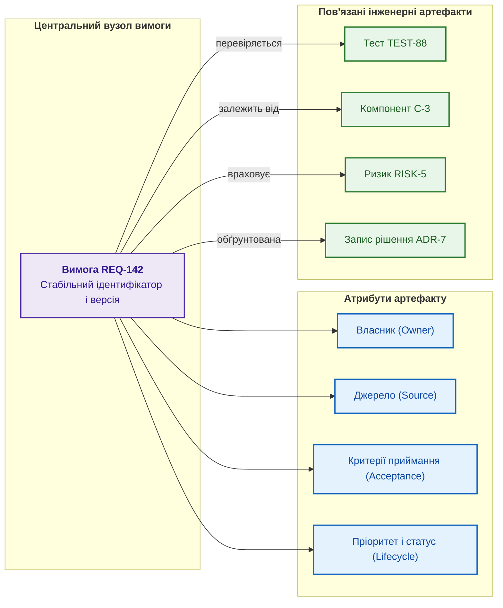
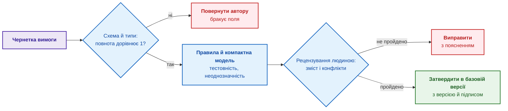
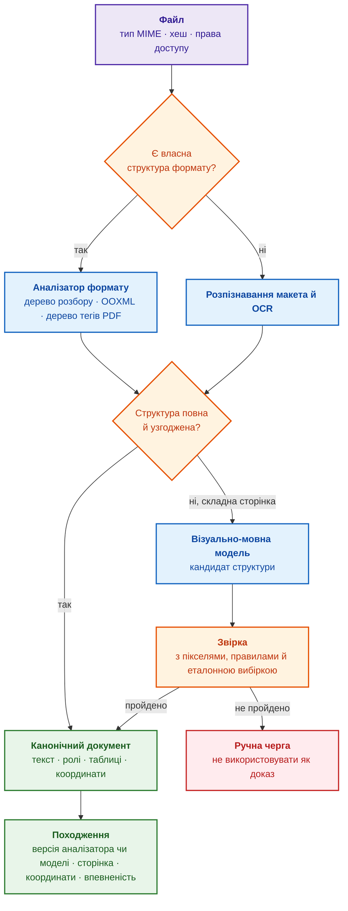
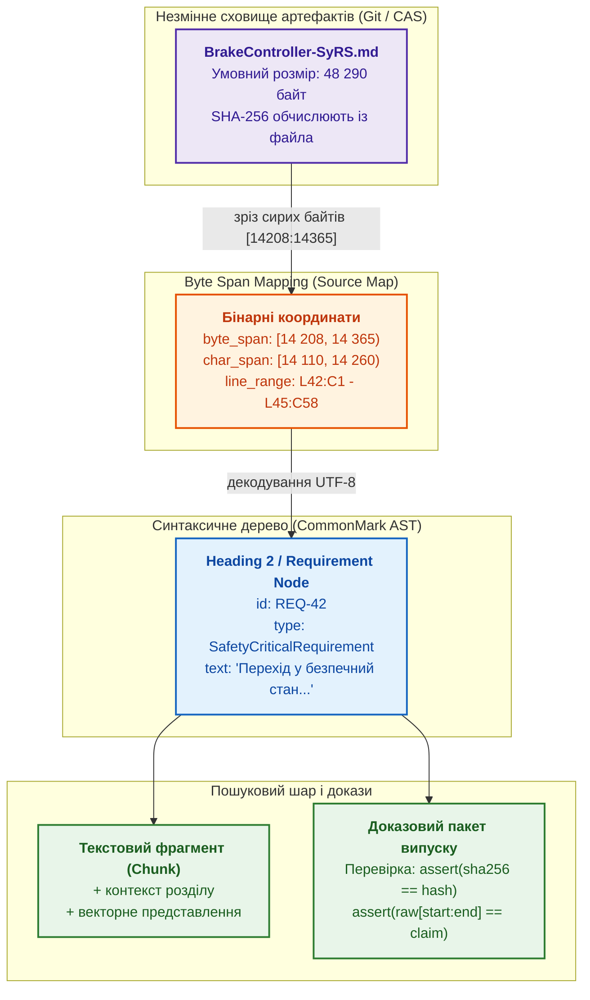
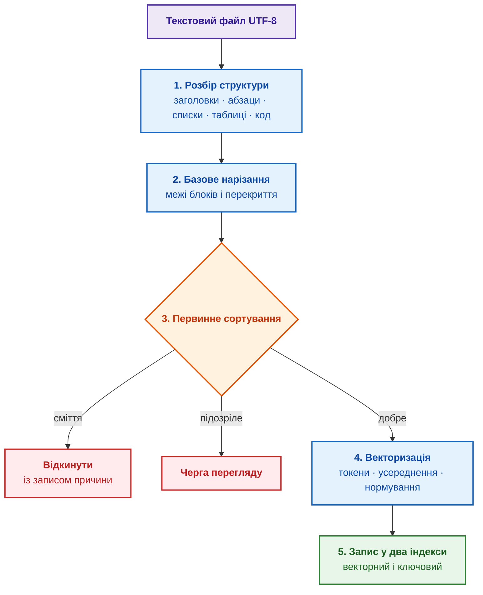
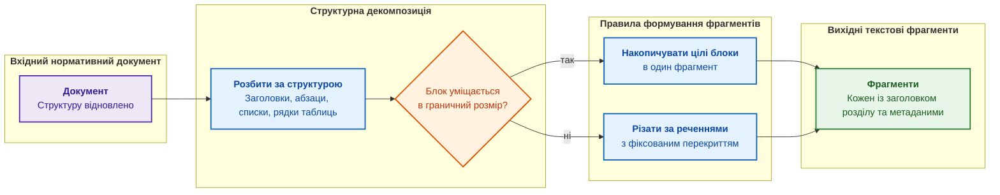
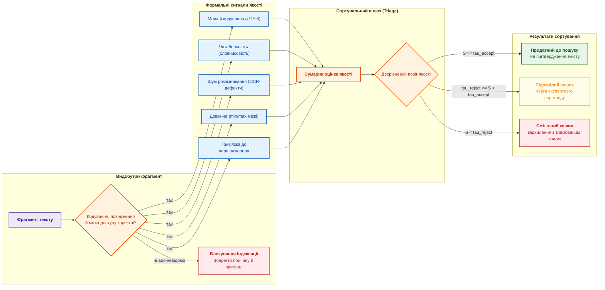
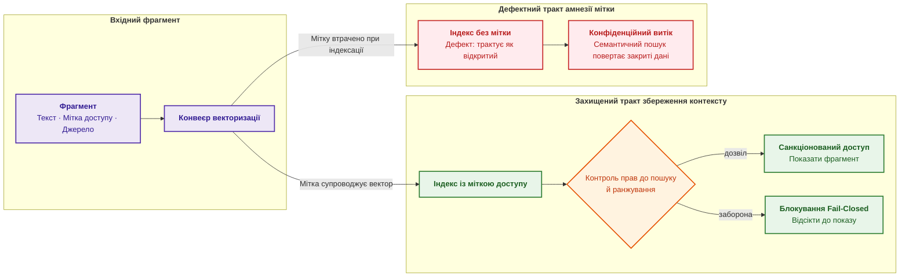
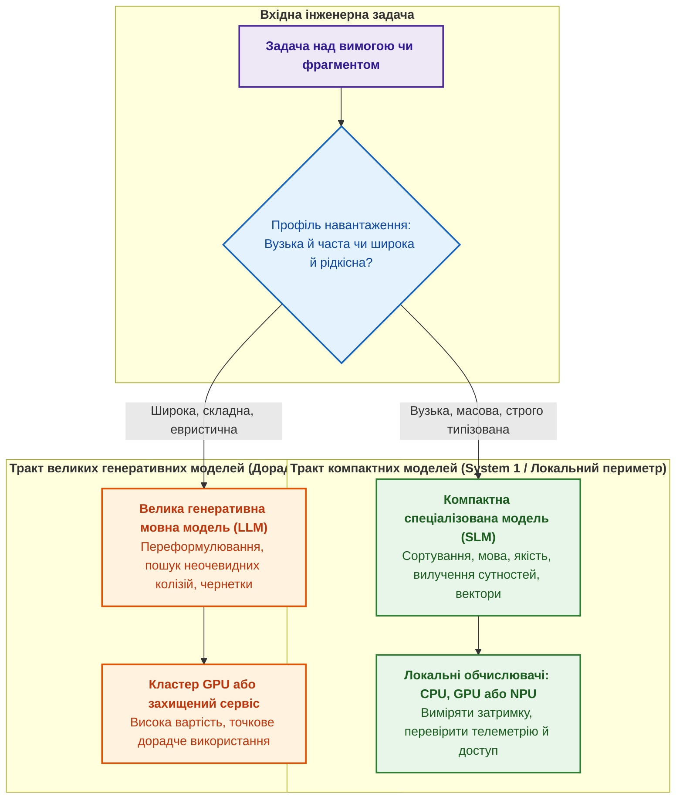

# Глава 8. Інженерні артефакти як дані експертної системи

> **Книга:** [Архітектура доказових експертних систем](README.md) · [Частина II: Математичні моделі, представлення та збереження знань](part-02-knowledge-models.md)  
> **Попередня глава:** [Глава 7. Типологія баз знань: правила, онтології, прецеденти та вектори](ch07-knowledge-base-typology.md)  
> **Наступна глава:** [Глава 9. Інженерний граф знань: простежуваність від вимог до апаратури](ch09-engineering-knowledge-graph-traceability.md)  
> **Зміст книги:** [README.md](README.md)  
> **Автор:** [Микола Мартинович Федчик](about-the-author.md)  
> **Попередня підготовка:** поняття вимоги, версії, факту й джерела з попередніх глав. Поля об'єкта, правила перевірки й походження фрагмента пояснюються в тексті; практикум наведено в [лабораторних роботах](learning/LABS.md).  
> **Очікувані результати:** описати вимогу, план чи ризик як версійований об'єкт даних; оцінити, скільки структури зберігає формат файла; пройти шлях від файла до фрагмента з походженням, перевіркою якості, векторним представленням і міткою доступу; обирати між правилом, компактною моделлю й великою мовною моделлю за виміряним результатом.  

## Анотація

Експертна система має пов'язати твердження з потрібною версією вимоги, тестом і звітом, а не лише переказати знайдений документ. Для цього інженерні артефакти, тобто вимоги, рішення, плани й результати роботи, подаються як об'єкти з визначеними полями та зв'язками. Глава пояснює, як перевірити ці поля, зберегти походження фрагмента й підготувати матеріал до пошуку та подальшого виведення. Структура й карта походження дають перевірні операції над даними, але не доводять істинності змісту або юридичної достатності документа. Навчальні оцінки якості й ресурсів розглянуто разом із передумовами, обчисленням і межами використання.

Після глави 7 відомо, чому тест і його окремий запуск треба розрізняти. Тепер потрібно отримати відповідні дані з реального артефакта. Візьмемо навчальну вимогу REQ-142: «контролер має швидко реагувати на зниження напруги». Перш ніж перевіряти її тестом TEST-88, потрібно визначити поріг напруги, допустимий час, версію вимоги й відповідального за погодження. Простий переказ речення цих відомостей не створює. Якщо вони розкидані між файлами, експертна система повинна зберегти їхні джерела, а не вгадати відсутні значення.

Маршрут глави: потрібні запитання до артефакта, модель полів і версій, перевірка якості, вилучення з файла, збереження походження, пошук і контроль доступу. Структурований запис може бути авторитетним реєстром у погодженому процесі, але імпортований об'єкт не скасовує статусу підписаного першоджерела. Зв'язування об'єктів у граф продовжує [Глава 9](ch09-engineering-knowledge-graph-traceability.md), повний процес здобуття знань розглядає [Глава 10](ch10-knowledge-acquisition-systems.md).

## 1. Карта дослідження: проблеми обробки артефактів, інженерні методи та метрики якості

Карта дослідження починається із запитання: що може зламатися, поки речення REQ-142 стане підставою машинного висновку? Система може втратити версію, неправильно прочитати число або показати текст користувачеві без права доступу. Тому спочатку розділимо ці задачі: одна висока оцінка пошуку не перевіряє всього шляху.

У стандартах і процесних моделях результати роботи називають робочими продуктами (*work products*): вимога, план, протокол тестування, запис рішення, доказовий пакет. Поруч існують робочі елементи (*work items*): задача, дефект, запит на зміну, у яких теж зберігаються рішення й контекст. Для цієї глави обидва види є артефактами. Нижче наведено навчальну матрицю п'яти типових проблем їх обробки: для кожної вказано метод, вимірювану ознаку, можливу відмову й спосіб виправлення. Це організація прикладів глави, а не підтверджена даними повна класифікація промислових дефектів.

<a id="object-8-1"></a>

**Таблиця 8.1. Матриця проблем обробки інженерних артефактів**

| Проблема | Метод | Що вимірюють | Типова відмова | Шлях виправлення |
| --- | --- | --- | --- | --- |
| Вимога неповна або нечітка | схема об'єкта й контрольна точка якості | повнота полів, частка прийнятих вимог, дефекти після рецензування | перевірка приймає граматично чисту, але нетестовну вимогу | числові критерії й погодження людиною |
| Зв'язки існують лише в тексті | граф простежуваності | покриття вимог тестами й доказами | посилання існує, але веде на неактуальну версію | версійовані зв'язки й перевірка змісту зв'язку |
| Файл PDF або скан втрачає структуру | синтаксичний аналізатор, розпізнавання макета й символів, модель для документів | порядок читання, точність таблиць і формул, походження | візуально-мовна модель створює правдоподібний, але відсутній у джерелі текст | звірка з координатами, оцінка впевненості й ручна черга |
| Фрагмент не знаходиться за запитом | структурне нарізання й гібридний пошук | повнота й якість ранжування на перших позиціях, затримка | оптимізація лише косинусної подібності | ключовий і векторний пошук, злиття рангів, повторне ранжування |
| Закритий текст з'являється у відповіді | фільтр доступу до пошуку | нуль несанкціонованих видач у негативних тестах | права доступу перевіряють уже після пошуку | фільтрація кандидатів до ранжування |

Таблиця дає навчальний приклад того, чому самого факту працездатності моделі недостатньо для висновку про готовність. Для застосування в описаному процесі потрібні контрольна вибірка, метрика, обґрунтований поріг і визначена дія, якщо перевірку не пройдено або результат невідомий. Захисна відмова (*Fail-Closed*) тут означає блокування непідтвердженого переходу, а не видалення вихідного документа. Почнемо з того, чому вилучення даних із вільного тексту потребує таких перевірок.

## 2. Обмеження неструктурованого природномовного тексту в критичних системах

Неструктурований текст може містити потрібну відповідь, але для машинної перевірки її треба вилучити й зв'язати з артефактом. Кожний етап такого вилучення може помилитися. Для оцінювання послідовності етапів застосовується ланцюгове правило ймовірностей: імовірність успіху всього ланцюга дорівнює добутку умовних імовірностей успіху кожного етапу за умови правильного попереднього префікса. Це відоме правило теорії ймовірностей; модель не описує подальшого виправлення помилок і не перетворює загальну точність екстрактора на довіру до кожного окремого ребра:

<a id="object-8-2"></a>

**Формула (8.2). Імовірність правильного проходження всього ланцюга**

$$
P_{\mathrm{trace}}(\mathcal{A}) = \prod_{i=1}^{k} \big(1 - \varepsilon_i\big)
$$

де $`P_{\mathrm{trace}}(\mathcal{A})\in[0,1]`$ — безрозмірна ймовірність успіху всього ланцюга обробки артефакту $\mathcal{A}$; $k\ge1$ — кількість етапів; $`A_i`$ — подія правильного виконання етапу $i$. Для ненульового правильного префікса $`\varepsilon_i=P(\neg A_i\mid A_1\cap\dots\cap A_{i-1})\in[0,1]`$ є умовною ймовірністю помилки, а для першого етапу $`\varepsilon_1=P(\neg A_1)`$. Якщо ймовірність префікса вже нульова, наскрізний успіх дорівнює нулю без обчислення невизначеної наступної умовної ймовірності. Загальні похибки етапів на окремих вибірках не можна підставляти замість умовних без обґрунтування незалежності. Невідомі оцінки не замінюються нулями й не дають підстав для автоматичного підтвердження зв'язку.

За оцінених умовних похибок рішення приймають так:
1. **Керування рантаймом і потоком обчислень:** у цьому авторському навчальному профілі поріг $`\tau_{\mathrm{trace}} = 0{,}95`$ є параметром політики, а не вимогою стандарту; для іншого виробу його потрібно обґрунтувати й затвердити. При $`P_{\mathrm{trace}}(\mathcal{A}) < \tau_{\mathrm{trace}}`$ конвеєр припиняє автоматичну фіксацію зв'язку й скеровує ребро графа до черги обов'язкового ручного підтвердження інженером (Fail-Closed); невідоме значення не дає автоматичного запису.
2. **Апаратний сайзинг:** за збереження запису для кожного фрагмента на кожному етапі кількість записів журналу зростає як $`O(k \cdot N_{\mathrm{span}})`$, де $`N_{\mathrm{span}}`$ — кількість фрагментів. Це оцінка кількості записів, не числовий бюджет у байтах: обсяг визначається форматом запису та накладними витратами сховища. Саме значення $k\ge4$ не встановлює окремої апаратної межі; резервування виконується за фактичним форматом, а не за позначенням складності.
3. **Практичний числовий приклад:** для навчального триетапного конвеєра ($k=3$) із умовними похибками сегментації $`\varepsilon_1 = 0{,}05`$, класифікації сутностей $`\varepsilon_2 = 0{,}08`$ та екстракції зв'язків $`\varepsilon_3 = 0{,}12`$, результуюча ймовірність цілісності зв'язку складає $`P_{\mathrm{trace}} = (1 - 0{,}05)(1 - 0{,}08)(1 - 0{,}12) = 0{,}95 \times 0{,}92 \times 0{,}88 \approx 0{,}769 < 0{,}95`$. Система блокує прямий запис у базу фактів і ескалує транзакцію інженеру-валідатору.

Якщо зв'язки не записані явно, виникає ручна праця: ведення окремої матриці простежуваності (*traceability matrix*), звіряння тестів із вимогами, збирання доказів із листування й старих версій документів.

Проєктні плани мають ту саму проблему. Структура декомпозиції робіт (*Work Breakdown Structure*, WBS), графік, запити на зміну, знімки погоджених базових версій (*baselines*) і плани верифікації містять взаємозалежні відомості. Аналіз впливу (*impact analysis*) має показати, які з них зачеплено зміною. Платформа керування життєвим циклом застосунків (*Application Lifecycle Management*, ALM) може це робити, якщо залежності явно записано й підтримано правилами оновлення. Саме відсутність цього поєднання, а не природна мова як така, є предметом авторської *концепції руйнування динамічного аналізу впливу через текстову ізоляцію*: зміна в одному файлі лишає залежні записи неактуальними. Зв'язки можна зберігати й у текстовому форматі; важливо, щоб система могла їх однозначно прочитати та обробити.

Підсумок розділу: текст зрозумілий людині, але не дає відтворюваних відповідей на структурні запити, а кожне автоматичне вилучення полів із тексту додає похибку. Вихід полягає в тому, щоб змінити роль документа.

## 3. Парадигма інженерного артефакту як типізованого об'єкта даних

Типізований об'єкт потрібний, щоб система могла обробляти зміни однаково: поле має назву й тип, зв'язок ціль, а запис версію. З такого реєстру можна створювати звіт або PDF як подання даних. Проте імпортований об'єкт не стає авторитетнішим за підписану специфікацію лише через формат; процес має визначити, яке джерело керівне й як погоджуються розбіжності.

До інженерних артефактів можна застосовувати практики «як код» (*Artifacts as Code*): зберігати машинозчитуваний опис під контролем версій, рецензувати зміни й виконувати перевірки до їх погодження. Це відомий підхід до інфраструктури, політик і документації. Для REQ-142 зміна поля допустимого часу має створити нову версію та позначити пов'язаний TEST-88 для перегляду; сам файл YAML без правила обробки змін цього не зробить.

Той самий підхід поширено на плани робіт (*WBS as Code*), моделі ризиків (*Risks as Code*) та контрольні точки випуску (*Gates as Code*). Якщо дату контрольної точки пересунуто на два тижні, система обходить явно записані залежності й показує зачеплені постачання та зобов'язання. Вона не виявить залежності, яких немає в реєстрі. Отже, користь дає поєднання даних, версій і правил, а не назва формату чи статус «джерела істини» за замовчуванням.

Природна мова залишається придатною для нормативних документів і пояснень. За авторським підходом слід розрізняти інтерфейс створення чернетки та процедуру її затвердження. Мовна модель може запропонувати поля й формулювання, але не отримує повноваження на погодження. Текст людини й текст моделі проходять однакові застосовні перевірки; структура полегшує їх виконання, не замінюючи оцінки змісту.

Структурований об'єкт корисний не лише експертній системі: довідкова інформаційна система, консультаційний інтерфейс і система підтримки рішень теж отримують надійніший пошук, фільтрацію й аналіз впливу. Експертною система стає тоді, коли поверх фактів і зв'язків застосовує кодифіковані знання до конкретного випадку й показує доказовий ланцюжок висновку ([Глава 3](ch03-beyond-reference-information-systems.md)). Структура дає матеріал для міркування, але не замінює міркування. Найважливіший випадок структурування становлять вимоги.

## 4. Структурна модель вимоги: атрибути, версійність та семантичні зв'язки

Структурна модель вимоги має відповісти, хто погоджує зміну REQ-142 і який саме тест після цього треба переглянути. Окрім стабільного ідентифікатора та версії, у навчальній схемі використано п'ять груп полів. Тип поля визначає допустимий вид значення: власник є посиланням на відповідальну особу чи роль, а не довільним числом.

- **власник** (*owner*): хто відповідає за зміст і актуальність вимоги;
- **джерело** (*source*): стандарт, замовник, регуляторний документ або рішення архітектора, з якого походить вимога;
- **критерії приймання** (*acceptance criteria*): як перевірити, що вимогу виконано;
- **пріоритет і статус**: важливість і стан життєвого циклу (чернетка, затверджено, змінено після базової версії, застаріло);
- **зв'язки**: інші вимоги, компоненти, тести, ризики й рішення, з якими пов'язана вимога.

Схема показує вимогу як вузол графа: у центрі вимога зі стабільним ідентифікатором, навколо поля, а стрілки ведуть до пов'язаних об'єктів.

<a id="object-8-3"></a>

**Діаграма 8.3. Атрибути та зв'язки версійованої вимоги**



Фіолетовий вузол є вимогою, сині вузли є атрибутами, зелені вузли є пов'язаними об'єктами: тестом, компонентом, ризиком і записом архітектурного рішення (*Architecture Decision Record*, ADR). Коли вимога має таку структуру, можна виконати запити «покажи всі затверджені вимоги без жодного тесту», «знайди вимоги, змінені після заморожування базової версії» чи «які вимоги залежать від компонента, сертифікацію якого ще не завершено». Над текстом такі запити потребують ручного читання або статистичного вилучення, а над графом об'єктів виконуються детерміновано.

Структура тримається на стабільному ідентифікаторі й версії. Ідентифікатор дозволяє простежити історію вимоги після зміни формулювання, але зв'язок тесту й свідчення має називати також перевірену версію. Інакше старий успішний запуск помилково підтвердить нову вимогу. Версійність зберігає знімки базових версій, а зміна змісту робить пов'язані підтвердження кандидатами на повторну перевірку, не стираючи історії. Наступний крок полягає в автоматичних перевірках якості таких об'єктів.

> [!NOTE]
> **Робоча схема інженерного артефакту як типізованого об'єкта даних**
> 1. У пропонованому процесі звіт є поданням керованих даних; авторитетність реєстру й першоджерел визначається процедурою, не самим форматом.
> 2. Ідентифікатор і версія визначають запис; п'ять груп його полів охоплюють власника, джерело, критерії приймання, пріоритет зі статусом і зв'язки. Критерій може бути числовим або однозначно перевірним логічним твердженням.
> 3. Чотири типи зв'язків поєднують вимогу з тестами ($T$), компонентами ($C$), ризиками ($K$) та рішеннями ($D$). Застосовний профіль визначає, які з них обов'язкові: не кожна вимога мусить мати окремий ризик чи окремий запис рішення.
> 4. Свідчення посилається на конкретну версію вимоги. Зміна створює потребу оцінити вплив і допустимість повторного використання свідчення; попередній історичний результат не стирається.
> *Керування рантаймом / Інженерний інваріант:* неперевірений артефакт може зберігатися як чернетка чи кандидат, але не має автоматично ставати затвердженою підставою висновку.

## 5. Автоматизований контроль якості та формальна валідація вимог (ISO/IEC/IEEE 29148)

Автоматизований контроль вимог починається зі структурних перевірок і сигналів для рецензента. ISO/IEC/IEEE 29148 описує властивості вимог [[1]](#src-1), але наявність полів або відсутність певного прислівника не доводить їх усіх. Для REQ-142 корисно окремо перевірити чотири аспекти:

- **повнота**: вимога має власника, джерело й критерії приймання;
- **тестовність** (*testability*): для вимоги можна побудувати перевірку; формулювання «інтерфейс має бути зручним» одразу позначають як проблемне;
- **однозначність**: чи визначено значення термінів і умов; слова «швидко» або «за потреби» є сигналами для перегляду, не вичерпним тестом;
- **несуперечність**: чи сумісні застосовні умови й обмеження. Дві різні межі параметра не обов'язково конфліктують, якщо діють у різних режимах.

Найпростіша числова оцінка є структурною повнотою вимоги:

<a id="object-8-4"></a>

**Формула (8.4). Частка заповнених полів вимоги**

```math
C_{\text{req}}(r)=\frac{1}{m}\sum_{j=1}^{m} I_j(r)
```

Величини структурної повноти:

- $r$ є вимогою, $m>0$ є цілою кількістю обов'язкових полів погодженої схеми, а ціле $j$ від 1 до $m$ позначає поле;
- $`I_j(r)`$ дорівнює 1, якщо поле $j$ заповнене значенням правильного типу, і 0 інакше;
- $`\sum_{j=1}^{m}`$ додає результати перевірок усіх полів, а ділення на $m$ обчислює їхню частку.

Безрозмірний результат лежить між 0 і 1: за чотирьох заповнених полів із п'яти $`C_{\text{req}}=4/5=0{,}8`$. Заповнене поле ще не є якісним полем: запис `owner: TBD` формально існує, але не називає відповідального. Тому контрольну точку якості (*quality gate*) записують як добуток бінарних перевірок, без припущення статистичної незалежності:

<a id="object-8-5"></a>

**Формула (8.5). Кон'юнктивна контрольна точка якості вимоги**

```math
Q_{\text{gate}}(r)=\mathbf{1}[C_{\text{req}}(r)=1]\cdot\mathbf{1}[T(r)=1]\cdot\mathbf{1}[A(r)=1]\cdot\mathbf{1}[S(r)=1]
```

Перевірки контрольної точки:

- $r$ є вимогою, а $`C_{\text{req}}(r)=1`$ означає, що всі обов'язкові поля заповнено коректно;
- $`\mathbf{1}[\cdot]`$ дорівнює 1, якщо умова в дужках істинна, і 0 інакше;
- $T(r)$ позначає підтверджену перевірюваність, $A(r)$ підтверджену однозначність у погодженому контексті, а $S(r)$ результат перевірки сумісності з визначеною базовою версією; для цієї навчальної формули лише завершена позитивна перевірка має значення 1;
- знак множення вимагає, щоб кожна блокувальна перевірка дорівнювала 1.

Отже, $`Q_{\text{gate}}(r)`$ набуває лише значень 0 і 1 та дорівнює 1, коли пройдено всі умови. Статистична модель може оцінити $T$ або запропонувати проблему, але контрольна точка не повинна мовчки замінювати оцінкою моделі інженерне рішення.

**Застосування результату:** одиниця дозволяє розглянути вимогу для затвердження в межах цієї політики, але не замінює повноваження погоджувача. Нуль блокує цей перехід і зберігає діагностику. Чернетка лишається доступною для виправлення. Невідомий стан не стає одиницею; разом із двійковим рішенням слід зберігати причину: дефект, незавершена перевірка чи технічна помилка. Криптографічний підпис є окремою операцією над погодженою версією.

**Числовий приклад розрахунку:**
Повернімося до REQ-142 про реакцію на зниження напруги. П'ять структурних полів присутні, тому оцінка структури дорівнює 1. У тексті не визначено порога напруги й допустимого часу, отже перевірюваність та однозначність ще не підтверджені: $T=0$, $A=0$. Припустімо, окрему перевірку сумісності з базовою версією завершено позитивно: $S=1$. Тоді маємо:

<a id="object-8-6"></a>

**Формула (8.6). Блокування затвердження REQ-142 у навчальному прикладі**

```math
Q_{\text{gate}}(\text{REQ-142}) = 1 \cdot 0 \cdot 0 \cdot 1 = 0
```
Результат блокує затвердження, а не збереження чернетки. Автор має погодити діапазон напруги, початкові умови, реакцію й допустимий час, після чого T та A перевіряються повторно. Відсутні числа не можна довільно дописати заради проходження фільтра.

> [!NOTE]
> **Авторський детермінований шлюз валідації інженерних вимог ($`Q_{\text{gate}}`$, чотири фільтри)**
> 1. Структурна повнота ($`C_{\text{req}} = 1`$): обов'язкова наявність усіх $m$ полів схеми без фіктивних заповнювачів (TBD/NA).
> 2. Формальна тестовність ($T = 1$): вимога має однозначний верифікаційний предикат, придатний для апаратного чи програмного тесту.
> 3. Однозначність специфікації ($A = 1$): відсутність якісних прислівників («швидко», «надійно») без визначених числових метрик і допусків.
> 4. Несуперечність чинній базовій версії ($S = 1$): відсутність колізій із затвердженими вимогами та фізичними обмеженнями середовища.
> *Керування рантаймом / Інженерний інваріант:* нуль або незавершена перевірка блокує затвердження за цим профілем, зберігаючи чернетку й діагностику. Лінгвістична евристика не засвідчує зміст усієї вимоги.

<a id="object-8-7"></a>

**Діаграма 8.7. Від чернетки до погодженої базової версії**



Сині блоки є перевірками, червоні блоки повертають вимогу на доопрацювання, зелений блок фіксує вимогу в базовій версії. Дефекти вимог ловлять під час написання, а не на аудиті чи в тестуванні.

### 5.1. Архітектура шаруватого інструментального стеку валідації прози

Шарувата перевірка потрібна тому, що різні дефекти потребують різних засобів: пропущене поле виявляє схема, слово «швидко» шукає лінтер, а застосовність порога оцінює рецензент. У запропонованій автором архітектурі рішення про перехід між шарами задані правилами; статистичний компонент усередині шару від цього не стає детермінованим доказом якості. Статичний аналізатор прози [Vale](https://github.com/vale-cli/vale) з власними українськими правилами може сигналізувати про слова-пастки й порушення шаблону в конвеєрі безперервної інтеграції. Бібліотека мовою Go [prose](https://github.com/jdkato/prose) пропонує токенізацію, поділ на речення, розмітку частин мови й розпізнавання іменованих сутностей (*named entity recognition*, NER), але її англомовні моделі не дають підстав переносити оцінки на українські вимоги. Для нейронних моделей у Go кандидатами є [Cybertron](https://github.com/nlpodyssey/cybertron) і [Hugot](https://github.com/knights-analytics/hugot); підтримку конкретної моделі, токенізатора та прискорювача перевіряють окремо. [GLiNER](https://github.com/urchade/GLiNER) є кандидатом для вилучення сутностей, не заміною вилучення відношень (*relation extraction*) чи перевірки схеми. Це перелік можливих компонентів для випробування, не звіт про їх перевірену сумісність.

Помічник на основі великої мовної моделі може запропонувати чіткіше формулювання, підказати відсутні критерії приймання, виявити можливу суперечність із сусідньою вимогою чи запропонувати тест для критерію. Пропозиції помічника лишаються пропозиціями: рішення ухвалює людина, а зміна фіксується з історією. Отже, структура дозволяє виміряти повноту полів і відтворити результати визначених перевірок; вона не зводить усю якість вимоги до одного числа. Наступне питання — як пов'язати перевірену версію з іншими артефактами.

## 6. Наскрізна простежуваність інженерних артефактів як основа системної архітектури

Наскрізна простежуваність відповідає на наступне запитання: чи можна від REQ-142 дійти до потреби, яка її породила, і до результату перевірки її версії? Ланцюжок поєднує потребу зацікавленої сторони, системну та програмну вимоги, рішення, тест і доказ виконання. Двобічність означає навігацію в обох напрямах: від потреби до свідчення та від свідчення до потреби. ISO/IEC/IEEE 29148 є джерелом із інженерії вимог [[1]](#src-1); нижче задано навчальний профіль простежуваності, а не відтворено конкретний нормативний пункт стандарту.

Структура робить ланцюжок навігаційним. Аналіз впливу стає швидким і відтворюваним настільки, наскільки актуальний граф: після зміни вимоги платформа показує зачеплені тести, ризики, рішення й контрольні точки випуску; після провалу тесту видно непідтверджені вимоги; після оновлення стандарту знаходяться пов'язані заходи контролю. Механізм зводиться до обходу графа зв'язків і перевірки цілісності, тож пропущений чи хибний зв'язок дає пропущений чи хибний вплив. Першу діагностичну метрику графа легко пояснити без теорії графів:

<a id="object-8-8"></a>

**Формула (8.8). Частка вимог із хоча б одним успішним заліковим тестом**

```math
\mathrm{Coverage}_{R\rightarrow T}=\frac{\left\lvert\left\{r\in R:\ \exists\,t\in T,\ (r,t)\in E_{RT}\right\}\right\rvert}{\lvert R \rvert}
```

Позначення покриття:

- $R$ є повною множиною чинних версій вимог у зафіксованому релізному зрізі, $T$ є множиною тестів, а $`E_{RT}`$ є множиною підтверджених зв'язків «ця версія вимоги має реалізацію та тест із вердиктом `PASS` для цільового випуску»;
- $r$ позначає одну вимогу, $t$ один тест, а $`(r,t)\in E_{RT}`$ означає, що підтверджений зв'язок поєднує саме цю пару;
- $\exists$ означає «існує хоча б один», а $\lvert\cdot\rvert$ є кількістю елементів множини;
- чисельник рахує кожну вимогу лише один раз, навіть якщо вона має кілька успішних тестів; знаменник рахує всі вимоги цього зрізу. Це безрозмірна частка від 0 до 1, а не відсоток пройдених тестів. Голого посилання на тест без актуального результату `PASS` недостатньо.

Формула визначена лише за $`\lvert R\rvert>0`$ і вимірює наявність хоча б одного успішного тесту для кожної вимоги, а не виконання всіх її критеріїв приймання. За $`\lvert R\rvert=0`$ значення не обчислюють і не підміняють одиницею: застосовність визначається схваленим профілем, а недоступний чи неповний реєстр не видається за порожню множину. Якщо вимога має два обов'язкові тести зі статусами `PASS` і `FAIL`, її внесок у чисельник уже дорівнює 1, але випуск лишається заблокованим перевіркою всіх обов'язків за §7. Отже, одиничне покриття є необхідною умовою описаного профілю, не достатнім доказом повної верифікації чи безпеки.

**Керування рантаймом і авторська умова допуску за профілем (інваріант повного верифікаційного покриття):**
- **Умова розглянутого профілю, не самостійна вимога стандарту:** для конкретного профілю, пов'язаного з ISO 26262 ASIL D / DO-178C Level A, автор задає необхідну умову $`\mathrm{Coverage}_{R\rightarrow T} = 1{,}00`$. Будь-яке значення нижче одиниці вказує на прогалину навіть за цією обмеженою метрикою. Одиниця не замінює перевірки всіх застосовних критеріїв і не є самостійним критерієм сертифікації;
- **Дія конвеєра:** якщо $`\mathrm{Coverage}_{R\rightarrow T} < 1{,}00`$, компілятор звіту про безпеку генерує подію `FAIL_CLOSED`, блокує створення підписаного пакета релізу й експортує перелік непокритих вимог до трекера інцидентів.

**Числовий приклад розрахунку:**
У навчальному релізному зрізі міститься $\lvert R \rvert = 120$ вимог безпеки. Припустімо, зв'язки з успішними заліковими тестами зафіксовано для 118 вимог:

<a id="object-8-9"></a>

**Формула (8.9). Дві прогалини у зрізі зі 120 вимог**

```math
\mathrm{Coverage}_{R\rightarrow T} = \frac{118}{120} \approx 0{,}9833
```
Оскільки $`\mathrm{Coverage}_{R\rightarrow T} = 0{,}9833 < 1{,}00`$, система блокує випуск прошивки, попри 98,3 % за цією діагностичною метрикою, та вказує на дві непокриті вимоги: `REQ-045` (скидання WDT) та `REQ-089` (діагностика обриву CAN).

## 7. Моделювання планів, ризиків та контрольних точок як типізованих об'єктів

Плани, ризики й контрольні точки потрібні, щоб перейти від окремого успішного тесту до рішення про випуск. Навіть повне покриття за (8.8) не відповідає, чи погоджено винятки й чи залишилися блокувальні дефекти. Тому план випуску подається як набір пов'язаних об'єктів, кожен із яких має власний перевірний стан. Таблиця Excel чи сторінка вікі також можуть бути керованими джерелами; проблема виникає, коли їхні статуси не звіряються з тестами, змінами й постачанням.

Контрольна точка має критерії входу й виходу, пов'язані з вимогами, тестами чи погодженнями. Пакет робіт має залежності й розподіл потужностей. Ризик має тригер, оцінку ймовірності й наслідків, заходи зниження, відповідального й правило ескалації.

Для критичного профілю автором сформульовано конкретну вимогу до конфігурації релізного шлюзу: перевіряти її повноту **до** обчислення кон'юнкції результатів. Порожня кон'юнкція математично істинна, тому недоступний реєстр не можна представляти успішно завантаженим порожнім списком. Очікуваний набір обов'язкових критеріїв має бути непорожнім і визначеним схваленою базовою лінією, а не випадково наявними рядками графа. Тести мають розрізняти недоступний, неповний, дубльований і застарілий реєстри; математична властивість тут стандартна, внесок полягає у вимозі до перевірки конфігурації шлюзу.

Статус готовності для конкретного випуску та зрізу фактів обчислюється так. Знак $\wedge$ означає «і»: потрібне виконання кожного обов'язку, а не високий середній бал. Для порожнього списку немає хибного елемента, тому його кон'юнкція за означенням істинна; саме через це повноту списку перевіряють окремо.

<a id="object-8-10"></a>

**Формула (8.10). Готовність випуску після перевірки конфігурації**

$$
\mathrm{Gate}_{\mathrm{release}}(G)=
\begin{cases}
0, & \mathrm{ConfigValid}(G)=0,\\
\displaystyle
\bigwedge_{c\in\mathcal{C}_{\mathrm{crit}}}
\mathbf{1}\!\left[\mathrm{eval}(c)=\mathsf{true}\right]
\wedge
\bigwedge_{w\in\mathcal{W}}
\mathbf{1}\!\left[\mathrm{approved}(w)=\mathsf{true}\right],
& \mathrm{ConfigValid}(G)=1.
\end{cases}
$$

Позначення та допустимі стани:

- $G$ — типізована контрольна точка з ідентичністю цільового випуску, версією схваленої політики, ідентичністю локального зрізу фактів і моментом оцінювання; ці ідентичності не підміняються тільки назвою проєкту;
- $`\mathrm{ConfigValid}(G)\in\{0,1\}`$ — ознака перевіреної повноти й застосовності конфігурації. Значення 1 вимагає завантажених і чинних для цього випуску реєстрів критеріїв та винятків, відповідності схваленій версії політики, наявності всіх очікуваних унікальних ID і доступності обов'язкових входів кожного критерію. Пропущений, дубльований, невідомий чи нечинний запис дає 0 з діагностикою;
- $`\mathcal{C}_{\mathrm{crit}}`$ — повний набір застосовних критичних критеріїв зі схваленого профілю: відсутність блокуючих дефектів, проходження обов'язкових тестів, завершення перевірок безпеки. Для цього критичного шлюзу $`\lvert\mathcal{C}_{\mathrm{crit}}\rvert>0`$; набір звіряється за ID, а не лише за кількістю завантажених рядків;
- $`\mathcal{W}`$ — повний набір винятків, що потребують перевірки для цього випуску. Він може бути порожнім, **якщо** реєстр успішно завантажено й схвалений профіль підтверджує відсутність необхідних винятків; відсутній реєстр, незавершений запит або втрата запису не є порожньою множиною;
- $c$ позначає один критерій, а $w$ один виняток. $`\mathrm{eval}(c)`$ — типізований результат перевірки критерію за доказами цього зрізу; $`\mathrm{approved}(w)`$ — підтвердження чинного погодження саме цього винятку уповноваженою роллю в його межах застосування. Лише явний булевий результат $\mathsf{true}$ дає одиницю індикатору $\mathbf{1}$; хибність, невідомість, помилка чи тайм-аут не перетворюються на успіх;
- обидві кон'юнкції та $`\mathrm{Gate}_{\mathrm{release}}(G)\in\{0,1\}`$ безрозмірні. Схвалений виняток сам по собі не робить хибний критичний критерій істинним: його можливий вплив на застосовність визначається політикою до формування очікуваного набору.

1. **Керування рантаймом і потоком обчислень:** за $`\mathrm{ConfigValid}(G)=0`$ критерії не обчислюються як кон'юнкція порожнього списку, а генерація підписаного маніфесту блокується подією `RELEASE_GATE_BLOCK` із причиною дефекту конфігурації. За коректної конфігурації результат 0 супроводжується переліком невиконаних або невизначених перевірок. Результат 1 санкціонує маніфест лише для зафіксованих випуску, політики й зрізу; він не переноситься на інший стан і не замінює повноважень підписанта.
2. **Ресурсний приклад:** припустімо, навчальний профіль задає 500 мс на локальну перевірку конфігурації та оцінювання без мережевих звернень. Це обраний ліміт, не виміряна верхня межа часу виконання. За умовного формату 64 байти на запис-підставу вісім критеріїв і один виняток потребують (8 + 1) × 64 = 576 байтів без індексів, конфігурації та власне доказів. Нестача пам'яті не дозволяє оцінити скорочений набір як повний; перевищення часу блокує маніфест із діагностикою.
3. **Практичний числовий приклад:** для схваленого профілю очікується вісім критеріїв. Якщо всі вісім завантажено й виконано, але є один необхідний виняток зі статусом `PENDING`, маємо $`\mathrm{Gate}_{\mathrm{release}}(G)=1\wedge0=0`$. Після чинного погодження винятку й за незмінності решти підстав результат може стати 1. Якщо необхідних винятків немає й це підтверджено коректно завантаженим реєстром, порожня друга кон'юнкція дорівнює 1 і не блокує готовий випуск.

<a id="object-8-11"></a>

**Таблиця 8.11. Позитивний і негативні контролі релізної контрольної точки**

| Конфігурація та дані | Результат | Причина |
|---|---|---|
| Очікуються 8 критеріїв; завантажено всі 8, усі істинні; винятки явно відсутні | 1 | Повноту підтверджено, усі обов'язки виконано |
| Очікуються 8 критеріїв; через збій повернуто два порожні списки | 0, `RELEASE_GATE_BLOCK` | Реєстр критеріїв не відновлено; істинність порожніх кон'юнкцій не використовується |
| Очікуються 8 критеріїв; завантажено 7 істинних або 7 унікальних ID та дублікат | 0, `RELEASE_GATE_BLOCK` | Кількість рядків не замінює звірки повного набору ID |
| Усі критерії істинні; реєстр винятків недоступний | 0, `RELEASE_GATE_BLOCK` | Невідомий стан не прирівняно до відсутності винятків |
| Усі записи завантажено; один критерій хибний або один необхідний виняток не погоджено | 0, `RELEASE_GATE_BLOCK` | Конфігурація повна, але обов'язок не виконано |
| Усі локальні результати позитивні, але належать іншій версії політики чи випуску | 0, `RELEASE_GATE_BLOCK` | Підстави не застосовні до цільового маніфесту |

З тих самих об'єктів генерують щотижневий статус, але звіт відображає перевірений стан, а не створює його. Авторський *інженерний принцип захисту від презентаційного оптимізму* вимагає, щоб невиконаний обов'язок залишався видимим блокуванням незалежно від оформлення звіту. Це не захист від навмисної підміни вхідних даних: їхня повнота й походження потребують власних перевірок. Далі з'ясуємо, як отримати такі об'єкти з файлів різних форматів.

## 8. Вплив фізичного формату носія на рівень збереження інженерної структури

Кожен артефакт зберігається у файлі певного формату, і формат визначає, скільки структури доживе до індексатора, експертної системи чи аудиторського конвеєра. Той самий план у форматі розмітки й у вигляді сканованого PDF є для машини двома різними джерелами. Для навчального порівняння формати згруповано за чотирма рівнями збереження явної структури. Це евристична класифікація, а не універсальне ранжування якості:

- **текст і розмітка** (*plain text, markup*): Markdown, HTML, reStructuredText, AsciiDoc, а в інженерії формати на основі XML (*eXtensible Markup Language*), наприклад обмінний формат вимог ReqIF (*Requirements Interchange Format*) [[2]](#src-2). Структуру записано прямо в тексті: заголовок позначено символом, таблицю роздільниками, зв'язок ідентифікатором. Файл можна порівнювати порядково, тримати під контролем версій і адресувати до рядка;
- **структуровані двійкові формати** (*structured binary*): офісні файли .docx і .xlsx є ZIP-архівами з XML-частинами формату Office Open XML (OOXML). Структура є, але схована за упаковкою й стилями, і зв'язок між стилем і змістом не завжди однозначний;
- **формати верстки** (*layout-oriented*): звичайний, особливо нетегований PDF описує розташування тексту й графіки на сторінці, тож порядок читання, межі таблиць та ієрархію заголовків доводиться відновлювати. Тегований PDF (*tagged PDF*) має дерево логічної структури, а стандарт PDF/UA задає вимоги до семантичних тегів і порядку читання [[3]](#src-3); проте автоматично створене дерево тегів буває неповним і потребує перевірки;
- **растрові зображення** (*raster scans*): растр без прихованого текстового шару містить лише пікселі, тож кожен символ спершу розпізнають оптично, і кожне розпізнавання може помилитися.

Це класи можливих способів вилучення, не універсальний порядок якості. Коректно тегований PDF може передати потрібні поля краще за неузгоджені Markdown-таблиці; ключовими є сам документ, аналізатор і задача. Замість невизначеної «ентропії вилучення» для порівняння потрібен еталон. У простому контрольному наборі кожне очікуване поле позначається як правильне, пропущене або неправильне:

<a id="object-8-12"></a>

**Формула (8.12). Частка очікуваних полів із дефектом вилучення**

$$
E_{\mathrm{fields}}=\frac{N_{\mathrm{missing}}+N_{\mathrm{wrong}}}{N_{\mathrm{expected}}}.
$$

Тут кількості полів цілі й невід'ємні, $`N_{\mathrm{expected}}>0`$ є числом очікуваних полів еталона, $`N_{\mathrm{missing}}`$ числом пропущених, а $`N_{\mathrm{wrong}}`$ числом присутніх, але неправильних. Останні дві категорії не перетинаються, їхня сума не перевищує знаменника. Безрозмірна частка помилок лежить між 0 і 1; менше значення краще.

Якщо з п'яти очікуваних полів вимоги три відтворено правильно, одне втрачено, а одне має неправильне значення, отримано (1 + 1) / 5 = 0,4, тобто 40 % полів з дефектом. Це сигнал переглянути спосіб вилучення. Результат не є ймовірністю істинності документа. Зайві вигадані поля, критичність помилки, таблиці й порядок читання перевіряються окремо; нуль за цією вузькою метрикою не закриває всіх перевірок.

Окремий клас становлять формати серіалізації, створені для обміну структурованими даними між програмами. XML описує дані вкладеними тегами (`<owner>Storage</owner>`), але багатослівний. JSON (*JavaScript Object Notation*) узяв синтаксис об'єктів мови JavaScript і став звичним форматом обміну між сервером і браузером [[4]](#src-4). YAML (*YAML Ain't Markup Language*) тримає структуру відступами, тож людині легко читати й писати YAML руками, і тому YAML часто використовують для конфігурацій [[5]](#src-5). У трьох форматах ключ прямо називає поле (`owner`, `acceptance_criteria`), тож формати природно зберігають «артефакт як об'єкт». Є три застороги:

1. запис перевіряють схемою до індексації: JSON Schema [[6]](#src-6), схема XML (*XML Schema Definition*, XSD) або мова обмежень форми SHACL [[7]](#src-7) відсікають хибні типи, пропущені поля й заборонені зв'язки;
2. YAML читають безпечним синтаксичним аналізатором із визначеною версією специфікації й політикою щодо дублікатів ключів, псевдонімів (*aliases*) і нестандартних типів, щоб конфігурація не стала каналом виконання коду;
3. сиру серіалізацію не варто сліпо перетворювати на вектор: службовий синтаксис додає шум, хоча змістовні назви полів іноді допомагають. На власних запитах порівнюють щонайменше два подання (сирий запис і канонічно відтворений текст), а структурні поля зберігають як метадані й фільтри. Нарізають файл за об'єктами (запис масиву, елемент XML, блок ключів разом зі шляхом), а не через фіксовану кількість символів.

Підсумок розділу: формат є питанням доказовості, а не естетики. На практиці корисно дотримуватися трьох рекомендацій:
1. Зберігати першоджерело у форматі з явною структурою (текст під контролем версій замість експорту в PDF, ReqIF замість роздруківки).
2. Фіксувати спосіб вилучення кожного фрагмента: розбір розмітки, відновлення верстки й OCR мають різні можливі дефекти, але сам спосіб ще не задає рівня довіри.
3. Нести результати перевірок якості разом із фрагментом. Частка помилок за еталоном (8.12) оцінює вилучення, а евристичний бал $`S_{\text{triage}}`$ у §11 лише допомагає визначити чергу обробки; це не взаємозамінні оцінки.

Як саме машина дістає структуру з файлів різних форматів, показує наступний розділ.

## 9. Первинне перетворення: синтаксичний аналіз та нормалізація сирих байтів у канонічний документ

Первинне перетворення має зберегти ті поля й зв'язки REQ-142, які можна звірити з джерелом. Для розмітки спочатку читається синтаксис, для офісного пакета його внутрішні частини, для скану розпізнаються символи й макет. Складність і затримка залежать від обсягу, якості входу та реалізації; ані мікросекундного часу, ані відсутності втрат сам формат не гарантує. Обраний шлях перевіряється на потрібних типах артефактів.

**Розмітка.** Синтаксичний аналізатор (*parser*) перетворює текст із розміткою на абстрактне синтаксичне дерево (*abstract syntax tree*, AST). Це дерево вкладених елементів: наприклад, розділ містить заголовок і список вимог. Нижче наведено спрощений алгоритм, не реалізацію CommonMark [[8]](#src-8): справжній аналізатор розрізняє заголовки та схожі рядки всередині блоків коду, а таблиці потребують відповідного розширення Markdown. Для входу з рядків `## Вимога` і `- REQ-142` очікуються заголовок другого рівня та елемент списку під ним; саме таку структуру перевіряють тестом аналізатора.

<details>
<summary>Псевдокод: розбір розмітки в дерево</summary>

```text
прочитати файл як рядок UTF-8
для кожного рядка:
    якщо рядок починається з '#'    -> вузол «заголовок», рівень = кількість '#'
    якщо рядок має вигляд '| ... |' -> рядок таблиці
    якщо рядок починається з '- '   -> елемент списку
    якщо рядок містить '[текст](ціль)' -> зв'язок (текст, ціль)
зібрати вузли в дерево за рівнями заголовків
```

</details>

Розбір розмітки дає синтаксичні заголовки, таблиці, списки й посилання; значення вимоги чи придатність посилання все одно потребують окремої перевірки. PDF та формати зображень також мають формальні специфікації. Складність не у відсутності граматики файла, а в тому, що коректні команди розміщення символів або масив пікселів не задають однозначно порядку читання та предметного змісту. Аналізатор може правильно прочитати формат і помилково відновити таблицю. Детермінованість синтаксичного розбору не означає відсутності дефектів аналізатора.

**Проміжні формати.** У нетегованому PDF символи прив'язані до геометрії сторінки, тож порядок читання, колонки й межі таблиць відновлюють евристиками; тегований PDF спершу читають за деревом структури, але перевіряють узгодженість дерева з видимою сторінкою. Формат .docx надійніший, бо є пакетом XML-частин, однак семантика теж залежить від дисципліни авторів: якщо заголовок зроблено більшим шрифтом, а не стилем заголовка, роль тексту доводиться вгадувати.

**Растр.** Скан проходить найдовший і найкрихкіший шлях: вирівнювання нахилу, бінаризацію, розбиття сторінки на текст, таблиці й рисунки та оптичне розпізнавання символів (*optical character recognition*, OCR).

<details>
<summary>Псевдокод: розпізнавання скану</summary>

```text
зображення -> вирівнювання нахилу -> бінаризація
розбиття сторінки: де текст, де таблиця, де рисунок
для кожної текстової області: OCR -> символи + впевненість від 0 до 1
якщо якість нижча за поріг або критичне поле не звірено -> у чергу ручної перевірки
```

</details>

Вхід цього алгоритму є зображенням сторінки, вихід — текстом із координатами та результатом перевірки. Наприклад, правильно прочитані 99 слів не компенсують заміну «24 В» на «240 В»: критичне число звіряють окремо й за невизначеності передають людині. Оцінка впевненості OCR є сигналом моделі, а не автоматично каліброваною ймовірністю правильності цитати.

Станом на 2026 рік конвеєр інтелектуальної обробки документів (*document AI*) доцільно будувати каскадом: від найдешевшого й найбільш відтворюваного методу до статистичного запасного варіанта.

<a id="object-8-13"></a>

**Таблиця 8.13. Вибір першого методу вилучення за типом входу**

| Вхід і проблема | Перший метод | Коли підключати машинне навчання | Критерій приймання |
| --- | --- | --- | --- |
| Markdown, HTML, XML, ReqIF | синтаксичний аналізатор формату й дерево розбору | майже ніколи для синтаксису; модель лише для змістовних полів | дерево коректне, посилання й ідентифікатори збережено |
| .docx, .xlsx, .pptx | аналізатор OOXML; для масового завантаження Apache Tika [[9]](#src-9) або Docling [[10]](#src-10) | коли стилі не передають ролей тексту | заголовки, таблиці, примітки й зв'язки звірено з еталоном |
| тегований PDF | дерево структури й геометрія сторінки | якщо теги відсутні або суперечать сторінці | правильний порядок читання й семантичні ролі |
| складний PDF або скан | розпізнавання макета й OCR, наприклад Docling або PP-StructureV3 [[11]](#src-11) | візуально-мовна модель для формул, таблиць, графіків і складної верстки | частка помилкових символів і слів, точність клітинок таблиць, формул і порядку читання |
| критичний доказ | детермінований аналізатор і координати джерела | модель створює лише кандидата | підтвердження людиною або подвійна незалежна перевірка |

Моделі з урахуванням макета, як LayoutLMv3 [[12]](#src-12), поєднують текст, зображення й координати; візуально-мовні моделі (*vision-language models*, VLM) можуть повертати Markdown або JSON. Їхню перевагу над звичайним OCR потрібно перевірити для конкретних сторінок і полів, не припускати автоматично. Генеративний вихід може містити вигаданий символ: номер сторінки й координати забезпечують можливість звірки, але самі не роблять текст доказом. Походження перетворень можна описати за PROV-O [[13]](#src-13); фактична перевірка відповідності джерелу залишається окремою дією.

<a id="object-8-14"></a>

**Діаграма 8.14. Каскад розбору файла зі звіркою відновленої структури**



Сині блоки обробляють файл, помаранчеві перевіряють результат, зелені позначають канонічний документ із походженням, червоний — ручну чергу. Візуально-мовна модель вмикається, коли дешевші методи не дали потрібної структури. Авторський *інженерний принцип заборони неперевіреного генеративного свідчення* означає: результат можна зберегти як кандидата, але не використати як підтверджену підставу без звірки з джерелом за застосовною процедурою. Для зображення потрібні сторінка й геометрія, для дослівного текстового джерела — відповідність байтів. Самі координати, лінтинг чи підпис не замінюють цієї звірки.

### 9.1. Простежуваність на рівні байтів: побудова Source Map для вихідних артефактів

Карта походження (*Source Map*) потрібна, щоб від знайденого твердження повернутися до точного місця в точній ревізії файла. Розглянемо окремий навчальний приклад REQ-42: «за відмови watchdog контролер гальм переходить у безпечний стан за 100 мс». Посилання «десь у специфікації» не дозволяє перевірити, чи модель не замінила 100 на 10. У запропонованій моделі аудиту зберігаються ревізія джерела й координати цитати; сам збіг SHA-256 не встановлює авторства, чинності документа або правильності його інженерного змісту.

Якщо система оперує лише «відновленим текстом» без жорстких координат у файлі, виникає *проблема семантичного спотворення при нормалізації символів та генеративній екстракції*:
- перекодування UTF-8 або нормалізація Unicode (наприклад, заміна символу дефіса на тире чи латинської літери «c» на кириличну «с») спотворює пошукові хеші;
- агресивний токенізатор або VLM-модель може непомітно «округлити» час реакції зі «100 ms» на «10 ms», викликавши катастрофічну галюцинацію у висновку безпеки;
- відсутність точних координат унеможливлює інтеграцію з середовищами розробки (IDE), де інженер має натиснути на посилання у звіті й миттєво побачити підсвічений вихідний рядок у редакторі коду чи специфікацій.

Щоб простежити вилучені знання до первинного джерела, архітектура обробки інженерних документів використовує механізм **Source Map на рівні байтів**: кожен вузол AST-дерева, вилучений атрибут і текстовий фрагмент для пошуку пов'язуються з первинним бінарним файлом набором детермінованих координат. Пряме порівняння цитати зі зрізом застосовне, коли текст буквально міститься у джерелі, як у наведеному UTF-8-файлі. Для стисненого PDF, OOXML чи скану розкодований або розпізнаний текст зазвичай не є таким зрізом: зберігають хеш оригіналу, версію похідного подання, перетворення та перевірну відповідність сторінці й геометрії. На схемі нижче ім'я файла, розмір і координати є умовними; хеш для реального файла обчислюють за його фактичними байтами.

<a id="object-8-15"></a>

**Діаграма 8.15. Походження дослівної цитати з текстового UTF-8-файла**



Комплексний дескриптор походження для кожного артефакту містить п'ять взаємопов'язаних вимірів:

1. **Криптографічний хеш джерела (`file_sha256`):** ідентифікує бінарний вміст для звірки з довіреним знімком. Сам хеш не робить сховище незмінним; інша версія потребує повторної перевірки відповідності очікуваному дайджесту.
2. **Зріз байтів (`byte_span`):** напіввідкритий інтервал байтів $`[b_{\text{start}}, b_{\text{end}})`$ у вихідному файлі. Для непорожньої дослівної цитати обидві межі цілі й задовольняють $`0\le b_{\text{start}}<b_{\text{end}}\le\mathrm{len}(\mathrm{raw})`$; декодування в UTF-8 має бути коректним. Байтові координати похідного тексту не видаються за координати стисненого оригіналу.
3. **Зсув символів (`char_span`):** напіввідкритий інтервал кодових точок Unicode у декодованому тексті, з відліком від нуля. Кодові точки, байти й видимі знаки не завжди мають однакову кількість; адаптер бібліотеки має враховувати її одиницю відліку.
4. **Координати рядка й колонки (`line_col`):** кортеж $`[l_{\text{start}}, c_{\text{start}}, l_{\text{end}}, c_{\text{end}}]`$ для відкриття фрагмента в редакторі. У цьому макеті рядки й колонки цілі, відлік починається з 1, кінець не включено, колонка рахує кодові точки; редактор із колонками UTF-16 потребує перетворення.
5. **Геометричний обмежувальний прямокутник (`bbox`):** номер сторінки від 1 та безрозмірні координати $`[x_0, y_0, x_1, y_1]`$. Після врахування повороту сторінки початок розташовано вгорі ліворуч; $`0\le x_0<x_1\le1`$ і $`0\le y_0<y_1\le1`$. Координати іншої системи спершу перетворюють.

Перевірмо різницю одиниць на рядку «А=24 В» без лапок. У UTF-8 літери «А» і «В» займають по два байти, решта чотири знаки — по одному: разом 8 байтів і 6 кодових точок. Цитата «24 В» має байтові межі `[3, 8)` та символьні `[2, 6)`. Обидва зрізи відтворюють той самий текст, але взаємна підміна координат зіпсує цитату. Для реального документа цей контроль повторюється на його незмінених байтах.

Наведений YAML є макетом: значення `null` позначають поля, які треба отримати з конкретної ревізії файла та байтового зрізу. Умовні координати й текст не є результатом перевірки реального файла.

<details>
<summary>Приклад YAML: метадані походження фрагмента з координатами байтів</summary>

```yaml
{
    chunk_id: CHK-REQ-42-01,
    target_entity: REQ-42,
    provenance: {
        file_path: "specs/safety/BrakeController-SyRS.md",
        file_git_commit: null,
        file_sha256: null,
        byte_span: [14208, 14365],
        char_span: [14110, 14260],
        line_col: {start_line: 42, start_col: 1, end_line: 45, end_col: 58},
        extracted_by: "CommonMarkParser_v2.4",
        verification_checksum: null
    },
    text_payload: "Перехід BrakeController у безпечний стан за відмови watchdog: не пізніше ніж за 100 ms"
}
```

</details>

Наступний фрагмент є схемою перевірки дослівної непорожньої цитати UTF-8, а не самостійною програмою: об'єкт `claim` і сховище `artifact_store` мають бути надані реалізацією, а поля макета заповнені з реального файла. Очікуваний хеш у канонічному нижньому регістрі має походити з довіреного маніфесту ревізії: хеш, наданий разом із довільно підміненим файлом, не доводить його автентичності. Результат типізований: `MATCH` підтверджує збіг цитати з довіреним знімком, `INVALID` означає дефект або невідповідність даних, `UNAVAILABLE` — відсутній артефакт, а `ERROR` — помилку інфраструктури. Лише `MATCH` дозволяє перейти до окремих перевірок твердження:

<details>
<summary>Схема функції з типізованими результатами перевірки походження</summary>

```python
import hashlib
from enum import Enum
from typing import NamedTuple


class ProvenanceStatus(Enum):
    MATCH = "MATCH"
    INVALID = "INVALID"
    UNAVAILABLE = "UNAVAILABLE"
    ERROR = "ERROR"


class ProvenanceResult(NamedTuple):
    status: ProvenanceStatus
    reason: str


def verify_claim_provenance(claim, artifact_store) -> ProvenanceResult:
    def result(status, reason):
        return ProvenanceResult(status, reason)

    try:
        provenance = claim.provenance
        text = claim.text_payload
        digest = provenance.file_sha256
        span = provenance.byte_span
    except AttributeError:
        return result(ProvenanceStatus.INVALID, "missing_or_malformed_provenance")
    except OSError:
        return result(ProvenanceStatus.ERROR, "claim_metadata_read_error")

    if not isinstance(digest, str) or len(digest) != 64:
        return result(ProvenanceStatus.INVALID, "malformed_sha256")
    if any(symbol not in '0123456789abcdef' for symbol in digest):
        return result(ProvenanceStatus.INVALID, "noncanonical_sha256")
    if not isinstance(span, (list, tuple)) or len(span) != 2:
        return result(ProvenanceStatus.INVALID, "malformed_byte_span")
    start, end = span
    if type(start) is not int or type(end) is not int:
        return result(ProvenanceStatus.INVALID, "noninteger_byte_span")
    if not isinstance(text, str) or not text:
        return result(ProvenanceStatus.INVALID, "empty_or_nontext_quote")

    try:
        raw_bytes = artifact_store.read_bytes(digest)
    except (FileNotFoundError, KeyError):
        return result(ProvenanceStatus.UNAVAILABLE, "artifact_not_found")
    except (AttributeError, OSError, TypeError, ValueError):
        return result(ProvenanceStatus.ERROR, "artifact_store_read_error")

    if not isinstance(raw_bytes, bytes):
        return result(ProvenanceStatus.ERROR, "artifact_store_contract_error")
    if not 0 <= start < end <= len(raw_bytes):
        return result(ProvenanceStatus.INVALID, "byte_span_out_of_bounds")
    if hashlib.sha256(raw_bytes).hexdigest() != digest:
        return result(ProvenanceStatus.INVALID, "artifact_digest_mismatch")

    try:
        decoded_quote = raw_bytes[start:end].decode('utf-8')
    except UnicodeDecodeError:
        return result(ProvenanceStatus.INVALID, "quote_span_not_utf8")
    if decoded_quote != text:
        return result(ProvenanceStatus.INVALID, "quote_text_mismatch")
    return result(ProvenanceStatus.MATCH, "citation_matches_trusted_snapshot")
```

</details>

**Очікувані результати контрольних випадків:**

| Випадок | Результат | Наступна дія |
|---|---|---|
| Хеш, межі або текст цитати некоректні чи не збігаються | `INVALID` | Відхилити цитату й записати причину |
| Артефакт за довіреним хешем відсутній у сховищі | `UNAVAILABLE` | Запросити джерело, повторити читання або ескалувати |
| Сховище не налаштоване, має помилку доступу чи порушує контракт типу | `ERROR` | Зафіксувати операційну помилку, сповістити оператора й заблокувати видачу |
| Хеш, межі й декодований зріз збігаються | `MATCH` | Продовжити незалежні перевірки застосовності та логічного випливання |

Адаптер `artifact_store.read_bytes(digest)` повертає байти, а `KeyError` чи `FileNotFoundError` означають відсутній об'єкт; інші помилки читання трактуються як `ERROR`. Наведені контрольні перевірки розрізняють усі чотири результати. Тести використовують лише фіктивне сховище в пам'яті; вони не засвідчують доступність, автентичність або повноту реального реєстру артефактів:

<details>
<summary>Unit-тести чотирьох результатів перевірки походження</summary>

```python
import hashlib
import unittest
from types import SimpleNamespace


class MemoryStore:
    def __init__(self, objects):
        self.objects = objects

    def read_bytes(self, digest):
        return self.objects[digest]


class FailingStore:
    def read_bytes(self, digest):
        raise OSError("storage unavailable")


class ProvenanceTests(unittest.TestCase):
    def setUp(self):
        self.raw = b"100 ms"
        self.digest = hashlib.sha256(self.raw).hexdigest()
        self.store = MemoryStore({self.digest: self.raw})
        self.claim = SimpleNamespace(
            provenance=SimpleNamespace(file_sha256=self.digest, byte_span=(0, len(self.raw))),
            text_payload="100 ms",
        )

    def test_matching_quote(self):
        self.assertEqual(verify_claim_provenance(self.claim, self.store).status,
                         ProvenanceStatus.MATCH)

    def test_mismatching_quote_is_invalid(self):
        self.claim.text_payload = "10 ms"
        self.assertEqual(verify_claim_provenance(self.claim, self.store).status,
                         ProvenanceStatus.INVALID)

    def test_out_of_bounds_span_is_invalid(self):
        self.claim.provenance.byte_span = (0, len(self.raw) + 1)
        self.assertEqual(verify_claim_provenance(self.claim, self.store).status,
                         ProvenanceStatus.INVALID)

    def test_missing_provenance_is_invalid(self):
        self.claim.provenance = None
        self.assertEqual(verify_claim_provenance(self.claim, self.store).status,
                         ProvenanceStatus.INVALID)

    def test_missing_artifact_is_unavailable(self):
        self.assertEqual(verify_claim_provenance(self.claim, MemoryStore({})).status,
                         ProvenanceStatus.UNAVAILABLE)

    def test_storage_error_is_not_invalid_evidence(self):
        self.assertEqual(verify_claim_provenance(self.claim, FailingStore()).status,
                         ProvenanceStatus.ERROR)
```

</details>

Для запуску обидва Python-фрагменти зберігають в одному модулі; перевірки виконують командою `python3 -m unittest -v`. У виробничій реалізації статус `ERROR` також має потрапити до операційного журналу, а жоден статус, крім `MATCH`, не повинен розблоковувати відповідь.

Так, заміна «100 ms» на «10 ms» за незмінних довіреного хешу й координат поверне `INVALID` з причиною `quote_text_mismatch`. Відсутній артефакт не маскується як невідповідність, а помилка читання не перетворюється на звичайну невдачу перевірки. Непередбачені винятки не перехоплюються цим фрагментом і мають бути зафіксовані обробником операційної межі; жоден статус, крім `MATCH`, не дозволяє видавати відповідь. Це необхідна перевірка цілісності цитування, а не доказ істинності твердження, повноти контексту або юридичної неспростовності. Підписи, повноваження підписанта й чинність джерела перевіряються окремо.

> [!NOTE]
> **Схема п'яти координат та ідентифікаторів джерела**
> 1. Криптографічний хеш джерела (`file_sha256`): ідентифікатор вмісту для звірки з довіреним знімком. Незмінність зберігання забезпечується окремо політикою сховища, не самим хешем.
> 2. Бінарний інтервал байтів (`byte_span`): валідний напіввідкритий інтервал $`[b_{\text{start}}, b_{\text{end}})`$, за яким перевіряється відповідність дослівної цитати довіреному знімку текстового джерела.
> 3. Символьний зсув канонічного тексту (`char_span`): діапазон декодованих Unicode-символів для роботи текстових аналізаторів.
> 4. Текстова координатна сітка (`line_col`): кортеж $`[l_{\text{start}}, c_{\text{start}}, l_{\text{end}}, c_{\text{end}}]`$ для навігації та підсвічування в середовищах розробки (IDE).
> 5. Просторова 2D-геометрія (`bbox`): номер сторінки та геометричний прямокутник $`[x_0, y_0, x_1, y_1]`$ для PDF-документів і креслень.
> *Керування рантаймом / Інженерний інваріант:* невідповідність сирих байтів довіреному хешу, некоректні координати або непідтверджена карта походження анулюють сертифікат доказовості (Proof Certificate) і блокують залежне виведення. Нормалізоване подання зберігається окремо й не видається за дослівну цитату оригіналу.

## 10. Декомпозиція документа на структурні фрагменти (Chunking)

Канонічний документ ще не потрапляє в пошук цілим. Пошуковий шар працює з фрагментами (*chunks*), тобто невеликими самодостатніми частинами тексту, за якими виконується пошук і які перетворюються на векторні представлення. Розділ показує конвеєр оглядово; як будується повна система здобуття знань, що знаходить, класифікує, усуває дублікати, індексує потік файлів і не пропускає застарілого чи забороненого, розбирає [Глава 10](ch10-knowledge-acquisition-systems.md).

Чому не перетворити весь зміст вимоги на точне машинне правило одразу? Природна мова має граматику, але граматично правильне «відповідь має бути швидкою» не задає граничного часу. Потрібну домовленість не можна отримати самим синтаксичним розбором. Нарізання вирішує скромнішу задачу: готує частини документа до пошуку; векторизація допомагає знайти кандидата, а не визначає його істинність. Точні поля й правила з'являться після окремого вилучення та погодження у §14.

<a id="object-8-16"></a>

**Діаграма 8.16. П'ять кроків підготовки тексту до пошуку**



Сині блоки є кроками обробки, помаранчевий ромб сортує фрагменти, червоні блоки відкидають або відкладають фрагмент, зелений — записує в індекси. Для довгої специфікації фрагменти потрібні через межу входу моделі та локальність запиту: питання про напругу стосується конкретного пункту, а не всього документа. Короткий документ можна індексувати цілим, а повний документ лишається доступним для перевірки контексту. Менший фрагмент не завжди кращий: якщо відрізати умову застосування, пошук підніме неповну відповідь.

Під час нарізання тексту спершу можна виділяти структурні межі — заголовки, абзаци, пункти списку й таблиці — а потім застосовувати обмеження вікна. Завеликий блок можна поділити з перекриттям (*overlap*), тобто повторити частину його токенів у сусідніх фрагментах. Для рівномірних токенних вікон кількість фрагментів дає формула:

<a id="object-8-17"></a>

**Формула (8.17). Кількість рівномірних вікон непорожнього блоку**

```math
N(L,c,o)=1+\left\lceil\frac{\max(0,\ L-c)}{c-o}\right\rceil
```

У формулі нарізання:

- $L\ge1$ є цілою довжиною непорожнього блоку в токенах обраного токенізатора, $c\ge1$ є цілим граничним розміром вікна, а ціле $o$ є кількістю токенів перекриття, де $0\le o<c$; порожній блок не створює фрагмента й у цю формулу не подається;
- $\max(0,L-c)$ є довжиною понад межу першого фрагмента, а $c-o$ є кроком між початками сусідніх фрагментів;
- $\lceil z\rceil$ означає округлення числа $z$ угору до цілого, а доданок 1 враховує перший фрагмент.

Результат є безрозмірною цілою кількістю не менше 1. За умовних $L=1000$, $c=400$, $o=80$ крок дорівнює 320 токенам: початки вікон мають позиції 0, 320, 640, а останнє закінчується на 1000. Отже, $1+\lceil600/320\rceil=3$ фрагменти. Це точний підрахунок для такого віконного алгоритму, не для довільного поділу за реченнями: зміщення меж може змінити кількість. Заголовок і доданий контекст також займають токени, тому $c$ задають після резервування місця під них. Перекриття підбирають за повнотою пошуку й витратами, перевіряючи, що умову вимоги не відірвано від її значення.

**Апаратний сайзинг пам'яті та бюджетування контексту:**
Кількість фрагментів $N(L, c, o)$ визначає лише корисний обсяг вихідних векторів партії, а не всю пам'ять векторайзера чи індексу:

<a id="object-8-18"></a>

**Формула (8.18). Корисний обсяг пам'яті вихідних векторів**

```math
M_{\mathrm{emb}} = N \cdot d_{\mathrm{model}} \cdot b_{\mathrm{elem}}
```
де $N\ge1$ — ціла кількість фрагментів партії, $`d_{\mathrm{model}}\ge1`$ — ціла розмірність векторного представлення (наприклад, 768 чисел), а $`b_{\mathrm{elem}}>0`$ — кількість байтів на елемент (2 байти для FP16 або 1 байт для INT8). Результат $`M_{\mathrm{emb}}`$ вимірюється в байтах без вирівнювання й службових полів. Окремо враховують ваги моделі, вхідні токени, проміжні активації та робочу пам'ять середовища виконання, метадані й структуру пошукового індексу. Придатність буфера для DMA залежить також від вимог інтерфейсу до вирівнювання та відображення пам'яті; ця формула їх не встановлює.

**Числовий приклад розрахунку:**
Специфікація апаратної підсистеми містить великий розділ опису протоколу обсягом $L = 2500$ токенів. Параметри конвеєра нарізання: розмір вікна $c = 512$ токенів, перекриття $o = 64$ токени (крок зміщення $c - o = 448$ токенів).

<a id="object-8-19"></a>

**Формула (8.19). Шість вікон для блоку з 2500 токенів**

```math
N(2500, 512, 64) = 1 + \left\lceil\frac{\max(0, 2500 - 512)}{448}\right\rceil = 1 + \left\lceil\frac{1988}{448}\right\rceil = 1 + \lceil 4{,}4375 \rceil = 1 + 5 = 6 \text{ фрагментів}
```
Для зберігання векторів цих 6 фрагментів у форматі FP16 ($`d_{\mathrm{model}} = 768`$) потрібно:

<a id="object-8-20"></a>

**Формула (8.20). Пам'ять шести 768-вимірних векторів FP16**

```math
M_{\mathrm{emb}} = 6 \cdot 768 \cdot 2\,\text{байти} = 9\,216\,\text{байт} = 9{,}0\,\text{КіБ}
```
Отже, для самих вихідних векторів резервують щонайменше 9 216 байтів корисної місткості; за меншого бюджету зменшують партію або не запускають її. Повний бюджет пам'яті й транспортні буфери перевіряють окремо: наведений розрахунок не гарантує відсутності динамічних алокацій або достатності всього середовища виконання. Схема показує алгоритм.

<a id="object-8-21"></a>

**Діаграма 8.21. Структурний поділ із накопиченням цілих блоків**



Цілі блоки одного розділу накопичуються, доки вміщаються, а новий розділ завершує попередній фрагмент. Завеликий блок ріжуть за реченнями; якщо одне речення довше за вікно, запасний токенний поділ зберігає посилання на нього. Кожний блок має метадані батьківського заголовка й джерела, які успадковують його фрагменти. Функція поділу щоразу просуває початок уперед, інакше перекриття може спричинити нескінченне повторення. Нижче ліміт уже враховує резерв контексту, з'єднання додає перенос рядка, а довжина кандидата вимірюється обраним токенізатором. Кількість фрагментів цього структурного методу не прирівнюють автоматично до (8.17).

<details>
<summary>Псевдокод базового нарізання й приклад розділу специфікації</summary>

```text
функція базове_нарізання(документ, граничний_розмір, перекриття):
    блоки = розбити_за_структурою(документ)
    фрагменти = []
    буфер = ""
    для кожного блоку в блоки:
        якщо починається_новий_розділ(блок) і буфер не порожній:
            фрагменти.додати(буфер)
            буфер = ""
        кандидат = з'єднати_рядками(буфер, блок)
        якщо кількість_токенів(кандидат) <= граничний_розмір:
            буфер = кандидат
        інакше:
            якщо буфер не порожній:
                фрагменти.додати(буфер)
            якщо кількість_токенів(блок) > граничний_розмір:
                для частини в різати_за_реченнями(блок, граничний_розмір, перекриття):
                    фрагменти.додати(частина)
                буфер = ""
            інакше:
                буфер = блок
    якщо буфер не порожній:
        фрагменти.додати(буфер)
    повернути фрагменти
```

```text
3.2 Електроживлення
Модуль має живитися від 24 В постійного струму.
Допустиме відхилення напруги: ±10 %.
Споживаний струм у режимі очікування не перевищує 50 мА.

3.3 Робоча температура
Діапазон робочих температур: від -20 °C до +60 °C.
```

</details>

Якщо кожен із двох наведених розділів уміщується в ліміт, перевірка прикладу очікує рівно два фрагменти: «3.2 Електроживлення» та «3.3 Робоча температура». На початку 3.3 буфер 3.2 завершується, а наприкінці документа додається буфер 3.3. Заголовок і походження зберігаються як контекст; більший розділ дав би кілька фрагментів, а не гарантовано один. Розширені методи пояснює [Глава 10](ch10-knowledge-acquisition-systems.md). Базове правило: зберігати структуру та перевіряти умови на межах, а не просто збільшувати перекриття. Тепер потрібно відсіяти пошкоджені результати такого поділу.

## 11. Первинна фільтрація та семантична класифікація видобутих фрагментів

Первинна фільтрація має відрізнити придатний до пошуку фрагмент від пошкодженого, не оголошуючи читабельність доказом істинності. Спершу перевіряють обов'язкові умови: коректне кодування, доступне посилання на джерело та успадковані права. Їх не можна компенсувати високим балом. Лише після цього первинне сортування (тріаж, *triage*) оцінює формальні сигнали:

- **мова й кодування:** мова визначається впевнено, UTF-8 коректний, немає поламаних послідовностей байтів;
- **читабельність:** частка справжніх слів проти випадкових наборів символів, частка розділових знаків і цифр (ознака зламаної таблиці чи сміття після OCR);
- **шум розпізнавання:** поодинокі літери, плутанина «l/1/I», «rn» замість «m», розірвані слова, латинські літери посеред кириличного слова;
- **довжина:** надто довгий фрагмент міг злитися помилково, але коротке «Напруга: 24 В» теж може бути потрібним фактом; межі залежать від типу блоку;
- **прив'язка до джерела:** посилання на документ, розділ і сторінку, без якого фрагмент не може бути доказом.

<a id="object-8-22"></a>

**Діаграма 8.22. Обов'язкові перевірки перед тризонним сортуванням**



Сині блоки дають сигнали якості, помаранчеві порівнюють оцінку з порогами, а кошики задають наступну дію. Бал оцінює пріоритет обробки після обов'язкових перевірок; це не ймовірність правильності фрагмента. Загальний вигляд такого бала:

<a id="object-8-23"></a>

**Формула (8.23). Зважена евристична оцінка якості фрагмента**

```math
S_{\text{triage}}(x)=\sum_i w_i\,q_i(x)-\sum_j v_j\,n_j(x),\qquad w_i,\ v_j\ge 0
```

Складники оцінки:

- $x$ є фрагментом, $`q_i(x)\in[0,1]`$ є нормованими корисними ознаками, а $`n_j(x)\in[0,1]`$ є нормованими ознаками шуму;
- цілі $i$ та $j$ індексують два скінченні набори ознак, а скінченні дійсні $`w_i\ge0`$ і $`v_j\ge0`$ є безрозмірними вагами їхнього впливу; пропущена ознака не підміняється найкращим значенням;
- перша сума додає зважені корисні ознаки, друга віднімає зважені ознаки шуму.

Безрозмірна оцінка лежить між $`-\sum_j v_j`$ і $`\sum_i w_i`$. Дійсні пороги мають задовольняти $`\tau_{\text{reject}}<\tau_{\text{accept}}`$ і відповідати шкалі обраних ваг. За $`S\ge\tau_{\text{accept}}`$ фрагмент індексують, за $`S<\tau_{\text{reject}}`$ відхиляють із причиною, а між порогами перевіряє людина. Ваги та пороги підбирають на розмічених прикладах, а перевіряють на відкладеній вибірці з потрібними мовами й типами блоків.

**Керування рантаймом та пороги сортування:**
- **Автоматичний допуск (`Direct Admission`):** у навчальному профілі після обов'язкових перевірок за $`S_{\text{triage}}(x) \ge \tau_{\text{accept}} = 0{,}75`$ фрагмент передається до векторизації; його зміст не отримує статусу підтвердженого факту;
- **Карантинна ескалація (`Human-in-the-Loop Triage`):** якщо $`\tau_{\text{reject}} \le S_{\text{triage}}(x) < \tau_{\text{accept}}`$ (де $`\tau_{\text{reject}} = 0{,}20`$), чанк позначається прапорцем `SUSPICIOUS_ARTIFACT` та скеровується в чергу ручної ревізії куратора;
- **Безумовне відкидання (`Drop Noise`):** якщо $`S_{\text{triage}}(x) < \tau_{\text{reject}} = 0{,}20`$, чанк відкидається як артефакт невдалого розбору або шум сканування, генеруючи сповіщення в системний журнал без забруднення векторного сховища.

**Числовий приклад сортування:**
Оцінюється текстовий чанк із PDF-специфікації: частка друкованих символів $`q_1 = 0{,}95`$ ($`w_1 = 0{,}6`$), наявність нормативного ідентифікатора $`q_2 = 1{,}0`$ ($`w_2 = 0{,}4`$), частка змішаних алфавітів у словах через OCR $`n_1 = 0{,}05`$ ($`v_1 = 0{,}5`$):

<a id="object-8-24"></a>

**Формула (8.24). Навчальний бал фрагмента з невеликою часткою OCR-шуму**

```math
S_{\text{triage}}(x) = (0{,}6 \cdot 0{,}95 + 0{,}4 \cdot 1{,}0) - (0{,}5 \cdot 0{,}05) = (0{,}57 + 0{,}40) - 0{,}025 = 0{,}945
```
Оскільки $`S_{\text{triage}}(x) = 0{,}945 \ge \tau_{\text{accept}} = 0{,}75`$, фрагмент проходить евристичний поріг цього прикладу. За коректного походження й доступу він потрапляє до пошуку; без них той самий бал не дозволяє індексації. Наявний ідентифікатор і друковані символи не засвідчують правильності числа «24 В».

> [!NOTE]
> **Авторська чотирикомпонентна модель санітарного тріажу інженерних фрагментів ($`S_{\text{triage}}`$, чотири компоненти)**
> 1. Кодування, походження й права є обов'язковими передумовами. Читабельність, OCR-шум і відповідність довжини типу блоку дають евристичні сигнали, а не доказ істинності.
> 2. Зона автоматичного допуску ($`S_{\text{triage}} \ge \tau_{\text{accept}} = 0{,}75`$): після передумов фрагмент передається на векторизацію та індексування за навчальним профілем.
> 3. Зона ручного карантину ($`\tau_{\text{reject}} \le S_{\text{triage}} < \tau_{\text{accept}}`$): маркування прапорцем `SUSPICIOUS_ARTIFACT` та ескалація в чергу експертної верифікації (Human-in-the-Loop).
> 4. Зона безумовного відкидання ($`S_{\text{triage}} < \tau_{\text{reject}} = 0{,}20`$): видалення артефактів невдалого розбору з фіксацією діагностики в системному журналі без засмічення векторного індексу.
> *Керування рантаймом / Інженерний інваріант:* дефект обов'язкової передумови блокує індексацію незалежно від бала. Решту фрагментів розподіляють за двома порогами; відхилення з індексу не означає видалення першоджерела.

<details>
<summary>Приклад мовою Go: первинне сортування чистого фрагмента й фрагмента після OCR</summary>

Програма є повною й запускається командою `go run main.go`. Це навчальна реалізація методу «обов'язкові перевірки, потім зважені ознаки» з (8.23), на шкалі 0–8 балів замість порогів 0,20 та 0,75. За коректний UTF-8 нараховано 2 бали, за частку незмішаних слів понад 0,9 — 3, за непорожнє посилання — 2, за довжину 8–300 слів — 1. Межі кошиків тут 4 та 7. Вхід — текст і посилання; перевірку прав та чинності самого джерела має виконати попередній етап. Програма перевіряє лише наявність посилання. Очікувані результати для чистого тексту, OCR-шуму, пробільного посилання та пошкодженого UTF-8 наведено після коду.

```go
package main

import (
	"fmt"
	"strings"
	"unicode"
	"unicode/utf8"
)

// Fragment є фрагментом тексту з посиланням на джерело.
type Fragment struct {
	Text   string
	Source string
}

// mixedScript повідомляє, чи містить слово одночасно кириличні й латинські літери.
func mixedScript(word string) bool {
	var cyr, lat bool
    for _, symbol := range word {
		switch {
        case unicode.Is(unicode.Cyrillic, symbol):
			cyr = true
        case unicode.Is(unicode.Latin, symbol):
			lat = true
		}
	}
	return cyr && lat
}

// triage повертає бали, кількість чистих слів і кошик фрагмента.
func triage(fragment Fragment) (score, clean, total int, verdict string) {
    if !utf8.ValidString(fragment.Text) {
        return 0, 0, 0, "блокування: некоректний UTF-8"
	}
    if strings.TrimSpace(fragment.Source) == "" {
        return 0, 0, 0, "блокування: немає джерела"
    }
    score = 4
    words := strings.Fields(fragment.Text)
	total = len(words)
    for _, word := range words {
        if !mixedScript(word) {
			clean++
		}
	}
	if total > 0 && float64(clean)/float64(total) > 0.9 {
		score += 3
	}
	if total >= 8 && total <= 300 {
		score++
	}
	switch {
	case score >= 7:
		verdict = "добре: в індекс"
	case score >= 4:
		verdict = "підозріле: черга перегляду"
	default:
		verdict = "сміття: відкинути з причиною"
	}
	return score, clean, total, verdict
}

func main() {
	fragments := []Fragment{
		{"3.2 Електроживлення. Модуль має живитися від 24 В постійного струму, допустиме відхилення ±10 %.", "spec-power.md#3.2"},
		{"3.2 Eлeктpoживлeння Moдyль мaє живи тися вiд 24В пocт. cтpyмy ±1O% rn", "scan-power.pdf#p4"},
        {"Модуль має живитися від 24 В постійного струму.", " \t"},
        {"Модуль має живитися від 24 В постійного струму.\xff", "spec-power.md#3.2"},
	}
    for _, fragment := range fragments {
        score, clean, total, verdict := triage(fragment)
		fmt.Printf("%d балів, чистих слів %d з %d: %s\n", score, clean, total, verdict)
	}
}
```

Програма друкує:

```text
8 балів, чистих слів 14 з 14: добре: в індекс
5 балів, чистих слів 6 з 12: підозріле: черга перегляду
0 балів, чистих слів 0 з 0: блокування: немає джерела
0 балів, чистих слів 0 з 0: блокування: некоректний UTF-8
```

У другому фрагменті половина слів має змішане письмо, тому він потребує перегляду. Третій показує дефект старого варіанта з перевіркою `Source != ""`: пробіли теж є непорожнім рядком і раніше давали прямий допуск. Четвертий демонструє, що пошкоджене кодування не має отримувати звичайний бал. Нулі в лічильниках двох останніх рядків означають раннє блокування: слова не підраховувалися.

</details>

Перший фрагмент проходить навчальні евристики, другий лишається в черзі через змішане письмо й розірвані слова. Проте чистий текст «240 В» теж пройшов би цю програму: вона не звіряє число з джерелом. Змішування письма може бути законним у технічному позначенні, тому й негативний сигнал потребує перевірки. Придатність до індексації та підтвердження змісту залишаються різними рішеннями.

Сигнали залежать від мови й типу даних. Авторське *інженерне правило збереження щільних параметричних таблиць* забороняє відкидати запис лише через перевагу цифр над словами. Для «Напруга: 24 В; допуск: ±10 %» спершу перевіряють зв'язок параметра, значення, допуску та одиниці, не забуваючи походження й права. Назви одиниць можна зіставляти з погодженим словником, наприклад UCUM (*Unified Code for Units of Measure*), але це не виправляє помилково розпізнаного числа. Наведений класифікатор прози не є валідатором таблиць.

Первинне сортування є класичною роботою для правил або компактного класифікатора: рішення вузьке, однотипне й повторюється на кожному фрагменті. Генеративна мовна модель може допомогти розмітити початкову вибірку чи розібрати неоднозначні випадки, але пропускати через генеративну модель кожен фрагмент варто лише після виміряного приросту точності й повноти, бо затримка, ціна й нестабільність відповіді можуть переважити користь. Фрагмент, що пройшов сортування, рухається до векторизації.

## 12. Векторизація фрагментів та гібридне індексування

Векторизація потрібна, коли запит і потрібна вимога сформульовані різними словами: наприклад, «чим живиться модуль?» і «напруга живлення». Векторне представлення (*embedding*) є списком чисел, навченим відображати певні змістові подібності. Воно доповнює, а не замінює точний пошук REQ-142 чи «24 В». Спершу розберемо, як текст стає входом моделі, потім — як оцінити близькість і перевірити пошуковий результат.

### 12.1. Токенізація інженерного тексту: підходи та вплив на семантику

Токенізація має вмістити текст у словник і граничну довжину входу конкретної моделі. Токен (*token*) є одиницею цього поділу; модель отримує її цілий номер у словнику, а не слово в людському розумінні. Тому ліміт 512 токенів у §10 не означає ані 512 слів, ані 512 символів: довжину рахують тим самим токенізатором, який використовує кодувальник.

Сучасні моделі застосовують підслівну токенізацію (*subword tokenization*): часте слово лишається одним токеном, а рідкісне чи довге слово розпадається на кілька частин. Для української мови з багатою словозміною такий поділ доречний: «живлення», «живленню», «живленням» можуть мати спільну основу-підслово, а закінчення стає окремим токеном. Словник лишається компактним, а незнайоме слово збирається з відомих частин.

<a id="object-8-25"></a>

**Діаграма 8.25. Умовний поділ тексту на підслова й словникові номери**

```mermaid
flowchart LR
    accTitle: Підслівна токенізація інженерного тексту
    accDescr: Текст «Електроживлення модуля» токенізатор ділить на підслова, підслова отримують числові номери, а кожен номер вибирає рядок у таблиці векторів моделі.

    subgraph UserText["<b>Природний текст</b>"]
        H["<b>Людина бачить текст</b><br/>«Електроживлення модуля»"]
    end

    subgraph SubwordTokenizer["<b>Підслівний розбір (Subword Split)</b>"]
        Tz["<b>Токенізатор моделі</b><br/>Поділ на канонічні BPE/WordPiece лексеми"]
        Sub["<b>Виділені підслова</b><br/>Елект · ро · живлення · модуля"]
        Tz --> Sub
    end

    subgraph VocabularyMapping["<b>Числове кодування (Vocabulary ID)</b>"]
        ID["<b>Машинні індекси</b><br/>1423 · 88 · 9102 · 377"]
    end

    subgraph EmbeddingTable["<b>Таблиця ембедингів моделі</b>"]
        E["<b>Рядки таблиці векторів</b><br/>Один вектор розмірності d_model на номер"]
    end

    H --> Tz
    Sub --> ID
    ID --> E

    classDef hum fill:#ede7f6,stroke:#512da8,stroke-width:2px,color:#311b92;
    classDef tok fill:#e3f2fd,stroke:#1565c0,stroke-width:2px,color:#0d47a1;
    classDef num fill:#fff3e0,stroke:#e65100,stroke-width:2px,color:#bf360c;
    classDef emb fill:#e8f5e9,stroke:#2e7d32,stroke-width:2px,color:#1b5e20;

    class H hum;
    class Tz,Sub tok;
    class ID num;
    class E emb;
```



Поділ на підслова й номери умовні: кожен токенізатор має власний словник. Модель замінює номер на рядок чисел зі своєї таблиці, враховує контекст сусідніх токенів і лише потім збирає з усіх токенів один вектор фрагмента.

### 12.2. Побудова контекстних векторних представлень структурних фрагментів

Контекстне представлення потрібне, щоб зіставити не лише словникові номери, а й уживання токенів у реченні. Кодувальник може зблизити «Напруга живлення 24 В» та «Модуль живиться напругою 24 вольти», хоча слова різняться. Це мета навчання, не гарантія для кожної пари; Sentence-BERT є відомим прикладом такого підходу [[14]](#src-14).

Один вектор фрагмента часто отримують усередненням контекстних векторів токенів із маскою (*masked mean pooling*): вектори справжніх токенів додають і ділять на їхню кількість, не враховуючи позиції заповнення. Для умовних векторів (1, 0) та (0, 1) середнє становить (0,5; 0,5); вектор заповнення не має змінювати цю відповідь. Порожній набір токенів не усереднюють. Далі, якщо модель цього потребує, вектор ділять на його довжину; нульовий вектор так нормувати не можна. Частина моделей натомість використовує спеціальний або останній токен, тому спосіб збирання задає конфігурація навченої моделі.

Для ранжування порівнюють напрямки двох ненульових векторів тієї самої моделі. Нагадаємо потрібну формулу з попередніх глав, щоб обчислення можна було повторити тут:

<a id="object-8-26"></a>

**Формула (8.26). Косинусна подібність векторів запиту та фрагмента**

```math
\mathrm{sim}(u,v)=\frac{\sum_{a=1}^{d}u_a v_a}{\sqrt{\sum_{a=1}^{d}u_a^2}\sqrt{\sum_{a=1}^{d}v_a^2}}
```

Тут $u$ та $v$ — ненульові вектори з $d\ge1$ скінченними дійсними безрозмірними координатами; ціле $a$ від 1 до $d$ нумерує координати $`u_a`$ й $`v_a`$. Чисельник є скалярним добутком, знаменник — добутком евклідових довжин. За цих умов нерівність Коші — Буняковського обмежує модуль скалярного добутку добутком довжин, тому безрозмірна подібність лежить у [−1, 1].

У навчальному двовимірному прикладі візьмемо $u=(3,4)$ і $v=(4,3)$. Чисельник: 3 × 4 + 4 × 3 = 24; кожна довжина: корінь із 9 + 16, тобто 5; відповідь: 24 / 25 = 0,96. Таку оцінку можна використати для порядку кандидатів. Координати тут обрані для арифметики, а не отримані з тексту. Високий бал може мати й фрагмент із протилежною умовою або іншим числом. Це зміст авторського *принципу семантичної обмеженості векторів*: близькість не є логічною істинністю, несуперечністю чи дозволом на доступ.

Векторизацію виконує переважно спеціалізований кодувальник (*encoder*). Генеративна мовна модель теж може дати приховані представлення, але звичайний режим генерації не оптимізований під масовий пошук і коштує дорожче. Менша модель не є автоматично кращою: модель перевіряють на власній мові, домені й типах запитів. Набори тестів MTEB [[15]](#src-15) і багатомовний MMTEB [[16]](#src-16) корисні як початковий фільтр, але остаточний вибір визначають повнота й якість ранжування, затримка й пам'ять на власному корпусі, зокрема на українських і змішаних запитах.

Готовий вектор записують разом із текстом і метаданими у два індекси одночасно: векторний індекс для пошуку за близькістю змісту й ключовий індекс BM25 (*Best Matching 25*) для точного пошуку за словами, кодами й ідентифікаторами вимог, які вектор може розмити.

<details>
<summary>Псевдокод: запис фрагмента у сховище</summary>

```text
запис_у_сховище(
    id      = фрагмент.id,                # стабільний ідентифікатор
    текст   = фрагмент.текст,
    вектор  = вектор,                     # векторний індекс, косинусна подібність
    ключі   = токени_для_bm25(фрагмент),  # ключовий індекс
    джерело = фрагмент.посилання,         # документ, розділ, версія
    доступ  = фрагмент.мітка_доступу,     # мітка доступу рухається разом із фрагментом
    якість  = фрагмент.оцінка_сортування
)
```

</details>

Індекси доповнюють один одного: вектор може знайти перефразування, а ключовий пошук — точний REQ-142. BM25 оцінює збіги слів з урахуванням їхньої частоти в документі й корпусі та довжини документа [[17]](#src-17); без додаткового словника він не прирівняє всі синоніми. Злиття рангів RRF використовує позиції кандидатів у списках, а не додає несумірні бали BM25 та косинуса [[18]](#src-18). Докладний розрахунок розглянуто в [Главі 6](ch06-applied-mathematics-for-expert-systems.md). Після злиття модель повторного ранжування (*reranker*) може уточнити порядок: крос-кодувальник (*cross-encoder*) оцінює запит і кандидат разом, а не двома незалежними векторами. Увесь каскад працює після обмеження доступу й версії; наскрізний результат перевіримо у §12.4.

У цьому індексі можна окремо налаштувати лематизацію загальної прози й точний пошук стандартизованих кодів, мнемонік, скорочень та параметричних позначень. Режими нормалізації залежать від мови, токенізатора й словника та мають порівнюватися на контрольних інженерних запитах за повнотою і точністю пошуку.

### 12.3. Безпека даних: успадкування та поширення міток доступу у векторному просторі

Фрагмент несе не лише текст: крізь увесь конвеєр разом із ним рухаються мітка доступу, клас чутливості й посилання на джерело. Нехай абзац договору має мітку «обмежений доступ». Якщо дефектна система втратить мітку й трактуватиме відсутність обмеження як загальний дозвіл, користувач без прав може отримати закритий абзац на буденний запит «яка неустойка за прострочення». Такий витік можливий навіть без прохання процитувати файл дослівно.

В описаному захищеному процесі відсутня мітка блокує індексацію або видачу, а не означає «відкрито всім». Якщо фрагмент об'єднує кілька джерел, право доступу має задовольняти обмеження кожного з них; інакше об'єднання обійде захист. Наприклад, публічний заголовок не робить відкритим закритий абзац під ним. Після зміни прав слід оновити також індекси та кеші.

<a id="object-8-27"></a>

**Діаграма 8.27. Збережена мітка проти помилкового відкритого доступу**



Зелений шлях зберігає мітку й відсікає заборонене до показу, червоний шлях губить мітку й призводить до витоку. Мітка доступу лишається прикріпленою до фрагмента на вході й на виході конвеєра, а пошук відсікає заборонене ще до ранжування; як мітка переходить на висновки й пояснення, пояснює [Глава 2](ch02-epistemology-of-machine-knowledge.md).

### 12.4. Методологія емпіричної оцінки точності та повноти гібридного пошуку

Оцінка пошуку має відповісти, чи REQ-142 знаходиться серед кандидатів, а не лише чи високий косинус випадкової пари. Потрібні зафіксований корпус і набір запитів із розміченими релевантними фрагментами. Для кожного запиту обмеження версій і прав однаково застосовують до еталона й видачі: недоступний користувачеві документ не повинен покращувати метрику. Середня повнота на перших $k$ позиціях обчислюється так:

<a id="object-8-28"></a>

**Формула (8.28). Середня повнота пошуку на перших k позиціях**

```math
\mathrm{Recall@}k=\frac{1}{|Q|}\sum_{q\in Q}\frac{|\mathrm{Rel}(q)\cap\mathrm{Top}_k(q)|}{|\mathrm{Rel}(q)|}
```

Параметри метрики:

- $Q$ є скінченною непорожньою множиною оцінюваних запитів, а $q$ позначає один запит;
- $`\mathrm{Rel}(q)`$ є непорожньою множиною еталонних релевантних і дозволених фрагментів, а $`\mathrm{Top}_k(q)`$ є множиною не більш ніж $k$ перших унікальних фрагментів видачі; $k\ge1$ ціле й однакове для порівнюваних варіантів;
- $`|\cdot|`$ рахує елементи множини, а зовнішня сума й ділення на $`|Q|`$ обчислюють середнє за запитами.

Безрозмірне значення лежить між 0 і 1. За $k=3$ нехай пошук повернув 2 з 4 релевантних фрагментів для першого запиту й 3 з 3 для другого. Частки дорівнюють 0,5 та 1, їхнє середнє — $`(2/4+3/3)/2=0{,}75`$. Це середнє за запитами, не частка 5 / 7 за всіма фрагментами. Якщо навчальний критерій оновлення вимагає не менш ніж 0,8, такий варіант його не проходить; поріг не є загальним стандартом. Неповна розмітка обмежує висновок, а запити без релевантної відповіді перевіряють окремо на коректне утримання від відповіді. Повнота не оцінює порядок усередині перших трьох позицій: для цього застосовують, зокрема, nDCG@k, а MRR оцінює позицію першого релевантного результату.

Для абляційного тестування на однакових запитах і знімку корпусу зіставляють (1) лише BM25; (2) лише вектори; (3) гібрид зі злиттям рангів RRF; (4) каскад із повторним ранжуванням. Почергове додавання компонента показує його внесок, а не приписує весь виграш останній моделі. Профіль включає повноту, якість порядку, затримку $p95$ у мілісекундах і негативні тести доступу. $p95$ є оцінкою часу, не перевищеного приблизно у 95 % виміряних запитів, а не гарантованим максимумом. Нуль витоків у цих тестах є критерієм їх проходження, не доказом відсутності всіх можливих витоків. Якщо пошук поліпшився, а відповідь погіршилася, окремо перевіряють походження, повторне ранжування й цитування генератором; це можливі причини для діагностики, не вичерпний встановлений діагноз. Для кількісного порівняння фіксують повтори, розкид та інтервал невизначеності; одиничний вимір не доводить переваги одного варіанта.

## 13. Апаратне профілювання: розподіл обчислювальних навантажень обробки артефактів

Апаратне профілювання потрібне після перевірки якості пошуку: тепер треба з'ясувати, чи встигає конвеєр обробляти потрібний потік документів. Перед вимірюванням фіксують модель, формат чисел, розмір пакета, пристрій і час кожного етапу в мілісекундах; швидке обчислення векторів не усуне повільного OCR. Характер обчислень підказує, коли випробувати центральний процесор (*Central Processing Unit*, CPU), графічний процесор (*Graphics Processing Unit*, GPU) чи нейронний процесор (*Neural Processing Unit*, NPU):

- **розбір структури й базове нарізання** працюють із рядками, деревами й численними розгалуженнями. Це задача CPU; виграш дають потокове читання, паралелізм на рівні файлів і контроль пам'яті, а не перенесення аналізатора на GPU;
- **OCR, розпізнавання макета й візуально-мовні моделі** виконують згортки, механізм уваги й декодування над зображеннями. На малому потоці досить CPU, пакетна обробка сторінок природно масштабується на GPU, компактні моделі можна запускати на NPU. Важлива не назва пристрою, а підтримка всіх операцій моделі, обсяг пам'яті й виміряна точність конкретного середовища виконання;
- **первинне сортування** є легкою статистикою: частки символів, n-грами, визначення мови. Правила виконуються на CPU; невеликий нейронний класифікатор може працювати на CPU, GPU чи NPU залежно від розміру пакета (*batch*) і доступного середовища виконання;
- **векторизація** є щільною лінійною алгеброю, тобто множенням матриць. Велику пакетну індексацію вигідно виконувати на GPU, а безперервний малий потік на підтримуваному NPU може мати кращу енергоефективність. Середовище виконання ONNX Runtime підключає різні постачальники виконання (*execution providers*): CUDA, TensorRT, OpenVINO, DirectML, Core ML [[19]](#src-19); розбиття моделі між пристроями й резервне виконання окремих операцій на CPU (*CPU fallback*) треба бачити в профілювальнику;
- **пошук в індексі** поєднує дві різні математики. BM25 обходить інвертований індекс і добре масштабується на CPU. Наближений пошук найближчих сусідів графами HNSW (*Hierarchical Navigable Small World*) теж часто працює на CPU, а великі плоскі індекси чи індекси зі стисненням векторів прискорює GPU або спеціалізований векторний рушій. NPU зазвичай прискорює обчислення векторних представлень, а не обхід графа HNSW.

Звідси практичне правило: розбір, нарізання, правила, BM25 і керування конвеєром лишаються на CPU; OCR, візуально-мовні моделі й пакетна векторизація є кандидатами на GPU; малий стабільний кодувальник можна перенести на NPU, якщо середовище виконання справді виконує модель без дорогого повернення на CPU. Класи обладнання докладно розбирає [Глава 18](ch18-execution-infrastructure.md). Форма обчислення звужує вибір, але остаточне рішення дає вимірювання всього конвеєра, а не пікова продуктивність чипа.

У публікації автора про вилучення знань [[20]](#src-20) наведено порівняння векторизації на CPU, вбудованому GPU й NPU одного ноутбука: косинусна подібність між векторами близько 0,99998, прискорення NPU відносно CPU — приблизно 3,5 раза. Це посилання на повідомлений результат, не відтворений у цій главі експеримент: без точних версій, пакетів і протоколу чисел недостатньо для вибору обладнання.

Авторське *інженерне правило повної метричної валідації при зміні апаратного прискорювача* вимагає повторно оцінити кінцевий пошук і затримку, а не лише збіг векторів. Навіть мала зміна оцінок може поміняти місцями близьких кандидатів. Під час переходу на GPU/NPU чи FP16/INT8 перевіряють також резервне виконання на CPU: воно не обов'язково є дефектом, але його вартість має входити до виміряного бюджету. Після перевірки індексу лишається повернути знайденим фрагментам явні поля для логічного виведення.

## 14. Трансформація текстових фрагментів у типізовані екземпляри онтологічних сутностей

Перетворення фрагмента на типізовану сутність потрібне, коли замість «знайди абзац про живлення» ставиться запит «покажи вимоги з порогом напруги нижче заданого». Для такого запиту поріг і одиниця мають бути полями, а не лише словами у векторному індексі. В авторській *двоетапній парадигмі переходу від пошукового фрагмента до типізованого об'єкта* пошук знаходить кандидата, а окреме вилучення полів і зв'язків звіряє його з онтологічною схемою — описом допустимих типів сутностей та відношень. Схема впорядковує кандидата, але його походження й зміст перевіряються окремо. Детальні методи наведено в [Главі 15](ch15-knowledge-extraction-and-kb-construction.md).

Вилучення перетворює абзац специфікації на об'єкт вимоги: виділяє кандидата у формулювання, пропонує власника за розділом-джерелом, переносить числові пороги в критерії приймання, знаходить посилання на тести й сусідні вимоги. Модель дає чернетку полів і зв'язків, інженер підтверджує або виправляє, а зміна фіксується як зміна об'єкта з історією. Регулярні поля спершу вилучають правилами аналізатора, розпізнаванням сутностей або компактною моделлю під конкретну задачу; велику мовну чи візуально-мовну модель підключають до складних таблиць і неоднозначних абзаців і вимагають від моделі відповіді за схемою. Маршрутизатор між моделями може спиратися на оцінку впевненості, але оцінку треба калібрувати: низька впевненість означає передачу людині, а не автоматичне прийняття гарнішої відповіді. Так старий корпус документів переходить у машинно-орієнтовану модель без ручного перенесення тисяч файлів, а методи вилучення докладно розбирає [Глава 15](ch15-knowledge-extraction-and-kb-construction.md). Без кроку вилучення конвеєр дає лише кращий пошук у тексті, а не структуру.

Для безперервного потоку документів схему й статистику входу перевіряють систематично; валідацію даних у конвеєрах машинного навчання розглянуто у Breck та співавторів [[21]](#src-21). Наприклад, учора час був числом у мілісекундах, а сьогодні екстрактор повернув рядок «швидко»: це зміна типу, яку слід зупинити до запису в граф. Автоматичне виведення схем (*schema inference*) лише пропонує типи й діапазони зі спостережених даних. Воно не може самостійно оголосити часту помилку допустимою нормою; схему погоджують і версіонують. Окремо відстежують зміну розподілів даних (*data drift*) та розбіжності між навчальними й робочими даними. Це готує наступний крок: перевіряти зміни артефактів до включення в базову версію.

## 15. Парадигма «Артефакти як код»: інженерні інваріанти, лінтинг та безперервна інтеграція

«Артефакти як код» повертає до питання §3: як перевіряти зміни об'єктів так само систематично, як зміни програми? Авторська *парадигма самодокументованих інженерних артефактів* вимагає зберігати потрібний для перевірки контекст, критерії та зв'язки разом із записом або за явними посиланнями. Самодокументованість не означає відсутності пояснень: мотивація й межі застосування можуть залишатися зв'язним текстом. Порівняймо два навчальні записи вимоги. Перший:

> «Інформаційна система має надійно зберігати дані користувача.»

Запис не називає власника, не пояснює слова «надійно» й не вказує, хто вимогу перевіряє. Другий запис:

> **REQ-204 «Збереження даних користувача»**
>
> - Власник: команда Storage · Джерело: навчальна потреба SHR-12 · Версія вимоги: 2.1 · Статус: чернетка для рецензування
> - Умови навчального тесту: один збій живлення після підтвердження запису; накопичувач не пошкоджений. Набір записів і початковий стан зафіксовано у TEST-330
> - Критерії: після відновлення всі підтверджені записи збігаються з контрольним набором; час від подання живлення до доступності читання не перевищує 5 хв, що перевіряє TEST-331
> - Зв'язки: тести TEST-330, TEST-331 · ризик RISK-9 · запис рішення ADR-4

Другий запис дозволяє автоматично перевірити поля й зв'язки, а виконання названих тестів перевіряє його критерії в заданих умовах. Він не доводить відсутності втрат за всіх можливих відмов і ще не є затвердженою вимогою. У конвеєрі безперервної інтеграції зміна цього запису запускає лінтинг схеми та перевірку посилань; перегляд і погодження залишаються окремими кроками. Так формалізація робить перевірку відтворюваною, не обіцяючи автоматичної істинності.

## 16. Симбіоз структурованих даних та штучного інтелекту: від класифікації до логічного виведення

Поєднання структурованих даних і штучного інтелекту (ШІ) має розділити дві задачі: запропонувати поля або пояснення та обчислити допустимий статус. Для першої можна порівнювати моделі за якістю й вартістю, для другої потрібні погоджені правила над перевіреними об'єктами. На прикладі REQ-204 модель може запропонувати формулювання, але не повинна сама змінити «чернетку» на «затверджено».

### 16.1. Архітектурний вибір: генеративні LLM проти спеціалізованих SLM

Велика мовна модель сильна там, де треба зіставити багато контексту, запропонувати переформулювання чи пояснити статус готовності. Такі виклики відносно рідкі й дорогі, а висновок моделі однаково потребує доказів. У конвеєрі багато вузьких, однотипних і частих кроків, де кращим вибором є компактна спеціалізована модель: кодувальник, класифікатор, модель розпізнавання сутностей і відношень або мала мовна модель (*small language model*, SLM). Важливе не рекламне слово «мала», а відповідність цільовій метриці й контрольованій схемі виходу.

Компактні моделі закривають покрокову роботу над потоком фрагментів: сортування, визначення мови, оцінку якості вилучення, вилучення полів і зв'язків, векторні представлення. Компактну модель можна тримати локально й навчити повертати закритий набір класів або схему. Проте локальне виконання саме не гарантує конфіденційності: лишаються журнали, кеші, телеметрія, файли моделей і контроль доступу. Велику модель підключають лише там, де виміряний виграш виправдовує затримку, ціну й ризик.

<a id="object-8-29"></a>

**Таблиця 8.29. Критерії вибору класу моделі для випробування**

| Критерій | Компактна спеціалізована модель | Велика генеративна модель |
| --- | --- | --- |
| Межа застосування | задача, схема виходу й класи визначені заздалегідь | задача потребує змінного контексту й відкритої відповіді |
| Де працює | локально або в сервісі; CPU, GPU чи NPU за профілем | локальний кластер GPU або керований програмний інтерфейс постачальника |
| Затримка | зазвичай нижча й стабільніша | зазвичай вища; залежить від довжини запиту й відповіді |
| Контроль виходу | клас, фрагмент, відношення, вектор; форму перевірити простіше, зміст потребує оцінювання | обмеження схемою JSON допомагають, але не доводять правильності змісту |
| Дані | простіше лишити в контрольованому периметрі | потрібні явні правила передавання, зберігання й журналювання |
| Сильна сторона | масове сортування, вилучення, векторні представлення | неоднозначні випадки, синтез і пояснення з доказами |

<a id="object-8-30"></a>

**Діаграма 8.30. Розподіл кандидатних моделей за характером задачі**



Зелена гілка є масовою роботою компактних моделей, помаранчева гілка є точковими викликами великої моделі. Орієнтир простий: якщо задача має фіксовані класи, повторюється тисячі разів і має розмічений набір, спершу пробують правила або компактну модель; якщо треба зважити багато різнорідних зв'язків і пояснити висновок, тестують велику модель, але з доказами з пошуку й правом утриматися від відповіді (*abstention*).

У публікації автора [[20]](#src-20) повідомлено про двокласову задачу «нормативна вимога чи структурне означення»: компактний класифікатор дав 93,1 % проти 88,1 % у генеративної моделі із сімома мільярдами параметрів і працював приблизно у 130 разів швидше. Еталонні мітки створило детерміноване правило, тому відсотки означають згоду з правилом-учителем, не незалежно встановлену семантичну точність. Навіть різниця 5 відсоткових пунктів без розміру вибірки й оцінки невизначеності не встановлює загальної переваги класу моделей. Ці числа не відтворено в цій главі; деталі розглядає [Глава 10](ch10-knowledge-acquisition-systems.md). Для вибору потрібні незалежна розмітка, поділ без витоку між редакціями, однакова обробка й визначення вимірюваної затримки. Повідомлення мотивує випробувати компактний класифікатор, а не замінює це випробування.

> [!NOTE]
> **Розподіл обробки інженерних артефактів у цьому профілі (чотири рівні)**
> 1. Детерміновані парсери й лінтери: синтаксичний розбір AST, перевірка схем JSON/XSD/SHACL та валідація прози за правилами.
> 2. Компактні спеціалізовані моделі (SLM / Encoders): потоковий санітарний тріаж, розпізнавання іменованих сутностей (NER) та генерація векторних представлень.
> 3. Генеративні мовні моделі (LLM): виключно дорадча функція (System 1) для синтезу чернеток вимог, пошуку прихованих суперечностей та генерації пояснень.
> 4. Символьне ядро й логічні правила: остаточне детерміноване санкціонування рішень (Eligibility / System 2) та обчислення статусів релізних шлюзів.
> *Керування рантаймом / Інженерний інваріант:* власник шлюзу перевіряє повноту й походження вхідної конфігурації; генеративні результати рівня 3 не змінюють стан системи й не відкривають шлюз без підтвердження перевірками рівня 1 та правилами рівня 4.

### 16.2. Детерміновані запити та логічний висновок над графом об'єктів

Другий рівень є відповіддю на запит людини, наприклад «чи готова команда до кандидата на випуск (*release candidate*)?». У світі документів відповідь потребує читання звіту про статус, результатів тестів, переліку дефектів, реєстру ризиків і нотаток погоджень, і модель залежить від якості текстів. У машинно-орієнтованому світі помічник проходить об'єктами: контрольна точка випуску, невиконані критерії, відкриті дефекти, зачеплені вимоги, погодження в очікуванні. Відповідь стає простежуваною: не «готовність середня», а «контрольну точку заблоковано двома тестами, які не пройшли; один дозвіл на виняток очікує затвердження; критичний ризик не має відповідального за зниження». Кожне твердження спирається на конкретний об'єкт. Тут діє запропонована автором *модель детермінованого логічного виведення над графом об'єктів для релізних шлюзів*: оцінка готовності системи є детермінованим предикатом над топологією графа артефактів, де статус `READY` обчислюється символьним рушієм правил, а генеративна мовна модель виконує виключно допоміжну пояснювальну функцію без права модифікації статусу. Перед цим обов'язково перевіряється повнота застосовної конфігурації за §7: відсутність вузла критерію через збій завантаження не є доказом відсутності невиконаних обов'язків.

У цьому полягає сформульована автором *концепція активного евристичного аудиту структурної повноти інженерного графа*: експертна система функціонує як проактивний лінтер інженерного середовища, виявляючи структурні дефекти топології (пакети робіт без призначеного власника, ризики без верифікованих заходів зниження, релізні контрольні точки без прив'язаних доказів). Помічник не замінює людину, але прибирає частину нудної перевірки узгодженості перед важливими переглядами. Відповідь приходить не як гладкий абзац, а зі списком об'єктів, які можна відкрити й перевірити, і саме тому таку відповідь можна використати в рішенні.

## 17. Аудитоване проходження сертифікації та відповідність регуляторним стандартам

Аудитованість (*auditability*) означає здатність відтворити, на яких даних і повноваженнях ґрунтувалося рішення. Після обчислення статусу за §16 потрібно показати не лише `READY`, а й версії вимог, результати тестів та погодження. Авторська *концепція динамічного синтезу сертифікаційного аудиторського пакета* пропонує формувати таке досьє з погодженого зрізу графа. Маніфест фіксує зріз, посилання й хеші джерел, а підписи перевіряються разом із повноваженнями підписантів. Експорт допомагає підготувати аудит, але не є сертифікацією та не замінює перевірки застосовних положень стандарту.

Нехай аудитор запитує про затвердження REQ-204 версії 2.1 у конкретному випуску. Зразок із §15 ще є чернеткою: наявності TEST-330 у списку недостатньо. Потрібні результати TEST-330 і TEST-331 для цільової конфігурації та запис погодження цієї версії. Якщо їх немає, пакет показує прогалину, а не створює схвалення. Якщо вони є, переходи за зв'язками допомагають зібрати підстави; фактичне скорочення часу аудиту вимірюють у своєму процесі. Це підводить до меж формалізації: потрібні дані слід зібрати, не перетворивши кожний запис на надмірну анкету.

## 18. Ризики надмірної формалізації та межі гранулярності інженерних схем

Переведення інженерних артефактів у форму типізованих об'єктів даних (*machine-first*) несе для живої команди два небезпечні психологічні та організаційні ризики: **бюрократичний саботаж через надмірну деталізацію** та **втрату цілісного інженерного контексту через подрібнення знань**.

Авторський *закон бюрократичного відторгнення надмірно формалізованих схем* тут має статус організаційної гіпотези, не універсальної кількісної закономірності: надмірна вартість заповнення може спонукати відкладати записи або ставити фіктивні значення. Наприклад, для фіксації дрейфу напруги ще не відомі остаточна причина й комерційні наслідки. Якщо зробити їх обов'язковими одразу, форма стимулюватиме здогад замість факту. Кількість полів сама не визначає поведінки команди; її можна дослідити за часом реєстрації та часткою заповнювачів до й після зміни схеми.

Авторське *інженерне правило функціональної виправданості атрибутів схеми* вимагає назвати для кожного обов'язкового поля рішення або перевірку, які його потребують. Для першої чернетки достатньо зафіксувати спостереження, джерело й відповідального; перед затвердженням можуть бути потрібні додаткові поля. Так статус «невідомо» зберігає чесну неповноту без удаваного проходження шлюзу. Це рекомендація до проєктування процесу, не вимога обмежитися лише автоматично обчислюваними атрибутами.

Другий ризик описує авторський *закон деградації наративного контексту при гіпергрануляції знань*, також якісна гіпотеза: ізольовані атомарні записи можуть приховати загальну логіку. Окреме число «24 В» не пояснить, до якого режиму воно належить і чому обрано саме такий допуск. Тому з полями зберігаються посилання на цілісний опис, умови й мотивацію рішення. Коректність схеми та зрозумілість для нового читача перевіряють різними способами.

Машинно-орієнтований підхід не означає «людина в останню чергу». Для описаного критичного процесу автором запропоновано політику чотирьох рольових проєкцій над графом знань: із погодженого зрізу даних формуються цільові подання (*views*), які доповнюють поля потрібним людині контекстом. Це локальне архітектурне рішення, а не універсальна модель взаємодії ролей:
1. **Архітектурна проєкція:** зв'язний технічний опис системи з фізичним контекстом і структурними діаграмами для системного архітектора.
2. **Верифікаційна проєкція:** вичерпні критерії приймання, інтерфейси та статуси залікових тестів для розробників і тестувальників.
3. **Проєктно-координаційна проєкція:** динамічний критичний шлях, стан заблокованих задач і графік контрольних точок для керівників проєктів.
4. **Доказово-аудиторська проєкція:** повний криптографічний ланцюг походження з версіями, датами, хешами та кваліфікованими підписами для аудиторів і регуляторів.

Подання різні, але версія вихідних даних має бути спільною й явно вказаною. Ранній мозковий штурм або зауваження до прототипу можуть залишатися вільним текстом. У запропонованому процесі домовленість отримує структуру, версію та власника тоді, коли стає керованою вимогою, ризиком або критерієм випуску. Отже, впроваджувати варто не всі можливі поля одразу, а мінімальний корисний шлях від запису до перевірки.

## 19. Стратегія поетапного впровадження об'єктно-орієнтованих артефактів у наявні процеси

Поетапне впровадження потрібне, щоб перевірити користь структури до перенесення всіх документів і зміни звичних процедур. Авторський *методологічний принцип неприпустимості стратегії «Великого вибуху»* є рекомендацією для розглянутих наявних процесів: починати з обмеженої задачі, мати критерій успіху й спосіб повернення. Одномоментна заміна (*Big Bang adoption*) не приречена математично, але поєднує ризики міграції, навчання й нових перевірок так, що причину погіршення важко відокремити.

Для першого кроку автор рекомендує обрати одну задачу, де можна порівняти витрати й помилки до та після зміни:
1. **Контрольна точка готовності до випуску (*Release Gate*):** команда описує критерії як типізований об'єкт і звіряє автоматично зібраний статус із ручною перевіркою. Погоджене означення завершеності роботи (*Definition of Done*) може бути одним із входів, але не тотожне всій контрольній точці випуску.
2. **Пакет ради з контролю змін (*Change Control Board*, CCB):** замість ручного збирання звітів про вплив зміни коду на документацію, інженери зв'язують лише критичні вимоги з відповідними тестами. Коли система автоматично виводить список тестів, які треба перезапустити після зміни вимоги, користь структури стає очевидною кожному розробнику.
3. **Реєстр ризиків або інженерних припущень:** замість мертвої таблиці Excel, яку відкривають раз на квартал перед аудитом, створюють простий YAML- або Markdown-файл під контролем версій у репозиторії проєкту, де кожен ризик має тригер, кількісну оцінку й відповідального інженера.

Команда фіксує мінімальну схему й дві-три перевірки в конвеєрі безперервної інтеграції та постачання (CI/CD). Наприклад, кожна нова вимога має названого власника й перевірний критерій; це перевірка нових змін, не автоматичний аудит усього старого корпусу. Для навчального пілота можна взяти десять змін REQ-142 і порівняти з ручним переглядом: чи знайдено всі залежні тести, скільки хвилин зайняла перевірка, скільки хибних попереджень отримано. Обсяг і критерії погоджують наперед; якщо користі немає, виправляють схему або зупиняють розширення. Так рішення про впровадження спирається на спостереження, а не на обіцянку зникнення опору.

## Висновки
Глава почалася з нечіткої REQ-142 і запитання, як пов'язати її з потрібним тестом, не вгадавши відсутніх порогів. Відповідь: відокремити текст, версійовані поля, зв'язки та процедуру погодження. Вимога, план, ризик і контрольна точка стають даними для перевірки й аналізу, а звіт може бути їхнім поданням; підписане першоджерело при цьому не втрачає визначеного процесом статусу. Глава показала:

- структурний об'єкт зі стабільним ідентифікатором і версіями дозволяє обчислити повноту полів ($`C_{\text{req}}`$), стан контрольної точки ($`Q_{\text{gate}}`$) та діагностичне покриття ($`\mathrm{Coverage}_{R\rightarrow T}`$); ці показники виявляють визначені прогалини, а не доводять усю якість;
- формат файла визначає, скільки структури збережеться: розмітку розбирає детермінований аналізатор, а верстку й растр відновлюють евристиками й моделями з перевіркою та походженням;
- конвеєр від файла до індексу (розбір, нарізання, первинне сортування, векторизація, два індекси) несе разом із фрагментом джерело, оцінку якості й мітку доступу, а покращення пошуку доводять повнотою й якістю ранжування на власних запитах;
- правило або компактна модель виконують масові вузькі кроки, а велика мовна модель підключається там, де виміряний виграш виправдовує ризик і вартість.

Межі глави: пороги сортування й параметри нарізання є профільними рішеннями, а числові приклади не замінюють вимірювань. Авторське повідомлення про роботу з корпусом майже десяти тисяч специфікацій і перевагу вилучених об'єктів для пошуку та контексту [[20]](#src-20) тут не підтверджено відтворюваним порівнянням. Для його перевірки потрібні доступний зріз корпусу, запити, еталонні відповіді й однаковий бюджет контексту; до цього перевага є дослідницькою гіпотезою для перенесення на нові дані. Навчальні методи глави дають спосіб поставити таке порівняння. Наступний крок — об'єднати отримані об'єкти в наскрізний граф простежуваності, який розглядає [Глава 9](ch09-engineering-knowledge-graph-traceability.md).

## Словник

<a id="object-8-31"></a>

**Таблиця 8.31. Терміни обробки інженерних артефактів**

| Український термін | Англійський відповідник | Коротке пояснення |
|---|---|---|
| Артефакт | *artifact* | Результат роботи зі стабільним ідентифікатором, зв'язками, статусом і доказами |
| Робочий продукт | *work product* | Результат процесу: вимога, план, протокол тестування, запис рішення, доказовий пакет |
| Робочий елемент | *work item* | Відстежувана одиниця роботи: задача, дефект, запит на зміну |
| Джерело істини | *source of truth* | Місце, зміна в якому вважається справжньою зміною даних |
| Подання | *view* | Згенерований із даних документ, сторінка чи панель для людини |
| Машинно-орієнтований підхід | *machine-first* | Підхід, у якому артефакт спершу є структурованими даними, а вже потім документом |
| Базова версія | *baseline* | Затверджений знімок набору артефактів, від якого відраховують зміни |
| Аналіз впливу | *impact analysis* | Визначення артефактів, яких торкається зміна |
| Матриця простежуваності | *traceability matrix* | Таблиця зв'язків між вимогами, тестами й іншими артефактами |
| Критерії приймання | *acceptance criteria* | Умови, за якими перевіряють виконання вимоги |
| Тестовність | *testability* | Можливість побудувати перевірку вимоги |
| Контрольна точка якості | *quality gate* | Набір машинно-перевірюваних умов, які артефакт має пройти перед затвердженням |
| Дозвіл на виняток | *waiver* | Затверджене відхилення від вимоги чи правила з обґрунтуванням |
| Простежуваність | *traceability* | Можливість пройти зв'язками від потреби до вимоги, рішення, тесту й доказу |
| Синтаксичний аналізатор | *parser* | Програма, що будує дерево структури з тексту за граматикою формату |
| Абстрактне синтаксичне дерево | *abstract syntax tree* | Дерево елементів, отримане синтаксичним аналізатором |
| Тегований PDF | *tagged PDF* | PDF із деревом логічної структури й семантичними тегами |
| Оптичне розпізнавання символів | *optical character recognition* | Перетворення зображення тексту на символи з оцінкою впевненості |
| Розпізнавання макета | *layout analysis* | Визначення на сторінці областей тексту, таблиць і рисунків та порядку читання |
| Інтелектуальна обробка документів | *document AI* | Відновлення структури документів методами машинного навчання |
| Візуально-мовна модель | *vision-language model* | Модель, що одночасно обробляє зображення й текст |
| Походження | *provenance* | Запис того, звідки взято фрагмент і якими перетвореннями отримано |
| Канонічний документ | *canonical document* | Єдине внутрішнє подання документа з текстом, ролями, таблицями й координатами |
| Фрагмент | *chunk* | Самодостатня частина тексту для пошуку й векторизації |
| Базове нарізання | *basic chunking* | Поділ тексту на фрагменти за структурними межами з обмеженням розміру |
| Перекриття | *overlap* | Спільна частина сусідніх фрагментів, що зберігає контекст на межі |
| Первинне сортування | *triage* | Перевірка фрагмента за формальними сигналами якості перед індексацією |
| Токен | *token* | Одиниця тексту для моделі, подана номером у словнику |
| Підслівна токенізація | *subword tokenization* | Поділ рідкісних слів на частини зі словника |
| Векторне представлення | *embedding* | Числовий вектор, що кодує зміст фрагмента |
| Модель векторних представлень | *embedding model* | Модель, що перетворює текст на векторні представлення |
| Кодувальник | *encoder* | Нейронна модель, що перетворює вхід на внутрішні представлення без генерації тексту |
| Усереднення з маскою | *masked mean pooling* | Середнє векторів із відбором позицій за маскою, зокрема без позицій заповнення |
| Повторне ранжування | *reranking* | Уточнення порядку знайдених кандидатів окремою моделлю |
| Крос-кодувальник | *cross-encoder* | Модель, що оцінює запит і фрагмент разом |
| Лематизація | *lemmatization* | Зведення словоформ до словникової форми |
| Абляційне порівняння | *ablation* | Порівняння варіантів конвеєра з вимкненими чи заміненими компонентами |
| Мітка доступу | *security label* | Позначка рівня доступу, що рухається разом із фрагментом і висновком |
| Вилучення відношень | *relation extraction* | Знаходження в тексті зв'язків між сутностями |
| Вилучення полів і зв'язків | *field and relation extraction* | Заповнення полів і зв'язків об'єкта за текстом |
| Розмір пакета | *batch size* | Кількість входів, які модель обробляє за один виклик |
| Середовище виконання | *runtime* | Програмний шар, що виконує модель на конкретному обладнанні |
| Постачальник виконання | *execution provider* | Модуль середовища виконання, що передає операції конкретному прискорювачу |
| Резервне виконання на CPU | *CPU fallback* | Виконання непідтримуваних прискорювачем операцій на центральному процесорі |
| Мала мовна модель | *small language model* | Компактна мовна модель для вузьких задач |
| Утримання від відповіді | *abstention* | Відмова відповідати, коли доказів недостатньо |
| Можливість аудиту | *auditability* | Здатність показати, хто, коли й на якій підставі змінив артефакт |
| «Артефакти як код» | *Artifacts as Code* | Парадигма зберігання системних артефактів (вимог, планів, ризиків) у формі декларативного коду під контролем версій із валідацією в CI/CD |
| Семантичне спотворення нормалізації | *Normalization Semantic Distortion* | Спотворення змісту або хешів артефактів унаслідок неконтрольованої нормалізації Unicode, перекодування або генеративних галюцинацій |

## Абревіатури

<a id="object-8-32"></a>

**Таблиця 8.32. Скорочення, використані в главі**

| Скорочення | Розшифрування | Значення |
|---|---|---|
| ADR | Architecture Decision Record | запис архітектурного рішення |
| ALM | Application Lifecycle Management | керування життєвим циклом застосунків |
| AST | Abstract Syntax Tree | абстрактне синтаксичне дерево |
| BM25 | Best Matching 25 | функція ранжування документів за словами |
| CCB | Change Control Board | рада з контролю змін |
| CPU | Central Processing Unit | центральний процесор |
| GPU | Graphics Processing Unit | графічний процесор |
| HNSW | Hierarchical Navigable Small World | ієрархічний граф для наближеного пошуку найближчих сусідів |
| JSON | JavaScript Object Notation | текстовий формат обміну структурованими даними |
| LLM | Large Language Model | велика мовна модель |
| MIME | Multipurpose Internet Mail Extensions | стандарт позначення типу вмісту файла |
| MRR | Mean Reciprocal Rank | середній обернений ранг |
| nDCG | normalized Discounted Cumulative Gain | нормований дисконтований сукупний виграш |
| NER | Named Entity Recognition | розпізнавання іменованих сутностей |
| NPU | Neural Processing Unit | нейронний процесор |
| OCR | Optical Character Recognition | оптичне розпізнавання символів |
| OOXML | Office Open XML | формат офісних документів на основі XML |
| PDF/UA | PDF/Universal Accessibility | стандарт доступного PDF із семантичними тегами |
| PROV-O | PROV Ontology | онтологія W3C для запису походження |
| ReqIF | Requirements Interchange Format | обмінний формат вимог |
| SHACL | Shapes Constraint Language | мова обмежень форми для графів RDF |
| SLM | Small Language Model | мала мовна модель |
| UTF-8 | Unicode Transformation Format, 8-bit | кодування символів Unicode |
| VLM | Vision-Language Model | візуально-мовна модель |
| WBS | Work Breakdown Structure | структура декомпозиції робіт |
| XML | eXtensible Markup Language | розширювана мова розмітки |
| XSD | XML Schema Definition | мова схем XML |
| YAML | YAML Ain't Markup Language | текстовий формат структурованих даних |
| ШІ | штучний інтелект | *artificial intelligence*, AI |

## Джерела
1. <a id="src-1"></a>ISO, IEC, IEEE. [*ISO/IEC/IEEE 29148:2018 Systems and software engineering: Life cycle processes: Requirements engineering*](https://www.iso.org/standard/72089.html). 2018.
2. <a id="src-2"></a>Object Management Group. [*Requirements Interchange Format (ReqIF), Version 1.2*](https://www.omg.org/spec/ReqIF/1.2/About-ReqIF). 2016.
3. <a id="src-3"></a>ISO. [*ISO 14289-1:2014 Document management applications: Electronic document file format enhancement for accessibility: Part 1: Use of ISO 32000-1 (PDF/UA-1)*](https://www.iso.org/standard/64599.html). 2014.
4. <a id="src-4"></a>Tim Bray (ред.). [*RFC 8259: The JavaScript Object Notation (JSON) Data Interchange Format*](https://www.rfc-editor.org/info/rfc8259/). IETF, 2017.
5. <a id="src-5"></a>YAML Language Development Team. [*YAML Ain't Markup Language (YAML) Version 1.2.2*](https://yaml.org/spec/1.2.2/). 2021.
6. <a id="src-6"></a>Austin Wright, Henry Andrews, Ben Hutton, Greg Dennis. [*JSON Schema: A Media Type for Describing JSON Documents, Draft 2020-12*](https://json-schema.org/draft/2020-12).
7. <a id="src-7"></a>Holger Knublauch, Dimitris Kontokostas (ред.). [*Shapes Constraint Language (SHACL)*](https://www.w3.org/TR/shacl/). W3C Recommendation, 2017.
8. <a id="src-8"></a>John MacFarlane. [*CommonMark Spec, Version 0.31.2*](https://spec.commonmark.org/0.31.2/). 2024.
9. <a id="src-9"></a>Apache Software Foundation. [*Apache Tika: a content analysis toolkit*](https://tika.apache.org/).
10. <a id="src-10"></a>Docling Project. [*Docling: document conversion*](https://github.com/docling-project/docling).
11. <a id="src-11"></a>PaddlePaddle Authors. [*PP-StructureV3 Pipeline*](https://github.com/PaddlePaddle/PaddleOCR/blob/main/docs/version3.x/pipeline_usage/PP-StructureV3.en.md).
12. <a id="src-12"></a>Yupan Huang, Tengchao Lv, Lei Cui, Yutong Lu, Furu Wei. [*LayoutLMv3: Pre-training for Document AI with Unified Text and Image Masking*](https://arxiv.org/abs/2204.08387). *Proceedings of ACM Multimedia 2022*, 2022.
13. <a id="src-13"></a>Timothy Lebo, Satya Sahoo, Deborah McGuinness (ред.). [*PROV-O: The PROV Ontology*](https://www.w3.org/TR/prov-o/). W3C Recommendation, 2013.
14. <a id="src-14"></a>Nils Reimers, Iryna Gurevych. [*Sentence-BERT: Sentence Embeddings using Siamese BERT-Networks*](https://aclanthology.org/D19-1410/). *Proceedings of EMNLP-IJCNLP 2019*, 3982–3992, 2019.
15. <a id="src-15"></a>Niklas Muennighoff, Nouamane Tazi, Loïc Magne, Nils Reimers. [*MTEB: Massive Text Embedding Benchmark*](https://aclanthology.org/2023.eacl-main.148/). *Proceedings of EACL 2023*, 2023.
16. <a id="src-16"></a>Kenneth Enevoldsen та ін. [*MMTEB: Massive Multilingual Text Embedding Benchmark*](https://arxiv.org/abs/2502.13595). arXiv:2502.13595, 2025.
17. <a id="src-17"></a>Stephen Robertson, Hugo Zaragoza. [*The Probabilistic Relevance Framework: BM25 and Beyond*](https://doi.org/10.1561/1500000019). *Foundations and Trends in Information Retrieval*, 3(4), 333–389, 2009.
18. <a id="src-18"></a>Gordon V. Cormack, Charles L. A. Clarke, Stefan Büttcher. [*Reciprocal Rank Fusion Outperforms Condorcet and Individual Rank Learning Methods*](https://doi.org/10.1145/1571941.1572114). *Proceedings of SIGIR 2009*, 758–759, 2009.
19. <a id="src-19"></a>ONNX Runtime. [*Execution Providers*](https://onnxruntime.ai/docs/execution-providers/).
20. <a id="src-20"></a>Микола Федчик. [*Детекція знань у документах*](https://dou.ua/forums/topic/60526/). DOU.
21. <a id="src-21"></a>Eric Breck, Neoklis Polyzotis, Sudip Roy, Steven Whang, Marty Zinkevich. [*Data Validation for Machine Learning*](https://research.google/pubs/data-validation-for-machine-learning/). *Proceedings of SysML 2019*, 2019.

---

[← Глава 7](ch07-knowledge-base-typology.md) | [Зміст книги](README.md) | [Частина II](part-02-knowledge-models.md) | [Глава 9 →](ch09-engineering-knowledge-graph-traceability.md)
